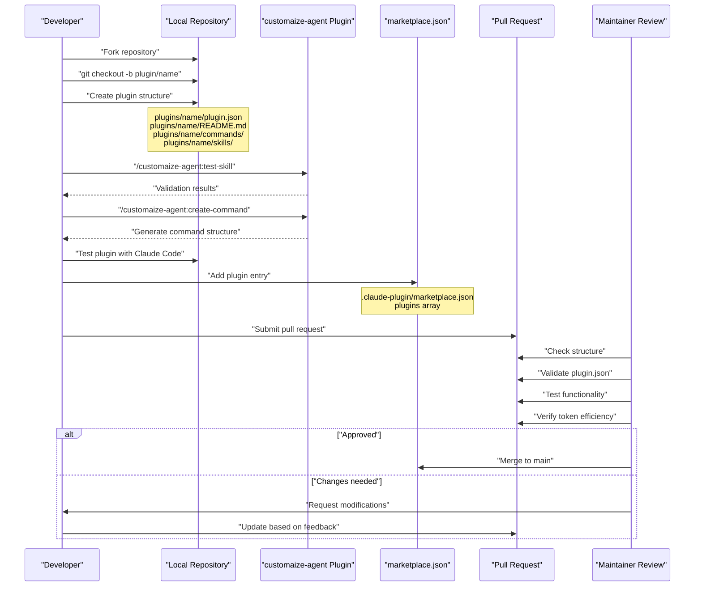

<!-- source: DeepWiki mcp.deepwiki.com · repo NeoLabHQ/context-engineering-kit · page 6 Contributing · fetched 2026-10-26 -->

# Contributing

<details>
<summary>Relevant source files</summary>

The following files were used as context for generating this wiki page:

- [.claude/commands/bump-plugin.md](.claude/commands/bump-plugin.md)
- [CONTRIBUTING.md](CONTRIBUTING.md)
- [docs/concepts.md](docs/concepts.md)
- [docs/plugins/README.md](docs/plugins/README.md)
- [docs/plugins/ddd/README.md](docs/plugins/ddd/README.md)
- [docs/plugins/ddd/usage-examples.md](docs/plugins/ddd/usage-examples.md)
- [plugins/README.md](plugins/README.md)
- [plugins/ddd/README.md](plugins/ddd/README.md)

</details>


This document provides an overview of how to contribute plugins to the Context Engineering Kit marketplace. It covers the philosophy, development workflow, and submission process for creating high-quality plugins that enhance Claude Code with advanced context engineering techniques.

For detailed information on specific aspects of contribution:
- Plugin structure, manifests, and testing: see [Plugin Development Guide](#6.1)
- Token efficiency and quality guidelines: see [Quality Standards & Best Practices](#6.2)
- Fork/branch workflow and PR requirements: see [Submission Process](#6.3)

---

## Core Philosophy

The Context Engineering Kit prioritizes **quality over quantity**. Each plugin must meaningfully improve agent output through efficient context engineering patterns [CONTRIBUTING.md:7-9](). The marketplace follows three fundamental principles:

| Principle | Description | Implementation |
|-----------|-------------|----------------|
| **Minimal Token Footprint** | Every token loaded into context must provide value | Commands load on-demand; skills description are by default loaded into context [CONTRIBUTING.md:10-11]() |
| **Predictable Context Loading** | Agents should reliably access needed information | Prefer commands and specialized agents over skills that may not be loaded [CONTRIBUTING.md:12]() |
| **Quality Gates** | Better to do one thing well than many things poorly | Thorough testing required; `customaize-agent` plugin available for validation [CONTRIBUTING.md:79]() |

**Token Efficiency Hierarchy:**

Title: Context Loading Priority
```mermaid
graph LR
    ["Setup Commands<br/>(Write to CLAUDE.md)"] -->|"Most efficient for persistent context"| ["Specialized Agents<br/>(Broad context)"]
    ["Specialized Agents<br/>(Broad context)"] -->|"More predictable than skills"| ["Commands<br/>(On-demand)"]
    ["Commands<br/>(On-demand)"] -->|"More predictable than skills"| ["Skills<br/>(Pre-loaded)"]
    
    ["Setup Commands<br/>(Write to CLAUDE.md)"] -.->|"Loaded every session"| ["Context Window"]
    ["Specialized Agents<br/>(Broad context)"] -.->|"Loaded when spawned"| ["Context Window"]
    ["Commands<br/>(On-demand)"] -.->|"Loaded when invoked"| ["Context Window"]
    ["Skills<br/>(Pre-loaded)"] -.->|"Always loaded"| ["Context Window"]
```
Sources: [CONTRIBUTING.md:10-13](), [docs/concepts.md:68-75]()

---

## Plugin Development Workflow

The complete plugin development process follows this sequence:

Title: Plugin Contribution Lifecycle

Sources: [CONTRIBUTING.md:85-106](), [docs/plugins/README.md:191-206]()

---

## Plugin Architecture & Registry Structure

Plugins integrate with the marketplace through a structured registry and manifest system.

Title: Marketplace Registry and Plugin Association
```mermaid
graph TB
    subgraph "Registry: .claude-plugin/marketplace.json"
        ["marketplace.json"]
        ["plugins array"]
    end
    
    subgraph "Plugin Entry Structure"
        ["Plugin Entry Object"]
        ["name: 'plugin-name'"]
        ["description: '...'"]
        ["version: '1.0.0'"]
        ["author: 'Name'"]
        ["source: './plugins/name'"]
    end
    
    subgraph "Plugin Directory: plugins/name/"
        ["Plugin Directory"]
        ["plugin.json"]
        ["README.md"]
        ["commands/"]
        ["skills/"]
    end
    
    subgraph "Plugin Manifest: plugin.json"
        ["Plugin Manifest"]
        ["meta_name"]
        ["meta_version"]
        ["meta_description"]
        ["meta_author"]
        ["tokens: { estimated, description }"]
        ["commands: [ { name, description, path } ]"]
        ["skills: [ { name, description, path } ]"]
    end
    
    ["marketplace.json"] --> ["plugins array"]
    ["plugins array"] --> ["Plugin Entry Object"]
    ["Plugin Entry Object"] --> ["name: 'plugin-name'"]
    ["Plugin Entry Object"] --> ["description: '...'"]
    ["Plugin Entry Object"] --> ["version: '1.0.0'"]
    ["Plugin Entry Object"] --> ["author: 'Name'"]
    
    ["Plugin Entry Object"] -->|"references"| ["Plugin Directory"]
    ["Plugin Directory"] --> ["plugin.json"]
    ["Plugin Directory"] --> ["README.md"]
    ["Plugin Directory"] --> ["commands/"]
    ["Plugin Directory"] --> ["skills/"]
    
    ["plugin.json"] -->|"contains"| ["Plugin Manifest"]
    ["Plugin Manifest"] --> ["meta_name"]
    ["Plugin Manifest"] --> ["meta_version"]
    ["Plugin Manifest"] --> ["meta_description"]
    ["Plugin Manifest"] --> ["meta_author"]
    ["Plugin Manifest"] --> ["tokens: { estimated, description }"]
    ["Plugin Manifest"] --> ["commands: [ { name, description, path } ]"]
    ["Plugin Manifest"] --> ["skills: [ { name, description, path } ]"]
```

**Plugin Manifest Example:**

The basic structure for a `plugin.json` file [plugins/README.md:19-32]():

```json
{
  "name": "plugin-name",
  "version": "1.0.0",
  "description": "Brief description of what the plugin does",
  "author": "Your Name",
  "tokens": {
    "estimated": 500,
    "description": "Token usage explanation"
  },
  "commands": [],
  "skills": []
}
```
Sources: [plugins/README.md:19-32](), [CONTRIBUTING.md:37-65]()

---

## Required Plugin Components

Every plugin submission must include these components:

Title: Plugin Component Validation
```mermaid
graph TB
    subgraph "Mandatory Files"
        ["plugin.json"]
        ["README.md"]
    end
    
    subgraph "Optional Components"
        ["commands/"]
        ["skills/"]
    end
    
    subgraph "Quality Standards"
        ["Token Efficiency"]
        ["Testing with Claude Code"]
        ["Specificity (MUST/SHOULD)"]
        ["Focus"]
    end
    
    ["plugin.json"] -->|"defines"| ["commands/"]
    ["plugin.json"] -->|"defines"| ["skills/"]
    
    ["README.md"] -->|"documents"| ["commands/"]
    ["README.md"] -->|"documents"| ["skills/"]
    
    ["commands/"] -.->|"evaluated for"| ["Token Efficiency"]
    ["skills/"] -.->|"evaluated for"| ["Token Efficiency"]
    
    ["commands/"] -.->|"validated with"| ["Testing with Claude Code"]
    ["skills/"] -.->|"validated with"| ["Testing with Claude Code"]
    
    ["README.md"] -.->|"demonstrates"| ["Specificity (MUST/SHOULD)"]
    ["plugin.json"] -.->|"demonstrates"| ["Focus"]
```

**Plugin Directory Structure:**

```
your-plugin/
├── plugin.json       # REQUIRED: Manifest with metadata, commands, skills
├── README.md        # REQUIRED: Complete documentation
├── commands/        # OPTIONAL: On-demand slash commands
│   └── command.md
└── skills/          # OPTIONAL: Pre-loaded skill definitions
    └── skill.md
```
Sources: [CONTRIBUTING.md:21-33](), [plugins/README.md:5-15]()

---

## Versioning and Maintenance

The repository uses automated tools for version management. Contributors should use the `bump-plugin` command, which synchronizes plugin versions with the marketplace version.

### Versioning Logic:
- `patch`: 1.0.0 → 1.0.1 (bug fixes)
- `minor`: 1.0.0 → 1.1.0 (new features)
- `major`: 1.0.0 → 2.0.0 (breaking changes)

Sources: [.claude/commands/bump-plugin.md:1-40]()

---

## Testing with customaize-agent Plugin

The `customaize-agent` plugin provides tools for validating plugin quality and applying Anthropic best practices.

Title: Validation Tools
```mermaid
graph LR
    subgraph "customaize-agent Commands"
        ["/customaize-agent:create-command"]
        ["/customaize-agent:test-skill"]
        ["/customaize-agent:apply-anthropic-best-practices"]
    end
    
    subgraph "Plugin Under Development"
        ["commands/"]
        ["skills/"]
    end
    
    ["/customaize-agent:create-command"] -->|"generates"| ["commands/"]
    ["/customaize-agent:test-skill"] -->|"validates"| ["skills/"]
    ["/customaize-agent:apply-anthropic-best-practices"] -->|"enhances"| ["commands/"]
    ["/customaize-agent:apply-anthropic-best-practices"] -->|"enhances"| ["skills/"]
```
Sources: [docs/plugins/README.md:191-206](), [CONTRIBUTING.md:79]()

---

## Documentation Requirements

Every plugin's `README.md` must include:

1. **Clear Purpose**: What problem does the plugin solve?
2. **Installation**: Copy-paste ready instructions, including setup commands.
3. **Usage Examples**: Real use cases showing command invocations.
4. **How It Works**: High-level overview of the logic and context management.

Sources: [CONTRIBUTING.md:67-74]()

---

For detailed implementation guidance, token optimization strategies, and the complete submission workflow, see the subsections:
- [Plugin Development Guide](#6.1)
- [Quality Standards & Best Practices](#6.2)
- [Submission Process](#6.3)

Questions? Open an issue with the `question` label or start a discussion in the repository [CONTRIBUTING.md:104-106]().

---

