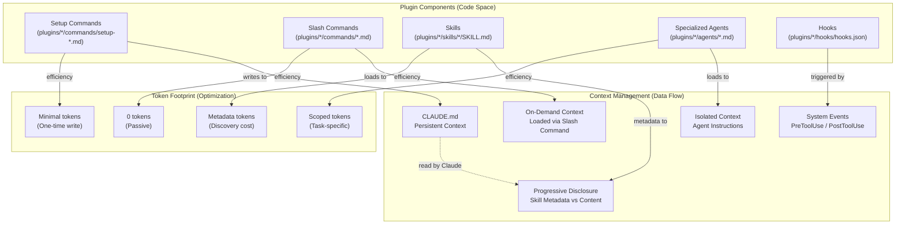
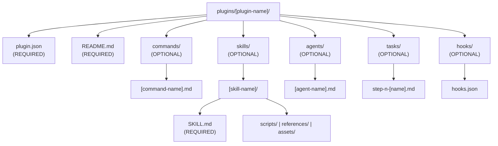

<!-- source: DeepWiki mcp.deepwiki.com · repo NeoLabHQ/context-engineering-kit · page 6.1 Plugin Development Guide · fetched 2026-10-26 -->

# Plugin Development Guide

Relevant source files

The following files were used as context for generating this wiki page:

- [CONTRIBUTING.md](CONTRIBUTING.md)
- [plugins/README.md](plugins/README.md)
- [plugins/customaize-agent/skills/apply-anthropic-skill-best-practices/SKILL.md](plugins/customaize-agent/skills/apply-anthropic-skill-best-practices/SKILL.md)
- [plugins/customaize-agent/skills/create-agent/SKILL.md](plugins/customaize-agent/skills/create-agent/SKILL.md)
- [plugins/customaize-agent/skills/create-command/SKILL.md](plugins/customaize-agent/skills/create-command/SKILL.md)
- [plugins/customaize-agent/skills/create-hook/SKILL.md](plugins/customaize-agent/skills/create-hook/SKILL.md)
- [plugins/customaize-agent/skills/create-skill/SKILL.md](plugins/customaize-agent/skills/create-skill/SKILL.md)
- [plugins/customaize-agent/skills/create-workflow-command/SKILL.md](plugins/customaize-agent/skills/create-workflow-command/SKILL.md)
- [plugins/customaize-agent/skills/test-prompt/SKILL.md](plugins/customaize-agent/skills/test-prompt/SKILL.md)
- [plugins/customaize-agent/skills/test-skill/SKILL.md](plugins/customaize-agent/skills/test-skill/SKILL.md)
- [plugins/docs/skills/write-concisely/SKILL.md](plugins/docs/skills/write-concisely/SKILL.md)
- [plugins/git/skills/create-pr/SKILL.md](plugins/git/skills/create-pr/SKILL.md)

This document provides comprehensive guidance for creating new plugins for the Context Engineering Kit marketplace. It covers the required directory structure, plugin manifest configuration, architectural patterns for commands and skills, and testing requirements using the `customaize-agent` toolkit.

---

## Plugin Architecture Overview

The Context Engineering Kit plugin system is designed around **token efficiency** and **predictable loading behavior**. Plugins can contain several types of components, each with different loading characteristics:

| Component Type | Loading Behavior | Token Cost | Use Case |
|---------------|------------------|------------|----------|
| **Setup Commands** | On-demand execution, writes to `CLAUDE.md` | Minimal (one-time write) | Project-specific configuration that should be loaded every session [CONTRIBUTING.md:13](). |
| **Commands** | On-demand loading via slash commands | Zero until invoked | Complex operations, multi-step workflows [CONTRIBUTING.md:11](). |
| **Skills** | Metadata loaded at start; content loaded on-demand | Metadata (always), Content (on-demand) | Core capabilities and modular "onboarding guides" [plugins/customaize-agent/skills/apply-anthropic-skill-best-practices/SKILL.md:17](). |
| **Agents** | Spawned via the `Task` tool with specific context | Isolated context window | Specialized review or implementation tasks [CONTRIBUTING.md:12](). |
| **Workflow Commands** | Orchestrates sub-agents using task files | Lean orchestrator context | Solving "context bloat" by isolation [plugins/customaize-agent/skills/create-workflow-command/SKILL.md:21](). |
| **Hooks** | Triggered by system events (e.g., `PreToolUse`, `PostToolUse`) | Execution-time cost | Automation, state management, or post-processing [plugins/customaize-agent/skills/create-hook/SKILL.md:69-73](). |

**Sources:** [CONTRIBUTING.md:10-14](), [plugins/customaize-agent/skills/apply-anthropic-skill-best-practices/SKILL.md:15-17](), [plugins/customaize-agent/skills/create-workflow-command/SKILL.md:19-21](), [plugins/customaize-agent/skills/create-hook/SKILL.md:69-73]()

### Context & Token Flow

The following diagram bridges the natural language concept of "Context" to the code entities that manage it.

**Diagram: Context Loading Architecture**

**Sources:** [CONTRIBUTING.md:10-13](), [plugins/customaize-agent/skills/create-skill/SKILL.md:27-30](), [plugins/customaize-agent/skills/create-agent/SKILL.md:21-26](), [plugins/customaize-agent/skills/apply-anthropic-skill-best-practices/SKILL.md:17](), [plugins/customaize-agent/skills/create-hook/SKILL.md:69-73]()

---

## Plugin Directory Structure

Every plugin must follow this standardized structure to be recognized by the marketplace and `customaize-agent` management tools.

**Diagram: Plugin File System Structure**

**Sources:** [CONTRIBUTING.md:22-33](), [plugins/customaize-agent/skills/create-skill/SKILL.md:93-100](), [plugins/customaize-agent/skills/create-agent/SKILL.md:35-73](), [plugins/customaize-agent/skills/create-workflow-command/SKILL.md:23-34]()

### Key Components
1.  **`plugin.json`**: The manifest containing metadata, token estimates, and component paths [CONTRIBUTING.md:39-65]().
2.  **`commands/*.md`**: Markdown files where YAML frontmatter defines slash command properties [CONTRIBUTING.md:29-30]().
3.  **`skills/[name]/SKILL.md`**: Modular reference guides. Requires YAML frontmatter with `name` and `description` [plugins/customaize-agent/skills/create-skill/SKILL.md:115-131]().
4.  **`agents/*.md`**: Autonomous subprocesses defined by YAML frontmatter and a markdown system prompt [plugins/customaize-agent/skills/create-agent/SKILL.md:35-73]().
5.  **`tasks/*.md`**: Detailed step instructions for workflow commands, kept out of the main orchestrator context [plugins/customaize-agent/skills/create-workflow-command/SKILL.md:29-34]().

---

## Creating Components with `customaize-agent`

The `customaize-agent` plugin provides specialized skills to automate the creation of high-quality plugin components.

### 1. Creating Commands
Use `/customaize-agent:create-command` to generate new slash commands. 
*   **Frontmatter**: Every command file MUST begin with YAML frontmatter containing a `description` and optional `argument-hint` [plugins/customaize-agent/skills/create-command/SKILL.md:65-74]().
*   **Arguments**: Use `$ARGUMENTS` for all input or `$1`, `$2` for positional parameters [plugins/customaize-agent/skills/create-command/SKILL.md:142-162]().
*   **Execution**: Prefix bash commands with `!` to include their output in the command context [plugins/customaize-agent/skills/create-command/SKILL.md:168-174]().

### 2. Creating Skills (TDD for Documentation)
The `create-skill` workflow applies **Test-Driven Development** to process documentation [plugins/customaize-agent/skills/create-skill/SKILL.md:13]().

*   **RED Phase**: Run a pressure scenario *without* the skill. Document how the agent rationalizes breaking the desired rule [plugins/customaize-agent/skills/create-skill/SKILL.md:53-57]().
*   **GREEN Phase**: Write the `SKILL.md` addressing those specific failures. Verify the agent now complies [plugins/customaize-agent/skills/create-skill/SKILL.md:54-59]().
*   **REFACTOR Phase**: Find new loopholes or rationalizations and plug them in the skill text [plugins/customaize-agent/skills/create-skill/SKILL.md:55-60]().
*   **Best Practices**: Use gerund form (verb + -ing) for skill names (e.g., "Testing code") [plugins/customaize-agent/skills/apply-anthropic-skill-best-practices/SKILL.md:44-52]().

### 3. Creating Agents
Agents are created using `/customaize-agent:create-agent`. 
*   **Triggering Conditions**: The `description` field must start with "Use this agent when..." and include `<example>` blocks [plugins/customaize-agent/skills/create-agent/SKILL.md:99-107]().
*   **Context Isolation**: Agents prevent "context pollution" by operating in an isolated subprocess [CONTRIBUTING.md:12]().

### 4. Creating Workflow Commands
Use `/customaize-agent:create-workflow-command` to orchestrate multi-step execution.
*   **Pattern**: Store detailed instructions in separate `tasks/` files. The orchestrator command remains lean (~50-100 tokens per step) [plugins/customaize-agent/skills/create-workflow-command/SKILL.md:21-26]().
*   **Portable Paths**: Use `${CLAUDE_PLUGIN_ROOT}` to reference task files within the plugin [plugins/customaize-agent/skills/create-workflow-command/SKILL.md:63-69]().

---

## Testing and Validation

All plugins must undergo rigorous testing before submission.

### Pressure Testing
Use `/customaize-agent:test-skill` to verify skills under pressure. Effective tests combine at least three pressure types:
*   **Time**: Emergency deadlines or deploy windows [plugins/customaize-agent/skills/test-skill/145]().
*   **Sunk Cost**: Hours of work already completed that would be "wasted" if deleted [plugins/customaize-agent/skills/test-skill/146]().
*   **Authority**: A manager or senior dev overriding the rule [plugins/customaize-agent/skills/test-skill/147]().

### Prompt Testing
Use `/customaize-agent:test-prompt` to verify that command prompts and agent system messages produce the expected outputs.
*   **Isolation**: Use subagents for testing to ensure a clean slate without conversation history [plugins/customaize-agent/skills/test-prompt/66-72]().
*   **Baseline**: Proving what the prompt needs to fix by watching it fail without the prompt [plugins/customaize-agent/skills/test-prompt/81-85]().

### Quality Checklist
*   **Conciseness**: Every token counts. Omit needless words [plugins/customaize-agent/skills/apply-anthropic-skill-best-practices/SKILL.md:128]().
*   **MUST/SHOULD Tags**: Use explicit requirements tags to guide agent behavior [CONTRIBUTING.md:82]().
*   **Third Person**: Descriptions must be written in the third person [plugins/customaize-agent/skills/apply-anthropic-skill-best-practices/SKILL.md:76-82]().

**Sources:** [CONTRIBUTING.md:76-84](), [plugins/customaize-agent/skills/test-skill/SKILL.md:100-153](), [plugins/customaize-agent/skills/test-prompt/SKILL.md:53-64](), [plugins/customaize-agent/skills/create-workflow-command/SKILL.md:21-26]()

---

