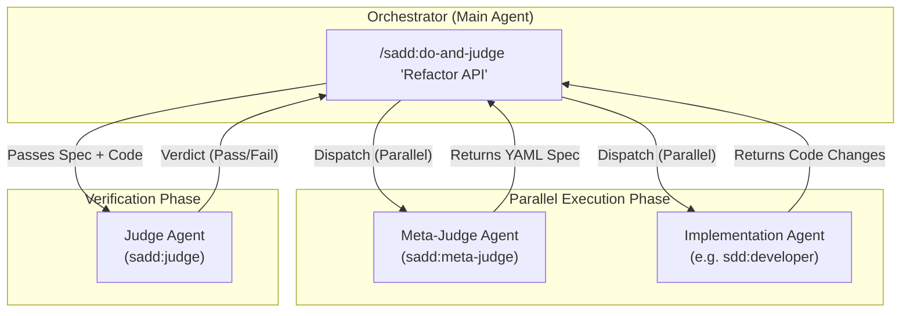
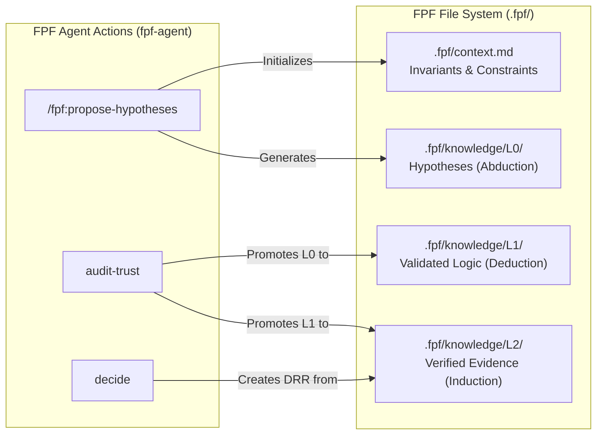

<!-- source: DeepWiki mcp.deepwiki.com · repo NeoLabHQ/context-engineering-kit · page 7 Advanced Topics · fetched 2026-10-26 -->

# Advanced Topics

Relevant source files

The following files were used as context for generating this wiki page:

- [docs/plugins/fpf/README.md](docs/plugins/fpf/README.md)
- [docs/plugins/fpf/architecture.md](docs/plugins/fpf/architecture.md)
- [docs/plugins/fpf/evidence-freshness.md](docs/plugins/fpf/evidence-freshness.md)
- [docs/plugins/sadd/README.md](docs/plugins/sadd/README.md)
- [docs/resources/papers.md](docs/resources/papers.md)
- [plugins/fpf/README.md](plugins/fpf/README.md)
- [plugins/fpf/agents/fpf-agent.md](plugins/fpf/agents/fpf-agent.md)
- [plugins/sadd/README.md](plugins/sadd/README.md)

This page covers advanced usage patterns for maximizing the effectiveness of the Context Engineering Kit. These techniques are designed for technical users who want to leverage sophisticated agent orchestration, session automation, multi-plugin workflows, knowledge accumulation strategies, and rigorous reasoning frameworks.

For basic plugin usage, see [Plugin Reference](#3). For development workflow guides, see [Development Guides](#5). For creating custom plugins, see [Contributing](#6).

## Agent Orchestration Patterns

Agent orchestration involves defining specialized agents with precise contexts and permission boundaries to reduce hallucinations. The CEK implements several sophisticated orchestration patterns, primarily within the `sadd` (Subagent-Driven Development) plugin.

### Orchestrator vs. Implementation Roles
In advanced workflows, the primary agent acts strictly as an **Orchestrator**. It delegates to sub-agents to maintain a clean context window and high reasoning quality, preventing "context pollution" where an agent accumulates confusion or implementation drift over long sessions [plugins/sadd/README.md:21-29]().

| Pattern | Logic | Command Reference |
|---------|-------|-------------------|
| **Do-and-Judge** | Single task implementation with implementation sub-agent and independent judge verification. | `/sadd:do-and-judge` [plugins/sadd/README.md:55]() |
| **Do-in-Steps** | Sequential decomposition of complex tasks through sequential sub-agent orchestration. | `/sadd:do-in-steps` [plugins/sadd/README.md:57]() |
| **Do-in-Parallel** | Concurrent execution across multiple targets with intelligent model selection and context isolation. | `/sadd:do-in-parallel` [plugins/sadd/README.md:56]() |
| **Competitive** | Multi-agent generation followed by multi-judge evaluation and evidence-based synthesis. | `/sadd:do-competitively` [plugins/sadd/README.md:58]() |
| **Tree of Thoughts** | Systematic exploration of solution space, pruning unpromising branches and expanding viable ones. | `/sadd:tree-of-thoughts` [plugins/sadd/README.md:59]() |

### The Meta-Judge -> LLM-as-a-Judge Pattern
A core advancement in CEK is the separation of **Criteria Generation** from **Evaluation**, utilizing research-backed patterns like [LLM-as-a-Judge](https://arxiv.org/abs/2306.05685) and [LLM-as-a-Meta-Judge](https://arxiv.org/pdf/2407.19594) [plugins/sadd/README.md:47-50]().

1.  **sadd:meta-judge**: Analyzes the task and produces a tailored YAML evaluation specification (rubrics, checklists, scoring criteria) [plugins/sadd/README.md:70]().
2.  **sadd:judge**: An independent agent that applies the Meta-Judge's YAML specification to the implementation artifact with evidence-based scoring [plugins/sadd/README.md:71]().

**Figure: Meta-Judge Orchestration Flow**
Sources: [plugins/sadd/README.md:47-50](), [plugins/sadd/README.md:70-71]()

For details, see [Agent Orchestration Patterns](#7.1).

## Session Hooks & Automation

Session hooks enable automatic actions at key points during Claude Code sessions. This is configured in `.claude/settings.json` and is essential for tools like **Codemap** to provide persistent codebase visualization.

### Automatic Reflection
The `reflexion` plugin includes optional hooks that automatically trigger reflection when the word "reflect" is included in a prompt [docs/resources/papers.md:133-137](). This utilizes the `onStopHandler` TypeScript hook to execute `/reflexion:reflect` automatically.

### Common Hook Points
*   **SessionStart**: Used for initial environment setup or loading codebase maps.
*   **PreToolUse**: Validates context or enforces security constraints before a tool executes.
*   **PostToolUse**: Updates internal tracking or triggers automated linting after file modifications.
*   **SessionEnd**: Final cleanup or state persistence.

Sources: [docs/resources/papers.md:133-137](), [plugins/sadd/README.md:54]()

For details, see [Session Hooks & Automation](#7.2).

## Knowledge Accumulation Strategies

The Context Engineering Kit relies on a three-tier configuration system to manage how Claude learns about a project over time, focusing on reducing "context rot" and hallucinations.

### The Configuration Hierarchy
1.  **User-Global**: Personal preferences and cross-project standards.
2.  **Project-Shared (`CLAUDE.md`)**: Architecture decisions, tech stack standards, and team-wide patterns.
3.  **Project-Personal**: Local overrides and working notes.

### What to Memorize
The `reflexion` plugin provides `/reflexion:memorize` to capture insights from reflections and update `CLAUDE.md` using **Agentic Context Engineering** [docs/resources/papers.md:16-17]().
*   **Resolution Strategies**: Extracting how specific issues were fixed to prevent recurrence.
*   **Tech Stack Rules**: Codifying language-specific patterns and conventions.
*   **Architecture Invariants**: Documenting DDD and Clean Architecture rules to guide future code generation.

Sources: [docs/resources/papers.md:11-17](), [docs/resources/papers.md:110-125]()

For details, see [Knowledge Accumulation Strategies](#7.3).

## First Principles Framework (FPF)

The **First Principles Framework (FPF)** is a structured reasoning plugin designed for rigorous, auditable decision-making. It operates as a state machine using the **ADI (Abduction-Deduction-Induction) cycle** [plugins/fpf/README.md:1-10]().

### Core FPF Concepts
*   **Assurance Levels**: Claims progress from **L0** (Observation) to **L1** (Substantiated Logic) to **L2** (Verified) [plugins/fpf/agents/fpf-agent.md:105-110]().
*   **Evidence Freshness**: Evidence has a `valid_until` date; stale evidence triggers re-evaluation or waivers [docs/plugins/fpf/evidence-freshness.md:13-15]().
*   **Weakest Link Analysis (WLNK)**: System reliability is limited by its least reliable component (Assurance = min(evidence)) [plugins/fpf/agents/fpf-agent.md:112-114]().
*   **Transformer Mandate**: AI generates options with evidence; humans make the final decision [plugins/fpf/agents/fpf-agent.md:121]().

### FPF Workflow Entity Space

**Figure: FPF Code Entity Mapping**
Sources: [plugins/fpf/README.md:51-107](), [plugins/fpf/agents/fpf-agent.md:105-110](), [plugins/fpf/agents/fpf-agent.md:119]()

For details, see [First Principles Framework (FPF)](#7.4).

---

