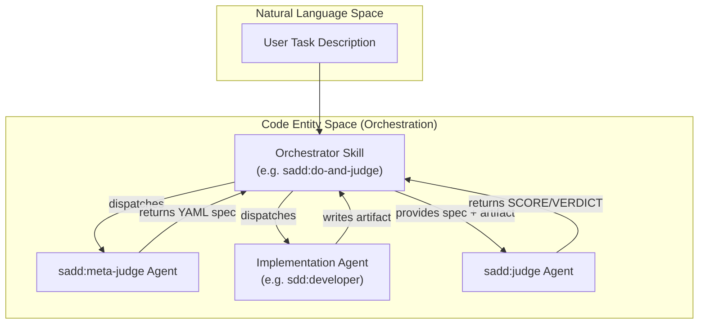
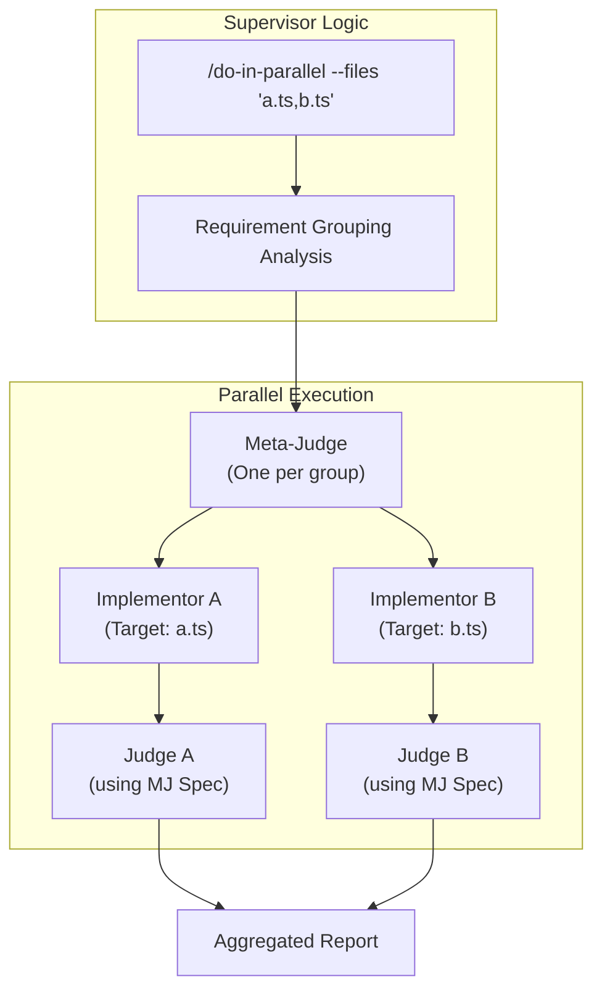

<!-- source: DeepWiki mcp.deepwiki.com · repo NeoLabHQ/context-engineering-kit · page 7.1 Agent Orchestration Patterns · fetched 2026-10-26 -->

# Agent Orchestration Patterns

<details>
<summary>Relevant source files</summary>

The following files were used as context for generating this wiki page:

- [docs/plugins/sadd/README.md](docs/plugins/sadd/README.md)
- [docs/resources/papers.md](docs/resources/papers.md)
- [plugins/customaize-agent/skills/agent-evaluation/SKILL.md](plugins/customaize-agent/skills/agent-evaluation/SKILL.md)
- [plugins/customaize-agent/skills/context-engineering/SKILL.md](plugins/customaize-agent/skills/context-engineering/SKILL.md)
- [plugins/customaize-agent/skills/thought-based-reasoning/SKILL.md](plugins/customaize-agent/skills/thought-based-reasoning/SKILL.md)
- [plugins/sadd/README.md](plugins/sadd/README.md)
- [plugins/sadd/skills/do-and-judge/SKILL.md](plugins/sadd/skills/do-and-judge/SKILL.md)
- [plugins/sadd/skills/do-in-parallel/SKILL.md](plugins/sadd/skills/do-in-parallel/SKILL.md)
- [plugins/sadd/skills/do-in-steps/SKILL.md](plugins/sadd/skills/do-in-steps/SKILL.md)
- [plugins/sadd/skills/launch-sub-agent/SKILL.md](plugins/sadd/skills/launch-sub-agent/SKILL.md)
- [plugins/sadd/skills/multi-agent-patterns/SKILL.md](plugins/sadd/skills/multi-agent-patterns/SKILL.md)

</details>


This document covers advanced techniques for orchestrating multiple Claude agents to solve complex tasks efficiently. Agent orchestration involves spawning specialized agents with focused contexts, tools, and responsibilities, enabling parallel execution, quality gates, and token-efficient workflows.

For basic plugin usage and commands, see [Plugin Reference](#3). For session-level automation, see [Session Hooks & Automation](#7.2). For knowledge management strategies, see [Knowledge Accumulation Strategies](#7.3).

## Understanding Agents in Claude Code

### What is an Agent?

An agent is a fresh Claude instance with:
- **Specific context**: Focused instructions and knowledge for a particular task.
- **Limited tools**: Only the tools needed for its responsibility.
- **Defined scope**: Clear boundaries for what it should and shouldn't do.
- **Optional model override**: Can use different models (e.g., `sonnet` vs `opus`).

Agents differ from the main Claude session in that they start with clean context, preventing **context pollution**—the accumulation of confusion, outdated assumptions, or implementation drift over long sessions [plugins/sadd/README.md:21-29]().

### Agent Definition Structure

Agents are defined using the `--agents` flag with JSON configuration:

```bash
claude --agents '{
  "agent-name": {
    "description": "When to use this agent",
    "prompt": "System instructions for the agent",
    "tools": ["Read", "Grep", "Glob", "Bash"],
    "model": "sonnet"
  }
}'
```

### Permission Modes

Permission modes control agent autonomy:

| Mode | Behavior | Use Case |
|------|----------|----------|
| `ask` | Prompt before each tool use | Interactive review, learning |
| `plan` | Show execution plan, confirm before running | Balanced safety/automation |
| `auto` | Execute without confirmation | CI/CD, trusted workflows |

Set via `--permission-mode <mode>` flag or `--dangerously-skip-permissions` for full automation.

**Sources**: [plugins/sadd/skills/do-and-judge/SKILL.md:85](), [plugins/sadd/README.md:21-29]()

## Pattern 1: Meta-Judge → LLM-as-a-Judge

The core orchestration pattern used across the Context Engineering Kit is the **Meta-Judge → Judge** pipeline. This pattern separates the creation of evaluation criteria from the act of evaluation to eliminate surface-level bias and "length bias" [plugins/sadd/skills/do-and-judge/SKILL.md:12-24]().


**Diagram: Meta-Judge to Judge Data Flow**

### Implementation Detail
1.  **Meta-Judge (`sadd:meta-judge`)**: Analyzes the user prompt and context to generate a structured YAML specification containing rubrics, checklists, and scoring criteria [plugins/sadd/skills/do-and-judge/SKILL.md:93-115]().
2.  **Implementation**: A subagent (typically `opus` for logic or `sonnet` for volume) executes the task [plugins/sadd/skills/do-and-judge/SKILL.md:77-85](). It must use a **Zero-shot Chain-of-Thought** prefix to think systematically before implementation [plugins/sadd/skills/do-and-judge/SKILL.md:129-159]().
3.  **Judge (`sadd:judge`)**: Evaluates the completed work using the Meta-Judge specification. It applies the criteria mechanically to catch blind spots that self-critique might miss [plugins/sadd/skills/do-and-judge/SKILL.md:13-24]().

**Sources**: [plugins/sadd/skills/do-and-judge/SKILL.md:12-24](), [plugins/sadd/skills/do-and-judge/SKILL.md:77-85](), [plugins/sadd/skills/do-and-judge/SKILL.md:129-159](), [plugins/sadd/README.md:48-50]()

## Pattern 2: Parallel Dispatch (Supervisor Pattern)

The `sadd:do-in-parallel` skill implements a supervisor pattern that executes tasks across multiple independent targets simultaneously. This is highly efficient for batch operations like refactoring multiple files [plugins/sadd/skills/do-in-parallel/SKILL.md:14-31]().


**Diagram: Parallel Orchestration with Requirement Grouping**

### Requirement Grouping
To save tokens and time, the orchestrator identifies if tasks are:
-   **Repeatable**: Same task across different files (shares one Meta-Judge spec) [plugins/sadd/skills/do-in-parallel/SKILL.md:14-22]().
-   **Shared**: Interdependent tasks (uses one combined judge for all related changes) [plugins/sadd/skills/do-in-parallel/SKILL.md:14-22]().
-   **Independent**: Distinct tasks (separate meta-judges and judges) [plugins/sadd/skills/do-in-parallel/SKILL.md:120-125]().

**Sources**: [plugins/sadd/skills/do-in-parallel/SKILL.md:14-40](), [plugins/sadd/skills/do-in-parallel/SKILL.md:120-125]()

## Pattern 3: Sequential Step Decomposition

For complex tasks that cannot be parallelized due to dependencies, the `sadd:do-in-steps` skill decomposes the work into a linear pipeline [plugins/sadd/skills/do-in-steps/SKILL.md:9-11]().

### Workflow Steps:
1.  **Decomposition**: Analyzes the task to identify natural boundaries (e.g., Interface change → Implementation → Consumer update) using Zero-shot CoT [plugins/sadd/skills/do-in-steps/SKILL.md:87-120]().
2.  **Context Passing**: Summaries of relevant outputs from Step N are passed as input to Step N+1 to avoid context window overflow [plugins/sadd/skills/do-in-steps/SKILL.md:14-22]().
3.  **Step-Level Quality Gates**: Each individual step must pass a Judge verification (Score ≥ 4) before the orchestrator proceeds to the next step [plugins/sadd/skills/do-in-steps/SKILL.md:26-34]().
4.  **Reporting**: Judge verification reports are saved to `.specs/reports/` for auditability [plugins/sadd/skills/do-in-steps/SKILL.md:67-83]().

**Sources**: [plugins/sadd/skills/do-in-steps/SKILL.md:9-35](), [plugins/sadd/skills/do-in-steps/SKILL.md:67-83](), [plugins/sadd/skills/do-in-steps/SKILL.md:87-120]()

## Pattern 4: Advanced Reasoning (Tree of Thoughts & PoLL)

The SADD plugin implements high-stakes reasoning patterns based on academic research [plugins/sadd/README.md:74-101]().

### Tree of Thoughts (ToT)
The `/tree-of-thoughts` command executes complex reasoning through systematic exploration. It generates multiple "thoughts" (nodes), evaluates them, and prunes unpromising branches while expanding viable ones [plugins/sadd/README.md:59](). This is ideal for tasks where initial decisions are pivotal [plugins/customaize-agent/skills/thought-based-reasoning/SKILL.md:180-188]().

### Panel of LLMs (PoLL) & Debate
The `/judge-with-debate` command implements a voting and consensus system. Independent judges analyze a solution, challenge each other's assessments, and refine evaluations until reaching a consensus [plugins/sadd/README.md:60](). This mirrors the **Self-Consistency** pattern where multiple reasoning paths are sampled to find the most frequent answer [plugins/customaize-agent/skills/thought-based-reasoning/SKILL.md:134-148]().

**Sources**: [plugins/sadd/README.md:59-60](), [plugins/customaize-agent/skills/thought-based-reasoning/SKILL.md:134-188](), [plugins/sadd/README.md:74-101]()

## Pattern 5: Context Isolation & Self-Critique

A fundamental principle of CEK orchestration is **Context Isolation**. Each sub-agent operates in a clean context window focused on its specific task without accumulated context pollution [plugins/sadd/skills/launch-sub-agent/SKILL.md:13-15]().

### The MAKER Self-Critique Loop
Every implementation agent is mandated to perform a self-critique before submission. This involves:
1.  **Generating Verification Questions**: Creating 5 specific questions to test correctness [plugins/sadd/skills/launch-sub-agent/SKILL.md:174-180]().
2.  **Evidence-Based Verification**: Finding specific proof in the implementation that answers those questions [plugins/sadd/skills/launch-sub-agent/SKILL.md:181-190]().
3.  **Refinement**: Improving the output based on the identified gaps before returning control to the orchestrator [plugins/sadd/skills/launch-sub-agent/SKILL.md:195-200]().

**Sources**: [plugins/sadd/skills/launch-sub-agent/SKILL.md:13-15](), [plugins/sadd/skills/launch-sub-agent/SKILL.md:170-200]()

## Summary Table: Orchestration Patterns

| Pattern | Skill / Command | Primary Benefit | Implementation |
| :--- | :--- | :--- | :--- |
| **Meta-Judge/Judge** | `/do-and-judge` | External verification | Separates criteria generation from scoring [plugins/sadd/skills/do-and-judge/SKILL.md:12-24]() |
| **Parallel Supervisor** | `/do-in-parallel` | Speed (Concurrency) | Requirement grouping and independence validation [plugins/sadd/skills/do-in-parallel/SKILL.md:14-31]() |
| **Sequential Steps** | `/do-in-steps` | Context management | Step-level gates and context passing [plugins/sadd/skills/do-in-steps/SKILL.md:14-22]() |
| **Tree of Thoughts** | `/tree-of-thoughts` | Complex logic | Systematic exploration and pruning of solution space [plugins/sadd/README.md:59]() |
| **Multi-Agent Debate** | `/judge-with-debate` | Consensus/Accuracy | Iterative judge challenge and consensus building [plugins/sadd/README.md:60]() |

**Sources**: [plugins/sadd/skills/do-and-judge/SKILL.md:12-24](), [plugins/sadd/skills/do-in-parallel/SKILL.md:14-31](), [plugins/sadd/skills/do-in-steps/SKILL.md:14-22](), [plugins/sadd/README.md:59-60]()

---

