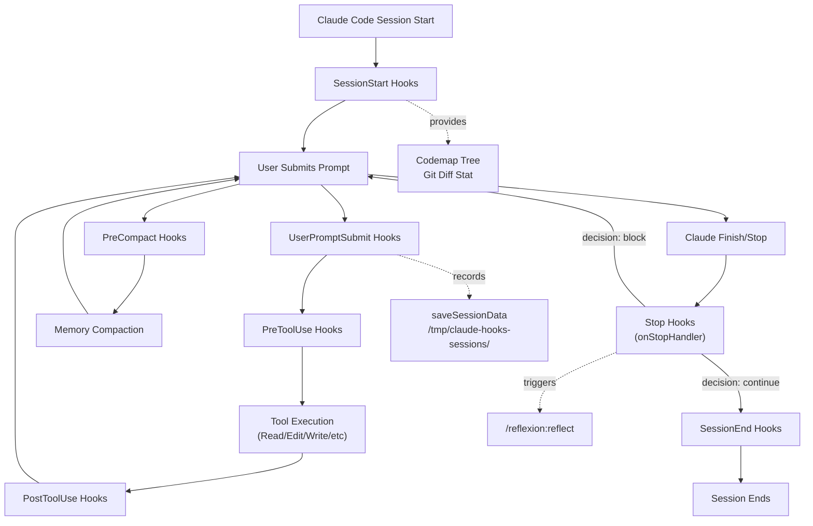

<!-- source: DeepWiki mcp.deepwiki.com · repo NeoLabHQ/context-engineering-kit · page 7.2 Session Hooks & Automation · fetched 2026-10-26 -->

# Session Hooks & Automation

<details>
<summary>Relevant source files</summary>

The following files were used as context for generating this wiki page:

- [.devcontainer/Dockerfile](.devcontainer/Dockerfile)
- [.devcontainer/configure-claude.sh](.devcontainer/configure-claude.sh)
- [.devcontainer/devcontainer.json](.devcontainer/devcontainer.json)
- [.devcontainer/install-mcps.sh](.devcontainer/install-mcps.sh)
- [.devcontainer/statusline.sh](.devcontainer/statusline.sh)
- [justfile](justfile)
- [plugins/reflexion/hooks/.gitignore](plugins/reflexion/hooks/.gitignore)
- [plugins/reflexion/hooks/README.md](plugins/reflexion/hooks/README.md)
- [plugins/reflexion/hooks/bun.lockb](plugins/reflexion/hooks/bun.lockb)
- [plugins/reflexion/hooks/hooks.json](plugins/reflexion/hooks/hooks.json)
- [plugins/reflexion/hooks/package.json](plugins/reflexion/hooks/package.json)
- [plugins/reflexion/hooks/src/index.ts](plugins/reflexion/hooks/src/index.ts)
- [plugins/reflexion/hooks/src/lib.ts](plugins/reflexion/hooks/src/lib.ts)
- [plugins/reflexion/hooks/src/onStopHandler.test.ts](plugins/reflexion/hooks/src/onStopHandler.test.ts)
- [plugins/reflexion/hooks/src/onStopHandler.ts](plugins/reflexion/hooks/src/onStopHandler.ts)
- [plugins/reflexion/hooks/src/session.ts](plugins/reflexion/hooks/src/session.ts)

</details>


Session hooks provide automated context injection and monitoring capabilities in Claude Code through the `.claude/settings.json` configuration file. This system allows developers to execute shell commands or TypeScript logic at specific lifecycle points of an AI interaction session, ensuring the agent always has access to the most relevant codebase state, dependency graphs, and change impacts.

## Purpose and Scope

Session hooks enable automatic execution of logic at specific points during a Claude Code session. Primary use cases include:

- **Automatic context injection**: Providing codebase structure, changes, and state at session start via Codemap.
- **Pre/post-tool monitoring**: Tracking file edits, imports, and dependencies before and after modifications.
- **Behavioral Intervention**: Intercepting the agent's "Stop" signal to force specific actions like self-reflection.
- **State preservation**: Saving context before memory compaction.
- **Session analytics**: Generating edit timelines and statistics on session end.

The Context Engineering Kit leverages these hooks for **Codemap CLI** integration and the **Reflexion** self-refinement loop [.devcontainer/configure-claude.sh:20-31](), [plugins/reflexion/hooks/README.md:3-5]().

## Hook System Architecture

The following diagram illustrates the lifecycle of a Claude Code session and where specific hooks trigger.

### Session Lifecycle & Hook Trigger Points

**Sources:** [plugins/reflexion/hooks/README.md:9-27](), [plugins/reflexion/hooks/src/session.ts:6-18](), [.devcontainer/configure-claude.sh:20-31]()

## Configuration & hooks.json

Hooks are configured in two primary ways: via the global `.claude/settings.json` for general shell commands, or via a plugin's `hooks.json` for programmatic logic.

### hooks.json Format
The `hooks.json` file defines which events trigger specific commands. For programmatic hooks, these commands typically invoke a runtime like `bun` to execute TypeScript handlers [plugins/reflexion/hooks/hooks.json:1-26]().

```json
{
    "hooks": {
        "Stop": [
            {
                "matcher": "",
                "hooks": [
                    {
                        "type": "command",
                        "command": "command -v bun >/dev/null 2>&1 && bun ${CLAUDE_PLUGIN_ROOT}/hooks/src/index.ts Stop || true"
                    }
                ]
            }
        ]
    }
}
```
**Sources:** [plugins/reflexion/hooks/hooks.json:1-26]()

## Programmatic Hooks: The Reflexion Case Study

The Reflexion plugin implements a sophisticated `onStopHandler` in TypeScript to automate the self-correction loop.

### Logic Flow: onStopHandler
When Claude attempts to finish a response, the `Stop` hook triggers. The handler performs the following:
1. **Session Retrieval**: Loads recent history from `/tmp/claude-hooks-sessions/` using the `session_id` from the payload [plugins/reflexion/hooks/src/onStopHandler.ts:13-16](), [plugins/reflexion/hooks/src/session.ts:34-36]().
2. **Cycle Prevention**: Validates that the previous hook was a `UserPromptSubmit` and not another `Stop` to prevent infinite loops [plugins/reflexion/hooks/src/onStopHandler.ts:26-28]().
3. **Keyword Detection**: Uses regex with word boundaries and negative lookbehind `(?<![:/])\breflect\b` to check if the user asked to "reflect" without triggering on existing slash commands [plugins/reflexion/hooks/src/onStopHandler.ts:44-50]().
4. **Intervention**: If the trigger word is found, it returns a `block` decision, forcing Claude to execute `/reflexion:reflect` [plugins/reflexion/hooks/src/onStopHandler.ts:36]().

### Data Structure: SessionData
Programmatic hooks persist state to track multi-step interactions:
- **Location**: `/tmp/claude-hooks-sessions/<session_id>.json` [plugins/reflexion/hooks/src/session.ts:6-34]().
- **Fields**: Includes `timestamp`, `hookType`, and the full `payload` from Claude [plugins/reflexion/hooks/src/session.ts:14-18]().

**Sources:** [plugins/reflexion/hooks/src/onStopHandler.ts:11-37](), [plugins/reflexion/hooks/src/session.ts:6-57]()

## Codemap CLI Automation

The Context Engineering Kit uses hooks to keep the agent's view of the codebase synchronized with the filesystem.

### Codemap Hook Mapping

| Hook Type | Codemap Command | Purpose |
|-----------|-----------------|---------|
| `SessionStart` | `codemap .` | Injects full codebase visualization at start [.devcontainer/configure-claude.sh:26]() |
| `SessionStart` | `git diff --stat` | Provides summary of current changes [.devcontainer/configure-claude.sh:26]() |
| `PreCompact` | N/A | Typically used to save state before memory pruning [.devcontainer/configure-claude.sh:84-86]() |

### Implementation in settings.json
The devcontainer setup automates the creation of these hooks in `~/.claude/settings.json` [.devcontainer/configure-claude.sh:13-44]().

```json
{
  "hooks": {
    "SessionStart": [
      {
        "hooks": [
          {
            "type": "command",
            "command": "echo 'codemap . && git diff:' && git diff --stat && echo 'git status:' && git status"
          }
        ]
      }
    ]
  }
}
```
**Sources:** [.devcontainer/configure-claude.sh:20-31](), [.devcontainer/Dockerfile:76-79]()

## Best Practices for Automation

1. **Cycle Prevention**: Always implement checks for consecutive `Stop` calls in programmatic hooks to avoid infinite loops [plugins/reflexion/hooks/src/onStopHandler.ts:26-28]().
2. **Word Boundaries**: Use precise regex (e.g., `\bword\b`) for triggers to avoid false positives on substrings like "reflection" [plugins/reflexion/hooks/src/onStopHandler.ts:48-49]().
3. **Slash Command Exclusion**: Use negative lookbehind in trigger regex to prevent hooks from re-triggering when the agent executes the command they just suggested [plugins/reflexion/hooks/src/onStopHandler.ts:44-50]().
4. **Silent Failures**: Append `|| true` to hook commands to ensure Claude Code continues even if a hook fails [plugins/reflexion/hooks/hooks.json:9]().
5. **Session Isolation**: Use unique session IDs to store and retrieve hook data to avoid cross-session pollution [plugins/reflexion/hooks/src/session.ts:34]().

**Sources:** [plugins/reflexion/hooks/src/onStopHandler.ts:26-50](), [plugins/reflexion/hooks/hooks.json:9](), [plugins/reflexion/hooks/src/session.ts:34]()

---

