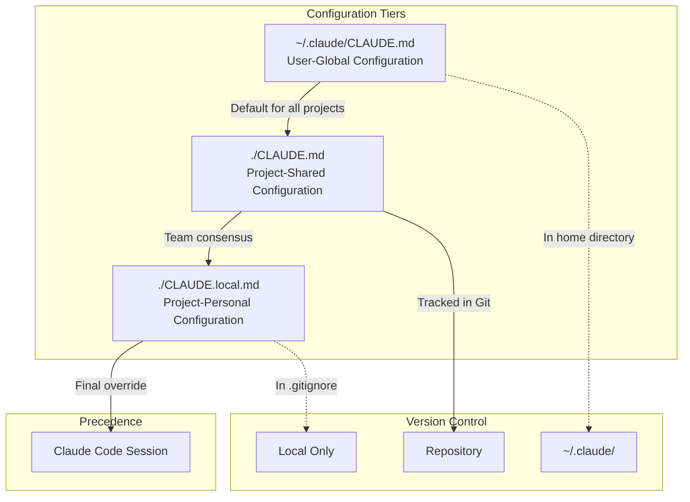
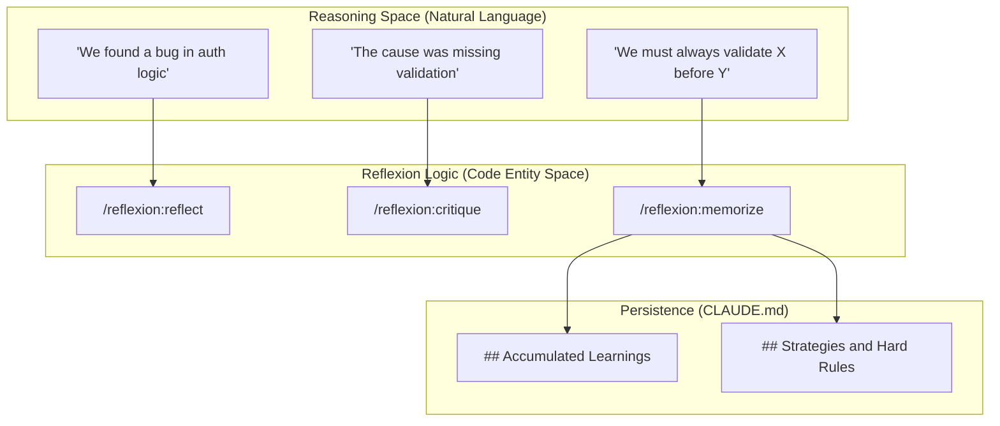
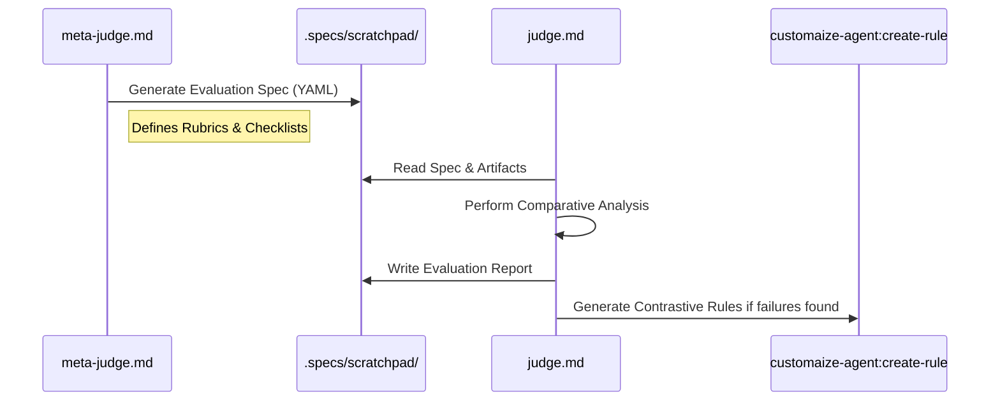

<!-- source: DeepWiki mcp.deepwiki.com · repo NeoLabHQ/context-engineering-kit · page 7.3 Knowledge Accumulation Strategies · fetched 2026-10-26 -->

# Knowledge Accumulation Strategies

Relevant source files

The following files were used as context for generating this wiki page:

- [CLAUDE.md](CLAUDE.md)
- [docs/plugins/mcp/README.md](docs/plugins/mcp/README.md)
- [plugins/customaize-agent/skills/create-rule/SKILL.md](plugins/customaize-agent/skills/create-rule/SKILL.md)
- [plugins/mcp/README.md](plugins/mcp/README.md)
- [plugins/reflexion/skills/memorize/SKILL.md](plugins/reflexion/skills/memorize/SKILL.md)
- [plugins/sadd/agents/judge.md](plugins/sadd/agents/judge.md)
- [plugins/sadd/agents/meta-judge.md](plugins/sadd/agents/meta-judge.md)

This document explains strategies for maximizing the effectiveness of accumulated knowledge in `CLAUDE.md` files and the `.claude/` directory within the Context Engineering Kit. It covers the workflow for capturing insights, structuring the configuration hierarchy, and using specialized systems like the `.claude/rules/` library to prevent context rot.

For information about the three-tier configuration system itself, see [Configuration & Context Management](2.2). For automatic knowledge updates via Reflexion, see [Reflexion Plugin](3.1.2).

**Sources:** [CLAUDE.md:1-84](), [plugins/reflexion/skills/memorize/SKILL.md:1-25]()

---

## Configuration Hierarchy

The Context Engineering Kit uses a three-tier configuration system to manage how knowledge accumulates. This hierarchy ensures that global preferences don't clutter project-specific rules, and team standards remain consistent across environments.

### Data Flow: Configuration Resolution
The following diagram shows how the system resolves configurations from the most general to the most specific, ultimately forming the `Claude Code Session` context.

**Configuration Tier Purposes:**

| Tier | File Path | Git Tracked | Purpose | Use For |
|------|-----------|-------------|---------|---------|
| **User-Global** | `~/.claude/CLAUDE.md` | No | Personal defaults across all projects | Personal coding style, global tool preferences |
| **Project-Shared** | `./CLAUDE.md` | Yes | Team-wide project context | Architecture decisions, coding standards, domain knowledge [CLAUDE.md:1-84]() |
| **Project-Personal** | `./CLAUDE.local.md` | No | Individual overrides for this project | Local API keys, WIP notes, personal workflow tweaks |

**Sources:** [plugins/mcp/README.md:21-27](), [CLAUDE.md:44-51]()

---

## The Reflexion:Memorize Workflow

The primary mechanism for knowledge accumulation is the `reflexion:memorize` workflow. This process implements **Agentic Context Engineering (ACE)** to transform transient conversation insights into durable project context.

### Knowledge Evolution: From Thought to Memory
This diagram bridges the **Natural Language Space** (Reasoning) to the **Code Entity Space** (Reflexion Plugin and CLAUDE.md).

### Phase 1: Context Harvesting
The agent identifies learning sources from recent history, including failed approaches and problem-solving patterns. It extracts high-value, generalizable insights such as root causes (one line) and imperative rules [plugins/reflexion/skills/memorize/SKILL.md:28-64]().

### Phase 2: Memory Curation (Refine)
To prevent "Context Collapse," the `reflexion:memorize` skill applies curation rules:
- **Atomicity**: One idea per bullet; short and self-contained [plugins/reflexion/skills/memorize/SKILL.md:94]().
- **Non-Redundancy**: Merge or skip if similar to existing bullets [plugins/reflexion/skills/memorize/SKILL.md:93]().
- **Verifiability**: Avoid speculative claims; link docs for external facts [plugins/reflexion/skills/memorize/SKILL.md:95]().

**Sources:** [plugins/reflexion/skills/memorize/SKILL.md:1-180]()

---

## The .claude/rules/ System

While `CLAUDE.md` provides broad project context, the `.claude/rules/` system provides granular, behavioral guardrails. Rules are modular, always-loaded instructions that act as "standing orders" [plugins/customaize-agent/skills/create-rule/SKILL.md:16-19]().

### The Contrastive Pattern
Effective rules use a specific structure to eliminate ambiguity for the LLM. Every rule created via `customaize-agent:create-rule` MUST follow the Description-Incorrect-Correct template [plugins/customaize-agent/skills/create-rule/SKILL.md:94-97]().

| Section | Purpose | Detail |
|---------|---------|--------|
| **Incorrect** | Anti-pattern | Shows a pattern the agent would plausibly produce [plugins/customaize-agent/skills/create-rule/SKILL.md:154-156](). |
| **Correct** | Recommended | Minimal change needed to fix the incorrect pattern [plugins/customaize-agent/skills/create-rule/SKILL.md:170-172](). |

### Rule Scoping
- **Global Rules**: Load in every session for universal constraints (e.g., error handling) [plugins/customaize-agent/skills/create-rule/SKILL.md:55-57]().
- **Path-Scoped Rules**: Use `paths` frontmatter to load only when working with specific files (e.g., `src/api/**/*.ts`) [plugins/customaize-agent/skills/create-rule/SKILL.md:66-70]().

**Sources:** [plugins/customaize-agent/skills/create-rule/SKILL.md:1-130]()

---

## Specialized Knowledge Agents

The `sadd` (Subagent-Driven Development) plugin introduces specialized agents that act as quality gatekeepers for accumulated knowledge.

### The Judge and Meta-Judge Pipeline
This diagram shows how agents interact with the filesystem and each other to enforce quality.

- **Meta-Judge**: Generates structured YAML evaluation specifications (rubrics, checklists) BEFORE implementation [plugins/sadd/agents/meta-judge.md:3-10]().
- **Judge**: A "ruthless quality gatekeeper" that applies the specification to implementation artifacts. It produces reasoning FIRST, then scores, to improve stability [plugins/sadd/agents/judge.md:8-16]().
- **Rule Generation**: If the Judge finds a deficiency, it triggers the creation of a new rule via the `create-rule` skill to prevent the implementation agent from repeating the mistake [plugins/sadd/agents/judge.md:137-150](), [plugins/customaize-agent/skills/create-rule/SKILL.md:3]().

**Sources:** [plugins/sadd/agents/meta-judge.md:1-50](), [plugins/sadd/agents/judge.md:1-40](), [plugins/customaize-agent/skills/create-rule/SKILL.md:1-4]()

---

## Maintenance and Token Efficiency

Knowledge accumulation must be balanced against the finite context window of the LLM.

- **Commands over Skills**: Use commands (on-demand) for complex procedures and skills (default-loaded) only for essential behavioral guidance [CLAUDE.md:48]().
- **Minimal Tokens**: Keep `CLAUDE.md` and rule files concise. Target: 50-200 words per rule [plugins/customaize-agent/skills/create-rule/SKILL.md:186-190]().
- **Path Scoping**: Use path-scoped rules to ensure only relevant context is loaded for the current task [plugins/customaize-agent/skills/create-rule/SKILL.md:192]().

**Sources:** [CLAUDE.md:44-51](), [plugins/customaize-agent/skills/create-rule/SKILL.md:186-194]()

---

