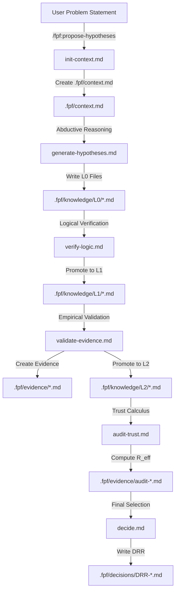
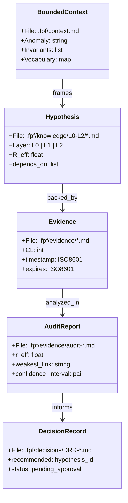

<!-- source: DeepWiki mcp.deepwiki.com · repo NeoLabHQ/context-engineering-kit · page 7.4 First Principles Framework (FPF) · fetched 2026-10-26 -->

# First Principles Framework (FPF)

Relevant source files

The following files were used as context for generating this wiki page:

- [docs/plugins/fpf/README.md](docs/plugins/fpf/README.md)
- [docs/plugins/fpf/architecture.md](docs/plugins/fpf/architecture.md)
- [docs/plugins/fpf/evidence-freshness.md](docs/plugins/fpf/evidence-freshness.md)
- [plugins/fpf/README.md](plugins/fpf/README.md)
- [plugins/fpf/agents/fpf-agent.md](plugins/fpf/agents/fpf-agent.md)
- [plugins/fpf/tasks/audit-trust.md](plugins/fpf/tasks/audit-trust.md)
- [plugins/fpf/tasks/decide.md](plugins/fpf/tasks/decide.md)
- [plugins/fpf/tasks/generate-hypotheses.md](plugins/fpf/tasks/generate-hypotheses.md)
- [plugins/fpf/tasks/init-context.md](plugins/fpf/tasks/init-context.md)
- [plugins/fpf/tasks/validate-evidence.md](plugins/fpf/tasks/validate-evidence.md)
- [plugins/fpf/tasks/verify-logic.md](plugins/fpf/tasks/verify-logic.md)

The First Principles Framework (FPF) plugin implements a rigorous, structured reasoning methodology for AI decision-making. Based on the work of Anatoly Levenchuk and the `quint-code` implementation, it transforms the "black box" of LLM outputs into a transparent, evidence-based audit trail [plugins/fpf/README.md:21-35]().

## Overview and Purpose

The FPF plugin is designed to prevent premature conclusions and anchoring bias by enforcing the systematic evaluation of competing alternatives [plugins/fpf/README.md:13-17](). It operates on the **Transformer Mandate**: the AI generates options and gathers evidence, but the human developer makes the final decision [plugins/fpf/agents/fpf-agent.md:121-121]().

### Core Objectives
*   **Transparent Reasoning**: All decisions are documented with full audit trails [plugins/fpf/README.md:7-7]().
*   **Hypothesis-Driven**: Generates 3-5 diverse competing hypotheses before evaluation [plugins/fpf/tasks/generate-hypotheses.md:11-11]().
*   **Evidence-Based**: Uses computed reliability scores ($R_{eff}$) rather than subjective estimates [plugins/fpf/README.md:9-9]().
*   **Knowledge Accumulation**: Decisions are stored as reusable project knowledge in the `.fpf/` directory [plugins/fpf/agents/fpf-agent.md:119-119]().

Sources: [plugins/fpf/README.md:7-35](), [plugins/fpf/agents/fpf-agent.md:119-122]()

## The ADI Cycle

The framework follows a three-stage inference cycle known as **ADI**: Abduction, Deduction, and Induction [plugins/fpf/README.md:23-29]().

| Phase | Mode | Goal | Code Entity (Task File) |
| :--- | :--- | :--- | :--- |
| **Abduction** | Creative | Generate plausible hypotheses ($L0$) | `generate-hypotheses.md` |
| **Deduction** | Logical | Verify constraints and logic ($L1$) | `verify-logic.md` |
| **Induction** | Empirical | Gather evidence and test ($L2$) | `validate-evidence.md` |

### ADI Cycle Data Flow
This diagram illustrates how the `fpf-agent` orchestrates the transition from natural language problems to structured code entities and files within the `.fpf/` directory.

**Diagram: FPF State Machine Flow**

Sources: [plugins/fpf/README.md:52-107](), [plugins/fpf/tasks/init-context.md:11-16](), [plugins/fpf/tasks/generate-hypotheses.md:65-67](), [plugins/fpf/tasks/verify-logic.md:1-5](), [plugins/fpf/tasks/validate-evidence.md:1-5]()

## Knowledge Assurance Levels

FPF categorizes knowledge into distinct layers based on the level of verification achieved [plugins/fpf/agents/fpf-agent.md:105-111]().

*   **L0 (Observation)**: Unverified conjecture or initial hypothesis generated via abduction [plugins/fpf/tasks/audit-trust.md:8-8]().
*   **L1 (Substantiated)**: Claims that have passed logical consistency checks and project invariants [plugins/fpf/tasks/audit-trust.md:9-9]().
*   **L2 (Verified)**: Claims corroborated by empirical evidence, such as test results or research [plugins/fpf/tasks/audit-trust.md:10-10]().
*   **Invalid**: Disproved claims, retained in `.fpf/knowledge/invalid/` for organizational learning [plugins/fpf/tasks/verify-logic.md:117-117]().

Sources: [plugins/fpf/agents/fpf-agent.md:105-111](), [plugins/fpf/tasks/audit-trust.md:7-10](), [plugins/fpf/tasks/verify-logic.md:20-24]()

## Trust Calculus ($R_{eff}$)

The plugin calculates the **Effective Reliability ($R_{eff}$)** of a hypothesis using a rigorous mathematical approach rather than estimation [plugins/fpf/tasks/audit-trust.md:63-71]().

### 1. Weakest Link (WLNK) Principle
The reliability of a system is defined by its least reliable component.
$$R_{eff} = \min(evidence\_score_1, evidence\_score_2, ..., evidence\_score_n)$$
Average scores are strictly forbidden to prevent "trust inflation" [plugins/fpf/tasks/audit-trust.md:71-71](). If a hypothesis has dependencies, the $R_{eff}$ is also capped by the reliability of its prerequisites [plugins/fpf/tasks/audit-trust.md:75-80]().

### 2. Congruence Level (CL)
Penalties are applied based on how closely the evidence matches the current project context [plugins/fpf/tasks/audit-trust.md:42-48]():
*   **CL3 (1.00)**: Internal test in this project (Same context).
*   **CL2 (0.90)**: Similar system or related project.
*   **CL1 (0.70)**: External documentation or general benchmarks (Different context).

### 3. Evidence Freshness & Decay
Evidence reliability degrades over time, encouraging periodic re-validation [plugins/fpf/tasks/audit-trust.md:50-61]():
*   **Fresh (<30 days)**: 1.00 multiplier.
*   **Aging (30-90 days)**: 0.95 multiplier.
*   **Stale (90-180 days)**: 0.85 multiplier.
*   **Expired (>180 days)**: 0.70 multiplier.

Users can run the `/decay` command (often invoked as `/fpf:decay`) to generate a freshness report and manage stale evidence via refreshing, deprecating, or waiving [docs/plugins/fpf/evidence-freshness.md:23-48]().

Sources: [plugins/fpf/tasks/audit-trust.md:40-80](), [docs/plugins/fpf/evidence-freshness.md:1-15](), [docs/plugins/fpf/architecture.md:78-89]()

## Implementation Details

### The FPF Agent
The `fpf-agent` is a specialized `sonnet[1m]` agent designed for high-context reasoning [plugins/fpf/agents/fpf-agent.md:1-6](). It operates as a state machine executor, transitioning through the ADI phases by invoking specific task files [plugins/fpf/agents/fpf-agent.md:10-11](). It is governed by principles such as "Functional Core, Imperative Shell" and "Explicit Over Hidden" [plugins/fpf/agents/fpf-agent.md:125-144]().

### File-Based Holon Architecture
FPF stores state in a structured directory to ensure the audit trail is git-trackable and persistent [plugins/fpf/agents/fpf-agent.md:119-119](). A "Holon" in this context refers to a self-contained unit of knowledge (a hypothesis file) that maintains its own state and metadata [docs/plugins/fpf/architecture.md:22-32]().

**Diagram: Code Entity Space (Holon Structure)**

Sources: [plugins/fpf/tasks/init-context.md:120-163](), [plugins/fpf/tasks/generate-hypotheses.md:65-111](), [plugins/fpf/tasks/audit-trust.md:105-159](), [plugins/fpf/tasks/decide.md:84-169](), [plugins/fpf/tasks/validate-evidence.md:93-135](), [docs/plugins/fpf/architecture.md:22-32]()

### Key Commands and Tasks
*   `/fpf:propose-hypotheses [problem]`: Triggers the full ADI cycle, initializing the `.fpf/` structure and launching subagents [plugins/fpf/README.md:111-124]().
*   `init-context.md`: Analyzes the user problem and project context to establish the **Bounded Context** document [plugins/fpf/tasks/init-context.md:11-16]().
*   `generate-hypotheses.md`: Uses abductive reasoning to create 3-5 hypotheses across a spectrum: **Conservative**, **Moderate**, and **Radical** [plugins/fpf/tasks/generate-hypotheses.md:46-58]().
*   `verify-logic.md`: Performs the **Deduction** phase, checking for internal consistency and constraint compliance [plugins/fpf/tasks/verify-logic.md:41-52]().
*   `validate-evidence.md`: Implements the **Induction** phase, gathering empirical data through internal tests or external research [plugins/fpf/tasks/validate-evidence.md:30-43]().
*   `audit-trust.md`: Executes the **Trust Calculus** to compute $R_{eff}$ based on evidence quality and freshness [plugins/fpf/tasks/audit-trust.md:14-22]().
*   `decide.md`: Aggregates audited hypotheses and creates the **Decision Readiness Report (DRR)** for final human approval [plugins/fpf/tasks/decide.md:16-21]().

Sources: [plugins/fpf/README.md:111-124](), [plugins/fpf/tasks/audit-trust.md:1-22](), [plugins/fpf/tasks/decide.md:1-21](), [plugins/fpf/tasks/init-context.md:1-16](), [plugins/fpf/tasks/generate-hypotheses.md:1-12]()

---

