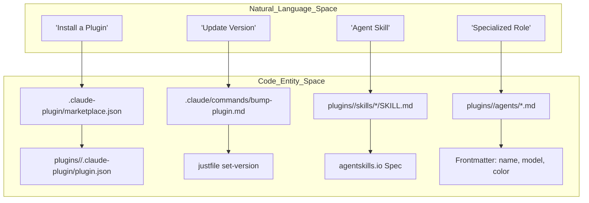
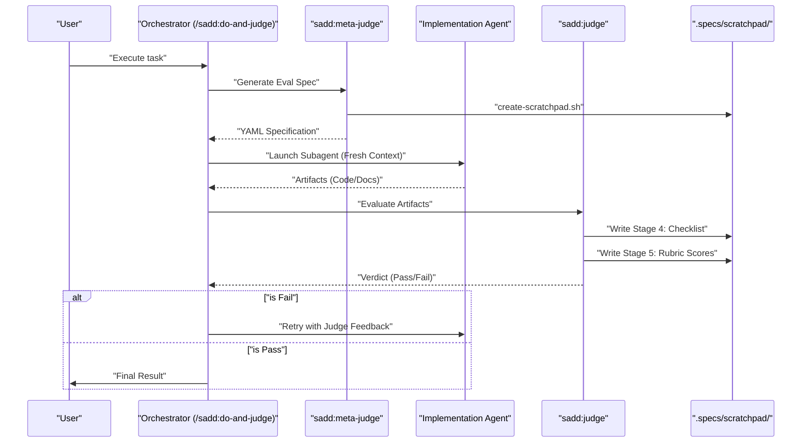

<!-- source: DeepWiki mcp.deepwiki.com · repo NeoLabHQ/context-engineering-kit · page 8 Glossary · fetched 2026-10-26 -->

# Glossary

Relevant source files

The following files were used as context for generating this wiki page:

- [.claude-plugin/marketplace.json](.claude-plugin/marketplace.json)
- [.claude/commands/bump-plugin.md](.claude/commands/bump-plugin.md)
- [README.md](README.md)
- [docs/SUMMARY.md](docs/SUMMARY.md)
- [docs/concepts.md](docs/concepts.md)
- [docs/plugins/README.md](docs/plugins/README.md)
- [docs/plugins/ddd/README.md](docs/plugins/ddd/README.md)
- [docs/plugins/ddd/usage-examples.md](docs/plugins/ddd/usage-examples.md)
- [docs/plugins/sadd/README.md](docs/plugins/sadd/README.md)
- [docs/resources/papers.md](docs/resources/papers.md)
- [plugins/customaize-agent/skills/create-rule/SKILL.md](plugins/customaize-agent/skills/create-rule/SKILL.md)
- [plugins/ddd/README.md](plugins/ddd/README.md)
- [plugins/sadd/.claude-plugin/plugin.json](plugins/sadd/.claude-plugin/plugin.json)
- [plugins/sadd/README.md](plugins/sadd/README.md)
- [plugins/sadd/agents/judge.md](plugins/sadd/agents/judge.md)
- [plugins/sadd/agents/meta-judge.md](plugins/sadd/agents/meta-judge.md)

This page provides definitions for codebase-specific terms, jargon, and domain concepts used throughout the **Context Engineering Kit (CEK)**. It serves as a technical reference for onboarding engineers to understand the implementation details and data flow of the kit's plugin architecture.

## Core Definitions

### Plugin
A modular unit of functionality that extends Claude Code. Unlike monolithic configurations, plugins are granular, allowing users to install only the specific agents, commands, and skills they need [[README.md:27-28]]().
*   **Implementation:** Defined by a `plugin.json` manifest within `plugins/<name>/.claude-plugin/` [[.claude-plugin/marketplace.json:19-20]]().
*   **Registry:** Managed globally in `.claude-plugin/marketplace.json` [[.claude-plugin/marketplace.json:1-10]]().

### Command
A slash command (e.g., `/reflexion:reflect`) that is loaded **on-demand**. Commands are preferred over skills for complex tasks to minimize the default token footprint [[README.md:26-26]]().
*   **File Location:** `plugins/<plugin-name>/commands/*.md`.

### Skill
A set of instructions or capabilities that are **pre-loaded** into the agent's context by default. They follow the [agentskills.io](https://agentskills.io) specification [[README.md:8-8]](), [[README.md:30-30]]().
*   **File Location:** `plugins/<plugin-name>/skills/*/SKILL.md` [[plugins/customaize-agent/skills/create-rule/SKILL.md:1-4]]().

### Specialized Agent
A focused LLM configuration with a restricted system prompt and specific tools, designed to perform a narrow task (e.g., `sadd:judge`). This reduces hallucinations by limiting context to only what is necessary for that role [[plugins/sadd/README.md:68-72]]().
*   **File Location:** `plugins/<plugin>/agents/<name>.md` [[plugins/sadd/agents/judge.md:1-6]]().

### Setup-commands
Specific commands (e.g., `/mcp:setup-context7-mcp`) used to update the project's `CLAUDE.md` file to mandate certain behaviors or tool usage for all subsequent sessions [[.claude-plugin/marketplace.json:133-135]]().

---

## Technical Concepts & Jargon

### Context Rot / Context Pollution
The degradation of LLM performance and reasoning accuracy caused by an excessively long session history, outdated assumptions, or redundant information in the prompt [[plugins/sadd/README.md:29-29]](). The SADD plugin mitigates this by dispatching "fresh" subagents for every task [[plugins/sadd/README.md:7-7]]().

### Vibe Coding
A colloquial term for developing without structured specifications or rigorous verification, relying purely on the LLM's initial "guess." CEK counters this via **Spec-Driven Development (SDD)** [[README.md:79-80]]().

### MAKER Pattern
A design philosophy for agentic workflows focusing on **M**inimal tokens, **A**gents (specialized), **K**nowledge (accumulated), **E**valuation (continuous), and **R**ules (contrastive) [[README.md:19-21]]().

### ADI Cycle
Used in the **First Principles Framework (FPF)** plugin, standing for **Abduction** (hypothesis generation), **Deduction** (logical consequence), and **Induction** (empirical validation) [[.claude-plugin/marketplace.json:144-146]]().

### Quality Gate
A verification checkpoint between development phases where a **Judge Agent** evaluates the output against a specification. If the output fails the rubric, the workflow triggers a retry loop [[plugins/sadd/README.md:8-8]]().

### LLM-as-a-Judge
A pattern where one LLM (the Judge) evaluates the output of another LLM (the Implementation Agent) using a structured rubric [[plugins/sadd/README.md:48-48]]().
*   **Meta-Judge:** An agent that generates the evaluation criteria (YAML) for a specific task [[plugins/sadd/agents/meta-judge.md:3-5]]().
*   **Judge:** An agent that applies the YAML rubric to the implementation artifact [[plugins/sadd/agents/judge.md:10-12]]().

### TICK (TICKing All the Boxes)
A boolean checklist decomposition method where complex requirements are broken down into binary (Yes/No) questions for reliable evaluation [[plugins/sadd/README.md:104-105]]().

### Scratchpad
A temporary markdown file created in `.specs/scratchpad/` used by agents to perform "Chain-of-Thought" reasoning, gather evidence, and draft reports before finalizing them [[plugins/sadd/agents/judge.md:72-75]]().
*   **Script:** `bash CLAUDE_PLUGIN_ROOT/scripts/create-scratchpad.sh` [[plugins/sadd/agents/judge.md:72-72]]().

### Contrastive Pattern
A mandatory structure for `.claude/rules/` files that includes an **Incorrect** example (anti-pattern) paired with a **Correct** example to eliminate ambiguity [[plugins/customaize-agent/skills/create-rule/SKILL.md:94-97]]().

### Ubiquitous Language
A concept from Domain-Driven Development (DDD) where the same terminology is used in both the business domain and the code [[plugins/ddd/README.md:52-53]]().

---

## System Architecture Diagrams

### From Natural Language to Code Entities
The following diagram maps high-level system concepts to their specific code representations and file structures.

**Entity Mapping Diagram**

**Sources:** [[.claude-plugin/marketplace.json:1-155]](), [[.claude/commands/bump-plugin.md:1-10]](), [[plugins/sadd/agents/judge.md:1-6]]().

---

### SADD/SDD Workflow Data Flow
This diagram illustrates how data flows between different specialized agents and files during a Specification-Driven Development (SDD) or Subagent-Driven Development (SADD) cycle.

**Execution & Quality Gate Flow**

**Sources:** [[plugins/sadd/README.md:48-61]](), [[plugins/sadd/agents/judge.md:72-130]](), [[plugins/sadd/agents/meta-judge.md:84-93]]().

---

## Abbreviations & Terms Table

| Abbreviation | Full Term | Context / Definition |
| :--- | :--- | :--- |
| **SADD** | Subagent-Driven Development | Framework for dispatching fresh agents per task [[plugins/sadd/README.md:1-3]](). |
| **SDD** | Spec-Driven Development | Workflow based on GitHub Spec Kit and OpenSpec [[.claude-plugin/marketplace.json:78-80]](). |
| **MCP** | Model Context Protocol | Standard for connecting AI models to data sources [[.claude-plugin/marketplace.json:133-134]](). |
| **FPF** | First Principles Framework | Structured reasoning using ADI cycles [[.claude-plugin/marketplace.json:144-146]](). |
| **ADI** | Abduction-Deduction-Induction | The logical cycle used within the FPF plugin [[.claude-plugin/marketplace.json:145-145]](). |
| **DDD** | Domain-Driven Development | Plugin focused on Clean Architecture and SOLID principles [[.claude-plugin/marketplace.json:67-69]](). |
| **PoLL** | Panel of LLMs | Voting system where multiple LLMs evaluate an output to reach consensus [[plugins/sadd/README.md:60-61]](). |
| **RRD** | Requirement-Rule-Dimension | Mapping strategy for creating rubrics [[plugins/sadd/agents/meta-judge.md:161-165]](). |
| **CoT** | Chain-of-Thought | Reasoning process where the LLM explains its steps [[plugins/sadd/README.md:54-55]](). |
| **DoD** | Definition of Done | Set of criteria that must be met for a task to be considered complete. |
| **Vertical Slicing** | Development Pattern | Implementing a full feature through all layers (UI to DB) in one go. |

**Sources:** [[.claude-plugin/marketplace.json:1-155]](), [[README.md:1-160]](), [[plugins/sadd/README.md:48-105]]().