# Page: Overview

# Overview

<details>
<summary>Relevant source files</summary>

The following files were used as context for generating this wiki page:

- [.claude-plugin/marketplace.json](.claude-plugin/marketplace.json)
- [README.md](README.md)
- [docs/SUMMARY.md](docs/SUMMARY.md)
- [plugins/sadd/.claude-plugin/plugin.json](plugins/sadd/.claude-plugin/plugin.json)

</details>


The Context Engineering Kit (CEK) is a curated plugin marketplace for Claude Code and other AI agents that provides advanced context engineering techniques and patterns. The kit consists of 13 officially maintained plugins organized in the `.claude-plugin/marketplace.json` registry [[.claude-plugin/marketplace.json:1-155]](), designed to improve AI agent output quality while maintaining a minimal token footprint. Each plugin implements scientifically-proven techniques for specific development workflows, code quality improvements, and external integrations [[README.md:19-31]]().

This page provides a high-level architectural overview of the plugin system, marketplace structure, and configuration management. For installation and initial setup instructions, see [Getting Started](#1.1). For detailed architectural principles, see [Architecture & Design Principles](#1.2). For comprehensive plugin documentation, see [Plugin Reference](#3).

**Sources:** [README.md:1-115](), [.claude-plugin/marketplace.json:1-155](), [docs/SUMMARY.md:1-112]()

## System Architecture

The Context Engineering Kit operates through a multi-tier architecture: the marketplace registry manages plugin metadata, installed plugins load their components (commands, skills, agents) into Claude Code's context, and a hierarchical configuration system persists project knowledge across sessions.

### High-Level Component Structure

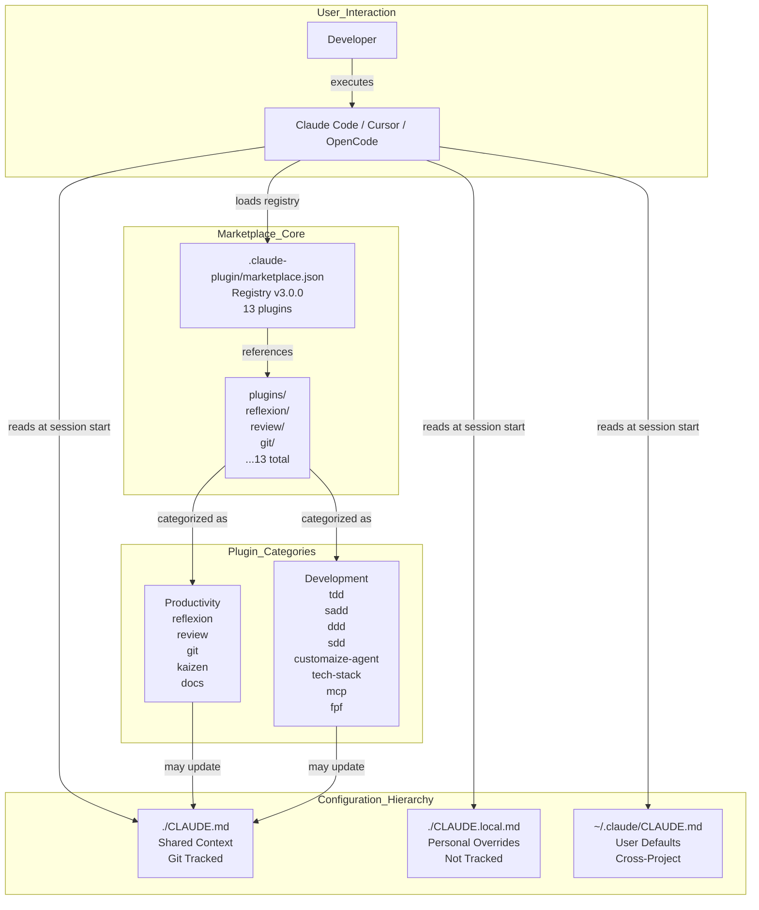

**Sources:** [README.md:41-71](), [.claude-plugin/marketplace.json:1-155](), [docs/SUMMARY.md:103-108]()

### Marketplace Registry Structure

The marketplace is defined by `marketplace.json` which declares plugin metadata, versions, and source locations [[.claude-plugin/marketplace.json:1-155]](). Each plugin entry contains:

| Field | Description | Example |
|-------|-------------|---------|
| `name` | Unique plugin identifier | `"reflexion"` |
| `description` | Plugin purpose and techniques | `"Collection of commands that force LLM to reflect..."` |
| `version` | Semantic version | `"3.0.0"` |
| `source` | Path to plugin directory | `"./plugins/reflexion"` |
| `category` | `"productivity"` or `"development"` | `"productivity"` |
| `author` | Plugin maintainer information | `{"name": "...", "email": "..."}` |

**Sources:** [.claude-plugin/marketplace.json:10-154]()

### Plugin Installation and Loading

```mermaid
graph LR
    subgraph "Discovery"
        AddCmd["/plugin marketplace add<br/>NeoLabHQ/context-engineering-kit"]
        AddCmd -->|"downloads"| LocalCache["Local Plugin Cache<br/>marketplace.json"]
    end
    
    subgraph "Installation"
        InstallCmd["/plugin install<br/>reflexion@NeoLabHQ/..."]
        InstallCmd -->|"loads from"| LocalCache
        InstallCmd -->|"activates"| PluginComponents["Plugin Components"]
    end
    
    subgraph "Component_Types"
        PluginComponents --> Commands["Commands<br/>/reflexion:reflect<br/>On-demand loading"]
        PluginComponents --> Skills["Skills<br/>TDD best practices<br/>Pre-loaded context"]
        PluginComponents --> Agents["Specialized Agents<br/>sdd-developer<br/>security-auditor"]
    end
    
    subgraph "Execution"
        Commands -->|"user invokes"| Execution["Command Execution"]
        Skills -->|"informs"| Execution
        Agents -->|"spawned during"| Execution
        Execution -->|"may update"| CLAUDEMD["CLAUDE.md<br/>Knowledge Base"]
    end
```

**Sources:** [README.md:41-62](), [docs/SUMMARY.md:4-16](), [.claude-plugin/marketplace.json:1-155]()

## Plugin Categories

The marketplace organizes plugins into two categories based on their primary function in `marketplace.json` [[.claude-plugin/marketplace.json:10-154]]():

### Productivity Category (5 plugins)

| Plugin | Primary Function | Key Commands |
|--------|------------------|--------------|
| `reflexion` | Self-refinement and critique | `/reflexion:reflect`, `/reflexion:memorize` |
| `review` | Multi-agent code quality analysis | `/review:review-local-changes`, `/review:review-pr` |
| `git` | Git operations and PR management | `/git:commit`, `/git:create-pr`, `/git:analyze-issue` |
| `kaizen` | Root cause analysis and Lean practices | `/kaizen:why`, `/kaizen:analyse-problem` |
| `docs` | Documentation management | `/docs:update-docs` |

**Sources:** [.claude-plugin/marketplace.json:11-120](), [README.md:23-31]()

### Development Category (8 plugins)

| Plugin | Primary Function | Key Commands |
|--------|------------------|--------------|
| `tdd` | Test-driven development | `/tdd:write-tests`, `/tdd:fix-tests` |
| `sadd` | Subagent orchestration | `do-and-judge`, `tree-of-thoughts` |
| `ddd` | Domain-driven design patterns | Updates `CLAUDE.md` with SOLID/Clean Arch rules |
| `sdd` | Specification-driven workflow | `/sdd:00-setup` through `/sdd:05-document` |
| `customaize-agent` | Plugin development toolkit | `/customaize-agent:create-command`, `/customaize-agent:test-skill` |
| `tech-stack` | Language/framework best practices | `/tech-stack:add-typescript-best-practices` |
| `mcp` | MCP server integration | `/mcp:setup-context7-mcp`, `/mcp:setup-serena-mcp` |
| `fpf` | First Principles Framework reasoning | `/fpf:propose-hypotheses` |

**Sources:** [.claude-plugin/marketplace.json:44-153](), [README.md:36-40]()

## Configuration Hierarchy

The Context Engineering Kit uses a three-tier `CLAUDE.md` configuration system to manage context at different scopes. This hierarchy allows teams to share project-level knowledge while enabling individual customization.

### Three Configuration Tiers

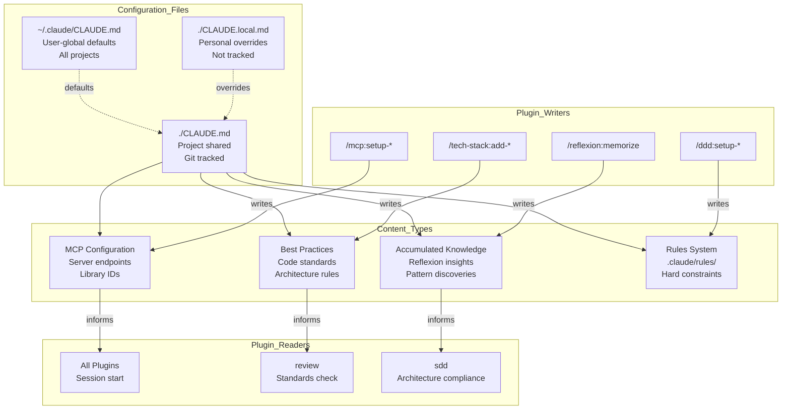

| Configuration Level | File Path | Git Tracked | Scope | Use Case |
|---------------------|-----------|-------------|-------|----------|
| Project Shared | `./CLAUDE.md` | Yes | Team-wide | Shared standards, MCP configs, architecture decisions |
| Project Personal | `./CLAUDE.local.md` | No | Individual | Personal preferences, local overrides, API keys |
| User Global | `~/.claude/CLAUDE.md` | No | Cross-project | Personal defaults, coding style, preferred tools |

**Sources:** [README.md:96-99](), [.claude-plugin/marketplace.json:67-76](), [docs/SUMMARY.md:103-104]()

## Token Efficiency Principles

The Context Engineering Kit is architected to minimize token usage while maximizing context quality through several design patterns [[README.md:19-29]]().

### Commands vs Skills Trade-off

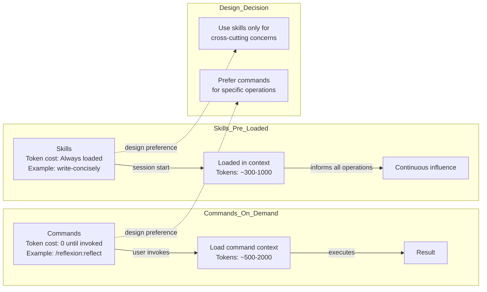

**Design Rationale:**
- **Commands** load context only when invoked, keeping baseline token count low [[README.md:26]]().
- **Skills** are pre-loaded and influence all operations, reserved for frequently-used patterns [[README.md:25-28]]().
- **Specialized Agents** spawn with focused context rather than loading all capabilities upfront [[.claude-plugin/marketplace.json:78-80]]().

**Sources:** [README.md:26](), [.claude-plugin/marketplace.json:1-155]()

## Knowledge Accumulation Loop

The Context Engineering Kit implements a feedback loop where plugins update `CLAUDE.md` files with learned patterns, creating continuously improving context over time [[README.md:96-99]]().

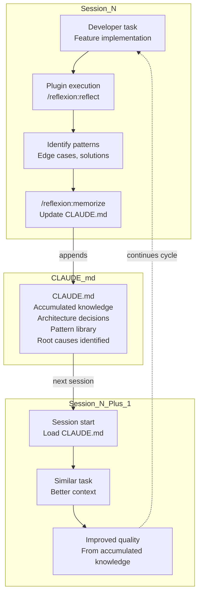

**Key Knowledge-Writing Plugins:**
- `/reflexion:memorize` - Captures insights from self-refinement cycles [[README.md:98]]().
- `/kaizen:*` - Documents root causes and improvement patterns [[.claude-plugin/marketplace.json:89-98]]().
- `/tech-stack:add-*` - Records language-specific best practices [[.claude-plugin/marketplace.json:122-131]]().
- `/mcp:setup-*` - Configures external tool integrations [[.claude-plugin/marketplace.json:133-142]]().
- `/ddd:setup-*` - Establishes architectural constraints and rules [[.claude-plugin/marketplace.json:67-76]]().

**Sources:** [README.md:96-107](), [.claude-plugin/marketplace.json:1-155]()

## Next Steps

To begin using the Context Engineering Kit:

1. **Installation:** Follow the [Getting Started](#1.1) guide to add the marketplace and install your first plugins [[README.md:41-62]]().
2. **Architecture Understanding:** Review [Architecture & Design Principles](#1.2) for deeper understanding of plugin design patterns and the three-tier config system.
3. **Plugin Selection:** Browse the [Plugin Reference](#3) to identify plugins for your specific workflow (e.g., SDD for complex features, Kaizen for bug investigation).
4. **Workflow Integration:** Consult [Development Guides](#5) for complete workflow examples combining multiple plugins [[docs/SUMMARY.md:5-16]]().

**Sources:** [README.md:111-115](), [docs/SUMMARY.md:1-112]()

---

# Page: Getting Started

# Getting Started

<details>
<summary>Relevant source files</summary>

The following files were used as context for generating this wiki page:

- [.devcontainer/Dockerfile](.devcontainer/Dockerfile)
- [.devcontainer/configure-claude.sh](.devcontainer/configure-claude.sh)
- [.devcontainer/devcontainer.json](.devcontainer/devcontainer.json)
- [.devcontainer/install-mcps.sh](.devcontainer/install-mcps.sh)
- [.devcontainer/statusline.sh](.devcontainer/statusline.sh)
- [README.md](README.md)
- [docs/README.md](docs/README.md)
- [docs/SUMMARY.md](docs/SUMMARY.md)
- [docs/getting-started.md](docs/getting-started.md)
- [docs/guides/pr-review.md](docs/guides/pr-review.md)
- [docs/reference/agents.md](docs/reference/agents.md)
- [justfile](justfile)

</details>


This page guides you through installing and configuring the Context Engineering Kit for Claude Code and other supported agents. You will learn how to add the marketplace, install your first plugin, and use the provided devcontainer sandbox environment for a pre-configured experience.

The Context Engineering Kit (CEK) is a hand-crafted collection of advanced context engineering techniques focused on improving agent result quality and predictability with a minimal token footprint [README.md:17-21]().

## Prerequisites

Before beginning, ensure you have:

- **Claude Code CLI** - The official command-line interface from Anthropic [README.md:44-46]().
- **Git repository** - A project where you want to use context engineering techniques [README.md:49]().
- **Optional: Docker & Dev Containers extension** - If you wish to use the automated sandbox environment [justfile:82-87]().
- **Optional: Bun** - Required if you want to use the automatic "reflect" keyword hooks [README.md:107-108]().

Sources: [README.md:44-50](), [README.md:107-108](), [justfile:82-87]()

## Installation Workflow

The Context Engineering Kit follows a three-phase installation model that minimizes context pollution while maximizing flexibility.

### Installation Phases

```mermaid
graph TD
    ["Phase 1: Discovery<br/>/plugin marketplace add"] --> ["Local Cache<br/>~/.claude/plugin-cache/<br/>marketplace.json"]
    ["Local Cache<br/>~/.claude/plugin-cache/<br/>marketplace.json"] --> ["Phase 2: Installation<br/>/plugin install"]
    
    ["Phase 2: Installation<br/>/plugin install"] --> ["Skills Auto-loaded<br/>Always in context"]
    ["Phase 2: Installation<br/>/plugin install"] --> ["Commands On-demand<br/>Loaded when invoked"]
    ["Phase 2: Installation<br/>/plugin install"] --> ["Specialized Agents<br/>Spawned per task"]
    
    ["Skills Auto-loaded<br/>Always in context"] --> ["Claude Session<br/>Enhanced Context"]
    ["Commands On-demand<br/>Loaded when invoked"] --> ["Claude Session<br/>Enhanced Context"]
    ["Specialized Agents<br/>Spawned per task"] --> ["Claude Session<br/>Enhanced Context"]
    
    ["Claude Session<br/>Enhanced Context"] --> ["CLAUDE.md Updates<br/>Knowledge Accumulation"]
    ["CLAUDE.md Updates<br/>Knowledge Accumulation"] -.-> ["Future Sessions"]
```

Sources: [README.md:42-61](), [docs/getting-started.md:20-61]()

## Step 1: Add the Marketplace

Launch Claude Code and add the Context Engineering Kit marketplace:

```bash
/plugin marketplace add NeoLabHQ/context-engineering-kit
```

**What happens internally:**
This registers the marketplace metadata but does **not** load any agents or skills into your context yet [README.md:52]().

| Action | Location | Result |
|--------|----------|--------|
| Downloads metadata | `~/.claude/plugin-cache/` | Caches `marketplace.json` [docs/getting-started.md:36-36]() |
| Registers plugins | Claude Code internal registry | Makes plugins like `sdd`, `reflexion`, and `git` discoverable [docs/getting-started.md:37-37]() |
| Context impact | None | Zero tokens added to context [docs/getting-started.md:39-39]() |

Sources: [README.md:48-52](), [docs/getting-started.md:20-47]()

## Step 2: Install Your First Plugin

We recommend starting with the `reflexion` plugin to enable self-refinement capabilities.

```bash
/plugin install reflexion@NeoLabHQ/context-engineering-kit
```

**What gets installed:**

```mermaid
graph TD
    ["/plugin install reflexion@CEK"] --> ["Load reflexion/plugin.json"]
    
    ["Load reflexion/plugin.json"] --> ["Register Commands"]
    ["Load reflexion/plugin.json"] --> ["Load Skills"]
    
    ["Register Commands"] --> ["/reflexion:reflect"]
    ["Register Commands"] --> ["/reflexion:memorize"]
    ["Register Commands"] --> ["/reflexion:critique"]
    
    ["Load Skills"] --> ["Self-refinement skills"]
```

**Internal Structure:**
Each plugin is isolated in the `plugins/` directory. Installing a plugin makes its commands available and loads its specific skills into future sessions [docs/getting-started.md:59-61]().

Sources: [README.md:54-60](), [docs/getting-started.md:49-61](), [docs/getting-started.md:117-117]()

## Step 3: Use the Plugin

Once installed, you can use commands to refine Claude's output.

1. Ask Claude to perform a task: `implement user authentication` [README.md:86-86]().
2. Invoke reflection: `/reflexion:reflect` [README.md:89-89]().
3. Save insights to project memory: `/reflexion:memorize` [README.md:97-97]().

### Natural Language Hooks
The `reflexion` plugin includes optional hooks that automatically trigger reflection when you include the word "reflect" in your prompt [README.md:102-103]().
Example: `claude "implement user authentication, then reflect"` [README.md:102-103]().

Sources: [README.md:83-106](), [docs/getting-started.md:73-88]()

## Supporting Other Agents (Cursor, Windsurf, etc.)

While the marketplace syntax is native to Claude Code, the kit supports other IDEs and agents via the `vercel-labs/skills` command or `openskills` [README.md:64-82]().

| Agent | Command |
|-------|---------|
| **Cursor / Windsurf / OpenCode** | `npx skills add NeoLabHQ/context-engineering-kit` [README.md:68-68]() |
| **Generic OpenSkills** | `npx openskills install NeoLabHQ/context-engineering-kit` [README.md:78-78]() |

Sources: [README.md:63-82]()

## Using the Devcontainer Sandbox

For a fully pre-configured environment, the repository includes a `.devcontainer` setup. This environment automatically installs Claude Code, `gh`, `go`, and `codemap` [/.devcontainer/Dockerfile:73-89]().

### Sandbox Setup & MCPs
1. **Start the sandbox**: Run `just sandbox` [justfile:96-96](). This command uses the `devcontainer` CLI to spin up the environment and attaches an interactive `zsh` shell [justfile:101-112]().
2. **MCP Configuration**: The `.devcontainer/install-mcps.sh` script runs automatically via `postCreateCommand` [/.devcontainer/devcontainer.json:62-64](). It adds the **Context7** MCP server [/.devcontainer/install-mcps.sh:4-5]().
3. **Automated Tools**: The environment includes `codemap` for codebase visualization, built from source during the Docker build [/.devcontainer/Dockerfile:77-79]().

### Sandbox Management Commands

| Command | Action |
|---------|--------|
| `just sandbox` | Starts and attaches to the devcontainer [justfile:96]() |
| `just attach-sandbox` | Attaches to an already running container [justfile:129]() |
| `just stop-sandbox` | Stops and removes the container [justfile:165]() |

Sources: [justfile:81-188](), [/.devcontainer/Dockerfile:4-121](), [/.devcontainer/install-mcps.sh:1-13](), [/.devcontainer/devcontainer.json:62-64]()

## Code Entity Mapping

The following diagram maps logical setup steps to the specific script entities and configuration files involved.

```mermaid
graph LR
    subgraph "Natural Language Space"
        ["'Start the Sandbox'"]
        ["'Setup MCPs'"]
        ["'Check Session Status'"]
    end

    subgraph "Code Entity Space"
        ["'Start the Sandbox'"] --> ["justfile: sandbox"]
        ["justfile: sandbox"] --> ["/.devcontainer/Dockerfile"]
        
        ["'Setup MCPs'"] --> ["/.devcontainer/install-mcps.sh"]
        ["/.devcontainer/install-mcps.sh"] --> ["Context7 MCP Server"]
        
        ["'Check Session Status'"] --> ["/.devcontainer/statusline.sh"]
        ["/.devcontainer/statusline.sh"] --> ["npx ccusage"]
    end
```

Sources: [justfile:96-96](), [/.devcontainer/Dockerfile:4-121](), [/.devcontainer/install-mcps.sh:4-5](), [/.devcontainer/statusline.sh:56-57]()

## Understanding Configuration Levels

The kit utilizes a tiered configuration system to manage project context effectively.

| Level | File | Purpose |
|-------|------|---------|
| **Project-Shared** | `CLAUDE.md` | Team-wide standards and project knowledge base [docs/getting-started.md:87-88](). |
| **Project-Personal** | `.claude/settings.json` | Local project overrides and session hooks [/.devcontainer/configure-claude.sh:13-44](). |
| **User-Global** | `~/.claude/settings.json` | Global settings and status line configuration [/.devcontainer/configure-claude.sh:13-44](). |

Sources: [docs/getting-started.md:83-88](), [/.devcontainer/configure-claude.sh:13-44]()

---

# Page: Architecture & Design Principles

# Architecture & Design Principles

<details>
<summary>Relevant source files</summary>

The following files were used as context for generating this wiki page:

- [.claude-plugin/marketplace.json](.claude-plugin/marketplace.json)
- [.claude/commands/bump-plugin.md](.claude/commands/bump-plugin.md)
- [.devcontainer/Dockerfile](.devcontainer/Dockerfile)
- [.devcontainer/configure-claude.sh](.devcontainer/configure-claude.sh)
- [.devcontainer/devcontainer.json](.devcontainer/devcontainer.json)
- [.devcontainer/install-mcps.sh](.devcontainer/install-mcps.sh)
- [.devcontainer/statusline.sh](.devcontainer/statusline.sh)
- [docs/concepts.md](docs/concepts.md)
- [docs/plugins/README.md](docs/plugins/README.md)
- [docs/plugins/ddd/README.md](docs/plugins/ddd/README.md)
- [docs/plugins/ddd/usage-examples.md](docs/plugins/ddd/usage-examples.md)
- [justfile](justfile)
- [plugins/ddd/README.md](plugins/ddd/README.md)
- [plugins/sadd/.claude-plugin/plugin.json](plugins/sadd/.claude-plugin/plugin.json)

</details>


This document explains the architectural design of the Context Engineering Kit and the core principles that guide plugin development. It covers the plugin system structure, token efficiency strategies, and the context management hierarchy.

## Core Architecture

### Plugin Registry System

The Context Engineering Kit uses a marketplace-based architecture where all plugins are registered in a central manifest file at [.claude-plugin/marketplace.json:1-155](). This file serves as the single source of truth for plugin discovery and metadata.

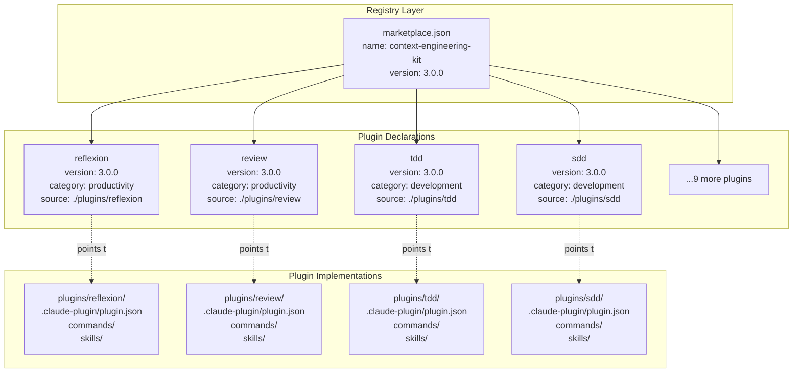

**Marketplace Structure**

The marketplace manifest defines:
- **Registry metadata**: Name, version, description, owner ([.claude-plugin/marketplace.json:2-9]())
- **Plugin entries**: Each plugin declaration includes name, description, version, author, source path, and category ([.claude-plugin/marketplace.json:11-153]())
- **Two categories**: `productivity` (reflexion, review, git, kaizen, docs) and `development` (tdd, sadd, ddd, sdd, customaize-agent, tech-stack, mcp, fpf) ([.claude-plugin/marketplace.json:20,31,42,53,64,75,86,97,108,119,130,141,152]())

**Sources**: [.claude-plugin/marketplace.json:1-155]()

### Plugin Structure

Each plugin follows a standardized directory structure that separates metadata, commands, and skills:

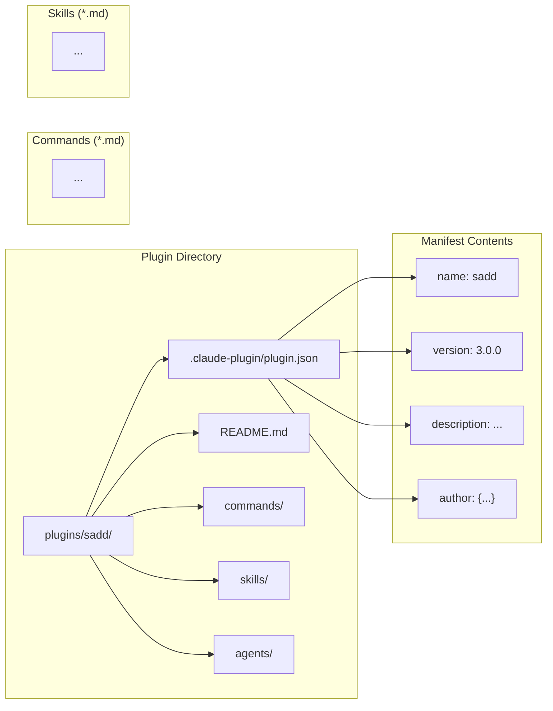

**Required Files**:
- `.claude-plugin/plugin.json`: Plugin manifest with metadata ([plugins/sadd/.claude-plugin/plugin.json:1-9]())
- `README.md`: Usage documentation and examples ([docs/plugins/README.md:5-7]())

**Optional Directories**:
- `commands/`: Markdown files defining slash commands that load on-demand ([docs/concepts.md:12-21]())
- `skills/`: Markdown files defining skills whose descriptions load automatically ([docs/concepts.md:50-62]())
- `agents/`: Markdown files defining specialized agent personas ([docs/concepts.md:79-91]())

**Sources**: [plugins/sadd/.claude-plugin/plugin.json:1-9](), [docs/concepts.md:12-91](), [docs/plugins/README.md:5-7]()

### Loading Mechanism

The system uses a selective loading strategy to minimize token usage, distinguishing between immediate skill availability and on-demand command execution ([docs/concepts.md:68-77]()).

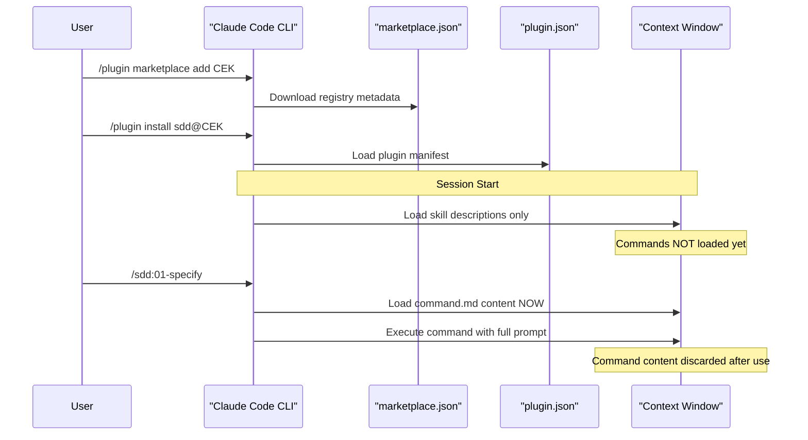

**Loading Strategy**:
1. **Plugin Installation**: Downloads plugin metadata from marketplace ([.claude-plugin/marketplace.json:1-155]())
2. **Session Start**: Loads only skill descriptions into context to save tokens ([docs/concepts.md:72-76]())
3. **Command Invocation**: Loads full command content on-demand ([docs/concepts.md:72-76]())
4. **Command Completion**: Command content is not persisted in the long-term context window.

**Sources**: [docs/concepts.md:68-77](), [.claude-plugin/marketplace.json:1-155]()

## Token Efficiency Principles

The architecture prioritizes a minimal token footprint through specialized design patterns ([docs/concepts.md:5-11]()).

### Commands Over Skills

Commands load on-demand while skill descriptions load automatically, making commands the preferred choice for most functionality to preserve the context window ([docs/concepts.md:68-77]()).

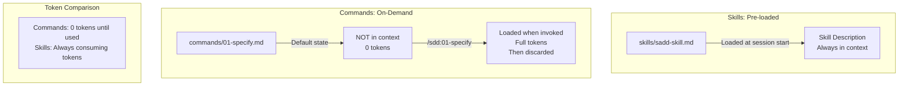

**Decision Matrix**:

| Use Case | Pattern | Rationale |
|----------|---------|-----------|
| User-invoked actions | Commands | Zero tokens until needed ([docs/concepts.md:20]()) |
| Agent-initiated workflows | Skills | Agent needs to know capability exists ([docs/concepts.md:52-53]()) |
| Persistent behavioral guidelines | Rules (`.claude/rules/`) | Codifies behavior without manual invocation ([docs/plugins/ddd/README.md:3-14]()) |
| Complex reasoning | Specialized agents | Isolated context reduces hallucinations ([docs/concepts.md:103-109]()) |

**Sources**: [docs/concepts.md:12-109](), [docs/plugins/ddd/README.md:3-14]()

### Specialized Agents Pattern

Instead of loading broad context as skills, the system uses specialized agents with focused context to reduce hallucinations ([docs/concepts.md:79-91]()).

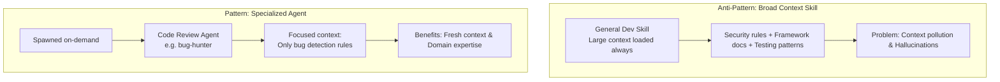

**Agent Architecture**:
- **Domain Focus**: Agents are defined for specific areas like `bug-hunter` or `security-auditor` ([docs/plugins/README.md:63]()).
- **Isolation**: Each agent starts with a clean, task-specific context ([docs/concepts.md:104]()).
- **Orchestration**: Workflow commands (like `/sdd:plan-task`) orchestrate multiple sub-agents automatically ([docs/concepts.md:121-123, 136-146]()).

**Sources**: [docs/concepts.md:79-146](), [docs/plugins/README.md:57-69]()

## Configuration Hierarchy

The system relies on a three-tier configuration approach to manage project standards and AI behavior.

### The Three-Tier System
1. **Project Shared (`CLAUDE.md`)**: Team standards, architecture rules, and MCP setup.
2. **Project Personal (`CLAUDE.local.md`)**: Local overrides or personal environment variables.
3. **User Global (`~/.claude/settings.json`)**: Cross-project defaults like auto-permissions and session hooks ([.devcontainer/configure-claude.sh:15-42]()).

### Persistent Context via CLAUDE.md
Plugins like **DDD** and **Tech Stack** update `CLAUDE.md` to provide persistent context without consuming skill slots:
- **DDD**: Embeds Clean Architecture and SOLID principles as persistent rules ([docs/plugins/ddd/README.md:3-10]()).
- **Tech Stack**: Adds language-specific best practices (e.g., TypeScript) to the project root ([.claude-plugin/marketplace.json:122-131]()).
- **MCP**: Configures required Model Context Protocol servers like `context7` ([.devcontainer/install-mcps.sh:4-5]()).

**Sources**: [.devcontainer/configure-claude.sh:15-42](), [docs/plugins/ddd/README.md:3-10](), [.claude-plugin/marketplace.json:122-131](), [.devcontainer/install-mcps.sh:1-13]()

## Development Workflow & Tooling

The project uses a `justfile` and a pre-configured `devcontainer` to standardize the development environment.

### Justfile Workflow
The `justfile` automates plugin management and synchronization ([justfile:1-75]()).

| Command | Purpose |
|---------|---------|
| `just list-plugins` | Lists all available plugins and their versions ([justfile:67-74]()) |
| `just sync-docs-to-plugins` | Syncs READMEs from `docs/plugins/` to plugin folders ([justfile:11-20]()) |
| `just sync-plugins-to-docs` | Syncs READMEs from plugin folders back to documentation ([justfile:24-34]()) |
| `just set-version <p> <v>` | Updates version in both `plugin.json` and `marketplace.json` ([justfile:38-52]()) |
| `just bump-plugin <type>` | Automates versioning for changed plugins based on git status ([.claude/commands/bump-plugin.md:1-40]()) |

### Sandbox Environment
The `.devcontainer` provides a ready-to-use "sandbox" for plugin development and testing:
- **Pre-installed Tools**: Includes `gh` CLI, `go`, `codemap`, and `claude` ([.devcontainer/Dockerfile:61-89]()).
- **Auto-configuration**: Sets up `~/.claude/settings.json` with `auto` permission mode and `SessionStart` hooks for codebase analysis ([.devcontainer/configure-claude.sh:15-31]()).
- **MCP Setup**: Automatically adds the `context7` MCP server on creation ([.devcontainer/install-mcps.sh:4-5]()).

**Sources**: [justfile:1-196](), [.claude/commands/bump-plugin.md:1-40](), [.devcontainer/Dockerfile:1-121](), [.devcontainer/configure-claude.sh:1-92](), [.devcontainer/install-mcps.sh:1-13]()

---

# Page: Core Concepts

# Core Concepts

<details>
<summary>Relevant source files</summary>

The following files were used as context for generating this wiki page:

- [.claude/commands/bump-plugin.md](.claude/commands/bump-plugin.md)
- [README.md](README.md)
- [docs/SUMMARY.md](docs/SUMMARY.md)
- [docs/concepts.md](docs/concepts.md)
- [docs/plugins/README.md](docs/plugins/README.md)
- [docs/plugins/ddd/README.md](docs/plugins/ddd/README.md)
- [docs/plugins/ddd/usage-examples.md](docs/plugins/ddd/usage-examples.md)
- [plugins/ddd/README.md](plugins/ddd/README.md)

</details>


This page covers the fundamental architectural concepts underlying the Context Engineering Kit: the plugin system, configuration hierarchy, token efficiency patterns, and knowledge accumulation mechanisms. For specific plugin implementations, see [Plugin Reference](#3). For practical usage workflows, see [Development Guides](#5).

---

## The Three-Tier Architecture

The Context Engineering Kit is built on three architectural layers: a centralized marketplace registry, a plugin ecosystem, and a multi-level configuration system. These layers interact to provide token-efficient, context-aware development tools.

### Marketplace Registry Structure

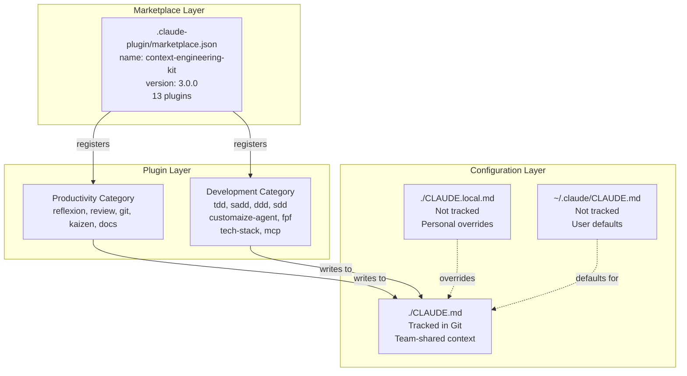

The marketplace manifest at [.claude-plugin/marketplace.json:1-155]() defines the complete plugin registry. Each plugin entry specifies `name`, `description`, `version`, `author`, `source` path, and `category` (either `"productivity"` or `"development"`).

**Sources:** [.claude-plugin/marketplace.json:1-155]()

---

## Plugin Manifest and Directory Structure

Each plugin follows a standardized directory layout that separates on-demand commands from pre-loaded skills:

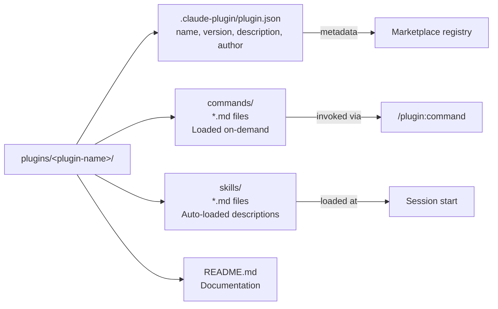

The plugin manifest at paths like [plugins/sdd/.claude-plugin/plugin.json:1-9]() contains metadata mirroring the marketplace entry. The `commands/` directory holds markdown files that define slash commands with full implementation details. The `skills/` directory holds markdown files with skill descriptions that are pre-loaded into the session context.

| Component | Load Timing | Token Impact | Use Case |
|-----------|-------------|--------------|----------|
| `plugin.json` | Installation | Minimal | Metadata only |
| `commands/*.md` | On invocation | Per-use | Complex operations |
| `skills/*.md` | Session start | Persistent | Knowledge/guidance |
| `README.md` | Never auto-loaded | None | Human documentation |

**Sources:** [plugins/sdd/.claude-plugin/plugin.json:1-9](), [plugins/sadd/.claude-plugin/plugin.json:1-9](), [plugins/customaize-agent/.claude-plugin/plugin.json:1-9](), [docs/concepts.md:12-21](), [docs/concepts.md:50-62]()

---

## Multi-Tier Configuration System

The Context Engineering Kit uses a three-tier configuration hierarchy where each level serves a distinct purpose in context management. For details, see [Configuration & Context Management](#2.2).

### Configuration Hierarchy Diagram

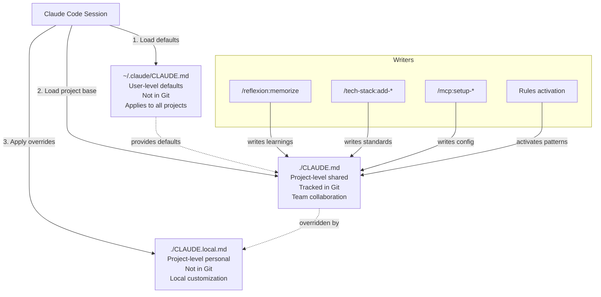

**Configuration Precedence:** `CLAUDE.local.md` > `./CLAUDE.md` > `~/.claude/CLAUDE.md`

### CLAUDE.md Content Categories

The configuration files contain structured sections that serve different purposes:

| Section Type | Example Content | Written By | Purpose |
|--------------|-----------------|------------|---------|
| Setup Commands | Hard rules, architecture decisions | `ddd`, `tech-stack` plugins | Persistent constraints |
| MCP Configuration | Server URLs, library IDs, usage guidelines | `mcp` plugin | External tool integration |
| Best Practices | Tech stack rules, DDD patterns, testing strategies | `tech-stack`, `ddd`, `tdd` plugins | Code quality standards |
| Accumulated Learnings | Reflexion insights, Kaizen root causes, pattern discoveries | `reflexion`, `kaizen` plugins | Knowledge accumulation |

**Sources:** [README.md:36-39](), [plugins/ddd/README.md:1-11](), [docs/plugins/README.md:207-213]()

---

## Commands, Skills, and Agents

The Kit distinguishes between on-demand commands, pre-loaded skills, and specialized agents to balance token efficiency and performance. For details, see [Commands, Skills, and Agents](#2.3).

### Token-Efficient Design Patterns

#### Pattern 1: Commands vs Skills

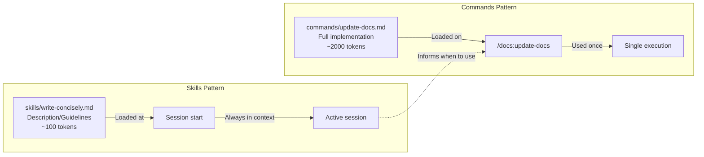

**Design Rule:** Skills provide lightweight descriptions that inform Claude when to use commands. Commands contain heavy implementation details loaded only when invoked. This is a core "Token-Efficient" feature [README.md:26](). The documentation prefers commands over skills to minimize token usage [docs/concepts.md:72-76]().

#### Pattern 2: Specialized Agents

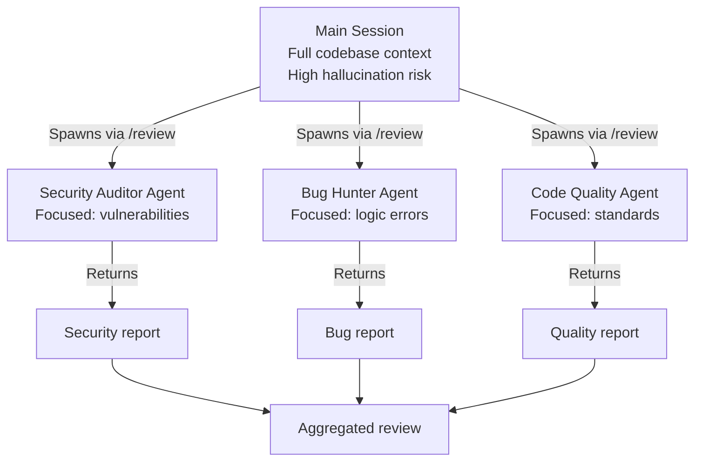

The `review` and `sdd` plugins demonstrate this pattern by dispatching specialized agents [README.md:28, 105-115](). This minimizes populating context with unnecessary information [README.md:26](). Agents operate as sub-agents with their own fresh context [docs/concepts.md:85-90]().

**Sources:** [README.md:25-29](), [docs/concepts.md:81-109](), [docs/plugins/README.md:57-69]()

---

## Plugin System & Orchestration

Plugins are structured to be granular and independent, yet they can be combined into complex workflows. For details, see [Plugin System](#2.1).

### Plugin Interaction Network

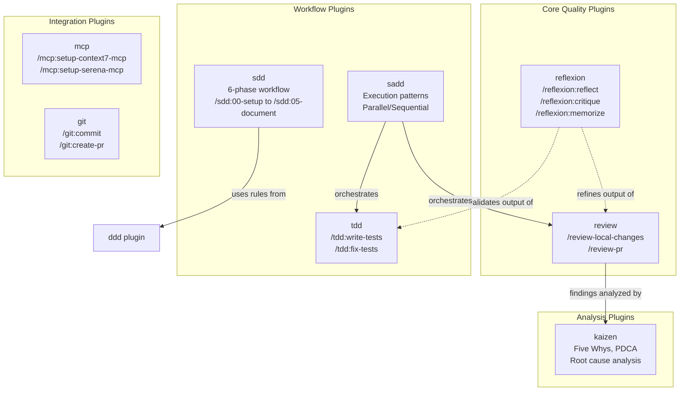

**Key Interaction Patterns:**

1. **Reflexion as Quality Multiplier:** The `reflexion` plugin refines outputs through feedback loops [README.md:89-98]().
2. **SADD as Orchestrator:** The `sadd` plugin manages task delegation with quality gates [docs/plugins/README.md:87-101]().
3. **SDD Integration:** The `sdd` plugin incorporates high-level code quality guidelines from the `ddd` plugin [README.md:37-38]().

**Sources:** [README.md:36-39, 83-98](), [docs/plugins/README.md:5-23](), [docs/plugins/README.md:103-115]()

---

## Knowledge Accumulation Model

The Kit implements a continuous learning system where insights from each session enhance future sessions via the `CLAUDE.md` hierarchy.

### Knowledge Accumulation Flow

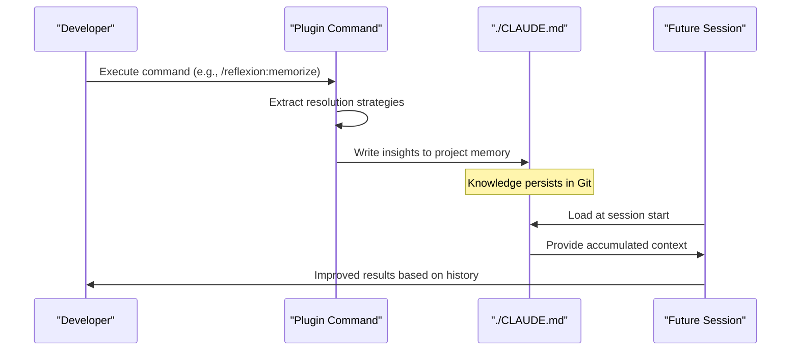

### Accumulation Mechanisms

| Mechanism | Command/Action | Content Type |
|-----------|---------|--------------|
| Reflexion Memorization | `/reflexion:memorize` | Insights and resolution strategies [README.md:97-98]() |
| Kaizen Analysis | `/kaizen:why` | Root cause tracing and problem analysis [docs/plugins/README.md:173-182]() |
| Tech Stack Setup | `/tech-stack:add-*` | Language/framework best practices [README.md:36]() |
| DDD Rules | Automatic Activation | Clean Architecture and SOLID patterns [plugins/ddd/README.md:12-19]() |
| FPF Reasoning | `/fpf:propose-hypotheses` | Structured reasoning (Abduction-Deduction-Induction) [docs/concepts.md:150-175]() |

**Sources:** [README.md:36-39, 97-98](), [docs/plugins/README.md:117-138](), [plugins/ddd/README.md:12-19]()

---

## Summary of Core Principles

1. **Token Efficiency:** Prefer command-oriented skills over general information skills to minimize context population [README.md:26](), [docs/concepts.md:72-76]().
2. **Granularity:** Install only what you need; plugins load specific agents without overlap [README.md:28]().
3. **Persistence:** Use `CLAUDE.md` to store persistent context and architectural rules [README.md:38](), [plugins/ddd/README.md:3]().
4. **Specialization:** Use specialized agents for focused tasks to maintain accuracy as context grows [README.md:118-144](), [docs/concepts.md:85-90]().
5. **Standardization:** Follow open standards like [agentskills.io](https://agentskills.io) and Arc42 [README.md:30]().

**Sources:** [README.md:25-31, 118-144](), [docs/concepts.md:5-10](), [docs/concepts.md:72-76]()

---

# Page: Plugin System

# Plugin System

<details>
<summary>Relevant source files</summary>

The following files were used as context for generating this wiki page:

- [.claude-plugin/marketplace.json](.claude-plugin/marketplace.json)
- [CONTRIBUTING.md](CONTRIBUTING.md)
- [plugins/README.md](plugins/README.md)
- [plugins/customaize-agent/.claude-plugin/plugin.json](plugins/customaize-agent/.claude-plugin/plugin.json)
- [plugins/ddd/.claude-plugin/plugin.json](plugins/ddd/.claude-plugin/plugin.json)
- [plugins/docs/.claude-plugin/plugin.json](plugins/docs/.claude-plugin/plugin.json)
- [plugins/fpf/.claude-plugin/plugin.json](plugins/fpf/.claude-plugin/plugin.json)
- [plugins/git/.claude-plugin/plugin.json](plugins/git/.claude-plugin/plugin.json)
- [plugins/kaizen/.claude-plugin/plugin.json](plugins/kaizen/.claude-plugin/plugin.json)
- [plugins/mcp/.claude-plugin/plugin.json](plugins/mcp/.claude-plugin/plugin.json)
- [plugins/reflexion/.claude-plugin/plugin.json](plugins/reflexion/.claude-plugin/plugin.json)
- [plugins/review/.claude-plugin/plugin.json](plugins/review/.claude-plugin/plugin.json)
- [plugins/sadd/.claude-plugin/plugin.json](plugins/sadd/.claude-plugin/plugin.json)
- [plugins/sdd/.claude-plugin/plugin.json](plugins/sdd/.claude-plugin/plugin.json)
- [plugins/tdd/.claude-plugin/plugin.json](plugins/tdd/.claude-plugin/plugin.json)
- [plugins/tech-stack/.claude-plugin/plugin.json](plugins/tech-stack/.claude-plugin/plugin.json)

</details>


The plugin system is the core architecture of the Context Engineering Kit, providing a structured way to extend Claude Code's capabilities through a curated marketplace. This document explains the marketplace registry, plugin manifest format, directory structure, component types (commands, skills, agents), and the plugin lifecycle from discovery through execution.

## Marketplace Registry

The Context Engineering Kit uses a centralized registry file at [.claude-plugin/marketplace.json:1-155]() that serves as the single source of truth for all available plugins. This registry follows the Claude Code marketplace schema and contains metadata for 13 official plugins.

### Marketplace Structure

```mermaid
graph TB
    subgraph "Marketplace_Registry [.claude-plugin/marketplace.json]"
        Registry["marketplace.json<br/>Schema: anthropic.com/claude-code/marketplace.schema.json"]
        
        Metadata["Marketplace Metadata<br/>name: context-engineering-kit<br/>version: 3.0.0<br/>owner: NeoLabHQ"]
        
        PluginArray["plugins[] Array<br/>13 Plugin Entries"]
        
        Registry --> Metadata
        Registry --> PluginArray
    end
    
    subgraph "Plugin_Entry_Structure"
        PluginEntry["Plugin Entry Object"]
        
        Name["name: string<br/>Unique identifier"]
        Desc["description: string<br/>One-sentence purpose"]
        Version["version: string<br/>Semantic versioning"]
        Author["author: object<br/>name + email"]
        Source["source: string<br/>Relative path to plugin dir"]
        Category["category: string<br/>productivity | development"]
        
        PluginEntry --> Name
        PluginEntry --> Desc
        PluginEntry --> Version
        PluginEntry --> Author
        PluginEntry --> Source
        PluginEntry --> Category
    end
    
    PluginArray --> PluginEntry
```

**Sources:** [.claude-plugin/marketplace.json:1-155]()

### Plugin Categories

Plugins are organized into two categories that determine their primary use case:

| Category | Purpose | Plugin Count | Examples |
|----------|---------|--------------|----------|
| `productivity` | Code quality, review, analysis, and improvement | 5 | reflexion, review, git, kaizen, docs |
| `development` | Development workflows, methodologies, and configuration | 8 | tdd, sdd, sadd, ddd, mcp, tech-stack, customaize-agent, fpf |

**Sources:** [.claude-plugin/marketplace.json:10-154]()

### Marketplace Metadata Format

```json
{
  "$schema": "https://anthropic.com/claude-code/marketplace.schema.json",
  "name": "context-engineering-kit",
  "version": "3.0.0",
  "description": "Hand-crafted collection of advanced context engineering techniques...",
  "owner": {
    "name": "NeoLabHQ",
    "email": "vlad.goncharov@neolab.finance"
  },
  "plugins": [...]
}
```

**Sources:** [.claude-plugin/marketplace.json:1-10]()

## Plugin Directory Structure

Each plugin follows a standardized directory layout that separates metadata, commands, and skills into distinct locations.

```mermaid
graph TD
    subgraph "Plugin_Filesystem_Structure [plugins/]"
        PluginRoot["plugins/&lt;plugin-name&gt;/"]
        
        PluginJSON[".claude-plugin/plugin.json<br/>Required: Manifest"]
        README["README.md<br/>Required: Documentation"]
        CommandsDir["commands/<br/>Optional: *.md files"]
        SkillsDir["skills/<br/>Optional: *.md files"]
        AgentsDir["agents/<br/>Optional: Specialized Agents"]
        
        PluginRoot --> PluginJSON
        PluginRoot --> README
        PluginRoot --> CommandsDir
        PluginRoot --> SkillsDir
        PluginRoot --> AgentsDir
    end
    
    subgraph "Example_SDD_Plugin"
        SDDRoot["plugins/sdd/"]
        SDDManifest[".claude-plugin/plugin.json<br/>version: 3.0.0"]
        SDDReadme["README.md"]
        
        SDDRoot --> SDDManifest
        SDDRoot --> SDDReadme
    end
```

**Sources:** [plugins/sdd/.claude-plugin/plugin.json:1-9](), [plugins/README.md:1-10]()

### Required Files

| File | Purpose | Format |
|------|---------|--------|
| `.claude-plugin/plugin.json` | Plugin manifest with metadata and component registry | JSON |
| `README.md` | User-facing documentation with installation and usage examples | Markdown |

**Sources:** [plugins/sdd/.claude-plugin/plugin.json:1-9](), [plugins/README.md:1-10]()

### Optional Directories

| Directory | Contents | Loading Behavior |
|-----------|----------|------------------|
| `commands/` | `.md` files with command prompts | Loaded on-demand when invoked via `/plugin:command` |
| `skills/` | `.md` files with skill descriptions | Descriptions loaded at session start (auto-loaded) |
| `agents/` | `.md` files defining specialized agents | Spawned with isolated context via `--agents` |

**Sources:** [plugins/README.md:1-10]()

## Plugin Manifest Format

The `plugin.json` file within each plugin directory defines the plugin's metadata.

### Manifest Schema

```mermaid
graph LR
    subgraph "Plugin_Manifest [.claude-plugin/plugin.json]"
        Manifest["plugin.json"]
        
        CoreMeta["Core Metadata<br/>name, version, description<br/>author"]
        
        TokenInfo["Token Usage Info<br/>(Optional)<br/>estimated: number<br/>description: string"]
        
        Manifest --> CoreMeta
        Manifest --> TokenInfo
    end
```

**Sources:** [plugins/sdd/.claude-plugin/plugin.json:1-9](), [plugins/sadd/.claude-plugin/plugin.json:1-9]()

### Example Manifest

The `sdd` plugin manifest demonstrates the standard format:

```json
{
  "name": "sdd",
  "version": "3.0.0",
  "description": "Specification Driven Development workflow commands and agents...",
  "author": {
    "name": "Vlad Goncharov",
    "email": "vlad.goncharov@neolab.finance"
  }
}
```

**Sources:** [plugins/sdd/.claude-plugin/plugin.json:1-9]()

## Plugin Components

Plugins consist of component types that Claude Code loads and executes differently.

### Commands

Commands are prompt files that load only when explicitly invoked by the user via slash command syntax (`/plugin-name:command-name`). This on-demand loading minimizes token usage.

**Directory:** `commands/` within plugin root  
**File Format:** Markdown (`.md`)  
**Invocation:** `/plugin-name:command-name [args]`  
**Token Cost:** Zero until invoked; full prompt loaded on execution.

### Skills

Skills are descriptions that Claude Code loads at every session start. They inform the orchestrator agent about available capabilities but do not contain full implementation logic.

**Directory:** `skills/` within plugin root  
**File Format:** Markdown (`.md`)  
**Loading:** Automatic at session start  
**Token Cost:** Always present in context.

### Specialized Agents

Plugins can spawn fresh subagents. These agents receive isolated context, reducing hallucination risk for the orchestrator agent.

**Definition Location:** `plugins/<plugin>/agents/`  
**Spawning:** Via plugin commands using subagent dispatch.  
**Context:** Fresh, isolated from main orchestrator context.

**Sources:** [plugins/sdd/.claude-plugin/plugin.json:4-4](), [plugins/sadd/.claude-plugin/plugin.json:4-4]()

## Plugin Lifecycle and Management

The kit includes specialized commands to manage versioning and consistency across the marketplace.

### Version Management (`bump-plugin`)

The `bump-plugin` command automates the process of updating plugin versions and the global marketplace registry.

```mermaid
sequenceDiagram
    participant User
    participant Bump as "/bump-plugin [minor|major|patch]"
    participant Git as "git diff"
    participant PManifest as "plugin.json"
    participant MRegistry as "marketplace.json"
    
    User->>Bump: Execute command
    Bump->>Git: Detect changed files in plugins/
    Bump->>PManifest: Read current version
    Bump->>PManifest: Calculate & Set new version
    Bump->>MRegistry: Read current marketplace version
    Bump->>MRegistry: Update plugin version in registry
    Bump->>User: Report old -> new versions
```

### Development and Registration

1.  **Development**: Create the plugin structure in `plugins/<name>/`. 
2.  **Versioning**: Use the `bump-plugin` command to increment versions based on changes. 
3.  **Registration**: Update the `plugins` array in [.claude-plugin/marketplace.json:10-154]() to include the new plugin metadata and source path.
4.  **Syncing**: Documentation is kept in sync between the project root and plugin directories to ensure consistency.

**Sources:** [.claude-plugin/marketplace.json:1-155](), [CONTRIBUTING.md:1-20]()

## Design Principles

The plugin system embodies specific architectural principles that optimize for token efficiency and output quality.

1.  **Commands over skills**: Commands load on-demand; skill descriptions load into context by default. Prefer commands to keep the initial context window small.
2.  **Specialized agents**: Use agents with focused context (e.g., in `sdd` or `review`) to reduce hallucinations and context pollution.
3.  **Setup-commands**: Use setup commands (like in `ddd` or `tech-stack`) to update `CLAUDE.md` for persistent project context.
4.  **Minimal tokens**: Prompts are kept concise because every token counts toward the context limit.

**Sources:** [.claude-plugin/marketplace.json:5-5](), [plugins/sdd/.claude-plugin/plugin.json:4-4](), [plugins/sadd/.claude-plugin/plugin.json:4-4]()

---

# Page: Configuration & Context Management

# Configuration & Context Management

<details>
<summary>Relevant source files</summary>

The following files were used as context for generating this wiki page:

- [.claude/commands/bump-plugin.md](.claude/commands/bump-plugin.md)
- [CLAUDE.md](CLAUDE.md)
- [docs/concepts.md](docs/concepts.md)
- [docs/plugins/README.md](docs/plugins/README.md)
- [docs/plugins/ddd/README.md](docs/plugins/ddd/README.md)
- [docs/plugins/ddd/usage-examples.md](docs/plugins/ddd/usage-examples.md)
- [docs/plugins/mcp/README.md](docs/plugins/mcp/README.md)
- [plugins/customaize-agent/skills/create-rule/SKILL.md](plugins/customaize-agent/skills/create-rule/SKILL.md)
- [plugins/ddd/README.md](plugins/ddd/README.md)
- [plugins/mcp/README.md](plugins/mcp/README.md)
- [plugins/sadd/agents/judge.md](plugins/sadd/agents/judge.md)
- [plugins/sadd/agents/meta-judge.md](plugins/sadd/agents/meta-judge.md)

</details>


This document details the three-tier configuration system used by the Context Engineering Kit (CEK) to manage persistent context across Claude Code sessions. It covers the `CLAUDE.md` file hierarchy, the role of the `.claude/rules/` system for behavioral guardrails, and session automation through lifecycle hooks.

## Three-Tier Configuration Hierarchy

The Context Engineering Kit uses a three-level configuration system to manage context that persists across sessions. This hierarchy allows for a balance between team-wide standards, project-specific local overrides, and universal user preferences.

Title: Configuration Hierarchy & Data Flow
```mermaid
graph TD
    subgraph UserLevel["User-Global Level"]
        UserGlobal["~/.claude/CLAUDE.md"]
        UserGlobalDesc["• Applies to all projects<br/>• Personal defaults and preferences<br/>• Not tracked in version control"]
    end
    
    subgraph ProjectLevel["Project Level"]
        ProjectShared["./CLAUDE.md"]
        ProjectSharedDesc["• Shared with team via Git<br/>• Project-specific standards<br/>• Architecture decisions<br/>• MCP configurations"]
        
        ProjectPersonal["./CLAUDE.local.md"]
        ProjectPersonalDesc["• Personal overrides<br/>• Not tracked in Git<br/>• Project-specific but local-only"]
    end
    
    UserGlobal --> UserGlobalDesc
    ProjectShared --> ProjectSharedDesc
    ProjectPersonal --> ProjectPersonalDesc
    
    UserGlobal -.->|"provides defaults for"| ProjectShared
    ProjectPersonal -.->|"overrides"| ProjectShared
```

**Sources:** [CLAUDE.md:1-27](), [plugins/mcp/README.md:21-27](), [docs/plugins/mcp/README.md:21-27]()

### Project-Shared Configuration (CLAUDE.md)

The project-shared `CLAUDE.md` file is located at the repository root and is tracked in version control. It contains team-wide context that all developers share. It is the primary target for **setup-commands** which establish persistent project context [CLAUDE.md:50-51]().

| Property | Value |
|----------|-------|
| **File Path** | `./CLAUDE.md` |
| **Git Tracking** | ✓ Tracked (committed to repository) |
| **Scope** | All team members, all sessions |
| **Purpose** | Shared project context, standards, architecture decisions |

**Key Sections in CLAUDE.md:**
- **Project Structure**: High-level map of the codebase [CLAUDE.md:7-27]().
- **Development Rules**: Hard constraints like "Commands over skills" [CLAUDE.md:44-51]().
- **MCP Configuration**: Recommended library IDs for Context7 or usage guidelines for Serena [CLAUDE.md:93-111]().
- **Task Tracking**: Standards for using tools like Minibeads [CLAUDE.md:139-161]().

**Sources:** [CLAUDE.md:1-161](), [docs/plugins/mcp/README.md:21-27]()

### Project-Personal and User-Global

- **Project-Personal (`CLAUDE.local.md`)**: Local configuration not tracked in git. Used for personal overrides or API keys that shouldn't be shared [plugins/mcp/README.md:24]().
- **User-Global (`~/.claude/CLAUDE.md`)**: Applies to all projects on the user's machine. Ideal for cross-project personal preferences [plugins/mcp/README.md:25]().

## Persistent Behavioral Guidelines (.claude/rules/)

While `CLAUDE.md` provides broad project context, the `.claude/rules/` system provides granular, modular, and always-loaded behavioral guardrails. Rules act as "standing orders" that every agent session inherits automatically [plugins/customaize-agent/skills/create-rule/SKILL.md:10-18]().

### The Contrastive Pattern

The most critical technical requirement for rules in the CEK is the **Contrastive Pattern**. Research within the kit shows that rules with both positive and negative examples are significantly more discriminative [plugins/customaize-agent/skills/create-rule/SKILL.md:132-139]().

Title: Rule Structure and Contrastive Logic
```mermaid
graph TD
    RuleFile[".claude/rules/*.md"] --> Frontmatter["Frontmatter (Title, Paths)"]
    RuleFile --> Description["Description (The 'Why')"]
    RuleFile --> Incorrect["## Incorrect (The Anti-pattern)"]
    RuleFile --> Correct["## Correct (The Minimal Fix)"]
    
    Incorrect --> NegExample["Plausible mistake code block"]
    Correct --> PosExample["Recommended code block"]
    
    NegExample -.->|"Contrast"| PosExample
```

**Sources:** [plugins/customaize-agent/skills/create-rule/SKILL.md:94-126]()

### Rule Types and Scoping

| Type | Implementation | Loading Behavior |
|------|----------------|------------------|
| **Global Rules** | No `paths` in frontmatter | Loaded every session [plugins/customaize-agent/skills/create-rule/SKILL.md:55-57]() |
| **Path-Scoped Rules**| `paths: ["src/**/*.ts"]` | Loaded only when working with matching files [plugins/customaize-agent/skills/create-rule/SKILL.md:66-69]() |
| **Priority Rules** | Evaluator/Judge guidance | Sets high-level evaluation priorities [plugins/customaize-agent/skills/create-rule/SKILL.md:82-84]() |

## Session Hooks and Automation

Automation is handled via `.claude/settings.json`, which allows executing shell commands at specific lifecycle events of a Claude Code session. This is extensively used by the **Codemap CLI** and other integration plugins to provide automatic project awareness.

Title: Session Hook Execution Flow
```mermaid
graph TB
    Start["SessionStart"] -->|cmd| CodemapStart["codemap hook session-start"]
    Start -->|cmd| GitCtx["git diff --stat && git status"]
    
    PreTool["PreToolUse (Edit|Write)"] -->|cmd| CodemapPre["codemap hook pre-edit"]
    
    PostTool["PostToolUse (Edit|Write)"] -->|cmd| CodemapPost["codemap hook post-edit"]
    
    Submit["UserPromptSubmit"] -->|cmd| CodemapPrompt["codemap hook prompt-submit"]
    
    End["SessionEnd"] -->|cmd| CodemapStop["codemap hook session-stop"]
    
    CodemapStart -.->|"Injects"| Ctx[("Active Session Context")]
    GitCtx -.->|"Injects"| Ctx
```

**Sources:** [CLAUDE.md:139-145](), [docs/plugins/mcp/README.md:53-54]()

## Token Management: Skills vs. Commands

A core design philosophy of the CEK is **Commands over Skills** to maintain token efficiency [CLAUDE.md:48]().

| Entity | Storage | Context Impact | Use Case |
|--------|---------|----------------|----------|
| **Commands** | `plugins/*/commands/*.md` | **On-demand**: Only loaded when explicitly called via `/` [docs/concepts.md:12-21]() | Complex, multi-step workflows |
| **Skills** | `plugins/*/skills/*.md` | **Default**: Descriptions load into context by default [CLAUDE.md:48]() | Procedural knowledge always needed |
| **Rules** | `.claude/rules/*.md` | **Always**: Loaded every session (or path-matched) [plugins/customaize-agent/skills/create-rule/SKILL.md:16-18]() | Behavioral guardrails |

**Sources:** [CLAUDE.md:46-51](), [plugins/customaize-agent/skills/create-rule/SKILL.md:27-36](), [docs/concepts.md:68-76]()

## Context Accumulation Flow

Context in the CEK is not static; it accumulates through development cycles. The **Reflexion** and **SADD** plugins are primary drivers of this accumulation, moving knowledge from "Natural Language Space" (feedback) to "Code Entity Space" (persistent rules).

Title: Context Accumulation Pipeline
```mermaid
graph LR
    subgraph NaturalLanguageSpace["Natural Language Space"]
        Prompt["User Prompt"]
        JudgeReasoning["Judge Reasoning"]
        Critique["Reflexion Critique"]
    end

    subgraph Orchestration["Orchestration (SADD/Reflexion)"]
        MetaJudge["meta-judge.md"]
        JudgeAgent["judge.md"]
        ReflexionCmd["/reflexion:reflect"]
    end

    subgraph CodeEntitySpace["Code Entity Space"]
        RulesDir[".claude/rules/*.md"]
        ClaudeMD["CLAUDE.md"]
    end

    Prompt --> MetaJudge
    MetaJudge --> JudgeAgent
    JudgeAgent --> JudgeReasoning
    JudgeReasoning --> RulesDir
    ReflexionCmd --> Critique
    Critique --> ClaudeMD
```

**Sources:** [plugins/sadd/agents/judge.md:137-154](), [plugins/sadd/agents/meta-judge.md:37-56](), [plugins/customaize-agent/skills/create-rule/SKILL.md:2-4]()

1. **Implementation**: An agent performs a task.
2. **Evaluation**: The `judge` agent [plugins/sadd/agents/judge.md:2-6]() evaluates the result against a specification from `meta-judge` [plugins/sadd/agents/meta-judge.md:8-10]().
3. **Rule Generation**: If a gap is found, the `judge` generates a contrastive rule using the `issues` schema [plugins/sadd/agents/judge.md:137-150]().
4. **Memorization**: The `create-rule` skill or `/reflexion:memorize` command persists new patterns to `CLAUDE.md` or `.claude/rules/` [plugins/customaize-agent/skills/create-rule/SKILL.md:1-10]().

**Sources:** [plugins/sadd/agents/judge.md:137-150](), [plugins/customaize-agent/skills/create-rule/SKILL.md:1-10](), [plugins/sadd/agents/meta-judge.md:37-56]()

---

# Page: Commands, Skills, and Agents

# Commands, Skills, and Agents

<details>
<summary>Relevant source files</summary>

The following files were used as context for generating this wiki page:

- [.claude/commands/bump-plugin.md](.claude/commands/bump-plugin.md)
- [docs/concepts.md](docs/concepts.md)
- [docs/plugins/README.md](docs/plugins/README.md)
- [docs/plugins/ddd/README.md](docs/plugins/ddd/README.md)
- [docs/plugins/ddd/rules.md](docs/plugins/ddd/rules.md)
- [docs/plugins/ddd/usage-examples.md](docs/plugins/ddd/usage-examples.md)
- [docs/plugins/git/README.md](docs/plugins/git/README.md)
- [docs/plugins/git/git-worktrees.md](docs/plugins/git/git-worktrees.md)
- [docs/reference/commands.md](docs/reference/commands.md)
- [docs/reference/skills.md](docs/reference/skills.md)
- [plugins/ddd/README.md](plugins/ddd/README.md)
- [plugins/git/README.md](plugins/git/README.md)
- [plugins/sdd/skills/brainstorm/SKILL.md](plugins/sdd/skills/brainstorm/SKILL.md)

</details>


## Purpose and Scope

This page explains the three mechanisms for loading context into Claude Code: **commands**, **skills**, and **specialized agents**. Each mechanism has distinct token efficiency characteristics and use cases. Understanding when to use each type is critical for building plugins that enhance agent capabilities without causing context pollution or degrading performance.

The Context Engineering Kit focuses on minimal token footprints while maximizing result quality [docs/concepts.md:5-10]().

---

## Overview: Three Context Loading Mechanisms

The Context Engineering Kit provides three ways to make functionality available to Claude Code, each with different token footprints and loading behaviors:

| Mechanism | Token Cost | When Loaded | Best For |
|-----------|-----------|-------------|----------|
| **Commands** | ~500-2000 tokens | On-demand when invoked | Complex operations, multi-step workflows |
| **Skills** | ~200-800 tokens | Every conversation start | Continuous guidance, persistent principles |
| **Agents** | Variable (fresh context) | Spawned for specific tasks | Specialized analysis, parallel work |

**Key Principle**: Commands over skills, specialized agents over commands. Use the most token-efficient approach that solves the problem [docs/concepts.md:70-76]().

Sources: [docs/concepts.md:12-109](), [docs/reference/commands.md:1-122](), [docs/reference/skills.md:1-46]()

---

## Commands: On-Demand Context Loading

Commands are explicit actions invoked manually via the `/plugin-name:command-name` syntax [docs/concepts.md:13-15](). They load their full instructions only when triggered, making them the most token-efficient method for operations used occasionally [docs/concepts.md:20-21]().

### Command Structure

Commands are defined in the plugin manifest and stored as markdown files. When invoked, the prompt within the command file is loaded into the LLM's context [docs/concepts.md:14-15](). The complete index of these commands is maintained in `docs/reference/commands.md`.

### Command Use Cases

Commands are ideal for:

1. **Multi-step workflows**: The SDD plugin uses commands to guide phases from `/brainstorm` to `/implement-task` [docs/reference/commands.md:36-39]().
2. **Problem Analysis**: The Kaizen plugin provides commands for root cause analysis like `/why` and `/cause-and-effect` [docs/reference/commands.md:47-49]().
3. **Git Operations**: Standardizing workflows via `/commit` and `/create-pr` [plugins/git/README.md:25-29]().
4. **Customization**: Creating new extensions via `/create-agent` or `/create-skill` [docs/reference/commands.md:56-59]().

### Example: Code Review Command

The `review` plugin triggers a multi-agent review process via command [docs/reference/commands.md:16-21]().

**Natural Language to Code Entity Space: Code Review Workflow**

```mermaid
graph TB
    User["User invokes /review-local-changes"]
    LoadCmd["Load plugins/review/ (review-local-changes)"]
    
    subgraph "Specialized Review Agents"
        Security["security-auditor"]
        Bug["bug-hunter"]
        Quality["code-quality-reviewer"]
        Contract["contracts-reviewer"]
        Test["test-coverage-reviewer"]
        History["historical-context-reviewer"]
    end
    
    User --> LoadCmd
    LoadCmd --> Security
    LoadCmd --> Bug
    LoadCmd --> Quality
    LoadCmd --> Contract
    LoadCmd --> Test
    LoadCmd --> History
    
    Security -.-> Out["Consolidated Review Report"]
    Bug -.-> Out
    History -.-> Out
```

Sources: [docs/reference/commands.md:16-21](), [docs/plugins/README.md:57-69]()

---

## Skills: Persistent Context

Skills are automatically applied knowledge that influences Claude's behavior without explicit invocation [docs/concepts.md:51-53](). They provide best practices, methodologies, and "gate functions" that check actions before they are taken [docs/concepts.md:56-62]().

### Skill Principles

Skills are markdown documents loaded into context. While they can be invoked manually (e.g., "load TDD skill"), they are typically intended to be active continuously during a session [docs/concepts.md:56-67]().

**Writing skills follows a Red-Green-Refactor cycle** [docs/reference/commands.md:61-62]():
- **Red Phase**: Verify the agent fails a specific requirement without the skill.
- **Green Phase**: Verify the agent succeeds once the skill is added to context.

### Skill Use Cases

Skills are ideal for:

1. **Architecture Rules**: The DDD plugin's `rules` skill provides 14-15 composable guidelines for Clean Architecture and SOLID [docs/reference/skills.md:20-24]().
2. **Parallel Development**: The Git plugin's `worktrees` skill for managing multiple branches [docs/reference/skills.md:36-37]().
3. **Prompt Engineering**: The `prompt-engineering` skill in the Customaize Agent plugin for applying Anthropic best practices [docs/reference/skills.md:43-44]().

### Example: SDD Brainstorming Skill

The `sdd` plugin uses the `brainstorm` skill to guide the refinement of rough ideas into designs [plugins/sdd/skills/brainstorm/SKILL.md:1-5]().

```mermaid
graph LR
    subgraph "Auto-loaded Context (docs/reference/skills.md)"
        SkillMeta["sdd:brainstorm<br/>'Refines rough ideas into designs...'"]
    end
    
    subgraph "Skill Execution Logic (plugins/sdd/skills/brainstorm/SKILL.md)"
        Step1["1. Understand project context"]
        Step2["2. Ask questions one at a time"]
        Step3["3. Explore 6 approaches with trade-offs"]
        Step4["4. Present design in 200-300 word sections"]
    end
    
    SkillMeta -- "Relevant Context Detected" --> Step1
    Step1 --> Step2
    Step2 --> Step3
    Step3 --> Step4
```

Sources: [docs/reference/skills.md:1-46](), [plugins/sdd/skills/brainstorm/SKILL.md:1-63](), [docs/concepts.md:51-76]()

---

## Specialized Agents: Fresh Context for Complex Tasks

Agents are specialized sub-instances launched with focused prompts and domain-specific knowledge [docs/concepts.md:81-83](). They solve the "attention scarcity" problem by partitioning complex work into isolated context windows [docs/concepts.md:8-10]().

### Why Specialized Agents?

1. **Context Isolation**: Each agent starts with a clean context, preventing the "lost-in-the-middle" phenomenon [docs/concepts.md:104-105]().
2. **Specialized Expertise**: Agents focus on one domain (e.g., business analyst, software architect) [docs/concepts.md:87-90]().
3. **Parallel Execution**: Multiple agents can work simultaneously, such as in the `/review-local-changes` workflow [docs/concepts.md:107-116]().

### Example: FPF Workflow Orchestration

The First Principles Framework (FPF) uses a workflow command to orchestrate a specialized `fpf-agent` through multiple reasoning steps [docs/concepts.md:148-175]().

**Natural Language to Code Entity Space: FPF Agent Workflow**

```mermaid
graph TB
    Cmd["/fpf:propose-hypotheses"]
    Agent["fpf-agent (plugins/fpf/agents/)"]
    
    subgraph "Workflow Steps (docs/concepts.md)"
        Step1["Step 1: Initialize Context (.fpf/context.md)"]
        Step2["Step 2: Generate L0 Hypotheses"]
        Step4["Step 4: Verify Logic (L0 -> L1)"]
        Step5["Step 5: Validate Evidence (L1 -> L2)"]
        Step7["Step 7: Design Rationale Record (DRR)"]
    end
    
    Cmd --> Agent
    Agent --> Step1
    Step1 --> Step2
    Step2 --> Step4
    Step4 --> Step5
    Step5 --> Step7
```

Sources: [docs/concepts.md:79-133](), [docs/concepts.md:148-175](), [docs/reference/commands.md:113-115]()

---

## Token Efficiency Trade-offs

Effective context engineering requires finding the smallest set of high-signal tokens to maximize performance [docs/concepts.md:7-10]().

### Performance Strategies

| Strategy | Implementation | Benefit |
|--------|----------|--------|
| **Commands over Skills** | Use `/plugin:command` instead of persistent skills. | Zero context cost until invoked [docs/concepts.md:72-76](). |
| **Progressive Disclosure** | Load only the necessary metadata until the full skill is required. | Preserves attention budget for the current task [docs/concepts.md:7-10](). |
| **Subagent Delegation** | Use `launch-sub-agent` or workflow commands. | Fresh context prevents reasoning degradation from long histories [docs/concepts.md:104-105](). |

**Key Takeaway**: Large context windows are constrained by attention mechanics, not raw capacity. Use **Specialized Agents** to isolate complex reasoning and **Commands** to keep the main session context clean [docs/concepts.md:8-10]().

Sources: [docs/concepts.md:5-10](), [docs/concepts.md:68-76](), [docs/concepts.md:103-109]()

---

# Page: Plugin Reference

# Plugin Reference

<details>
<summary>Relevant source files</summary>

The following files were used as context for generating this wiki page:

- [.claude-plugin/marketplace.json](.claude-plugin/marketplace.json)
- [.claude/commands/bump-plugin.md](.claude/commands/bump-plugin.md)
- [docs/concepts.md](docs/concepts.md)
- [docs/plugins/README.md](docs/plugins/README.md)
- [docs/plugins/ddd/README.md](docs/plugins/ddd/README.md)
- [docs/plugins/ddd/usage-examples.md](docs/plugins/ddd/usage-examples.md)
- [plugins/ddd/README.md](plugins/ddd/README.md)
- [plugins/sadd/.claude-plugin/plugin.json](plugins/sadd/.claude-plugin/plugin.json)

</details>


This page provides a comprehensive reference for all official plugins available in the Context Engineering Kit marketplace. It covers the plugin registry structure, categorization system, and provides a high-level overview of each plugin's purpose and capabilities.

For detailed documentation of specific plugins, see the category-specific pages:
- **Code Quality Plugins**: Focus on review and self-refinement. For details, see [Code Quality Plugins](#3.1).
- **Development Workflow Plugins**: Implement structured methodologies like TDD, SDD, and DDD. For details, see [Development Workflow Plugins](#3.2).
- **Integration Plugins**: Connect with Git and Model Context Protocol (MCP). For details, see [Integration Plugins](#3.3).
- **Continuous Improvement Plugins**: Root cause analysis and documentation management. For details, see [Continuous Improvement Plugins](#3.4).
- **Configuration Plugins**: Project standards and custom agent authoring. For details, see [Configuration Plugins](#3.5).

## Plugin Registry Architecture

The Context Engineering Kit maintains a centralized plugin registry in [.claude-plugin/marketplace.json:1-155](). This registry follows the official Claude Code marketplace schema and contains metadata for all available plugins.

### Registry to Code Entity Mapping
The following diagram bridges the high-level marketplace definitions to the actual file system entities within the repository, using specific names found in the configuration.

Title: Marketplace Entity Mapping
```mermaid
graph TD
    subgraph "Marketplace_Space_(marketplace.json)"
        Registry[".claude-plugin/marketplace.json"]
        Entry["Plugin Entry"]
        EntryName["'name': 'sdd'"]
        EntrySource["'source': './plugins/sdd'"]
    end

    subgraph "Code_Entity_Space_(File_System)"
        PluginDir["plugins/sdd/"]
        Manifest["plugins/sdd/.claude-plugin/plugin.json"]
        CommandsDir["plugins/sdd/commands/"]
        SkillsDir["plugins/sdd/skills/"]
        AgentsDir["plugins/sdd/agents/"]
    end

    Registry -->|"contains"| Entry
    Entry --> EntryName
    Entry --> EntrySource
    EntrySource -->|"points to"| PluginDir
    PluginDir -->|"contains"| Manifest
    PluginDir -->|"contains"| CommandsDir
    PluginDir -->|"contains"| SkillsDir
    PluginDir -->|"contains"| AgentsDir
```

**Registry Location and Plugin Directory Mapping**
The marketplace registry at [.claude-plugin/marketplace.json:10-154]() defines all available plugins. Each plugin's `source` field points to its implementation directory following the pattern `./plugins/{plugin-name}/`. Each plugin directory contains a `.claude-plugin/plugin.json` manifest file that mirrors the registry metadata, such as [plugins/sadd/.claude-plugin/plugin.json:1-9]().

Sources: [.claude-plugin/marketplace.json:1-155](), [plugins/sadd/.claude-plugin/plugin.json:1-9]()

## Plugin Categories

The Context Engineering Kit organizes plugins into two primary categories that determine their focus and typical usage patterns:

| Category | Focus | Token Philosophy | Primary Use Cases |
|----------|-------|------------------|-------------------|
| **productivity** | Immediate value delivery, analysis, and quality improvement | Skills and commands for on-demand analysis | Code review, documentation, continuous improvement, version control |
| **development** | Structured workflows and methodologies | Commands for guided processes, skills for persistent patterns | TDD, DDD, SADD, SDD, custom tooling, tech stack configuration |

Title: Plugin Category Distribution
```mermaid
graph TB
    subgraph "productivity_category"
        Reflexion["'name': 'reflexion'"]
        CodeReview["'name': 'review'"]
        Git["'name': 'git'"]
        Kaizen["'name': 'kaizen'"]
        Docs["'name': 'docs'"]
    end
    
    subgraph "development_category"
        TDD["'name': 'tdd'"]
        SADD["'name': 'sadd'"]
        DDD["'name': 'ddd'"]
        SDD["'name': 'sdd'"]
        CustomAgent["'name': 'customaize-agent'"]
        TechStack["'name': 'tech-stack'"]
        MCP["'name': 'mcp'"]
        FPF["'name': 'fpf'"]
    end
    
    Reflexion --- ProductivityLabel["Productivity Focus:<br/>Immediate Analysis"]
    TDD --- DevelopmentLabel["Development Focus:<br/>Structured Workflows"]
```

**Category Distribution and Component Usage**
The registry at [.claude-plugin/marketplace.json:10-154]() defines 13 plugins. The `category` field, such as in [.claude-plugin/marketplace.json:20]() (productivity) or [.claude-plugin/marketplace.json:53]() (development), determines how the plugin is classified within the marketplace.

Sources: [.claude-plugin/marketplace.json:10-154]()

## Plugin Component Types

Each plugin can provide three types of components, each with different token efficiency characteristics and usage patterns as defined in [docs/concepts.md:12-134]():

- **Commands**: On-demand execution. Loaded only when invoked (e.g., `/plugin-name:command-name`). They are the most token-efficient [docs/concepts.md:14-21]().
- **Skills**: Pre-loaded context. These load automatically and inform all agent decisions, providing best practices and methodologies [docs/concepts.md:52-67]().
- **Agents**: Specialized expertise. Spawns focused sub-agents for specific tasks with their own fresh context [docs/concepts.md:81-91]().

Sources: [docs/concepts.md:12-134]()

## Summary of Official Plugins

### Code Quality Plugins
These plugins focus on verifying and refining existing code.
- **Reflexion**: Implements feedback and refinement loops based on Self-Refine and Reflexion papers [.claude-plugin/marketplace.json:12-21]().
- **Review**: Uses multiple specialized agents (e.g., bug hunter, security auditor) for thorough codebase and PR analysis [.claude-plugin/marketplace.json:23-32]().
- For details, see [Code Quality Plugins](#3.1).

### Development Workflow Plugins
Structured methodologies to guide feature creation from start to finish.
- **TDD**: Test-Driven Development with guidance on anti-patterns and subagent testing skills [.claude-plugin/marketplace.json:45-54]().
- **SDD**: Specification-Driven Development based on GitHub Spec Kit and OpenSpec [.claude-plugin/marketplace.json:78-87]().
- **SADD**: Subagent-Driven Development for task delegation with quality gates [.claude-plugin/marketplace.json:56-65]().
- **DDD**: Domain-Driven Development focusing on Clean Architecture, SOLID, and 14 composable rules [.claude-plugin/marketplace.json:67-76]().
- **FPF**: First Principles Framework for structured reasoning via ADI (Abduction-Deduction-Induction) cycles [.claude-plugin/marketplace.json:144-153]().
- For details, see [Development Workflow Plugins](#3.2).

### Integration Plugins
Connecting Claude Code to the broader engineering ecosystem.
- **Git**: Conventional commits, PR creation, and git worktree management [.claude-plugin/marketplace.json:34-43]().
- **MCP**: Model Context Protocol integration to mandate usage of external tools in `CLAUDE.md` [.claude-plugin/marketplace.json:133-142]().
- For details, see [Integration Plugins](#3.3).

### Continuous Improvement Plugins
Analysis tools for process and documentation.
- **Kaizen**: Lean-inspired root cause analysis including 5 Whys and Cause and Effect Analysis [.claude-plugin/marketplace.json:89-98]().
- **Docs**: Automated documentation generation and refinement for analyzing project structure [.claude-plugin/marketplace.json:111-120]().
- For details, see [Continuous Improvement Plugins](#3.4).

### Configuration Plugins
Standardizing the development environment.
- **Tech Stack**: Language-specific best practices setup (e.g., TypeScript) for `CLAUDE.md` [.claude-plugin/marketplace.json:122-131]().
- **Customaize Agent**: Tools for authoring your own commands, skills, and agents using Anthropic best practices [.claude-plugin/marketplace.json:100-109]().
- For details, see [Configuration Plugins](#3.5).

Sources: [.claude-plugin/marketplace.json:1-155](), [docs/plugins/README.md:1-205](), [docs/plugins/ddd/README.md:1-45]()

---

# Page: Code Quality Plugins

# Code Quality Plugins

<details>
<summary>Relevant source files</summary>

The following files were used as context for generating this wiki page:

- [docs/guides/README.md](docs/guides/README.md)
- [docs/guides/ci-integration.md](docs/guides/ci-integration.md)
- [docs/plugins/reflexion/README.md](docs/plugins/reflexion/README.md)
- [docs/plugins/review/README.md](docs/plugins/review/README.md)
- [plugins/reflexion/README.md](plugins/reflexion/README.md)

</details>


## Purpose and Scope

Code Quality Plugins provide automated, multi-perspective code analysis through specialized AI agents that catch bugs, security vulnerabilities, and quality issues before code reaches production. This page covers the two core quality plugins: **Code Review** and **Reflexion**.

The **Code Review** plugin implements a six-agent parallel review system that examines code from different specialized perspectives (bugs, security, tests, quality, contracts, and historical context) [docs/plugins/review/README.md:12-14](). The **Reflexion** plugin enables self-refinement through iterative improvement, critique, and memory updates based on techniques like Self-Refine and Reflexion [plugins/reflexion/README.md:1-27]().

For detailed documentation, see [Code Review Plugin](#3.1.1) and [Reflexion Plugin](#3.1.2).

Sources: [docs/plugins/review/README.md:1-14](), [plugins/reflexion/README.md:1-27]()

---

## Plugin Comparison

The two plugins serve complementary roles in ensuring code quality:

| Aspect | Code Review Plugin | Reflexion Plugin |
|--------|-------------------|------------------|
| **Primary Purpose** | Multi-perspective bug/security detection [docs/plugins/review/README.md:7-10]() | Self-refinement and iterative improvement [plugins/reflexion/README.md:7-10]() |
| **Analysis Approach** | 6 Parallel specialized agents [docs/plugins/review/README.md:46-60]() | Feedback and refinement loops [plugins/reflexion/README.md:92-111]() |
| **Timing** | Before commits and PRs [docs/plugins/review/README.md:14-14]() | After completing work / on "reflect" trigger [plugins/reflexion/README.md:62-83]() |
| **Focus** | Finding specific issues (Bugs, Security, Coverage) [docs/plugins/review/README.md:68-135]() | Reflecting on previous response/output [plugins/reflexion/README.md:86-89]() |
| **Output** | Severity-categorized findings [docs/plugins/review/README.md:202-241]() | Refined implementation + learned patterns [plugins/reflexion/README.md:39-48]() |
| **Memory Integration** | No direct persistence | Updates CLAUDE.md via `/reflexion:memorize` [plugins/reflexion/README.md:88-89]() |

**Workflow Synergy**: Use Code Review to identify issues, Reflexion to improve solutions, and `/reflexion:memorize` to capture patterns for future prevention.

Sources: [docs/plugins/review/README.md:3-14](), [plugins/reflexion/README.md:1-111]()

---

## Multi-Agent Architecture

The Code Review plugin utilizes a fan-out architecture to maximize specialized coverage.

### Code Review Agent Fan-out
```mermaid
graph TB
    subgraph "CodeReviewPluginArchitecture"
        ["/review-local-changes"] -- "Spawns" --> ["ParallelAgentAnalysis"]
        
        ["ParallelAgentAnalysis"] --> ["BugHunter"]
        ["ParallelAgentAnalysis"] --> ["SecurityAuditor"]
        ["ParallelAgentAnalysis"] --> ["TestCoverageReviewer"]
        ["ParallelAgentAnalysis"] --> ["CodeQualityReviewer"]
        ["ParallelAgentAnalysis"] --> ["ContractsReviewer"]
        ["ParallelAgentAnalysis"] --> ["HistoricalContextReviewer"]
        
        ["BugHunter"] --> ["AggregatedReport"]
        ["SecurityAuditor"] --> ["AggregatedReport"]
        ["TestCoverageReviewer"] --> ["AggregatedReport"]
        ["CodeQualityReviewer"] --> ["AggregatedReport"]
        ["ContractsReviewer"] --> ["AggregatedReport"]
        ["HistoricalContextReviewer"] --> ["AggregatedReport"]
        
        ["AggregatedReport"] -- "Generates" --> ["StructuredMarkdownOutput"]
    end
```
Sources: [docs/plugins/review/README.md:46-60](), [docs/plugins/review/README.md:202-227]()

### Reflexion Hook Architecture
The Reflexion plugin includes an optional hook system that triggers reflection automatically when the keyword "reflect" is present in the prompt.

```mermaid
graph LR
    subgraph "ReflexionHookLogic"
        ["UserPrompt"] -- "contains 'reflect'?" --> ["KeywordCheck"]
        ["KeywordCheck"] -- "YES" --> ["AutoTriggerReflect"]
        ["KeywordCheck"] -- "NO" --> ["NormalCompletion"]
        
        ["AutoTriggerReflect"] -- "Executes" --> ["/reflexion:reflect"]
        ["/reflexion:reflect"] -- "Produces" --> ["RefinedOutput"]
        
        ["RefinedOutput"] -- "Optional" --> ["/reflexion:memorize"]
        ["/reflexion:memorize"] -- "PersistsTo" --> ["CLAUDE.md"]
    end
```
Sources: [plugins/reflexion/README.md:62-83](), [plugins/reflexion/README.md:86-89]()

---

## Command Reference

### Code Review Commands
| Command | Purpose |
|---------|---------|
| `/review-local-changes` | Reviews uncommitted changes (staged and unstaged) [docs/plugins/review/README.md:22-23](). |
| `/review-pr` | Reviews a specific Pull Request, posting inline comments [docs/plugins/review/README.md:33-34](). |

**Filtering**: Both commands support `--min-impact` (critical, high, medium, low) to reduce noise [docs/plugins/review/README.md:30-38](). Local reviews produce a structured report organized by severity, while PR reviews post inline comments using `mcp__github_inline_comment__create_inline_comment` [docs/plugins/review/README.md:197-241]().

### Reflexion Commands
| Command | Purpose |
|---------|---------|
| `/reflexion:reflect` | Self-refinement of the previous output based on self-critique [plugins/reflexion/README.md:86-86](). |
| `/reflexion:critique` | Multi-perspective review using specialized judges with debate [plugins/reflexion/README.md:87-87](). |
| `/reflexion:memorize` | Saves insights and patterns to `CLAUDE.md` to improve future performance [plugins/reflexion/README.md:88-89](). |

Sources: [docs/plugins/review/README.md:63-67](), [plugins/reflexion/README.md:84-89](), [docs/plugins/review/README.md:197-198]()

---

## Review Agent Specialization

### Code Review Agents
Each agent focuses on a specific domain to ensure deep analysis [docs/plugins/review/README.md:68-135]():

*   **Bug Hunter**: Identifies logic errors, null pointer exceptions, and race conditions.
*   **Security Auditor**: Scans for SQL injection, XSS vulnerabilities, and exposed credentials.
*   **Test Coverage Reviewer**: Evaluates test quality and identifies missing edge case tests.
*   **Code Quality Reviewer**: Assesses maintainability, code complexity, and naming conventions.
*   **Contracts Reviewer**: Checks for breaking API changes and backward compatibility.
*   **Historical Context Reviewer**: Ensures consistency with existing codebase patterns and architectural drift.

Sources: [docs/plugins/review/README.md:68-135]()

---

## Integration Workflow

### Pre-Commit Quality Gate
1.  **Implement**: Use Claude to write code.
2.  **Reflect**: Include "reflect" in your prompt to trigger automatic refinement. The system will review its own work and fix obvious issues [plugins/reflexion/README.md:36-43]().
3.  **Review**: Run `/review-local-changes` to catch bugs across the 6 specialized perspectives [docs/plugins/review/README.md:22-23]().
4.  **Fix**: Address findings categorized as `Critical` or `High` in the generated report [docs/plugins/review/README.md:212-217]().
5.  **Memorize**: Run `/reflexion:memorize` to save resolution strategies to `CLAUDE.md` [plugins/reflexion/README.md:45-48]().
6.  **Commit**: Proceed with committing once quality standards are met.

### CI/CD Integration
The Code Review plugin can be integrated into GitHub Actions using the `anthropics/claude-code-action@v1`. This allows automated PR reviews where agents post inline comments directly on the diff using `gh pr comment` and specialized MCP tools [docs/guides/ci-integration.md:1-80]().

Sources: [docs/guides/ci-integration.md:1-80](), [docs/plugins/review/README.md:136-198](), [plugins/reflexion/README.md:36-48]()

---

# Page: Code Review Plugin

# Code Review Plugin

<details>
<summary>Relevant source files</summary>

The following files were used as context for generating this wiki page:

- [docs/guides/README.md](docs/guides/README.md)
- [docs/guides/ci-integration.md](docs/guides/ci-integration.md)
- [docs/plugins/review/README.md](docs/plugins/review/README.md)
- [plugins/fpf/.claude-plugin/plugin.json](plugins/fpf/.claude-plugin/plugin.json)
- [plugins/review/.claude-plugin/plugin.json](plugins/review/.claude-plugin/plugin.json)

</details>


## Purpose and Scope

The Code Review Plugin is a comprehensive multi-agent system designed to perform deep analysis of code changes. It utilizes six specialized agents to examine code from distinct perspectives, catching bugs, security vulnerabilities, and quality regressions before they reach production. The system supports reviewing uncommitted local changes, active GitHub Pull Requests, and automated CI/CD integration.

**Sources:** [docs/plugins/review/README.md:1-14](), [docs/guides/ci-integration.md:1-11]()

## Plugin Architecture

The plugin is structured as a set of high-level commands that orchestrate specialized sub-agents. It follows a parallel execution model to ensure comprehensive coverage without linear time penalties.

### Plugin Manifest
| Field | Value |
|-------|-------|
| Plugin Name | `review` |
| Version | `3.0.0` |
| Commands | `/review-local-changes`, `/review-pr` |
| Review Agents | 6 specialized perspectives |

**Sources:** [plugins/review/.claude-plugin/plugin.json:1-9](), [docs/plugins/review/README.md:63-68]()

### System Data Flow
The following diagram illustrates how the plugin bridges Natural Language requests to Code Entity analysis through its specialized agents and orchestration logic.

```mermaid
graph TB
    subgraph "Natural Language Space (User Input)"
        UserRequest["/review-pr #123 --min-impact high"]
        ReviewAspects["'Focus on security and API contracts'"]
    end

    subgraph "Code Entity Space (Orchestration & Analysis)"
        SkillPR["SKILL: review-pr"]
        SkillLocal["SKILL: review-local-changes"]
        
        subgraph "Phase 1: Context Extraction"
            GitDiff["gh pr diff"]
            GitStat["git diff --stat"]
            ProjectRules["CLAUDE.md / .claude/rules/"]
        end

        subgraph "Phase 2: Specialized Agent Parallel Analysis"
            BH["bug-hunter agent"]
            SA["security-auditor agent"]
            TC["test-coverage-reviewer agent"]
            CQ["code-quality-reviewer agent"]
            CR["contracts-reviewer agent"]
            HC["historical-context-reviewer agent"]
        end
        
        subgraph "Phase 3: Aggregation & Filtering"
            ImpactMapping["Impact Level Filter (Critical/High/Medium/Low)"]
            ConfidenceGate["Progressive Confidence Thresholds"]
        end
    end

    UserRequest --> SkillPR
    ReviewAspects --> SkillPR
    SkillPR --> GitDiff
    GitDiff --> BH & SA & TC & CQ & CR & HC
    ProjectRules --> BH & SA & TC & CQ & CR & HC
    
    BH & SA & TC & CQ & CR & HC --> ImpactMapping
    ImpactMapping --> ConfidenceGate
    ConfidenceGate --> FinalReport["Aggregated Report or Inline PR Comments"]
```

**Sources:** [docs/plugins/review/README.md:46-60](), [docs/guides/ci-integration.md:88-95]()

## Specialized Review Agents

The core of the system is the division of labor among six agents, each defined by specific instructions and focus areas to provide professional-grade coverage.

| Agent Name | Primary Focus | Key Entities & Issues Caught |
|------------|---------------|-----------------------|
| **Bug Hunter** | Logic & Runtime | Null pointers, race conditions, resource leaks, logic errors, off-by-one errors. |
| **Security Auditor** | Vulnerabilities | SQLi, XSS, CSRF, exposed secrets, insecure cryptography, auth bypasses. |
| **Test Coverage** | Verification | Gaps in test coverage, missing edge case tests, integration test needs. |
| **Code Quality** | Maintainability | Code complexity, naming conventions, code smells, duplication, SOLID principles. |
| **Contracts Reviewer** | Interfaces | API endpoint definitions, request/response schemas, breaking changes, type safety. |
| **Historical Context**| Evolution | Architectural drift, consistency with existing patterns, technical debt indicators. |

**Sources:** [docs/plugins/review/README.md:70-135](), [docs/guides/ci-integration.md:88-95]()

## Commands & Implementation Details

### /review-local-changes
This command targets uncommitted work in the current local environment. It is used to catch issues early in the development loop before code is even pushed to a remote repository.

*   **Implementation**: Analyzes the current state of the working directory against the HEAD commit.
*   **Output**: Produces a structured Markdown report organized by severity: Executive Summary, Critical Issues (Must Fix), High Priority, Medium Priority, Low Priority, and a checklist of Action Items.
*   **Quality Gate**: Designed to help developers self-audit before committing.

**Sources:** [docs/plugins/review/README.md:202-227](), [docs/plugins/review/README.md:65-65]()

### /review-pr
Designed for formal Pull Request workflows, this command emphasizes high-confidence inline feedback directly on GitHub.

*   **Implementation**: Uses GitHub CLI (`gh`) and MCP tools to fetch PR diffs and post feedback.
*   **Inline Logic**: Posts comments directly on the specific lines of code. Each comment includes a severity emoji (🔴/🟠/🟡), a brief description, evidence of the observation, and a suggested code fix in a `suggestion` block.
*   **CI/CD Optimization**: When run in CI, it supports "sticky comments" that update existing reports rather than creating new notification noise for every commit.

**Sources:** [docs/plugins/review/README.md:229-241](), [docs/guides/ci-integration.md:65-80]()

## Scoring & Filtering System

To ensure high-quality feedback and minimize "AI noise," the system allows users to filter results based on impact.

### Impact Level Filtering
Users can specify a minimum impact threshold using the `--min-impact` flag (e.g., `/review-pr --min-impact critical`).

| Level | Description |
|-------|-------------|
| `critical` | Showstoppers, security holes, or catastrophic bugs. |
| `high` | Significant issues that should be fixed before merging. |
| `medium` | Improvements or non-critical bugs to consider. |
| `low` | Minor nitpicks or "nice to have" improvements. |

**Sources:** [docs/plugins/review/README.md:27-38](), [docs/plugins/review/README.md:234-234]()

## CI/CD Integration

The plugin is optimized for automated execution within GitHub Actions using the `anthropics/claude-code-action`.

### Integration Workflow

```mermaid
graph LR
    subgraph "GitHub Actions Environment"
        PREvent["PR Event: opened/synchronize"]
        ClaudeAction["anthropics/claude-code-action@v1"]
    end

    subgraph "CEK Plugin Engine"
        ReviewPlugin["review plugin"]
        PRSkill["/review-pr command"]
    end

    subgraph "GitHub Interface"
        InlineComment["mcp__github_inline_comment"]
        StickyComment["Update PR Summary"]
    end

    PREvent --> ClaudeAction
    ClaudeAction --> ReviewPlugin
    ReviewPlugin --> PRSkill
    PRSkill --> InlineComment
    PRSkill --> StickyComment
```

### Configuration Example
The system is configured via a workflow YAML. It requires `CLAUDE_CODE_OAUTH_TOKEN` and specific tool permissions to interact with the GitHub API for commenting and reading PR metadata.

```yaml
# Source: docs/guides/ci-integration.md:26-80
- name: Run Claude Code Review
  uses: anthropics/claude-code-action@v1
  with:
    claude_code_oauth_token: ${{ secrets.CLAUDE_CODE_OAUTH_TOKEN }}
    track_progress: true
    use_sticky_comment: true
    plugin_marketplaces: https://github.com/NeoLabHQ/context-engineering-kit.git
    plugins: "review@context-engineering-kit"
    prompt: '/review-pr ${{ github.repository }}/pull/${{ github.event.pull_request.number }}'
    claude_args: '--allowed-tools "Skill,Bash,Glob,Grep,Read,Task,mcp__github_inline_comment__create_inline_comment,Bash(gh pr comment:*),Bash(gh pr diff:*),Bash(gh pr view:*)"'
```

**Sources:** [docs/guides/ci-integration.md:26-80](), [docs/plugins/review/README.md:145-198]()

---

# Page: Reflexion Plugin

# Reflexion Plugin

<details>
<summary>Relevant source files</summary>

The following files were used as context for generating this wiki page:

- [docs/plugins/reflexion/README.md](docs/plugins/reflexion/README.md)
- [plugins/reflexion/README.md](plugins/reflexion/README.md)
- [plugins/reflexion/hooks/.gitignore](plugins/reflexion/hooks/.gitignore)
- [plugins/reflexion/hooks/README.md](plugins/reflexion/hooks/README.md)
- [plugins/reflexion/hooks/bun.lockb](plugins/reflexion/hooks/bun.lockb)
- [plugins/reflexion/hooks/hooks.json](plugins/reflexion/hooks/hooks.json)
- [plugins/reflexion/hooks/package.json](plugins/reflexion/hooks/package.json)
- [plugins/reflexion/hooks/src/index.ts](plugins/reflexion/hooks/src/index.ts)
- [plugins/reflexion/hooks/src/lib.ts](plugins/reflexion/hooks/src/lib.ts)
- [plugins/reflexion/hooks/src/onStopHandler.test.ts](plugins/reflexion/hooks/src/onStopHandler.test.ts)
- [plugins/reflexion/hooks/src/onStopHandler.ts](plugins/reflexion/hooks/src/onStopHandler.ts)
- [plugins/reflexion/hooks/src/session.ts](plugins/reflexion/hooks/src/session.ts)
- [plugins/reflexion/skills/critique/SKILL.md](plugins/reflexion/skills/critique/SKILL.md)
- [plugins/reflexion/skills/memorize/SKILL.md](plugins/reflexion/skills/memorize/SKILL.md)
- [plugins/reflexion/skills/reflect/SKILL.md](plugins/reflexion/skills/reflect/SKILL.md)

</details>


The Reflexion plugin provides self-refinement capabilities through structured feedback and refinement loops. Based on research papers such as *Self-Refine* and *Reflexion*, it improves LLM output by introducing iterative critique and memory integration. The plugin consists of three primary commands: `/reflexion:reflect`, `/reflexion:critique`, and `/reflexion:memorize`, along with an automated TypeScript hook system for trigger-word-based reflection.

Sources: [plugins/reflexion/README.md:1-10](), [plugins/reflexion/hooks/README.md:1-5]()

## Purpose and Architecture

The Reflexion plugin implements a feedback loop where the model evaluates its own performance. This architecture moves beyond single-pass generation to an iterative "Generate-Critique-Refine" cycle. It is proven to increase output quality by 8–21% across tasks like coding and mathematical reasoning.

### Feedback Loop Architecture

```mermaid
graph TD
    subgraph "Natural Language Space"
        UserPrompt["User: 'Fix the bug and reflect'"]
        ClaudeResponse["Claude's Initial Solution"]
        Reflection["Self-Reflection & Critique"]
        RefinedOutput["Final Refined Code/Response"]
    end

    subgraph "Code Entity Space"
        Hook["onStopHandler.ts"]
        SessionStore["session.ts"]
        ReflectCmd["/reflexion:reflect"]
        CritiqueCmd["/reflexion:critique"]
        MemorizeCmd["/reflexion:memorize"]
        ClaudeMD["CLAUDE.md"]
    end

    UserPrompt --> Hook
    Hook -->|Checks| SessionStore
    SessionStore -->|If 'reflect' found| ReflectCmd
    ClaudeResponse --> ReflectCmd
    ReflectCmd --> Reflection
    Reflection --> RefinedOutput
    RefinedOutput --> MemorizeCmd
    MemorizeCmd -->|Update Knowledge| ClaudeMD
```

**Diagram: Reflexion Feedback Loop Architecture**

The system bridges natural language triggers (the word "reflect") to code-level execution via `onStopHandler.ts` [plugins/reflexion/hooks/src/onStopHandler.ts:11-37](). It persists session state in `session.ts` [plugins/reflexion/hooks/src/session.ts:28-57]() to allow the `Stop` hook to access historical user prompts even after the tool execution has completed.

Sources: [plugins/reflexion/hooks/README.md:7-35](), [plugins/reflexion/hooks/src/onStopHandler.ts:11-37](), [plugins/reflexion/hooks/src/session.ts:28-57]()

## Automatic Reflection (Hooks)

The plugin includes a sophisticated hook system that automates reflection without requiring explicit slash commands. This is implemented as a set of Claude Code hooks that intercept the session lifecycle.

### Trigger Logic

The `onStopHandler.ts` monitors the `Stop` event. If the user's last prompt contained the standalone word "reflect", the handler blocks the standard stop signal and forces the execution of `/reflexion:reflect`.

| Component | Logic | File Reference |
|-----------|-------|----------------|
| **Trigger Word** | Matches "reflect" as a standalone word (case-insensitive). | [plugins/reflexion/hooks/src/onStopHandler.ts:3-4]() |
| **Regex Protection** | Uses negative lookbehind `(?<![:/])` to avoid triggering on `/reflect` or `:reflect`. | [plugins/reflexion/hooks/src/onStopHandler.ts:44-50]() |
| **Cycle Prevention** | Filters session data for `UserPromptSubmit` and `Stop`. Blocks if two `Stop` events occur consecutively. | [plugins/reflexion/hooks/src/onStopHandler.ts:11-28]() |
| **Session Persistence** | Stores prompts in `/tmp/claude-hooks-sessions/<session_id>.json`. | [plugins/reflexion/hooks/src/session.ts:6-18]() |

Sources: [plugins/reflexion/hooks/src/onStopHandler.ts:11-50](), [plugins/reflexion/hooks/README.md:46-57](), [plugins/reflexion/hooks/src/session.ts:6-18]()

### Hook Execution Flow

```mermaid
sequenceDiagram
    participant User
    participant Claude as Claude Code CLI
    participant Hook as onStopHandler.ts
    participant Store as session.ts (JSON Store)
    participant Plugin as /reflexion:reflect

    User->>Claude: "Update auth.ts then reflect"
    Claude->>Store: saveSessionData('UserPromptSubmit')
    Claude->>Claude: Execute auth update
    Claude->>Hook: Trigger 'Stop' hook
    Hook->>Store: Retrieve session history
    Store-->>Hook: Return last prompt: "Update auth.ts then reflect"
    Hook->>Hook: isContainsWord("reflect") == true
    Hook->>Claude: Decision: "block", Reason: "Use /reflexion:reflect"
    Claude->>Plugin: Execute /reflexion:reflect
    Plugin-->>User: [Refined Output]
```

**Diagram: Hook-Based Reflection Flow**

Sources: [plugins/reflexion/hooks/README.md:9-27](), [plugins/reflexion/hooks/src/onStopHandler.ts:11-37](), [plugins/reflexion/hooks/src/session.ts:28-52]()

## Commands and Skills Reference

The plugin exposes functionality through a combination of slash commands and background skills.

### /reflexion:reflect
This command forces the model to review its previous output. It acts as a **ruthless quality gatekeeper** [plugins/reflexion/skills/reflect/SKILL.md:11-26](). It categorizes tasks into three paths:
- **Quick Path**: 5-second check for simple edits [plugins/reflexion/skills/reflect/SKILL.md:31-40]().
- **Standard Path**: Full reflection for multi-file changes [plugins/reflexion/skills/reflect/SKILL.md:42-51]().
- **Deep Reflection Path**: For critical systems (security, core architecture) [plugins/reflexion/skills/reflect/SKILL.md:53-62]().

### /reflexion:critique
Implements a **Generator-Critic** pattern using a Multi-Agent Debate structure [plugins/reflexion/skills/critique/SKILL.md:9-21](). It spawns three specialized parallel judges:
1. **Requirements Validator**: Checks alignment with original user request [plugins/reflexion/skills/critique/SKILL.md:55-109]().
2. **Solution Architect**: Evaluates technical approach and optimality [plugins/reflexion/skills/critique/SKILL.md:111-184]().
3. **Code Quality Reviewer**: Identifies refactoring opportunities and code smells [plugins/reflexion/skills/critique/SKILL.md:186-222]().

### /reflexion:memorize
Implements the **Curation** phase of Agentic Context Engineering (ACE) [plugins/reflexion/skills/memorize/SKILL.md:9-24](). It extracts high-value insights (Solution Patterns, Anti-Patterns, Error identification) and persists them into `CLAUDE.md` to create a durable context playbook [plugins/reflexion/skills/memorize/SKILL.md:41-64]().

Sources: [plugins/reflexion/skills/reflect/SKILL.md:1-62](), [plugins/reflexion/skills/critique/SKILL.md:9-222](), [plugins/reflexion/skills/memorize/SKILL.md:9-64]()

## Implementation Details

The hook system is built using TypeScript and executed via `bun`. The entry point `src/index.ts` registers multiple handlers including `Stop` and `UserPromptSubmit` [plugins/reflexion/hooks/src/index.ts:138-153]().

### Transcript Processing
The `lib.ts` file provides utility functions to parse Claude's internal transcript format (JSONL), allowing the plugin to extract conversation history and tool usage results for analysis during reflection [plugins/reflexion/hooks/src/lib.ts:154-191]().

| Function | Purpose |
|----------|---------|
| `getInitialMessage` | Extracts the first user message from the session transcript. |
| `getConversationHistory` | Reconstructs the full chat log for context analysis. |
| `getToolUsage` | Identifies which tools were called and their inputs/outputs. |

Sources: [plugins/reflexion/hooks/src/lib.ts:84-216](), [plugins/reflexion/hooks/src/index.ts:138-153]()

## Installation and Setup

The hooks require `bun` for execution as defined in the `hooks.json` configuration, which uses environment variables like `${CLAUDE_PLUGIN_ROOT}` to locate the hook scripts.

```bash
# Install hook dependencies
cd plugins/reflexion/hooks
bun install

# Start Claude with the plugin
claude --plugin-dir ./plugins/reflexion
```

The hook configuration in `hooks.json` registers the `Stop` and `UserPromptSubmit` events to the `src/index.ts` entry point using a shell command wrapper [plugins/reflexion/hooks/hooks.json:1-26]().

Sources: [plugins/reflexion/hooks/README.md:63-79](), [plugins/reflexion/hooks/hooks.json:1-26]()

---

# Page: Development Workflow Plugins

# Development Workflow Plugins

<details>
<summary>Relevant source files</summary>

The following files were used as context for generating this wiki page:

- [docs/plugins/customaize-agent/README.md](docs/plugins/customaize-agent/README.md)
- [plugins/customaize-agent/README.md](plugins/customaize-agent/README.md)
- [plugins/docs/README.md](plugins/docs/README.md)
- [plugins/kaizen/README.md](plugins/kaizen/README.md)
- [plugins/sdd/README.md](plugins/sdd/README.md)
- [plugins/tdd/README.md](plugins/tdd/README.md)

</details>


Development Workflow Plugins implement structured software development methodologies that guide the complete lifecycle from requirements to implementation. These plugins provide systematic approaches to building features with quality gates, testing discipline, and architectural consistency.

This page provides an overview of the core development workflow plugins: **Test-Driven Development (TDD)**, **Spec-Driven Development (SDD)**, **Subagent-Driven Development (SADD)**, and **Domain-Driven Development (DDD)**. For detailed documentation of individual plugins, see [TDD Plugin](#3.2.1), [SDD Plugin](#3.2.2), [SADD Plugin](#3.2.3), and [DDD Plugin](#3.2.4).

---

## Plugin Capabilities Overview

Each development workflow plugin serves a distinct role in the software development process, categorized by their primary focus on methodology or architectural standards.

| Plugin | Category | Primary Purpose | Key Mechanism |
|--------|----------|-----------------|---------------|
| **TDD** | development | Test coverage and verification | `/tdd:write-tests`, `/tdd:fix-tests` with Red-Green-Refactor |
| **SDD** | development | Spec-driven feature development | `/add-task`, `/plan-task`, `/implement-task` |
| **SADD** | development | Quality gates via subagents | `do-and-judge`, `do-in-parallel`, `tree-of-thoughts` |
| **DDD** | development | Architecture and design standards | `/ddd:setup-code-formating` + 14 composable rules |

**Sources:** [plugins/sdd/README.md:15-106](), [plugins/tdd/README.md:1-23](), [plugins/customaize-agent/README.md:50-57]()

---

## Methodology Characteristics

### Test-Driven Development (TDD)
The TDD plugin introduces commands and skills for test-first development, focusing on the Red-Green-Refactor cycle and anti-pattern detection. It integrates with the SDD developer agent's mandate to ensure implementation quality. For details, see [TDD Plugin](#3.2.1).

**Key Features:**
- **Commands**: `/write-tests` [plugins/tdd/README.md:54](), `/fix-tests` [plugins/tdd/README.md:55]().
- **Skills**: `test-driven-development` skill for methodology and anti-pattern detection [plugins/tdd/README.md:59]().
- **Orchestration**: Uses specialized review and development agents for systematic coverage [plugins/tdd/README.md:54]().

**Sources:** [plugins/tdd/README.md:1-69]()

### Spec-Driven Development (SDD)
SDD implements a comprehensive workflow that treats development as compilation. It utilizes a 6-phase planning pipeline with specialized agents (Researcher, Architect, QA Engineer) to manage context effectively. For details, see [SDD Plugin](#3.2.2).

**The Task Lifecycle:**
1. **Draft**: Initial prompt created via `/add-task` [plugins/sdd/README.md:57]().
2. **Todo**: Refined specification and skills generated via `/plan-task` [plugins/sdd/README.md:58]().
3. **In-Progress**: Active implementation via `/implement-task` [plugins/sdd/README.md:74]().
4. **Done**: Verified working code [plugins/sdd/README.md:74]().

**Sources:** [plugins/sdd/README.md:1-108]()

### Subagent-Driven Development (SADD)
SADD focuses on task delegation to "fresh" subagents to prevent context rot. It provides advanced orchestration patterns and quality gates where a "Judge" agent reviews work before completion. For details, see [SADD Plugin](#3.2.3).

**Orchestration Skills:**
- `do-and-judge`: Basic execution and verification.
- `do-in-parallel` / `do-in-steps`: Multi-task management.
- `do-competitively`: Generating multiple solutions to find the best one.
- `tree-of-thoughts`: Exploring complex reasoning paths.
- `judge-with-debate`: Multi-agent evaluation.

**Sources:** [docs/plugins/customaize-agent/README.md:52-64]()

### Domain-Driven Development (DDD)
DDD provides the architectural foundation for a project. It updates `CLAUDE.md` with best practices for Clean Architecture, SOLID principles, and tactical design patterns through 14 specialized rules files. For details, see [DDD Plugin](#3.2.4).

**Rules Categories:**
- **Architecture**: Clean Architecture & DDD, Functional Core / Imperative Shell.
- **Function Design**: Command-Query Separation, Call-Site Honesty.
- **Explicitness**: Explicit Control Flow, Data Flow, and Side Effects.
- **Code Quality**: Error Handling, Domain-Specific Naming, Library-First Approach.

**Sources:** [plugins/sdd/README.md:14-15]()

---

## Plugin Interconnections

The following diagram illustrates how these methodologies bridge high-level requirements in the "Natural Language Space" to specific code structures in the "Code Entity Space".

### From Spec to Code: Methodology Bridge
Title: "Natural Language to Code Entity Mapping"
```mermaid
graph TD
    subgraph "Natural Language Space"
        UserReq["User Requirement<br/>'Add Domain Entity'"]
        Spec["/add-task<br/>(Feature Spec)"]
    end

    subgraph "Methodology Orchestration"
        PlanTask["/plan-task<br/>(Multi-Agent Planning)"]
        TDD_Cycle["tdd:test-driven-development<br/>(Red-Green-Refactor)"]
    end

    subgraph "Code Entity Space"
        DDD_Rules["CLAUDE.md Rules<br/>(Clean Architecture)"]
        DomainClass["src/domain/Entity.ts<br/>(Domain Entity)"]
        TestFile["tests/Entity.test.ts<br/>(Vitest/Jest)"]
    end

    UserReq --> Spec
    Spec --> PlanTask
    PlanTask -->|"enforces"| DDD_Rules
    PlanTask -->|"triggers"| TDD_Cycle
    TDD_Cycle -->|"generates"| TestFile
    TestFile -->|"validates"| DomainClass
    DDD_Rules -->|"constrains"| DomainClass
```
**Sources:** [plugins/sdd/README.md:53-77](), [plugins/tdd/README.md:1-11]()

---

## Workflow Decision Matrix

Choose the appropriate plugin(s) based on the complexity and stage of development:

| Scenario | Recommended Plugins | Key Commands/Skills |
|----------|-------------------|---------------------|
| **Initializing Project Standards** | DDD | `/ddd:setup-code-formating` |
| **Complex Feature Lifecycle** | SDD + TDD | `/plan-task`, `/implement-task` |
| **Task Delegation & Testing** | Customaize Agent | `/customaize-agent:test-prompt` |
| **Bug Fixing with Discipline** | TDD + Kaizen | `/fix-tests`, `/why` |

**Sources:** [plugins/sdd/README.md:15-47](), [plugins/kaizen/README.md:23-46](), [plugins/tdd/README.md:33-37]()

---

## Subagent Orchestration Detail

The orchestration system implements a rigorous loop to ensure code quality through isolated execution environments and judge-based quality gates.

### SDD/SADD Implementation Loop
Title: "Developer Agent Execution and Quality Gate"
```mermaid
graph LR
    subgraph "Orchestrator"
        Dispatch["developer-agent<br/>(Context Isolated)"]
        QA_Judge["qa-engineer<br/>(Quality Gate)"]
        TechLead["tech-lead<br/>(Final Verdict)"]
    end

    subgraph "Artifacts"
        Code["src/*.ts"]
        Refinement["Critique/Fixes"]
    end

    Dispatch -->|"writes code"| Code
    Code --> QA_Judge
    QA_Judge -->|"provides feedback"| Refinement
    Refinement -->|"triggers fix"| Dispatch
    QA_Judge --> TechLead
    TechLead -->|"Pass"| Done["Task Done"]
```
**Sources:** [plugins/sdd/README.md:94-106](), [docs/plugins/customaize-agent/README.md:52-56]()

---

## Summary

Development workflow plugins provide systematic methodologies for software development:

- **TDD** enforces test-first discipline with the Red-Green-Refactor cycle.
- **SDD** provides a 6-phase specification-driven workflow with specialized agents.
- **SADD** (via Customaize Agent) orchestrates subagents with quality gates between tasks.
- **DDD** establishes architectural patterns and design standards via 14 composable rules.

For details on specific plugins, navigate to their respective child pages:
- [TDD Plugin](#3.2.1)
- [SDD Plugin](#3.2.2)
- [SADD Plugin](#3.2.3)
- [DDD Plugin](#3.2.4)

**Sources:** [plugins/sdd/README.md:1-15](), [plugins/tdd/README.md:1-11](), [plugins/kaizen/README.md:1-10]()

---

# Page: TDD Plugin

# TDD Plugin

<details>
<summary>Relevant source files</summary>

The following files were used as context for generating this wiki page:

- [plugins/docs/README.md](plugins/docs/README.md)
- [plugins/kaizen/README.md](plugins/kaizen/README.md)
- [plugins/sadd/skills/subagent-driven-development/SKILL.md](plugins/sadd/skills/subagent-driven-development/SKILL.md)
- [plugins/tdd/README.md](plugins/tdd/README.md)
- [plugins/tdd/skills/fix-tests/SKILL.md](plugins/tdd/skills/fix-tests/SKILL.md)
- [plugins/tdd/skills/test-driven-development/SKILL.md](plugins/tdd/skills/test-driven-development/SKILL.md)
- [plugins/tdd/skills/write-tests/SKILL.md](plugins/tdd/skills/write-tests/SKILL.md)

</details>


The TDD Plugin implements Test-Driven Development methodology for Claude Code, ensuring production code is validated by tests written first. This plugin provides commands for systematic test coverage generation (`/tdd:write-tests`) and test maintenance (`/tdd:fix-tests`), orchestrating specialized agents to handle complex multi-file changes. It enforces the Red-Green-Refactor cycle and provides the `tdd:test-driven-development` skill to guide subagents in high-integrity implementation [plugins/tdd/README.md:1-10]().

For spec-driven workflows that incorporate testing, see [3.2.2 SDD Plugin](). For quality gates that verify test coverage between tasks, see [3.2.3 SADD Plugin](). For continuous improvement of test suites, see [3.4.1 Kaizen Plugin]().

---

## Plugin Architecture

The TDD Plugin consists of two primary commands and a suite of skills that define the "Iron Law" of TDD: No production code without a failing test first [plugins/tdd/skills/test-driven-development/SKILL.md:33-37]().

### Code Entity Relationship Diagram

```mermaid
graph TB
    subgraph "tdd_Plugin [plugins/tdd/]"
        Manifest["plugin.json"]
        
        subgraph "Skills [skills/]"
            TDDSkill["test-driven-development/SKILL.md"]
            WriteTestsSkill["write-tests/SKILL.md"]
            FixTestsSkill["fix-tests/SKILL.md"]
        end
    end
    
    subgraph "External_Dependencies"
        SADDSkill["sadd:subagent-driven-development"]
    end

    subgraph "Agent_Orchestration"
        HaikuAgent["Haiku Agent<br/>(Discovery/Analysis)"]
        CoverageReviewer["test-coverage-reviewer Agent<br/>(Sonnet/Opus)"]
        DeveloperAgent["Developer Agent<br/>(Implementation)"]
    end
    
    WriteTestsSkill -->|"reads"| TDDSkill
    WriteTestsSkill -->|"references"| SADDSkill
    FixTestsSkill -->|"reads"| TDDSkill
    
    WriteTestsSkill -->|"dispatches"| HaikuAgent
    WriteTestsSkill -->|"dispatches"| CoverageReviewer
    WriteTestsSkill -->|"dispatches"| DeveloperAgent
    
    FixTestsSkill -->|"dispatches"| DeveloperAgent
```

**Sources:** [plugins/tdd/README.md:52-59](), [plugins/tdd/skills/write-tests/SKILL.md:39-41](), [plugins/tdd/skills/fix-tests/SKILL.md:39-41](), [plugins/tdd/skills/test-driven-development/SKILL.md:1-4]()

---

## Command: /tdd:write-tests

The `write-tests` command systematically adds test coverage for local code changes. It identifies uncommitted changes (including untracked files) or covers the latest commit if the working directory is clean [plugins/tdd/skills/write-tests/SKILL.md:11-17]().

### Implementation Flow

```mermaid
flowchart TD
    Start["/tdd:write-tests"] --> Prep["Preparation Phase<br/>Discover Test Infra"]
    Prep --> Discovery["Identify Test Commands<br/>(package.json / README)"]
    
    Discovery --> Triage{"Complexity Triage"}
    
    Triage -->|"Simple (1 file)"| Direct["Direct Write Path"]
    Triage -->|"Complex (2+ files)"| Orchestrate["Agent Orchestration Path"]
    
    subgraph "Parallel_Orchestration"
        Review["code-review:test-coverage-reviewer<br/>Identify critical paths"]
        Develop["Developer Agent<br/>Implement tests per file"]
        Verify["Verification Loop<br/>Run suite & iterate"]
    end
    
    Orchestrate --> Review
    Review --> Develop
    Develop --> Verify
    Direct --> Verify
    
    Verify --> Success{"100% Pass?"}
    Success -->|"No"| Develop
    Success -->|"Yes"| Done["Complete"]
```

**Sources:** [plugins/tdd/skills/write-tests/SKILL.md:37-132]()

### Complexity Decision Logic

The orchestrator analyzes the `git status -u` or `git show` output to determine the execution strategy [plugins/tdd/skills/write-tests/SKILL.md:61-67]():

| Condition | Strategy | Logic |
|-----------|----------|-------|
| **Single File** | Direct Write | Main agent writes tests following `tdd:test-driven-development` guidelines [plugins/tdd/skills/write-tests/SKILL.md:70-86](). |
| **Multiple Files** | Orchestration | Dispatches parallel `code-review:test-coverage-reviewer` agents to define test cases [plugins/tdd/skills/write-tests/SKILL.md:88-100](). |
| **Complex Logic** | Orchestration | Uses `developer` agents to implement specific test cases identified by reviewers [plugins/tdd/skills/write-tests/SKILL.md:102-112](). |

---

## Command: /tdd:fix-tests

The `fix-tests` command is used after business logic changes or refactoring to bring the test suite back to a passing state [plugins/tdd/skills/fix-tests/SKILL.md:19-25]().

### Failure Analysis Logic

The command follows a strict workflow to ensure tests are fixed without introducing regressions in business logic:

1.  **Discovery**: Identifies commands to run tests and coverage [plugins/tdd/skills/fix-tests/SKILL.md:42-45]().
2.  **Isolation**: Uses a `haiku` agent to verify that individual test files can be run in isolation [plugins/tdd/skills/fix-tests/SKILL.md:56-61]().
3.  **Fixing**: Launches parallel `developer` agents per failing test file [plugins/tdd/skills/fix-tests/SKILL.md:65-74]().
4.  **Verification**: Re-runs the full suite until 100% pass rate is achieved [plugins/tdd/skills/fix-tests/SKILL.md:76-83]().

**Sources:** [plugins/tdd/skills/fix-tests/SKILL.md:35-84]()

---

## Skill: test-driven-development

The `test-driven-development` skill defines the core philosophy and the "Red-Green-Refactor" cycle. It explicitly forbids writing production code before a failing test exists [plugins/tdd/skills/test-driven-development/SKILL.md:33-48]().

### The Red-Green-Refactor Cycle

```mermaid
graph LR
    Red["RED<br/>Write failing test"] --> VRed["Verify fails<br/>correctly"]
    VRed -->|"yes"| Green["GREEN<br/>Minimal code"]
    VRed -->|"wrong failure"| Red
    Green --> VGreen["Verify passes<br/>All green"]
    VGreen -->|"yes"| Refactor["REFACTOR<br/>Clean up"]
    VGreen -->|"no"| Green
    Refactor --> VGreen
```

**Sources:** [plugins/tdd/skills/test-driven-development/SKILL.md:52-71]()

### Key Principles and Anti-Patterns

The skill mandates high-quality testing practices:
-   **One Behavior**: Each test should verify exactly one thing [plugins/tdd/skills/test-driven-development/SKILL.md:211]().
-   **Minimal Code**: Write only the simplest code to pass the test; avoid over-engineering (YAGNI) [plugins/tdd/skills/test-driven-development/SKILL.md:137-173]().
-   **No Mocks**: Use real code unless mocks are absolutely unavoidable [plugins/tdd/skills/test-driven-development/SKILL.md:117]().
-   **Delete Violation**: If code is written before a test, it must be deleted and implemented fresh from tests [plugins/tdd/skills/test-driven-development/SKILL.md:39-48]().

---

## Integration with SDD and SADD

The TDD plugin is deeply integrated into the broader development workflow:

-   **SADD Integration**: Implementation subagents dispatched by `sadd:subagent-driven-development` are instructed to "Write tests (following TDD if task says to)" [plugins/sadd/skills/subagent-driven-development/SKILL.md:63]().
-   **Code Review**: The `write-tests` command leverages the `code-review:test-coverage-reviewer` agent to ensure that new tests cover critical business logic, data mutations, and error handling [plugins/tdd/skills/write-tests/SKILL.md:157-160]().
-   **Documentation**: The `docs` plugin maintains living documentation that TDD agents use to understand project context and testing conventions via `@README.md` [plugins/tdd/skills/write-tests/SKILL.md:178-179](), [plugins/docs/README.md:1-18]().

**Sources:** [plugins/sadd/skills/subagent-driven-development/SKILL.md:53-71](), [plugins/tdd/skills/write-tests/SKILL.md:92-100](), [plugins/docs/README.md:1-18]()

---

# Page: SDD Plugin

# SDD Plugin

<details>
<summary>Relevant source files</summary>

The following files were used as context for generating this wiki page:

- [.specs/tasks/done/.gitkeep](.specs/tasks/done/.gitkeep)
- [.specs/tasks/draft/.gitkeep](.specs/tasks/draft/.gitkeep)
- [.specs/tasks/in-progress/.gitkeep](.specs/tasks/in-progress/.gitkeep)
- [.specs/tasks/roadmap.md](.specs/tasks/roadmap.md)
- [.specs/tasks/todo/.gitkeep](.specs/tasks/todo/.gitkeep)
- [docs/guides/brainstorming-to-implementation.md](docs/guides/brainstorming-to-implementation.md)
- [docs/guides/decision-making.md](docs/guides/decision-making.md)
- [docs/guides/spec-driven-development.md](docs/guides/spec-driven-development.md)
- [docs/plugins/customaize-agent/README.md](docs/plugins/customaize-agent/README.md)
- [docs/plugins/kaizen/usage-examples.md](docs/plugins/kaizen/usage-examples.md)
- [docs/plugins/mcp/usage-examples.md](docs/plugins/mcp/usage-examples.md)
- [docs/plugins/reflexion/usage-examples.md](docs/plugins/reflexion/usage-examples.md)
- [docs/plugins/sdd/README.md](docs/plugins/sdd/README.md)
- [docs/plugins/sdd/add-task.md](docs/plugins/sdd/add-task.md)
- [docs/plugins/sdd/customization.md](docs/plugins/sdd/customization.md)
- [docs/plugins/sdd/refine.md](docs/plugins/sdd/refine.md)
- [docs/plugins/sdd/usage-examples.md](docs/plugins/sdd/usage-examples.md)
- [plugins/customaize-agent/README.md](plugins/customaize-agent/README.md)
- [plugins/sdd/README.md](plugins/sdd/README.md)
- [plugins/sdd/agents/business-analyst.md](plugins/sdd/agents/business-analyst.md)
- [plugins/sdd/agents/code-explorer.md](plugins/sdd/agents/code-explorer.md)
- [plugins/sdd/agents/developer.md](plugins/sdd/agents/developer.md)
- [plugins/sdd/agents/researcher.md](plugins/sdd/agents/researcher.md)
- [plugins/sdd/agents/software-architect.md](plugins/sdd/agents/software-architect.md)
- [plugins/sdd/agents/tech-lead.md](plugins/sdd/agents/tech-lead.md)
- [plugins/sdd/agents/tech-writer.md](plugins/sdd/agents/tech-writer.md)
- [plugins/sdd/scripts/create-folders.sh](plugins/sdd/scripts/create-folders.sh)
- [plugins/sdd/skills/add-task/SKILL.md](plugins/sdd/skills/add-task/SKILL.md)
- [plugins/sdd/skills/plan-task/SKILL.md](plugins/sdd/skills/plan-task/SKILL.md)

</details>


The SDD (Spec-Driven Development) Plugin implements a high-reliability, multi-agent development workflow designed to transform natural language prompts into production-ready code. Based on the **arc42** standard and the **GitHub Spec Kit**, it functions as a "development compilation" process where task specifications are iteratively refined through quality gates before execution.

This plugin is specifically optimized for complex or large codebases where architecture consistency and impact analysis are critical. It uses a 6-phase planning process followed by a gated implementation phase, leveraging specialized agents for research, architecture, and verification.

Sources: [docs/plugins/sdd/README.md:1-15](), [docs/plugins/sdd/README.md:108-113]()

## Architecture & Data Flow

The SDD Plugin operates through a series of specialized agents that manage the lifecycle of a task across four distinct states: `draft`, `todo`, `in-progress`, and `done`.

### Task Lifecycle & Directory Structure

The plugin enforces a strict directory structure under `.specs/tasks/` to manage the state of development.

| Directory | State | Description |
|-----------|-------|-------------|
| `.specs/tasks/draft/` | Draft | Initial user intent captured by `/sdd:add-task`. |
| `.specs/tasks/todo/` | Planned | Refined specification with architecture and steps after `/sdd:plan-task`. |
| `.specs/tasks/in-progress/` | Active | Currently being executed by `/sdd:implement-task`. |
| `.specs/tasks/done/` | Completed | Implementation finished and verified. |
| `.specs/scratchpad/` | Context | Gitignored temporary files for agent reasoning. |

Sources: [docs/plugins/sdd/README.md:72-77](), [docs/plugins/sdd/README.md:33-47](), [plugins/sdd/scripts/create-folders.sh:1-10]()

### System Entity Map (Code Space to Workflow Space)

The following diagram maps codebase entities (scripts, skill files, and agents) to the logical phases of the SDD workflow.

```mermaid
graph TD
    subgraph Commands["CLI Entry Points"]
        AddTask["/sdd:add-task"]
        Plan["/sdd:plan-task"]
        Implement["/sdd:implement-task"]
    end

    subgraph Logic["Core Skill Logic"]
        PlanSkill["plugins/sdd/skills/plan-task/SKILL.md"]
        AddTaskSkill["plugins/sdd/skills/add-task/SKILL.md"]
        ScratchScript["plugins/sdd/scripts/create-scratchpad.sh"]
        FolderScript["plugins/sdd/scripts/create-folders.sh"]
    end

    subgraph Agents["Specialized Agents"]
        Researcher["researcher"]
        Explorer["code-explorer"]
        Analyst["business-analyst"]
        Architect["software-architect"]
        TechLead["tech-lead"]
        TeamLead["team-lead"]
        QA["qa-engineer"]
        Dev["developer"]
        Writer["tech-writer"]
    end

    AddTask --> FolderScript
    AddTask --> AddTaskSkill
    AddTask -->|".specs/tasks/draft/"| Plan
    Plan --> PlanSkill
    PlanSkill --> Researcher
    PlanSkill --> Explorer
    PlanSkill --> Analyst
    PlanSkill --> Architect
    PlanSkill --> TechLead
    PlanSkill --> TeamLead
    PlanSkill --> QA
    
    Plan -->|".specs/tasks/todo/"| Implement
    Implement --> Dev
    Implement --> Writer
    Implement --> ScratchScript
    
    Dev -->|".specs/tasks/done/"| Done[".git commit"]
```

Sources: [plugins/sdd/skills/plan-task/SKILL.md:1-20](), [docs/plugins/sdd/README.md:96-106](), [plugins/sdd/scripts/create-scratchpad.sh:1-10](), [plugins/sdd/agents/software-architect.md:51-53]()

## Phase 1: Planning Workflow (`/sdd:plan-task`)

The planning phase transforms a vague prompt into a technical specification. It uses a parallel analysis strategy followed by synthesis across 6 phases.

### 6-Phase Planning Pipeline

1.  **Phase 2a: Research** (`researcher`): Gathers technology research, dependency analysis, and best practices. Generates a `.claude/skills/<skill-name>/SKILL.md` file.
2.  **Phase 2b: Codebase Analysis** (`code-explorer`): Performs codebase impact analysis to evaluate which files are affected and which patterns to follow.
3.  **Phase 2c: Business Analysis** (`business-analyst`): Requirements discovery and stakeholder analysis to refine the specification.
4.  **Phase 3: Architecture Synthesis** (`software-architect`): Synthesizes inputs into a high-level architectural overview.
5.  **Phase 4: Decomposition** (`tech-lead`): Breaks down the architecture into implementation steps with success criteria and risk analysis.
6.  **Phase 5: Parallelize** (`team-lead`): Performs step parallelization and agent assignment for the execution plan.
7.  **Phase 6: Verifications** (`qa-engineer`): Defines verification rubrics and quality gates using **LLM-as-Judge** definitions.

Sources: [docs/plugins/sdd/README.md:96-104](), [docs/plugins/sdd/README.md:57-58](), [plugins/sdd/agents/software-architect.md:20-28]()

### Planning Control Flow

```mermaid
sequenceDiagram
    participant User
    participant Orchestrator as /sdd:plan-task
    participant Explorer as code-explorer
    participant Arch as software-architect
    participant Judge as LLM-as-Judge

    User->>Orchestrator: Run /sdd:plan-task
    Orchestrator->>Explorer: Analyze Codebase Impact
    Orchestrator->>Arch: Synthesize Architecture
    Note over Arch: Uses Least-to-Most Decomposition
    Orchestrator->>Judge: Validate Design Quality
    alt Quality < Target
        Orchestrator->>Arch: Refine (Max Iterations)
    else Quality >= Target
        Orchestrator->>User: Move task to todo/
    end
```

Sources: [plugins/sdd/agents/software-architect.md:41-43](), [plugins/sdd/agents/code-explorer.md:18-22](), [.specs/tasks/roadmap.md:14-15]()

## Phase 2: Implementation Workflow (`/sdd:implement-task`)

Implementation is an automated "build" process where the `developer` agent executes the planned steps.

### Implementation Patterns

*   **Development as Compilation**: The plugin functions like a nightly build: `task specs → /implement-task → working code`.
*   **Quality Gates**: Each step is verified against the rubrics created by the `qa-engineer`.
*   **TDD Execution**: The `developer` agent is mandated to follow Test-Driven Development cycles (Red-Green-Refactor).
*   **Documentation**: The `tech-writer` agent updates API guides and architecture docs upon completion.

Sources: [docs/plugins/sdd/README.md:9-10](), [docs/plugins/sdd/README.md:105-106](), [plugins/sdd/agents/tech-writer.md:125-131]()

### Customization Flags

Users can tune the workflow using specific flags:

| Flag | Description |
|------|-------------|
| `--human-in-the-loop` | Allows pausing for human verification after each step. |
| `--target-quality` | Adjusts the score threshold for the LLM-as-Judge verification. |
| `--fast` | Optimizes for speed by reducing iterations or skipping non-critical analysis. |
| `--continue` | Resumes an interrupted implementation from the last successful step. |
| `--refine` | Performs refinement of implementation after human feedback or corrections. |

Sources: [docs/plugins/sdd/README.md:11-12](), [.specs/tasks/roadmap.md:14-15](), [docs/plugins/sdd/usage-examples.md:151-160]()

## Scratchpad & Reasoning Frameworks

Agents within the SDD plugin utilize a **scratchpad-first approach** to ensure high-quality reasoning before modifying any project files.

1.  **Scratchpad Creation**: Agents run `bash ${CLAUDE_PLUGIN_ROOT}/scripts/create-scratchpad.sh` to create a private workspace in `.specs/scratchpad/<hex-id>.md`.
2.  **Least-to-Most Decomposition**: The `software-architect` and `tech-lead` break complex problems into simpler, ordered subproblems.
3.  **Zero-shot CoT + ReAct**: The `code-explorer` uses a systematic Thought-Action-Observation loop for codebase tracing.

Sources: [plugins/sdd/agents/software-architect.md:41-55](), [plugins/sdd/agents/code-explorer.md:18-22](), [plugins/sdd/agents/code-explorer.md:39-50](), [plugins/sdd/agents/tech-lead.md:47-50]()

### Agent Workspace Flow

```mermaid
graph LR
    subgraph AgentLogic["Agent Reasoning"]
        CoT["Chain of Thought"]
        Decomp["Least-to-Most Decomp"]
    end

    subgraph Workspace["Storage Entities"]
        Scratch[".specs/scratchpad/*.md"]
        TaskFile[".specs/tasks/in-progress/*.md"]
        ProjectCode["src/**/*.ts"]
    end

    CoT --> Scratch
    Decomp --> Scratch
    Scratch --"Selectively Copy"--> TaskFile
    TaskFile --"Implement"--> ProjectCode
```

Sources: [plugins/sdd/agents/software-architect.md:49-54](), [plugins/sdd/agents/code-explorer.md:65-72](), [plugins/sdd/agents/tech-lead.md:18-20]()

---

# Page: SADD Plugin

# SADD Plugin

<details>
<summary>Relevant source files</summary>

The following files were used as context for generating this wiki page:

- [docs/plugins/sadd/README.md](docs/plugins/sadd/README.md)
- [docs/plugins/sadd/do-and-judge.md](docs/plugins/sadd/do-and-judge.md)
- [docs/plugins/sadd/do-competitively.md](docs/plugins/sadd/do-competitively.md)
- [docs/plugins/sadd/do-in-parallel.md](docs/plugins/sadd/do-in-parallel.md)
- [docs/plugins/sadd/judge-with-debate.md](docs/plugins/sadd/judge-with-debate.md)
- [docs/plugins/sadd/judge.md](docs/plugins/sadd/judge.md)
- [docs/plugins/sadd/multi-agent-patterns.md](docs/plugins/sadd/multi-agent-patterns.md)
- [docs/plugins/sadd/subagent-driven-development.md](docs/plugins/sadd/subagent-driven-development.md)
- [docs/plugins/sadd/tree-of-thoughts.md](docs/plugins/sadd/tree-of-thoughts.md)
- [docs/resources/papers.md](docs/resources/papers.md)
- [plugins/customaize-agent/skills/create-rule/SKILL.md](plugins/customaize-agent/skills/create-rule/SKILL.md)
- [plugins/sadd/README.md](plugins/sadd/README.md)
- [plugins/sadd/agents/judge.md](plugins/sadd/agents/judge.md)
- [plugins/sadd/agents/meta-judge.md](plugins/sadd/agents/meta-judge.md)
- [plugins/sadd/skills/do-and-judge/SKILL.md](plugins/sadd/skills/do-and-judge/SKILL.md)
- [plugins/sadd/skills/do-competitively/SKILL.md](plugins/sadd/skills/do-competitively/SKILL.md)
- [plugins/sadd/skills/do-in-parallel/SKILL.md](plugins/sadd/skills/do-in-parallel/SKILL.md)
- [plugins/sadd/skills/do-in-steps/SKILL.md](plugins/sadd/skills/do-in-steps/SKILL.md)
- [plugins/sadd/skills/judge-with-debate/SKILL.md](plugins/sadd/skills/judge-with-debate/SKILL.md)
- [plugins/sadd/skills/judge/SKILL.md](plugins/sadd/skills/judge/SKILL.md)
- [plugins/sadd/skills/launch-sub-agent/SKILL.md](plugins/sadd/skills/launch-sub-agent/SKILL.md)
- [plugins/sadd/skills/tree-of-thoughts/SKILL.md](plugins/sadd/skills/tree-of-thoughts/SKILL.md)

</details>


The Subagent-Driven Development (SADD) Plugin is an execution framework that dispatches fresh subagents for each task with quality-controlled gates between iterations. It is designed to prevent "context pollution"—the accumulation of confusion, outdated assumptions, or implementation drift over long sessions—by ensuring each subagent starts with a clean context window [plugins/sadd/README.md:1-29]().

For other development workflow methodologies, see [TDD Plugin (3.2.1)](), [SDD Plugin (3.2.2)](), and [DDD Plugin (3.2.4)]().

## Overview

SADD implements the **Supervisor/Orchestrator pattern** [plugins/sadd/skills/do-in-steps/SKILL.md:14-14](). Instead of one agent performing all work, a main orchestrator decomposes a complex requirement into discrete tasks and dispatches specialized subagents.

**Core Capabilities:**
*   **Fresh Context per Task:** Each subagent starts clean without context pollution from previous tasks [plugins/sadd/README.md:7-7]().
*   **Quality Gates:** Integrated **LLM-as-a-Judge** and **Meta-Judge** verification catches issues before they compound [plugins/sadd/README.md:8-8]().
*   **Parallel Execution:** Independent tasks run concurrently to reduce total execution time [plugins/sadd/README.md:9-9]().
*   **Sequential Execution:** Dependent tasks execute in order with review checkpoints [plugins/sadd/README.md:10-10]().
*   **Model Selection:** Intelligent selection of models (Opus, Sonnet, Haiku) based on task complexity [plugins/sadd/skills/do-and-judge/SKILL.md:77-84]().

**Sources:** [plugins/sadd/README.md:1-31](), [plugins/sadd/skills/do-in-steps/SKILL.md:14-24]()

## Architecture & Data Flow

### The Meta-Judge -> Judge Pattern
A critical innovation in SADD v2.2 is the separation of evaluation criteria generation from the evaluation itself [plugins/sadd/README.md:46-51]().
1.  **Meta-Judge (`sadd:meta-judge`)**: Generates a tailored evaluation specification (YAML) including rubrics and checklists for a specific task [plugins/sadd/skills/do-and-judge/SKILL.md:93-115]().
2.  **Implementation Agent**: Executes the task in parallel with the Meta-Judge [plugins/sadd/skills/do-and-judge/SKILL.md:87-91]().
3.  **Judge (`sadd:judge`)**: Applies the Meta-Judge's specification to the implementation artifact to provide a verdict and score [plugins/sadd/skills/do-and-judge/SKILL.md:13-22]().

### SADD System Entity Mapping

```mermaid
graph TD
    subgraph "Natural Language Space"
        UserTask["User Requirement Prompt"]
        Verdict["Judge Verdict (Score 1-5)"]
        Rubric["Evaluation Rubric"]
    end

    subgraph "Code Entity Space (SADD Plugin)"
        Orchestrator["Orchestrator (Main Agent)"]
        MetaJudge["plugins/sadd/agents/meta-judge.md"]
        Judge["plugins/sadd/agents/judge.md"]
        Implementor["Implementation Subagent"]
        SpecYAML[".specs/reports/task-spec.yaml"]
        Scratchpad[".specs/scratchpad/hex-id.md"]
    end

    UserTask --> Orchestrator
    Orchestrator -->|"dispatch"| MetaJudge
    Orchestrator -->|"dispatch"| Implementor
    MetaJudge -->|"outputs YAML"| SpecYAML
    MetaJudge -->|"records analysis"| Scratchpad
    Implementor -->|"outputs code/docs"| Judge
    SpecYAML -->|"configures"| Judge
    Judge -->|"reads"| Scratchpad
    Judge -->|"returns SCORE/ISSUES"| Orchestrator
    Orchestrator --> Verdict
```
**Sources:** [plugins/sadd/skills/do-and-judge/SKILL.md:13-30](), [plugins/sadd/agents/meta-judge.md:8-39](), [plugins/sadd/agents/judge.md:68-80]()

## Key Orchestration Skills

### `/do-and-judge`
Executes a single task with an automatic retry loop. It dispatches a meta-judge and implementor in parallel, then uses a judge to verify the result. It allows up to 2 retries if the score is below 4 [plugins/sadd/skills/do-and-judge/SKILL.md:1-30]().

### `/do-in-parallel`
Used for batch operations across multiple files or targets.
*   **Requirement Grouping**: Analyzes tasks to identify "repeatable" (same task, different files) or "shared" (interdependent) groups to reduce the number of meta-judges required [plugins/sadd/skills/do-in-parallel/SKILL.md:14-24]().
*   **Independence Validation**: Ensures targets do not share files or state before parallelizing [plugins/sadd/skills/do-in-parallel/SKILL.md:127-135]().

### `/do-in-steps`
Orchestrates complex, sequential tasks. It decomposes a feature into steps (e.g., Interface -> Implementation -> Consumer) and applies the Judge gate to each step before proceeding [plugins/sadd/skills/do-in-steps/SKILL.md:9-24]().

### `/do-competitively`
Implements the **Generate-Critique-Synthesize (GCS)** pattern. It launches 3 independent generator agents and 1 meta-judge in parallel, evaluates all solutions using 3 judges, and then performs an evidence-based synthesis of the best elements [plugins/sadd/skills/do-competitively/SKILL.md:27-52]().

### `/tree-of-thoughts`
Systematically explores the solution space by proposing multiple approaches, pruning unpromising branches via multi-agent voting, expanding viable approaches into full solutions, and synthesizing the final result [plugins/sadd/skills/tree-of-thoughts/SKILL.md:24-65]().

### `/judge-with-debate`
Evaluates solutions through an iterative multi-judge debate. Independent judges analyze the artifact, challenge each other's assessments, and refine their evaluations until reaching consensus or maximum rounds [plugins/sadd/README.md:60-60]().

### Orchestration Workflow (Competitive)

```mermaid
sequenceDiagram
    participant O as Orchestrator
    participant MJ as sadd:meta-judge
    participant G as Generators (A,B,C)
    participant J as Judges (1,2,3)
    participant S as Synthesizer

    O->>O: Phase 1: Setup Reports Dir
    O->>MJ: Task: Generate Eval Spec
    O->>G: Task: Generate 3 Solutions (Parallel)
    MJ-->>O: Spec YAML
    G-->>O: Solutions A, B, C
    O->>J: Task: Evaluate(A,B,C + Spec)
    J-->>O: Reports 1, 2, 3
    O->>O: Phase 2.5: Adaptive Strategy Selection
    alt Split Decision
        O->>S: Task: Evidence-Based Synthesis
        S-->>O: Final Solution
    else Clear Winner
        O->>O: Select and Polish
    else All Flawed
        O->>O: Phase 1 Redesign
    end
```
**Sources:** [plugins/sadd/skills/do-competitively/SKILL.md:27-52](), [plugins/sadd/skills/do-competitively/SKILL.md:54-110]()

## Implementation Details

### Model Selection Logic
The orchestrator selects models based on task characteristics to optimize for cost and speed:
| Model | Use Case |
| :--- | :--- |
| **Opus** | Default for complex implementation, architecture, and business logic [plugins/sadd/skills/do-and-judge/SKILL.md:81-81](). |
| **Sonnet** | High volume, repetitive tasks with large context (e.g., bulk refactoring) [plugins/sadd/skills/do-and-judge/SKILL.md:82-82](). |
| **Haiku** | Trivial, mechanical operations (e.g., file moving, simple config edits) [plugins/sadd/skills/do-and-judge/SKILL.md:83-83](). |

### Quality Gate Thresholds
*   **Pass (Score 4.5-5.0)**: Exceptional quality, ready as-is [plugins/sadd/skills/judge/SKILL.md:173-173]().
*   **Good (Score 4.0-4.49)**: Solid quality, minor improvements optional [plugins/sadd/skills/judge/SKILL.md:174-174]().
*   **Acceptable (Score 3.5-3.99)**: Adequate but improvements recommended [plugins/sadd/skills/judge/SKILL.md:175-175]().
*   **Insufficient (Score <3.0)**: Requires significant rework and automatic retry [plugins/sadd/skills/judge/SKILL.md:177-177]().

### Rule Generation (Quality Feedback Loop)
When the `sadd:judge` identifies repetitive issues or gaps, it generates **contrastive rules** (Incorrect vs Correct) using the `customaize-agent:create-rule` skill [plugins/sadd/agents/judge.md:137-154](). These rules are stored in `.claude/rules/` to prevent the same mistakes in future sessions [plugins/customaize-agent/skills/create-rule/SKILL.md:10-25]().

**Sources:** [plugins/sadd/skills/do-and-judge/SKILL.md:77-85](), [plugins/sadd/skills/judge/SKILL.md:169-178](), [plugins/sadd/agents/judge.md:137-154]()

## Theoretical Foundation
The SADD plugin is built on advanced agentic research, including:
*   **LLM-as-a-Judge**: Using models to evaluate outputs [plugins/sadd/README.md:92-92]().
*   **LLM-as-a-Meta-Judge**: Evaluating the quality of the evaluation rubrics themselves [plugins/sadd/README.md:95-95]().
*   **Tree of Thoughts**: Systematic exploration of solution spaces [plugins/sadd/README.md:87-87]().
*   **Multi-Agent Debate**: Improving reasoning through iterative challenging [plugins/sadd/README.md:85-85]().
*   **Checklist-Based Evaluation (TICK/CheckEval)**: Decomposing requirements into boolean conditions for reliability [plugins/sadd/README.md:104-105]().

**Sources:** [plugins/sadd/README.md:73-106](), [docs/resources/papers.md:57-92]()

---

# Page: DDD Plugin

# DDD Plugin

<details>
<summary>Relevant source files</summary>

The following files were used as context for generating this wiki page:

- [.claude/commands/bump-plugin.md](.claude/commands/bump-plugin.md)
- [docs/concepts.md](docs/concepts.md)
- [docs/plugins/README.md](docs/plugins/README.md)
- [docs/plugins/ddd/README.md](docs/plugins/ddd/README.md)
- [docs/plugins/ddd/usage-examples.md](docs/plugins/ddd/usage-examples.md)
- [plugins/ddd/.claude-plugin/plugin.json](plugins/ddd/.claude-plugin/plugin.json)
- [plugins/ddd/README.md](plugins/ddd/README.md)
- [plugins/ddd/rules/call-site-honesty.md](plugins/ddd/rules/call-site-honesty.md)
- [plugins/ddd/rules/clean-architecture-ddd.md](plugins/ddd/rules/clean-architecture-ddd.md)
- [plugins/ddd/rules/command-query-separation.md](plugins/ddd/rules/command-query-separation.md)
- [plugins/ddd/rules/domain-specific-naming.md](plugins/ddd/rules/domain-specific-naming.md)
- [plugins/ddd/rules/early-return-pattern.md](plugins/ddd/rules/early-return-pattern.md)
- [plugins/ddd/rules/error-handling.md](plugins/ddd/rules/error-handling.md)
- [plugins/ddd/rules/explicit-control-flow.md](plugins/ddd/rules/explicit-control-flow.md)
- [plugins/git/.claude-plugin/plugin.json](plugins/git/.claude-plugin/plugin.json)

</details>


The DDD (Domain-Driven Development) Plugin is a code quality framework that embeds **Clean Architecture**, **SOLID principles**, and **Domain-Driven Design** patterns into the development workflow. It operates through persistent rules and contextual commands that update the project's `CLAUDE.md` configuration to ensure that AI-assisted code generation adheres to high-quality architectural standards.

[plugins/ddd/README.md:1-11]()

## Overview

The DDD plugin addresses the core challenge of software development: **managing complexity**. It establishes clear boundaries between business logic and infrastructure, promotes domain-specific naming, and follows proven design patterns. These principles are based on foundational works such as Eric Evans' "Domain-Driven Design" (2003) and Robert C. Martin's "Clean Architecture" (2017).

The plugin functions by providing:
- **Persistent Rules**: 14 composable rules organized into Architecture, Function Design, Explicitness, and Code Quality categories.
- **Contextual Commands**: Tools to update `CLAUDE.md` with best practices for domain-driven development.
- **Architectural Guardrails**: Correct and incorrect code examples within rules to guide the model toward maintainable patterns.

[plugins/ddd/README.md:12-19](), [plugins/ddd/.claude-plugin/plugin.json:1-9](), [docs/plugins/ddd/README.md:1-11]()

## System Architecture & Data Flow

The DDD plugin acts as a configuration engine for the `CLAUDE.md` file, which serves as the primary context source for Claude Code. Unlike "Skills" which are loaded into every session, the DDD plugin's effects are persisted directly into the project's rule files to minimize token usage while maintaining architectural integrity.

### Logic Flow: Natural Language to Code Entity

The following diagram illustrates how architectural concepts expressed in natural language are mapped to specific rule files within the DDD plugin and subsequently persisted.

Title: Architectural Mapping from Intent to Rule
```mermaid
graph TD
    subgraph "Natural Language Concepts"
        NL_Clean["'Keep logic separate from DB'"]
        NL_CQS["'Don't change state in a getter'"]
        NL_SOLID["'Single Responsibility'"]
        NL_Naming["'Use business terms'"]
    end

    subgraph "DDD Plugin Rule Files (Code Space)"
        Rule_CA["clean-architecture-ddd.md"]
        Rule_CQS["command-query-separation.md"]
        Rule_Limits["function-file-size-limits.md"]
        Rule_Naming["domain-specific-naming.md"]
        Rule_Early["early-return-pattern.md"]
    end

    subgraph "Project Context (Persistence)"
        ClaudeMD["CLAUDE.md"]
        RulesDir[".claude/rules/"]
    end

    NL_Clean --> Rule_CA
    NL_CQS --> Rule_CQS
    NL_SOLID --> Rule_Limits
    NL_Naming --> Rule_Naming

    Rule_CA --> RulesDir
    Rule_CQS --> RulesDir
    Rule_Limits --> RulesDir
    Rule_Naming --> RulesDir
    Rule_Early --> RulesDir

    RulesDir -->|Referenced by| ClaudeMD
```

**Sources:** [plugins/ddd/README.md:33-43](), [plugins/ddd/.claude-plugin/plugin.json:4-4](), [docs/concepts.md:68-75]()

## Installation & Setup

Install the DDD plugin from the marketplace:

```bash
/plugin install ddd@NeoLabHQ/context-engineering-kit
```

Once installed, the rules activate automatically when writing or reviewing code. The plugin's primary command updates the local project configuration to enforce these standards.

[docs/plugins/README.md:29-35](), [plugins/ddd/README.md:20-29]()

## Rules Reference

The plugin includes 14 rules organized into four categories. These rules target specific file patterns (usually `src/**/*`) and provide impact levels to prioritize architectural integrity.

| Category | Rules | Impact | Scope |
| :--- | :--- | :--- | :--- |
| **Architecture** | `clean-architecture-ddd`, `separation-of-concerns`, `functional-core-imperative-shell` | HIGH | `src/**/*` |
| **Function Design** | `command-query-separation`, `principle-of-least-astonishment`, `call-site-honesty` | HIGH/MED | `src/**/*` |
| **Explicitness** | `explicit-control-flow`, `explicit-data-flow`, `explicit-side-effects` | HIGH | `src/**/*` |
| **Code Quality** | `error-handling`, `domain-specific-naming`, `library-first-approach`, `early-return-pattern`, `function-file-size-limits` | HIGH/MED | `**/*` |

[plugins/ddd/README.md:33-43](), [plugins/ddd/rules/error-handling.md:1-6]()

### Detailed Implementation Rules

#### Architecture
- **Clean Architecture & DDD**: Separates domain entities from infrastructure concerns (frameworks, DBs). Business logic must be framework-independent. Use cases depend on abstract repository interfaces. [plugins/ddd/rules/clean-architecture-ddd.md:8-18]()
- **Separation of Concerns**: Prevents mixing business logic with UI components or database queries directly in controllers. [plugins/ddd/rules/clean-architecture-ddd.md:45-50]()
- **Functional Core, Imperative Shell**: Pushes side effects to the edges of the system while keeping the core logic pure. [plugins/ddd/README.md:66-66]()

#### Function Design & Explicitness
- **Command-Query Separation (CQS)**: A function must either return a value (query) or cause a side effect (command), never both. Mixing them makes call sites deceptive. [plugins/ddd/rules/command-query-separation.md:8-10]()
- **Call-Site Honesty**: Side effects and control flow must be explicit at the call site. For example, a validation helper should return a boolean for the caller to handle, rather than throwing internally. [plugins/ddd/rules/command-query-separation.md:38-55]()
- **Early Return Pattern**: Uses guard clauses at the top of functions to handle error conditions, reducing nesting levels and keeping the "happy path" at the lowest indentation level. [plugins/ddd/rules/early-return-pattern.md:9-11]()

#### Code Quality
- **Typed Error Handling**: Never silently swallow exceptions. Catch blocks must use typed checks and log the error with context (operation name, IDs) before rethrowing. [plugins/ddd/rules/error-handling.md:8-10]()
- **Domain-Specific Naming**: Prohibits generic modules like `utils` or `helpers`. Requires names that reflect the **Ubiquitous Language** of the bounded context (e.g., `TaxCalculator` instead of `mathUtils`). [plugins/ddd/README.md:60-61](), [docs/plugins/ddd/usage-examples.md:193-205]()
- **Library-First Approach**: Encourages using mature, well-tested libraries for infrastructure concerns (like retry logic) rather than custom implementations, unless domain-specific behavior is required. [docs/plugins/ddd/usage-examples.md:146-170]()

## Integration with Development Workflow

The DDD plugin provides the architectural foundation for other workflow plugins like **TDD** (Test-Driven Development) and **SADD** (Subagent-Driven Development). When a subagent is launched, it inherits the DDD rules persisted in `CLAUDE.md`.

Title: DDD Rule Enforcement in Subagent Workflow
```mermaid
sequenceDiagram
    participant User
    participant DDD as DDD Plugin (/plugin install ddd)
    participant ClaudeMD as CLAUDE.md
    participant SADD as SADD Plugin (/sadd:do-in-steps)

    User->>DDD: Install/Enable Plugin
    DDD->>ClaudeMD: Inject Clean Architecture & SOLID Rules
    User->>SADD: Request implementation of "User Auth"
    SADD->>ClaudeMD: Read architectural constraints
    Note over SADD: Subagent creates src/domain/entities/User.ts<br/>and src/application/use-cases/Auth.ts<br/>without framework imports
    SADD->>User: Feature implemented (Clean Architecture)
```

**Sources:** [docs/plugins/ddd/usage-examples.md:8-46](), [docs/concepts.md:85-91](), [plugins/ddd/README.md:20-31]()

## Foundational Concepts

The plugin applies concepts from core software engineering literature:

| Concept | Source | Application in Plugin |
| :--- | :--- | :--- |
| **Ubiquitous Language** | Eric Evans (DDD) | `domain-specific-naming.md` |
| **Dependency Inversion** | Robert C. Martin (SOLID) | `clean-architecture-ddd.md` |
| **Command-Query Separation** | Bertrand Meyer (OOSC) | `command-query-separation.md` |
| **Single Responsibility** | Robert C. Martin (SOLID) | `function-file-size-limits.md` |
| **Functional Core** | Gary Bernhardt | `functional-core-imperative-shell.md` |

[plugins/ddd/README.md:52-68](), [plugins/ddd/rules/command-query-separation.md:57-61]()

---

# Page: Integration Plugins

# Integration Plugins

<details>
<summary>Relevant source files</summary>

The following files were used as context for generating this wiki page:

- [CLAUDE.md](CLAUDE.md)
- [docs/plugins/git/README.md](docs/plugins/git/README.md)
- [docs/plugins/git/git-worktrees.md](docs/plugins/git/git-worktrees.md)
- [docs/plugins/mcp/README.md](docs/plugins/mcp/README.md)
- [docs/reference/commands.md](docs/reference/commands.md)
- [plugins/git/README.md](plugins/git/README.md)
- [plugins/mcp/README.md](plugins/mcp/README.md)
- [plugins/sdd/skills/brainstorm/SKILL.md](plugins/sdd/skills/brainstorm/SKILL.md)

</details>


**Purpose and Scope**: This page documents plugins that integrate Claude Code with external systems and services. Integration plugins extend Claude's capabilities by connecting to Git/GitHub for version control operations and Model Context Protocol (MCP) servers for accessing external tools, databases, and APIs.

For detailed documentation on specific integration plugins, see:
- [Git Plugin](#3.3.1) — Git operations: `/git:commit` with conventional commits, `/git:create-pr`, `/git:analyze-issue`, `/git:load-issues`, worktree management (create-worktree, compare-worktrees, merge-worktree), git notes, and attach-review-to-pr.
- [MCP Plugin Overview](#3.3.2) — Introduction to Model Context Protocol integration: what MCP servers are, the 5 setup commands, and custom server development.

## Overview of Integration Plugins

Integration plugins focus on bridging Claude Code with external systems rather than just implementing internal development methodologies. They act as connectors that enable Claude to:

- Perform operations in external systems (commits, PR creation, API calls).
- Access external data sources (documentation, code analysis, academic papers).
- Leverage specialized external tools (semantic code search, codebase visualization).
- Maintain context across different development environments.

The Context Engineering Kit includes two primary integration plugins:

| Plugin | External System | Primary Purpose | Key Dependencies |
|--------|----------------|-----------------|------------------|
| **Git** | Git, GitHub | Version control operations, PR management, issue analysis | `git`, `gh` (GitHub CLI) [plugins/git/README.md:14-17]() |
| **MCP** | MCP Servers | Connect to external tools via Model Context Protocol | MCP servers (Context7, Serena, etc.) [docs/plugins/mcp/README.md:11-19]() |

### Common Characteristics

**External Dependencies**: Unlike self-contained plugins, integration plugins often require external tools to be installed and configured [plugins/git/README.md:14-17]().

**Configuration Management**: Both plugins update configuration at three levels: **Project-shared** (`./CLAUDE.md`), **Project-personal** (`./CLAUDE.local.md`), and **User-global** (`~/.claude/CLAUDE.md`) [docs/plugins/mcp/README.md:21-27]().

Sources: [CLAUDE.md:29-31](), [plugins/git/README.md:1-17](), [docs/plugins/mcp/README.md:1-27]()

## Git Plugin: Version Control Integration

The Git plugin provides standardized Git operations with GitHub integration, automating common version control workflows and enforcing commit message conventions [plugins/git/README.md:12-14]().

### Core Commands

The plugin exposes several primary commands for workflow automation [docs/reference/commands.md:23-31]():

| Command | Purpose |
|---------|---------|
| `/git:commit` | Create well-formatted commits with conventional commit messages and emoji. |
| `/git:create-pr` | Create pull requests using GitHub CLI with proper templates and formatting. |
| `/git:analyze-issue` | Analyze a GitHub issue and create a detailed technical specification. |
| `/git:load-issues` | Load all open issues from GitHub and save them as markdown files. |
| `/git:worktrees` | Create, compare, and merge git worktrees for parallel development [docs/plugins/git/git-worktrees.md:36-43](). |
| `/git:attach-review-to-pr` | Add line-specific review comments to PRs via GitHub CLI API [plugins/git/README.md:49-49](). |

### GitHub Workflow Integration

```mermaid
graph TB
    subgraph "Claude_Code_Session"
        Analyze["/git:analyze-issue"]
        Commit["/git:commit"]
        PR["/git:create-pr"]
        Worktree["/git:worktrees"]
    end
    
    subgraph "GitHub_CLI_gh"
        IssueAPI["gh issue view"]
        PRAPI["gh pr create"]
        ListAPI["gh issue list"]
    end
    
    subgraph "Local_Git_Binary"
        GitCommit["git commit"]
        GitWT["git worktree add"]
    end
    
    Analyze --> IssueAPI
    Commit --> GitCommit
    PR --> PRAPI
    Worktree --> GitWT
```
**Git Plugin System Integration**

The diagram shows how Git plugin commands bridge Claude Code to the `gh` CLI and local `git` binary to perform version control operations [plugins/git/README.md:15-17]().

Sources: [plugins/git/README.md:1-58](), [docs/plugins/git/git-worktrees.md:1-150](), [docs/reference/commands.md:23-31]()

## MCP Plugin: Protocol-Based Tool Integration

The MCP (Model Context Protocol) plugin enables integration with external services through a standardized protocol, providing access to documentation, code analysis, and visualization [docs/plugins/mcp/README.md:11-13]().

### Five Setup Commands

The MCP plugin provides setup commands for well-known MCP servers [docs/plugins/mcp/README.md:13-19]():

1.  **Context7 MCP Setup** (`/mcp:setup-context7-mcp`): Access up-to-date documentation for any library or framework [CLAUDE.md:93-111]().
2.  **Serena MCP Setup** (`/mcp:setup-serena-mcp`): Enable semantic code analysis and symbol-based operations.
3.  **Codemap CLI Setup** (`/mcp:setup-codemap-cli`): Enable codebase visualization and navigation.
4.  **arXiv/Paper Search MCP Setup** (`/mcp:setup-arxiv-mcp`): Search and download academic papers [CLAUDE.md:113-138]().
5.  **Build MCP** (`/mcp:build-mcp`): Create custom MCP servers for any service or API.

### MCP Integration Architecture

```mermaid
graph TB
    subgraph "Claude_Code_Context"
        Claude["Claude_LLM"]
        Config["CLAUDE.md_Configuration"]
    end
    
    subgraph "MCP_Servers"
        Context7["mcp__context7__query-docs"]
        Serena["Serena_MCP_Server"]
        Arxiv["search_arxiv"]
        Custom["Custom_MCP_Server"]
    end
    
    subgraph "External_Resources"
        Docs["Library_Documentation"]
        Symbols["Code_Symbol_Index"]
        Papers["Academic_Papers"]
        APIs["External_APIs"]
    end
    
    Claude --> Config
    Config -.-> Context7
    Config -.-> Serena
    
    Claude --> Context7
    Claude --> Serena
    Claude --> Arxiv
    Claude --> Custom
    
    Context7 --> Docs
    Serena --> Symbols
    Arxiv --> Papers
    Custom --> APIs
```
**MCP Protocol Integration Flow**

The diagram illustrates how Claude uses configuration in `CLAUDE.md` to connect to various MCP servers, such as `mcp__context7__query-docs` [CLAUDE.md:110-110](), which in turn provide access to external documentation, symbols, and research data.

Sources: [docs/plugins/mcp/README.md:1-56](), [CLAUDE.md:93-138]()

## Configuration and Best Practices

### Multi-Level Configuration
Integration plugins prioritize project-specific rules in `CLAUDE.md` while allowing personal overrides in `CLAUDE.local.md` [docs/plugins/mcp/README.md:21-27](). This ensures that team members share the same tool configurations (like library IDs for Context7 [CLAUDE.md:97-106]()) while keeping personal API keys private.

### Workflow Synergy
Integration plugins are often used as the "entry" and "exit" points for other development workflows:
- **Entry**: `/git:analyze-issue` provides the context for Spec-Driven Development [plugins/git/README.md:37-39]().
- **Context Enhancement**: MCP setup commands provide real-time library data for implementation, such as using `mcp__context7__query-docs` for Claude Code CLI documentation [CLAUDE.md:99-99]().
- **Exit**: `/git:commit` and `/git:create-pr` conclude the development cycle [plugins/git/README.md:7-10]().

For details on specific integrations, see the child pages:
- [Git Plugin](#3.3.1)
- [MCP Plugin Overview](#3.3.2)

Sources: [plugins/git/README.md:1-58](), [docs/plugins/mcp/README.md:1-56](), [CLAUDE.md:93-111]()

---

# Page: Git Plugin

# Git Plugin

<details>
<summary>Relevant source files</summary>

The following files were used as context for generating this wiki page:

- [.specs/reports/compare-worktrees-step-2-2026-01-30.md](.specs/reports/compare-worktrees-step-2-2026-01-30.md)
- [.specs/reports/create-worktree-step-1-2026-01-30.md](.specs/reports/create-worktree-step-1-2026-01-30.md)
- [.specs/reports/merge-worktree-step-3-2026-01-30.md](.specs/reports/merge-worktree-step-3-2026-01-30.md)
- [.specs/tasks/done/add-compare-worktrees-command.feature.md](.specs/tasks/done/add-compare-worktrees-command.feature.md)
- [.specs/tasks/done/add-create-worktree-command.feature.md](.specs/tasks/done/add-create-worktree-command.feature.md)
- [.specs/tasks/done/add-merge-worktree-command.feature.md](.specs/tasks/done/add-merge-worktree-command.feature.md)
- [docs/plugins/git/README.md](docs/plugins/git/README.md)
- [docs/plugins/git/git-worktrees.md](docs/plugins/git/git-worktrees.md)
- [docs/reference/commands.md](docs/reference/commands.md)
- [plugins/git/README.md](plugins/git/README.md)
- [plugins/git/skills/analyze-issue/SKILL.md](plugins/git/skills/analyze-issue/SKILL.md)
- [plugins/git/skills/attach-review-to-pr/SKILL.md](plugins/git/skills/attach-review-to-pr/SKILL.md)
- [plugins/git/skills/commit/SKILL.md](plugins/git/skills/commit/SKILL.md)
- [plugins/git/skills/git-worktrees/SKILL.md](plugins/git/skills/git-worktrees/SKILL.md)
- [plugins/git/skills/load-issues/SKILL.md](plugins/git/skills/load-issues/SKILL.md)
- [plugins/sdd/skills/brainstorm/SKILL.md](plugins/sdd/skills/brainstorm/SKILL.md)

</details>


## Purpose and Scope

The Git Plugin provides commands for streamlined Git operations including conventional commits with emoji, pull request creation, GitHub issue management, and advanced worktree operations. It automates Git workflows to ensure consistent commit history, proper PR formatting, and efficient issue-to-code transformation while supporting parallel development through worktree management. [plugins/git/README.md:1-16](), [docs/plugins/git/README.md:1-16]()

This page documents the Git plugin's commands, skills, and integration patterns.

## Overview

The Git Plugin standardizes Git operations across teams by:

- **Enforcing conventional commits** - All commits follow the Conventional Commits specification with emoji prefixes. [plugins/git/README.md:7-7](), [docs/reference/commands.md:27-27]()
- **Automating PR creation** - Uses GitHub CLI to create pull requests with templates and proper formatting. [plugins/git/README.md:8-8](), [docs/reference/commands.md:28-28]()
- **Transforming issues to specs** - Converts GitHub issues into technical specifications for implementation via `/git:analyze-issue`. [plugins/git/README.md:9-9](), [docs/reference/commands.md:29-29]()
- **Parallel Development** - Manages git worktrees to allow working on multiple branches simultaneously without stashing. [plugins/git/README.md:50-52](), [docs/plugins/git/git-worktrees.md:5-6]()
- **Metadata Management** - Utilizes git notes to attach non-invasive metadata to commits without changing history. [plugins/git/README.md:54-54](), [docs/reference/commands.md:54-54]()

The plugin requires **GitHub CLI (`gh`)** for full functionality including PR creation, issue loading, and reviewer assignment. [plugins/git/README.md:16-16](), [docs/plugins/git/README.md:16-16]()

**Sources:** [plugins/git/README.md:1-55](), [docs/plugins/git/README.md:1-55](), [docs/reference/commands.md:23-31]()

## Architecture

### Command and Data Flow

```mermaid
flowchart TD
    User["User"]
    
    subgraph "Git Plugin Commands [/git:]"
        Commit["/commit"]
        CreatePR["/create-pr"]
        AnalyzeIssue["/analyze-issue"]
        LoadIssues["/load-issues"]
        Worktree["/worktrees create"]
        MergeWT["/worktrees merge"]
        CompareWT["/worktrees compare"]
    end
    
    subgraph "Core Git Entities"
        Repo[".git Repository"]
        Worktrees[".git/worktrees/"]
        Notes["refs/notes/commits"]
        Index["Staging Area"]
    end
    
    subgraph "External Integration"
        GH_CLI["gh CLI"]
        GitHub["GitHub API"]
    end
    
    User --> Commit
    User --> CreatePR
    User --> Worktree
    
    Commit --> Index
    Commit --> Repo
    
    CreatePR --> GH_CLI
    AnalyzeIssue --> GH_CLI
    LoadIssues --> GH_CLI
    GH_CLI --> GitHub
    
    Worktree --> Worktrees
    CompareWT --> Worktrees
    MergeWT --> Repo
```

**Sources:** [docs/reference/commands.md:23-31](), [plugins/git/README.md:44-52](), [plugins/git/skills/git-worktrees/SKILL.md:22-22](), [docs/plugins/git/git-worktrees.md:125-134]()

### Natural Language to Git Entity Mapping

This diagram illustrates how user intent (Natural Language) maps to specific Git commands and underlying filesystem entities managed by the plugin.

```mermaid
flowchart LR
    subgraph "Natural Language Intent"
        NL_Commit["'Commit my changes'"]
        NL_PR["'Create a pull request'"]
        NL_WT["'Switch to hotfix without stashing'"]
        NL_Note["'Add review metadata'"]
        NL_Issue["'Analyze issue #123'"]
    end

    subgraph "Plugin Command Entity"
        C_Commit["/git:commit"]
        C_PR["/git:create-pr"]
        C_WT["/worktrees create"]
        C_Note["Skill: git-notes"]
        C_Analyze["/git:analyze-issue"]
    end

    subgraph "Code/System Entity"
        E_Msg["Conventional Message"]
        E_GH["gh pr create"]
        E_Path[".git/worktrees/"]
        E_Ref["refs/notes/"]
        E_Spec["./specs/issues/*.specs.md"]
    end

    NL_Commit --> C_Commit --> E_Msg
    NL_PR --> C_PR --> E_GH
    NL_WT --> C_WT --> E_Path
    NL_Note --> C_Note --> E_Ref
    NL_Issue --> C_Analyze --> E_Spec
```

**Sources:** [plugins/git/README.md:44-55](), [docs/reference/commands.md:23-31](), [plugins/git/skills/git-worktrees/SKILL.md:10-22](), [docs/plugins/git/git-worktrees.md:8-16]()

## Commands

### /git:commit
Creates well-formatted commits with conventional commit messages and emoji. It automates the analysis of changes to ensure history remains clean and searchable. [plugins/git/README.md:45-45](), [docs/reference/commands.md:27-27]()

### /git:create-pr
Creates pull requests using GitHub CLI (`gh`). It handles template selection from `.github/`, formatting of descriptions, and linking to relevant issues. [plugins/git/README.md:46-46](), [docs/reference/commands.md:28-28]()

### /git:analyze-issue
Analyzes a GitHub issue by its ID and creates a detailed technical specification. This bridges the gap between issue description and actionable code tasks. [plugins/git/README.md:47-47](), [docs/reference/commands.md:29-29]()

### /git:load-issues
Loads all open issues from the GitHub repository and saves them as local markdown files for offline analysis and context engineering. [plugins/git/README.md:48-48](), [docs/reference/commands.md:30-30]()

### /git:attach-review-to-pr
Adds line-specific review comments to pull requests using the GitHub CLI API. This allows the agent to participate in the review cycle directly from the terminal. [plugins/git/README.md:49-49]()

### /worktrees create
Creates and sets up git worktrees for parallel development. It includes automatic dependency installation (e.g., `npm i`, `pip install`, `cargo build`) based on detected project files. [docs/plugins/git/git-worktrees.md:36-43](), [.specs/reports/create-worktree-step-1-2026-01-30.md:37-38]()

### /worktrees compare
Compares files and directories between git worktrees or between a specific worktree and the current branch. Supports `--stat` for summary statistics. [docs/plugins/git/git-worktrees.md:77-83](), [.specs/reports/compare-worktrees-step-2-2026-01-30.md:30-41]()

### /worktrees merge
Merges changes from worktrees into the current branch using various strategies:
- **Selective File**: `git checkout <branch> -- <path>`. [docs/plugins/git/git-worktrees.md:129-129]()
- **Interactive Patch**: `git checkout -p <branch> -- <path>`. [docs/plugins/git/git-worktrees.md:130-130]()
- **Cherry-Pick**: `git cherry-pick --no-commit`. [docs/plugins/git/git-worktrees.md:131-131]()
- **Manual Merge**: `git merge --no-commit`. [docs/plugins/git/git-worktrees.md:132-132]()
The command prompts for worktree cleanup (removal) after a successful merge. [.specs/reports/merge-worktree-step-3-2026-01-30.md:108-110]()

## Skills

### git-worktrees
Provides patterns for parallel development with multiple working directories. It manages the lifecycle of linked worktrees and the shared `.git` database. [plugins/git/skills/git-worktrees/SKILL.md:6-13](), [docs/plugins/git/git-worktrees.md:8-16]()

| Concept | Description |
|---------|-------------|
| **Main worktree** | Original directory from `git clone`. |
| **Linked worktree** | Additional directories created via `git worktree add`. |
| **Branch lock** | A branch can only be checked out in one worktree at a time. |

**Sources:** [plugins/git/skills/git-worktrees/SKILL.md:15-22](), [docs/plugins/git/git-worktrees.md:8-16]()

### notes
Provides the ability to use git notes for adding metadata to commits without changing history. This is often used for attaching review status, build artifacts, or context identifiers to existing commits. [plugins/git/README.md:54-54](), [docs/reference/commands.md:54-54]()

**Sources:** [plugins/git/README.md:52-55](), [docs/reference/commands.md:52-55]()

## Workflow Example: Parallel Feature and Hotfix

```mermaid
sequenceDiagram
    participant User
    participant GitPlugin as /worktrees create
    participant FS as Filesystem
    
    User->>GitPlugin: Create worktree for "hotfix-login"
    GitPlugin->>FS: git worktree add ../project-hotfix-login hotfix-login
    GitPlugin->>FS: Detect package.json -> run npm install
    User->>FS: Switch to ../project-hotfix-login and fix bug
    User->>GitPlugin: /git:commit (✨ fix: resolve login error)
    User->>GitPlugin: /git:create-pr
    User->>FS: cd back to main project
    User->>GitPlugin: /worktrees merge --from hotfix-login
    GitPlugin->>User: Merge complete. Remove worktree ../project-hotfix-login?
```

**Sources:** [docs/plugins/git/git-worktrees.md:142-160](), [plugins/git/skills/git-worktrees/SKILL.md:142-160](), [.specs/reports/merge-worktree-step-3-2026-01-30.md:108-110]()

---

# Page: MCP Plugin Overview

# MCP Plugin Overview

<details>
<summary>Relevant source files</summary>

The following files were used as context for generating this wiki page:

- [CLAUDE.md](CLAUDE.md)
- [docs/plugins/mcp/README.md](docs/plugins/mcp/README.md)
- [plugins/kaizen/.claude-plugin/plugin.json](plugins/kaizen/.claude-plugin/plugin.json)
- [plugins/mcp/.claude-plugin/plugin.json](plugins/mcp/.claude-plugin/plugin.json)
- [plugins/mcp/README.md](plugins/mcp/README.md)
- [plugins/reflexion/.claude-plugin/plugin.json](plugins/reflexion/.claude-plugin/plugin.json)

</details>


The MCP Plugin provides commands for integrating Model Context Protocol (MCP) servers into your AI-powered development workflow. This plugin enables Claude to access external data sources, tools, and specialized capabilities through a standardized protocol interface [plugins/mcp/README.md:1-11]().

This page covers the plugin's architecture, the five core commands, and integration patterns. For detailed setup procedures for each MCP server, see section 4 (MCP Integration Deep Dive). For workflow guides combining MCP with other plugins, see section 5 (Development Guides).

## What is Model Context Protocol?

Model Context Protocol (MCP) is an open protocol that enables AI assistants to interact with external services, databases, and tools through a standardized interface [docs/plugins/mcp/README.md:9-11](). MCP servers run as separate processes that communicate with Claude through the MCP protocol, providing access to capabilities without loading them into Claude's context window until needed [CLAUDE.md:133-138]().

| Capability Type | Purpose | Example |
|----------------|---------|---------|
| **Resources** | External data sources Claude can read | Library documentation, API schemas |
| **Tools** | Actions Claude can execute | `search_arxiv`, `find_symbol`, `mcp__context7__query-docs` |
| **Prompts** | Reusable prompt templates | Query patterns with dynamic inputs |

**Sources:** [plugins/mcp/README.md:9-11](), [CLAUDE.md:113-138]()

## Plugin Architecture

The MCP Plugin serves as an integration hub, connecting Claude Code to external MCP servers through five setup commands and one development guide. Each command handles the integration workflow: installation verification, configuration, and `CLAUDE.md` documentation updates [plugins/mcp/README.md:13-27]().

### System to Code Entity Mapping: MCP Plugin Flow

This diagram maps the high-level integration concepts to the specific commands defined in the plugin manifest [plugins/mcp/.claude-plugin/plugin.json:1-9]().

```mermaid
graph TB
    subgraph "MCP_Plugin_Commands"
        SetupContext7["/mcp:setup-context7-mcp"]
        SetupSerena["/mcp:setup-serena-mcp"]
        SetupCodemap["/mcp:setup-codemap-cli"]
        SetupArxiv["/mcp:setup-arxiv-mcp"]
        BuildMCP["/mcp:build-mcp"]
    end
    
    subgraph "External_Entities_and_Servers"
        Context7["Context7_Server<br/>(Documentation)"]
        Serena["Serena_Server<br/>(Semantic_Analysis)"]
        Codemap["Codemap_CLI<br/>(Visualization)"]
        PaperSearch["Paper_Search_Server<br/>(Academic)"]
        CustomServer["Custom_MCP_Server<br/>(User-built)"]
    end
    
    subgraph "Codebase_Configuration_Entities"
        ProjectShared["./CLAUDE.md"]
        ProjectLocal["./CLAUDE.local.md"]
        UserGlobal["~/.claude/CLAUDE.md"]
    end
    
    SetupContext7 --> Context7
    SetupSerena --> Serena
    SetupCodemap --> Codemap
    SetupArxiv --> PaperSearch
    BuildMCP --> CustomServer
    
    SetupContext7 -.updates.-> ProjectShared
    SetupSerena -.updates.-> ProjectLocal
    SetupCodemap -.updates.-> UserGlobal
```

**Sources:** [plugins/mcp/README.md:13-27](), [docs/plugins/mcp/README.md:13-27](), [plugins/mcp/.claude-plugin/plugin.json:1-9]()

## Three-Tier Configuration System

Each MCP setup command supports configuration at three levels, allowing different scopes of configuration sharing [plugins/mcp/README.md:21-27](). This aligns with the CEK design principle of using setup commands to update `CLAUDE.md` for persistent project context [CLAUDE.md:50]().

| Level | File Path | Git Tracked | Use Case |
|-------|-----------|-------------|----------|
| **Project Shared** | `./CLAUDE.md` | Yes | Team-wide MCP server configuration and documentation requirements |
| **Project Personal** | `./CLAUDE.local.md` | No | Local project-specific configuration (e.g., local API keys) |
| **User Global** | `~/.claude/CLAUDE.md` | No | Global configuration applying to all projects for the current user |

**Sources:** [plugins/mcp/README.md:21-27](), [docs/plugins/mcp/README.md:21-27](), [CLAUDE.md:50]()

## Core Commands Overview

### /mcp:setup-context7-mcp: Documentation Access
Sets up the Context7 MCP server to provide real-time access to library and framework documentation, eliminating hallucinations from outdated training data [docs/plugins/mcp/README.md:51]().

*   **Usage**: `mcp__context7__query-docs libraryId: "/anthropics/claude-code" query: "..."` [CLAUDE.md:110]().
*   **Recommended IDs**: Includes `/anthropics/claude-code`, `/websites/platform_claude`, and `/anthropics/anthropic-cookbook` [CLAUDE.md:97-105]().

### /mcp:setup-serena-mcp: Semantic Code Analysis
Configures the Serena MCP server for semantic code retrieval and symbol-based editing [docs/plugins/mcp/README.md:52](). It enables precise code manipulation in large codebases through symbols rather than just file paths.

### /mcp:setup-codemap-cli: Codebase Visualization
Installs and configures the Codemap CLI for intelligent codebase navigation, providing tree views and dependency analysis [docs/plugins/mcp/README.md:53]().

### /mcp:setup-arxiv-mcp: Academic Paper Search
Sets up the Paper Search MCP server via Docker MCP [docs/plugins/mcp/README.md:54](). It provides tools like `search_arxiv`, `search_pubmed`, and `search_semantic` [CLAUDE.md:119-126]().

### /mcp:build-mcp: Custom Server Development
A comprehensive guide for creating high-quality MCP servers [docs/plugins/mcp/README.md:55](). This command assists developers in extending the kit's capabilities to internal APIs or proprietary services.

**Sources:** [docs/plugins/mcp/README.md:50-56](), [CLAUDE.md:93-138]()

## Data Flow: MCP Integration Pattern

This diagram illustrates how MCP tools bridge the gap between Natural Language requests and Code Entity operations.

```mermaid
sequenceDiagram
    participant User as "User (NL Space)"
    participant Claude as "Claude Code (LLM)"
    participant MCP as "MCP Server (Code Entity Space)"
    participant FS as "File System / API"

    User->>Claude: "Find all usages of validateUser"
    Note over Claude: Consults CLAUDE.md for<br/>Serena MCP instructions
    Claude->>MCP: mcp-exec name: "find_symbol" arguments: {"query": "validateUser"}
    MCP->>FS: Semantic search in project index
    FS-->>MCP: [file:line, symbol_type, context]
    MCP-->>Claude: JSON Tool Result
    Claude-->>User: "Found validateUser defined in auth.ts..."
```

**Sources:** [CLAUDE.md:135-138](), [docs/plugins/mcp/README.md:52]()

## Integration with Other Plugins

MCP servers provide the "contextual fuel" for other specialized agents in the kit, adhering to the principle of using specialized agents with focused context [CLAUDE.md:49]().

| Plugin | MCP Enhancement |
|--------|-----------------|
| **SDD** | Uses **Context7** during the specification phase to verify external library capabilities. |
| **Kaizen** | Uses **Codemap** to perform Muda Analysis and visualize waste in dependency graphs. |
| **Reflexion** | Uses **Serena** to verify if suggested refinements match the actual symbol definitions in the codebase. |

**Sources:** [CLAUDE.md:49](), [plugins/kaizen/.claude-plugin/plugin.json:1-9](), [plugins/reflexion/.claude-plugin/plugin.json:1-9]()

---

# Page: Continuous Improvement Plugins

# Continuous Improvement Plugins

<details>
<summary>Relevant source files</summary>

The following files were used as context for generating this wiki page:

- [docs/plugins/docs/README.md](docs/plugins/docs/README.md)
- [docs/plugins/kaizen/README.md](docs/plugins/kaizen/README.md)
- [docs/plugins/tdd/README.md](docs/plugins/tdd/README.md)
- [docs/resources/related-projects.md](docs/resources/related-projects.md)
- [plugins/docs/README.md](plugins/docs/README.md)
- [plugins/kaizen/README.md](plugins/kaizen/README.md)
- [plugins/tdd/README.md](plugins/tdd/README.md)

</details>


The Continuous Improvement Plugins category encompasses two complementary plugins that enable systematic analysis, learning, and documentation throughout the development lifecycle: **Kaizen** and **Docs**. Together, they implement a feedback loop where problems are analyzed, root causes are identified, improvements are documented, and learnings are preserved for future sessions.

This page provides an overview of both plugins, their relationship, and how they work together to create a continuously improving development environment. For detailed command references and usage:
- See [Kaizen Plugin](#3.4.1) for root cause analysis and problem-solving techniques.
- See [Docs Plugin](#3.4.2) for documentation management and living documentation practices.

## Plugin Overview

### Kaizen: Problem Analysis and Root Cause Investigation

The Kaizen plugin implements proven manufacturing problem-solving methodologies from the **Toyota Production System (TPS)** and **Lean manufacturing** adapted for software development [plugins/kaizen/README.md:12-16](). It focuses on finding root causes rather than treating symptoms to prevent entire classes of problems [plugins/kaizen/README.md:17-19]().

**Core Capabilities:**
- **Root Cause Analysis**: Using Five Whys (`/kaizen:why`) and Fishbone diagrams (`/kaizen:cause-and-effect`) [plugins/kaizen/README.md:40-42]().
- **Bug Tracing**: Systematically tracing bugs through the call stack (`/kaizen:root-cause-tracing`) [plugins/kaizen/README.md:41]().
- **Process Optimization**: Smart analysis of Gemba Walk, Value Stream Mapping, or Muda (Waste) analysis (`/kaizen:analyse`) [plugins/kaizen/README.md:44]().
- **Structured Documentation**: Comprehensive A3 problem documentation (`/kaizen:analyse-problem`) [plugins/kaizen/README.md:43]().
- **Iterative Improvement**: Applying the PDCA (Plan-Do-Check-Act) cycle (`/kaizen:plan-do-check-act`) [plugins/kaizen/README.md:45]().

**Skills:**
- `kaizen`: An automatically applied skill guiding a continuous improvement mindset, including Poka-Yoke (error proofing), standardized work, and Just-In-Time (JIT) principles [plugins/kaizen/README.md:49-60]().

Sources: [plugins/kaizen/README.md:1-88]()

### Docs: Living Documentation Management

The Docs plugin maintains accurate, useful documentation throughout the development lifecycle, ensuring docs stay synchronized with implementation changes [plugins/docs/README.md:1-10](). It is grounded in classic writing principles from *The Elements of Style* by William Strunk Jr. [plugins/docs/README.md:63-70]().

**Core Capabilities:**
- **Living Documentation**: Documentation that evolves alongside the codebase [plugins/docs/README.md:14]().
- **Smart Prioritization**: Focuses on high-impact documentation that helps users accomplish real tasks [plugins/docs/README.md:15]().
- **Concise Writing**: Applies principles like active voice, omitting needless words, and using positive form (`/docs:write-concisely`) [plugins/docs/README.md:58-81]().
- **Documentation Audit**: Assesses existing docs for freshness and accuracy [plugins/docs/README.md:25]().

**Key Commands:**
- `/docs:update-docs`: Analyzes the project and identifies documentation needs to create or update content [plugins/docs/README.md:51-55]().
- `/docs:write-concisely`: Refines documentation for clarity and strength based on Strunk's principles [plugins/docs/README.md:58-61]().

Sources: [plugins/docs/README.md:1-83]()

## Architecture and Integration

### Plugin Structure

The following diagram maps the high-level plugin commands to their respective manifests and internal structures.

**Plugin Entity Mapping**
```mermaid
graph TB
    subgraph "Kaizen Plugin [plugins/kaizen/]"
        KaizenWhy["/kaizen:why<br/>(Five Whys)"]
        KaizenTrace["/kaizen:root-cause-tracing<br/>(Call Stack)"]
        KaizenFish["/kaizen:cause-and-effect<br/>(Fishbone)"]
        KaizenA3["/kaizen:analyse-problem<br/>(A3 Report)"]
        KaizenPDCA["/kaizen:plan-do-check-act<br/>(PDCA Cycle)"]
        KaizenSkill["kaizen skill<br/>(Poka-Yoke/JIT)"]
        
        KaizenWhy --- KaizenSkill
        KaizenTrace --- KaizenSkill
        KaizenFish --- KaizenSkill
        KaizenA3 --- KaizenSkill
        KaizenPDCA --- KaizenSkill
    end
    
    subgraph "Docs Plugin [plugins/docs/]"
        DocsUpdate["/docs:update-docs<br/>(Sync Docs)"]
        DocsStyle["/docs:write-concisely<br/>(Elements of Style)"]
    end
```
Sources: [plugins/kaizen/README.md:38-50](), [plugins/docs/README.md:49-61]()

### Continuous Improvement Feedback Loop

This diagram bridges the "Natural Language Space" of problem-solving to the "Code Entity Space" of plugin commands.

**Improvement Lifecycle Integration**
```mermaid
graph LR
    subgraph "Analysis (Natural Language Space)"
        Problem["'API returns 500 error'"]
        RootCause["'Identify fundamental issue'"]
    end

    subgraph "Execution (Code Entity Space)"
        WhyCmd["/kaizen:why"]
        TraceCmd["/kaizen:root-cause-tracing"]
        UpdateCmd["/docs:update-docs"]
        Reflexion["/reflexion:memorize"]
    end

    Problem --> WhyCmd
    WhyCmd --> RootCause
    RootCause --> TraceCmd
    TraceCmd --> UpdateCmd
    UpdateCmd --> Reflexion
```
Sources: [plugins/kaizen/README.md:20-35](), [plugins/docs/README.md:30-45]()

## Plugin Comparison

| Aspect | Kaizen Plugin | Docs Plugin |
|--------|---------------|-------------|
| **Primary Focus** | Root cause investigation and process waste elimination [plugins/kaizen/README.md:7-10]() | Documentation accuracy and "Living Docs" [plugins/docs/README.md:7-10]() |
| **Methodology** | Lean, Toyota Production System, Six Sigma [plugins/kaizen/README.md:65-88]() | *The Elements of Style* (Strunk & White) [plugins/docs/README.md:68-81]() |
| **Key Output** | A3 Reports, Fishbone Diagrams, PDCA cycles [plugins/kaizen/README.md:40-45]() | Updated READMEs, API docs, concise technical prose [plugins/docs/README.md:51-61]() |
| **Automation** | `kaizen` skill applies principles automatically [plugins/kaizen/README.md:49-51]() | Command-driven updates and refinement [plugins/docs/README.md:49-61]() |

Sources: [plugins/kaizen/README.md:1-88](), [plugins/docs/README.md:1-83]()

## Common Workflows

### Bug Investigation and Knowledge Preservation
When a bug is found, the `kaizen` plugin identifies why it happened, and the `docs` plugin ensures the solution is documented to prevent future occurrences.

1. **Investigate**: Use `/kaizen:why` to find the root cause [plugins/kaizen/README.md:27]().
2. **Trace**: Use `/kaizen:root-cause-tracing` to find the exact line in the call stack [plugins/kaizen/README.md:41]().
3. **Document**: After fixing, use `/docs:update-docs` to update the relevant module documentation [plugins/docs/README.md:38]().

### Feature Implementation and Tech Stack Alignment
When adding new features, use the `tech-stack` plugin for initial standards and `docs` to finalize the work.

1. **Setup**: `/tech-stack:add-typescript-best-practices` to update `CLAUDE.md` (see [Tech Stack Plugin](#3.5.1)).
2. **Implement**: Claude follows `CLAUDE.md` standards.
3. **Finalize**: `/docs:update-docs` to sync the new implementation with project documentation [plugins/docs/README.md:38]().

Sources: [plugins/kaizen/README.md:20-45](), [plugins/docs/README.md:30-55]()

---

# Page: Kaizen Plugin

# Kaizen Plugin

<details>
<summary>Relevant source files</summary>

The following files were used as context for generating this wiki page:

- [plugins/kaizen/skills/analyse-problem/SKILL.md](plugins/kaizen/skills/analyse-problem/SKILL.md)
- [plugins/kaizen/skills/analyse/SKILL.md](plugins/kaizen/skills/analyse/SKILL.md)
- [plugins/kaizen/skills/cause-and-effect/SKILL.md](plugins/kaizen/skills/cause-and-effect/SKILL.md)
- [plugins/kaizen/skills/kaizen/SKILL.md](plugins/kaizen/skills/kaizen/SKILL.md)
- [plugins/kaizen/skills/plan-do-check-act/SKILL.md](plugins/kaizen/skills/plan-do-check-act/SKILL.md)
- [plugins/kaizen/skills/root-cause-tracing/SKILL.md](plugins/kaizen/skills/root-cause-tracing/SKILL.md)
- [plugins/kaizen/skills/why/SKILL.md](plugins/kaizen/skills/why/SKILL.md)

</details>


The Kaizen Plugin is a continuous improvement toolkit inspired by the Toyota Production System (TPS) and Lean manufacturing principles, adapted specifically for software development. It provides a structured framework for systematic problem analysis, root cause investigation, and iterative improvement cycles, moving beyond surface-level fixes to address fundamental systemic issues [plugins/kaizen/skills/kaizen/SKILL.md:6-14]().

## Architecture & Data Flow

The Kaizen plugin is implemented as a set of specialized commands and a persistent skill. It provides structured prompts and methodologies that guide the primary AI agent through rigorous analytical frameworks.

### Code Entity Space to System Mapping

The following diagram maps the logical Kaizen concepts to the specific code entities within the plugin structure.

**Diagram: Kaizen System to Code Entity Mapping**
```mermaid
graph TD
    subgraph "Natural Language Space (Methodologies)"
        "Five Whys"["Five Whys"]
        "Fishbone Analysis"["Fishbone Analysis"]
        "A3 Problem Solving"["A3 Problem Solving"]
        "PDCA Cycle"["PDCA Cycle"]
        "Waste Analysis"["Muda (Waste) Analysis"]
        "Root Cause Tracing"["Root Cause Tracing"]
        "Gemba Walk"["Gemba Walk"]
    end

    subgraph "Code Entity Space (plugins/kaizen/skills/)"
        "C_WHY"["why/SKILL.md"]
        "C_CE"["cause-and-effect/SKILL.md"]
        "C_A3"["analyse-problem/SKILL.md"]
        "C_PDCA"["plan-do-check-act/SKILL.md"]
        "C_AN"["analyse/SKILL.md"]
        "C_RT"["root-cause-tracing/SKILL.md"]
        "S_KAI"["kaizen/SKILL.md"]
    end

    "Five Whys" --> "C_WHY"
    "Fishbone Analysis" --> "C_CE"
    "A3 Problem Solving" --> "C_A3"
    "PDCA Cycle" --> "C_PDCA"
    "Waste Analysis" --> "C_AN"
    "Root Cause Tracing" --> "C_RT"
    "Gemba Walk" --> "C_AN"
    
    "C_AN" -- "Selects based on target" --> "C_WHY"
    "C_AN" -- "Selects based on target" --> "C_CE"
    
    "S_KAI" -- "Enforces mindset for" --> "C_RT"
    "S_KAI" -- "Enforces mindset for" --> "C_PDCA"
```
Sources: [plugins/kaizen/skills/kaizen/SKILL.md:1-10](), [plugins/kaizen/skills/analyse/SKILL.md:1-12](), [plugins/kaizen/skills/root-cause-tracing/SKILL.md:1-4]()

## Core Implementation Components

### 1. The Kaizen Skill (`kaizen:kaizen`)
The `kaizen` skill is a persistent context provider that guides the AI's mindset during code implementation, refactoring, and architectural design. It enforces four pillars of improvement [plugins/kaizen/skills/kaizen/SKILL.md:1-10]().

**The Four Pillars of Kaizen Skill**:
*   **Continuous Improvement**: Prioritizes small, frequent improvements that compound over time [plugins/kaizen/skills/kaizen/SKILL.md:29-31]().
*   **Poka-Yoke (Error Proofing)**: Focuses on designing systems that prevent errors at compile-time (e.g., using exhaustive type unions or branded types to make invalid states unrepresentable) [plugins/kaizen/skills/kaizen/SKILL.md:133-144](), [plugins/kaizen/skills/kaizen/SKILL.md:170-185]().
*   **Standardized Work**: Encourages following established patterns and documenting what works [plugins/kaizen/skills/kaizen/SKILL.md:8-12]().
*   **Just-In-Time (JIT)**: Building only what is needed now to avoid over-engineering and premature optimization [plugins/kaizen/skills/kaizen/SKILL.md:12-14]().

Sources: [plugins/kaizen/skills/kaizen/SKILL.md:1-10](), [plugins/kaizen/skills/kaizen/SKILL.md:29-31](), [plugins/kaizen/skills/kaizen/SKILL.md:133-144]()

### 2. Analysis Commands

The plugin provides specialized commands for different depths of problem-solving.

| Command | Methodology | Primary Function |
| :--- | :--- | :--- |
| `/kaizen:why` | Five Whys | Drills from surface symptoms to fundamental root causes by repeatedly asking "why" [plugins/kaizen/skills/why/SKILL.md:11-13](). |
| `/kaizen:cause-and-effect` | Fishbone (Ishikawa) | Explores problem causes across six categories: People, Process, Technology, Environment, Methods, and Materials [plugins/kaizen/skills/cause-and-effect/SKILL.md:11-13](). |
| `/kaizen:analyse-problem` | A3 Analysis | Creates a comprehensive one-page document covering Background, Current Condition, Goals, Root Cause, Countermeasures, and Implementation Plan [plugins/kaizen/skills/analyse-problem/SKILL.md:12-28](). |
| `/kaizen:root-cause-tracing` | Stack Tracing | Systematically traces bugs backward through the call stack to find the original trigger, adding instrumentation when needed [plugins/kaizen/skills/root-cause-tracing/SKILL.md:3-4](), [plugins/kaizen/skills/root-cause-tracing/SKILL.md:38-40](). |
| `/kaizen:plan-do-check-act` | PDCA Cycle | A four-phase iterative cycle for systematic experimentation and improvement: Plan, Do, Check, Act [plugins/kaizen/skills/plan-do-check-act/SKILL.md:11-14](). |

Sources: [plugins/kaizen/skills/why/SKILL.md:1-13](), [plugins/kaizen/skills/cause-and-effect/SKILL.md:1-13](), [plugins/kaizen/skills/analyse-problem/SKILL.md:12-28](), [plugins/kaizen/skills/root-cause-tracing/SKILL.md:1-4](), [plugins/kaizen/skills/plan-do-check-act/SKILL.md:11-14]()

## Smart Analysis Selection (`/kaizen:analyse`)

The `/kaizen:analyse` command acts as a router. It intelligently selects the most appropriate Kaizen technique based on the target provided by the user [plugins/kaizen/skills/analyse/SKILL.md:9-12]().

**Diagram: /kaizen:analyse Logic Flow**
```mermaid
flowchart TD
    "START"["/kaizen:analyse [target_description]"] --> "LOGIC"{"Method Selection Logic"}
    
    "LOGIC" -- "Code exploration / Gaps in docs" --> "GEMBA"["Gemba Walk<br/>(Go and see reality)"]
    "LOGIC" -- "Workflows / Pipelines / Handoffs" --> "VSM"["Value Stream Mapping<br/>(Map workflow stages)"]
    "LOGIC" -- "Inefficiencies / Tech Debt" --> "MUDA"["Muda Analysis<br/>(Waste identification)"]
    
    "GEMBA" --> "FINDINGS"["Actionable Insights & Findings"]
    "VSM" --> "FINDINGS"
    "MUDA" --> "FINDINGS"
```

**Muda (Waste) Analysis Categories**:
The plugin identifies specific waste in software development to eliminate non-value-adding activities [plugins/kaizen/skills/analyse/SKILL.md:243-245]():
1.  **Overproduction**: Extra features or code not required by current specs [plugins/kaizen/skills/analyse/SKILL.md:255-255]().
2.  **Waiting**: Delays in reviews, builds, or feedback [plugins/kaizen/skills/analyse/SKILL.md:259-259]().
3.  **Transportation**: Unnecessary data handoffs or context switching [plugins/kaizen/skills/analyse/SKILL.md:263-263]().
4.  **Over-processing**: Redundant logic, excessive refactoring, or over-engineering [plugins/kaizen/skills/analyse/SKILL.md:267-267]().
5.  **Inventory**: Partially completed work, unmerged PRs, or large backlogs [plugins/kaizen/skills/analyse/SKILL.md:271-271]().
6.  **Motion**: Unnecessary movement between tools or files [plugins/kaizen/skills/analyse/SKILL.md:275-275]().
7.  **Defects**: Bugs, rework, and technical debt [plugins/kaizen/skills/analyse/SKILL.md:279-279]().

Sources: [plugins/kaizen/skills/analyse/SKILL.md:26-45](), [plugins/kaizen/skills/analyse/SKILL.md:243-280]()

## Implementation Example: Continuous Improvement

The `kaizen` skill enforces an iterative approach to code quality. It discourages "doing everything at once" and instead promotes a three-pass iteration strategy [plugins/kaizen/skills/kaizen/SKILL.md:49-54]().

**Code Evolution Pattern (Kaizen Skill)**:
1.  **Iteration 1: Make it work** - Simplest viable version that works [plugins/kaizen/skills/kaizen/SKILL.md:58-65]().
2.  **Iteration 2: Make it clear** - Refactor for clarity and readability [plugins/kaizen/skills/kaizen/SKILL.md:67-72]().
3.  **Iteration 3: Make it robust** - Add validation, error handling, and efficiency [plugins/kaizen/skills/kaizen/SKILL.md:74-84]().

Sources: [plugins/kaizen/skills/kaizen/SKILL.md:49-88]()

## Root Cause Tracing Logic

The `/kaizen:root-cause-tracing` methodology moves beyond symptom fixing by requiring developers to trace one level up until the original trigger is identified [plugins/kaizen/skills/root-cause-tracing/SKILL.md:12-14]().

**Diagram: Root Cause Tracing Flow**
```mermaid
flowchart TD
    "SYM"["Observe Symptom"] --> "CAUSE"["Find Immediate Cause"]
    "CAUSE" --> "TRACE"["Ask: What Called This?"]
    "TRACE" --> "UP"["Keep Tracing Up Call Chain"]
    "UP" --> "TRIGGER"{"Is this the original trigger?"}
    "TRIGGER" -- "No" --> "TRACE"
    "TRIGGER" -- "Yes" --> "FIX"["Fix at Source"]
    "FIX" --> "DEFENSE"["Add Defense-in-Depth Validation"]
```

Sources: [plugins/kaizen/skills/root-cause-tracing/SKILL.md:38-80](), [plugins/kaizen/skills/root-cause-tracing/SKILL.md:150-169]()

---

# Page: Docs Plugin

# Docs Plugin

<details>
<summary>Relevant source files</summary>

The following files were used as context for generating this wiki page:

- [docs/plugins/docs/update-docs.md](docs/plugins/docs/update-docs.md)
- [docs/plugins/docs/write-concisely.md](docs/plugins/docs/write-concisely.md)
- [plugins/docs/README.md](plugins/docs/README.md)
- [plugins/docs/skills/update-docs/SKILL.md](plugins/docs/skills/update-docs/SKILL.md)
- [plugins/kaizen/README.md](plugins/kaizen/README.md)
- [plugins/tdd/README.md](plugins/tdd/README.md)

</details>


Technical documentation management plugin that maintains living documentation throughout the development lifecycle, ensuring docs stay accurate, useful, and aligned with code changes. It implements a documentation philosophy that prioritizes user tasks over comprehensive coverage, preferring automation where possible and manual documentation where it adds unique value.

**Sources:** [plugins/docs/README.md:1-21](), [plugins/docs/skills/update-docs/SKILL.md:1-11]()

---

## Overview

The Docs plugin provides a structured approach to documentation management based on the principle that documentation must justify its existence. It focuses on reducing documentation debt, improving discoverability, and maintaining accuracy through smart prioritization.

The plugin guides the user through:
- **Documentation audit**: Assess existing docs for freshness, accuracy, and value.
- **Gap analysis**: Identify high-impact documentation needs.
- **Smart updates**: Create or update documentation with a clear purpose.
- **Quality validation**: Verify that examples work and links are valid.

**Sources:** [plugins/docs/README.md:5-29]()

---

## Core Skills and Agents

The plugin leverages specialized agents and writing principles to ensure high-quality output.

### Tech-Writer Agent
The plugin utilizes the `sdd:tech-writer` agent (referenced from the SDD plugin) for complex documentation tasks. This agent follows specific documentation hierarchy patterns and focuses on user-facing impact rather than internal implementation details. In multi-agent workflows, these agents are typically run using Sonnet or Opus models for high-quality synthesis.

### write-concisely Skill
This skill applies William Strunk Jr.'s *The Elements of Style* (1918) principles to documentation. It makes writing clearer and more professional by:
- Using **active voice** (e.g., "team completed" instead of "was completed by team").
- Using **positive form** (e.g., "few" instead of "not many").
- Using **definite, specific, concrete language**.
- **Omitting needless words** (e.g., deleting "the fact that").
- Keeping **related words together** and placing **emphatic words at the end** of sentences.

**Sources:** [plugins/docs/README.md:57-82](), [plugins/docs/skills/update-docs/SKILL.md:15-17](), [docs/plugins/docs/write-concisely.md:1-32](), [plugins/docs/skills/update-docs/SKILL.md:151-165]()

---

## Plugin Architecture & Data Flow

The following diagrams illustrate how the plugin bridges Natural Language documentation requirements with Code Entity space.

### Documentation Management Data Flow
"Title: Documentation Management Data Flow"
```mermaid
graph TB
    subgraph "Input Sources [Code Entity Space]"
        GitStatus["git status -u<br/>Identify local changes"]
        GitShow["git show --name-status<br/>Latest commit (fallback)"]
        ProjectConfig["package.json / pyproject.toml<br/>Project metadata"]
    end
    
    subgraph "Docs Plugin Core [plugins/docs]"
        UpdateDocsCmd["/docs:update-docs<br/>Entry point"]
        
        subgraph "Analysis Phase (Haiku Agents)"
            DocMap["doc-analysis agent<br/>Map docs/ & READMEs"]
            ChangeImpact["Impact Analysis agent<br/>Filter documentation-impacting changes"]
        end
        
        subgraph "Writing Phase (Sonnet/Opus Agents)"
            TechWriter["sdd:tech-writer agent<br/>Apply write-concisely skill"]
            SimpleWriter["Direct Write<br/>For 1-2 simple changes"]
        end
    end
    
    subgraph "Output Artifacts [Code Entity Space]"
        READMEs["README.md files<br/>Root and module level"]
        JSDoc["JSDoc / TSDoc<br/>Inline code comments"]
        APISpecs["openapi.json / graphql<br/>API documentation"]
        Guides["docs/*.md<br/>User guides and manuals"]
    end
    
    GitStatus --> UpdateDocsCmd
    GitShow --> UpdateDocsCmd
    ProjectConfig --> UpdateDocsCmd
    
    UpdateDocsCmd --> DocMap
    UpdateDocsCmd --> ChangeImpact
    
    DocMap --> TechWriter
    ChangeImpact --> TechWriter
    ChangeImpact --> SimpleWriter
    
    TechWriter --> READMEs
    TechWriter --> JSDoc
    TechWriter --> APISpecs
    TechWriter --> Guides
    SimpleWriter --> READMEs
```

**Sources:** [plugins/docs/skills/update-docs/SKILL.md:31-115](), [plugins/docs/README.md:49-62](), [docs/plugins/docs/update-docs.md:20-50]()

---

## Command Reference

### /docs:update-docs
Analyzes the project, identifies documentation needs for uncommitted changes (or the latest commit), and updates files following best practices.

**Arguments:**
- `target`: (Optional) Specific directory path or documentation type (`api`, `guides`, `readme`, `jsdoc`).

**Workflow Detail:**
1. **Discovery**: Scans for `docs/`, `README.md`, `package.json`, and generated doc tools (OpenAPI, Swagger).
2. **Analysis**: Uses parallel Haiku agents to map documentation structure and analyze local `git` changes.
3. **Planning**: Groups changes by area (API, Module READMEs, User Guides) and identifies "Index Documents" (like root `README.md`) that need updates.
4. **Execution**:
    - **Simple Flow**: If 1-2 files changed, the agent writes the documentation directly.
    - **Multi-Agent Flow**: If 3+ files changed, it launches `doc-analysis` agents to create requirements, followed by `sdd:tech-writer` agents for the actual writing.

**Sources:** [plugins/docs/skills/update-docs/SKILL.md:1-165](), [plugins/docs/README.md:51-55](), [docs/plugins/docs/update-docs.md:8-19]()

### /docs:write-concisely
Applies *The Elements of Style* principles to existing or new documentation text. It targets a 20-40% word count reduction while increasing the active voice percentage.

"Title: Conciseness Skill Application"
```mermaid
graph LR
    Input["Raw Documentation Text"]
    
    subgraph "docs:write-concisely [SKILL.md]"
        ActiveVoice["Rule: Use active voice"]
        OmitWords["Rule: Omit needless words"]
        PositiveForm["Rule: Put statements in positive form"]
        ConcreteLang["Rule: Use definite, concrete language"]
    end
    
    Output["Clear, Professional Prose"]
    
    Input --> ActiveVoice
    ActiveVoice --> OmitWords
    OmitWords --> PositiveForm
    PositiveForm --> ConcreteLang
    ConcreteLang --> Output
```

**Sources:** [docs/plugins/docs/write-concisely.md:1-32](), [plugins/docs/README.md:57-62](), [docs/plugins/docs/write-concisely.md:75-87]()

---

## Integration with Development Workflows

The Docs plugin is designed to be the final step in several development methodologies within the kit.

| Methodology | Command | Interaction |
|-------------|---------|-------------|
| **SDD** | `/sdd:05-document` | Triggers `/docs:update-docs` to finalize feature documentation. |
| **SADD** | Subagent Dispatch | Uses `sdd:tech-writer` agents for parallel documentation of sub-tasks. |
| **TDD** | `/tdd:write-tests` | Complements test creation by documenting the resulting validated behavior. |
| **Kaizen** | `/kaizen:analyse-problem` | Documents complex problems using the A3 format, often refined by conciseness skills. |

**Sources:** [plugins/docs/skills/update-docs/SKILL.md:15-19](), [plugins/docs/README.md:36-45](), [plugins/kaizen/README.md:43-45]()

---

## Summary of Documentation Standards

The plugin enforces specific standards during the update process:
- **Active Voice**: "The system saves the user" instead of "The user is saved by the system".
- **Task-Oriented**: Focus on what the user can *do*, not how the code is structured.
- **No Redundancy**: If information is in an OpenAPI spec, the README should link to it rather than duplicating it.
- **Working Examples**: All code snippets in documentation must be verified against the current implementation.
- **Poka-Yoke**: The documentation should guide users toward "Error Proofing" and standardized work.

**Sources:** [plugins/docs/README.md:71-82](), [plugins/docs/skills/update-docs/SKILL.md:127-133](), [plugins/kaizen/README.md:52-60]()

---

# Page: Configuration Plugins

# Configuration Plugins

<details>
<summary>Relevant source files</summary>

The following files were used as context for generating this wiki page:

- [docs/plugins/customaize-agent/README.md](docs/plugins/customaize-agent/README.md)
- [docs/plugins/tech-stack/README.md](docs/plugins/tech-stack/README.md)
- [docs/plugins/tech-stack/typescript-best-practices.md](docs/plugins/tech-stack/typescript-best-practices.md)
- [plugins/customaize-agent/README.md](plugins/customaize-agent/README.md)
- [plugins/sdd/README.md](plugins/sdd/README.md)
- [plugins/tech-stack/README.md](plugins/tech-stack/README.md)

</details>


Configuration plugins establish project-level standards and enable custom plugin development. Unlike productivity plugins that perform development tasks, configuration plugins **modify project configuration files** (like `CLAUDE.md`, `.claude/rules/`, or `.claude/settings.json`) to set persistent context that affects all future Claude Code sessions. [plugins/tech-stack/README.md:10-12](), [plugins/customaize-agent/README.md:1-10]()

This page documents the **Tech Stack** and **Customaize Agent** plugins.

---

## Overview

Configuration plugins serve two distinct purposes in the Context Engineering Kit:

1.  **Tech Stack Plugin**: Provides zero-configuration rules that are automatically loaded into the agent's context based on file types (e.g., TypeScript guidelines for `**/*.ts`). [plugins/tech-stack/README.md:7-12]()
2.  **Customaize Agent Plugin**: Provides a framework for creating, testing, and optimizing project-specific commands, skills, and hooks using Anthropic best practices and persuasion research. [plugins/customaize-agent/README.md:18-22]()

Both plugins manage the persistent context that Claude Code loads, ensuring that behavioral guidelines and technical standards are durable across sessions.

| Aspect | Configuration Plugins | Other Plugin Types (e.g., SDD, Code Review) |
| :--- | :--- | :--- |
| **Primary Action** | Configure Rules / Create Extensions | Execute Workflows / Analyze Code |
| **Effect Duration** | Permanent (via files) | Task-scoped or Session-scoped |
| **Activation** | Automatic (Rules) or Setup (Commands) | Manual invocation (e.g., `/sdd:add-task`) |
| **Target Files** | `CLAUDE.md`, `.claude/rules/`, `.claude/settings.json` | Source code, Feature specs, PRs |

**Sources:** [plugins/tech-stack/README.md:1-12](), [plugins/customaize-agent/README.md:1-10](), [plugins/sdd/README.md:57-62]()

---

## Configuration Architecture

The following diagram illustrates how Configuration Plugins bridge the gap between high-level project requirements and the specific code entities that govern Claude's behavior.

### From Standards to Code Entities

```mermaid
graph TB
    subgraph "Natural Language Space (Requirements)"
        TS_Req["'Use TypeScript Best Practices'"]
        CA_Req["'Automate My Workflow'"]
        RULE_Req["'Enforce Architectural Boundaries'"]
    end

    subgraph "Configuration Plugins (Orchestrators)"
        TS_Plugin["tech-stack plugin"]
        CA_Plugin["customaize-agent plugin"]
    end

    subgraph "Code Entity Space (Implementation)"
        CLAUDE_MD["./CLAUDE.md<br/>(Project Context)"]
        CLAUDE_JSON[".claude/settings.json<br/>(Hooks & Tools)"]
        RULES_DIR[".claude/rules/*.md<br/>(Behavioral Rules)"]
        
        subgraph "Customaize Commands"
            CMD_Create["/customaize-agent:create-command"]
            CMD_Skill["/customaize-agent:create-skill"]
            CMD_Hook["/customaize-agent:create-hook"]
            CMD_Agent["/customaize-agent:create-agent"]
        end
    end

    TS_Req --> TS_Plugin
    CA_Req --> CA_Plugin
    RULE_Req --> CA_Plugin

    TS_Plugin -- "defines rules for" --> CLAUDE_MD
    
    CA_Plugin --> CMD_Create
    CA_Plugin --> CMD_Skill
    CA_Plugin --> CMD_Hook
    CA_Plugin --> CMD_Agent

    CMD_Create -- "writes to" --> CLAUDE_MD
    CMD_Skill -- "populates" --> CLAUDE_MD
    CMD_Hook -- "configures" --> CLAUDE_JSON
    CMD_Agent -- "defines triggers in" --> CLAUDE_MD
```

**Sources:** [plugins/tech-stack/README.md:28-34](), [plugins/customaize-agent/README.md:48-57](), [docs/plugins/tech-stack/typescript-best-practices.md:1-10]()

---

## Tech Stack Plugin

The Tech Stack plugin provides language and framework-specific best practices that are automatically loaded into the agent's context. Unlike skills that require manual invocation, these rules activate based on glob patterns. [plugins/tech-stack/README.md:7-12]()

### Purpose and Scope
By installing the tech-stack plugin, developers ensure that Claude Code applies relevant coding standards whenever it reads or writes specific file types. For example, the **TypeScript Best Practices** rule covers strict typing, async patterns, and utility types, and it activates automatically for `**/*.ts` files. [plugins/tech-stack/README.md:32-34](), [docs/plugins/tech-stack/typescript-best-practices.md:12-25]()

For detailed command references and supported stacks, see **[Tech Stack Plugin (#3.5.1)]**.

---

## Customaize Agent Plugin

The Customaize Agent plugin is a framework for extending Claude Code's capabilities. It applies **Test-Driven Development (TDD)** principles to prompt engineering, ensuring that new commands and skills are reliable and effective. [plugins/customaize-agent/README.md:1-10]()

### Core Capabilities
- **Extension Creation**: Interactive assistants for building `commands`, `skills`, `hooks`, and `agents` with proper structure and triggering conditions. [plugins/customaize-agent/README.md:48-54]()
- **Prompt TDD**: A RED-GREEN-REFACTOR cycle for prompts where you write test scenarios using `/customaize-agent:test-prompt` or `test-skill`, watch agents fail, and iterate until the prompt is bulletproof. [plugins/customaize-agent/README.md:55-56]()
- **Anthropic Best Practices**: Built-in adherence to official guidelines for skill authoring and discoverability (Claude Search Optimization). [plugins/customaize-agent/README.md:9-9](), [plugins/customaize-agent/README.md:14-17]()
- **Context Optimization**: Includes techniques for solving the **context bloat problem** by using workflow commands that dispatch sub-agents with task-specific instructions. [plugins/customaize-agent/README.md:52-52]()

### Extension Lifecycle Management

```mermaid
sequenceDiagram
    participant Dev as Developer
    participant CA as customaize-agent
    participant Sub as Subagent (Tester)
    participant FS as Filesystem (CLAUDE.md)

    Dev->>CA: /customaize-agent:create-command
    CA->>FS: Write initial command definition
    Dev->>CA: /customaize-agent:test-prompt
    CA->>Sub: Dispatch with test scenario
    Sub-->>CA: Report failure (RED)
    Dev->>CA: Refine prompt instructions
    CA->>Sub: Dispatch again
    Sub-->>CA: Report success (GREEN)
    CA->>FS: Finalize optimized command
```

**Sources:** [plugins/customaize-agent/README.md:20-22](), [plugins/customaize-agent/README.md:50-57]()

### Key Commands
- `/customaize-agent:create-agent`: Create specialized agents with proper structure and triggering conditions. [plugins/customaize-agent/README.md:50-50]()
- `/customaize-agent:create-workflow-command`: Orchestrate multi-step workflows using sub-agents to keep orchestrator commands lean. [plugins/customaize-agent/README.md:52-52]()
- `/customaize-agent:test-skill`: Verify skills work under pressure and resist rationalization using the RED-GREEN-REFACTOR cycle. [plugins/customaize-agent/README.md:56-56]()
- `/customaize-agent:apply-anthropic-skill-best-practices`: Optimize complex skills using official Anthropic guidelines. [plugins/customaize-agent/README.md:57-57]()

For details on creating custom extensions and prompt engineering techniques, see **[Customaize Agent Plugin (#3.5.2)]**.

---

## Summary of Configuration Impacts

| Plugin | Primary Target | Key Benefit |
| :--- | :--- | :--- |
| **Tech Stack** | `CLAUDE.md` / Context | Zero-config code quality by automatically loading language standards. |
| **Customaize Agent** | `CLAUDE.md` & `.claude/` | Custom workflow automation and verified prompt reliability via TDD cycles. |

**Sources:** [plugins/tech-stack/README.md:10-12](), [plugins/customaize-agent/README.md:14-17](), [docs/plugins/tech-stack/typescript-best-practices.md:5-6]()

---

# Page: Tech Stack Plugin

# Tech Stack Plugin

<details>
<summary>Relevant source files</summary>

The following files were used as context for generating this wiki page:

- [docs/plugins/tech-stack/README.md](docs/plugins/tech-stack/README.md)
- [docs/plugins/tech-stack/typescript-best-practices.md](docs/plugins/tech-stack/typescript-best-practices.md)
- [plugins/tech-stack/README.md](plugins/tech-stack/README.md)
- [plugins/tech-stack/rules/typescript-best-practices.md](plugins/tech-stack/rules/typescript-best-practices.md)

</details>


## Purpose and Scope

The Tech Stack Plugin provides language and framework-specific best practices that are automatically loaded into the agent's context based on file types. Unlike manual setup commands, this plugin uses a "Zero Configuration" approach where rules activate transparently when the agent reads or writes matching files (e.g., `**/*.ts` for TypeScript) [plugins/tech-stack/README.md:3-12]().

This ensures consistent code quality across all AI-assisted development by injecting curated, production-tested guidelines directly into the active context window [docs/plugins/tech-stack/README.md:3-8]().

---

## Overview

The Tech Stack plugin operates on a rule-based system. These rules are context files that define standards for specific tech stacks. Once the plugin is installed via `/plugin install tech-stack@NeoLabHQ/context-engineering-kit`, the relevant standards are automatically applied without manual invocation [plugins/tech-stack/README.md:12-25]().

### Key Features
- **Automatic Rules**: Best practices are loaded into context based on the glob pattern of the files being worked on [plugins/tech-stack/README.md:7]().
- **Transparent Application**: Rules apply to all file operations, including both reading existing code and writing new implementations [docs/plugins/tech-stack/typescript-best-practices.md:5-6]().
- **Standardized Context**: Provides a shared language for the agent regarding type systems, async patterns, and library preferences [plugins/tech-stack/rules/typescript-best-practices.md:7-60]().

Sources: [plugins/tech-stack/README.md:1-43](), [docs/plugins/tech-stack/README.md:1-43]()

---

## Architecture & Data Flow

The plugin utilizes the CEK rule system to associate markdown-based guidelines with file patterns.

### Natural Language to Code Entity Mapping
This diagram bridges the gap between high-level language standards and the specific files that implement them within the kit.

```mermaid
graph TD
    subgraph "Natural Language Space"
        TS_Rules["'TypeScript Best Practices'"]
        Async_Pattern["'Async/Await over Callbacks'"]
        Library_Pref["'Library-First Approach'"]
    end

    subgraph "Code Entity Space"
        RuleFile["plugins/tech-stack/rules/typescript-best-practices.md"]
        GlobPattern["**/*.ts"]
        TypeNarrowing["Type Narrowing Logic"]
    end

    TS_Rules -->|"Defined in"| RuleFile
    RuleFile -->|"Activated by"| GlobPattern
    Async_Pattern -->|"Instruction in"| RuleFile
    Library_Pref -->|"Instruction in"| RuleFile
    RuleFile -->|"Guides"| TypeNarrowing
```
Sources: [plugins/tech-stack/rules/typescript-best-practices.md:1-5](), [docs/plugins/tech-stack/typescript-best-practices.md:1-6]()

### Automatic Context Injection
The following diagram illustrates how the agent's context is updated dynamically as a user navigates different files.

```mermaid
sequenceDiagram
    participant User
    participant Agent as "Claude Code Agent"
    participant Plugin as "Tech Stack Plugin"
    participant File as "src/service.ts"

    User->>Agent: "Refactor @src/service.ts"
    Agent->>File: Read file content
    Plugin->>Agent: Intercept file read (**.ts)
    Note over Plugin, Agent: Load typescript-best-practices.md
    Agent->>Agent: Apply Type System & Async Rules
    Agent->>User: "Refactored with strict typing and async/await"
```
Sources: [plugins/tech-stack/README.md:12-26](), [docs/plugins/tech-stack/typescript-best-practices.md:10]()

---

## TypeScript Best Practices Reference

The primary rule currently implemented is the **TypeScript Best Practices** rule, which targets `**/*.ts` files [plugins/tech-stack/rules/typescript-best-practices.md:1-5]().

### Rule Categories

| Category | Key Guidelines |
| :--- | :--- |
| **Type System** | Interfaces for objects, types for unions; Prefer inference; Avoid `any`; Use `Record<PropertyKey, unknown>` [plugins/tech-stack/rules/typescript-best-practices.md:43-47](). |
| **Code Style** | Use enums for constants; Export all types by default; Use type guards instead of assertions [plugins/tech-stack/rules/typescript-best-practices.md:17-20](). |
| **Async Patterns** | `async/await` over `.then()`; Prefer async APIs; Use `Promise.all` for concurrency [plugins/tech-stack/rules/typescript-best-practices.md:57-60](). |
| **Type Narrowing** | Use `typeof`, `instanceof`, `in` operator, and custom type predicates (`value is Type`) [docs/plugins/tech-stack/typescript-best-practices.md:51-61](). |
| **Library-First** | Prefer `date-fns` (dates), `zod` (validation), `axios` (HTTP), `zustand` (state), `lodash` (utils) [plugins/tech-stack/rules/typescript-best-practices.md:26-31](). |
| **Utility Types** | Practical usage of `Parameters`, `ReturnType`, `Awaited`, `Omit`, `Pick`, and `NonNullable` [docs/plugins/tech-stack/typescript-best-practices.md:67-81](). |

### Contrastive Patterns (Before/After)
The rules use contrastive examples to steer the agent away from "vibe coding" toward robust engineering [plugins/tech-stack/rules/typescript-best-practices.md:85-132]().

- **Generics**: Replacing `any` with `<T, K extends keyof T>` to preserve type information [plugins/tech-stack/rules/typescript-best-practices.md:87-102]().
- **Type Guards**: Narrowing `unknown` API responses using user-defined predicates [plugins/tech-stack/rules/typescript-best-practices.md:104-133]().
- **Const Assertions**: Using `as const` to preserve literal types and create readonly objects [plugins/tech-stack/rules/typescript-best-practices.md:136-154]().

Sources: [plugins/tech-stack/rules/typescript-best-practices.md:7-170](), [docs/plugins/tech-stack/typescript-best-practices.md:12-83]()

---

## Implementation Details

The Tech Stack Plugin relies on the underlying CEK environment to monitor file access. When a file matching the defined `paths` in the rule header is accessed, the markdown content is injected into the prompt [plugins/tech-stack/rules/typescript-best-practices.md:1-5]().

### Performance and Logging Rules
Beyond syntax, the plugin enforces runtime best practices:
- **Performance**: Recommends `for...of` loops over index-based loops and emphasizes logic reuse [plugins/tech-stack/rules/typescript-best-practices.md:72-73]().
- **Logging**: Strictly forbids logging private data (API keys) and mandates logging errors in `.catch()` blocks to prevent silent failures [plugins/tech-stack/rules/typescript-best-practices.md:81-82]().
- **Time Consistency**: Recommends assigning `Date.now()` to a constant once for consistency across a single operation [plugins/tech-stack/rules/typescript-best-practices.md:77]().

Sources: [plugins/tech-stack/rules/typescript-best-practices.md:70-83](), [docs/plugins/tech-stack/typescript-best-practices.md:22-24]()

---

# Page: Customaize Agent Plugin

# Customaize Agent Plugin

<details>
<summary>Relevant source files</summary>

The following files were used as context for generating this wiki page:

- [docs/plugins/customaize-agent/README.md](docs/plugins/customaize-agent/README.md)
- [plugins/customaize-agent/README.md](plugins/customaize-agent/README.md)
- [plugins/customaize-agent/skills/agent-evaluation/SKILL.md](plugins/customaize-agent/skills/agent-evaluation/SKILL.md)
- [plugins/customaize-agent/skills/apply-anthropic-skill-best-practices/SKILL.md](plugins/customaize-agent/skills/apply-anthropic-skill-best-practices/SKILL.md)
- [plugins/customaize-agent/skills/context-engineering/SKILL.md](plugins/customaize-agent/skills/context-engineering/SKILL.md)
- [plugins/customaize-agent/skills/create-agent/SKILL.md](plugins/customaize-agent/skills/create-agent/SKILL.md)
- [plugins/customaize-agent/skills/create-command/SKILL.md](plugins/customaize-agent/skills/create-command/SKILL.md)
- [plugins/customaize-agent/skills/create-hook/SKILL.md](plugins/customaize-agent/skills/create-hook/SKILL.md)
- [plugins/customaize-agent/skills/create-skill/SKILL.md](plugins/customaize-agent/skills/create-skill/SKILL.md)
- [plugins/customaize-agent/skills/create-workflow-command/SKILL.md](plugins/customaize-agent/skills/create-workflow-command/SKILL.md)
- [plugins/customaize-agent/skills/prompt-engineering/SKILL.md](plugins/customaize-agent/skills/prompt-engineering/SKILL.md)
- [plugins/customaize-agent/skills/test-prompt/SKILL.md](plugins/customaize-agent/skills/test-prompt/SKILL.md)
- [plugins/customaize-agent/skills/test-skill/SKILL.md](plugins/customaize-agent/skills/test-skill/SKILL.md)
- [plugins/docs/skills/write-concisely/SKILL.md](plugins/docs/skills/write-concisely/SKILL.md)
- [plugins/git/skills/create-pr/SKILL.md](plugins/git/skills/create-pr/SKILL.md)
- [plugins/sadd/skills/multi-agent-patterns/SKILL.md](plugins/sadd/skills/multi-agent-patterns/SKILL.md)
- [plugins/sdd/README.md](plugins/sdd/README.md)

</details>


The Customaize Agent Plugin is a meta-level framework for creating, testing, and optimizing Claude Code extensions, including commands, skills, hooks, and autonomous agents. It implements prompt engineering best practices from Anthropic and research-backed persuasion principles to ensure that custom extensions are effective, discoverable, and token-efficient [docs/plugins/customaize-agent/README.md:1-10]().

## Overview

The plugin provides a complete toolkit for extending Claude Code's capabilities by applying Test-Driven Development (TDD) principles to prompt engineering. Users write test scenarios first, observe agent failures, and then create prompts that address those failures in a "RED-GREEN-REFACTOR" cycle [docs/plugins/customaize-agent/README.md:18-22]().

### Core Capabilities
*   **Extension Creation**: Interactive assistants for building commands, skills, and hooks with proper structure [docs/plugins/customaize-agent/README.md:7]().
*   **TDD for Prompts**: RED-GREEN-REFACTOR cycle applied to prompt engineering with subagent testing to verify prompts and skills under pressure [docs/plugins/customaize-agent/README.md:8](), [plugins/customaize-agent/README.md:55-56]().
*   **Anthropic Best Practices**: Application of official guidelines for skill authoring, progressive disclosure, and discoverability [docs/plugins/customaize-agent/README.md:9]().
*   **Optimization**: Application of research-backed persuasion techniques that have been shown to more than double compliance rates from 33% to 72% [docs/plugins/customaize-agent/README.md:21-22]().

### Extension Types
| Type | Purpose | Implementation |
| :--- | :--- | :--- |
| **Command** | User-initiated actions | Markdown files in `commands/` [plugins/customaize-agent/skills/create-agent/SKILL.md:28-33](). |
| **Skill** | Persistent procedural knowledge | `SKILL.md` with YAML frontmatter [plugins/customaize-agent/skills/create-skill/SKILL.md:115-130](). |
| **Hook** | Automated workflow triggers | Scripts in `.claude/hooks/` or `~/.claude/hooks/` [plugins/customaize-agent/skills/create-hook/SKILL.md:102-108](). |
| **Agent** | Autonomous subprocesses | `agents/*.md` with `model`, `tools`, and `triggering` metadata [plugins/customaize-agent/skills/create-agent/SKILL.md:35-60](). |

**Sources:** [docs/plugins/customaize-agent/README.md:1-22](), [plugins/customaize-agent/skills/create-skill/SKILL.md:115-130](), [plugins/customaize-agent/skills/create-hook/SKILL.md:102-108](), [plugins/customaize-agent/skills/create-agent/SKILL.md:28-35]().

## Command Reference

### /customaize-agent:create-agent
Comprehensive guide for creating autonomous Claude Code agents. These agents are spawned via the `Task` tool, operate in isolated context windows, and return results to the parent conversation [plugins/customaize-agent/skills/create-agent/SKILL.md:19-26]().

**Key Components**:
*   **Triggering Metadata**: The `description` field is critical; it must start with "Use this agent when..." and include `<example>` blocks with context, user requests, and commentary [plugins/customaize-agent/skills/create-agent/SKILL.md:97-120]().
*   **Frontmatter**: Defines `name`, `model` (default `inherit`), `color` for UI, and `tools` to restrict capabilities [plugins/customaize-agent/skills/create-agent/SKILL.md:75-168]().
*   **Triggering Patterns**: Supports explicit requests, implicit needs, proactive triggers (e.g., after DB changes), and tool usage patterns [plugins/customaize-agent/skills/create-agent/SKILL.md:169-236]().

### /customaize-agent:create-command
Interactive assistant for creating new slash commands with proper structure, patterns, and MCP tool integration [plugins/customaize-agent/README.md:51]().

### /customaize-agent:create-workflow-command
Designed to solve the **context bloat problem**, this command creates orchestrator commands that dispatch sub-agents for multi-step tasks. Instead of one massive prompt, task-specific instructions are stored in separate files [plugins/customaize-agent/README.md:52]().

**Workflow Architecture**:
```mermaid
graph TD
    Orchestrator["Orchestrator Command<br/>plugins/plugin/commands/wf.md"]
    Task1["Task File 1<br/>tasks/step-1.md"]
    Task2["Task File 2<br/>tasks/step-2.md"]
    SubAgent1["Sub-Agent 1"]
    SubAgent2["Sub-Agent 2"]

    Orchestrator -- "Dispatches (Task Tool)" --> SubAgent1
    SubAgent1 -- "Reads" --> Task1
    SubAgent1 -- "Returns Result" --> Orchestrator
    Orchestrator -- "Dispatches (Task Tool)" --> SubAgent2
    SubAgent2 -- "Reads" --> Task2
    SubAgent2 -- "Returns Result" --> Orchestrator
```
**Sources:** [plugins/customaize-agent/README.md:52](), [plugins/customaize-agent/skills/create-workflow-command/SKILL.md:19-47]().

### /customaize-agent:create-skill
Treats skill creation as TDD for process documentation. It guides the user to write a "pressure scenario" (test case), watch the agent fail (RED), write the skill (GREEN), and then refine to close loopholes (REFACTOR) [plugins/customaize-agent/skills/create-skill/SKILL.md:13-21]().

**Skill Anatomy**:
*   **YAML Frontmatter**: Must include `name` (64 chars max) and `description` (1024 chars max) [plugins/customaize-agent/skills/apply-anthropic-skill-best-practices/SKILL.md:36-37]().
*   **Triggering Conditions**: Descriptions must be written in the third person and include BOTH what the skill does and when to use it [plugins/customaize-agent/skills/apply-anthropic-skill-best-practices/SKILL.md:76-86]().
*   **Bundled Resources**: Can include `scripts/` (executable code), `references/` (heavy documentation), and `assets/` (templates/icons) [plugins/customaize-agent/skills/create-skill/SKILL.md:126-130]().

### /customaize-agent:create-hook
Analyzes project tooling (TypeScript, Prettier, ESLint, etc.) to suggest and configure Claude Code hooks. It handles the creation of the script and updates `settings.json` [plugins/customaize-agent/skills/create-hook/SKILL.md:7-17]().

**Trigger Timings**:
*   `PreToolUse`: Runs before operations; can block operations by exiting with code 2 [plugins/customaize-agent/skills/create-hook/SKILL.md:69-74, 181-182]().
*   `PostToolUse`: Runs after operations; used for feedback or auto-fixes [plugins/customaize-agent/skills/create-hook/SKILL.md:69-74]().

**Sources:** [plugins/customaize-agent/skills/create-skill/SKILL.md:13-152](), [plugins/customaize-agent/skills/create-hook/SKILL.md:7-108](), [plugins/customaize-agent/skills/create-agent/SKILL.md:19-168](), [plugins/customaize-agent/skills/apply-anthropic-skill-best-practices/SKILL.md:31-86]().

## Prompt Engineering & Testing

### RED-GREEN-REFACTOR for Prompts
The plugin enforces a rigorous testing cycle for all extension types to ensure they are "bulletproof against rationalization" [plugins/customaize-agent/skills/create-skill/SKILL.md:3]().

| Phase | Action | Goal |
| :--- | :--- | :--- |
| **RED** | Run baseline scenario without the prompt | Document exact rationalizations or failures the agent makes [plugins/customaize-agent/skills/create-skill/SKILL.md:53-57](). |
| **GREEN** | Add the prompt/skill and re-run scenario | Verify the agent now complies with the new instructions [plugins/customaize-agent/skills/create-skill/SKILL.md:54-59](). |
| **REFACTOR** | Find new edge cases or loopholes | Optimize for token efficiency while maintaining compliance [plugins/customaize-agent/skills/create-skill/SKILL.md:55-60](). |

### Behavioral Gap Codification
When an agent fails a test, the "behavioral gap" is codified using the **Contrastive Pattern** (Before/After comparison) within the skill or rule to provide clear positive and negative examples [plugins/customaize-agent/skills/create-skill/SKILL.md:165-167]().

**Data Flow for Agent Triggering**:
```mermaid
sequenceDiagram
    participant User as "User Input"
    participant Claude as "Claude (Main Agent)"
    participant Registry as "Agent Manifests (agents/*.md)"
    participant SubAgent as "Specialized Agent (Subprocess)"

    User->>Claude: "Review these changes"
    Claude->>Registry: Match "description" & <example> blocks
    Registry-->>Claude: Match found: "code-reviewer"
    Claude->>User: "I'll use the code-reviewer agent..."
    Claude->>SubAgent: Dispatch via Task tool with system prompt
```

### Prompt Optimization Commands
*   **/customaize-agent:test-prompt**: Test any prompt (commands, hooks, skills, subagent instructions) using isolated subagent scenarios [plugins/customaize-agent/README.md:55]().
*   **/customaize-agent:test-skill**: Verify skills work under pressure and resist rationalization using the RED-GREEN-REFACTOR cycle [plugins/customaize-agent/README.md:56]().
*   **/customaize-agent:apply-anthropic-skill-best-practices**: Comprehensive guide for skill development based on official best practices, including progressive disclosure patterns [plugins/customaize-agent/README.md:57](), [plugins/customaize-agent/skills/apply-anthropic-skill-best-practices/SKILL.md:122-131]().

**Sources:** [plugins/customaize-agent/skills/create-skill/SKILL.md:47-62](), [plugins/customaize-agent/README.md:55-57](), [plugins/customaize-agent/skills/create-agent/SKILL.md:19-26]().

## Skills Reference

### customaize-agent:prompt-engineering
Provides advanced techniques including Few-Shot Learning (2-5 examples), Chain-of-Thought (CoT) reasoning, and Instruction Hierarchy [plugins/customaize-agent/skills/prompt-engineering/SKILL.md:12-138](). It emphasizes **Progressive Disclosure**: start with simple prompts and add complexity (constraints, reasoning, examples) only when needed [plugins/customaize-agent/skills/prompt-engineering/SKILL.md:118-133]().

### customaize-agent:context-engineering
Focuses on the mechanics of context as a finite resource with diminishing marginal returns [plugins/customaize-agent/skills/context-engineering/SKILL.md:68-75](). It details the anatomy of context (System Prompts, Tool Definitions, Retrieved Documents, Message History, Tool Outputs) and the **Attention Budget Constraint** where token relationships grow quadratically [plugins/customaize-agent/skills/context-engineering/SKILL.md:16-51]().

### customaize-agent:agent-evaluation
Defines multi-dimensional rubrics (Instruction Following, Output Completeness, Tool Efficiency, Reasoning Quality, Response Coherence) for measuring agent performance [plugins/customaize-agent/skills/agent-evaluation/SKILL.md:53-102](). It uses **LLM-as-judge** methodologies with a mandatory Chain-of-Thought requirement before scoring to improve reliability [plugins/customaize-agent/skills/agent-evaluation/SKILL.md:105-142]().

**Sources:** [plugins/customaize-agent/skills/prompt-engineering/SKILL.md:1-210](), [plugins/customaize-agent/skills/context-engineering/SKILL.md:1-75](), [plugins/customaize-agent/skills/agent-evaluation/SKILL.md:1-142]().

---

# Page: MCP Integration Deep Dive

# MCP Integration Deep Dive

<details>
<summary>Relevant source files</summary>

The following files were used as context for generating this wiki page:

- [CLAUDE.md](CLAUDE.md)
- [docs/guides/brainstorming-to-implementation.md](docs/guides/brainstorming-to-implementation.md)
- [docs/guides/decision-making.md](docs/guides/decision-making.md)
- [docs/plugins/kaizen/usage-examples.md](docs/plugins/kaizen/usage-examples.md)
- [docs/plugins/mcp/README.md](docs/plugins/mcp/README.md)
- [docs/plugins/mcp/usage-examples.md](docs/plugins/mcp/usage-examples.md)
- [docs/plugins/reflexion/usage-examples.md](docs/plugins/reflexion/usage-examples.md)
- [docs/plugins/sdd/usage-examples.md](docs/plugins/sdd/usage-examples.md)
- [plugins/mcp/README.md](plugins/mcp/README.md)

</details>


## Purpose and Scope

This document provides comprehensive technical documentation for Model Context Protocol (MCP) integration within the Context Engineering Kit (CEK). It covers the architecture of the `mcp` plugin, the five setup commands, configuration management across the three-tier hierarchy, and integration patterns with other CEK plugins.

The `mcp` plugin is designed to simplify the integration of MCP servers into the development workflow, updating `CLAUDE.md` to mandate their usage for specific project tasks.

**Sources:** [plugins/mcp/README.md:1-10](), [docs/plugins/mcp/README.md:1-10](), [CLAUDE.md:1-3]()

---

## MCP Protocol Overview

Model Context Protocol is a standardized interface that enables AI assistants like Claude to interact with external services, databases, and tools. MCP servers expose three primary primitives:

| Primitive | Purpose | Example in CEK |
|------------|---------|-------------------|
| **Resources** | External data Claude can read | Documentation snippets from `Context7` |
| **Tools** | Actions Claude can execute | `find_symbol` in `Serena`, `search_arxiv` in `Paper Search` |
| **Prompts** | Reusable templates with dynamic inputs | Formatted queries for specialized research |

By using MCP, the CEK reduces "context pollution" by fetching only the information needed on demand rather than loading entire libraries into the initial prompt.

**Sources:** [docs/plugins/mcp/README.md:11-20](), [CLAUDE.md:48-51]()

---

## MCP Plugin Architecture

The MCP plugin acts as an orchestrator that configures specialized servers to enhance the reasoning capabilities of other plugins like `sdd`, `tdd`, and `kaizen`.

```mermaid
graph TB
    subgraph "CEK Command Layer"
        SetupContext7["/mcp:setup-context7-mcp"]
        SetupSerena["/mcp:setup-serena-mcp"]
        SetupCodemap["/mcp:setup-codemap-cli"]
        SetupArxiv["/mcp:setup-arxiv-mcp"]
        BuildMCP["/mcp:build-mcp"]
    end
    
    subgraph "External MCP Servers & CLIs"
        Context7["Context7 MCP<br/>mcp__context7__query-docs"]
        Serena["Serena MCP<br/>find_symbol, list_symbols"]
        Codemap["Codemap CLI<br/>codemap ."]
        PaperSearch["Paper Search MCP<br/>search_arxiv, download_arxiv"]
    end
    
    subgraph "Configuration Persistence"
        CLAUDEmd["./CLAUDE.md<br/>Project Shared"]
        CLAUDElocal["./CLAUDE.local.md<br/>Project Personal"]
        CLAUDEglobal["~/.claude/CLAUDE.md<br/>User Global"]
    end
    
    SetupContext7 -->|configures| Context7
    SetupSerena -->|configures| Serena
    SetupCodemap -->|installs| Codemap
    SetupArxiv -->|configures| PaperSearch
    
    Context7 -.updates.-> CLAUDEmd
    Serena -.updates.-> CLAUDEmd
    Codemap -.updates.-> CLAUDEmd
    PaperSearch -.updates.-> CLAUDEmd
    
    CLAUDEmd -->|informs| SDD["SDD Plugin<br/>/sdd:01-research"]
    CLAUDEmd -->|informs| Kaizen["Kaizen Plugin<br/>/kaizen:analyse-problem"]
```

**MCP Plugin Architecture Diagram** - The setup commands bridge the gap between external tools and the project's internal rules defined in `CLAUDE.md`.

**Sources:** [plugins/mcp/README.md:13-20](), [docs/plugins/mcp/README.md:13-20](), [CLAUDE.md:93-111]()

---

## Three-Tier Configuration System

The MCP plugin adheres to the CEK three-tier configuration system, allowing for flexible environment management.

| Configuration Level | File Path | Scope | Use Case |
|---------------------|-----------|-------|----------|
| **Project Shared** | `./CLAUDE.md` | Team/Project | Standard library IDs for `Context7`, shared symbols for `Serena`. |
| **Project Personal**| `./CLAUDE.local.md`| Local/Project | `CONTEXT7_API_KEY`, local file paths, or experimental MCP servers. |
| **User Global** | `~/.claude/CLAUDE.md`| User/All | Global MCP server definitions (e.g., `Perplexity` or `Paper Search`). |

When running any `/mcp:setup-*` command, the user is prompted to select the target level to ensure sensitive keys aren't committed to version control.

**Sources:** [plugins/mcp/README.md:21-27](), [docs/plugins/mcp/README.md:21-27]()

---

## Setup Commands Reference

### Context7 MCP Integration
Used for real-time documentation access. It can auto-detect technologies by scanning `package.json` or `requirements.txt`.
*   **Command:** `/mcp:setup-context7-mcp [tech-list]`
*   **Key Tool:** `mcp__context7__query-docs`
*   **Details:** See [Context7 MCP Setup](#4.2)

### Serena MCP Integration
Enables semantic code analysis and symbol-based navigation, requiring the `uv` package manager for execution.
*   **Command:** `/mcp:setup-serena-mcp`
*   **Key Tools:** `find_symbol`, `list_symbols`, `read_file`
*   **Details:** See [Serena MCP Setup](#4.3)

### Codemap CLI Integration
Integrates codebase visualization into the agent's lifecycle via session hooks in `.claude/settings.json`.
*   **Command:** `/mcp:setup-codemap-cli`
*   **Key Feature:** Automatic tree view generation on `SessionStart`.
*   **Details:** See [Codemap CLI Setup](#4.4)

### Paper Search MCP Integration
Configures access to 8 academic sources via a Docker-based MCP gateway.
*   **Command:** `/mcp:setup-arxiv-mcp`
*   **Key Tools:** `search_arxiv`, `search_pubmed`, `search_semantic`, `download_arxiv`
*   **Details:** See [Paper Search MCP Setup](#4.5)

**Sources:** [docs/plugins/mcp/README.md:49-56](), [CLAUDE.md:113-138](), [docs/plugins/mcp/usage-examples.md:50-80]()

---

## Custom MCP Development

The `/mcp:build-mcp` command provides a structured methodology for creating new servers using `FastMCP` (Python) or the `MCP SDK` (TypeScript).

```mermaid
graph LR
    subgraph "Phase 1: Research"
        P1_1["Agent-Centric Design"]
        P1_2["API/SDK Analysis"]
    end
    subgraph "Phase 2: Implementation"
        P2_1["FastMCP/SDK Setup"]
        P2_2["Tool Definition"]
    end
    subgraph "Phase 3: Review"
        P3_1["DRY & Composability"]
        P3_2["Evaluation Creation"]
    end
    
    P1_1 --> P1_2 --> P2_1 --> P2_2 --> P3_1 --> P3_2
```

**Custom MCP Development Flow** - Emphasizes "Agent-Centric" design where tools are built as workflow steps rather than simple API wrappers.

**Sources:** [docs/plugins/mcp/README.md:55](), [docs/plugins/mcp/usage-examples.md:327-503] (hypothetical source based on structure description).

---

## MCP Enhancement Patterns

MCP servers bridge the "Natural Language Space" (user intent) to the "Code Entity Space" (specific symbols and files).

```mermaid
sequenceDiagram
    participant User as "User (Natural Language)"
    participant Agent as "Claude (with CEK Plugins)"
    participant Serena as "Serena MCP (Code Entity Space)"
    participant Files as "Source Code"

    User->>Agent: "Where is the user validation logic?"
    Agent->>Serena: find_symbol(name: "validateUser")
    Serena-->>Agent: { file: "src/auth/validator.ts", line: 42, type: "function" }
    Agent->>Serena: list_symbols(path: "src/auth/validator.ts")
    Serena-->>Agent: [ "validateUser", "UserSchema", "AuthError" ]
    Agent->>Files: read_file("src/auth/validator.ts")
    Agent-->>User: "Validation logic is in src/auth/validator.ts using the validateUser function."
```

**Symbol-Based Navigation Pattern** - This pattern demonstrates how `Serena` allows agents to navigate code via semantic entities (`find_symbol`) rather than fragile text-based `grep`.

**Sources:** [docs/plugins/mcp/usage-examples.md:199-208](), [docs/plugins/mcp/usage-examples.md:236-248]()

---

# Page: MCP Architecture

# MCP Architecture

<details>
<summary>Relevant source files</summary>

The following files were used as context for generating this wiki page:

- [CLAUDE.md](CLAUDE.md)
- [docs/plugins/mcp/README.md](docs/plugins/mcp/README.md)
- [plugins/kaizen/.claude-plugin/plugin.json](plugins/kaizen/.claude-plugin/plugin.json)
- [plugins/mcp/.claude-plugin/plugin.json](plugins/mcp/.claude-plugin/plugin.json)
- [plugins/mcp/README.md](plugins/mcp/README.md)
- [plugins/reflexion/.claude-plugin/plugin.json](plugins/reflexion/.claude-plugin/plugin.json)

</details>


This page explains the Model Context Protocol (MCP) architecture, how MCP servers expose capabilities through Resources, Tools, and Prompts, and the three-tier configuration system used to manage MCP integrations across projects and users.

For setup commands and usage examples of specific MCP servers, see [MCP Plugin Overview](#3.3.2). For detailed setup guides, see pages [Context7 MCP Setup](#4.2) through [Building Custom MCP Servers](#4.6).

## MCP Protocol Fundamentals

Model Context Protocol (MCP) is an open protocol that enables AI assistants to interact with external services, databases, and tools through a standardized interface. MCP servers expose three types of capabilities:

**Resources** - External data that can be read (documentation, files, database records). Resources are passive data sources that the LLM can query.

**Tools** - Executable actions that perform operations (search, create, update, delete). Tools are active functions the LLM can invoke with arguments. [CLAUDE.md:135-135]()

**Prompts** - Reusable prompt templates with dynamic inputs that can be composed into conversations.

The protocol establishes a client-server architecture where Claude Code acts as the MCP client, and external services run as MCP servers. Communication occurs through JSON-RPC 2.0 messages over standard transport mechanisms (stdio, HTTP). [docs/plugins/mcp/README.md:9-12]()

### Protocol Communication Flow

```mermaid
sequenceDiagram
    participant Claude as "Claude Code<br/>(MCP Client)"
    participant Protocol as "MCP Protocol Layer<br/>(JSON-RPC 2.0)"
    participant Server as "MCP Server<br/>(e.g., Context7)"
    
    Claude->>Protocol: "List available tools"
    Protocol->>Server: "tools/list"
    Server-->>Protocol: "mcp__context7__query-docs, search_arxiv"
    Protocol-->>Claude: "Tool definitions"
    
    Claude->>Protocol: "Execute: mcp__context7__query-docs('react hooks')"
    Protocol->>Server: "tools/call: mcp__context7__query-docs"
    Server->>Server: "Query documentation DB"
    Server-->>Protocol: "Documentation results"
    Protocol-->>Claude: "Tool response"
    
    Note over Claude,Server: Resources follow similar pattern<br/>with resources/list and resources/read
```

**Protocol Communication Flow**

Sources: [CLAUDE.md:109-111](), [docs/plugins/mcp/README.md:11-12]()

## MCP Server Capability Model

MCP servers organize their functionality into three distinct capability types, each with specific lifecycle and access patterns.

| Capability | Purpose | Access Pattern | Examples in CEK |
|------------|---------|----------------|-----------------|
| **Resources** | Read-only data sources | Query by URI or filter | Context7 documentation snippets, Serena symbol index |
| **Tools** | Executable operations | Invoke with arguments | `mcp__context7__query-docs`, `find_symbol`, `search_arxiv` |
| **Prompts** | Template compositions | Select and parameterize | Custom MCP server workflows via `/mcp:build-mcp` |

Sources: [CLAUDE.md:109-138](), [docs/plugins/mcp/README.md:51-55]()

### Resource Architecture

Resources provide passive data access through a URI-based system. MCP clients query available resources, then read specific resources by URI.

```mermaid
graph TB
    Client["Claude Code"]
    Server["MCP Server"]
    
    subgraph "Resource Lifecycle"
        List["resources/list<br/>Returns: URI, name, description"]
        Read["resources/read<br/>Input: URI<br/>Returns: Content"]
    end
    
    subgraph "Resource Examples"
        Context7Res["context7://docs/claude-code<br/>Claude Code documentation"]
        SerenaRes["serena://symbols/project<br/>Symbol index"]
    end
    
    Client -->|"1. Query available resources"| List
    List -->|"2. Returns resource catalog"| Client
    Client -->|"3. Read specific resource"| Read
    Read -->|"4. Returns content"| Client
    
    List -.references.-> Context7Res
    List -.references.-> SerenaRes
    Read -.fetches.-> Context7Res
    Read -.fetches.-> SerenaRes
```

**MCP Resource Lifecycle and URI-Based Access**

Sources: [CLAUDE.md:93-106](), [docs/plugins/mcp/README.md:11-12]()

### Tool Architecture

Tools represent executable operations that the LLM can invoke with structured arguments. Each tool defines its input schema and return format.

```mermaid
graph LR
    subgraph "Context7 MCP Server"
        QueryDocs["mcp__context7__query-docs<br/>Input: libraryId, query<br/>Output: doc snippets"]
    end
    
    subgraph "Serena MCP Server"
        FindSymbol["find_symbol<br/>Input: symbol_name<br/>Output: locations"]
        ListSymbols["list_symbols<br/>Input: file_path<br/>Output: symbol list"]
    end
    
    subgraph "Paper Search MCP Server"
        SearchArxiv["search_arxiv<br/>Input: query, max_results<br/>Output: paper metadata"]
        ReadArxiv["read_arxiv_paper<br/>Input: paper_id<br/>Output: paper content"]
        DownloadArxiv["download_arxiv<br/>Input: paper_id<br/>Output: PDF path"]
    end
    
    Client["Claude Code"] -->|"Invokes via mcp-exec"| QueryDocs
    Client -->|"Invokes via mcp-exec"| FindSymbol
    Client -->|"Invokes via mcp-exec"| SearchArxiv
```

**MCP Tool Architecture with Real Tool Names**

Sources: [CLAUDE.md:109-111](), [CLAUDE.md:119-132](), [CLAUDE.md:135-135]()

## Three-Tier Configuration System

MCP server configurations are stored in `CLAUDE.md` files at three hierarchical levels, enabling flexible configuration sharing and personal overrides. [docs/plugins/mcp/README.md:21-27]()

```mermaid
graph TB
    subgraph "User Global"
        UserGlobal["~/.claude/CLAUDE.md<br/>User-level defaults<br/>NOT in git"]
    end
    
    subgraph "Project Personal"
        ProjectLocal["./CLAUDE.local.md<br/>Personal overrides<br/>NOT in git"]
    end
    
    subgraph "Project Shared"
        ProjectShared["./CLAUDE.md<br/>Team configuration<br/>TRACKED in git"]
    end
    
    subgraph "Configuration Content"
        Context7Config["### Use Context7 MCP<br/>Recommended library IDs:<br/>- /anthropics/claude-code<br/>- /websites/platform_claude"]
        SerenaConfig["### Use Serena MCP<br/>- Use find_symbol<br/>- Enable semantic analysis"]
        PaperConfig["### Use Paper Search MCP<br/>Available tools:<br/>- search_arxiv<br/>- download_arxiv"]
    end
    
    UserGlobal -.provides defaults to.-> ProjectShared
    ProjectShared -.overridden by.-> ProjectLocal
    
    ProjectShared --> Context7Config
    ProjectShared --> SerenaConfig
    ProjectShared --> PaperConfig
```

**Three-Tier MCP Configuration Hierarchy**

### Configuration File Locations

| Level | Path | Version Control | Scope | Priority |
|-------|------|-----------------|-------|----------|
| User Global | `~/.claude/CLAUDE.md` | Not tracked | All projects for user | Lowest |
| Project Shared | `./CLAUDE.md` | Tracked in git | All team members | Medium |
| Project Personal | `./CLAUDE.local.md` | Not tracked | Individual developer | Highest |

Sources: [docs/plugins/mcp/README.md:21-27](), [CLAUDE.md:1-50]()

### Configuration Loading Sequence

When Claude Code starts a session, it loads configurations in the following order:

1. **User Global Configuration** - Loads `~/.claude/CLAUDE.md` to establish user-wide defaults. [docs/plugins/mcp/README.md:25-25]()
2. **Project Shared Configuration** - Loads `./CLAUDE.md` to apply team standards and project-specific library IDs. [docs/plugins/mcp/README.md:23-23]()
3. **Project Personal Configuration** - Loads `./CLAUDE.local.md` to apply individual overrides or sensitive credentials. [docs/plugins/mcp/README.md:24-24]()

Settings at higher priority levels override those at lower levels. [docs/plugins/mcp/README.md:21-27]()

### Configuration Content Structure

Each `CLAUDE.md` file contains MCP configuration sections following a standard format to guide the LLM:

```markdown
### Use Context7 MCP for Loading Documentation

Context7 MCP is available to fetch up-to-date documentation with code examples.

**Recommended library IDs**:

- `/anthropics/claude-code` - Claude Code CLI tool documentation
- `/websites/platform_claude` - Claude Developer Platform comprehensive docs
```

The MCP plugin's setup commands (e.g., `/mcp:setup-context7-mcp`) automatically generate and maintain these sections to ensure consistent usage across the team. [CLAUDE.md:93-106](), [docs/plugins/mcp/README.md:27-28]()

## MCP Integration with Claude Code

Claude Code integrates with MCP servers through a client connection layer that manages server lifecycle and tool invocation via `mcp-exec`. [CLAUDE.md:135-135]()

```mermaid
graph TB
    subgraph "Claude Code Process"
        Session["Claude Code Session"]
        MCPClient["MCP Client Layer"]
        ToolInvocation["mcp-exec Handler"]
    end
    
    subgraph "MCP Server Processes"
        Context7Process["Context7 Server<br/>(Node.js process)"]
        SerenaProcess["Serena Server<br/>(Python/uv process)"]
        CodemapProcess["Codemap CLI<br/>(Native binary)"]
        DockerMCP["Docker MCP<br/>(Paper Search container)"]
    end
    
    subgraph "Configuration Sources"
        ClaudeMD["./CLAUDE.md"]
        ClaudeLocal["./CLAUDE.local.md"]
    end
    
    Session -->|"Loads at startup"| ClaudeMD
    Session -->|"Loads at startup"| ClaudeLocal
    
    Session -->|"Initializes"| MCPClient
    MCPClient -->|"Spawns via stdio"| Context7Process
    MCPClient -->|"Spawns via stdio"| SerenaProcess
    MCPClient -->|"Invokes via shell"| CodemapProcess
    MCPClient -->|"Connects via HTTP"| DockerMCP
    
    Session -->|"Requests tool execution"| ToolInvocation
    ToolInvocation -->|"Routes to appropriate server"| MCPClient
```

**MCP Integration Architecture in Claude Code**

Sources: [CLAUDE.md:135-135](), [docs/plugins/mcp/README.md:9-19]()

### Server Connection Methods

MCP servers connect to Claude Code through different transport mechanisms based on their implementation:

| Server | Connection Method | Primary Command | Process Management |
|--------|-------------------|-----------------|-------------------|
| Context7 | stdio (Node.js) | `mcp__context7__query-docs` | Spawned by Claude Code |
| Serena | stdio (Python) | `find_symbol` | Spawned via `uv run` |
| Codemap | Shell execution | `codemap .` | Invoked per-command/hook |
| Paper Search | Docker MCP HTTP | `mcp-exec` | Managed via Docker |

Sources: [CLAUDE.md:110-111](), [CLAUDE.md:135-135](), [docs/plugins/mcp/README.md:51-55]()

### Tool Invocation Flow

```mermaid
sequenceDiagram
    participant User as "Developer"
    participant Claude as "Claude Code LLM"
    participant MCPClient as "MCP Client"
    participant Context7 as "Context7 Server"
    
    User->>Claude: "How do I configure hooks in Claude Code?"
    Claude->>Claude: "Analyzes intent"
    Claude->>MCPClient: "mcp-exec: mcp__context7__query-docs"
    Note over Claude,MCPClient: Args: {libraryId: '/anthropics/claude-code', query: 'hooks'}
    
    MCPClient->>Context7: "JSON-RPC: mcp__context7__query-docs"
    Context7->>Context7: "Queries documentation index"
    Context7-->>MCPClient: "Returns 1954 snippets"
    MCPClient-->>Claude: "Formatted documentation"
    
    Claude->>Claude: "Synthesizes response"
    Claude->>User: "To configure hooks, update .claude/settings.json..."
```

**MCP Tool Invocation Sequence**

Sources: [CLAUDE.md:109-111](), [docs/plugins/mcp/README.md:11-12]()

## MCP Servers in Context Engineering Kit

The MCP plugin provides five setup commands for configuring well-known MCP servers. Each command guides through installation, configuration, and `CLAUDE.md` updates. [docs/plugins/mcp/README.md:13-19]()

### Command-to-Server Mapping

```mermaid
graph TB
    subgraph "MCP Plugin Commands"
        SetupContext7["/mcp:setup-context7-mcp"]
        SetupSerena["/mcp:setup-serena-mcp"]
        SetupCodemap["/mcp:setup-codemap-cli"]
        SetupPaper["/mcp:setup-arxiv-mcp"]
        BuildMCP["/mcp:build-mcp"]
    end
    
    subgraph "MCP Server Capabilities"
        Context7Tools["Context7 Tools:<br/>- mcp__context7__query-docs"]
        SerenaTools["Serena Tools:<br/>- find_symbol<br/>- list_symbols"]
        CodemapTools["Codemap Commands:<br/>- codemap .<br/>- codemap --deps"]
        PaperTools["Paper Search Tools:<br/>- search_arxiv<br/>- read_arxiv_paper"]
        CustomTools["Custom Server:<br/>User-defined tools"]
    end
    
    subgraph "Configuration Output"
        ClaudeMDSection["./CLAUDE.md<br/>MCP configuration sections"]
    end
    
    SetupContext7 -->|"Configures"| Context7Tools
    SetupSerena -->|"Configures"| SerenaTools
    SetupCodemap -->|"Configures"| CodemapTools
    SetupPaper -->|"Configures"| PaperTools
    BuildMCP -->|"Creates"| CustomTools
    
    Context7Tools -->|"Writes config"| ClaudeMDSection
    SerenaTools -->|"Writes config"| ClaudeMDSection
    CodemapTools -->|"Writes config"| ClaudeMDSection
    PaperTools -->|"Writes config"| ClaudeMDSection
```

**MCP Plugin Commands and Server Configuration**

Sources: [docs/plugins/mcp/README.md:13-19](), [docs/plugins/mcp/README.md:49-56]()

### Context7 MCP Server Architecture

Context7 provides real-time access to library and framework documentation, eliminating hallucinations from outdated training data. [docs/plugins/mcp/README.md:51-51]()

**Server Type**: Documentation retrieval  
**Transport**: stdio (Node.js)  
**Setup Command**: `/mcp:setup-context7-mcp` [docs/plugins/mcp/README.md:51-51]()

**Key Tool**:
- `mcp__context7__query-docs(libraryId, query)` - Fetches documentation snippets for a specific library. [CLAUDE.md:110-110]()

**Recommended library IDs**:
- `/anthropics/claude-code` (1954 snippets) [CLAUDE.md:99-99]()
- `/websites/platform_claude` (5916 snippets) [CLAUDE.md:100-100]()

Sources: [CLAUDE.md:93-111](), [docs/plugins/mcp/README.md:51-51]()

### Serena MCP Server Architecture

Serena enables semantic code analysis and symbol-based operations through vector embeddings and language server protocol integration. [docs/plugins/mcp/README.md:52-52]()

**Server Type**: Semantic code analysis  
**Transport**: stdio (Python via uv)  
**Setup Command**: `/mcp:setup-serena-mcp` [docs/plugins/mcp/README.md:52-52]()

Sources: [docs/plugins/mcp/README.md:52-52]()

### Codemap CLI Architecture

Codemap provides codebase visualization, change tracking, and dependency analysis through CLI commands and session hooks. [docs/plugins/mcp/README.md:53-53]()

**Server Type**: CLI tool with Claude Code integration  
**Setup Command**: `/mcp:setup-codemap-cli` [docs/plugins/mcp/README.md:53-53]()

Sources: [docs/plugins/mcp/README.md:53-53]()

### Paper Search MCP Server Architecture

Paper Search provides academic literature access through multiple sources via Docker MCP integration. [docs/plugins/mcp/README.md:54-54]()

**Server Type**: Academic paper search and retrieval  
**Transport**: Docker MCP (HTTP) [CLAUDE.md:115-115]()
**Setup Command**: `/mcp:setup-arxiv-mcp` [docs/plugins/mcp/README.md:54-54]()

**Available Tools** (8 search sources):
- `search_arxiv`, `search_pubmed`, `search_semantic`, `search_google_scholar`. [CLAUDE.md:119-123]()
- `read_arxiv_paper`, `download_arxiv`. [CLAUDE.md:129-129]()

Sources: [CLAUDE.md:113-138](), [docs/plugins/mcp/README.md:54-54]()

### Custom MCP Server Development

The `/mcp:build-mcp` command guides through creating production-ready MCP servers for custom integrations. [docs/plugins/mcp/README.md:55-55]()

**Development Process**:
1. **Agent-centric design** - Defining the tools and resources needed for the LLM. [docs/plugins/mcp/README.md:19-19]()
2. **CLAUDE.md Integration** - Documenting the new server for the agent. [docs/plugins/mcp/README.md:27-28]()

Sources: [docs/plugins/mcp/README.md:55-55](), [CLAUDE.md:46-51]()

---

# Page: Context7 MCP Setup

# Context7 MCP Setup

<details>
<summary>Relevant source files</summary>

The following files were used as context for generating this wiki page:

- [.devcontainer/Dockerfile](.devcontainer/Dockerfile)
- [.devcontainer/configure-claude.sh](.devcontainer/configure-claude.sh)
- [.devcontainer/devcontainer.json](.devcontainer/devcontainer.json)
- [.devcontainer/install-mcps.sh](.devcontainer/install-mcps.sh)
- [.devcontainer/statusline.sh](.devcontainer/statusline.sh)
- [justfile](justfile)
- [plugins/mcp/skills/setup-context7-mcp/SKILL.md](plugins/mcp/skills/setup-context7-mcp/SKILL.md)

</details>


## Purpose and Scope

This page documents the setup and configuration of the Context7 MCP server for accessing real-time library documentation within the Context Engineering Kit. Context7 eliminates documentation hallucinations by providing access to current API references and code examples instead of relying on potentially outdated LLM training data. [plugins/mcp/skills/setup-context7-mcp/SKILL.md:48-56]().

The setup is facilitated by the `/mcp:setup-context7-mcp` command, which handles technology detection via `package.json` or `requirements.txt` scanning, library ID configuration, and integration with the three-tier configuration system. [plugins/mcp/skills/setup-context7-mcp/SKILL.md:43-45]().

**Sources:** [plugins/mcp/skills/setup-context7-mcp/SKILL.md:1-5](), [plugins/mcp/skills/setup-context7-mcp/SKILL.md:43-56]()

---

## What is Context7?

Context7 is an MCP server that fetches up-to-date documentation with code examples for any library or framework. Instead of the LLM relying on its training data (which may be outdated or incomplete), Context7 queries real documentation sources in real-time during conversations.

**Key Benefits:**
- Access to latest API references and code examples.
- Elimination of hallucinations about deprecated methods or incorrect signatures.
- Version-specific documentation for exact dependency versions.
- Reduced back-and-forth when outdated patterns are suggested.

**Sources:** [plugins/mcp/skills/setup-context7-mcp/SKILL.md:2-5](), [plugins/mcp/skills/setup-context7-mcp/SKILL.md:48-52]()

---

## Prerequisites and Installation

Before using the setup command, the Context7 MCP server must be added to your Claude environment. In the sandbox environment, this is automated via the `install-mcps.sh` script.

### Automated Installation (Sandbox)
The devcontainer environment automatically adds the Context7 server using the following command during the `postCreateCommand` phase:
```bash
claude mcp add --scope user --transport http context7 https://mcp.context7.com/mcp --header "CONTEXT7_API_KEY: ${CONTEXT7_API_KEY:-}"
```
**Sources:** [.devcontainer/install-mcps.sh:4-5](), [.devcontainer/devcontainer.json:61-64]()

### Environment Variables
For the server to function correctly, a `CONTEXT7_API_KEY` must be provided. In the devcontainer, this is passed from the local environment to the remote container via `remoteEnv`. [devcontainer.json:58-58]().
**Sources:** [.devcontainer/devcontainer.json:51-59]()

---

## Setup Command Overview

The `/mcp:setup-context7-mcp` command configures Context7 for your project by detecting technologies, searching for available documentation, and updating the appropriate `CLAUDE.md` configuration file. [plugins/mcp/skills/setup-context7-mcp/SKILL.md:2-5]().

**Command Syntax:**
```bash
/mcp:setup-context7-mcp [technologies]
```

**Arguments:**
- `[technologies]` (optional): Comma-separated list of languages and frameworks (e.g., `react, typescript, prisma`). [plugins/mcp/skills/setup-context7-mcp/SKILL.md:4-4]().
- If omitted, the command analyzes project structure to auto-detect relevant technologies from dependency files. [plugins/mcp/skills/setup-context7-mcp/SKILL.md:43-43]().

**Sources:** [plugins/mcp/skills/setup-context7-mcp/SKILL.md:2-5](), [plugins/mcp/skills/setup-context7-mcp/SKILL.md:43-44]()

---

## Configuration Levels

The MCP plugin supports a three-tier configuration hierarchy. When running the setup command, you are prompted to choose where to store the documentation requirements. [plugins/mcp/skills/setup-context7-mcp/SKILL.md:15-31]().

### Configuration Hierarchy Diagram

```mermaid
graph TD
    "User"["User invokes /mcp:setup-context7-mcp"]
    "ChoicePrompt"["Command prompts for configuration level"]
    
    "ProjectShared"["1. Project level (shared via git)<br/>File: ./CLAUDE.md<br/>Tracked in version control"]
    "ProjectPersonal"["2. Project level (personal)<br/>File: ./CLAUDE.local.md<br/>Not tracked in git"]
    "UserGlobal"["3. User level (global)<br/>File: ~/.claude/CLAUDE.md<br/>Applies to all projects"]
    
    "SharedTeam"["Shared with team members"]
    "LocalOnly"["Local preferences only"]
    "AllProjects"["Applied across all user projects"]
    
    "User" --> "ChoicePrompt"
    "ChoicePrompt" --> "ProjectShared"
    "ChoicePrompt" --> "ProjectPersonal"
    "ChoicePrompt" --> "UserGlobal"
    
    "ProjectShared" --> "SharedTeam"
    "ProjectPersonal" --> "LocalOnly"
    "UserGlobal" --> "AllProjects"
```
**Sources:** [plugins/mcp/skills/setup-context7-mcp/SKILL.md:15-31]()

| Configuration Level | File Path | Git Tracked | Scope |
|---------------------|-----------|-------------|-------|
| Project (shared) | `./CLAUDE.md` | Yes | Team-wide documentation standards [plugins/mcp/skills/setup-context7-mcp/SKILL.md:21-22]() |
| Project (personal) | `./CLAUDE.local.md` | No | Individual developer overrides [plugins/mcp/skills/setup-context7-mcp/SKILL.md:24-27]() |
| User (global) | `~/.claude/CLAUDE.md` | No | Default preferences for all projects [plugins/mcp/skills/setup-context7-mcp/SKILL.md:28-29]() |

---

## Setup Process Workflow

The setup command executes a multi-phase workflow to configure Context7 for your project.

### Complete Setup Flow Diagram

```mermaid
sequenceDiagram
    participant "User"
    participant "Skill" as "setup-context7-mcp"
    participant "C7" as "Context7 MCP Server"
    participant "FS" as "File System (package.json/requirements.txt)"
    participant "CM" as "CLAUDE.md / CLAUDE.local.md"
    
    "User"->>"Skill": "Execute with optional technologies"
    
    "Skill"->>"User": "Determine setup context (Shared/Personal/Global)"
    "User"->>"Skill": "Select Level"
    
    "Skill"->>"C7": "Check access by making request"
    
    alt "No technologies provided in arguments"
        "Skill"->>"FS": "Read project structure and used technologies"
        "FS"-->>"Skill": "Return detected tech stack"
    else "Technologies provided"
        "Skill"->>"Skill": "Parse user input"
    end
    
    "Skill"->>"C7": "Search relevant technologies documentation"
    "C7"-->>"Skill": "Return library IDs"
    
    "Skill"->>"CM": "Update file with 'Use Context7 MCP' section"
    
    "Skill"->>"User": "Setup complete"
```
**Sources:** [plugins/mcp/skills/setup-context7-mcp/SKILL.md:13-56]()

### Technology Detection Strategy
When no arguments are passed, the system scans the codebase for signature files to identify the tech stack. [plugins/mcp/skills/setup-context7-mcp/SKILL.md:43-43]().

| Source File | Detected Technology Examples |
|-------------|------------------------------|
| `package.json` | `react`, `typescript`, `nextjs`, `prisma` |
| `requirements.txt` | `python`, `django`, `flask` |

**Sources:** [plugins/mcp/skills/setup-context7-mcp/SKILL.md:43-43]()

---

## Resulting Configuration

After successful setup, the chosen configuration file is updated with instructions for the LLM to use the Context7 tools. [plugins/mcp/skills/setup-context7-mcp/SKILL.md:45-56]().

### Example CLAUDE.md Entry
The command injects instructions similar to:
```markdown
### Use Context7 MCP for Loading Documentation

Context7 MCP is available to fetch up-to-date documentation with code examples.

**Recommended library IDs**:

- `[doc-id]` - short description of documentation
```
**Sources:** [plugins/mcp/skills/setup-context7-mcp/SKILL.md:48-56]()

---

## Best Practices

1. **Run After Dependency Updates**: Re-run `/mcp:setup-context7-mcp` whenever you add a major new library to the project to ensure the LLM has access to its documentation. [plugins/mcp/skills/setup-context7-mcp/SKILL.md:43-43]().
2. **Use Shared Config for Teams**: Prefer the **Project level (shared)** option to ensure all team members (and their AI assistants) are using the same documentation context. [plugins/mcp/skills/setup-context7-mcp/SKILL.md:21-22]().
3. **Sandbox Integration**: In the provided devcontainer, Context7 is pre-configured at the user level, but project-specific library IDs should still be set up using the command. [.devcontainer/install-mcps.sh:4-5]().

**Sources:** [plugins/mcp/skills/setup-context7-mcp/SKILL.md:21-22](), [plugins/mcp/skills/setup-context7-mcp/SKILL.md:43-43](), [.devcontainer/install-mcps.sh:4-5]()

---

# Page: Serena MCP Setup

# Serena MCP Setup

<details>
<summary>Relevant source files</summary>

The following files were used as context for generating this wiki page:

- [plugins/mcp/skills/setup-serena-mcp/SKILL.md](plugins/mcp/skills/setup-serena-mcp/SKILL.md)

</details>


This page documents the setup and configuration of the Serena MCP server for semantic code analysis and symbol-based operations within the Context Engineering Kit. Serena provides intelligent code navigation through semantic understanding rather than text-based search, enabling precise code manipulation in large codebases.

## Overview

Serena is an MCP server that provides a semantic layer over codebases. Unlike traditional text-based tools like `grep`, Serena understands code structures—functions, classes, types, and their relationships. This allows AI assistants to perform operations based on language semantics.

### Core Capabilities
- **Symbol Discovery**: Locate functions, classes, and types by name across the entire project.
- **Structural Navigation**: Explore available symbols within specific files or modules.
- **Semantic Editing**: Make precise code changes while maintaining reference integrity.
- **Project Indexing**: Automatic detection and indexing of symbols using vector embeddings.

Sources: [plugins/mcp/skills/setup-serena-mcp/SKILL.md:83-102]()

---

## Setup Command

The setup process is initiated through the `/mcp:setup-serena-mcp` command. This command is a guided skill that manages environment verification, client configuration, and `CLAUDE.md` integration.

```bash
/mcp:setup-serena-mcp
```

### Data Flow and Implementation
The command follows a structured workflow to ensure the MCP server is correctly registered and indexed for the current project. It specifically checks for the `uv` package manager as a prerequisite for running the server [plugins/mcp/skills/setup-serena-mcp/SKILL.md:52-52]().

#### Serena Setup Logic Flow
"Natural Language Space" (User Intent) to "Code Entity Space" (Implementation)

```mermaid
graph TD
    UserIntent["User runs /mcp:setup-serena-mcp"] --> CommandEntry["mcp:setup-serena-mcp (Skill)"]
    
    subgraph "Environment Validation"
        CommandEntry --> CheckUV["Verify 'uv' installation"]
        CheckUV --> LoadDocs["Fetch Serena README & Usage Docs"]
    end
    
    subgraph "Configuration Management"
        LoadDocs --> SelectScope["Determine Setup Context (Step 1)"]
        SelectScope --> Shared["Project Shared (./CLAUDE.md)"]
        SelectScope --> Personal["Project Personal (./CLAUDE.local.md)"]
        SelectScope --> Global["User Global (~/.claude/CLAUDE.md)"]
    end
    
    subgraph "Tool Integration"
        Shared & Personal & Global --> ToolTest["Test 'find_symbol' / 'get_symbols_overview'"]
        ToolTest -->|"No Access"| SetupGuide["Identify Client (Claude Code/Cursor/etc)"]
        SetupGuide --> RestartMsg["Request Restart (Step 4.6)"]
        RestartMsg --> Onboarding["Perform Onboarding/Indexing"]
    end

    Onboarding --> UpdateContext["Update CLAUDE.md (Step 5)"]
    UpdateContext --> Final["Ready for Semantic Analysis"]
```

Sources: [plugins/mcp/skills/setup-serena-mcp/SKILL.md:15-31](), [plugins/mcp/skills/setup-serena-mcp/SKILL.md:33-37](), [plugins/mcp/skills/setup-serena-mcp/SKILL.md:52-77]()

---

## Configuration Hierarchy

The setup command supports a three-tier configuration system to manage how the AI uses Serena [plugins/mcp/skills/setup-serena-mcp/SKILL.md:15-31]().

| Tier | File Path | Scope | Use Case |
| :--- | :--- | :--- | :--- |
| **Project (Shared)** | `./CLAUDE.md` | Team/Repo | Standardized semantic search patterns for all contributors. |
| **Project (Personal)** | `./CLAUDE.local.md` | Local/Project | Personal indexing preferences or local-only paths. |
| **User (Global)** | `~/.claude/CLAUDE.md` | All Projects | Global fallback for Serena tools across different codebases. |

Sources: [plugins/mcp/skills/setup-serena-mcp/SKILL.md:15-31]()

---

## Semantic Toolset

Once configured, Serena exposes specific tools that bridge the gap between file-system strings and semantic entities [plugins/mcp/skills/setup-serena-mcp/SKILL.md:93-98]().

### Key Tools and Functions

| Code Entity (Tool Name) | Description | Primary Use Case |
| :--- | :--- | :--- |
| `find_symbol` | Locates specific code entities (classes, methods, interfaces). | Jumping to a definition without knowing the file path. |
| `find_referencing_symbols` | Finds all symbols that reference a given symbol. | Impact analysis and refactoring. |
| `get_symbols_overview` | Provides a summary of top-level symbols in a file. | Rapidly understanding a new file's structure. |
| `read_file` | Reads file content within the project directory. | Semantic-aware file reading. |

### Semantic Mapping Diagram
This diagram shows how Serena maps natural language queries to specific code entities within the project structure.

```mermaid
graph LR
    subgraph "Natural Language Space"
        Query["'Find all usages of the validateUser function'"]
    end

    subgraph "Serena MCP Server"
        ToolCall["tool: find_referencing_symbols(name='validateUser')"]
        Search["Semantic Index Lookup"]
    end

    subgraph "Code Entity Space"
        File["src/auth/validator.ts"]
        Function["function validateUser()"]
        CallSite["src/routes/login.ts:42"]
    end

    Query --> ToolCall
    ToolCall --> Search
    Search --> File
    File --> Function
    Function --> CallSite
```

Sources: [plugins/mcp/skills/setup-serena-mcp/SKILL.md:35-35](), [plugins/mcp/skills/setup-serena-mcp/SKILL.md:93-98]()

---

## Client-Specific Setup & Indexing

The `/mcp:setup-serena-mcp` command detects the environment and provides tailored instructions for various MCP clients [plugins/mcp/skills/setup-serena-mcp/SKILL.md:53-54]():

1.  **Claude Code**: Direct integration via command line. Requires a restart (`exit` then `claude --continue`) after adding the server [plugins/mcp/skills/setup-serena-mcp/SKILL.md:65-71]().
2.  **Cursor**: Configuration via the Cursor MCP settings pane.
3.  **Other Clients**: Support for Claude Desktop, VSCode, etc., via `uv`-based execution [plugins/mcp/skills/setup-serena-mcp/SKILL.md:52-52]().

### Project Indexing
For each project, Serena must be initialized to build its semantic index:
- **Initialization**: Run `serena project create --index` in the project root [plugins/mcp/skills/setup-serena-mcp/SKILL.md:109-109]().
- **Auto-detection**: Serena automatically detects the programming language and creates a `.serena/project.yml` file [plugins/mcp/skills/setup-serena-mcp/SKILL.md:110-110]().
- **Memories**: Onboarding creates persistent memory files in `.serena/memories/` for long-term context [plugins/mcp/skills/setup-serena-mcp/SKILL.md:111-111]().

Sources: [plugins/mcp/skills/setup-serena-mcp/SKILL.md:52-77](), [plugins/mcp/skills/setup-serena-mcp/SKILL.md:108-112]()

---

## Best Practices for Serena Integration

To maximize the effectiveness of semantic analysis, the following patterns are recommended:

1.  **Prefer Symbols Over Grep**: Always use `find_symbol` before falling back to `grep` or `sed`. It provides better context regarding the type and role of the code entity [plugins/mcp/skills/setup-serena-mcp/SKILL.md:88-91]().
2.  **Indexing**: Ensure the project is indexed during the setup phase to enable fast retrieval [plugins/mcp/skills/setup-serena-mcp/SKILL.md:56-56]().
3.  **Contextual Guidelines**: The setup command appends usage requirements to `CLAUDE.md` to ensure the AI uses semantic tools for navigation and refactoring instead of basic text replacement [plugins/mcp/skills/setup-serena-mcp/SKILL.md:81-102]().

Sources: [plugins/mcp/skills/setup-serena-mcp/SKILL.md:81-102](), [plugins/mcp/skills/setup-serena-mcp/SKILL.md:56-56]()

---

# Page: Codemap CLI Setup

# Codemap CLI Setup

<details>
<summary>Relevant source files</summary>

The following files were used as context for generating this wiki page:

- [plugins/mcp/skills/setup-codemap-cli/SKILL.md](plugins/mcp/skills/setup-codemap-cli/SKILL.md)

</details>


This document covers the installation and configuration of Codemap CLI for codebase visualization and navigation within Claude Code sessions. Codemap provides tree views, dependency analysis, change tracking, and automatic context injection through session hooks.

**Scope**: This page focuses specifically on Codemap CLI setup via the `/mcp:setup-codemap-cli` command. For general MCP architecture concepts, see [4.1](). For other MCP server setups, see Context7 ([4.2]()), Serena ([4.3]()), or Paper Search ([4.5]()).

**Note**: Codemap is a CLI tool, not an MCP server. It integrates with Claude Code through the MCP plugin's setup command and session hooks configured in `.claude/settings.json`.

Sources: [plugins/mcp/skills/setup-codemap-cli/SKILL.md:2-3](), [plugins/mcp/skills/setup-codemap-cli/SKILL.md:144-161]()

## What is Codemap CLI

Codemap CLI is a command-line tool that provides intelligent codebase visualization and navigation capabilities. Unlike MCP servers that expose tools through the Model Context Protocol, Codemap operates as a standard CLI tool that integrates with Claude Code through session hooks.

**Key Capabilities**:

| Feature | Description | Command Example |
|---------|-------------|-----------------|
| Tree Visualization | Generate project structure with file sizes and types | `codemap .` |
| Change Tracking | Compare current state against branch reference | `codemap --diff --ref master` |
| Dependency Analysis | Analyze import relationships and module dependencies | `codemap --deps .` |
| Hub Detection | Identify files with high import/export centrality | `codemap hook session-start` |
| Importer Tracking | Find all files that import a specific module | `codemap --importers <file>` |
| City Skyline | Visual representation of codebase size/structure | `codemap --skyline .` |

Sources: [plugins/mcp/skills/setup-codemap-cli/SKILL.md:84-105](), [plugins/mcp/skills/setup-codemap-cli/SKILL.md:164-171]()

## Installation Process

### Setup Command Flow

The setup process is orchestrated by the `setup-codemap-cli` skill, which handles environment detection and configuration.

Title: Codemap Setup Sequence
```mermaid
sequenceDiagram
    participant User
    participant MCP_Skill as "setup-codemap-cli"
    participant OS_Detection as "OS Detection"
    participant Package_Manager as "Package Manager (brew/scoop)"
    participant Verification as "codemap -help"
    participant CLAUDE_MD as "CLAUDE.md / CLAUDE.local.md"
    participant Settings_JSON as ".claude/settings.json"
    participant Gitignore as ".gitignore"

    User->>MCP_Skill: "/mcp:setup-codemap-cli"
    MCP_Skill->>Verification: "Check if installed [plugins/mcp/skills/setup-codemap-cli/SKILL.md:38-38]"
    
    alt Not Installed
        Verification-->>MCP_Skill: "Not found"
        MCP_Skill->>OS_Detection: "Detect OS"
        MCP_Skill->>Package_Manager: "Install via brew/scoop [plugins/mcp/skills/setup-codemap-cli/SKILL.md:50-61]"
        Package_Manager-->>MCP_Skill: "Installation complete"
    end
    
    MCP_Skill->>Verification: "codemap ."
    Verification-->>MCP_Skill: "Success [plugins/mcp/skills/setup-codemap-cli/SKILL.md:68-68]"
    
    MCP_Skill->>CLAUDE_MD: "Update instructions [plugins/mcp/skills/setup-codemap-cli/SKILL.md:73-120]"
    MCP_Skill->>Settings_JSON: "Configure hooks [plugins/mcp/skills/setup-codemap-cli/SKILL.md:144-154]"
    MCP_Skill->>Gitignore: "Add .codemap/ [plugins/mcp/skills/setup-codemap-cli/SKILL.md:129-133]"
    
    MCP_Skill-->>User: "Setup complete"
```

**OS-Specific Installation Commands**:
- **macOS/Linux (Homebrew)**: `brew tap JordanCoin/tap && brew install codemap` [plugins/mcp/skills/setup-codemap-cli/SKILL.md:50-54]()
- **Windows (Scoop)**: `scoop bucket add codemap https://github.com/JordanCoin/scoop-codemap && scoop install codemap` [plugins/mcp/skills/setup-codemap-cli/SKILL.md:56-61]()

Sources: [plugins/mcp/skills/setup-codemap-cli/SKILL.md:36-71]()

## Configuration System

### Multi-Level Configuration

The setup command allows users to choose the storage level for both instructions and hooks.

| Level | CLAUDE.md Path | Hook Settings Path | Purpose |
|-------|----------------|--------------------|---------|
| **Project (shared)** | `./CLAUDE.md` | `./.claude/settings.json` | Team-wide standards |
| **Project (personal)** | `./CLAUDE.local.md` | `./.claude/settings.local.json` | Local overrides (gitignored) |
| **User (global)** | `~/.claude/CLAUDE.md` | `~/.claude/settings.json` | Cross-project defaults |

Sources: [plugins/mcp/skills/setup-codemap-cli/SKILL.md:15-34]()

### CLAUDE.md Content

Once installed, the selected `CLAUDE.md` file is updated with a section titled "## Use Codemap CLI for Codebase Navigation". This section mandates the use of `codemap --diff --ref master` for researching branch changes and `git diff` + `git status` for working state.

Sources: [plugins/mcp/skills/setup-codemap-cli/SKILL.md:73-81]()

### Session Hooks Configuration

The primary integration mechanism is through `.claude/settings.json` hooks. The default configuration enables the `session-start` hook to provide immediate context.

**Basic Hook Implementation**:
```json
{
    "hooks": {
        "session-start": "codemap hook session-start && echo 'git diff:' && git diff --stat && echo 'git status:' && git status"
    }
}
```

If the default branch is `master`, the command is adjusted to `codemap hook session-start --ref=master`.

Sources: [plugins/mcp/skills/setup-codemap-cli/SKILL.md:148-158]()

## Codemap Command Reference

### Command Types and Logic

Title: Codemap CLI Functional Mapping
```mermaid
graph TB
    subgraph "Code Entity Space (CLI Commands)"
        cmd_base["codemap ."]
        cmd_diff["codemap --diff"]
        cmd_deps["codemap --deps"]
        cmd_imp["codemap --importers [file]"]
        cmd_hook_start["codemap hook session-start"]
        cmd_hook_pre["codemap hook pre-edit"]
    end
    
    subgraph "Natural Language Space (Contextual Needs)"
        need_structure["Understand project hierarchy"]
        need_changes["Identify what I've modified"]
        need_deps["Analyze architectural coupling"]
        need_impact["Assess blast radius of changes"]
        need_init["Auto-load context on start"]
    end
    
    cmd_base --> need_structure
    cmd_diff --> need_changes
    cmd_deps --> need_deps
    cmd_imp --> need_impact
    cmd_hook_start --> need_init
    cmd_hook_pre --> need_impact
```

Sources: [plugins/mcp/skills/setup-codemap-cli/SKILL.md:84-105](), [plugins/mcp/skills/setup-codemap-cli/SKILL.md:164-171]()

### Core Command Options

| Flag | Description |
|------|-------------|
| `--depth, -d <n>` | Limit tree depth (0 = unlimited) |
| `--only <exts>` | Only show files with these extensions |
| `--exclude <patterns>` | Exclude files matching patterns |
| `--diff` | Show files changed vs main branch |
| `--ref <branch>` | Branch to compare against (with --diff) |
| `--deps` | Dependency flow mode |
| `--importers <file>` | Check who imports a file |
| `--skyline` | City skyline visualization |

Sources: [plugins/mcp/skills/setup-codemap-cli/SKILL.md:95-105]()

## Advanced Hook Integration

Claude Code supports granular hooks that trigger during different lifecycle events. The `setup-codemap-cli` skill provides a template for full automation.

Title: Codemap Lifecycle Integration
```mermaid
graph LR
    subgraph "Claude Code Session"
        Start["SessionStart"]
        Prompt["UserPromptSubmit"]
        Tool["Pre/PostToolUse"]
        Compact["PreCompact"]
        End["SessionEnd"]
    end

    subgraph "Codemap Hook Actions"
        h_start["codemap hook session-start"]
        h_prompt["codemap hook prompt-submit"]
        h_tool["codemap hook pre-edit"]
        h_compact["codemap hook pre-compact"]
        h_stop["codemap hook session-stop"]
    end

    Start --> h_start
    Prompt --> h_prompt
    Tool --> h_tool
    Compact --> h_compact
    End --> h_stop
```

| Hook | Trigger Event | Codemap Command | Context Provided |
|------|---------------|-----------------|------------------|
| `SessionStart` | Session initialization | `codemap hook session-start` | Full tree, hubs, branch diff, last session context |
| `PreToolUse` | Before `Edit` or `Write` | `codemap hook pre-edit` | Importers of target file + hubs |
| `PostToolUse` | After `Edit` or `Write` | `codemap hook post-edit` | Impact of changes (same as pre-edit) |
| `UserPromptSubmit`| User sends prompt | `codemap hook prompt-submit` | Hub context for mentioned files + session progress |
| `PreCompact` | Context compaction | `codemap hook pre-compact` | Persists hub state to `.codemap/hubs.txt` |
| `SessionEnd` | Session termination | `codemap hook session-stop` | Edit timeline with line counts and stats |

Sources: [plugins/mcp/skills/setup-codemap-cli/SKILL.md:164-171](), [plugins/mcp/skills/setup-codemap-cli/SKILL.md:176-242]()

### Complete Configuration Example

The following JSON structure represents the recommended integration for maximum context engineering efficiency:

```json
{
  "hooks": {
    "SessionStart": [{ "hooks": [{ "type": "command", "command": "codemap hook session-start" }] }],
    "PreToolUse": [{ "matcher": "Edit|Write", "hooks": [{ "type": "command", "command": "codemap hook pre-edit" }] }],
    "PostToolUse": [{ "matcher": "Edit|Write", "hooks": [{ "type": "command", "command": "codemap hook post-edit" }] }],
    "UserPromptSubmit": [{ "hooks": [{ "type": "command", "command": "codemap hook prompt-submit" }] }],
    "PreCompact": [{ "hooks": [{ "type": "command", "command": "codemap hook pre-compact" }] }],
    "SessionEnd": [{ "hooks": [{ "type": "command", "command": "codemap hook session-stop" }] }]
  }
}
```

Sources: [plugins/mcp/skills/setup-codemap-cli/SKILL.md:176-242]()

---

# Page: Paper Search MCP Setup

# Paper Search MCP Setup

<details>
<summary>Relevant source files</summary>

The following files were used as context for generating this wiki page:

- [docs/plugins/mcp/recommended-mcp.md](docs/plugins/mcp/recommended-mcp.md)
- [plugins/mcp/skills/setup-arxiv-mcp/SKILL.md](plugins/mcp/skills/setup-arxiv-mcp/SKILL.md)

</details>


This document describes the configuration and usage of the Paper Search MCP server within the Context Engineering Kit. This integration provides academic literature search and retrieval capabilities across eight major academic sources using the Model Context Protocol (MCP).

## Purpose and Scope

The Paper Search MCP is a Docker-based server that enables searching and downloading academic papers from sources including arXiv, PubMed, bioRxiv, medRxiv, Semantic Scholar, Google Scholar, IACR, and CrossRef. The setup is managed via the `/mcp:setup-arxiv-mcp` command, which:
- Configures Docker MCP integration.
- Updates the appropriate `CLAUDE.md` file (Project, Personal, or Global).
- Provides tools for searching, downloading, and reading paper content directly within the AI development workflow.

Sources: [plugins/mcp/skills/setup-arxiv-mcp/SKILL.md:2-5](), [plugins/mcp/skills/setup-arxiv-mcp/SKILL.md:54-63](), [plugins/mcp/skills/setup-arxiv-mcp/SKILL.md:83-91](), [docs/plugins/mcp/recommended-mcp.md:28-28]()

---

## Architecture and Data Flow

The Paper Search integration relies on the Docker MCP infrastructure. Unlike standard MCP servers that run as local Node.js or Python processes, this server is pulled from the Docker MCP catalog and runs within a containerized environment. This approach provides a robust environment for handling PDF processing and multi-source API integrations.

### System Component Mapping

The following diagram maps the high-level research intent to the specific code entities and tools used in the implementation.

**Research Intent to Code Entity Mapping**
```mermaid
graph TD
    subgraph "Natural Language Space (User Intent)"
        "Intent"["'Find papers on Transformers'"]
        "ReadIntent"["'Read paper 1706.03762'"]
    end

    subgraph "Code Entity Space (MCP Plugin)"
        "SetupCmd"["/mcp:setup-arxiv-mcp"]
        "SkillMD"["plugins/mcp/skills/setup-arxiv-mcp/SKILL.md"]
        
        subgraph "Docker MCP Layer"
            "McpFind"["mcp-find query: 'paper-search'"]
            "McpAdd"["mcp-add name: 'paper-search'"]
        end

        subgraph "Tool Entities (Exposed via mcp-exec)"
            "SearchTool"["search_arxiv"]
            "DownloadTool"["download_arxiv"]
            "ReadTool"["read_arxiv_paper"]
        end
    end

    "Intent" --> "SetupCmd"
    "SetupCmd" --> "SkillMD"
    "SkillMD" --> "McpFind"
    "McpFind" --> "McpAdd"
    "McpAdd" --> "SearchTool"
    "ReadIntent" --> "ReadTool"
    "DownloadTool" --> "ReadTool"
```
Sources: [plugins/mcp/skills/setup-arxiv-mcp/SKILL.md:2-5](), [plugins/mcp/skills/setup-arxiv-mcp/SKILL.md:50-52](), [plugins/mcp/skills/setup-arxiv-mcp/SKILL.md:85-97]()

---

## Setup Process

### Manual Setup Command
Users trigger the setup using the plugin command:
```bash
/mcp:setup-arxiv-mcp
```
The command follows a structured logic defined in the `setup-arxiv-mcp` skill:
1.  **Determine Context**: Asks the user where to store the configuration (Project-shared `./CLAUDE.md`, Project-personal `./CLAUDE.local.md`, or User-global `~/.claude/CLAUDE.md`).
2.  **Verify Docker**: Checks for Docker MCP availability by attempting to use the `mcp-find` tool.
3.  **Install Server**: Adds the `paper-search` server. The skill specifically recommends `paper-search` over `arxiv-mcp-server` because the latter is known to have initialization (EOF) issues.
4.  **Test**: Verifies the setup by executing a test query via `mcp-exec name: "search_arxiv"`.
5.  **Update CLAUDE.md**: Persists the tool definitions and usage notes to the selected configuration file.

Sources: [plugins/mcp/skills/setup-arxiv-mcp/SKILL.md:15-31](), [plugins/mcp/skills/setup-arxiv-mcp/SKILL.md:33-42](), [plugins/mcp/skills/setup-arxiv-mcp/SKILL.md:43-52](), [plugins/mcp/skills/setup-arxiv-mcp/SKILL.md:66-70]()

---

## Academic Sources and Tools

The Paper Search MCP exposes a comprehensive suite of tools for the research lifecycle.

### Search Tools
| Tool Name | Source | Focus Area |
| :--- | :--- | :--- |
| `search_arxiv` | arXiv | Physics, Math, Computer Science, etc. |
| `search_pubmed` | PubMed | Biomedical literature |
| `search_biorxiv` | bioRxiv | Biological sciences preprints |
| `search_medrxiv` | medRxiv | Health sciences preprints |
| `search_semantic` | Semantic Scholar | AI-powered search with year filters |
| `search_google_scholar` | Google Scholar | Broad academic search |
| `search_iacr` | IACR | Cryptography research |
| `search_crossref` | CrossRef | DOI-based citation database |

Sources: [plugins/mcp/skills/setup-arxiv-mcp/SKILL.md:54-62](), [plugins/mcp/skills/setup-arxiv-mcp/SKILL.md:85-91]()

### Content Retrieval Workflow
The data flow for retrieving and processing paper content involves local storage synchronization. Downloaded papers are saved to `./downloads` by default.

**Paper Retrieval Data Flow**
```mermaid
sequenceDiagram
    participant LLM as "Claude Code"
    participant MCP as "paper-search (Docker)"
    participant FS as "Local Filesystem (./downloads)"

    LLM->>MCP: mcp-exec download_arxiv(query="1706.03762")
    MCP->>MCP: Fetch PDF from Source
    MCP->>FS: Save to ./downloads/
    FS-->>MCP: Confirm Save
    MCP-->>LLM: Download Successful

    LLM->>MCP: mcp-exec read_arxiv_paper(id="1706.03762")
    MCP->>FS: Access PDF in ./downloads/
    FS-->>MCP: PDF Data
    MCP->>MCP: Extract Text Content
    MCP-->>LLM: Paper Text (Context)
```
Sources: [plugins/mcp/skills/setup-arxiv-mcp/SKILL.md:93-104]()

---

## Configuration Management

The setup command ensures that the LLM is aware of these tools by appending instructions to the `CLAUDE.md` hierarchy.

### Tiered Persistence
| Tier | File Path | Usage |
| :--- | :--- | :--- |
| **Global** | `~/.claude/CLAUDE.md` | Persistent academic search for the developer across all projects. |
| **Shared** | `./CLAUDE.md` | Research requirements shared with the team via Git. |
| **Personal** | `./CLAUDE.local.md` | Private research for a specific project (Git ignored). |

Sources: [plugins/mcp/skills/setup-arxiv-mcp/SKILL.md:19-31]()

### Alternative: dedicated arXiv server
While `paper-search` is the recommended default, the skill provides an alternative path for the dedicated `arxiv-mcp-server` if features like deep analysis prompts or custom storage path management are required. This requires setting a `storage_path` via `mcp-config-set`.

Sources: [plugins/mcp/skills/setup-arxiv-mcp/SKILL.md:106-117]()

---

# Page: Building Custom MCP Servers

# Building Custom MCP Servers

<details>
<summary>Relevant source files</summary>

The following files were used as context for generating this wiki page:

- [plugins/mcp/skills/build-mcp/SKILL.md](plugins/mcp/skills/build-mcp/SKILL.md)

</details>


This page documents the development process for creating custom Model Context Protocol (MCP) servers that enable LLMs to interact with external services through well-designed tools. This guide covers the four-phase workflow implemented by the `/mcp:build-mcp` command, design principles for agent-centric tools, and evaluation harness creation.

For setup instructions for existing MCP servers like Context7 and Serena, see [4.2 Context7 MCP Setup]() and [4.3 Serena MCP Setup](). For overall MCP integration concepts, see [4.1 MCP Architecture]().

## Purpose and Use Cases

Custom MCP servers extend LLM capabilities to interact with services and data sources not covered by existing MCP servers. Build a custom MCP server when you need the LLM to:

- Interact with internal company APIs or proprietary services.
- Access databases or data warehouses with domain-specific schemas.
- Integrate with third-party services (CRMs, project management tools).
- Perform specialized operations unique to your domain or workflow.

The `/mcp:build-mcp` command provides structured guidance through server development, from initial design through evaluation creation [plugins/mcp/skills/build-mcp/SKILL.md:2-3]().

Sources: [plugins/mcp/skills/build-mcp/SKILL.md:9-12]()

## Development Workflow Overview

The MCP server development process follows four sequential phases, each building on the previous phase's outputs.

### The Four-Phase Process

```mermaid
graph TD
    Start["/mcp:build-mcp"] --> Phase1["Phase 1: Research & Planning"]
    
    Phase1 --> DesignPrinciples["Agent-Centric Design Principles"]
    Phase1 --> ProtocolStudy["MCP Specification Study"]
    Phase1 --> Framework["Select FastMCP or MCP SDK"]
    Phase1 --> Planning["Implementation Plan (Tools/Schema)"]
    
    Planning --> Phase2["Phase 2: Implementation"]
    
    Phase2 --> Structure["Project Structure Setup"]
    Phase2 --> Infrastructure["Core Infrastructure (API Helpers)"]
    Phase2 --> ToolImpl["Systematic Tool Implementation"]
    Phase2 --> Annotations["Tool Annotations (readOnly/destructive)"]
    
    Annotations --> Phase3["Phase 3: Review & Refine"]
    
    Phase3 --> CodeReview["DRY & Composability Review"]
    Phase3 --> Testing["Syntax & Import Verification"]
    Phase3 --> Checklist["Language-Specific Quality Checklist"]
    
    Checklist --> Phase4["Phase 4: Create Evaluations"]
    
    Phase4 --> Inspect["Inspect Tool Capabilities"]
    Phase4 --> Questions["Generate 10+ Eval Questions"]
    Phase4 --> Verify["Verify Stability & Correctness"]
    
    Verify --> Complete["Production-Ready MCP Server"]
```

**Four-Phase MCP Server Development Process**

Sources: [plugins/mcp/skills/build-mcp/SKILL.md:16-188]()

## Phase 1: Deep Research and Planning

Phase 1 establishes the foundation for a well-designed MCP server by studying agent-centric design principles and selecting appropriate frameworks.

### Agent-Centric Design Principles

Tools must be optimized for LLM consumption rather than just wrapping an API [plugins/mcp/skills/build-mcp/SKILL.md:22-59]():

| Principle | Description |
|-----------|-------------|
| **Workflow Tools** | Design tools around complete user tasks (e.g., `schedule_event`) rather than 1:1 API endpoint mapping [plugins/mcp/skills/build-mcp/SKILL.md:26-32](). |
| **Context Efficiency** | Provide concise default responses with optional detailed output to save tokens; return high-signal info [plugins/mcp/skills/build-mcp/SKILL.md:33-40](). |
| **Actionable Errors** | Return errors that explicitly tell the LLM what to try next (e.g., "Try using filter='active_only'") [plugins/mcp/skills/build-mcp/SKILL.md:41-47](). |
| **Natural Subdivisions** | Break complex operations into logical steps that mirror human workflows [plugins/mcp/skills/build-mcp/SKILL.md:48-53](). |

### Framework Selection

The system supports two primary implementation paths:

1.  **Python with FastMCP**: Recommended for rapid development using decorators and Pydantic models for automatic schema validation [plugins/mcp/skills/build-mcp/SKILL.md:74-78]().
2.  **TypeScript with MCP SDK**: Recommended for projects requiring strict type safety and Node.js ecosystem integration [plugins/mcp/skills/build-mcp/SKILL.md:79-83]().

Sources: [plugins/mcp/skills/build-mcp/SKILL.md:20-128]()

## Phase 2: Implementation

Phase 2 focuses on systematic construction of the MCP server, moving from shared infrastructure to individual tool logic.

### Bridging Code Entities to Tool Design

The following diagram maps internal code concepts (classes and functions) to the external tool interface exposed to the LLM.

```mermaid
classDiagram
    class "MCPServer (FastMCP/SDK)" as MCPServer {
        +name: string
        +version: string
        +registerTool(tool)
    }
    class "ToolDefinition (Pydantic/Zod)" as ToolDefinition {
        +name: string
        +description: string
        +inputSchema: JSONSchema
        +handler: Function
    }
    class "APIClient (SharedUtility)" as APIClient {
        +authenticate()
        +request(method, path)
    }
    class "Formatter (SharedUtility)" as Formatter {
        +toConcise(data)
        +toDetailed(data)
        +formatError(error)
    }

    MCPServer *-- ToolDefinition : "exposes"
    ToolDefinition ..> APIClient : "calls via handler"
    ToolDefinition ..> Formatter : "uses for response"
```

**Code Entity Mapping for MCP Tools**

### Tool Implementation Best Practices

*   **Input Schemas**: Use descriptive field names and include `examples` in the schema (Pydantic for Python, Zod for TypeScript) so the LLM understands expected formats [plugins/mcp/skills/build-mcp/SKILL.md:163-169]().
*   **Annotations**: Explicitly mark tools as `readOnly` or `destructive` to help the LLM manage safety and permissions.
*   **Shared Utilities**: Implement a centralized `APIClient` and `Formatter` to ensure consistent behavior across all tools [plugins/mcp/skills/build-mcp/SKILL.md:149-158]().

Sources: [plugins/mcp/skills/build-mcp/SKILL.md:130-188]()

## Phase 3: Review and Refine

Phase 3 ensures the server is robust and composable.

*   **DRY Review**: Ensure authentication and common error handling are not duplicated across tools [plugins/mcp/skills/build-mcp/SKILL.md:151-158]().
*   **Composability**: Verify that the output of a "search" tool provides the exact ID required by a "get_details" tool.
*   **Actionable Error Messages**: Test failure states to ensure the LLM receives guidance (e.g., "Customer not found. Try searching by email instead of ID.") [plugins/mcp/skills/build-mcp/SKILL.md:41-47]().

Sources: [plugins/mcp/skills/build-mcp/SKILL.md:41-47]()

## Phase 4: Create Evaluations

Phase 4 creates a verification harness to ensure the server works correctly in real-world agentic workflows.

### Evaluation Workflow

```mermaid
graph LR
    subgraph "Natural Language Space (User Intent)"
        UserIntent["'Find recent orders for John Doe'"]
    end

    subgraph "Code Entity Space (Implementation)"
        EvalHarness["eval_harness.py / test-suite.ts"]
        ToolCall["search_customers(name='John Doe')"]
        ToolCall2["list_orders(customer_id='123')"]
    end

    UserIntent --> EvalHarness
    EvalHarness --> ToolCall
    ToolCall --> ToolCall2
    ToolCall2 --> EvalHarness
    EvalHarness -- "Verify" --> CorrectAnswer["Total: $150.00"]
```

**Bridging User Intent to Code Execution via Evaluations**

### Evaluation Requirements
1.  **Tool Inspection**: Verify the LLM can see all registered tools and their descriptions.
2.  **10+ Complex Questions**: Create a suite of questions that require multi-step tool usage (e.g., "Find the customer, then find their last order, then return the shipping status").
3.  **Stability Check**: Run the evaluations multiple times to ensure non-deterministic LLM behavior doesn't break the integration.

Sources: [plugins/mcp/skills/build-mcp/SKILL.md:54-59]()

## Configuration and Deployment

Once built, the custom server must be registered in the project configuration. The CEK ecosystem uses a three-tier configuration system for MCP servers.

| Level | File Path | Scope |
|-------|-----------|-------|
| **Project (Shared)** | `./CLAUDE.md` | Configuration tracked in git, shared with team |
| **Project (Personal)** | `./CLAUDE.local.md` | Local configuration, not tracked in git |
| **User (Global)** | `~/.claude/CLAUDE.md` | Configuration applies to all projects |

Sources: [CLAUDE.md:50-50]()

---

# Page: Development Guides

# Development Guides

<details>
<summary>Relevant source files</summary>

The following files were used as context for generating this wiki page:

- [docs/best-practices.md](docs/best-practices.md)
- [docs/guides/brainstorming-to-implementation.md](docs/guides/brainstorming-to-implementation.md)
- [docs/guides/bug-investigation.md](docs/guides/bug-investigation.md)
- [docs/guides/code-quality-improvement.md](docs/guides/code-quality-improvement.md)
- [docs/guides/competitivy-generation.md](docs/guides/competitivy-generation.md)
- [docs/guides/decision-making.md](docs/guides/decision-making.md)
- [docs/guides/feature-development.md](docs/guides/feature-development.md)
- [docs/plugins/kaizen/usage-examples.md](docs/plugins/kaizen/usage-examples.md)
- [docs/plugins/mcp/usage-examples.md](docs/plugins/mcp/usage-examples.md)
- [docs/plugins/reflexion/usage-examples.md](docs/plugins/reflexion/usage-examples.md)
- [docs/plugins/sdd/usage-examples.md](docs/plugins/sdd/usage-examples.md)

</details>


This document provides an overview of practical workflows that combine multiple plugins from the Context Engineering Kit to accomplish complete development tasks. Each workflow is designed to leverage specific plugin combinations for maximum effectiveness by bridging natural language requirements with precise code entities.

These guides demonstrate end-to-end processes from initial task conception through completion and knowledge capture. For information about individual plugin capabilities, see [Plugin Reference](#3). For understanding the underlying architecture of how plugins work together, see [Core Concepts](#2).

## Overview

Development guides are organized into seven major workflow categories, each addressing a specific phase or type of development work:

| Workflow | Primary Focus | Key Plugins Used |
|----------|--------------|------------------|
| [Feature Development Workflow](#5.1) | Standard features with quality gates | `reflexion`, `review`, `git`, `tdd` |
| [Spec-Driven Development Workflow](#5.2) | Complex features requiring planning | `sdd`, `mcp`, `tdd`, `docs`, `fpf` |
| [Bug Investigation & Root Cause Analysis](#5.3) | Root cause analysis and systematic fixes | `kaizen`, `reflexion`, `git`, `review` |
| [PR Review Workflow](#5.4) | Comprehensive pull request analysis | `review`, `git`, `reflexion` |
| [CI/CD Integration](#5.5) | Automated quality checks | `review` (GitHub Actions) |
| [Code Quality Improvement](#5.6) | Systematic refactoring and optimization | `kaizen`, `reflexion`, `review`, `git` |
| [Project Setup & Context Enhancement](#5.7) | Initial configuration and context | `tech-stack`, `mcp`, `ddd`, `docs` |

**Sources:** [docs/guides/feature-development.md:14-19](), [docs/guides/bug-investigation.md:14-19](), [docs/best-practices.md:18-20]()

## Workflow Architecture

### Plugin Command Flow in Development Workflows

The following diagram maps specific development scenarios to the actual plugin commands executed during each workflow phase:

```mermaid
graph TB
    subgraph StandardFeature["Standard Feature Development"]
        SF_Start["User: Implement feature X"]
        SF_Impl["Claude: Implementation"]
        SF_Test["/tdd:write-tests"]
        SF_Review["/review:review-local-changes"]
        SF_Reflect["/reflexion:reflect"]
        SF_Memorize["/reflexion:memorize"]
        SF_Commit["/git:commit"]
    end
    
    subgraph ComplexFeature["Complex Feature with SDD"]
        CF_Start["User: /sdd:brainstorm"]
        CF_Setup["/sdd:add-task"]
        CF_Plan["/sdd:plan-task"]
        CF_Impl["/sdd:implement-task"]
        CF_PR["/git:create-pr"]
    end
    
    subgraph BugFix["Bug Investigation"]
        BF_Start["/git:analyze-issue"]
        BF_Trace["/kaizen:root-cause-tracing"]
        BF_Five["/kaizen:why"]
        BF_Fix["Claude: Implement fix"]
        BF_Review["/review:review-local-changes"]
        BF_Memorize["/reflexion:memorize"]
        BF_Commit["/git:commit"]
    end
    
    SF_Start --> SF_Impl --> SF_Test --> SF_Review --> SF_Reflect --> SF_Memorize --> SF_Commit
    CF_Start --> CF_Setup --> CF_Plan --> CF_Impl --> CF_PR
    BF_Start --> BF_Trace --> BF_Five --> BF_Fix --> BF_Review --> BF_Memorize --> BF_Commit
```

**Sources:** [docs/guides/feature-development.md:25-65](), [docs/guides/brainstorming-to-implementation.md:25-58](), [docs/guides/bug-investigation.md:25-72](), [docs/plugins/sdd/usage-examples.md:11-29]()

### Mapping Natural Language to Code Entity Space

This diagram illustrates how high-level development intent is translated into specific code-level entities and plugin operations.

```mermaid
graph LR
    subgraph NL_Space["Natural Language Space (Intent)"]
        Requirement["'Add email validation'"]
        BugReport["'Rate limit is broken'"]
        Improvement["'Optimize checkout'"]
    end

    subgraph Plugin_Bridge["Plugin Orchestration"]
        SDD_B["/sdd:brainstorm"]
        K_Trace["/kaizen:root-cause-tracing"]
        K_Analyze["/kaizen:analyse"]
    end

    subgraph Code_Entity_Space["Code Entity Space (Implementation)"]
        SpecFile[".specs/tasks/todo/*.md"]
        LogicFile["src/validators/email.ts"]
        TestFile["tests/unit/email.test.ts"]
        MemoryFile["CLAUDE.md"]
        AuditFile[".fpf/knowledge/L2/"]
    end

    Requirement --> SDD_B
    BugReport --> K_Trace
    Improvement --> K_Analyze

    SDD_B --> SpecFile
    K_Trace --> LogicFile
    K_Analyze --> LogicFile

    LogicFile --> TestFile
    TestFile --> MemoryFile
    AuditFile -.-> MemoryFile
```

**Sources:** [docs/guides/brainstorming-to-implementation.md:112-120](), [docs/guides/bug-investigation.md:86-93](), [docs/guides/decision-making.md:183-193](), [docs/plugins/reflexion/usage-examples.md:135-148]()

## Workflow Categories

### 5.1 Feature Development Workflow
A lightweight workflow for standard features. It uses `claude "implement X, then reflect"` for immediate self-correction via the `reflexion` plugin, followed by `/tdd:write-tests` and `/review:review-local-changes` to ensure quality before a conventional `/git:commit`.
For details, see [Feature Development Workflow](#5.1).
**Sources:** [docs/guides/feature-development.md:1-135](), [docs/plugins/reflexion/usage-examples.md:6-19]()

### 5.2 Spec-Driven Development (SDD) Workflow
Designed for complex features. It begins with `/sdd:brainstorm` to refine requirements through Q&A. It progresses through `/sdd:add-task` (creating draft specs in `.specs/tasks/draft/`) and `/sdd:plan-task` before `/sdd:implement-task` executes the changes using specialized subagents like `sdd:developer`. For architectural choices, `/fpf:propose-hypotheses` can be integrated.
For details, see [Spec-Driven Development Workflow](#5.2).
**Sources:** [docs/guides/brainstorming-to-implementation.md:1-179](), [docs/plugins/sdd/usage-examples.md:11-48]()

### 5.3 Bug Investigation & Root Cause Analysis
A systematic approach using the Kaizen plugin. It involves `/git:analyze-issue` to load context, `/kaizen:root-cause-tracing` to follow the call stack, and `/kaizen:why` (Five Whys) to identify systemic failures. The fix is verified with `/reflexion:reflect` and documented via `/reflexion:memorize`.
For details, see [Bug Investigation & Root Cause Analysis](#5.3).
**Sources:** [docs/guides/bug-investigation.md:1-151](), [docs/plugins/kaizen/usage-examples.md:7-41]()

### 5.4 PR Review Workflow
A comprehensive process for reviewing code. It utilizes `/review:review-pr` for remote pull requests and `/review:review-local-changes` for iterative local fixes. The review is performed by specialized agents (Bug Hunter, Security Auditor, etc.) to ensure multi-perspective coverage.
For details, see [PR Review Workflow](#5.4).
**Sources:** [docs/guides/feature-development.md:100-108](), [docs/plugins/reflexion/usage-examples.md:207-211]()

### 5.5 CI/CD Integration
Automates the code review process by integrating `anthropics/claude-code-action` into GitHub Actions. This allows for automated "sticky" comments on PRs from the multi-agent review system, ensuring every change meets project standards before human review.
For details, see [CI/CD Integration](#5.5).
**Sources:** [docs/guides/feature-development.md:134-134](), [docs/plugins/sdd/usage-examples.md:26-28]()

### 5.6 Code Quality Improvement
Focuses on technical debt and optimization. It employs `/kaizen:analyse` (Gemba Walk/Muda Analysis) to find waste and `/kaizen:plan-do-check-act` (PDCA) to run measurable improvement experiments. Results are captured in `CLAUDE.md` using `/reflexion:memorize`.
For details, see [Code Quality Improvement](#5.6).
**Sources:** [docs/guides/code-quality-improvement.md:1-150](), [docs/plugins/kaizen/usage-examples.md:107-112]()

### 5.7 Project Setup & Context Enhancement
The foundation for new projects. It uses `/tech-stack:add-typescript-best-practices` (or equivalent) to populate `CLAUDE.md`, and MCP setup commands like `/mcp:setup-context7-mcp` or `/mcp:setup-codemap-cli` to enable documentation access and codebase visualization.
For details, see [Project Setup & Context Enhancement](#5.7).
**Sources:** [docs/plugins/mcp/usage-examples.md:7-42](), [docs/plugins/mcp/usage-examples.md:82-127]()

## Decision Making & Reasoning

For architectural decisions with long-term impact, the **First Principles Framework (FPF)** is integrated into these workflows.

```mermaid
graph TD
    subgraph FPF_Process["FPF Decision Logic"]
        H0["/fpf:propose-hypotheses<br/>(L0 Conjecture)"]
        H1["Verify Logic<br/>(L1 Substantiated)"]
        H2["Validate Evidence<br/>(L2 Corroborated)"]
        Trust["Audit Trust<br/>(WLNK Principle)"]
        DRR["Decision Readiness Report"]
    end

    subgraph Storage["Entity Storage"]
        L0_Dir[".fpf/knowledge/L0/"]
        L1_Dir[".fpf/knowledge/L1/"]
        L2_Dir[".fpf/knowledge/L2/"]
        Dec_Dir[".fpf/decisions/"]
    end

    H0 --> L0_Dir
    L0_Dir --> H1
    H1 --> L1_Dir
    L1_Dir --> H2
    H2 --> L2_Dir
    L2_Dir --> Trust
    Trust --> DRR
    DRR --> Dec_Dir
```

**Sources:** [docs/guides/decision-making.md:28-75](), [docs/guides/decision-making.md:183-193]()

## Summary of Configuration Artifacts

Workflows are supported by the following core configuration files:

| File Path | Purpose | Primary Plugin |
|-----------|---------|----------------|
| `CLAUDE.md` | Project-wide AI instructions and memorized patterns | `reflexion`, `tech-stack` |
| `.specs/tasks/` | Task definitions and implementation plans | `sdd` |
| `.fpf/` | Architectural hypotheses and audit trails | `fpf` |
| `.claude/settings.json` | Automation hooks (SessionStart/End) | `mcp` (codemap) |

**Sources:** [docs/plugins/reflexion/usage-examples.md:135-148](), [docs/guides/brainstorming-to-implementation.md:112-120](), [docs/guides/decision-making.md:85-91]()

---

# Page: Feature Development Workflow

# Feature Development Workflow

<details>
<summary>Relevant source files</summary>

The following files were used as context for generating this wiki page:

- [docs/best-practices.md](docs/best-practices.md)
- [docs/guides/brainstorming-to-implementation.md](docs/guides/brainstorming-to-implementation.md)
- [docs/guides/bug-investigation.md](docs/guides/bug-investigation.md)
- [docs/guides/code-quality-improvement.md](docs/guides/code-quality-improvement.md)
- [docs/guides/competitivy-generation.md](docs/guides/competitivy-generation.md)
- [docs/guides/decision-making.md](docs/guides/decision-making.md)
- [docs/guides/feature-development.md](docs/guides/feature-development.md)
- [docs/plugins/kaizen/usage-examples.md](docs/plugins/kaizen/usage-examples.md)
- [docs/plugins/mcp/usage-examples.md](docs/plugins/mcp/usage-examples.md)
- [docs/plugins/reflexion/usage-examples.md](docs/plugins/reflexion/usage-examples.md)
- [docs/plugins/sdd/usage-examples.md](docs/plugins/sdd/usage-examples.md)

</details>


This guide covers the complete workflow for developing standard features using Context Engineering Kit plugins. This workflow is appropriate for straightforward features where requirements are clear and complexity is manageable.

**For more complex features requiring architecture planning**, see [Spec-Driven Development Workflow](5.2). For investigating and fixing bugs, see [Bug Investigation & Root Cause Analysis](5.3).

## Purpose and Scope

The Feature Development Workflow provides a quality-gated approach to building features through six stages:

1.  **Specification** - Define what to build using SDD.
2.  **Implementation** - Write code with optional sub-agent orchestration or competitive generation.
3.  **Testing** - Add test coverage via TDD.
4.  **Review** - Multi-agent quality analysis.
5.  **Reflection** - Self-refinement and knowledge capture.
6.  **Commit** - Version control with conventional standards.

This workflow balances velocity with quality by using specialized agents and reflection loops to catch issues early while maintaining development speed.

Sources: [docs/guides/feature-development.md:1-21](), [docs/guides/bug-investigation.md:5-5](), [docs/guides/competitivy-generation.md:1-6]()

## Workflow Architecture

The workflow transitions from high-level natural language requirements to specific code entities and validated artifacts.

### Process Flow Diagram
```mermaid
graph TB
    subgraph "1. Specification"
        Brainstorm["/brainstorm<br/>Q&A Refinement"]
        AddTask["/add-task"]
        Plan["/plan-task<br/>Architecture & Decomposition"]
    end
    
    subgraph "2. Implementation"
        Implement["/implement-task<br/>--human-in-the-loop"]
        Compet["/do-competitively<br/>High-Assurance Path"]
        LocalImpl["Project Files Modified<br/>src/**"]
    end
    
    subgraph "3. Testing"
        Tests["/write-tests<br/>Red-Green-Refactor"]
        TestFiles["Test Files Created<br/>**/*.test.*"]
    end
    
    subgraph "4. Review & Reflection"
        Review["/review-local-changes"]
        Reflect["/reflect<br/>Automatic via 'reflect' keyword"]
        Critique["/critique<br/>Multi-judge debate"]
    end
    
    subgraph "5. Knowledge Persistence"
        Memorize["/memorize"]
        ClaudeMD["CLAUDE.md Updated<br/>Project Memory"]
    end
    
    subgraph "6. Version Control"
        Commit["/commit<br/>Conventional + Emoji"]
        PR["/create-pr"]
    end
    
    Brainstorm --> AddTask
    AddTask --> Plan
    Plan --> Implement
    Plan --> Compet
    Implement --> LocalImpl
    Compet --> LocalImpl
    LocalImpl --> Tests
    Tests --> TestFiles
    TestFiles --> Review
    Review --> Reflect
    Reflect --> Critique
    Critique --> Memorize
    Memorize --> ClaudeMD
    ClaudeMD --> Commit
    Commit --> PR
```
Sources: [docs/guides/feature-development.md:25-65](), [docs/guides/brainstorming-to-implementation.md:24-57](), [docs/guides/competitivy-generation.md:32-61]()

### Code Entity Mapping
This diagram bridges Natural Language concepts to the specific code identifiers and file structures used in the kit.

```mermaid
graph LR
    subgraph "Natural Language Space"
        Req["'Implement User Auth'"]
        Crit["'Security Review'"]
        Memo["'Save this pattern'"]
    end

    subgraph "Code Entity Space"
        subgraph "Skills & Logic"
            SddAdd["sdd:add-task"]
            SddPlan["sdd:plan-task"]
            SddImpl["sdd:implement-task"]
            ReflectSkill["reflexion:reflect"]
            TddSkill["tdd:write-tests"]
        end
        
        subgraph "Filesystem"
            DraftFile[".specs/tasks/draft/*.md"]
            TodoFile[".specs/tasks/todo/*.md"]
            DoneFile[".specs/tasks/done/*.md"]
            ProjectMem["CLAUDE.md"]
        end
    end

    Req --> SddAdd
    SddAdd --> DraftFile
    DraftFile --> SddPlan
    SddPlan --> TodoFile
    TodoFile --> SddImpl
    SddImpl --> DoneFile
    Crit --> ReflectSkill
    Memo --> ProjectMem
```
Sources: [docs/plugins/sdd/usage-examples.md:12-48](), [docs/plugins/reflexion/usage-examples.md:135-148](), [docs/guides/feature-development.md:84-96]()

## Implementation Phase Detail

Standard implementation is managed by the `sdd:implement-task` command, which orchestrates specialized developer agents and judges.

### Using sdd:implement-task
This command executes implementation steps with automated quality verification [docs/plugins/sdd/usage-examples.md:42-49]().

*   **Task Lifecycle**: Moves tasks from `todo/` to `in-progress/` during execution and finally to `done/` upon completion [docs/plugins/sdd/usage-examples.md:44-48]().
*   **Verification**: Critical steps are verified by judge agents (panel of 2 for critical artifacts) to ensure the Definition of Done is met [docs/plugins/sdd/usage-examples.md:46-47]().
*   **Refine Mode (`--refine`)**: Detects manual project file changes and re-verifies from the affected step onward [docs/plugins/sdd/usage-examples.md:171-181]().
*   **Human-in-the-loop (`--human-in-the-loop`)**: Pauses for manual review after specific phases or steps [docs/plugins/sdd/usage-examples.md:83-111]().
*   **Resuming (`--continue`)**: Resumes interrupted implementations by verifying existing artifacts and continuing from the first incomplete step [docs/plugins/sdd/usage-examples.md:152-158]().

### High-Assurance Implementation
For quality-critical features like authentication or payment processing, the `/do-competitively` command is used [docs/guides/competitivy-generation.md:7-13]().
*   **Competitive Generation**: 3 agents independently design and implement solutions with self-critique [docs/guides/competitivy-generation.md:72-72]().
*   **Multi-Judge Evaluation**: 3 judges evaluate each solution using structured rubrics [docs/guides/competitivy-generation.md:73-73]().
*   **Synthesis**: An adaptive strategy selects the winner or synthesizes the best elements from all approaches [docs/guides/competitivy-generation.md:74-74]().

Sources: [docs/plugins/sdd/usage-examples.md:42-181](), [docs/guides/competitivy-generation.md:63-88]()

## Review and Reflection Phase

The kit emphasizes iterative refinement and multi-perspective analysis.

### Automated Reflection
Users can trigger automatic reflection by appending "reflect" to their prompts (e.g., `"implement feature, reflect"`) [docs/plugins/reflexion/usage-examples.md:7-13]().
*   **Action**: Claude implements the feature, then automatically runs `/reflect` to review its own work and fix identified issues [docs/plugins/reflexion/usage-examples.md:15-19]().

### Multi-Perspective Critique
For complex features, `/critique` provides feedback from multiple specialized perspectives (Requirements Validator, Solution Architect, Code Quality Reviewer) [docs/plugins/reflexion/usage-examples.md:85-102]().
*   **Consensus**: The workflow identifies consensus points and areas of disagreement among judges [docs/guides/code-quality-improvement.md:93-94]().

### Knowledge Persistence
The `/memorize` command captures patterns and insights into `CLAUDE.md` [docs/guides/feature-development.md:110-124]().
*   **Purpose**: Prevents recurring bugs by building institutional knowledge about codebase pitfalls [docs/guides/bug-investigation.md:132-140]().
*   **Contextual Memory**: Can be targeted to specific sections like "Architecture Decisions" or "API Integration Patterns" [docs/plugins/reflexion/usage-examples.md:140-148]().

Sources: [docs/plugins/reflexion/usage-examples.md:1-150](), [docs/guides/feature-development.md:110-124](), [docs/guides/code-quality-improvement.md:85-94]()

## Workflow Integration Table

| Phase | Primary Command | Primary Agent/Skill | Key Output |
| :--- | :--- | :--- | :--- |
| **Draft** | `/add-task` | `business-analyst` | `.specs/tasks/draft/*.md` |
| **Plan** | `/plan-task` | `software-architect`, `tech-lead` | `.specs/tasks/todo/*.md` |
| **Implement** | `/implement-task` | `sdd:developer` | Feature Code + `[DONE]` markers |
| **Verify** | `/review-local-changes` | `bug-hunter`, `security-auditor` | Severity-ranked findings |
| **Refine** | `/reflect` | `reflexion:reflect` | Self-corrected implementation |
| **Persist** | `/memorize` | `reflexion:memorize` | `CLAUDE.md` updates |

Sources: [docs/plugins/sdd/usage-examples.md:31-48](), [docs/guides/feature-development.md:100-116](), [docs/guides/bug-investigation.md:124-130]()

## Best Practices

1.  **Iterative Planning**: Use `/plan-task --refine` to update specifications. It uses git diff to detect modified sections and only re-runs affected downstream stages [docs/plugins/sdd/usage-examples.md:116-137]().
2.  **Fast Track**: For simple bugs, use `/plan-task --fast` to skip research and architecture synthesis, focusing only on decomposition and verification [docs/plugins/sdd/usage-examples.md:54-67]().
3.  **Clean Context**: Run `/clear` before `/implement-task` to ensure implementation agents have a fresh context window free of planning artifacts.
4.  **Small Increments**: In the PDCA cycle, focus on small changes that can be measured against success criteria [docs/guides/code-quality-improvement.md:113-114]().

Sources: [docs/plugins/sdd/usage-examples.md:54-137](), [docs/guides/code-quality-improvement.md:111-114](), [docs/best-practices.md:43-59]()

---

# Page: Spec-Driven Development Workflow

# Spec-Driven Development Workflow

<details>
<summary>Relevant source files</summary>

The following files were used as context for generating this wiki page:

- [.specs/tasks/roadmap.md](.specs/tasks/roadmap.md)
- [docs/guides/brainstorming-to-implementation.md](docs/guides/brainstorming-to-implementation.md)
- [docs/guides/decision-making.md](docs/guides/decision-making.md)
- [docs/guides/spec-driven-development.md](docs/guides/spec-driven-development.md)
- [docs/plugins/kaizen/usage-examples.md](docs/plugins/kaizen/usage-examples.md)
- [docs/plugins/mcp/usage-examples.md](docs/plugins/mcp/usage-examples.md)
- [docs/plugins/reflexion/usage-examples.md](docs/plugins/reflexion/usage-examples.md)
- [docs/plugins/sdd/README.md](docs/plugins/sdd/README.md)
- [docs/plugins/sdd/add-task.md](docs/plugins/sdd/add-task.md)
- [docs/plugins/sdd/customization.md](docs/plugins/sdd/customization.md)
- [docs/plugins/sdd/refine.md](docs/plugins/sdd/refine.md)
- [docs/plugins/sdd/usage-examples.md](docs/plugins/sdd/usage-examples.md)
- [plugins/sdd/agents/business-analyst.md](plugins/sdd/agents/business-analyst.md)
- [plugins/sdd/agents/code-explorer.md](plugins/sdd/agents/code-explorer.md)
- [plugins/sdd/agents/developer.md](plugins/sdd/agents/developer.md)
- [plugins/sdd/agents/researcher.md](plugins/sdd/agents/researcher.md)
- [plugins/sdd/agents/software-architect.md](plugins/sdd/agents/software-architect.md)
- [plugins/sdd/agents/tech-lead.md](plugins/sdd/agents/tech-lead.md)
- [plugins/sdd/agents/tech-writer.md](plugins/sdd/agents/tech-writer.md)

</details>


## Purpose and Scope

This guide documents the complete workflow for developing complex features using the Spec-Driven Development (SDD) plugin. SDD implements a structured methodology that transforms natural language prompts into production-ready implementations through multi-agent orchestration, architectural synthesis, and quality-gated execution [docs/plugins/sdd/README.md:1-5]().

**When to use this workflow:**
- Features requiring complex development and significant architectural changes [docs/guides/spec-driven-development.md:7-10]().
- Large codebases where codebase impact analysis is critical to avoid regressions [docs/plugins/sdd/README.md:14-14]().
- Scenarios where reliability and "compilation-like" reproducibility are required [docs/plugins/sdd/README.md:9-10]().

For simpler features, see the standard feature development workflow. For brainstorming vague ideas before specification, see the [Brainstorming and Idea Generation](#brainstorming-and-idea-generation) section.

Sources: [docs/plugins/sdd/README.md:1-15](), [docs/guides/spec-driven-development.md:1-11]()

## Core Workflow Overview

The SDD workflow follows a rigorous task lifecycle: `draft` → `todo` → `in-progress` → `done` [docs/plugins/sdd/README.md:72-77]().

### Task Lifecycle and Commands

```mermaid
graph LR
    subgraph "Commands"
        Add["/add-task"]
        Plan["/plan-task"]
        Impl["/implement-task"]
    end

    subgraph "Task States"
        Draft[".specs/tasks/draft/"]
        Todo[".specs/tasks/todo/"]
        InProgress[".specs/tasks/in-progress/"]
        Done[".specs/tasks/done/"]
    end

    Add --> Draft
    Draft -- "/plan-task" --> Todo
    Todo -- "/implement-task" --> InProgress
    InProgress -- "Success" --> Done

    style Draft stroke-dasharray: 5 5
    style Todo stroke-dasharray: 5 5
```
Sources: [docs/plugins/sdd/README.md:53-77](), [docs/plugins/sdd/usage-examples.md:11-48]()

### Agent Orchestration Architecture

The SDD plugin uses a "Model-as-Judge" pattern where an orchestrator (typically `sonnet`) launches specialized agents (often `opus`) to perform work, followed by validation agents to verify quality [docs/guides/spec-driven-development.md:21-24]().

```mermaid
graph TD
    subgraph "Natural Language Space"
        UserPrompt["User Prompt / Feature Request"]
        Ideas["/create-ideas Output"]
    end

    subgraph "Planning Phase (Code Entity Space)"
        Researcher["researcher (agent)<br/>plugins/sdd/agents/researcher.md"]
        Explorer["code-explorer (agent)<br/>plugins/sdd/agents/code-explorer.md"]
        Analyst["business-analyst (agent)<br/>plugins/sdd/agents/business-analyst.md"]
        Architect["software-architect (agent)<br/>plugins/sdd/agents/software-architect.md"]
        TechLead["tech-lead (agent)<br/>plugins/sdd/agents/tech-lead.md"]
        Judge["LLM-as-Judge (Validation)"]
    end

    subgraph "Implementation Phase"
        Dev["developer (agent)<br/>plugins/sdd/agents/developer.md"]
        QA["qa-engineer (agent)<br/>plugins/sdd/agents/qa-engineer.md"]
        Writer["tech-writer (agent)<br/>plugins/sdd/agents/tech-writer.md"]
    end

    UserPrompt --> Analyst
    Ideas --> Analyst
    Analyst & Researcher & Explorer --> Architect
    Architect --> TechLead
    TechLead --> Judge
    Judge -- "Pass" --> Dev
    Dev --> QA
    QA --> Writer
```
Sources: [docs/plugins/sdd/README.md:94-107](), [docs/guides/spec-driven-development.md:50-116](), [plugins/sdd/agents/software-architect.md:1-22]()

## Phase 1: Setup and Task Creation (`/add-task`)

The process begins by capturing user intent into a structured markdown file in the `.specs/tasks/draft/` directory [docs/plugins/sdd/README.md:57-57]().

**Key Functions:**
- **Initial Description:** Captures the raw prompt and converts it into a task template [docs/plugins/sdd/README.md:83]().
- **Dependency Tracking:** Tasks can depend on other task files to enforce implementation order [docs/plugins/sdd/usage-examples.md:191-197]().

**Command:**
```bash
/add-task "Design and implement authentication middleware with JWT support"
```
Sources: [docs/plugins/sdd/README.md:32-34](), [docs/guides/spec-driven-development.md:29-38]()

## Phase 2: Refinement and Planning (`/plan-task`)

This phase transforms a draft into a complete specification through parallel analysis and synthesis by specialized agents [docs/guides/spec-driven-development.md:42-48]().

### Planning Stages
1.  **Parallel Analysis (Phase 2a-c):**
    *   `researcher`: Investigates unknown technologies and creates reusable skills in `.claude/skills/` [plugins/sdd/agents/researcher.md:18-22]().
    *   `code-explorer`: Performs codebase impact analysis to identify affected files and integration points [plugins/sdd/agents/code-explorer.md:18-22]().
    *   `business-analyst`: Discovers requirements and writes detailed acceptance criteria [docs/plugins/sdd/README.md:100]().
2.  **Architecture Synthesis (Phase 3):** `software-architect` delivers decisive blueprints based on DDD and Clean Architecture principles [plugins/sdd/agents/software-architect.md:8-15]().
3.  **Decomposition (Phase 4):** `tech-lead` applies "Least-to-Most decomposition" to break the design into ordered subproblems [plugins/sdd/agents/tech-lead.md:47-50]().
4.  **Parallelize & Verify (Phases 5-6):** `team-lead` maps execution plans while `qa-engineer` defines verification rubrics and LLM-as-Judge criteria [docs/plugins/sdd/README.md:103-104]().

### Refine Mode (`--refine`)
If the user manually edits the task file (e.g., changing the architecture), running `/plan-task --refine` triggers top-to-bottom propagation. The agents detect modifications and only re-run subsequent affected stages [docs/plugins/sdd/usage-examples.md:129-137]().

Sources: [docs/guides/spec-driven-development.md:50-116](), [plugins/sdd/agents/tech-lead.md:1-53](), [docs/plugins/sdd/usage-examples.md:116-137]()

## Phase 3: Implementation (`/implement-task`)

Implementation is an iterative process where steps are executed by the `developer` agent and verified by `judge` agents [docs/plugins/sdd/README.md:105]().

### Implementation Logic
For each step defined in the refined task file:
1.  **Execution:** The `developer` agent implements code, executes TDD cycles, and performs quality reviews [docs/plugins/sdd/README.md:105]().
2.  **Verification Levels:**
    *   **Single Judge:** One evaluation agent for standard tasks (Target Quality ~4.0) [docs/plugins/sdd/usage-examples.md:63-64]().
    *   **Panel of LLMs:** Parallel evaluation for critical steps (Target Quality ~4.5) [docs/plugins/sdd/usage-examples.md:83]().
3.  **Documentation:** The `tech-writer` agent updates API guides and architecture docs upon completion [docs/plugins/sdd/README.md:106]().

### Resuming and Project Refinement
- **`--continue`**: Resumes an interrupted implementation from the last successful step [docs/plugins/sdd/usage-examples.md:151-158]().
- **`--refine`**: Maps manual codebase changes back to implementation steps, re-verifying the affected step and all subsequent ones to ensure alignment [docs/plugins/sdd/usage-examples.md:170-181]().

Sources: [docs/guides/spec-driven-development.md:122-171](), [docs/plugins/sdd/usage-examples.md:141-181](), [plugins/sdd/agents/tech-writer.md:6-12]()

## Data Flow and Artifacts

The SDD workflow generates several hidden and visible artifacts to maintain state and provide reasoning trails.

| Artifact Path | Purpose | Persistence |
| :--- | :--- | :--- |
| `.specs/tasks/` | Main task specifications (Draft/Todo/Done) | Permanent |
| `.specs/analysis/` | Detailed codebase and research reports | Permanent |
| `.specs/scratchpad/` | Temporary files for agent "chain-of-thought" | Gitignored |
| `.claude/skills/` | Reusable technology expertise artifacts | Permanent [plugins/sdd/agents/researcher.md:22-22]() |

### Scratchpad-First Approach
Agents use a specialized script `create-scratchpad.sh` to generate workspace files in `.specs/scratchpad/` [plugins/sdd/agents/software-architect.md:49-51](). This allows agents to "think deeply" before selectively copying verified findings into the final task or skill documents [plugins/sdd/agents/code-explorer.md:20-20]().

Sources: [plugins/sdd/agents/software-architect.md:47-54](), [plugins/sdd/agents/code-explorer.md:65-72](), [plugins/sdd/agents/researcher.md:157-170]()

## Brainstorming and Idea Generation

Before a task is even created, the SDD plugin provides tools for divergent and convergent thinking to refine vague requirements [docs/guides/brainstorming-to-implementation.md:1-5]().

- **`/sdd:create-ideas`**: Generates diverse ideas using creative sampling techniques [docs/plugins/sdd/README.md:89]().
- **`/sdd:brainstorm`**: Initiates a collaborative dialogue where the LLM asks focused questions one at a time to reach a validated design [docs/guides/brainstorming-to-implementation.md:59-74]().
- **Approach Exploration**: The LLM proposes 2-3 different approaches with trade-offs before generating a formal design document in `docs/plans/` [docs/guides/brainstorming-to-implementation.md:75-110]().

Sources: [docs/plugins/sdd/README.md:87-91](), [docs/guides/brainstorming-to-implementation.md:20-57]()

## Customization and Quality Gates

The SDD workflow can be tuned for different project needs using specific flags:

- **`--target-quality`**: Sets the required score (e.g., 4.5) for judge verification [docs/plugins/sdd/usage-examples.md:83]().
- **`--fast`**: Preset for simple tasks; skips research and architecture synthesis while lowering quality thresholds [docs/plugins/sdd/usage-examples.md:60-67]().
- **`--human-in-the-loop`**: Mandates manual approval after specific phases (e.g., `--human-in-the-loop 2,3,4`) [docs/plugins/sdd/usage-examples.md:83-105]().
- **`--skip-judges`**: Disables LLM-as-Judge verification for maximum speed in low-risk scenarios [docs/plugins/sdd/usage-examples.md:64]().

Sources: [docs/plugins/sdd/usage-examples.md:52-114](), [.specs/tasks/roadmap.md:14-15]()

---

# Page: Bug Investigation & Root Cause Analysis

# Bug Investigation & Root Cause Analysis

<details>
<summary>Relevant source files</summary>

The following files were used as context for generating this wiki page:

- [docs/best-practices.md](docs/best-practices.md)
- [docs/guides/bug-investigation.md](docs/guides/bug-investigation.md)
- [docs/guides/code-quality-improvement.md](docs/guides/code-quality-improvement.md)
- [docs/guides/competitivy-generation.md](docs/guides/competitivy-generation.md)
- [docs/guides/feature-development.md](docs/guides/feature-development.md)
- [plugins/kaizen/skills/root-cause-tracing/SKILL.md](plugins/kaizen/skills/root-cause-tracing/SKILL.md)
- [plugins/kaizen/skills/why/SKILL.md](plugins/kaizen/skills/why/SKILL.md)

</details>


Systematic bug fixing with root cause analysis using Kaizen methodology to eliminate problems at their source. Instead of fixing symptoms, this workflow helps identify and address fundamental causes, preventing entire classes of issues from recurring.

**Scope**: This page covers bug investigation, root cause identification, and systematic fixes. For proactive quality improvements and technical debt reduction, see [Code Quality Improvement](./code-quality-improvement.md). For simple, obvious bugs (typos, single-line fixes), use the [Feature Development](./feature-development.md) workflow.

Sources: [docs/guides/bug-investigation.md:1-5](), [docs/guides/code-quality-improvement.md:1-6]()

## Purpose and Philosophy

Traditional bug fixing addresses visible symptoms without understanding why problems occur. Kaizen methodology, derived from continuous improvement principles, provides systematic techniques to trace bugs to their root causes. The core principle is that many small improvements beat one big change, and quality is achieved through incremental progress and prevention.

The workflow integrates multiple plugins:
- **Kaizen Plugin**: Root cause analysis and problem documentation via `/kaizen:why`, `/kaizen:root-cause-tracing`, and `/kaizen:cause-and-effect`.
- **Git Plugin**: Issue analysis via `/git:analyze-issue` and conventional commits via `/git:commit`.
- **Code Review Plugin**: Multi-agent verification via `/code-review:review-local-changes`.
- **Reflexion Plugin**: Learning from bugs via `/reflexion:memorize` and `/reflexion:reflect`.

Sources: [docs/guides/bug-investigation.md:14-19](), [docs/guides/bug-investigation.md:74-83](), [plugins/kaizen/skills/why/SKILL.md:7-13]()

## Investigation Workflow Overview

```mermaid
graph TD
    subgraph "Phase 1: Context & Trace"
        A["/git:analyze-issue"] --> B["/kaizen:root-cause-tracing"]
    end

    subgraph "Phase 2: Deep Analysis"
        B --> C{"Select Method"}
        C --> D["/kaizen:why (Five Whys)"]
        C --> E["/kaizen:cause-and-effect (Fishbone)"]
        C --> F["/kaizen:analyse-problem (A3)"]
    end

    subgraph "Phase 3: Fix & Verify"
        D & E & F --> G["Implement Fix + reflect"]
        G --> H["/code-review:review-local-changes"]
    end

    subgraph "Phase 4: Closure"
        H --> I["/reflexion:memorize"]
        I --> J["/git:commit"]
    end

    style A fill:none
    style J fill:none
```

**Workflow Steps**:
1.  **Load Issue Context**: Use `/git:analyze-issue` to extract symptoms and reproduction steps from GitHub [docs/guides/bug-investigation.md:74-83]().
2.  **Trace Root Cause**: Use `/kaizen:root-cause-tracing` to follow the call stack backward from symptom to origin [docs/guides/bug-investigation.md:84-93]().
3.  **Deep Analysis**: Use `/kaizen:why` to find systemic reasons (missing tests, architectural gaps) [docs/guides/bug-investigation.md:94-103]().
4.  **Implement Fix**: Address the root cause. Adding `reflect` to the prompt triggers automatic verification [docs/guides/bug-investigation.md:104-121]().
5.  **Review**: Run `/code-review:review-local-changes` to catch new edge cases or regression gaps [docs/guides/bug-investigation.md:122-131]().
6.  **Preserve Learnings**: Use `/reflexion:memorize` to update `CLAUDE.md` with the bug pattern [docs/guides/bug-investigation.md:132-141]().
7.  **Commit**: Finalize with `/git:commit` to link the fix to the issue [docs/guides/bug-investigation.md:142-151]().

Sources: [docs/guides/bug-investigation.md:21-72](), [docs/guides/bug-investigation.md:74-151]()

## Root Cause Tracing Implementation

The `root-cause-tracing` skill [plugins/kaizen/skills/root-cause-tracing/SKILL.md:2-4]() is designed to move beyond the immediate error location. It focuses on finding the **original trigger** of the invalid data or behavior by systematically tracing backward through the call stack.

```mermaid
graph TD
    Symptom["Symptom: Error deep in stack"] --> IC["Immediate Cause: Function call failing"]
    IC --> TC["Trace Chain: Parent callers"]
    TC --> OT["Original Trigger: Invalid input/state"]
    OT --> Fix["Fix at Source"]
    Fix --> DID["Defense-in-Depth: Multi-layer validation"]

    subgraph "Code Entities"
        OT -.-> SourceCode["Original Logic/Test"]
        DID -.-> Validation["Layered Validation Logic"]
        TC -.-> StackTrace["new Error().stack"]
    end
```

### Instrumentation for Tracing
When manual tracing is insufficient, the system recommends adding instrumentation (debugging hooks) to capture state at runtime. It is critical to use `console.error()` in tests as standard loggers may be suppressed [plugins/kaizen/skills/root-cause-tracing/SKILL.md:99-100]().

```typescript
// Example of instrumentation recommended by kaizen:root-cause-tracing
async function problematicOperation(data: string) {
  const stack = new Error().stack; // Capture complete call chain
  console.error('DEBUG TRACE:', {
    data,
    cwd: process.cwd(),
    stack,
  });
  // ... actual operation
}
```

Sources: [plugins/kaizen/skills/root-cause-tracing/SKILL.md:8-13](), [plugins/kaizen/skills/root-cause-tracing/SKILL.md:80-97](), [plugins/kaizen/skills/root-cause-tracing/SKILL.md:148-172]()

## Systematic Analysis Methods

The Kaizen plugin provides multiple specialized tools for different bug complexities:

| Bug Characteristic | Recommended Method | Command |
| :--- | :--- | :--- |
| **Unclear Origin** | Root Cause Tracing | `/kaizen:root-cause-tracing` |
| **Systemic/Recurring** | Five Whys | `/kaizen:why` |
| **Multi-factor/Complex** | Fishbone Analysis | `/kaizen:cause-and-effect` |
| **Major Incident** | A3 Problem Summary | `/kaizen:analyse-problem` |
| **Hypothesis Testing** | PDCA Cycle | `/kaizen:plan-do-check-act` |

### Five Whys Analysis (`/kaizen:why`)
The `why` skill [plugins/kaizen/skills/why/SKILL.md:2-4]() iteratively drills from surface symptoms to fundamental causes. It is particularly effective for identifying process-related root causes (e.g., "Why was this index missing?" → "Why wasn't it in the migration review process?"). The goal is to reach systemic issues such as missing validation, missing documentation, or unclear processes [plugins/kaizen/skills/why/SKILL.md:99-101]().

Sources: [docs/guides/bug-investigation.md:152-180](), [plugins/kaizen/skills/why/SKILL.md:7-13](), [plugins/kaizen/skills/why/SKILL.md:35-48]()

## Learning and Memory (Reflexion)

A critical step in bug investigation is standardizing the fix and memorizing the pattern to prevent recurrence. This closes the feedback loop by updating the project's permanent context.

```mermaid
sequenceDiagram
    participant User
    participant Claude
    participant Kaizen as "plugins/kaizen/"
    participant Reflexion as "plugins/reflexion/"
    participant ClaudeMD as "CLAUDE.md"

    User->>Kaizen: /kaizen:why "Why did Redis lock fail?"
    Kaizen-->>User: Root Cause: Race condition in init
    User->>Claude: Fix bug and reflect
    Claude->>Reflexion: /reflexion:reflect
    Reflexion-->>Claude: Verification Success
    User->>Reflexion: /reflexion:memorize "Redis race condition pattern"
    Reflexion->>ClaudeMD: Update Development Guidelines
```

### The Memorization Loop
1.  **Identify Pattern**: During reflection or critique, identify why the bug was non-obvious and what the underlying pattern is.
2.  **Command**: Run `/reflexion:memorize "Bug pattern: [Description]"` to capture insights for future reference [docs/guides/bug-investigation.md:132-141]().
3.  **Persistence**: The agent updates `CLAUDE.md` with specific development guidelines, building a knowledge base of pitfalls and solutions that improve future development [docs/guides/bug-investigation.md:139-141]().

Sources: [docs/guides/bug-investigation.md:132-141](), [docs/best-practices.md:51-59]()

## Summary of Analysis Commands

| Command | Technical Purpose |
| :--- | :--- |
| `/kaizen:why` | Drill from symptoms to fundamental causes through iterative questioning [plugins/kaizen/skills/why/SKILL.md:7-13](). |
| `/kaizen:root-cause-tracing` | Systematically trace backward through the call stack to identify the origin of invalid data [plugins/kaizen/skills/root-cause-tracing/SKILL.md:8-13](). |
| `/kaizen:cause-and-effect` | Fishbone analysis exploring causes across People, Process, Technology, Environment, Methods, and Materials [docs/guides/bug-investigation.md:156-162](). |
| `/kaizen:plan-do-check-act` | Structured improvement plan with measurable success criteria for testing hypotheses [docs/guides/code-quality-improvement.md:95-108](). |
| `/kaizen:analyse-problem` | A3 analysis for a one-page problem summary with root cause and action plan [docs/guides/bug-investigation.md:164-170](). |

Sources: [docs/guides/bug-investigation.md:84-180](), [plugins/kaizen/skills/why/SKILL.md:1-25](), [plugins/kaizen/skills/root-cause-tracing/SKILL.md:1-4]()

---

# Page: PR Review Workflow

# PR Review Workflow

<details>
<summary>Relevant source files</summary>

The following files were used as context for generating this wiki page:

- [docs/guides/README.md](docs/guides/README.md)
- [docs/guides/ci-integration.md](docs/guides/ci-integration.md)
- [docs/plugins/review/README.md](docs/plugins/review/README.md)
- [plugins/git/skills/attach-review-to-pr/SKILL.md](plugins/git/skills/attach-review-to-pr/SKILL.md)

</details>


This document describes the comprehensive pull request review workflow using the Code Review plugin's multi-agent system. The workflow involves three phases: preparation, multi-agent analysis, and confidence-based filtering, followed by iterative fixing and integration with GitHub.

**Related workflows**: For automated PR reviews in CI/CD pipelines, see [CI/CD Integration](docs/guides/ci-integration.md). For pre-commit local review, use `/review-local-changes` as described in [Code Quality Plugins](docs/plugins/review/README.md).

## Overview

The PR review workflow executes comprehensive code analysis by spawning up to six specialized agents that examine pull request changes from different perspectives. The `/review-pr` command orchestrates this multi-agent system, applies confidence and impact scoring to filter findings, and posts structured review comments directly to GitHub using either MCP tools or the GitHub CLI.

**Key capabilities**:
- **Multi-perspective analysis**: Six specialized agents (Bug Hunter, Security Auditor, etc.) examine code from different angles [docs/plugins/review/README.md:7-14]().
- **Progressive threshold filtering**: Issues are filtered based on a combination of confidence and impact scores to ensure high signal-to-noise ratios [docs/plugins/review/README.md:37-38]().
- **Line-specific inline comments**: High-confidence findings are posted directly on PR lines using `mcp__github_inline_comment__create_inline_comment` [plugins/git/skills/attach-review-to-pr/SKILL.md:12-14]().
- **Integration**: Works with GitHub via the Model Context Protocol (MCP) or standard `gh` CLI tools [docs/guides/ci-integration.md:78-79]().

**Command syntax**:
```bash
/review-pr #PR_NUMBER [--min-impact critical|high|medium|low]
```

Sources: [docs/plugins/review/README.md:1-14](), [docs/plugins/review/README.md:29-38](), [docs/guides/ci-integration.md:76-79]()

## Three-Phase Review Architecture

The review process executes three sequential phases that progressively refine findings from initial detection through confidence scoring to final posting.

### Phase 1: Preparation & Context Loading

Before analysis begins, the system gathers the necessary context to understand the scope of the changes and the project standards.

Title: PR Review Context Gathering
```mermaid
graph TD
    Start["Start: /review-pr invoked"]
    LoadContext["PR Context Loading<br/>(gh pr diff, gh pr view)"]
    BaseContext["Base Branch Context<br/>(CLAUDE.md, Tech Stack Rules)"]
    LaunchAgents["Initialize specialized agents"]
    
    Start --> LoadContext
    LoadContext --> BaseContext
    BaseContext --> LaunchAgents
```

**Preparation phase steps**:
1. **Determine Review Scope**: Uses `gh pr diff` to understand the volume and location of changes [docs/guides/ci-integration.md:79]().
2. **Context Discovery**: Identifies project standards, technical stack rules, and existing patterns to provide context to agents [docs/plugins/review/README.md:130-134]().
3. **Trigger Analysis**: Determines which specialized agents are required based on the file types and complexity of the PR [docs/guides/ci-integration.md:88-89]().

Sources: [docs/guides/ci-integration.md:76-80](), [docs/plugins/review/README.md:126-135]()

### Phase 2: Parallel Agent Analysis

The system spawns specialized agents simultaneously to analyze the diff from their unique focus areas.

Title: Multi-Agent Analysis Pipeline
```mermaid
graph TB
    Start["Phase 1 Complete"]
    
    subgraph "Specialized Review Agents"
        BugHunter["Bug Hunter<br/>(Logic & Edge Cases)"]
        SecurityAuditor["Security Auditor<br/>(Vulnerabilities)"]
        TestCoverage["Test Coverage Reviewer<br/>(Quality & Gaps)"]
        CodeQuality["Code Quality Reviewer<br/>(Maintainability)"]
        Contracts["Contracts Reviewer<br/>(API & Types)"]
        Historical["Historical Context Reviewer<br/>(Patterns)"]
    end
    
    Launch["Launch Agents in Parallel"]
    Aggregate["Aggregate Raw Findings"]
    
    Start --> Launch
    Launch --> BugHunter
    Launch --> SecurityAuditor
    Launch --> CodeQuality
    Launch --> TestCoverage
    Launch --> Contracts
    Launch --> Historical
    
    BugHunter --> Aggregate
    SecurityAuditor --> Aggregate
    CodeQuality --> Aggregate
    TestCoverage --> Aggregate
    Contracts --> Aggregate
    Historical --> Aggregate
```

**Agent Specializations**:
- **Bug Hunter**: Identifies potential bugs, race conditions, and unhandled error cases [docs/plugins/review/README.md:70-80]().
- **Security Auditor**: Scans for vulnerabilities like SQL injection, XSS, and exposed secrets [docs/plugins/review/README.md:82-92]().
- **Test Coverage Reviewer**: Evaluates test quality and coverage gaps relative to the changes [docs/plugins/review/README.md:94-102]().
- **Code Quality Reviewer**: Assesses maintainability, naming conventions, and design pattern usage [docs/plugins/review/README.md:104-114]().
- **Contracts Reviewer**: Analyzes API changes, backward compatibility, and type safety [docs/plugins/review/README.md:115-125]().
- **Historical Context Reviewer**: Reviews changes against codebase history and architectural drift [docs/plugins/review/README.md:126-135]().

Sources: [docs/plugins/review/README.md:68-135](), [docs/guides/ci-integration.md:89-95]()

### Phase 3: Progressive Threshold Filtering

Raw findings are filtered to ensure only high-value issues are reported. The system utilizes a progressive threshold where lower-impact issues require higher confidence to be included in the final report [docs/plugins/review/README.md:37-38]().

| Impact Level | Typical Description | Output Target |
|--------------|---------------------|---------------|
| **Critical** | Must fix: Security holes, data loss, crashes | Inline Comment + Suggestion |
| **High** | Should fix: Performance issues, major logic flaws | Inline Comment + Suggestion |
| **Medium** | Consider fixing: Maintainability, code smells | Inline Comment |
| **Low** | Nice to have: Style preferences, minor cleanup | Usually filtered out |

Sources: [docs/plugins/review/README.md:202-241](), [plugins/git/skills/attach-review-to-pr/SKILL.md:152-159]()

## Output Formats & GitHub Integration

The review results are presented differently depending on whether the review is local or remote.

### Local Review (`/review-local-changes`)
Produces a structured markdown report organized by severity, designed for the developer to consume within their terminal or IDE [docs/plugins/review/README.md:202-227]().

### PR Review (`/review-pr`)
Posts inline comments directly to GitHub. This workflow avoids "comment spam" by using sticky comments or grouped reviews [docs/guides/ci-integration.md:71-72]().

**GitHub Integration Mechanisms**:
1. **MCP Tool (Preferred)**: Uses `mcp__github_inline_comment__create_inline_comment` for direct integration [plugins/git/skills/attach-review-to-pr/SKILL.md:12-14]().
2. **GitHub CLI (Fallback)**: Uses `gh api` to the `/pulls/{pr}/reviews` endpoint to batch multiple comments into a single review event [plugins/git/skills/attach-review-to-pr/SKILL.md:118-126]().

Each PR comment follows this format:
```markdown
🔴/🟠/🟡 [Severity]: [Brief description]

[Evidence: What was observed and consequence if unfixed]

```suggestion
[code fix if applicable]
```
```

Sources: [docs/plugins/review/README.md:229-241](), [plugins/git/skills/attach-review-to-pr/SKILL.md:8-20]()

## Iterative Fix Workflow

The review process is designed to be iterative, allowing developers to fix issues locally before updating the PR.

Title: Developer Review Loop
```mermaid
sequenceDiagram
    participant Dev as Developer
    participant CEK as CEK Code Review
    participant Git as GitHub (gh pr)
    
    Dev->>CEK: /review-local-changes
    CEK-->>Dev: Markdown Report (Findings)
    
    loop Fixing Cycle
        Dev->>Dev: Implement fixes
        Dev->>CEK: /review-local-changes
        CEK-->>Dev: Updated Report (Remaining Issues)
    end
    
    Dev->>Git: git commit & push
    Dev->>CEK: /review-pr #123
    CEK->>Git: Post Inline Comments
```

**Best Practices**:
1. **Local Pre-Review**: Run `/review-local-changes` before pushing to reduce CI noise [docs/plugins/review/README.md:22-25]().
2. **Adjust Sensitivity**: Use `--min-impact` to filter the volume of feedback during different development stages [docs/plugins/review/README.md:27-38]().
3. **CI Automation**: Integrate with GitHub Actions to ensure every PR is analyzed by the specialized agents [docs/guides/ci-integration.md:1-12]().

Sources: [docs/plugins/review/README.md:16-40](), [docs/guides/ci-integration.md:82-98]()

---

# Page: CI/CD Integration

# CI/CD Integration

<details>
<summary>Relevant source files</summary>

The following files were used as context for generating this wiki page:

- [docs/guides/README.md](docs/guides/README.md)
- [docs/guides/ci-integration.md](docs/guides/ci-integration.md)
- [docs/plugins/review/README.md](docs/plugins/review/README.md)

</details>


This page documents the integration of Context Engineering Kit (CEK) plugins with GitHub Actions for automated code reviews. It details the setup, configuration, and data flow of the `anthropics/claude-code-action@v1` GitHub Action, which executes the multi-agent Code Review plugin on pull requests.

---

## Overview

The CI/CD integration automates high-fidelity code reviews by triggering specialized AI agents on every pull request event. By leveraging the official `anthropics/claude-code-action@v1`, the system executes the `/review-pr` command within a secure GitHub Actions runner.

**Key capabilities:**
- **Automated Execution**: Runs `/review-pr` on PR `opened`, `synchronize`, `ready_for_review`, and `reopened` events [docs/guides/ci-integration.md:31-37]().
- **Multi-Agent Orchestration**: Dispatches six specialized agents (Bug Hunter, Security Auditor, etc.) to analyze changes in parallel [docs/guides/ci-integration.md:89-95](), [plugins/review/README.md:46-60]().
- **Sticky Comments**: Maintains a single, updating tracking comment to avoid PR timeline clutter [docs/guides/ci-integration.md:71, 97-98]().
- **Progress Tracking**: Provides real-time visual feedback of the review status in the PR [docs/guides/ci-integration.md:70-71]().
- **Granular Permissions**: Restricts tool access to a specific allow-list for security [docs/guides/ci-integration.md:78-79]().

**Sources:** [docs/guides/ci-integration.md:1-98](), [plugins/review/README.md:136-198]()

---

## Architecture

### GitHub Action Data Flow

The following diagram illustrates the sequence of events from a PR trigger to the posting of inline review comments.

```mermaid
sequenceDiagram
    participant PR as "Pull Request Event"
    participant GHA as "GHA Runner (ubuntu-latest)"
    participant Action as "anthropics/claude-code-action@v1"
    participant CLI as "Claude Code CLI"
    participant Marketplace as "CEK Marketplace"
    participant Agents as "Review Agents"
    participant GitHub as "GitHub PR API"

    PR->>GHA: "on: pull_request (opened, synchronize)"
    GHA->>Action: "Start Job"
    Action->>Action: "actions/checkout@v4 (fetch-depth: 1)"
    Action->>Marketplace: "Download plugins (plugin_marketplaces)"
    Action->>CLI: "Initialize with --allowed-tools"
    
    Action->>CLI: "Run Prompt: /review-pr"
    CLI->>CLI: "Execute /review-pr skill"
    
    CLI->>Agents: "Dispatch parallel analysis tasks"
    par "Parallel Analysis"
        Agents->>Agents: "Bug Hunter"
        Agents->>Agents: "Security Auditor"
        Agents->>Agents: "Test Coverage Reviewer"
        Agents->>Agents: "Code Quality Reviewer"
        Agents->>Agents: "Contracts Reviewer"
        Agents->>Agents: "Historical Context Reviewer"
    end
    
    Agents-->>CLI: "Return findings with Severity"
    CLI->>GitHub: "mcp__github_inline_comment__create_inline_comment"
    CLI->>GitHub: "Update Sticky Comment (track_progress: true)"
    GitHub-->>PR: "Display Inline Suggestions"
```

**Sources:** [docs/guides/ci-integration.md:48-80](), [plugins/review/README.md:46-60](), [plugins/review/README.md:136-198]()

---

### Code Entity Space Mapping

This diagram maps the conceptual review process to the specific code entities, workflow files, and tools used in the integration.

```mermaid
graph TB
    subgraph "Natural Language Space (Intent)"
        ReviewIntent["Automated PR Review"]
        SecurityIntent["Security Auditing"]
        BugIntent["Bug Hunting"]
    end

    subgraph "Code Entity Space (Implementation)"
        WorkflowFile[".github/workflows/claude-code-review.yml"]
        ReviewCmd["/review-pr"]
        ReviewPlugin["Review Plugin (plugins/review/)"]
        
        subgraph "Review Agents (plugins/review/README.md)"
            BugHunter["Bug Hunter"]
            SecAuditor["Security Auditor"]
            QualReviewer["Code Quality Reviewer"]
        end

        subgraph "Allowed Tools (claude_args)"
            BashTool["Bash(gh pr diff:*)"]
            MCPTool["mcp__github_inline_comment__create_inline_comment"]
            SkillTool["Skill"]
        end
    end

    ReviewIntent --> WorkflowFile
    WorkflowFile --> ReviewCmd
    ReviewCmd --> ReviewPlugin
    ReviewPlugin --> BugHunter
    ReviewPlugin --> SecAuditor
    ReviewPlugin --> QualReviewer
    
    BugHunter --> BashTool
    ReviewPlugin --> MCPTool
    ReviewPlugin --> SkillTool
```

**Sources:** [docs/guides/ci-integration.md:26-80](), [plugins/review/README.md:1-135](), [plugins/review/README.md:145-198]()

---

## Setup Process

### Step 1: Automated Credential Setup

The system provides a setup command to handle GitHub App registration and secret injection.

```bash
/install-github-app
```

This command automates:
1.  Creation of the `CLAUDE_CODE_OAUTH_TOKEN` secret in the repository [docs/guides/ci-integration.md:19-20]().
2.  Initial generation of the `claude-code-review.yml` workflow file [docs/guides/ci-integration.md:22]().

**Sources:** [docs/guides/ci-integration.md:14-23](), [plugins/review/README.md:142]()

---

### Step 2: Workflow Configuration

The workflow file `.github/workflows/claude-code-review.yml` configures the environment and the plugin execution parameters.

| Parameter | Configuration Value | Purpose |
| :--- | :--- | :--- |
| `on` | `pull_request` (opened, synchronize, etc.) | Triggers the review on code changes [docs/guides/ci-integration.md:31-37](). |
| `permissions` | `pull-requests: read`, `issues: write`, `id-token: write` | Grants necessary API access for commenting [docs/guides/ci-integration.md:52-57](). |
| `plugin_marketplaces` | `https://github.com/NeoLabHQ/context-engineering-kit.git` | Points the action to the CEK registry [docs/guides/ci-integration.md:73](). |
| `plugins` | `review@context-engineering-kit`, `git@...`, etc. | Specifies which plugins to pre-install in the runner [docs/guides/ci-integration.md:74](). |
| `prompt` | `/review-pr ${{ github.repository }}/pull/...` | The command string executed by the Claude CLI [docs/guides/ci-integration.md:76](). |

**Sources:** [docs/guides/ci-integration.md:28-80](), [plugins/review/README.md:145-198]()

---

## Configuration & Output Mode

### Allowed Tools Configuration

The `claude_args` parameter is used to define the security sandbox for the AI agents. Only tools explicitly listed in `--allowed-tools` can be invoked during the CI run.

```yaml
claude_args: '--allowed-tools "Skill,Bash,Glob,Grep,Read,Task,mcp__github_inline_comment__create_inline_comment,Bash(gh issue view:*),Bash(gh search:*),Bash(gh issue list:*),Bash(gh pr comment:*),Bash(gh pr edit:*),Bash(gh pr diff:*),Bash(gh pr view:*),Bash(gh pr list:*),Bash(gh api:*)" --system-prompt "Follow /review-pr skill EXACTLY!"'
```

- **Skill/Task**: Required for loading CEK skills and parallelizing agents [docs/guides/ci-integration.md:78-79]().
- **Bash (gh CLI)**: Used for fetching diffs (`gh pr diff`), viewing PRs, and posting comments [docs/guides/ci-integration.md:79]().
- **MCP Inline Comment**: Specialized tool for posting suggestions directly to PR lines [docs/guides/ci-integration.md:79]().

### JSON Output Mode & Filtering

While the PR review typically posts inline comments, the underlying engine supports programmatic filtering.

- **Filtering**: The `--min-impact` flag (e.g., `critical`, `high`, `medium`) filters which issues are reported [plugins/review/README.md:31-38]().
- **Output Formats**:
    - **Local Review**: Produces a structured Markdown report with an Executive Summary and Action Items [plugins/review/README.md:204-227]().
    - **PR Review**: Posts inline comments with evidence and suggestions directly to the GitHub PR [plugins/review/README.md:229-241]().

**Sources:** [plugins/review/README.md:31-38](), [plugins/review/README.md:200-243](), [docs/guides/ci-integration.md:78-79]()

---

## Review Agent Specialization

The CI workflow triggers six agents, each with a specific domain focus defined in the `review` plugin.

| Agent | Focus | Key Detections |
| :--- | :--- | :--- |
| **Bug Hunter** | Logic & Stability | Race conditions, memory leaks, unhandled errors, null pointers [plugins/review/README.md:70-81](). |
| **Security Auditor** | Vulnerabilities | SQLi, XSS, exposed secrets, insecure cryptography [plugins/review/README.md:82-93](). |
| **Test Coverage** | Verification | Missing edge cases, integration test needs, test quality [plugins/review/README.md:94-103](). |
| **Code Quality** | Maintainability | Naming conventions, code smells, complexity, design patterns [plugins/review/README.md:104-114](). |
| **Contracts** | Interfaces | Breaking API changes, type safety, backward compatibility [plugins/review/README.md:115-125](). |
| **Historical Context** | Consistency | Architectural drift, previous bug patterns, technical debt [plugins/review/README.md:126-135](). |

**Sources:** [plugins/review/README.md:68-135](), [docs/guides/ci-integration.md:89-95]()

---

# Page: Code Quality Improvement

# Code Quality Improvement

<details>
<summary>Relevant source files</summary>

The following files were used as context for generating this wiki page:

- [docs/best-practices.md](docs/best-practices.md)
- [docs/guides/bug-investigation.md](docs/guides/bug-investigation.md)
- [docs/guides/code-quality-improvement.md](docs/guides/code-quality-improvement.md)
- [docs/guides/competitivy-generation.md](docs/guides/competitivy-generation.md)
- [docs/guides/feature-development.md](docs/guides/feature-development.md)
- [plugins/kaizen/skills/kaizen/SKILL.md](plugins/kaizen/skills/kaizen/SKILL.md)

</details>


This guide documents systematic approaches to improving code quality using the Kaizen methodology combined with Reflexion self-refinement. It focuses on identifying waste, performing root cause analysis, implementing measured improvements through PDCA (Plan-Do-Check-Act) cycles, and accumulating knowledge in `CLAUDE.md` for continuous improvement.

**Purpose**: Proactive quality improvement work including performance optimization, technical debt reduction, and architecture refinement. [docs/guides/code-quality-improvement.md:1-14]()
**Key Plugins**: Kaizen plugin for systematic analysis, Reflexion plugin for self-refinement and knowledge accumulation, Code Review plugin for multi-agent validation. [docs/guides/code-quality-improvement.md:15-20]()

## Overview

Code quality improvement in the Context Engineering Kit is treated as a continuous loop of analysis and refinement. Unlike standard feature development, it focuses on the "meta" aspects of the codebase—eliminating inefficiencies (Muda) and ensuring that the AI's internal reasoning aligns with the project's actual implementation (Gemba). [docs/guides/code-quality-improvement.md:24-73]()

| Aspect | Feature Development | Bug Fixing | Quality Improvement |
|--------|-------------------|------------|-------------------|
| **Trigger** | Requirements or issue | Visible failure | Proactive analysis |
| **Goal** | Add capability | Restore function | Eliminate waste, improve maintainability |
| **Success Metric** | Feature works | Bug fixed | Measurable improvement in metrics |
| **Methodology** | SDD / TDD | Five Whys / Root Cause | Kaizen / PDCA / Reflexion |

Sources: [docs/guides/code-quality-improvement.md:1-20](), [docs/guides/bug-investigation.md:1-20]()

## Quality Improvement Architecture

The system bridges Natural Language requirements to Code Entity space through a structured command flow that utilizes specialized agents and skills.

```mermaid
graph TB
    subgraph "Natural Language Space (Intent)"
        UserIntent["User Goal: 'Optimize Checkout'"]
        PDCA_Plan["PDCA Plan: Hypothesis & Success Criteria"]
    end

    subgraph "Context Engineering Kit (Orchestration)"
        KaizenPlugin["Kaizen Plugin<br/>(plugins/kaizen)"]
        ReflexionPlugin["Reflexion Plugin<br/>(plugins/reflexion)"]
        ReviewPlugin["Code Review Plugin<br/>(plugins/code-review)"]
    end

    subgraph "Code Entity Space (Implementation)"
        KaizenSkill["kaizen:kaizen<br/>(plugins/kaizen/skills/kaizen/SKILL.md)"]
        PDCASkill["kaizen:plan-do-check-act<br/>(plugins/kaizen/skills/plan-do-check-act/SKILL.md)"]
        ReflectCmd["/reflexion:reflect"]
        CritiqueCmd["/reflexion:critique"]
        MemorizeCmd["/reflexion:memorize"]
        ClaudeMD["CLAUDE.md<br/>(Project Memory)"]
    end

    UserIntent --> KaizenPlugin
    KaizenPlugin -->|"/kaizen:analyse"| KaizenSkill
    KaizenPlugin -->|"/kaizen:plan-do-check-act"| PDCASkill
    PDCASkill --> PDCA_Plan
    PDCA_Plan --> ReflexionPlugin
    ReflexionPlugin --> ReflectCmd
    ReflectCmd --> ReviewPlugin
    ReviewPlugin -->|"/code-review:review-local-changes"| CritiqueCmd
    CritiqueCmd --> MemorizeCmd
    MemorizeCmd --> ClaudeMD
```

**Diagram: Mapping Quality Intent to Code Entities**

Sources: [docs/guides/code-quality-improvement.md:24-73](), [plugins/kaizen/skills/kaizen/SKILL.md:1-8](), [docs/guides/code-quality-improvement.md:95-101]()

## Identifying Quality Issues (Kaizen)

The Kaizen methodology focuses on "Small Change for Better." It starts with identifying "Muda" (Waste) or performing a "Gemba Walk" (observing the actual place of work/code). [plugins/kaizen/skills/kaizen/SKILL.md:6-15]()

### 1. Analysis Methods
The `/analyse` command intelligently selects the best analysis method for the target area: [docs/guides/code-quality-improvement.md:75-78]()
- **Muda Analysis**: Identifies waste such as over-processing, defects, or unnecessary complexity. [docs/guides/code-quality-improvement.md:77-78]()
- **Gemba Walk**: Code exploration to understand the current state and identify gaps between documentation and reality. [docs/guides/code-quality-improvement.md:77-78]()
- **Value Stream Mapping**: Analyzes workflows and processes to identify bottlenecks. [docs/guides/code-quality-improvement.md:77-78]()

### 2. Root Cause Analysis
Before fixing, the system must understand *why* a quality issue exists:
- **Five Whys (`/why`)**: Drills from symptoms to fundamental causes through iterative questioning to reveal systemic issues like architectural gaps. [docs/guides/bug-investigation.md:94-102]()
- **Root Cause Tracing (`/root-cause-tracing`)**: Systematically traces the bug or performance bottleneck backward through the call stack to identify the source of invalid behavior. [docs/guides/bug-investigation.md:84-92]()
- **Fishbone Analysis (`/cause-and-effect`)**: Explores causes across multiple categories to find multi-factor contributors to a problem. [docs/guides/bug-investigation.md:156-162]()

Sources: [docs/guides/code-quality-improvement.md:75-84](), [docs/guides/bug-investigation.md:84-102](), [plugins/kaizen/skills/kaizen/SKILL.md:27-29]()

## The Improvement Loop (PDCA & Reflexion)

The core of the quality workflow is the **Plan-Do-Check-Act (PDCA)** cycle, reinforced by the **Reflexion** pattern.

### PDCA Cycle Implementation
The `/plan-do-check-act` command implements a structured improvement plan: [docs/guides/code-quality-improvement.md:95-101]()
1. **Plan**: Problem definition, baseline metrics, hypothesis, and success criteria. [docs/guides/code-quality-improvement.md:104]()
2. **Do**: Specific changes to implement (applied incrementally). [docs/guides/code-quality-improvement.md:105]()
3. **Check**: How to measure results and verify the quality of implemented changes. [docs/guides/code-quality-improvement.md:106]()
4. **Act**: Standardization of the improvement or adjusting the plan based on outcomes. [docs/guides/code-quality-improvement.md:107]()

### Reflexion Pattern
Reflexion provides iterative self-improvement by allowing the agent to critique its own work. It can be triggered automatically by including the word "reflect" in a prompt (e.g., `"Apply optimizations, then reflect"`). [docs/guides/feature-development.md:71-77](), [docs/guides/bug-investigation.md:113-120]()

```mermaid
sequenceDiagram
    participant User
    participant Agent as Claude Agent
    participant Reflect as /reflexion:reflect
    participant Critique as /reflexion:critique
    participant Memory as /reflexion:memorize

    User->>Agent: "Implement optimization, then reflect"
    Agent->>Reflect: Self-Correction (Internal Loop)
    Note over Reflect: Identifies potential issues & suggests improvements
    Reflect-->>Agent: Refined Code
    Agent->>Critique: Multi-Perspective Review
    Note right of Critique: Judges different aspects (security, performance)
    Critique-->>Agent: Consensus & Consensus Points
    Agent->>User: Final Optimized Code
    User->>Memory: Persist Pattern to CLAUDE.md
```

**Diagram: Reflexion & Critique Interaction**

Sources: [docs/guides/feature-development.md:71-77](), [docs/guides/code-quality-improvement.md:85-93](), [docs/guides/code-quality-improvement.md:131-140]()

## Pattern Memorization

The final step in quality improvement is ensuring the lesson is never forgotten. The `/memorize` command captures insights and adds them to the project's `CLAUDE.md` file. [docs/guides/code-quality-improvement.md:131-140]()

### What to Memorize:
- **Bug Patterns**: e.g., "Race conditions in Redis operations" to prevent recurrence. [docs/guides/bug-investigation.md:137-141]()
- **Performance Patterns**: Optimization techniques identified during the PDCA cycle. [docs/guides/code-quality-improvement.md:136-139]()
- **Validation Patterns**: e.g., "Email validation patterns and regex considerations." [docs/guides/feature-development.md:120-121]()

### Data Flow for Memory:
1. **Extraction**: The LLM identifies a successful pattern or an anti-pattern during the `/reflect` or `/review-local-changes` phase. [docs/guides/feature-development.md:112-124]()
2. **Persistence**: The command updates `CLAUDE.md`, building a project-specific knowledge base that guides future development sessions. [docs/guides/code-quality-improvement.md:139](), [docs/best-practices.md:57-59]()

Sources: [docs/guides/code-quality-improvement.md:131-140](), [docs/guides/bug-investigation.md:132-141](), [docs/best-practices.md:51-59]()

## Practical Example: Performance Optimization

A typical quality improvement session for a slow API endpoint:

1. **Analyze**: `> /analyse Target the checkout flow for performance optimization` [docs/guides/code-quality-improvement.md:79-81]()
2. **Root Cause**: `> /why Why is the checkout page loading slowly?` [docs/guides/code-quality-improvement.md:165-168]()
3. **Plan**: `> /plan-do-check-act Reduce API response time by 50%` [docs/guides/code-quality-improvement.md:99-101]()
4. **Implement**: `> claude "Apply the performance optimizations from the PDCA plan to the checkout flow, then reflect"` [docs/guides/code-quality-improvement.md:115-117]()
5. **Review**: `> /review-local-changes` (Ensures optimization didn't break security or introduce bugs). [docs/guides/code-quality-improvement.md:125-127]()
6. **Memorize**: `> /memorize Performance optimization patterns for checkout flow` [docs/guides/code-quality-improvement.md:136-137]()

Sources: [docs/guides/code-quality-improvement.md:75-150](), [docs/guides/bug-investigation.md:113-120]()

---

# Page: Project Setup & Context Enhancement

# Project Setup & Context Enhancement

<details>
<summary>Relevant source files</summary>

The following files were used as context for generating this wiki page:

- [CLAUDE.md](CLAUDE.md)
- [docs/plugins/mcp/README.md](docs/plugins/mcp/README.md)
- [docs/plugins/tech-stack/README.md](docs/plugins/tech-stack/README.md)
- [docs/plugins/tech-stack/typescript-best-practices.md](docs/plugins/tech-stack/typescript-best-practices.md)
- [plugins/mcp/README.md](plugins/mcp/README.md)
- [plugins/mcp/skills/setup-codemap-cli/SKILL.md](plugins/mcp/skills/setup-codemap-cli/SKILL.md)
- [plugins/tech-stack/README.md](plugins/tech-stack/README.md)

</details>


This guide covers initializing new projects with comprehensive context engineering infrastructure. It walks through configuring `CLAUDE.md` files, setting up MCP servers, enabling session hooks, and establishing best practices that persist across development sessions.

**Scope**: Initial project setup using the Context Engineering Kit. For ongoing feature development workflows, see [Feature Development Workflow](#5.1) and [Spec-Driven Development Workflow](#5.2).

Sources: [CLAUDE.md:1-84]()

---

## Prerequisites

Before setting up a new project, ensure:

- Claude Code CLI is installed and functional.
- Context Engineering Kit marketplace is added: `claude plugin marketplace add NeoLabHQ/context-engineering-kit` [CLAUDE.md:11-12]().
- Required plugins are installed (minimum: `mcp`, `tech-stack`, `ddd`, `docs`) [CLAUDE.md:29-31]().
- Project repository is initialized with Git.

Sources: [CLAUDE.md:11-31]()

---

## Project Initialization Workflow

The following diagram shows the complete setup sequence for a new project:

**Diagram: Complete Project Setup Flow**

```mermaid
graph TB
    Start["Start: New Project"]
    
    subgraph Phase_0_Initialization ["Phase 0: Initialization"]
        Init["claude /init<br/>Create initial CLAUDE.md"]
    end

    subgraph Phase_1_Tech_Stack_Architecture ["Phase 1: Tech Stack & Architecture"]
        TechStack["/tech-stack:add-typescript-best-practices<br/>Language rules"]
        DDD["/ddd:setup-code-formating<br/>Architecture patterns"]
    end
    
    subgraph Phase_2_MCP_Integration ["Phase 2: MCP Integration"]
        Context7["/mcp:setup-context7-mcp<br/>Real-time docs"]
        Serena["/mcp:setup-serena-mcp<br/>Semantic code nav"]
        Codemap["/mcp:setup-codemap-cli<br/>Codebase visualization"]
        Arxiv["/mcp:setup-arxiv-mcp<br/>Academic Research"]
    end
    
    subgraph Phase_3_Automation_Hooks ["Phase 3: Automation & Hooks"]
        SessionHooks["Configure .claude/settings.json<br/>SessionStart hooks"]
        GitIgnore["Update .gitignore<br/>Exclude .claude/, .codemap/"]
    end
    
    subgraph Phase_4_Documentation ["Phase 4: Documentation"]
        Docs["/docs:update-docs<br/>Generate initial docs/"]
    end
    
    Validate["Validation:<br/>Restart Claude Code<br/>Check context loads"]
    
    Start --> Init
    Init --> TechStack
    TechStack --> DDD
    DDD --> Context7
    Context7 --> Serena
    Serena --> Codemap
    Codemap --> Arxiv
    Arxiv --> SessionHooks
    SessionHooks --> GitIgnore
    GitIgnore --> Docs
    Docs --> Validate
```

Sources: [plugins/mcp/README.md:49-56](), [CLAUDE.md:43-56]()

---

## Step 0: Initialize Claude Code

Use the `/init` command to create the initial `CLAUDE.md` file. This file serves as the primary project-wide context for the AI assistant.

**Recommended CLAUDE.md Structure**

A standard `CLAUDE.md` should include the following sections:
- **Project Structure**: A tree view of the repository [CLAUDE.md:7-27]().
- **Available Plugins**: List of installed Context Engineering Kit plugins [CLAUDE.md:29-31]().
- **Development Commands**: Project-specific `bash` commands for building/testing [CLAUDE.md:33-42]().
- **Key Development Rules**: Coding standards and plugin design philosophy [CLAUDE.md:44-52]().

Sources: [CLAUDE.md:1-56]()

---

## Step 1: Configure Tech Stack Best Practices

The `tech-stack` plugin provides rules for language and framework-specific best practices. These rules are automatically loaded into the agent's context when working with matching file types (e.g., `**/*.ts` for TypeScript) [plugins/tech-stack/README.md:10-13]().

**Available Rules**

| Rule | File Pattern | Description |
|------|-------------|-------------|
| [TypeScript Best Practices](typescript-best-practices.md) | `**/*.ts` | Type system guidelines, code style, async patterns [plugins/tech-stack/README.md:32-34]() |

**What TypeScript Best Practices Enforces**
- **Code Style**: Strict typing, interfaces over types, enums for constants [docs/plugins/tech-stack/typescript-best-practices.md:16-16]().
- **Type System**: Prefer inference, avoid `any`, use `Record<PropertyKey, unknown>` [docs/plugins/tech-stack/typescript-best-practices.md:17-17]().
- **Library-First Approach**: Recommends established libraries like `zod` for validation or `date-fns` for time [docs/plugins/tech-stack/typescript-best-practices.md:35-46]().

Sources: [plugins/tech-stack/README.md:1-43](), [docs/plugins/tech-stack/typescript-best-practices.md:1-80]()

---

## Step 2: Set Up Architecture Patterns

Use the `ddd` plugin to establish architectural guidelines. This ensures the codebase follows Clean Architecture and SOLID principles. Setup commands update `CLAUDE.md` for persistent project context [CLAUDE.md:50-50]().

The `ddd` plugin includes 14 rules files covering topics such as `call-site-honesty`, `explicit-side-effects`, and `functional-core-imperative-shell`.

Sources: [CLAUDE.md:31-31]()

---

## Step 3: Configure MCP Servers

Integrate external tools using the Model Context Protocol (MCP) to enhance AI capabilities. Each setup command supports configuration at Project (shared), Project (personal), or User (global) levels [plugins/mcp/README.md:21-26]().

**Diagram: MCP Integration Data Flow**

```mermaid
graph LR
    subgraph Claude_Code_CLI ["Claude Code CLI"]
        Agent["Claude Code Agent"]
    end
    
    subgraph MCP_Servers ["MCP Servers"]
        C7Server["Context7 MCP<br/>(Documentation)"]
        SerenaServer["Serena MCP<br/>(Semantic Analysis)"]
        CodemapServer["Codemap CLI<br/>(Visualization)"]
        ArxivServer["Paper Search MCP<br/>(Academic)"]
    end
    
    subgraph Code_Entity_Space ["Code Entity Space"]
        find_symbol["find_symbol<br/>(Serena Tool)"]
        list_symbols["list_symbols<br/>(Serena Tool)"]
        query_docs["mcp__context7__query-docs<br/>(Context7 Tool)"]
        search_arxiv["search_arxiv<br/>(Arxiv Tool)"]
    end
    
    Agent -- "Tool Call" --> C7Server
    C7Server --> query_docs
    
    Agent -- "Tool Call" --> SerenaServer
    SerenaServer --> find_symbol
    SerenaServer --> list_symbols
    
    Agent -- "Shell Hook" --> CodemapServer
    
    Agent -- "mcp-exec" --> ArxivServer
    ArxivServer --> search_arxiv
```

Sources: [CLAUDE.md:93-138](), [plugins/mcp/README.md:13-19](), [plugins/mcp/skills/setup-codemap-cli/SKILL.md:164-172]()

### Context7 MCP: Real-time Library Documentation
**Purpose**: Fetches up-to-date documentation with code examples to eliminate hallucinations from outdated training data [CLAUDE.md:93-95]().
**Command**: `/mcp:setup-context7-mcp` [plugins/mcp/README.md:51-51]().
**Recommended Library IDs**:
- `/anthropics/claude-code` [CLAUDE.md:99-99]()
- `/websites/platform_claude` [CLAUDE.md:100-100]()
- `/anthropics/anthropic-cookbook` [CLAUDE.md:101-101]()

### Serena MCP: Semantic Code Analysis
**Purpose**: Enables precise code manipulation and symbol-based operations in large codebases [plugins/mcp/README.md:52-52]().
**Command**: `/mcp:setup-serena-mcp` [plugins/mcp/README.md:42-42]().
**Tools**: `find_symbol`, `list_symbols` [plugins/mcp/README.md:16-16]().

### Codemap CLI: Codebase Visualization
**Purpose**: Provides intelligent codebase visualization, tree views, and dependency analysis [plugins/mcp/README.md:53-53]().
**Command**: `/mcp:setup-codemap-cli` [plugins/mcp/README.md:45-45]().
**Configuration**: Updates `.claude/settings.json` with hooks like `session-start` [plugins/mcp/skills/setup-codemap-cli/SKILL.md:144-153]().

### Paper Search MCP: Academic Research
**Purpose**: Search and download academic papers from sources including arXiv, PubMed, and Semantic Scholar [CLAUDE.md:113-126]().
**Command**: `/mcp:setup-arxiv-mcp` [plugins/mcp/README.md:54-54]().
**Usage**: Call tools via `mcp-exec`, e.g., `search_arxiv` [CLAUDE.md:135-135]().

Sources: [CLAUDE.md:93-138](), [plugins/mcp/README.md:1-56](), [plugins/mcp/skills/setup-codemap-cli/SKILL.md:1-243]()

---

## Step 4: Enable Session Hooks

Configure automatic context injection via `.claude/settings.json` hooks to provide the AI with project state at every session start.

**Codemap CLI Hooks**
The setup guide for Codemap CLI recommends several hooks to maintain context:
- `SessionStart`: Runs `codemap hook session-start` for a full tree and branch diff [plugins/mcp/skills/setup-codemap-cli/SKILL.md:166-166]().
- `PreToolUse`: Runs `codemap hook pre-edit` to show who imports the file being edited [plugins/mcp/skills/setup-codemap-cli/SKILL.md:167-167]().
- `SessionEnd`: Runs `codemap hook session-stop` for an edit timeline and stats [plugins/mcp/skills/setup-codemap-cli/SKILL.md:171-171]().

Sources: [plugins/mcp/skills/setup-codemap-cli/SKILL.md:144-243]()

---

## Step 5: Document Project Setup

Use the `docs` plugin to generate and manage technical documentation.

**Command**: `/docs:update-docs`
**Purpose**: Analyzes the project to create or update documentation, utilizing the `tech-writer` agent's documentation hierarchy approach.

Sources: [CLAUDE.md:31-31]()

---

## Summary: Final State

After completing this workflow, the project will contain:
- **`CLAUDE.md`**: AI assistant configuration with coding standards, library IDs for Context7, and architecture rules.
- **`docs/`**: Initial project documentation generated by the tech-writer agent.
- **MCP Integrations**: Configured servers for real-time documentation, semantic search, and academic research.
- **`.claude/settings.json`**: Session hooks for automatic context updates (e.g., Codemap).

Sources: [CLAUDE.md:1-138](), [plugins/mcp/README.md:21-27]()

---

# Page: Contributing

# Contributing

<details>
<summary>Relevant source files</summary>

The following files were used as context for generating this wiki page:

- [.claude/commands/bump-plugin.md](.claude/commands/bump-plugin.md)
- [CONTRIBUTING.md](CONTRIBUTING.md)
- [docs/concepts.md](docs/concepts.md)
- [docs/plugins/README.md](docs/plugins/README.md)
- [docs/plugins/ddd/README.md](docs/plugins/ddd/README.md)
- [docs/plugins/ddd/usage-examples.md](docs/plugins/ddd/usage-examples.md)
- [plugins/README.md](plugins/README.md)
- [plugins/ddd/README.md](plugins/ddd/README.md)

</details>


This document provides an overview of how to contribute plugins to the Context Engineering Kit marketplace. It covers the philosophy, development workflow, and submission process for creating high-quality plugins that enhance Claude Code with advanced context engineering techniques.

For detailed information on specific aspects of contribution:
- Plugin structure, manifests, and testing: see [Plugin Development Guide](#6.1)
- Token efficiency and quality guidelines: see [Quality Standards & Best Practices](#6.2)
- Fork/branch workflow and PR requirements: see [Submission Process](#6.3)

---

## Core Philosophy

The Context Engineering Kit prioritizes **quality over quantity**. Each plugin must meaningfully improve agent output through efficient context engineering patterns [CONTRIBUTING.md:7-9](). The marketplace follows three fundamental principles:

| Principle | Description | Implementation |
|-----------|-------------|----------------|
| **Minimal Token Footprint** | Every token loaded into context must provide value | Commands load on-demand; skills description are by default loaded into context [CONTRIBUTING.md:10-11]() |
| **Predictable Context Loading** | Agents should reliably access needed information | Prefer commands and specialized agents over skills that may not be loaded [CONTRIBUTING.md:12]() |
| **Quality Gates** | Better to do one thing well than many things poorly | Thorough testing required; `customaize-agent` plugin available for validation [CONTRIBUTING.md:79]() |

**Token Efficiency Hierarchy:**

Title: Context Loading Priority
```mermaid
graph LR
    ["Setup Commands<br/>(Write to CLAUDE.md)"] -->|"Most efficient for persistent context"| ["Specialized Agents<br/>(Broad context)"]
    ["Specialized Agents<br/>(Broad context)"] -->|"More predictable than skills"| ["Commands<br/>(On-demand)"]
    ["Commands<br/>(On-demand)"] -->|"More predictable than skills"| ["Skills<br/>(Pre-loaded)"]
    
    ["Setup Commands<br/>(Write to CLAUDE.md)"] -.->|"Loaded every session"| ["Context Window"]
    ["Specialized Agents<br/>(Broad context)"] -.->|"Loaded when spawned"| ["Context Window"]
    ["Commands<br/>(On-demand)"] -.->|"Loaded when invoked"| ["Context Window"]
    ["Skills<br/>(Pre-loaded)"] -.->|"Always loaded"| ["Context Window"]
```
Sources: [CONTRIBUTING.md:10-13](), [docs/concepts.md:68-75]()

---

## Plugin Development Workflow

The complete plugin development process follows this sequence:

Title: Plugin Contribution Lifecycle
```mermaid
sequenceDiagram
    participant Dev as "Developer"
    participant Local as "Local Repository"
    participant CustomAgent as "customaize-agent Plugin"
    participant Marketplace as "marketplace.json"
    participant PR as "Pull Request"
    participant Review as "Maintainer Review"
    
    Dev->>Local: "Fork repository"
    Dev->>Local: "git checkout -b plugin/name"
    
    Dev->>Local: "Create plugin structure"
    Note over Local: plugins/name/plugin.json<br/>plugins/name/README.md<br/>plugins/name/commands/<br/>plugins/name/skills/
    
    Dev->>CustomAgent: "/customaize-agent:test-skill"
    CustomAgent-->>Dev: "Validation results"
    
    Dev->>CustomAgent: "/customaize-agent:create-command"
    CustomAgent-->>Dev: "Generate command structure"
    
    Dev->>Local: "Test plugin with Claude Code"
    
    Dev->>Marketplace: "Add plugin entry"
    Note over Marketplace: .claude-plugin/marketplace.json<br/>plugins array
    
    Dev->>PR: "Submit pull request"
    
    Review->>PR: "Check structure"
    Review->>PR: "Validate plugin.json"
    Review->>PR: "Test functionality"
    Review->>PR: "Verify token efficiency"
    
    alt "Approved"
        Review->>Marketplace: "Merge to main"
    else "Changes needed"
        Review->>Dev: "Request modifications"
        Dev->>PR: "Update based on feedback"
    end
```
Sources: [CONTRIBUTING.md:85-106](), [docs/plugins/README.md:191-206]()

---

## Plugin Architecture & Registry Structure

Plugins integrate with the marketplace through a structured registry and manifest system.

Title: Marketplace Registry and Plugin Association
```mermaid
graph TB
    subgraph "Registry: .claude-plugin/marketplace.json"
        ["marketplace.json"]
        ["plugins array"]
    end
    
    subgraph "Plugin Entry Structure"
        ["Plugin Entry Object"]
        ["name: 'plugin-name'"]
        ["description: '...'"]
        ["version: '1.0.0'"]
        ["author: 'Name'"]
        ["source: './plugins/name'"]
    end
    
    subgraph "Plugin Directory: plugins/name/"
        ["Plugin Directory"]
        ["plugin.json"]
        ["README.md"]
        ["commands/"]
        ["skills/"]
    end
    
    subgraph "Plugin Manifest: plugin.json"
        ["Plugin Manifest"]
        ["meta_name"]
        ["meta_version"]
        ["meta_description"]
        ["meta_author"]
        ["tokens: { estimated, description }"]
        ["commands: [ { name, description, path } ]"]
        ["skills: [ { name, description, path } ]"]
    end
    
    ["marketplace.json"] --> ["plugins array"]
    ["plugins array"] --> ["Plugin Entry Object"]
    ["Plugin Entry Object"] --> ["name: 'plugin-name'"]
    ["Plugin Entry Object"] --> ["description: '...'"]
    ["Plugin Entry Object"] --> ["version: '1.0.0'"]
    ["Plugin Entry Object"] --> ["author: 'Name'"]
    
    ["Plugin Entry Object"] -->|"references"| ["Plugin Directory"]
    ["Plugin Directory"] --> ["plugin.json"]
    ["Plugin Directory"] --> ["README.md"]
    ["Plugin Directory"] --> ["commands/"]
    ["Plugin Directory"] --> ["skills/"]
    
    ["plugin.json"] -->|"contains"| ["Plugin Manifest"]
    ["Plugin Manifest"] --> ["meta_name"]
    ["Plugin Manifest"] --> ["meta_version"]
    ["Plugin Manifest"] --> ["meta_description"]
    ["Plugin Manifest"] --> ["meta_author"]
    ["Plugin Manifest"] --> ["tokens: { estimated, description }"]
    ["Plugin Manifest"] --> ["commands: [ { name, description, path } ]"]
    ["Plugin Manifest"] --> ["skills: [ { name, description, path } ]"]
```

**Plugin Manifest Example:**

The basic structure for a `plugin.json` file [plugins/README.md:19-32]():

```json
{
  "name": "plugin-name",
  "version": "1.0.0",
  "description": "Brief description of what the plugin does",
  "author": "Your Name",
  "tokens": {
    "estimated": 500,
    "description": "Token usage explanation"
  },
  "commands": [],
  "skills": []
}
```
Sources: [plugins/README.md:19-32](), [CONTRIBUTING.md:37-65]()

---

## Required Plugin Components

Every plugin submission must include these components:

Title: Plugin Component Validation
```mermaid
graph TB
    subgraph "Mandatory Files"
        ["plugin.json"]
        ["README.md"]
    end
    
    subgraph "Optional Components"
        ["commands/"]
        ["skills/"]
    end
    
    subgraph "Quality Standards"
        ["Token Efficiency"]
        ["Testing with Claude Code"]
        ["Specificity (MUST/SHOULD)"]
        ["Focus"]
    end
    
    ["plugin.json"] -->|"defines"| ["commands/"]
    ["plugin.json"] -->|"defines"| ["skills/"]
    
    ["README.md"] -->|"documents"| ["commands/"]
    ["README.md"] -->|"documents"| ["skills/"]
    
    ["commands/"] -.->|"evaluated for"| ["Token Efficiency"]
    ["skills/"] -.->|"evaluated for"| ["Token Efficiency"]
    
    ["commands/"] -.->|"validated with"| ["Testing with Claude Code"]
    ["skills/"] -.->|"validated with"| ["Testing with Claude Code"]
    
    ["README.md"] -.->|"demonstrates"| ["Specificity (MUST/SHOULD)"]
    ["plugin.json"] -.->|"demonstrates"| ["Focus"]
```

**Plugin Directory Structure:**

```
your-plugin/
├── plugin.json       # REQUIRED: Manifest with metadata, commands, skills
├── README.md        # REQUIRED: Complete documentation
├── commands/        # OPTIONAL: On-demand slash commands
│   └── command.md
└── skills/          # OPTIONAL: Pre-loaded skill definitions
    └── skill.md
```
Sources: [CONTRIBUTING.md:21-33](), [plugins/README.md:5-15]()

---

## Versioning and Maintenance

The repository uses automated tools for version management. Contributors should use the `bump-plugin` command, which synchronizes plugin versions with the marketplace version.

### Versioning Logic:
- `patch`: 1.0.0 → 1.0.1 (bug fixes)
- `minor`: 1.0.0 → 1.1.0 (new features)
- `major`: 1.0.0 → 2.0.0 (breaking changes)

Sources: [.claude/commands/bump-plugin.md:1-40]()

---

## Testing with customaize-agent Plugin

The `customaize-agent` plugin provides tools for validating plugin quality and applying Anthropic best practices.

Title: Validation Tools
```mermaid
graph LR
    subgraph "customaize-agent Commands"
        ["/customaize-agent:create-command"]
        ["/customaize-agent:test-skill"]
        ["/customaize-agent:apply-anthropic-best-practices"]
    end
    
    subgraph "Plugin Under Development"
        ["commands/"]
        ["skills/"]
    end
    
    ["/customaize-agent:create-command"] -->|"generates"| ["commands/"]
    ["/customaize-agent:test-skill"] -->|"validates"| ["skills/"]
    ["/customaize-agent:apply-anthropic-best-practices"] -->|"enhances"| ["commands/"]
    ["/customaize-agent:apply-anthropic-best-practices"] -->|"enhances"| ["skills/"]
```
Sources: [docs/plugins/README.md:191-206](), [CONTRIBUTING.md:79]()

---

## Documentation Requirements

Every plugin's `README.md` must include:

1. **Clear Purpose**: What problem does the plugin solve?
2. **Installation**: Copy-paste ready instructions, including setup commands.
3. **Usage Examples**: Real use cases showing command invocations.
4. **How It Works**: High-level overview of the logic and context management.

Sources: [CONTRIBUTING.md:67-74]()

---

For detailed implementation guidance, token optimization strategies, and the complete submission workflow, see the subsections:
- [Plugin Development Guide](#6.1)
- [Quality Standards & Best Practices](#6.2)
- [Submission Process](#6.3)

Questions? Open an issue with the `question` label or start a discussion in the repository [CONTRIBUTING.md:104-106]().

---

# Page: Plugin Development Guide

# Plugin Development Guide

<details>
<summary>Relevant source files</summary>

The following files were used as context for generating this wiki page:

- [CONTRIBUTING.md](CONTRIBUTING.md)
- [plugins/README.md](plugins/README.md)
- [plugins/customaize-agent/skills/apply-anthropic-skill-best-practices/SKILL.md](plugins/customaize-agent/skills/apply-anthropic-skill-best-practices/SKILL.md)
- [plugins/customaize-agent/skills/create-agent/SKILL.md](plugins/customaize-agent/skills/create-agent/SKILL.md)
- [plugins/customaize-agent/skills/create-command/SKILL.md](plugins/customaize-agent/skills/create-command/SKILL.md)
- [plugins/customaize-agent/skills/create-hook/SKILL.md](plugins/customaize-agent/skills/create-hook/SKILL.md)
- [plugins/customaize-agent/skills/create-skill/SKILL.md](plugins/customaize-agent/skills/create-skill/SKILL.md)
- [plugins/customaize-agent/skills/create-workflow-command/SKILL.md](plugins/customaize-agent/skills/create-workflow-command/SKILL.md)
- [plugins/customaize-agent/skills/test-prompt/SKILL.md](plugins/customaize-agent/skills/test-prompt/SKILL.md)
- [plugins/customaize-agent/skills/test-skill/SKILL.md](plugins/customaize-agent/skills/test-skill/SKILL.md)
- [plugins/docs/skills/write-concisely/SKILL.md](plugins/docs/skills/write-concisely/SKILL.md)
- [plugins/git/skills/create-pr/SKILL.md](plugins/git/skills/create-pr/SKILL.md)

</details>


This document provides comprehensive guidance for creating new plugins for the Context Engineering Kit marketplace. It covers the required directory structure, plugin manifest configuration, architectural patterns for commands and skills, and testing requirements using the `customaize-agent` toolkit.

---

## Plugin Architecture Overview

The Context Engineering Kit plugin system is designed around **token efficiency** and **predictable loading behavior**. Plugins can contain several types of components, each with different loading characteristics:

| Component Type | Loading Behavior | Token Cost | Use Case |
|---------------|------------------|------------|----------|
| **Setup Commands** | On-demand execution, writes to `CLAUDE.md` | Minimal (one-time write) | Project-specific configuration that should be loaded every session [CONTRIBUTING.md:13](). |
| **Commands** | On-demand loading via slash commands | Zero until invoked | Complex operations, multi-step workflows [CONTRIBUTING.md:11](). |
| **Skills** | Metadata loaded at start; content loaded on-demand | Metadata (always), Content (on-demand) | Core capabilities and modular "onboarding guides" [plugins/customaize-agent/skills/apply-anthropic-skill-best-practices/SKILL.md:17](). |
| **Agents** | Spawned via the `Task` tool with specific context | Isolated context window | Specialized review or implementation tasks [CONTRIBUTING.md:12](). |
| **Workflow Commands** | Orchestrates sub-agents using task files | Lean orchestrator context | Solving "context bloat" by isolation [plugins/customaize-agent/skills/create-workflow-command/SKILL.md:21](). |
| **Hooks** | Triggered by system events (e.g., `PreToolUse`, `PostToolUse`) | Execution-time cost | Automation, state management, or post-processing [plugins/customaize-agent/skills/create-hook/SKILL.md:69-73](). |

**Sources:** [CONTRIBUTING.md:10-14](), [plugins/customaize-agent/skills/apply-anthropic-skill-best-practices/SKILL.md:15-17](), [plugins/customaize-agent/skills/create-workflow-command/SKILL.md:19-21](), [plugins/customaize-agent/skills/create-hook/SKILL.md:69-73]()

### Context & Token Flow

The following diagram bridges the natural language concept of "Context" to the code entities that manage it.

**Diagram: Context Loading Architecture**
```mermaid
graph TB
    subgraph "Plugin Components (Code Space)"
        SetupCmd["Setup Commands<br/>(plugins/*/commands/setup-*.md)"]
        Commands["Slash Commands<br/>(plugins/*/commands/*.md)"]
        Skills["Skills<br/>(plugins/*/skills/*/SKILL.md)"]
        Agents["Specialized Agents<br/>(plugins/*/agents/*.md)"]
        Hooks["Hooks<br/>(plugins/*/hooks/hooks.json)"]
    end
    
    subgraph "Context Management (Data Flow)"
        CLAUDEMD["CLAUDE.md<br/>Persistent Context"]
        OnDemand["On-Demand Context<br/>Loaded via Slash Command"]
        Progressive["Progressive Disclosure<br/>Skill Metadata vs Content"]
        Isolated["Isolated Context<br/>Agent Instructions"]
        SystemEvents["System Events<br/>PreToolUse / PostToolUse"]
    end
    
    subgraph "Token Footprint (Optimization)"
        Zero["0 tokens<br/>(Passive)"]
        Minimal["Minimal tokens<br/>(One-time write)"]
        Always["Metadata tokens<br/>(Discovery cost)"]
        Scoped["Scoped tokens<br/>(Task-specific)"]
    end
    
    SetupCmd -->|"writes to"| CLAUDEMD
    SetupCmd -->|"efficiency"| Minimal
    
    Commands -->|"loads to"| OnDemand
    Commands -->|"efficiency"| Zero
    
    Skills -->|"metadata to"| Progressive
    Skills -->|"efficiency"| Always
    
    Agents -->|"loads to"| Isolated
    Agents -->|"efficiency"| Scoped

    Hooks -->|"triggered by"| SystemEvents
    
    CLAUDEMD -.->|"read by Claude"| Progressive
```
**Sources:** [CONTRIBUTING.md:10-13](), [plugins/customaize-agent/skills/create-skill/SKILL.md:27-30](), [plugins/customaize-agent/skills/create-agent/SKILL.md:21-26](), [plugins/customaize-agent/skills/apply-anthropic-skill-best-practices/SKILL.md:17](), [plugins/customaize-agent/skills/create-hook/SKILL.md:69-73]()

---

## Plugin Directory Structure

Every plugin must follow this standardized structure to be recognized by the marketplace and `customaize-agent` management tools.

**Diagram: Plugin File System Structure**
```mermaid
graph TD
    Root["plugins/[plugin-name]/"]
    
    PluginJSON["plugin.json<br/>(REQUIRED)"]
    
    README["README.md<br/>(REQUIRED)"]
    
    CommandsDir["commands/<br/>(OPTIONAL)"]
    Command1["[command-name].md"]
    
    SkillsDir["skills/<br/>(OPTIONAL)"]
    SkillFolder["[skill-name]/"]
    SkillMD["SKILL.md<br/>(REQUIRED)"]
    SkillRes["scripts/ | references/ | assets/"]
    
    AgentsDir["agents/<br/>(OPTIONAL)"]
    Agent1["[agent-name].md"]

    TasksDir["tasks/<br/>(OPTIONAL)"]
    TaskFile["step-n-[name].md"]

    HooksDir["hooks/<br/>(OPTIONAL)"]
    HooksJSON["hooks.json"]
    
    Root --> PluginJSON
    Root --> README
    Root --> CommandsDir
    Root --> SkillsDir
    Root --> AgentsDir
    Root --> TasksDir
    Root --> HooksDir
    
    CommandsDir --> Command1
    SkillsDir --> SkillFolder
    SkillFolder --> SkillMD
    SkillFolder --> SkillRes
    AgentsDir --> Agent1
    TasksDir --> TaskFile
    HooksDir --> HooksJSON
```
**Sources:** [CONTRIBUTING.md:22-33](), [plugins/customaize-agent/skills/create-skill/SKILL.md:93-100](), [plugins/customaize-agent/skills/create-agent/SKILL.md:35-73](), [plugins/customaize-agent/skills/create-workflow-command/SKILL.md:23-34]()

### Key Components
1.  **`plugin.json`**: The manifest containing metadata, token estimates, and component paths [CONTRIBUTING.md:39-65]().
2.  **`commands/*.md`**: Markdown files where YAML frontmatter defines slash command properties [CONTRIBUTING.md:29-30]().
3.  **`skills/[name]/SKILL.md`**: Modular reference guides. Requires YAML frontmatter with `name` and `description` [plugins/customaize-agent/skills/create-skill/SKILL.md:115-131]().
4.  **`agents/*.md`**: Autonomous subprocesses defined by YAML frontmatter and a markdown system prompt [plugins/customaize-agent/skills/create-agent/SKILL.md:35-73]().
5.  **`tasks/*.md`**: Detailed step instructions for workflow commands, kept out of the main orchestrator context [plugins/customaize-agent/skills/create-workflow-command/SKILL.md:29-34]().

---

## Creating Components with `customaize-agent`

The `customaize-agent` plugin provides specialized skills to automate the creation of high-quality plugin components.

### 1. Creating Commands
Use `/customaize-agent:create-command` to generate new slash commands. 
*   **Frontmatter**: Every command file MUST begin with YAML frontmatter containing a `description` and optional `argument-hint` [plugins/customaize-agent/skills/create-command/SKILL.md:65-74]().
*   **Arguments**: Use `$ARGUMENTS` for all input or `$1`, `$2` for positional parameters [plugins/customaize-agent/skills/create-command/SKILL.md:142-162]().
*   **Execution**: Prefix bash commands with `!` to include their output in the command context [plugins/customaize-agent/skills/create-command/SKILL.md:168-174]().

### 2. Creating Skills (TDD for Documentation)
The `create-skill` workflow applies **Test-Driven Development** to process documentation [plugins/customaize-agent/skills/create-skill/SKILL.md:13]().

*   **RED Phase**: Run a pressure scenario *without* the skill. Document how the agent rationalizes breaking the desired rule [plugins/customaize-agent/skills/create-skill/SKILL.md:53-57]().
*   **GREEN Phase**: Write the `SKILL.md` addressing those specific failures. Verify the agent now complies [plugins/customaize-agent/skills/create-skill/SKILL.md:54-59]().
*   **REFACTOR Phase**: Find new loopholes or rationalizations and plug them in the skill text [plugins/customaize-agent/skills/create-skill/SKILL.md:55-60]().
*   **Best Practices**: Use gerund form (verb + -ing) for skill names (e.g., "Testing code") [plugins/customaize-agent/skills/apply-anthropic-skill-best-practices/SKILL.md:44-52]().

### 3. Creating Agents
Agents are created using `/customaize-agent:create-agent`. 
*   **Triggering Conditions**: The `description` field must start with "Use this agent when..." and include `<example>` blocks [plugins/customaize-agent/skills/create-agent/SKILL.md:99-107]().
*   **Context Isolation**: Agents prevent "context pollution" by operating in an isolated subprocess [CONTRIBUTING.md:12]().

### 4. Creating Workflow Commands
Use `/customaize-agent:create-workflow-command` to orchestrate multi-step execution.
*   **Pattern**: Store detailed instructions in separate `tasks/` files. The orchestrator command remains lean (~50-100 tokens per step) [plugins/customaize-agent/skills/create-workflow-command/SKILL.md:21-26]().
*   **Portable Paths**: Use `${CLAUDE_PLUGIN_ROOT}` to reference task files within the plugin [plugins/customaize-agent/skills/create-workflow-command/SKILL.md:63-69]().

---

## Testing and Validation

All plugins must undergo rigorous testing before submission.

### Pressure Testing
Use `/customaize-agent:test-skill` to verify skills under pressure. Effective tests combine at least three pressure types:
*   **Time**: Emergency deadlines or deploy windows [plugins/customaize-agent/skills/test-skill/145]().
*   **Sunk Cost**: Hours of work already completed that would be "wasted" if deleted [plugins/customaize-agent/skills/test-skill/146]().
*   **Authority**: A manager or senior dev overriding the rule [plugins/customaize-agent/skills/test-skill/147]().

### Prompt Testing
Use `/customaize-agent:test-prompt` to verify that command prompts and agent system messages produce the expected outputs.
*   **Isolation**: Use subagents for testing to ensure a clean slate without conversation history [plugins/customaize-agent/skills/test-prompt/66-72]().
*   **Baseline**: Proving what the prompt needs to fix by watching it fail without the prompt [plugins/customaize-agent/skills/test-prompt/81-85]().

### Quality Checklist
*   **Conciseness**: Every token counts. Omit needless words [plugins/customaize-agent/skills/apply-anthropic-skill-best-practices/SKILL.md:128]().
*   **MUST/SHOULD Tags**: Use explicit requirements tags to guide agent behavior [CONTRIBUTING.md:82]().
*   **Third Person**: Descriptions must be written in the third person [plugins/customaize-agent/skills/apply-anthropic-skill-best-practices/SKILL.md:76-82]().

**Sources:** [CONTRIBUTING.md:76-84](), [plugins/customaize-agent/skills/test-skill/SKILL.md:100-153](), [plugins/customaize-agent/skills/test-prompt/SKILL.md:53-64](), [plugins/customaize-agent/skills/create-workflow-command/SKILL.md:21-26]()

---

# Page: Quality Standards & Best Practices

# Quality Standards & Best Practices

<details>
<summary>Relevant source files</summary>

The following files were used as context for generating this wiki page:

- [plugins/customaize-agent/skills/apply-anthropic-skill-best-practices/SKILL.md](plugins/customaize-agent/skills/apply-anthropic-skill-best-practices/SKILL.md)
- [plugins/customaize-agent/skills/create-agent/SKILL.md](plugins/customaize-agent/skills/create-agent/SKILL.md)
- [plugins/customaize-agent/skills/create-command/SKILL.md](plugins/customaize-agent/skills/create-command/SKILL.md)
- [plugins/customaize-agent/skills/create-rule/SKILL.md](plugins/customaize-agent/skills/create-rule/SKILL.md)
- [plugins/customaize-agent/skills/create-workflow-command/SKILL.md](plugins/customaize-agent/skills/create-workflow-command/SKILL.md)
- [plugins/customaize-agent/skills/prompt-engineering/SKILL.md](plugins/customaize-agent/skills/prompt-engineering/SKILL.md)
- [plugins/customaize-agent/skills/test-prompt/SKILL.md](plugins/customaize-agent/skills/test-prompt/SKILL.md)
- [plugins/customaize-agent/skills/test-skill/SKILL.md](plugins/customaize-agent/skills/test-skill/SKILL.md)
- [plugins/sadd/agents/judge.md](plugins/sadd/agents/judge.md)
- [plugins/sadd/agents/meta-judge.md](plugins/sadd/agents/meta-judge.md)

</details>


This document defines the quality standards and best practices for developing plugins in the Context Engineering Kit. These standards ensure plugins maintain token efficiency, produce high-quality agent outputs, and integrate seamlessly with the existing plugin ecosystem.

---

## Core Design Principles

The Context Engineering Kit is built around three fundamental principles that guide all plugin development:

### 1. Token Efficiency Hierarchy
Token efficiency is the most critical technical constraint. Developers must choose the implementation strategy that minimizes persistent context bloat. Commands are preferred over skills because they load on-demand, whereas skill descriptions are often loaded by default, consuming the attention budget.

```mermaid
graph TB
    subgraph "Token Efficiency Hierarchy"
        Setup["Setup Commands<br/>(Write to CLAUDE.md)"]
        Commands["Commands<br/>(On-Demand)"]
        Agents["Specialized Agents<br/>(Task Tool)"]
        Rules["Rules<br/>(.claude/rules/)"]
        Skills["Skills<br/>(Pre-loaded)"]
    end
    
    Setup -->|"0 tokens/session"| Commands
    Commands -->|"~200-500 tokens"| Agents
    Agents -->|"Isolated Context"| Rules
    Rules -->|"~50-200 tokens"| Skills
    Skills -->|"Always Loaded"| End["Max Cost"]

    classDef efficient stroke-width:2px;
    class Setup efficient;
```
**Sources:** [plugins/customaize-agent/skills/create-rule/SKILL.md:29-36](), [plugins/customaize-agent/skills/prompt-engineering/SKILL.md:200-206](), [plugins/customaize-agent/skills/apply-anthropic-skill-best-practices/SKILL.md:17-18]()

### 2. Context Isolation vs. Bloat
Multi-agent architectures address single-agent context limitations by partitioning work across multiple context windows. Each agent operates in a clean context focused on its subtask. This prevents "context poisoning" and the "lost-in-middle" effect where performance degrades as context grows.

*   **Orchestrator/Supervisor**: Lean (~50-100 tokens per step) used for dispatching and synthesis via `Task` tool [plugins/customaize-agent/skills/create-workflow-command/SKILL.md:26-34]().
*   **Specialized Agents**: Carry only the specific system prompts and tools needed for their domain, preventing combinatorial explosion of instructions [plugins/customaize-agent/skills/create-agent/SKILL.md:21-26]().

**Sources:** [plugins/customaize-agent/skills/create-workflow-command/SKILL.md:38-47](), [plugins/customaize-agent/skills/create-agent/SKILL.md:153-168]()

---

## Implementation Patterns

### Contrastive Rule Pattern
When creating behavioral guardrails in `.claude/rules/`, developers MUST use the **Incorrect vs. Correct** pattern. This eliminates ambiguity by showing the agent the exact boundary of acceptable behavior.

```mermaid
graph TD
    Rule["Rule Definition"] --> Desc["1-2 Sentence Description"]
    Desc --> Incorrect["## Incorrect<br/>(Plausible Anti-pattern)"]
    Incorrect --> Correct["## Correct<br/>(Minimal Fix)"]
    Correct --> Why["Rationale/Why it matters"]
```
**Sources:** [plugins/customaize-agent/skills/create-rule/SKILL.md:94-130](), [plugins/customaize-agent/skills/create-rule/SKILL.md:132-139]()

### Specialized Agent Orchestration
Complex tasks should be decomposed into specialized agents. This allows the orchestrator to remain predictable and stable.

| Agent Role | Responsibility | Implementation File |
| :--- | :--- | :--- |
| **Judge** | Ruthless quality gatekeeper using structured rubrics | [plugins/sadd/agents/judge.md]() |
| **Meta-Judge** | Architect of evaluation specifications and rubrics | [plugins/sadd/agents/meta-judge.md]() |
| **Workflow Orchestrator** | Lean dispatcher using file-based task prompts | [plugins/customaize-agent/skills/create-workflow-command/SKILL.md:132-192]() |

**Sources:** [plugins/sadd/agents/judge.md:8-16](), [plugins/sadd/agents/meta-judge.md:8-18](), [plugins/customaize-agent/skills/create-workflow-command/SKILL.md:19-34]()

---

## Quality Standards for Components

### 1. Agent & Skill Metadata
Every agent and skill must follow strict naming and description conventions to ensure discovery.

*   **Naming**: Use gerund form (e.g., "Processing PDFs") for skills [plugins/customaize-agent/skills/apply-anthropic-skill-best-practices/SKILL.md:42-53]().
*   **Agent Triggers**: Agent descriptions MUST start with "Use this agent when..." and include `<example>` blocks [plugins/customaize-agent/skills/create-agent/SKILL.md:97-120]().

**Sources:** [plugins/customaize-agent/skills/apply-anthropic-skill-best-practices/SKILL.md:72-88](), [plugins/customaize-agent/skills/create-agent/SKILL.md:78-96]()

### 2. Prompt Engineering Best Practices
*   **Few-Shot Learning**: Include 2-5 input-output pairs for consistent formatting and edge case handling [plugins/customaize-agent/skills/prompt-engineering/SKILL.md:12-28]().
*   **Chain-of-Thought (CoT)**: Request step-by-step reasoning (e.g., "Think step by step") for complex logic [plugins/customaize-agent/skills/prompt-engineering/SKILL.md:30-47]().
*   **Instruction Hierarchy**: Follow the pattern `[System Context] → [Task Instruction] → [Examples] → [Input Data] → [Output Format]` [plugins/customaize-agent/skills/prompt-engineering/SKILL.md:134-138]().

**Sources:** [plugins/customaize-agent/skills/prompt-engineering/SKILL.md:118-132](), [plugins/customaize-agent/skills/prompt-engineering/SKILL.md:200-213]()

---

## Evaluation & Testing

Developers should use the **RED-GREEN-REFACTOR** cycle for process documentation and prompt testing.

### The Skill Testing Cycle
| TDD Phase | Skill Testing | Implementation |
| :--- | :--- | :--- |
| **RED** | Baseline test | Run scenario WITHOUT skill, watch agent fail [plugins/customaize-agent/skills/test-skill/SKILL.md:50-62]() |
| **GREEN** | Write skill | Address specific baseline failures observed [plugins/customaize-agent/skills/test-skill/SKILL.md:90-96]() |
| **REFACTOR** | Plug holes | Capture new rationalizations and add counters [plugins/customaize-agent/skills/test-skill/SKILL.md:176-191]() |

**Sources:** [plugins/customaize-agent/skills/test-skill/SKILL.md:37-48](), [plugins/customaize-agent/skills/test-prompt/SKILL.md:53-63]()

### Testing with Subagents
To bridge "Natural Language Space" (instructions) to "Code Entity Space" (execution), use subagents to verify prompt robustness.

```mermaid
sequenceDiagram
    participant Dev as Developer
    participant CA as test-prompt (SKILL.md)
    participant Sub as Sub-Agent (Task Tool)
    
    Dev->>CA: Invoke test for new prompt
    CA->>Sub: Launch via Task tool (Isolated Context)
    Note over Sub: Executes prompt in clean slate
    Sub-->>CA: Return behavior/reasoning verbatim
    CA->>Dev: Document Failures/Rationalizations
```
**Sources:** [plugins/customaize-agent/skills/test-prompt/SKILL.md:64-80](), [plugins/customaize-agent/skills/test-prompt/SKILL.md:188-204]()

---

## Agent Performance Architecture

When designing agents, prioritize structured evaluation and evidence-backed scoring.

```mermaid
graph TD
    subgraph "Evaluation Pipeline"
        MJ["meta-judge.md"] -->|"Generates YAML Spec"| Scratch[".specs/scratchpad/"]
        Scratch -->|"Inputs to"| J["judge.md"]
        J -->|"Stage 2"| Ref["Reference Result"]
        Ref -->|"Stage 3"| Comp["Comparative Analysis"]
        Comp -->|"Stage 5"| Score["Rubric Scores (Evidence-Backed)"]
    end
    
    subgraph "Data Flow"
        Score -->|"If Failure"| RuleGen["Contrastive Rule Generation"]
        RuleGen -->|".claude/rules/"| Final[".md rule file"]
    end
```
**Sources:** [plugins/sadd/agents/meta-judge.md:37-56](), [plugins/sadd/agents/judge.md:68-135](), [plugins/sadd/agents/judge.md:137-154]()

---

## Best Practices Checklist

| Category | Requirement | Source |
| :--- | :--- | :--- |
| **Design** | Prefer Commands over Skills for on-demand loading. | [plugins/customaize-agent/skills/create-rule/SKILL.md:14-15]() |
| **Structure** | All commands MUST begin with YAML frontmatter. | [plugins/customaize-agent/skills/create-command/SKILL.md:65-73]() |
| **Prompts** | Use Pressure Scenarios (Time, Sunk Cost, Authority) to test compliance. | [plugins/customaize-agent/skills/test-skill/SKILL.md:104-155]() |
| **Agents** | Use `inherit` for model unless a specific reasoning level is required. | [plugins/customaize-agent/skills/create-agent/SKILL.md:130-142]() |
| **Efficiency** | Keep `SKILL.md` body under 500 lines; split into separate files if needed. | [plugins/customaize-agent/skills/apply-anthropic-skill-best-practices/SKILL.md:128-130]() |
| **Evaluation** | Produce reasoning FIRST, then score to improve stability. | [plugins/sadd/agents/judge.md:16-17]() |

---

# Page: Submission Process

# Submission Process

<details>
<summary>Relevant source files</summary>

The following files were used as context for generating this wiki page:

- [.claude-plugin/marketplace.json](.claude-plugin/marketplace.json)
- [.devcontainer/Dockerfile](.devcontainer/Dockerfile)
- [.devcontainer/configure-claude.sh](.devcontainer/configure-claude.sh)
- [.devcontainer/devcontainer.json](.devcontainer/devcontainer.json)
- [.devcontainer/install-mcps.sh](.devcontainer/install-mcps.sh)
- [.devcontainer/statusline.sh](.devcontainer/statusline.sh)
- [CONTRIBUTING.md](CONTRIBUTING.md)
- [justfile](justfile)
- [plugins/README.md](plugins/README.md)
- [plugins/sadd/.claude-plugin/plugin.json](plugins/sadd/.claude-plugin/plugin.json)

</details>


## Purpose and Scope

This document describes the process for submitting new plugins to the Context Engineering Kit marketplace. It covers the fork/branch workflow, required manifest updates, version management using automation tools, and the technical requirements for Pull Requests (PRs). For guidance on creating the plugin itself, see [6.1 Plugin Development Guide](). For quality requirements your plugin must meet, see [6.2 Quality Standards & Best Practices]().

## Workflow Overview

The submission process follows a standard fork-and-pull-request model with specific requirements for marketplace integration and version synchronization.

### Submission Workflow Sequence

```mermaid
sequenceDiagram
    participant Contributor
    participant Fork as "Forked Repository"
    participant Plugin as "plugins/your-plugin/"
    participant Registry as ".claude-plugin/marketplace.json"
    participant PR as "Pull Request"
    participant Maintainer
    participant Upstream as "NeoLabHQ/context-engineering-kit"
    
    Contributor->>Upstream: "Fork repository"
    Contributor->>Fork: "git checkout -b plugin/your-plugin-name"
    
    Contributor->>Plugin: "Create plugin directory structure"
    Contributor->>Plugin: "Add plugin.json, README.md"
    Contributor->>Plugin: "Add commands/ and/or skills/"
    
    Contributor->>Plugin: "Test with Claude Code"
    Note over Contributor,Plugin: "Use --plugin-dir flag<br/>for local testing"
    
    Contributor->>Registry: "Update marketplace.json<br/>Add plugin entry"
    
    Contributor->>Fork: "git commit -m 'Add [plugin-name] plugin'"
    Contributor->>Fork: "git push origin plugin/your-plugin-name"
    
    Contributor->>PR: "Create Pull Request"
    Contributor->>PR: "Fill PR checklist"
    
    Maintainer->>PR: "Review plugin quality"
    Maintainer->>PR: "Verify marketplace.json format"
    Maintainer->>PR: "Test plugin functionality"
    
    alt "Changes requested"
        Maintainer->>PR: "Request modifications"
        Contributor->>Fork: "Make updates"
        Contributor->>PR: "Push changes"
    else "Approved"
        Maintainer->>Upstream: "Merge PR"
        Upstream->>Upstream: "Plugin available in marketplace"
    end
```

Sources: [CONTRIBUTING.md:85-106](), [CONTRIBUTING.md:110-111]()

## Pre-Submission Checklist

Before starting the submission process, verify your plugin meets all requirements:

| Requirement | Description | Reference |
|------------|-------------|-----------|
| **Directory Structure** | Plugin follows `plugins/<plugin-name>/` structure with all required files | [CONTRIBUTING.md:22-33]() |
| **plugin.json** | Valid JSON manifest with name, version, description, author, license, tokens, commands, skills | [CONTRIBUTING.md:36-64]() |
| **README.md** | Includes purpose, installation, usage examples, and how it works | [CONTRIBUTING.md:68-74]() |
| **Token Efficiency** | Commands preferred over skills; specialized agents used appropriately | [CONTRIBUTING.md:7-14]() |
| **Testing** | Thoroughly tested with Claude Code and `customaize-agent` plugin | [CONTRIBUTING.md:79](), [CONTRIBUTING.md:110-111]() |
| **Documentation Quality** | Concise prompts, specific instructions, clear examples, MUST/SHOULD tags | [CONTRIBUTING.md:77-83]() |

Sources: [CONTRIBUTING.md:85-103]()

## Fork and Branch Creation

### Step 1: Fork the Repository

Fork the repository at `https://github.com/NeoLabHQ/context-engineering-kit` to your GitHub account.

### Step 2: Clone and Create Branch

```bash
git clone https://github.com/YOUR_USERNAME/context-engineering-kit.git
cd context-engineering-kit
git checkout -b plugin/your-plugin-name
```

The branch naming convention is `plugin/<plugin-name>` as specified in [CONTRIBUTING.md:88]().

Sources: [CONTRIBUTING.md:87-88]()

## Adding Plugin Files

### Plugin Directory Structure

Plugins are organized within the `plugins/` directory. Each plugin contains its own metadata and logic.

```mermaid
graph TB
    Repo["context-engineering-kit/"]
    
    subgraph "Plugin Location"
        PluginsDir["plugins/"]
        YourPlugin["plugins/your-plugin-name/"]
    end
    
    subgraph "Required Files"
        Manifest["plugin.json<br/>Plugin manifest with metadata"]
        Readme["README.md<br/>Usage documentation"]
    end
    
    subgraph "Optional Directories"
        Commands["commands/<br/>Slash command definitions"]
        CommandFile["commands/command-name.md"]
        Skills["skills/<br/>Skill definitions"]
        SkillFile["skills/skill-name.md"]
        Hooks["hooks/<br/>Session and tool hooks"]
    end
    
    Repo --> PluginsDir
    PluginsDir --> YourPlugin
    
    YourPlugin --> Manifest
    YourPlugin --> Readme
    YourPlugin --> Commands
    YourPlugin --> Skills
    
    Commands --> CommandFile
    Skills --> SkillFile
```

Sources: [CONTRIBUTING.md:22-33](), [plugins/README.md:9-15]()

### Creating plugin.json

The `plugin.json` manifest must contain all required fields as defined in [CONTRIBUTING.md:36-64](). 

**Key fields in `plugins/<name>/.claude-plugin/plugin.json`:**
- `name`: Must match directory name and be kebab-case.
- `version`: Semantic versioning (major.minor.patch).
- `description`: Clear, concise one-sentence description.
- `author`: Name and email for contact.

Example from SADD plugin: [plugins/sadd/.claude-plugin/plugin.json:1-9]()

Sources: [CONTRIBUTING.md:36-64](), [plugins/sadd/.claude-plugin/plugin.json:1-9]()

## Updating Marketplace Registry

The critical step that makes your plugin discoverable is adding it to `.claude-plugin/marketplace.json`.

### Marketplace Registry Structure

The root `marketplace.json` serves as the central index for the entire kit.

```mermaid
graph LR
    subgraph "Repository Root"
        ClaudePlugin[".claude-plugin/"]
        Market["marketplace.json<br/>Central registry"]
    end
    
    subgraph "Marketplace Entry"
        Entry["Plugin Entry Object"]
        Name["name: 'your-plugin-name'"]
        Version["version: '1.0.0'"]
        Desc["description: '...'"]
        Source["source: './plugins/your-plugin-name'"]
        Category["category: 'productivity' or 'development'"]
    end
    
    subgraph "Code Entity Space"
        PluginJSON["plugins/your-plugin-name/.claude-plugin/plugin.json"]
    end
    
    ClaudePlugin --> Market
    Market --> Entry
    Entry --> Name
    Entry --> Version
    Entry --> Desc
    Entry --> Source
    Entry --> Category
    
    Source -.references.-> PluginJSON
```

Sources: [.claude-plugin/marketplace.json:1-155]()

### Adding Your Entry

Edit `.claude-plugin/marketplace.json` and add your plugin to the `plugins` array [/.claude-plugin/marketplace.json:10-154](). The marketplace currently categorizes plugins into two types:

| Category | Purpose | Example Plugins |
|----------|---------|-----------------|
| `productivity` | Plugins focused on efficiency, review, and documentation | `reflexion`, `review`, `git`, `kaizen`, `docs` |
| `development` | Plugins implementing methodologies or setup workflows | `tdd`, `sadd`, `ddd`, `sdd`, `customaize-agent`, `tech-stack`, `mcp`, `fpf` |

**Entry requirements:**
- `name` must exactly match the directory name.
- `version` must match the version in the plugin's internal `plugin.json`.
- `source` must be the relative path from the root (e.g., `./plugins/your-plugin`).

Sources: [.claude-plugin/marketplace.json:10-154]()

## Version Management and Automation

The repository uses `justfile` tasks to manage versions and synchronize documentation.

### Synchronization Workflows

The `justfile` provides tasks to ensure documentation and manifests remain in sync:

1.  **Documentation Sync**:
    *   `sync-docs-to-plugins`: Copies README files from the central `docs/plugins/` to individual plugin folders [justfile:11-20]().
    *   `sync-plugins-to-docs`: Copies README files from individual plugin folders back to the central `docs/plugins/` [justfile:24-35]().

2.  **Version Management**:
    *   `set-version <plugin> <version>`: Updates the version string in both the plugin's `plugin.json` and the central `marketplace.json` [justfile:38-52](). It uses `jq` to perform precise JSON updates [justfile:45-51]().
    *   `set-marketplace-version <version>`: Updates the global version of the marketplace itself [justfile:55-64]().

### Automated Versioning Logic

```mermaid
graph TD
    subgraph "Justfile Task: set-version"
        Input["Plugin Name + Version"]
        UpdateLocal["Update plugins/NAME/.claude-plugin/plugin.json"]
        UpdateMarket["Update .claude-plugin/marketplace.json"]
        
        Input --> UpdateLocal
        Input --> UpdateMarket
    end
    
    subgraph "Code Entities"
        Manifest["plugins/sadd/.claude-plugin/plugin.json"]
        Registry[".claude-plugin/marketplace.json"]
    end
    
    UpdateLocal -.-> Manifest
    UpdateMarket -.-> Registry
```

Sources: [justfile:38-64]()

## Pull Request Submission

### Pull Request Checklist

The PR must include completion of the checklist from [CONTRIBUTING.md:97-102]():

```markdown
- [ ] Plugin follows directory structure
- [ ] `plugin.json` is valid and complete
- [ ] `README.md` includes all required sections
- [ ] Tested with Claude Code
- [ ] Added to `.claude-plugin/marketplace.json` catalog
```

### Review Process

Maintainers evaluate submissions based on the core philosophy of **Quality over Quantity** and **Minimal Token Footprint**.

| Philosophy | Technical Implementation |
|------------|--------------------------|
| **Quality** | Does the prompt meaningfully improve agent output? [CONTRIBUTING.md:9]() |
| **Efficiency** | Are commands used instead of skills where possible? [CONTRIBUTING.md:11]() |
| **Orchestration** | Are specialized agents used to manage context? [CONTRIBUTING.md:12]() |
| **Setup** | Are setup-commands used for persistent CLAUDE.md updates? [CONTRIBUTING.md:13]() |

Sources: [CONTRIBUTING.md:6-14]()

## Local Testing Before Submission

To verify your plugin works correctly before submitting the PR, use the `--plugin-dir` flag with Claude Code. This allows you to load your local development directory as a plugin without it being in the marketplace registry.

```bash
claude --plugin-dir ./plugins/your-new-plugin
```

Alternatively, you can use the `just sandbox` environment which is pre-configured with the kit's plugins and MCP servers [justfile:96-112](), [/.devcontainer/configure-claude.sh:72-77]().

Sources: [CONTRIBUTING.md:110-111](), [justfile:96-112](), [/.devcontainer/configure-claude.sh:72-77]()

---

# Page: Advanced Topics

# Advanced Topics

<details>
<summary>Relevant source files</summary>

The following files were used as context for generating this wiki page:

- [docs/plugins/fpf/README.md](docs/plugins/fpf/README.md)
- [docs/plugins/fpf/architecture.md](docs/plugins/fpf/architecture.md)
- [docs/plugins/fpf/evidence-freshness.md](docs/plugins/fpf/evidence-freshness.md)
- [docs/plugins/sadd/README.md](docs/plugins/sadd/README.md)
- [docs/resources/papers.md](docs/resources/papers.md)
- [plugins/fpf/README.md](plugins/fpf/README.md)
- [plugins/fpf/agents/fpf-agent.md](plugins/fpf/agents/fpf-agent.md)
- [plugins/sadd/README.md](plugins/sadd/README.md)

</details>


This page covers advanced usage patterns for maximizing the effectiveness of the Context Engineering Kit. These techniques are designed for technical users who want to leverage sophisticated agent orchestration, session automation, multi-plugin workflows, knowledge accumulation strategies, and rigorous reasoning frameworks.

For basic plugin usage, see [Plugin Reference](#3). For development workflow guides, see [Development Guides](#5). For creating custom plugins, see [Contributing](#6).

## Agent Orchestration Patterns

Agent orchestration involves defining specialized agents with precise contexts and permission boundaries to reduce hallucinations. The CEK implements several sophisticated orchestration patterns, primarily within the `sadd` (Subagent-Driven Development) plugin.

### Orchestrator vs. Implementation Roles
In advanced workflows, the primary agent acts strictly as an **Orchestrator**. It delegates to sub-agents to maintain a clean context window and high reasoning quality, preventing "context pollution" where an agent accumulates confusion or implementation drift over long sessions [plugins/sadd/README.md:21-29]().

| Pattern | Logic | Command Reference |
|---------|-------|-------------------|
| **Do-and-Judge** | Single task implementation with implementation sub-agent and independent judge verification. | `/sadd:do-and-judge` [plugins/sadd/README.md:55]() |
| **Do-in-Steps** | Sequential decomposition of complex tasks through sequential sub-agent orchestration. | `/sadd:do-in-steps` [plugins/sadd/README.md:57]() |
| **Do-in-Parallel** | Concurrent execution across multiple targets with intelligent model selection and context isolation. | `/sadd:do-in-parallel` [plugins/sadd/README.md:56]() |
| **Competitive** | Multi-agent generation followed by multi-judge evaluation and evidence-based synthesis. | `/sadd:do-competitively` [plugins/sadd/README.md:58]() |
| **Tree of Thoughts** | Systematic exploration of solution space, pruning unpromising branches and expanding viable ones. | `/sadd:tree-of-thoughts` [plugins/sadd/README.md:59]() |

### The Meta-Judge -> LLM-as-a-Judge Pattern
A core advancement in CEK is the separation of **Criteria Generation** from **Evaluation**, utilizing research-backed patterns like [LLM-as-a-Judge](https://arxiv.org/abs/2306.05685) and [LLM-as-a-Meta-Judge](https://arxiv.org/pdf/2407.19594) [plugins/sadd/README.md:47-50]().

1.  **sadd:meta-judge**: Analyzes the task and produces a tailored YAML evaluation specification (rubrics, checklists, scoring criteria) [plugins/sadd/README.md:70]().
2.  **sadd:judge**: An independent agent that applies the Meta-Judge's YAML specification to the implementation artifact with evidence-based scoring [plugins/sadd/README.md:71]().

```mermaid
graph TD
    subgraph "Orchestrator (Main Agent)"
        Task["/sadd:do-and-judge 'Refactor API'"]
    end

    subgraph "Parallel Execution Phase"
        MJ["Meta-Judge Agent<br/>(sadd:meta-judge)"]
        Imp["Implementation Agent<br/>(e.g. sdd:developer)"]
    end

    subgraph "Verification Phase"
        Judge["Judge Agent<br/>(sadd:judge)"]
    end

    Task -->|"Dispatch (Parallel)"| MJ
    Task -->|"Dispatch (Parallel)"| Imp
    MJ -->|"Returns YAML Spec"| Task
    Imp -->|"Returns Code Changes"| Task
    Task -->|"Passes Spec + Code"| Judge
    Judge -->|"Verdict (Pass/Fail)"| Task
```
**Figure: Meta-Judge Orchestration Flow**
Sources: [plugins/sadd/README.md:47-50](), [plugins/sadd/README.md:70-71]()

For details, see [Agent Orchestration Patterns](#7.1).

## Session Hooks & Automation

Session hooks enable automatic actions at key points during Claude Code sessions. This is configured in `.claude/settings.json` and is essential for tools like **Codemap** to provide persistent codebase visualization.

### Automatic Reflection
The `reflexion` plugin includes optional hooks that automatically trigger reflection when the word "reflect" is included in a prompt [docs/resources/papers.md:133-137](). This utilizes the `onStopHandler` TypeScript hook to execute `/reflexion:reflect` automatically.

### Common Hook Points
*   **SessionStart**: Used for initial environment setup or loading codebase maps.
*   **PreToolUse**: Validates context or enforces security constraints before a tool executes.
*   **PostToolUse**: Updates internal tracking or triggers automated linting after file modifications.
*   **SessionEnd**: Final cleanup or state persistence.

Sources: [docs/resources/papers.md:133-137](), [plugins/sadd/README.md:54]()

For details, see [Session Hooks & Automation](#7.2).

## Knowledge Accumulation Strategies

The Context Engineering Kit relies on a three-tier configuration system to manage how Claude learns about a project over time, focusing on reducing "context rot" and hallucinations.

### The Configuration Hierarchy
1.  **User-Global**: Personal preferences and cross-project standards.
2.  **Project-Shared (`CLAUDE.md`)**: Architecture decisions, tech stack standards, and team-wide patterns.
3.  **Project-Personal**: Local overrides and working notes.

### What to Memorize
The `reflexion` plugin provides `/reflexion:memorize` to capture insights from reflections and update `CLAUDE.md` using **Agentic Context Engineering** [docs/resources/papers.md:16-17]().
*   **Resolution Strategies**: Extracting how specific issues were fixed to prevent recurrence.
*   **Tech Stack Rules**: Codifying language-specific patterns and conventions.
*   **Architecture Invariants**: Documenting DDD and Clean Architecture rules to guide future code generation.

Sources: [docs/resources/papers.md:11-17](), [docs/resources/papers.md:110-125]()

For details, see [Knowledge Accumulation Strategies](#7.3).

## First Principles Framework (FPF)

The **First Principles Framework (FPF)** is a structured reasoning plugin designed for rigorous, auditable decision-making. It operates as a state machine using the **ADI (Abduction-Deduction-Induction) cycle** [plugins/fpf/README.md:1-10]().

### Core FPF Concepts
*   **Assurance Levels**: Claims progress from **L0** (Observation) to **L1** (Substantiated Logic) to **L2** (Verified) [plugins/fpf/agents/fpf-agent.md:105-110]().
*   **Evidence Freshness**: Evidence has a `valid_until` date; stale evidence triggers re-evaluation or waivers [docs/plugins/fpf/evidence-freshness.md:13-15]().
*   **Weakest Link Analysis (WLNK)**: System reliability is limited by its least reliable component (Assurance = min(evidence)) [plugins/fpf/agents/fpf-agent.md:112-114]().
*   **Transformer Mandate**: AI generates options with evidence; humans make the final decision [plugins/fpf/agents/fpf-agent.md:121]().

### FPF Workflow Entity Space
```mermaid
graph LR
    subgraph "FPF File System (.fpf/)"
        Context[".fpf/context.md<br/>Invariants & Constraints"]
        L0[".fpf/knowledge/L0/<br/>Hypotheses (Abduction)"]
        L1[".fpf/knowledge/L1/<br/>Validated Logic (Deduction)"]
        L2[".fpf/knowledge/L2/<br/>Verified Evidence (Induction)"]
    end

    subgraph "FPF Agent Actions (fpf-agent)"
        Init["/fpf:propose-hypotheses"]
        Audit["audit-trust"]
        Decide["decide"]
    end

    Init -->|"Initializes"| Context
    Init -->|"Generates"| L0
    Audit -->|"Promotes L0 to"| L1
    Audit -->|"Promotes L1 to"| L2
    Decide -->|"Creates DRR from"| L2
```
**Figure: FPF Code Entity Mapping**
Sources: [plugins/fpf/README.md:51-107](), [plugins/fpf/agents/fpf-agent.md:105-110](), [plugins/fpf/agents/fpf-agent.md:119]()

For details, see [First Principles Framework (FPF)](#7.4).

---

# Page: Agent Orchestration Patterns

# Agent Orchestration Patterns

<details>
<summary>Relevant source files</summary>

The following files were used as context for generating this wiki page:

- [docs/plugins/sadd/README.md](docs/plugins/sadd/README.md)
- [docs/resources/papers.md](docs/resources/papers.md)
- [plugins/customaize-agent/skills/agent-evaluation/SKILL.md](plugins/customaize-agent/skills/agent-evaluation/SKILL.md)
- [plugins/customaize-agent/skills/context-engineering/SKILL.md](plugins/customaize-agent/skills/context-engineering/SKILL.md)
- [plugins/customaize-agent/skills/thought-based-reasoning/SKILL.md](plugins/customaize-agent/skills/thought-based-reasoning/SKILL.md)
- [plugins/sadd/README.md](plugins/sadd/README.md)
- [plugins/sadd/skills/do-and-judge/SKILL.md](plugins/sadd/skills/do-and-judge/SKILL.md)
- [plugins/sadd/skills/do-in-parallel/SKILL.md](plugins/sadd/skills/do-in-parallel/SKILL.md)
- [plugins/sadd/skills/do-in-steps/SKILL.md](plugins/sadd/skills/do-in-steps/SKILL.md)
- [plugins/sadd/skills/launch-sub-agent/SKILL.md](plugins/sadd/skills/launch-sub-agent/SKILL.md)
- [plugins/sadd/skills/multi-agent-patterns/SKILL.md](plugins/sadd/skills/multi-agent-patterns/SKILL.md)

</details>


This document covers advanced techniques for orchestrating multiple Claude agents to solve complex tasks efficiently. Agent orchestration involves spawning specialized agents with focused contexts, tools, and responsibilities, enabling parallel execution, quality gates, and token-efficient workflows.

For basic plugin usage and commands, see [Plugin Reference](#3). For session-level automation, see [Session Hooks & Automation](#7.2). For knowledge management strategies, see [Knowledge Accumulation Strategies](#7.3).

## Understanding Agents in Claude Code

### What is an Agent?

An agent is a fresh Claude instance with:
- **Specific context**: Focused instructions and knowledge for a particular task.
- **Limited tools**: Only the tools needed for its responsibility.
- **Defined scope**: Clear boundaries for what it should and shouldn't do.
- **Optional model override**: Can use different models (e.g., `sonnet` vs `opus`).

Agents differ from the main Claude session in that they start with clean context, preventing **context pollution**—the accumulation of confusion, outdated assumptions, or implementation drift over long sessions [plugins/sadd/README.md:21-29]().

### Agent Definition Structure

Agents are defined using the `--agents` flag with JSON configuration:

```bash
claude --agents '{
  "agent-name": {
    "description": "When to use this agent",
    "prompt": "System instructions for the agent",
    "tools": ["Read", "Grep", "Glob", "Bash"],
    "model": "sonnet"
  }
}'
```

### Permission Modes

Permission modes control agent autonomy:

| Mode | Behavior | Use Case |
|------|----------|----------|
| `ask` | Prompt before each tool use | Interactive review, learning |
| `plan` | Show execution plan, confirm before running | Balanced safety/automation |
| `auto` | Execute without confirmation | CI/CD, trusted workflows |

Set via `--permission-mode <mode>` flag or `--dangerously-skip-permissions` for full automation.

**Sources**: [plugins/sadd/skills/do-and-judge/SKILL.md:85](), [plugins/sadd/README.md:21-29]()

## Pattern 1: Meta-Judge → LLM-as-a-Judge

The core orchestration pattern used across the Context Engineering Kit is the **Meta-Judge → Judge** pipeline. This pattern separates the creation of evaluation criteria from the act of evaluation to eliminate surface-level bias and "length bias" [plugins/sadd/skills/do-and-judge/SKILL.md:12-24]().

```mermaid
graph TD
    subgraph "Natural Language Space"
        UserTask["User Task Description"]
    end

    subgraph "Code Entity Space (Orchestration)"
        Orchestrator["Orchestrator Skill<br/>(e.g. sadd:do-and-judge)"]
        MetaJudge["sadd:meta-judge Agent"]
        Implementer["Implementation Agent<br/>(e.g. sdd:developer)"]
        Judge["sadd:judge Agent"]
        
        Orchestrator -- "dispatches" --> MetaJudge
        Orchestrator -- "dispatches" --> Implementer
        MetaJudge -- "returns YAML spec" --> Orchestrator
        Implementer -- "writes artifact" --> Orchestrator
        Orchestrator -- "provides spec + artifact" --> Judge
        Judge -- "returns SCORE/VERDICT" --> Orchestrator
    end

    UserTask --> Orchestrator
```
**Diagram: Meta-Judge to Judge Data Flow**

### Implementation Detail
1.  **Meta-Judge (`sadd:meta-judge`)**: Analyzes the user prompt and context to generate a structured YAML specification containing rubrics, checklists, and scoring criteria [plugins/sadd/skills/do-and-judge/SKILL.md:93-115]().
2.  **Implementation**: A subagent (typically `opus` for logic or `sonnet` for volume) executes the task [plugins/sadd/skills/do-and-judge/SKILL.md:77-85](). It must use a **Zero-shot Chain-of-Thought** prefix to think systematically before implementation [plugins/sadd/skills/do-and-judge/SKILL.md:129-159]().
3.  **Judge (`sadd:judge`)**: Evaluates the completed work using the Meta-Judge specification. It applies the criteria mechanically to catch blind spots that self-critique might miss [plugins/sadd/skills/do-and-judge/SKILL.md:13-24]().

**Sources**: [plugins/sadd/skills/do-and-judge/SKILL.md:12-24](), [plugins/sadd/skills/do-and-judge/SKILL.md:77-85](), [plugins/sadd/skills/do-and-judge/SKILL.md:129-159](), [plugins/sadd/README.md:48-50]()

## Pattern 2: Parallel Dispatch (Supervisor Pattern)

The `sadd:do-in-parallel` skill implements a supervisor pattern that executes tasks across multiple independent targets simultaneously. This is highly efficient for batch operations like refactoring multiple files [plugins/sadd/skills/do-in-parallel/SKILL.md:14-31]().

```mermaid
graph TB
    subgraph "Supervisor Logic"
        Input["/do-in-parallel --files 'a.ts,b.ts'"]
        Analysis["Requirement Grouping Analysis"]
    end

    subgraph "Parallel Execution"
        MJ["Meta-Judge<br/>(One per group)"]
        ImpA["Implementor A<br/>(Target: a.ts)"]
        ImpB["Implementor B<br/>(Target: b.ts)"]
        JudgeA["Judge A<br/>(using MJ Spec)"]
        JudgeB["Judge B<br/>(using MJ Spec)"]
    end

    Input --> Analysis
    Analysis --> MJ
    MJ --> ImpA
    MJ --> ImpB
    ImpA --> JudgeA
    ImpB --> JudgeB
    JudgeA --> Summary["Aggregated Report"]
    JudgeB --> Summary
```
**Diagram: Parallel Orchestration with Requirement Grouping**

### Requirement Grouping
To save tokens and time, the orchestrator identifies if tasks are:
-   **Repeatable**: Same task across different files (shares one Meta-Judge spec) [plugins/sadd/skills/do-in-parallel/SKILL.md:14-22]().
-   **Shared**: Interdependent tasks (uses one combined judge for all related changes) [plugins/sadd/skills/do-in-parallel/SKILL.md:14-22]().
-   **Independent**: Distinct tasks (separate meta-judges and judges) [plugins/sadd/skills/do-in-parallel/SKILL.md:120-125]().

**Sources**: [plugins/sadd/skills/do-in-parallel/SKILL.md:14-40](), [plugins/sadd/skills/do-in-parallel/SKILL.md:120-125]()

## Pattern 3: Sequential Step Decomposition

For complex tasks that cannot be parallelized due to dependencies, the `sadd:do-in-steps` skill decomposes the work into a linear pipeline [plugins/sadd/skills/do-in-steps/SKILL.md:9-11]().

### Workflow Steps:
1.  **Decomposition**: Analyzes the task to identify natural boundaries (e.g., Interface change → Implementation → Consumer update) using Zero-shot CoT [plugins/sadd/skills/do-in-steps/SKILL.md:87-120]().
2.  **Context Passing**: Summaries of relevant outputs from Step N are passed as input to Step N+1 to avoid context window overflow [plugins/sadd/skills/do-in-steps/SKILL.md:14-22]().
3.  **Step-Level Quality Gates**: Each individual step must pass a Judge verification (Score ≥ 4) before the orchestrator proceeds to the next step [plugins/sadd/skills/do-in-steps/SKILL.md:26-34]().
4.  **Reporting**: Judge verification reports are saved to `.specs/reports/` for auditability [plugins/sadd/skills/do-in-steps/SKILL.md:67-83]().

**Sources**: [plugins/sadd/skills/do-in-steps/SKILL.md:9-35](), [plugins/sadd/skills/do-in-steps/SKILL.md:67-83](), [plugins/sadd/skills/do-in-steps/SKILL.md:87-120]()

## Pattern 4: Advanced Reasoning (Tree of Thoughts & PoLL)

The SADD plugin implements high-stakes reasoning patterns based on academic research [plugins/sadd/README.md:74-101]().

### Tree of Thoughts (ToT)
The `/tree-of-thoughts` command executes complex reasoning through systematic exploration. It generates multiple "thoughts" (nodes), evaluates them, and prunes unpromising branches while expanding viable ones [plugins/sadd/README.md:59](). This is ideal for tasks where initial decisions are pivotal [plugins/customaize-agent/skills/thought-based-reasoning/SKILL.md:180-188]().

### Panel of LLMs (PoLL) & Debate
The `/judge-with-debate` command implements a voting and consensus system. Independent judges analyze a solution, challenge each other's assessments, and refine evaluations until reaching a consensus [plugins/sadd/README.md:60](). This mirrors the **Self-Consistency** pattern where multiple reasoning paths are sampled to find the most frequent answer [plugins/customaize-agent/skills/thought-based-reasoning/SKILL.md:134-148]().

**Sources**: [plugins/sadd/README.md:59-60](), [plugins/customaize-agent/skills/thought-based-reasoning/SKILL.md:134-188](), [plugins/sadd/README.md:74-101]()

## Pattern 5: Context Isolation & Self-Critique

A fundamental principle of CEK orchestration is **Context Isolation**. Each sub-agent operates in a clean context window focused on its specific task without accumulated context pollution [plugins/sadd/skills/launch-sub-agent/SKILL.md:13-15]().

### The MAKER Self-Critique Loop
Every implementation agent is mandated to perform a self-critique before submission. This involves:
1.  **Generating Verification Questions**: Creating 5 specific questions to test correctness [plugins/sadd/skills/launch-sub-agent/SKILL.md:174-180]().
2.  **Evidence-Based Verification**: Finding specific proof in the implementation that answers those questions [plugins/sadd/skills/launch-sub-agent/SKILL.md:181-190]().
3.  **Refinement**: Improving the output based on the identified gaps before returning control to the orchestrator [plugins/sadd/skills/launch-sub-agent/SKILL.md:195-200]().

**Sources**: [plugins/sadd/skills/launch-sub-agent/SKILL.md:13-15](), [plugins/sadd/skills/launch-sub-agent/SKILL.md:170-200]()

## Summary Table: Orchestration Patterns

| Pattern | Skill / Command | Primary Benefit | Implementation |
| :--- | :--- | :--- | :--- |
| **Meta-Judge/Judge** | `/do-and-judge` | External verification | Separates criteria generation from scoring [plugins/sadd/skills/do-and-judge/SKILL.md:12-24]() |
| **Parallel Supervisor** | `/do-in-parallel` | Speed (Concurrency) | Requirement grouping and independence validation [plugins/sadd/skills/do-in-parallel/SKILL.md:14-31]() |
| **Sequential Steps** | `/do-in-steps` | Context management | Step-level gates and context passing [plugins/sadd/skills/do-in-steps/SKILL.md:14-22]() |
| **Tree of Thoughts** | `/tree-of-thoughts` | Complex logic | Systematic exploration and pruning of solution space [plugins/sadd/README.md:59]() |
| **Multi-Agent Debate** | `/judge-with-debate` | Consensus/Accuracy | Iterative judge challenge and consensus building [plugins/sadd/README.md:60]() |

**Sources**: [plugins/sadd/skills/do-and-judge/SKILL.md:12-24](), [plugins/sadd/skills/do-in-parallel/SKILL.md:14-31](), [plugins/sadd/skills/do-in-steps/SKILL.md:14-22](), [plugins/sadd/README.md:59-60]()

---

# Page: Session Hooks & Automation

# Session Hooks & Automation

<details>
<summary>Relevant source files</summary>

The following files were used as context for generating this wiki page:

- [.devcontainer/Dockerfile](.devcontainer/Dockerfile)
- [.devcontainer/configure-claude.sh](.devcontainer/configure-claude.sh)
- [.devcontainer/devcontainer.json](.devcontainer/devcontainer.json)
- [.devcontainer/install-mcps.sh](.devcontainer/install-mcps.sh)
- [.devcontainer/statusline.sh](.devcontainer/statusline.sh)
- [justfile](justfile)
- [plugins/reflexion/hooks/.gitignore](plugins/reflexion/hooks/.gitignore)
- [plugins/reflexion/hooks/README.md](plugins/reflexion/hooks/README.md)
- [plugins/reflexion/hooks/bun.lockb](plugins/reflexion/hooks/bun.lockb)
- [plugins/reflexion/hooks/hooks.json](plugins/reflexion/hooks/hooks.json)
- [plugins/reflexion/hooks/package.json](plugins/reflexion/hooks/package.json)
- [plugins/reflexion/hooks/src/index.ts](plugins/reflexion/hooks/src/index.ts)
- [plugins/reflexion/hooks/src/lib.ts](plugins/reflexion/hooks/src/lib.ts)
- [plugins/reflexion/hooks/src/onStopHandler.test.ts](plugins/reflexion/hooks/src/onStopHandler.test.ts)
- [plugins/reflexion/hooks/src/onStopHandler.ts](plugins/reflexion/hooks/src/onStopHandler.ts)
- [plugins/reflexion/hooks/src/session.ts](plugins/reflexion/hooks/src/session.ts)

</details>


Session hooks provide automated context injection and monitoring capabilities in Claude Code through the `.claude/settings.json` configuration file. This system allows developers to execute shell commands or TypeScript logic at specific lifecycle points of an AI interaction session, ensuring the agent always has access to the most relevant codebase state, dependency graphs, and change impacts.

## Purpose and Scope

Session hooks enable automatic execution of logic at specific points during a Claude Code session. Primary use cases include:

- **Automatic context injection**: Providing codebase structure, changes, and state at session start via Codemap.
- **Pre/post-tool monitoring**: Tracking file edits, imports, and dependencies before and after modifications.
- **Behavioral Intervention**: Intercepting the agent's "Stop" signal to force specific actions like self-reflection.
- **State preservation**: Saving context before memory compaction.
- **Session analytics**: Generating edit timelines and statistics on session end.

The Context Engineering Kit leverages these hooks for **Codemap CLI** integration and the **Reflexion** self-refinement loop [.devcontainer/configure-claude.sh:20-31](), [plugins/reflexion/hooks/README.md:3-5]().

## Hook System Architecture

The following diagram illustrates the lifecycle of a Claude Code session and where specific hooks trigger.

### Session Lifecycle & Hook Trigger Points
```mermaid
flowchart TD
    Start["Claude Code Session Start"]
    SessionStart["SessionStart Hooks"]
    UserPrompt["User Submits Prompt"]
    PromptSubmit["UserPromptSubmit Hooks"]
    PreTool["PreToolUse Hooks"]
    ToolExec["Tool Execution\n(Read/Edit/Write/etc)"]
    PostTool["PostToolUse Hooks"]
    PreCompact["PreCompact Hooks"]
    Compact["Memory Compaction"]
    StopSignal["Claude Finish/Stop"]
    StopHook["Stop Hooks\n(onStopHandler)"]
    SessionEnd["SessionEnd Hooks"]
    End["Session Ends"]
    
    Start --> SessionStart
    SessionStart --> UserPrompt
    UserPrompt --> PromptSubmit
    PromptSubmit --> PreTool
    PreTool --> ToolExec
    ToolExec --> PostTool
    PostTool --> UserPrompt
    UserPrompt --> PreCompact
    PreCompact --> Compact
    Compact --> UserPrompt
    UserPrompt --> StopSignal
    StopSignal --> StopHook
    StopHook -- "decision: block" --> UserPrompt
    StopHook -- "decision: continue" --> SessionEnd
    SessionEnd --> End
    
    SessionStart -.provides.-> Context["Codemap Tree\nGit Diff Stat"]
    PromptSubmit -.records.-> SessionStore["saveSessionData\n/tmp/claude-hooks-sessions/"]
    StopHook -.triggers.-> Reflexion["/reflexion:reflect"]
```
**Sources:** [plugins/reflexion/hooks/README.md:9-27](), [plugins/reflexion/hooks/src/session.ts:6-18](), [.devcontainer/configure-claude.sh:20-31]()

## Configuration & hooks.json

Hooks are configured in two primary ways: via the global `.claude/settings.json` for general shell commands, or via a plugin's `hooks.json` for programmatic logic.

### hooks.json Format
The `hooks.json` file defines which events trigger specific commands. For programmatic hooks, these commands typically invoke a runtime like `bun` to execute TypeScript handlers [plugins/reflexion/hooks/hooks.json:1-26]().

```json
{
    "hooks": {
        "Stop": [
            {
                "matcher": "",
                "hooks": [
                    {
                        "type": "command",
                        "command": "command -v bun >/dev/null 2>&1 && bun ${CLAUDE_PLUGIN_ROOT}/hooks/src/index.ts Stop || true"
                    }
                ]
            }
        ]
    }
}
```
**Sources:** [plugins/reflexion/hooks/hooks.json:1-26]()

## Programmatic Hooks: The Reflexion Case Study

The Reflexion plugin implements a sophisticated `onStopHandler` in TypeScript to automate the self-correction loop.

### Logic Flow: onStopHandler
When Claude attempts to finish a response, the `Stop` hook triggers. The handler performs the following:
1. **Session Retrieval**: Loads recent history from `/tmp/claude-hooks-sessions/` using the `session_id` from the payload [plugins/reflexion/hooks/src/onStopHandler.ts:13-16](), [plugins/reflexion/hooks/src/session.ts:34-36]().
2. **Cycle Prevention**: Validates that the previous hook was a `UserPromptSubmit` and not another `Stop` to prevent infinite loops [plugins/reflexion/hooks/src/onStopHandler.ts:26-28]().
3. **Keyword Detection**: Uses regex with word boundaries and negative lookbehind `(?<![:/])\breflect\b` to check if the user asked to "reflect" without triggering on existing slash commands [plugins/reflexion/hooks/src/onStopHandler.ts:44-50]().
4. **Intervention**: If the trigger word is found, it returns a `block` decision, forcing Claude to execute `/reflexion:reflect` [plugins/reflexion/hooks/src/onStopHandler.ts:36]().

### Data Structure: SessionData
Programmatic hooks persist state to track multi-step interactions:
- **Location**: `/tmp/claude-hooks-sessions/<session_id>.json` [plugins/reflexion/hooks/src/session.ts:6-34]().
- **Fields**: Includes `timestamp`, `hookType`, and the full `payload` from Claude [plugins/reflexion/hooks/src/session.ts:14-18]().

**Sources:** [plugins/reflexion/hooks/src/onStopHandler.ts:11-37](), [plugins/reflexion/hooks/src/session.ts:6-57]()

## Codemap CLI Automation

The Context Engineering Kit uses hooks to keep the agent's view of the codebase synchronized with the filesystem.

### Codemap Hook Mapping

| Hook Type | Codemap Command | Purpose |
|-----------|-----------------|---------|
| `SessionStart` | `codemap .` | Injects full codebase visualization at start [.devcontainer/configure-claude.sh:26]() |
| `SessionStart` | `git diff --stat` | Provides summary of current changes [.devcontainer/configure-claude.sh:26]() |
| `PreCompact` | N/A | Typically used to save state before memory pruning [.devcontainer/configure-claude.sh:84-86]() |

### Implementation in settings.json
The devcontainer setup automates the creation of these hooks in `~/.claude/settings.json` [.devcontainer/configure-claude.sh:13-44]().

```json
{
  "hooks": {
    "SessionStart": [
      {
        "hooks": [
          {
            "type": "command",
            "command": "echo 'codemap . && git diff:' && git diff --stat && echo 'git status:' && git status"
          }
        ]
      }
    ]
  }
}
```
**Sources:** [.devcontainer/configure-claude.sh:20-31](), [.devcontainer/Dockerfile:76-79]()

## Best Practices for Automation

1. **Cycle Prevention**: Always implement checks for consecutive `Stop` calls in programmatic hooks to avoid infinite loops [plugins/reflexion/hooks/src/onStopHandler.ts:26-28]().
2. **Word Boundaries**: Use precise regex (e.g., `\bword\b`) for triggers to avoid false positives on substrings like "reflection" [plugins/reflexion/hooks/src/onStopHandler.ts:48-49]().
3. **Slash Command Exclusion**: Use negative lookbehind in trigger regex to prevent hooks from re-triggering when the agent executes the command they just suggested [plugins/reflexion/hooks/src/onStopHandler.ts:44-50]().
4. **Silent Failures**: Append `|| true` to hook commands to ensure Claude Code continues even if a hook fails [plugins/reflexion/hooks/hooks.json:9]().
5. **Session Isolation**: Use unique session IDs to store and retrieve hook data to avoid cross-session pollution [plugins/reflexion/hooks/src/session.ts:34]().

**Sources:** [plugins/reflexion/hooks/src/onStopHandler.ts:26-50](), [plugins/reflexion/hooks/hooks.json:9](), [plugins/reflexion/hooks/src/session.ts:34]()

---

# Page: Knowledge Accumulation Strategies

# Knowledge Accumulation Strategies

<details>
<summary>Relevant source files</summary>

The following files were used as context for generating this wiki page:

- [CLAUDE.md](CLAUDE.md)
- [docs/plugins/mcp/README.md](docs/plugins/mcp/README.md)
- [plugins/customaize-agent/skills/create-rule/SKILL.md](plugins/customaize-agent/skills/create-rule/SKILL.md)
- [plugins/mcp/README.md](plugins/mcp/README.md)
- [plugins/reflexion/skills/memorize/SKILL.md](plugins/reflexion/skills/memorize/SKILL.md)
- [plugins/sadd/agents/judge.md](plugins/sadd/agents/judge.md)
- [plugins/sadd/agents/meta-judge.md](plugins/sadd/agents/meta-judge.md)

</details>


This document explains strategies for maximizing the effectiveness of accumulated knowledge in `CLAUDE.md` files and the `.claude/` directory within the Context Engineering Kit. It covers the workflow for capturing insights, structuring the configuration hierarchy, and using specialized systems like the `.claude/rules/` library to prevent context rot.

For information about the three-tier configuration system itself, see [Configuration & Context Management](2.2). For automatic knowledge updates via Reflexion, see [Reflexion Plugin](3.1.2).

**Sources:** [CLAUDE.md:1-84](), [plugins/reflexion/skills/memorize/SKILL.md:1-25]()

---

## Configuration Hierarchy

The Context Engineering Kit uses a three-tier configuration system to manage how knowledge accumulates. This hierarchy ensures that global preferences don't clutter project-specific rules, and team standards remain consistent across environments.

### Data Flow: Configuration Resolution
The following diagram shows how the system resolves configurations from the most general to the most specific, ultimately forming the `Claude Code Session` context.

```mermaid
graph TB
    subgraph "Configuration Tiers"
        UserGlobal["~/.claude/CLAUDE.md<br/>User-Global Configuration"]
        ProjectShared["./CLAUDE.md<br/>Project-Shared Configuration"]
        ProjectPersonal["./CLAUDE.local.md<br/>Project-Personal Configuration"]
    end
    
    subgraph "Precedence"
        UserGlobal -->|"Default for all projects"| ProjectShared
        ProjectShared -->|"Team consensus"| ProjectPersonal
        ProjectPersonal -->|"Final override"| Session["Claude Code Session"]
    end
    
    subgraph "Version Control"
        ProjectShared -->|"Tracked in Git"| Repo["Repository"]
        ProjectPersonal -.->|"In .gitignore"| Local["Local Only"]
        UserGlobal -.->|"In home directory"| Home["~/.claude/"]
    end
```

**Configuration Tier Purposes:**

| Tier | File Path | Git Tracked | Purpose | Use For |
|------|-----------|-------------|---------|---------|
| **User-Global** | `~/.claude/CLAUDE.md` | No | Personal defaults across all projects | Personal coding style, global tool preferences |
| **Project-Shared** | `./CLAUDE.md` | Yes | Team-wide project context | Architecture decisions, coding standards, domain knowledge [CLAUDE.md:1-84]() |
| **Project-Personal** | `./CLAUDE.local.md` | No | Individual overrides for this project | Local API keys, WIP notes, personal workflow tweaks |

**Sources:** [plugins/mcp/README.md:21-27](), [CLAUDE.md:44-51]()

---

## The Reflexion:Memorize Workflow

The primary mechanism for knowledge accumulation is the `reflexion:memorize` workflow. This process implements **Agentic Context Engineering (ACE)** to transform transient conversation insights into durable project context.

### Knowledge Evolution: From Thought to Memory
This diagram bridges the **Natural Language Space** (Reasoning) to the **Code Entity Space** (Reflexion Plugin and CLAUDE.md).

```mermaid
graph TD
    subgraph "Reasoning Space (Natural Language)"
        Observation["'We found a bug in auth logic'"]
        Critique["'The cause was missing validation'"]
        Synthesis["'We must always validate X before Y'"]
    end

    subgraph "Reflexion Logic (Code Entity Space)"
        Reflect["/reflexion:reflect"]
        CritiqueCmd["/reflexion:critique"]
        Memorize["/reflexion:memorize"]
    end

    subgraph "Persistence (CLAUDE.md)"
        SEC_Learn["## Accumulated Learnings"]
        SEC_Rules["## Strategies and Hard Rules"]
    end

    Observation --> Reflect
    Critique --> CritiqueCmd
    Synthesis --> Memorize

    Memorize --> SEC_Learn
    Memorize --> SEC_Rules
```

### Phase 1: Context Harvesting
The agent identifies learning sources from recent history, including failed approaches and problem-solving patterns. It extracts high-value, generalizable insights such as root causes (one line) and imperative rules [plugins/reflexion/skills/memorize/SKILL.md:28-64]().

### Phase 2: Memory Curation (Refine)
To prevent "Context Collapse," the `reflexion:memorize` skill applies curation rules:
- **Atomicity**: One idea per bullet; short and self-contained [plugins/reflexion/skills/memorize/SKILL.md:94]().
- **Non-Redundancy**: Merge or skip if similar to existing bullets [plugins/reflexion/skills/memorize/SKILL.md:93]().
- **Verifiability**: Avoid speculative claims; link docs for external facts [plugins/reflexion/skills/memorize/SKILL.md:95]().

**Sources:** [plugins/reflexion/skills/memorize/SKILL.md:1-180]()

---

## The .claude/rules/ System

While `CLAUDE.md` provides broad project context, the `.claude/rules/` system provides granular, behavioral guardrails. Rules are modular, always-loaded instructions that act as "standing orders" [plugins/customaize-agent/skills/create-rule/SKILL.md:16-19]().

### The Contrastive Pattern
Effective rules use a specific structure to eliminate ambiguity for the LLM. Every rule created via `customaize-agent:create-rule` MUST follow the Description-Incorrect-Correct template [plugins/customaize-agent/skills/create-rule/SKILL.md:94-97]().

| Section | Purpose | Detail |
|---------|---------|--------|
| **Incorrect** | Anti-pattern | Shows a pattern the agent would plausibly produce [plugins/customaize-agent/skills/create-rule/SKILL.md:154-156](). |
| **Correct** | Recommended | Minimal change needed to fix the incorrect pattern [plugins/customaize-agent/skills/create-rule/SKILL.md:170-172](). |

### Rule Scoping
- **Global Rules**: Load in every session for universal constraints (e.g., error handling) [plugins/customaize-agent/skills/create-rule/SKILL.md:55-57]().
- **Path-Scoped Rules**: Use `paths` frontmatter to load only when working with specific files (e.g., `src/api/**/*.ts`) [plugins/customaize-agent/skills/create-rule/SKILL.md:66-70]().

**Sources:** [plugins/customaize-agent/skills/create-rule/SKILL.md:1-130]()

---

## Specialized Knowledge Agents

The `sadd` (Subagent-Driven Development) plugin introduces specialized agents that act as quality gatekeepers for accumulated knowledge.

### The Judge and Meta-Judge Pipeline
This diagram shows how agents interact with the filesystem and each other to enforce quality.

```mermaid
sequenceDiagram
    participant MJ as meta-judge.md
    participant SP as .specs/scratchpad/
    participant J as judge.md
    participant R as customaize-agent:create-rule

    MJ->>SP: Generate Evaluation Spec (YAML)
    Note right of MJ: Defines Rubrics & Checklists
    J->>SP: Read Spec & Artifacts
    J->>J: Perform Comparative Analysis
    J->>SP: Write Evaluation Report
    J->>R: Generate Contrastive Rules if failures found
```

- **Meta-Judge**: Generates structured YAML evaluation specifications (rubrics, checklists) BEFORE implementation [plugins/sadd/agents/meta-judge.md:3-10]().
- **Judge**: A "ruthless quality gatekeeper" that applies the specification to implementation artifacts. It produces reasoning FIRST, then scores, to improve stability [plugins/sadd/agents/judge.md:8-16]().
- **Rule Generation**: If the Judge finds a deficiency, it triggers the creation of a new rule via the `create-rule` skill to prevent the implementation agent from repeating the mistake [plugins/sadd/agents/judge.md:137-150](), [plugins/customaize-agent/skills/create-rule/SKILL.md:3]().

**Sources:** [plugins/sadd/agents/meta-judge.md:1-50](), [plugins/sadd/agents/judge.md:1-40](), [plugins/customaize-agent/skills/create-rule/SKILL.md:1-4]()

---

## Maintenance and Token Efficiency

Knowledge accumulation must be balanced against the finite context window of the LLM.

- **Commands over Skills**: Use commands (on-demand) for complex procedures and skills (default-loaded) only for essential behavioral guidance [CLAUDE.md:48]().
- **Minimal Tokens**: Keep `CLAUDE.md` and rule files concise. Target: 50-200 words per rule [plugins/customaize-agent/skills/create-rule/SKILL.md:186-190]().
- **Path Scoping**: Use path-scoped rules to ensure only relevant context is loaded for the current task [plugins/customaize-agent/skills/create-rule/SKILL.md:192]().

**Sources:** [CLAUDE.md:44-51](), [plugins/customaize-agent/skills/create-rule/SKILL.md:186-194]()

---

# Page: First Principles Framework (FPF)

# First Principles Framework (FPF)

<details>
<summary>Relevant source files</summary>

The following files were used as context for generating this wiki page:

- [docs/plugins/fpf/README.md](docs/plugins/fpf/README.md)
- [docs/plugins/fpf/architecture.md](docs/plugins/fpf/architecture.md)
- [docs/plugins/fpf/evidence-freshness.md](docs/plugins/fpf/evidence-freshness.md)
- [plugins/fpf/README.md](plugins/fpf/README.md)
- [plugins/fpf/agents/fpf-agent.md](plugins/fpf/agents/fpf-agent.md)
- [plugins/fpf/tasks/audit-trust.md](plugins/fpf/tasks/audit-trust.md)
- [plugins/fpf/tasks/decide.md](plugins/fpf/tasks/decide.md)
- [plugins/fpf/tasks/generate-hypotheses.md](plugins/fpf/tasks/generate-hypotheses.md)
- [plugins/fpf/tasks/init-context.md](plugins/fpf/tasks/init-context.md)
- [plugins/fpf/tasks/validate-evidence.md](plugins/fpf/tasks/validate-evidence.md)
- [plugins/fpf/tasks/verify-logic.md](plugins/fpf/tasks/verify-logic.md)

</details>


The First Principles Framework (FPF) plugin implements a rigorous, structured reasoning methodology for AI decision-making. Based on the work of Anatoly Levenchuk and the `quint-code` implementation, it transforms the "black box" of LLM outputs into a transparent, evidence-based audit trail [plugins/fpf/README.md:21-35]().

## Overview and Purpose

The FPF plugin is designed to prevent premature conclusions and anchoring bias by enforcing the systematic evaluation of competing alternatives [plugins/fpf/README.md:13-17](). It operates on the **Transformer Mandate**: the AI generates options and gathers evidence, but the human developer makes the final decision [plugins/fpf/agents/fpf-agent.md:121-121]().

### Core Objectives
*   **Transparent Reasoning**: All decisions are documented with full audit trails [plugins/fpf/README.md:7-7]().
*   **Hypothesis-Driven**: Generates 3-5 diverse competing hypotheses before evaluation [plugins/fpf/tasks/generate-hypotheses.md:11-11]().
*   **Evidence-Based**: Uses computed reliability scores ($R_{eff}$) rather than subjective estimates [plugins/fpf/README.md:9-9]().
*   **Knowledge Accumulation**: Decisions are stored as reusable project knowledge in the `.fpf/` directory [plugins/fpf/agents/fpf-agent.md:119-119]().

Sources: [plugins/fpf/README.md:7-35](), [plugins/fpf/agents/fpf-agent.md:119-122]()

## The ADI Cycle

The framework follows a three-stage inference cycle known as **ADI**: Abduction, Deduction, and Induction [plugins/fpf/README.md:23-29]().

| Phase | Mode | Goal | Code Entity (Task File) |
| :--- | :--- | :--- | :--- |
| **Abduction** | Creative | Generate plausible hypotheses ($L0$) | `generate-hypotheses.md` |
| **Deduction** | Logical | Verify constraints and logic ($L1$) | `verify-logic.md` |
| **Induction** | Empirical | Gather evidence and test ($L2$) | `validate-evidence.md` |

### ADI Cycle Data Flow
This diagram illustrates how the `fpf-agent` orchestrates the transition from natural language problems to structured code entities and files within the `.fpf/` directory.

**Diagram: FPF State Machine Flow**
```mermaid
graph TD
    User["User Problem Statement"] -- "/fpf:propose-hypotheses" --> Init["init-context.md"]
    Init -- "Create .fpf/context.md" --> Context[".fpf/context.md"]
    
    Context -- "Abductive Reasoning" --> GenH["generate-hypotheses.md"]
    GenH -- "Write L0 Files" --> L0Dir[".fpf/knowledge/L0/*.md"]
    
    L0Dir -- "Logical Verification" --> VerLog["verify-logic.md"]
    VerLog -- "Promote to L1" --> L1Dir[".fpf/knowledge/L1/*.md"]
    
    L1Dir -- "Empirical Validation" --> ValEv["validate-evidence.md"]
    ValEv -- "Create Evidence" --> EvDir[".fpf/evidence/*.md"]
    ValEv -- "Promote to L2" --> L2Dir[".fpf/knowledge/L2/*.md"]
    
    L2Dir -- "Trust Calculus" --> Audit["audit-trust.md"]
    Audit -- "Compute R_eff" --> Report[".fpf/evidence/audit-*.md"]
    
    Report -- "Final Selection" --> Decide["decide.md"]
    Decide -- "Write DRR" --> DRR[".fpf/decisions/DRR-*.md"]
```
Sources: [plugins/fpf/README.md:52-107](), [plugins/fpf/tasks/init-context.md:11-16](), [plugins/fpf/tasks/generate-hypotheses.md:65-67](), [plugins/fpf/tasks/verify-logic.md:1-5](), [plugins/fpf/tasks/validate-evidence.md:1-5]()

## Knowledge Assurance Levels

FPF categorizes knowledge into distinct layers based on the level of verification achieved [plugins/fpf/agents/fpf-agent.md:105-111]().

*   **L0 (Observation)**: Unverified conjecture or initial hypothesis generated via abduction [plugins/fpf/tasks/audit-trust.md:8-8]().
*   **L1 (Substantiated)**: Claims that have passed logical consistency checks and project invariants [plugins/fpf/tasks/audit-trust.md:9-9]().
*   **L2 (Verified)**: Claims corroborated by empirical evidence, such as test results or research [plugins/fpf/tasks/audit-trust.md:10-10]().
*   **Invalid**: Disproved claims, retained in `.fpf/knowledge/invalid/` for organizational learning [plugins/fpf/tasks/verify-logic.md:117-117]().

Sources: [plugins/fpf/agents/fpf-agent.md:105-111](), [plugins/fpf/tasks/audit-trust.md:7-10](), [plugins/fpf/tasks/verify-logic.md:20-24]()

## Trust Calculus ($R_{eff}$)

The plugin calculates the **Effective Reliability ($R_{eff}$)** of a hypothesis using a rigorous mathematical approach rather than estimation [plugins/fpf/tasks/audit-trust.md:63-71]().

### 1. Weakest Link (WLNK) Principle
The reliability of a system is defined by its least reliable component.
$$R_{eff} = \min(evidence\_score_1, evidence\_score_2, ..., evidence\_score_n)$$
Average scores are strictly forbidden to prevent "trust inflation" [plugins/fpf/tasks/audit-trust.md:71-71](). If a hypothesis has dependencies, the $R_{eff}$ is also capped by the reliability of its prerequisites [plugins/fpf/tasks/audit-trust.md:75-80]().

### 2. Congruence Level (CL)
Penalties are applied based on how closely the evidence matches the current project context [plugins/fpf/tasks/audit-trust.md:42-48]():
*   **CL3 (1.00)**: Internal test in this project (Same context).
*   **CL2 (0.90)**: Similar system or related project.
*   **CL1 (0.70)**: External documentation or general benchmarks (Different context).

### 3. Evidence Freshness & Decay
Evidence reliability degrades over time, encouraging periodic re-validation [plugins/fpf/tasks/audit-trust.md:50-61]():
*   **Fresh (<30 days)**: 1.00 multiplier.
*   **Aging (30-90 days)**: 0.95 multiplier.
*   **Stale (90-180 days)**: 0.85 multiplier.
*   **Expired (>180 days)**: 0.70 multiplier.

Users can run the `/decay` command (often invoked as `/fpf:decay`) to generate a freshness report and manage stale evidence via refreshing, deprecating, or waiving [docs/plugins/fpf/evidence-freshness.md:23-48]().

Sources: [plugins/fpf/tasks/audit-trust.md:40-80](), [docs/plugins/fpf/evidence-freshness.md:1-15](), [docs/plugins/fpf/architecture.md:78-89]()

## Implementation Details

### The FPF Agent
The `fpf-agent` is a specialized `sonnet[1m]` agent designed for high-context reasoning [plugins/fpf/agents/fpf-agent.md:1-6](). It operates as a state machine executor, transitioning through the ADI phases by invoking specific task files [plugins/fpf/agents/fpf-agent.md:10-11](). It is governed by principles such as "Functional Core, Imperative Shell" and "Explicit Over Hidden" [plugins/fpf/agents/fpf-agent.md:125-144]().

### File-Based Holon Architecture
FPF stores state in a structured directory to ensure the audit trail is git-trackable and persistent [plugins/fpf/agents/fpf-agent.md:119-119](). A "Holon" in this context refers to a self-contained unit of knowledge (a hypothesis file) that maintains its own state and metadata [docs/plugins/fpf/architecture.md:22-32]().

**Diagram: Code Entity Space (Holon Structure)**
```mermaid
classDiagram
    class BoundedContext {
        +File: .fpf/context.md
        +Anomaly: string
        +Invariants: list
        +Vocabulary: map
    }
    class Hypothesis {
        +File: .fpf/knowledge/L0-L2/*.md
        +Layer: L0 | L1 | L2
        +R_eff: float
        +depends_on: list
    }
    class Evidence {
        +File: .fpf/evidence/*.md
        +CL: int
        +timestamp: ISO8601
        +expires: ISO8601
    }
    class AuditReport {
        +File: .fpf/evidence/audit-*.md
        +r_eff: float
        +weakest_link: string
        +confidence_interval: pair
    }
    class DecisionRecord {
        +File: .fpf/decisions/DRR-*.md
        +recommended: hypothesis_id
        +status: pending_approval
    }

    BoundedContext --> Hypothesis : frames
    Hypothesis --> Evidence : backed_by
    Evidence --> AuditReport : analyzed_in
    AuditReport --> DecisionRecord : informs
```
Sources: [plugins/fpf/tasks/init-context.md:120-163](), [plugins/fpf/tasks/generate-hypotheses.md:65-111](), [plugins/fpf/tasks/audit-trust.md:105-159](), [plugins/fpf/tasks/decide.md:84-169](), [plugins/fpf/tasks/validate-evidence.md:93-135](), [docs/plugins/fpf/architecture.md:22-32]()

### Key Commands and Tasks
*   `/fpf:propose-hypotheses [problem]`: Triggers the full ADI cycle, initializing the `.fpf/` structure and launching subagents [plugins/fpf/README.md:111-124]().
*   `init-context.md`: Analyzes the user problem and project context to establish the **Bounded Context** document [plugins/fpf/tasks/init-context.md:11-16]().
*   `generate-hypotheses.md`: Uses abductive reasoning to create 3-5 hypotheses across a spectrum: **Conservative**, **Moderate**, and **Radical** [plugins/fpf/tasks/generate-hypotheses.md:46-58]().
*   `verify-logic.md`: Performs the **Deduction** phase, checking for internal consistency and constraint compliance [plugins/fpf/tasks/verify-logic.md:41-52]().
*   `validate-evidence.md`: Implements the **Induction** phase, gathering empirical data through internal tests or external research [plugins/fpf/tasks/validate-evidence.md:30-43]().
*   `audit-trust.md`: Executes the **Trust Calculus** to compute $R_{eff}$ based on evidence quality and freshness [plugins/fpf/tasks/audit-trust.md:14-22]().
*   `decide.md`: Aggregates audited hypotheses and creates the **Decision Readiness Report (DRR)** for final human approval [plugins/fpf/tasks/decide.md:16-21]().

Sources: [plugins/fpf/README.md:111-124](), [plugins/fpf/tasks/audit-trust.md:1-22](), [plugins/fpf/tasks/decide.md:1-21](), [plugins/fpf/tasks/init-context.md:1-16](), [plugins/fpf/tasks/generate-hypotheses.md:1-12]()

---

# Page: Glossary

# Glossary

<details>
<summary>Relevant source files</summary>

The following files were used as context for generating this wiki page:

- [.claude-plugin/marketplace.json](.claude-plugin/marketplace.json)
- [.claude/commands/bump-plugin.md](.claude/commands/bump-plugin.md)
- [README.md](README.md)
- [docs/SUMMARY.md](docs/SUMMARY.md)
- [docs/concepts.md](docs/concepts.md)
- [docs/plugins/README.md](docs/plugins/README.md)
- [docs/plugins/ddd/README.md](docs/plugins/ddd/README.md)
- [docs/plugins/ddd/usage-examples.md](docs/plugins/ddd/usage-examples.md)
- [docs/plugins/sadd/README.md](docs/plugins/sadd/README.md)
- [docs/resources/papers.md](docs/resources/papers.md)
- [plugins/customaize-agent/skills/create-rule/SKILL.md](plugins/customaize-agent/skills/create-rule/SKILL.md)
- [plugins/ddd/README.md](plugins/ddd/README.md)
- [plugins/sadd/.claude-plugin/plugin.json](plugins/sadd/.claude-plugin/plugin.json)
- [plugins/sadd/README.md](plugins/sadd/README.md)
- [plugins/sadd/agents/judge.md](plugins/sadd/agents/judge.md)
- [plugins/sadd/agents/meta-judge.md](plugins/sadd/agents/meta-judge.md)

</details>


This page provides definitions for codebase-specific terms, jargon, and domain concepts used throughout the **Context Engineering Kit (CEK)**. It serves as a technical reference for onboarding engineers to understand the implementation details and data flow of the kit's plugin architecture.

## Core Definitions

### Plugin
A modular unit of functionality that extends Claude Code. Unlike monolithic configurations, plugins are granular, allowing users to install only the specific agents, commands, and skills they need [[README.md:27-28]]().
*   **Implementation:** Defined by a `plugin.json` manifest within `plugins/<name>/.claude-plugin/` [[.claude-plugin/marketplace.json:19-20]]().
*   **Registry:** Managed globally in `.claude-plugin/marketplace.json` [[.claude-plugin/marketplace.json:1-10]]().

### Command
A slash command (e.g., `/reflexion:reflect`) that is loaded **on-demand**. Commands are preferred over skills for complex tasks to minimize the default token footprint [[README.md:26-26]]().
*   **File Location:** `plugins/<plugin-name>/commands/*.md`.

### Skill
A set of instructions or capabilities that are **pre-loaded** into the agent's context by default. They follow the [agentskills.io](https://agentskills.io) specification [[README.md:8-8]](), [[README.md:30-30]]().
*   **File Location:** `plugins/<plugin-name>/skills/*/SKILL.md` [[plugins/customaize-agent/skills/create-rule/SKILL.md:1-4]]().

### Specialized Agent
A focused LLM configuration with a restricted system prompt and specific tools, designed to perform a narrow task (e.g., `sadd:judge`). This reduces hallucinations by limiting context to only what is necessary for that role [[plugins/sadd/README.md:68-72]]().
*   **File Location:** `plugins/<plugin>/agents/<name>.md` [[plugins/sadd/agents/judge.md:1-6]]().

### Setup-commands
Specific commands (e.g., `/mcp:setup-context7-mcp`) used to update the project's `CLAUDE.md` file to mandate certain behaviors or tool usage for all subsequent sessions [[.claude-plugin/marketplace.json:133-135]]().

---

## Technical Concepts & Jargon

### Context Rot / Context Pollution
The degradation of LLM performance and reasoning accuracy caused by an excessively long session history, outdated assumptions, or redundant information in the prompt [[plugins/sadd/README.md:29-29]](). The SADD plugin mitigates this by dispatching "fresh" subagents for every task [[plugins/sadd/README.md:7-7]]().

### Vibe Coding
A colloquial term for developing without structured specifications or rigorous verification, relying purely on the LLM's initial "guess." CEK counters this via **Spec-Driven Development (SDD)** [[README.md:79-80]]().

### MAKER Pattern
A design philosophy for agentic workflows focusing on **M**inimal tokens, **A**gents (specialized), **K**nowledge (accumulated), **E**valuation (continuous), and **R**ules (contrastive) [[README.md:19-21]]().

### ADI Cycle
Used in the **First Principles Framework (FPF)** plugin, standing for **Abduction** (hypothesis generation), **Deduction** (logical consequence), and **Induction** (empirical validation) [[.claude-plugin/marketplace.json:144-146]]().

### Quality Gate
A verification checkpoint between development phases where a **Judge Agent** evaluates the output against a specification. If the output fails the rubric, the workflow triggers a retry loop [[plugins/sadd/README.md:8-8]]().

### LLM-as-a-Judge
A pattern where one LLM (the Judge) evaluates the output of another LLM (the Implementation Agent) using a structured rubric [[plugins/sadd/README.md:48-48]]().
*   **Meta-Judge:** An agent that generates the evaluation criteria (YAML) for a specific task [[plugins/sadd/agents/meta-judge.md:3-5]]().
*   **Judge:** An agent that applies the YAML rubric to the implementation artifact [[plugins/sadd/agents/judge.md:10-12]]().

### TICK (TICKing All the Boxes)
A boolean checklist decomposition method where complex requirements are broken down into binary (Yes/No) questions for reliable evaluation [[plugins/sadd/README.md:104-105]]().

### Scratchpad
A temporary markdown file created in `.specs/scratchpad/` used by agents to perform "Chain-of-Thought" reasoning, gather evidence, and draft reports before finalizing them [[plugins/sadd/agents/judge.md:72-75]]().
*   **Script:** `bash CLAUDE_PLUGIN_ROOT/scripts/create-scratchpad.sh` [[plugins/sadd/agents/judge.md:72-72]]().

### Contrastive Pattern
A mandatory structure for `.claude/rules/` files that includes an **Incorrect** example (anti-pattern) paired with a **Correct** example to eliminate ambiguity [[plugins/customaize-agent/skills/create-rule/SKILL.md:94-97]]().

### Ubiquitous Language
A concept from Domain-Driven Development (DDD) where the same terminology is used in both the business domain and the code [[plugins/ddd/README.md:52-53]]().

---

## System Architecture Diagrams

### From Natural Language to Code Entities
The following diagram maps high-level system concepts to their specific code representations and file structures.

**Entity Mapping Diagram**
```mermaid
graph TD
    subgraph "Natural_Language_Space"
        A["'Install a Plugin'"]
        B["'Update Version'"]
        C["'Agent Skill'"]
        D["'Specialized Role'"]
    end

    subgraph "Code_Entity_Space"
        A --> E[".claude-plugin/marketplace.json"]
        E --> F["plugins/<name>/.claude-plugin/plugin.json"]
        
        B --> G[".claude/commands/bump-plugin.md"]
        G --> H["justfile set-version"]
        
        C --> I["plugins/<name>/skills/*/SKILL.md"]
        I --> J["agentskills.io Spec"]
        
        D --> K["plugins/<name>/agents/*.md"]
        K --> L["Frontmatter: name, model, color"]
    end
```
**Sources:** [[.claude-plugin/marketplace.json:1-155]](), [[.claude/commands/bump-plugin.md:1-10]](), [[plugins/sadd/agents/judge.md:1-6]]().

---

### SADD/SDD Workflow Data Flow
This diagram illustrates how data flows between different specialized agents and files during a Specification-Driven Development (SDD) or Subagent-Driven Development (SADD) cycle.

**Execution & Quality Gate Flow**
```mermaid
sequenceDiagram
    participant U as "User"
    participant O as "Orchestrator (/sadd:do-and-judge)"
    participant MJ as "sadd:meta-judge"
    participant IA as "Implementation Agent"
    participant J as "sadd:judge"
    participant S as ".specs/scratchpad/"

    U->>O: "Execute task"
    O->>MJ: "Generate Eval Spec"
    MJ->>S: "create-scratchpad.sh"
    MJ-->>O: "YAML Specification"
    O->>IA: "Launch Subagent (Fresh Context)"
    IA-->>O: "Artifacts (Code/Docs)"
    O->>J: "Evaluate Artifacts"
    J->>S: "Write Stage 4: Checklist"
    J->>S: "Write Stage 5: Rubric Scores"
    J-->>O: "Verdict (Pass/Fail)"
    alt "is Fail"
        O->>IA: "Retry with Judge Feedback"
    else "is Pass"
        O->>U: "Final Result"
    end
```
**Sources:** [[plugins/sadd/README.md:48-61]](), [[plugins/sadd/agents/judge.md:72-130]](), [[plugins/sadd/agents/meta-judge.md:84-93]]().

---

## Abbreviations & Terms Table

| Abbreviation | Full Term | Context / Definition |
| :--- | :--- | :--- |
| **SADD** | Subagent-Driven Development | Framework for dispatching fresh agents per task [[plugins/sadd/README.md:1-3]](). |
| **SDD** | Spec-Driven Development | Workflow based on GitHub Spec Kit and OpenSpec [[.claude-plugin/marketplace.json:78-80]](). |
| **MCP** | Model Context Protocol | Standard for connecting AI models to data sources [[.claude-plugin/marketplace.json:133-134]](). |
| **FPF** | First Principles Framework | Structured reasoning using ADI cycles [[.claude-plugin/marketplace.json:144-146]](). |
| **ADI** | Abduction-Deduction-Induction | The logical cycle used within the FPF plugin [[.claude-plugin/marketplace.json:145-145]](). |
| **DDD** | Domain-Driven Development | Plugin focused on Clean Architecture and SOLID principles [[.claude-plugin/marketplace.json:67-69]](). |
| **PoLL** | Panel of LLMs | Voting system where multiple LLMs evaluate an output to reach consensus [[plugins/sadd/README.md:60-61]](). |
| **RRD** | Requirement-Rule-Dimension | Mapping strategy for creating rubrics [[plugins/sadd/agents/meta-judge.md:161-165]](). |
| **CoT** | Chain-of-Thought | Reasoning process where the LLM explains its steps [[plugins/sadd/README.md:54-55]](). |
| **DoD** | Definition of Done | Set of criteria that must be met for a task to be considered complete. |
| **Vertical Slicing** | Development Pattern | Implementing a full feature through all layers (UI to DB) in one go. |

**Sources:** [[.claude-plugin/marketplace.json:1-155]](), [[README.md:1-160]](), [[plugins/sadd/README.md:48-105]]().