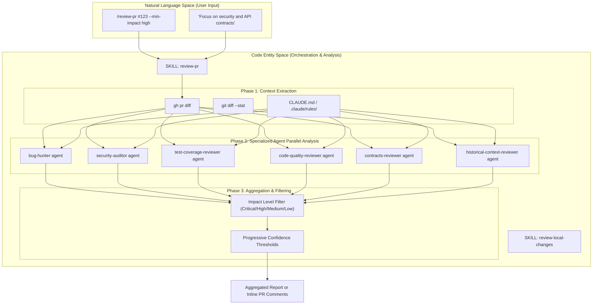
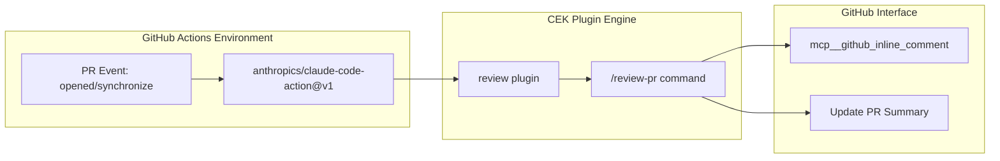

<!-- source: DeepWiki mcp.deepwiki.com · repo NeoLabHQ/context-engineering-kit · extra page Code Review Plugin · fetched 2026-10-26 -->

# Code Review Plugin

<details>
<summary>Relevant source files</summary>

The following files were used as context for generating this wiki page:

- [docs/guides/README.md](docs/guides/README.md)
- [docs/guides/ci-integration.md](docs/guides/ci-integration.md)
- [docs/plugins/review/README.md](docs/plugins/review/README.md)
- [plugins/fpf/.claude-plugin/plugin.json](plugins/fpf/.claude-plugin/plugin.json)
- [plugins/review/.claude-plugin/plugin.json](plugins/review/.claude-plugin/plugin.json)

</details>


## Purpose and Scope

The Code Review Plugin is a comprehensive multi-agent system designed to perform deep analysis of code changes. It utilizes six specialized agents to examine code from distinct perspectives, catching bugs, security vulnerabilities, and quality regressions before they reach production. The system supports reviewing uncommitted local changes, active GitHub Pull Requests, and automated CI/CD integration.

**Sources:** [docs/plugins/review/README.md:1-14](), [docs/guides/ci-integration.md:1-11]()

## Plugin Architecture

The plugin is structured as a set of high-level commands that orchestrate specialized sub-agents. It follows a parallel execution model to ensure comprehensive coverage without linear time penalties.

### Plugin Manifest
| Field | Value |
|-------|-------|
| Plugin Name | `review` |
| Version | `3.0.0` |
| Commands | `/review-local-changes`, `/review-pr` |
| Review Agents | 6 specialized perspectives |

**Sources:** [plugins/review/.claude-plugin/plugin.json:1-9](), [docs/plugins/review/README.md:63-68]()

### System Data Flow
The following diagram illustrates how the plugin bridges Natural Language requests to Code Entity analysis through its specialized agents and orchestration logic.



**Sources:** [docs/plugins/review/README.md:46-60](), [docs/guides/ci-integration.md:88-95]()

## Specialized Review Agents

The core of the system is the division of labor among six agents, each defined by specific instructions and focus areas to provide professional-grade coverage.

| Agent Name | Primary Focus | Key Entities & Issues Caught |
|------------|---------------|-----------------------|
| **Bug Hunter** | Logic & Runtime | Null pointers, race conditions, resource leaks, logic errors, off-by-one errors. |
| **Security Auditor** | Vulnerabilities | SQLi, XSS, CSRF, exposed secrets, insecure cryptography, auth bypasses. |
| **Test Coverage** | Verification | Gaps in test coverage, missing edge case tests, integration test needs. |
| **Code Quality** | Maintainability | Code complexity, naming conventions, code smells, duplication, SOLID principles. |
| **Contracts Reviewer** | Interfaces | API endpoint definitions, request/response schemas, breaking changes, type safety. |
| **Historical Context**| Evolution | Architectural drift, consistency with existing patterns, technical debt indicators. |

**Sources:** [docs/plugins/review/README.md:70-135](), [docs/guides/ci-integration.md:88-95]()

## Commands & Implementation Details

### /review-local-changes
This command targets uncommitted work in the current local environment. It is used to catch issues early in the development loop before code is even pushed to a remote repository.

*   **Implementation**: Analyzes the current state of the working directory against the HEAD commit.
*   **Output**: Produces a structured Markdown report organized by severity: Executive Summary, Critical Issues (Must Fix), High Priority, Medium Priority, Low Priority, and a checklist of Action Items.
*   **Quality Gate**: Designed to help developers self-audit before committing.

**Sources:** [docs/plugins/review/README.md:202-227](), [docs/plugins/review/README.md:65-65]()

### /review-pr
Designed for formal Pull Request workflows, this command emphasizes high-confidence inline feedback directly on GitHub.

*   **Implementation**: Uses GitHub CLI (`gh`) and MCP tools to fetch PR diffs and post feedback.
*   **Inline Logic**: Posts comments directly on the specific lines of code. Each comment includes a severity emoji (🔴/🟠/🟡), a brief description, evidence of the observation, and a suggested code fix in a `suggestion` block.
*   **CI/CD Optimization**: When run in CI, it supports "sticky comments" that update existing reports rather than creating new notification noise for every commit.

**Sources:** [docs/plugins/review/README.md:229-241](), [docs/guides/ci-integration.md:65-80]()

## Scoring & Filtering System

To ensure high-quality feedback and minimize "AI noise," the system allows users to filter results based on impact.

### Impact Level Filtering
Users can specify a minimum impact threshold using the `--min-impact` flag (e.g., `/review-pr --min-impact critical`).

| Level | Description |
|-------|-------------|
| `critical` | Showstoppers, security holes, or catastrophic bugs. |
| `high` | Significant issues that should be fixed before merging. |
| `medium` | Improvements or non-critical bugs to consider. |
| `low` | Minor nitpicks or "nice to have" improvements. |

**Sources:** [docs/plugins/review/README.md:27-38](), [docs/plugins/review/README.md:234-234]()

## CI/CD Integration

The plugin is optimized for automated execution within GitHub Actions using the `anthropics/claude-code-action`.

### Integration Workflow



### Configuration Example
The system is configured via a workflow YAML. It requires `CLAUDE_CODE_OAUTH_TOKEN` and specific tool permissions to interact with the GitHub API for commenting and reading PR metadata.

```yaml
# Source: docs/guides/ci-integration.md:26-80
- name: Run Claude Code Review
  uses: anthropics/claude-code-action@v1
  with:
    claude_code_oauth_token: ${{ secrets.CLAUDE_CODE_OAUTH_TOKEN }}
    track_progress: true
    use_sticky_comment: true
    plugin_marketplaces: https://github.com/NeoLabHQ/context-engineering-kit.git
    plugins: "review@context-engineering-kit"
    prompt: '/review-pr ${{ github.repository }}/pull/${{ github.event.pull_request.number }}'
    claude_args: '--allowed-tools "Skill,Bash,Glob,Grep,Read,Task,mcp__github_inline_comment__create_inline_comment,Bash(gh pr comment:*),Bash(gh pr diff:*),Bash(gh pr view:*)"'
```

**Sources:** [docs/guides/ci-integration.md:26-80](), [docs/plugins/review/README.md:145-198]()

---

