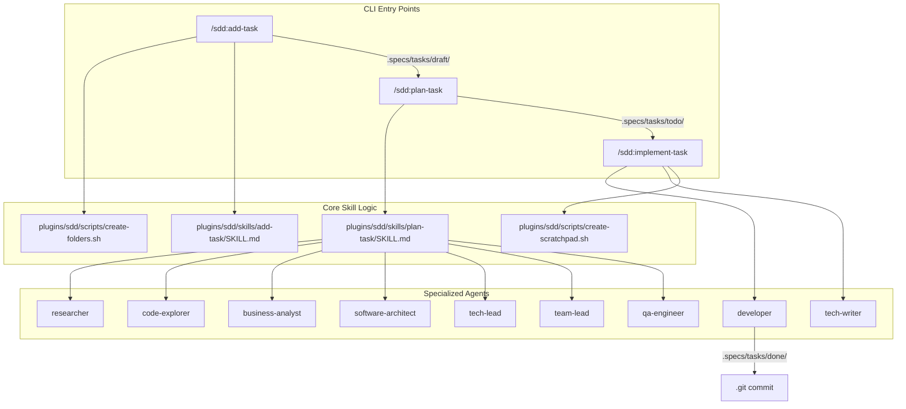
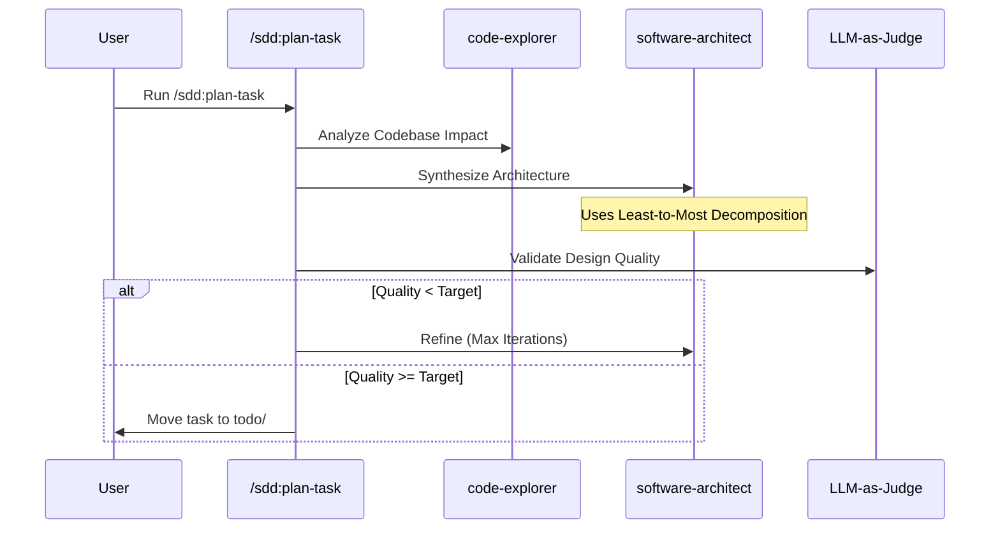
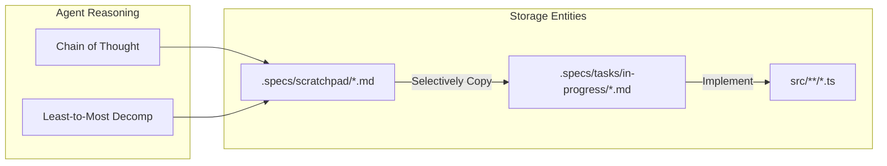

<!-- source: DeepWiki mcp.deepwiki.com · repo NeoLabHQ/context-engineering-kit · extra page SDD Plugin · fetched 2026-10-26 -->

# SDD Plugin

Relevant source files

The following files were used as context for generating this wiki page:

- [.specs/tasks/done/.gitkeep](.specs/tasks/done/.gitkeep)
- [.specs/tasks/draft/.gitkeep](.specs/tasks/draft/.gitkeep)
- [.specs/tasks/in-progress/.gitkeep](.specs/tasks/in-progress/.gitkeep)
- [.specs/tasks/roadmap.md](.specs/tasks/roadmap.md)
- [.specs/tasks/todo/.gitkeep](.specs/tasks/todo/.gitkeep)
- [docs/guides/brainstorming-to-implementation.md](docs/guides/brainstorming-to-implementation.md)
- [docs/guides/decision-making.md](docs/guides/decision-making.md)
- [docs/guides/spec-driven-development.md](docs/guides/spec-driven-development.md)
- [docs/plugins/customaize-agent/README.md](docs/plugins/customaize-agent/README.md)
- [docs/plugins/kaizen/usage-examples.md](docs/plugins/kaizen/usage-examples.md)
- [docs/plugins/mcp/usage-examples.md](docs/plugins/mcp/usage-examples.md)
- [docs/plugins/reflexion/usage-examples.md](docs/plugins/reflexion/usage-examples.md)
- [docs/plugins/sdd/README.md](docs/plugins/sdd/README.md)
- [docs/plugins/sdd/add-task.md](docs/plugins/sdd/add-task.md)
- [docs/plugins/sdd/customization.md](docs/plugins/sdd/customization.md)
- [docs/plugins/sdd/refine.md](docs/plugins/sdd/refine.md)
- [docs/plugins/sdd/usage-examples.md](docs/plugins/sdd/usage-examples.md)
- [plugins/customaize-agent/README.md](plugins/customaize-agent/README.md)
- [plugins/sdd/README.md](plugins/sdd/README.md)
- [plugins/sdd/agents/business-analyst.md](plugins/sdd/agents/business-analyst.md)
- [plugins/sdd/agents/code-explorer.md](plugins/sdd/agents/code-explorer.md)
- [plugins/sdd/agents/developer.md](plugins/sdd/agents/developer.md)
- [plugins/sdd/agents/researcher.md](plugins/sdd/agents/researcher.md)
- [plugins/sdd/agents/software-architect.md](plugins/sdd/agents/software-architect.md)
- [plugins/sdd/agents/tech-lead.md](plugins/sdd/agents/tech-lead.md)
- [plugins/sdd/agents/tech-writer.md](plugins/sdd/agents/tech-writer.md)
- [plugins/sdd/scripts/create-folders.sh](plugins/sdd/scripts/create-folders.sh)
- [plugins/sdd/skills/add-task/SKILL.md](plugins/sdd/skills/add-task/SKILL.md)
- [plugins/sdd/skills/plan-task/SKILL.md](plugins/sdd/skills/plan-task/SKILL.md)

The SDD (Spec-Driven Development) Plugin implements a high-reliability, multi-agent development workflow designed to transform natural language prompts into production-ready code. Based on the **arc42** standard and the **GitHub Spec Kit**, it functions as a "development compilation" process where task specifications are iteratively refined through quality gates before execution.

This plugin is specifically optimized for complex or large codebases where architecture consistency and impact analysis are critical. It uses a 6-phase planning process followed by a gated implementation phase, leveraging specialized agents for research, architecture, and verification.

Sources: [docs/plugins/sdd/README.md:1-15](), [docs/plugins/sdd/README.md:108-113]()

## Architecture & Data Flow

The SDD Plugin operates through a series of specialized agents that manage the lifecycle of a task across four distinct states: `draft`, `todo`, `in-progress`, and `done`.

### Task Lifecycle & Directory Structure

The plugin enforces a strict directory structure under `.specs/tasks/` to manage the state of development.

| Directory | State | Description |
|-----------|-------|-------------|
| `.specs/tasks/draft/` | Draft | Initial user intent captured by `/sdd:add-task`. |
| `.specs/tasks/todo/` | Planned | Refined specification with architecture and steps after `/sdd:plan-task`. |
| `.specs/tasks/in-progress/` | Active | Currently being executed by `/sdd:implement-task`. |
| `.specs/tasks/done/` | Completed | Implementation finished and verified. |
| `.specs/scratchpad/` | Context | Gitignored temporary files for agent reasoning. |

Sources: [docs/plugins/sdd/README.md:72-77](), [docs/plugins/sdd/README.md:33-47](), [plugins/sdd/scripts/create-folders.sh:1-10]()

### System Entity Map (Code Space to Workflow Space)

The following diagram maps codebase entities (scripts, skill files, and agents) to the logical phases of the SDD workflow.

Sources: [plugins/sdd/skills/plan-task/SKILL.md:1-20](), [docs/plugins/sdd/README.md:96-106](), [plugins/sdd/scripts/create-scratchpad.sh:1-10](), [plugins/sdd/agents/software-architect.md:51-53]()

## Phase 1: Planning Workflow (`/sdd:plan-task`)

The planning phase transforms a vague prompt into a technical specification. It uses a parallel analysis strategy followed by synthesis across 6 phases.

### 6-Phase Planning Pipeline

1.  **Phase 2a: Research** (`researcher`): Gathers technology research, dependency analysis, and best practices. Generates a `.claude/skills/<skill-name>/SKILL.md` file.
2.  **Phase 2b: Codebase Analysis** (`code-explorer`): Performs codebase impact analysis to evaluate which files are affected and which patterns to follow.
3.  **Phase 2c: Business Analysis** (`business-analyst`): Requirements discovery and stakeholder analysis to refine the specification.
4.  **Phase 3: Architecture Synthesis** (`software-architect`): Synthesizes inputs into a high-level architectural overview.
5.  **Phase 4: Decomposition** (`tech-lead`): Breaks down the architecture into implementation steps with success criteria and risk analysis.
6.  **Phase 5: Parallelize** (`team-lead`): Performs step parallelization and agent assignment for the execution plan.
7.  **Phase 6: Verifications** (`qa-engineer`): Defines verification rubrics and quality gates using **LLM-as-Judge** definitions.

Sources: [docs/plugins/sdd/README.md:96-104](), [docs/plugins/sdd/README.md:57-58](), [plugins/sdd/agents/software-architect.md:20-28]()

### Planning Control Flow

Sources: [plugins/sdd/agents/software-architect.md:41-43](), [plugins/sdd/agents/code-explorer.md:18-22](), [.specs/tasks/roadmap.md:14-15]()

## Phase 2: Implementation Workflow (`/sdd:implement-task`)

Implementation is an automated "build" process where the `developer` agent executes the planned steps.

### Implementation Patterns

*   **Development as Compilation**: The plugin functions like a nightly build: `task specs → /implement-task → working code`.
*   **Quality Gates**: Each step is verified against the rubrics created by the `qa-engineer`.
*   **TDD Execution**: The `developer` agent is mandated to follow Test-Driven Development cycles (Red-Green-Refactor).
*   **Documentation**: The `tech-writer` agent updates API guides and architecture docs upon completion.

Sources: [docs/plugins/sdd/README.md:9-10](), [docs/plugins/sdd/README.md:105-106](), [plugins/sdd/agents/tech-writer.md:125-131]()

### Customization Flags

Users can tune the workflow using specific flags:

| Flag | Description |
|------|-------------|
| `--human-in-the-loop` | Allows pausing for human verification after each step. |
| `--target-quality` | Adjusts the score threshold for the LLM-as-Judge verification. |
| `--fast` | Optimizes for speed by reducing iterations or skipping non-critical analysis. |
| `--continue` | Resumes an interrupted implementation from the last successful step. |
| `--refine` | Performs refinement of implementation after human feedback or corrections. |

Sources: [docs/plugins/sdd/README.md:11-12](), [.specs/tasks/roadmap.md:14-15](), [docs/plugins/sdd/usage-examples.md:151-160]()

## Scratchpad & Reasoning Frameworks

Agents within the SDD plugin utilize a **scratchpad-first approach** to ensure high-quality reasoning before modifying any project files.

1.  **Scratchpad Creation**: Agents run `bash ${CLAUDE_PLUGIN_ROOT}/scripts/create-scratchpad.sh` to create a private workspace in `.specs/scratchpad/<hex-id>.md`.
2.  **Least-to-Most Decomposition**: The `software-architect` and `tech-lead` break complex problems into simpler, ordered subproblems.
3.  **Zero-shot CoT + ReAct**: The `code-explorer` uses a systematic Thought-Action-Observation loop for codebase tracing.

Sources: [plugins/sdd/agents/software-architect.md:41-55](), [plugins/sdd/agents/code-explorer.md:18-22](), [plugins/sdd/agents/code-explorer.md:39-50](), [plugins/sdd/agents/tech-lead.md:47-50]()

### Agent Workspace Flow

Sources: [plugins/sdd/agents/software-architect.md:49-54](), [plugins/sdd/agents/code-explorer.md:65-72](), [plugins/sdd/agents/tech-lead.md:18-20]()

---

