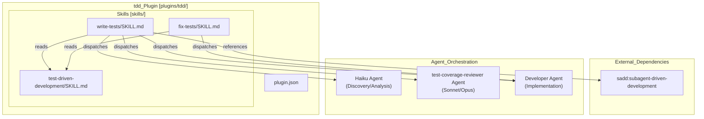
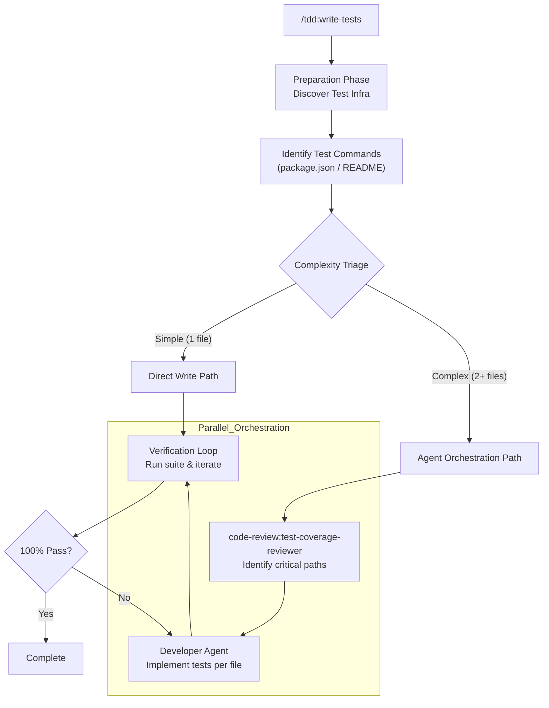
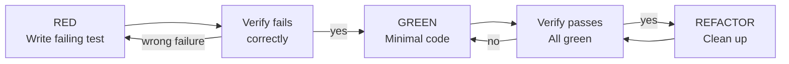

<!-- source: DeepWiki mcp.deepwiki.com · repo NeoLabHQ/context-engineering-kit · extra page TDD Plugin · fetched 2026-10-26 -->

# TDD Plugin

Relevant source files

The following files were used as context for generating this wiki page:

- [plugins/docs/README.md](plugins/docs/README.md)
- [plugins/kaizen/README.md](plugins/kaizen/README.md)
- [plugins/sadd/skills/subagent-driven-development/SKILL.md](plugins/sadd/skills/subagent-driven-development/SKILL.md)
- [plugins/tdd/README.md](plugins/tdd/README.md)
- [plugins/tdd/skills/fix-tests/SKILL.md](plugins/tdd/skills/fix-tests/SKILL.md)
- [plugins/tdd/skills/test-driven-development/SKILL.md](plugins/tdd/skills/test-driven-development/SKILL.md)
- [plugins/tdd/skills/write-tests/SKILL.md](plugins/tdd/skills/write-tests/SKILL.md)

The TDD Plugin implements Test-Driven Development methodology for Claude Code, ensuring production code is validated by tests written first. This plugin provides commands for systematic test coverage generation (`/tdd:write-tests`) and test maintenance (`/tdd:fix-tests`), orchestrating specialized agents to handle complex multi-file changes. It enforces the Red-Green-Refactor cycle and provides the `tdd:test-driven-development` skill to guide subagents in high-integrity implementation [plugins/tdd/README.md:1-10]().

For spec-driven workflows that incorporate testing, see [3.2.2 SDD Plugin](). For quality gates that verify test coverage between tasks, see [3.2.3 SADD Plugin](). For continuous improvement of test suites, see [3.4.1 Kaizen Plugin]().

---

## Plugin Architecture

The TDD Plugin consists of two primary commands and a suite of skills that define the "Iron Law" of TDD: No production code without a failing test first [plugins/tdd/skills/test-driven-development/SKILL.md:33-37]().

### Code Entity Relationship Diagram

**Sources:** [plugins/tdd/README.md:52-59](), [plugins/tdd/skills/write-tests/SKILL.md:39-41](), [plugins/tdd/skills/fix-tests/SKILL.md:39-41](), [plugins/tdd/skills/test-driven-development/SKILL.md:1-4]()

---

## Command: /tdd:write-tests

The `write-tests` command systematically adds test coverage for local code changes. It identifies uncommitted changes (including untracked files) or covers the latest commit if the working directory is clean [plugins/tdd/skills/write-tests/SKILL.md:11-17]().

### Implementation Flow

**Sources:** [plugins/tdd/skills/write-tests/SKILL.md:37-132]()

### Complexity Decision Logic

The orchestrator analyzes the `git status -u` or `git show` output to determine the execution strategy [plugins/tdd/skills/write-tests/SKILL.md:61-67]():

| Condition | Strategy | Logic |
|-----------|----------|-------|
| **Single File** | Direct Write | Main agent writes tests following `tdd:test-driven-development` guidelines [plugins/tdd/skills/write-tests/SKILL.md:70-86](). |
| **Multiple Files** | Orchestration | Dispatches parallel `code-review:test-coverage-reviewer` agents to define test cases [plugins/tdd/skills/write-tests/SKILL.md:88-100](). |
| **Complex Logic** | Orchestration | Uses `developer` agents to implement specific test cases identified by reviewers [plugins/tdd/skills/write-tests/SKILL.md:102-112](). |

---

## Command: /tdd:fix-tests

The `fix-tests` command is used after business logic changes or refactoring to bring the test suite back to a passing state [plugins/tdd/skills/fix-tests/SKILL.md:19-25]().

### Failure Analysis Logic

The command follows a strict workflow to ensure tests are fixed without introducing regressions in business logic:

1.  **Discovery**: Identifies commands to run tests and coverage [plugins/tdd/skills/fix-tests/SKILL.md:42-45]().
2.  **Isolation**: Uses a `haiku` agent to verify that individual test files can be run in isolation [plugins/tdd/skills/fix-tests/SKILL.md:56-61]().
3.  **Fixing**: Launches parallel `developer` agents per failing test file [plugins/tdd/skills/fix-tests/SKILL.md:65-74]().
4.  **Verification**: Re-runs the full suite until 100% pass rate is achieved [plugins/tdd/skills/fix-tests/SKILL.md:76-83]().

**Sources:** [plugins/tdd/skills/fix-tests/SKILL.md:35-84]()

---

## Skill: test-driven-development

The `test-driven-development` skill defines the core philosophy and the "Red-Green-Refactor" cycle. It explicitly forbids writing production code before a failing test exists [plugins/tdd/skills/test-driven-development/SKILL.md:33-48]().

### The Red-Green-Refactor Cycle

**Sources:** [plugins/tdd/skills/test-driven-development/SKILL.md:52-71]()

### Key Principles and Anti-Patterns

The skill mandates high-quality testing practices:
-   **One Behavior**: Each test should verify exactly one thing [plugins/tdd/skills/test-driven-development/SKILL.md:211]().
-   **Minimal Code**: Write only the simplest code to pass the test; avoid over-engineering (YAGNI) [plugins/tdd/skills/test-driven-development/SKILL.md:137-173]().
-   **No Mocks**: Use real code unless mocks are absolutely unavoidable [plugins/tdd/skills/test-driven-development/SKILL.md:117]().
-   **Delete Violation**: If code is written before a test, it must be deleted and implemented fresh from tests [plugins/tdd/skills/test-driven-development/SKILL.md:39-48]().

---

## Integration with SDD and SADD

The TDD plugin is deeply integrated into the broader development workflow:

-   **SADD Integration**: Implementation subagents dispatched by `sadd:subagent-driven-development` are instructed to "Write tests (following TDD if task says to)" [plugins/sadd/skills/subagent-driven-development/SKILL.md:63]().
-   **Code Review**: The `write-tests` command leverages the `code-review:test-coverage-reviewer` agent to ensure that new tests cover critical business logic, data mutations, and error handling [plugins/tdd/skills/write-tests/SKILL.md:157-160]().
-   **Documentation**: The `docs` plugin maintains living documentation that TDD agents use to understand project context and testing conventions via `@README.md` [plugins/tdd/skills/write-tests/SKILL.md:178-179](), [plugins/docs/README.md:1-18]().

**Sources:** [plugins/sadd/skills/subagent-driven-development/SKILL.md:53-71](), [plugins/tdd/skills/write-tests/SKILL.md:92-100](), [plugins/docs/README.md:1-18]()

---

