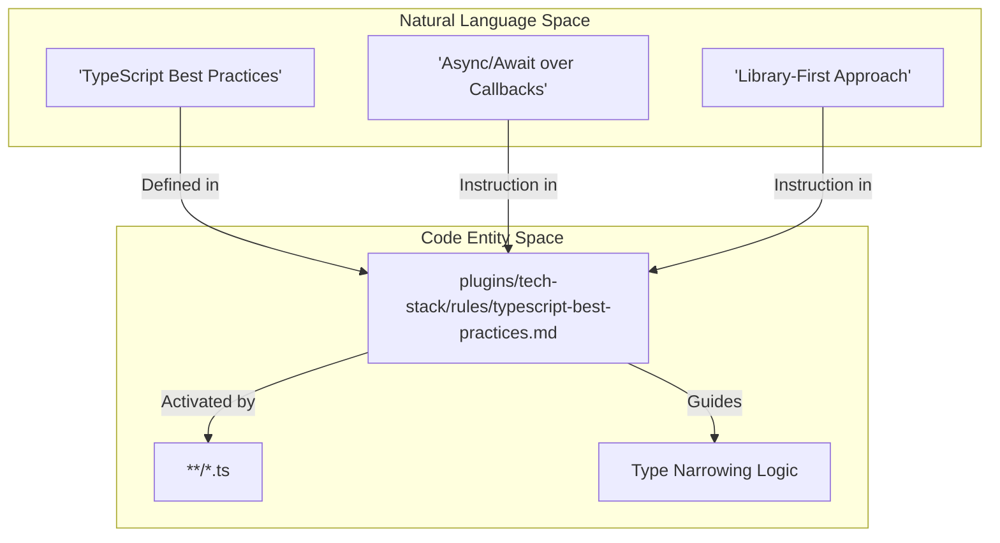
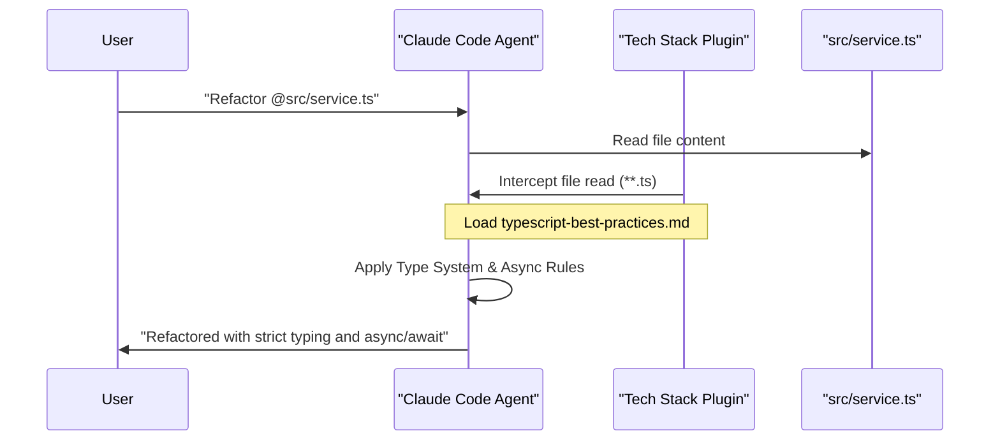

<!-- source: DeepWiki mcp.deepwiki.com · repo NeoLabHQ/context-engineering-kit · extra page Tech Stack Plugin · fetched 2026-10-26 -->

# Tech Stack Plugin

Relevant source files

The following files were used as context for generating this wiki page:

- [docs/plugins/tech-stack/README.md](docs/plugins/tech-stack/README.md)
- [docs/plugins/tech-stack/typescript-best-practices.md](docs/plugins/tech-stack/typescript-best-practices.md)
- [plugins/tech-stack/README.md](plugins/tech-stack/README.md)
- [plugins/tech-stack/rules/typescript-best-practices.md](plugins/tech-stack/rules/typescript-best-practices.md)

## Purpose and Scope

The Tech Stack Plugin provides language and framework-specific best practices that are automatically loaded into the agent's context based on file types. Unlike manual setup commands, this plugin uses a "Zero Configuration" approach where rules activate transparently when the agent reads or writes matching files (e.g., `**/*.ts` for TypeScript) [plugins/tech-stack/README.md:3-12]().

This ensures consistent code quality across all AI-assisted development by injecting curated, production-tested guidelines directly into the active context window [docs/plugins/tech-stack/README.md:3-8]().

---

## Overview

The Tech Stack plugin operates on a rule-based system. These rules are context files that define standards for specific tech stacks. Once the plugin is installed via `/plugin install tech-stack@NeoLabHQ/context-engineering-kit`, the relevant standards are automatically applied without manual invocation [plugins/tech-stack/README.md:12-25]().

### Key Features
- **Automatic Rules**: Best practices are loaded into context based on the glob pattern of the files being worked on [plugins/tech-stack/README.md:7]().
- **Transparent Application**: Rules apply to all file operations, including both reading existing code and writing new implementations [docs/plugins/tech-stack/typescript-best-practices.md:5-6]().
- **Standardized Context**: Provides a shared language for the agent regarding type systems, async patterns, and library preferences [plugins/tech-stack/rules/typescript-best-practices.md:7-60]().

Sources: [plugins/tech-stack/README.md:1-43](), [docs/plugins/tech-stack/README.md:1-43]()

---

## Architecture & Data Flow

The plugin utilizes the CEK rule system to associate markdown-based guidelines with file patterns.

### Natural Language to Code Entity Mapping
This diagram bridges the gap between high-level language standards and the specific files that implement them within the kit.

Sources: [plugins/tech-stack/rules/typescript-best-practices.md:1-5](), [docs/plugins/tech-stack/typescript-best-practices.md:1-6]()

### Automatic Context Injection
The following diagram illustrates how the agent's context is updated dynamically as a user navigates different files.

Sources: [plugins/tech-stack/README.md:12-26](), [docs/plugins/tech-stack/typescript-best-practices.md:10]()

---

## TypeScript Best Practices Reference

The primary rule currently implemented is the **TypeScript Best Practices** rule, which targets `**/*.ts` files [plugins/tech-stack/rules/typescript-best-practices.md:1-5]().

### Rule Categories

| Category | Key Guidelines |
| :--- | :--- |
| **Type System** | Interfaces for objects, types for unions; Prefer inference; Avoid `any`; Use `Record<PropertyKey, unknown>` [plugins/tech-stack/rules/typescript-best-practices.md:43-47](). |
| **Code Style** | Use enums for constants; Export all types by default; Use type guards instead of assertions [plugins/tech-stack/rules/typescript-best-practices.md:17-20](). |
| **Async Patterns** | `async/await` over `.then()`; Prefer async APIs; Use `Promise.all` for concurrency [plugins/tech-stack/rules/typescript-best-practices.md:57-60](). |
| **Type Narrowing** | Use `typeof`, `instanceof`, `in` operator, and custom type predicates (`value is Type`) [docs/plugins/tech-stack/typescript-best-practices.md:51-61](). |
| **Library-First** | Prefer `date-fns` (dates), `zod` (validation), `axios` (HTTP), `zustand` (state), `lodash` (utils) [plugins/tech-stack/rules/typescript-best-practices.md:26-31](). |
| **Utility Types** | Practical usage of `Parameters`, `ReturnType`, `Awaited`, `Omit`, `Pick`, and `NonNullable` [docs/plugins/tech-stack/typescript-best-practices.md:67-81](). |

### Contrastive Patterns (Before/After)
The rules use contrastive examples to steer the agent away from "vibe coding" toward robust engineering [plugins/tech-stack/rules/typescript-best-practices.md:85-132]().

- **Generics**: Replacing `any` with `<T, K extends keyof T>` to preserve type information [plugins/tech-stack/rules/typescript-best-practices.md:87-102]().
- **Type Guards**: Narrowing `unknown` API responses using user-defined predicates [plugins/tech-stack/rules/typescript-best-practices.md:104-133]().
- **Const Assertions**: Using `as const` to preserve literal types and create readonly objects [plugins/tech-stack/rules/typescript-best-practices.md:136-154]().

Sources: [plugins/tech-stack/rules/typescript-best-practices.md:7-170](), [docs/plugins/tech-stack/typescript-best-practices.md:12-83]()

---

## Implementation Details

The Tech Stack Plugin relies on the underlying CEK environment to monitor file access. When a file matching the defined `paths` in the rule header is accessed, the markdown content is injected into the prompt [plugins/tech-stack/rules/typescript-best-practices.md:1-5]().

### Performance and Logging Rules
Beyond syntax, the plugin enforces runtime best practices:
- **Performance**: Recommends `for...of` loops over index-based loops and emphasizes logic reuse [plugins/tech-stack/rules/typescript-best-practices.md:72-73]().
- **Logging**: Strictly forbids logging private data (API keys) and mandates logging errors in `.catch()` blocks to prevent silent failures [plugins/tech-stack/rules/typescript-best-practices.md:81-82]().
- **Time Consistency**: Recommends assigning `Date.now()` to a constant once for consistency across a single operation [plugins/tech-stack/rules/typescript-best-practices.md:77]().

Sources: [plugins/tech-stack/rules/typescript-best-practices.md:70-83](), [docs/plugins/tech-stack/typescript-best-practices.md:22-24]()

---

