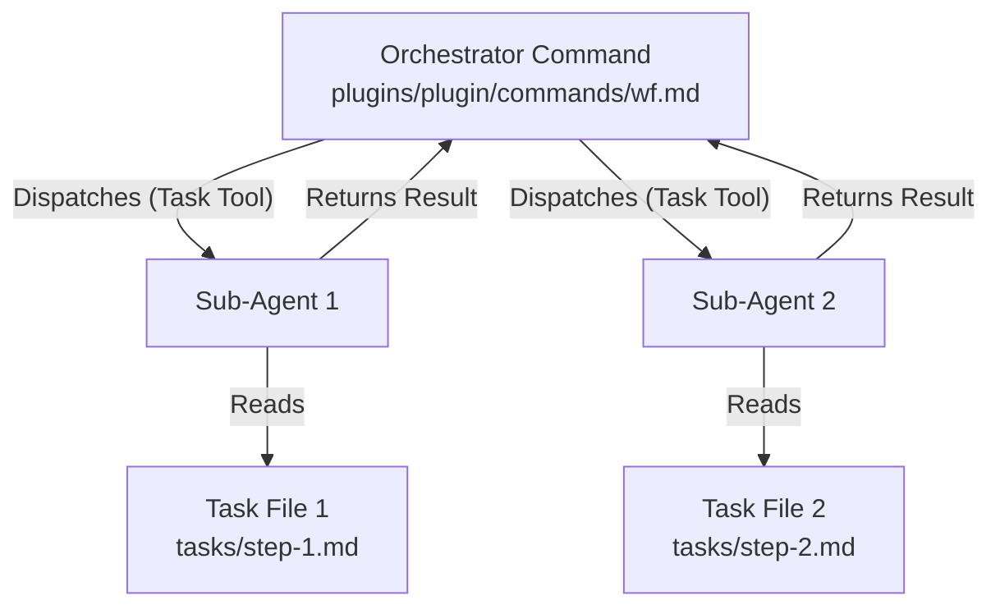
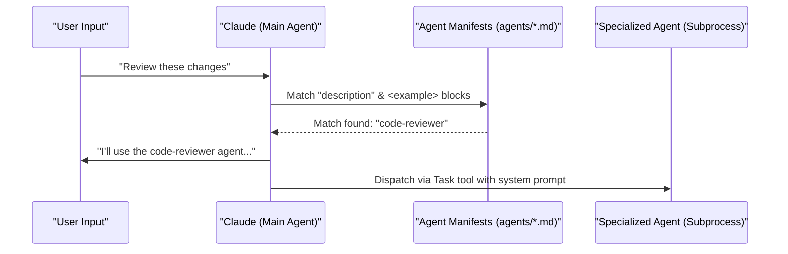

<!-- source: DeepWiki mcp.deepwiki.com · repo NeoLabHQ/context-engineering-kit · extra page Customaize Agent Plugin · fetched 2026-10-26 -->

# Customaize Agent Plugin

Relevant source files

The following files were used as context for generating this wiki page:

- [docs/plugins/customaize-agent/README.md](docs/plugins/customaize-agent/README.md)
- [plugins/customaize-agent/README.md](plugins/customaize-agent/README.md)
- [plugins/customaize-agent/skills/agent-evaluation/SKILL.md](plugins/customaize-agent/skills/agent-evaluation/SKILL.md)
- [plugins/customaize-agent/skills/apply-anthropic-skill-best-practices/SKILL.md](plugins/customaize-agent/skills/apply-anthropic-skill-best-practices/SKILL.md)
- [plugins/customaize-agent/skills/context-engineering/SKILL.md](plugins/customaize-agent/skills/context-engineering/SKILL.md)
- [plugins/customaize-agent/skills/create-agent/SKILL.md](plugins/customaize-agent/skills/create-agent/SKILL.md)
- [plugins/customaize-agent/skills/create-command/SKILL.md](plugins/customaize-agent/skills/create-command/SKILL.md)
- [plugins/customaize-agent/skills/create-hook/SKILL.md](plugins/customaize-agent/skills/create-hook/SKILL.md)
- [plugins/customaize-agent/skills/create-skill/SKILL.md](plugins/customaize-agent/skills/create-skill/SKILL.md)
- [plugins/customaize-agent/skills/create-workflow-command/SKILL.md](plugins/customaize-agent/skills/create-workflow-command/SKILL.md)
- [plugins/customaize-agent/skills/prompt-engineering/SKILL.md](plugins/customaize-agent/skills/prompt-engineering/SKILL.md)
- [plugins/customaize-agent/skills/test-prompt/SKILL.md](plugins/customaize-agent/skills/test-prompt/SKILL.md)
- [plugins/customaize-agent/skills/test-skill/SKILL.md](plugins/customaize-agent/skills/test-skill/SKILL.md)
- [plugins/docs/skills/write-concisely/SKILL.md](plugins/docs/skills/write-concisely/SKILL.md)
- [plugins/git/skills/create-pr/SKILL.md](plugins/git/skills/create-pr/SKILL.md)
- [plugins/sadd/skills/multi-agent-patterns/SKILL.md](plugins/sadd/skills/multi-agent-patterns/SKILL.md)
- [plugins/sdd/README.md](plugins/sdd/README.md)

The Customaize Agent Plugin is a meta-level framework for creating, testing, and optimizing Claude Code extensions, including commands, skills, hooks, and autonomous agents. It implements prompt engineering best practices from Anthropic and research-backed persuasion principles to ensure that custom extensions are effective, discoverable, and token-efficient [docs/plugins/customaize-agent/README.md:1-10]().

## Overview

The plugin provides a complete toolkit for extending Claude Code's capabilities by applying Test-Driven Development (TDD) principles to prompt engineering. Users write test scenarios first, observe agent failures, and then create prompts that address those failures in a "RED-GREEN-REFACTOR" cycle [docs/plugins/customaize-agent/README.md:18-22]().

### Core Capabilities
*   **Extension Creation**: Interactive assistants for building commands, skills, and hooks with proper structure [docs/plugins/customaize-agent/README.md:7]().
*   **TDD for Prompts**: RED-GREEN-REFACTOR cycle applied to prompt engineering with subagent testing to verify prompts and skills under pressure [docs/plugins/customaize-agent/README.md:8](), [plugins/customaize-agent/README.md:55-56]().
*   **Anthropic Best Practices**: Application of official guidelines for skill authoring, progressive disclosure, and discoverability [docs/plugins/customaize-agent/README.md:9]().
*   **Optimization**: Application of research-backed persuasion techniques that have been shown to more than double compliance rates from 33% to 72% [docs/plugins/customaize-agent/README.md:21-22]().

### Extension Types
| Type | Purpose | Implementation |
| :--- | :--- | :--- |
| **Command** | User-initiated actions | Markdown files in `commands/` [plugins/customaize-agent/skills/create-agent/SKILL.md:28-33](). |
| **Skill** | Persistent procedural knowledge | `SKILL.md` with YAML frontmatter [plugins/customaize-agent/skills/create-skill/SKILL.md:115-130](). |
| **Hook** | Automated workflow triggers | Scripts in `.claude/hooks/` or `~/.claude/hooks/` [plugins/customaize-agent/skills/create-hook/SKILL.md:102-108](). |
| **Agent** | Autonomous subprocesses | `agents/*.md` with `model`, `tools`, and `triggering` metadata [plugins/customaize-agent/skills/create-agent/SKILL.md:35-60](). |

**Sources:** [docs/plugins/customaize-agent/README.md:1-22](), [plugins/customaize-agent/skills/create-skill/SKILL.md:115-130](), [plugins/customaize-agent/skills/create-hook/SKILL.md:102-108](), [plugins/customaize-agent/skills/create-agent/SKILL.md:28-35]().

## Command Reference

### /customaize-agent:create-agent
Comprehensive guide for creating autonomous Claude Code agents. These agents are spawned via the `Task` tool, operate in isolated context windows, and return results to the parent conversation [plugins/customaize-agent/skills/create-agent/SKILL.md:19-26]().

**Key Components**:
*   **Triggering Metadata**: The `description` field is critical; it must start with "Use this agent when..." and include `<example>` blocks with context, user requests, and commentary [plugins/customaize-agent/skills/create-agent/SKILL.md:97-120]().
*   **Frontmatter**: Defines `name`, `model` (default `inherit`), `color` for UI, and `tools` to restrict capabilities [plugins/customaize-agent/skills/create-agent/SKILL.md:75-168]().
*   **Triggering Patterns**: Supports explicit requests, implicit needs, proactive triggers (e.g., after DB changes), and tool usage patterns [plugins/customaize-agent/skills/create-agent/SKILL.md:169-236]().

### /customaize-agent:create-command
Interactive assistant for creating new slash commands with proper structure, patterns, and MCP tool integration [plugins/customaize-agent/README.md:51]().

### /customaize-agent:create-workflow-command
Designed to solve the **context bloat problem**, this command creates orchestrator commands that dispatch sub-agents for multi-step tasks. Instead of one massive prompt, task-specific instructions are stored in separate files [plugins/customaize-agent/README.md:52]().

**Workflow Architecture**:

**Sources:** [plugins/customaize-agent/README.md:52](), [plugins/customaize-agent/skills/create-workflow-command/SKILL.md:19-47]().

### /customaize-agent:create-skill
Treats skill creation as TDD for process documentation. It guides the user to write a "pressure scenario" (test case), watch the agent fail (RED), write the skill (GREEN), and then refine to close loopholes (REFACTOR) [plugins/customaize-agent/skills/create-skill/SKILL.md:13-21]().

**Skill Anatomy**:
*   **YAML Frontmatter**: Must include `name` (64 chars max) and `description` (1024 chars max) [plugins/customaize-agent/skills/apply-anthropic-skill-best-practices/SKILL.md:36-37]().
*   **Triggering Conditions**: Descriptions must be written in the third person and include BOTH what the skill does and when to use it [plugins/customaize-agent/skills/apply-anthropic-skill-best-practices/SKILL.md:76-86]().
*   **Bundled Resources**: Can include `scripts/` (executable code), `references/` (heavy documentation), and `assets/` (templates/icons) [plugins/customaize-agent/skills/create-skill/SKILL.md:126-130]().

### /customaize-agent:create-hook
Analyzes project tooling (TypeScript, Prettier, ESLint, etc.) to suggest and configure Claude Code hooks. It handles the creation of the script and updates `settings.json` [plugins/customaize-agent/skills/create-hook/SKILL.md:7-17]().

**Trigger Timings**:
*   `PreToolUse`: Runs before operations; can block operations by exiting with code 2 [plugins/customaize-agent/skills/create-hook/SKILL.md:69-74, 181-182]().
*   `PostToolUse`: Runs after operations; used for feedback or auto-fixes [plugins/customaize-agent/skills/create-hook/SKILL.md:69-74]().

**Sources:** [plugins/customaize-agent/skills/create-skill/SKILL.md:13-152](), [plugins/customaize-agent/skills/create-hook/SKILL.md:7-108](), [plugins/customaize-agent/skills/create-agent/SKILL.md:19-168](), [plugins/customaize-agent/skills/apply-anthropic-skill-best-practices/SKILL.md:31-86]().

## Prompt Engineering & Testing

### RED-GREEN-REFACTOR for Prompts
The plugin enforces a rigorous testing cycle for all extension types to ensure they are "bulletproof against rationalization" [plugins/customaize-agent/skills/create-skill/SKILL.md:3]().

| Phase | Action | Goal |
| :--- | :--- | :--- |
| **RED** | Run baseline scenario without the prompt | Document exact rationalizations or failures the agent makes [plugins/customaize-agent/skills/create-skill/SKILL.md:53-57](). |
| **GREEN** | Add the prompt/skill and re-run scenario | Verify the agent now complies with the new instructions [plugins/customaize-agent/skills/create-skill/SKILL.md:54-59](). |
| **REFACTOR** | Find new edge cases or loopholes | Optimize for token efficiency while maintaining compliance [plugins/customaize-agent/skills/create-skill/SKILL.md:55-60](). |

### Behavioral Gap Codification
When an agent fails a test, the "behavioral gap" is codified using the **Contrastive Pattern** (Before/After comparison) within the skill or rule to provide clear positive and negative examples [plugins/customaize-agent/skills/create-skill/SKILL.md:165-167]().

**Data Flow for Agent Triggering**:

### Prompt Optimization Commands
*   **/customaize-agent:test-prompt**: Test any prompt (commands, hooks, skills, subagent instructions) using isolated subagent scenarios [plugins/customaize-agent/README.md:55]().
*   **/customaize-agent:test-skill**: Verify skills work under pressure and resist rationalization using the RED-GREEN-REFACTOR cycle [plugins/customaize-agent/README.md:56]().
*   **/customaize-agent:apply-anthropic-skill-best-practices**: Comprehensive guide for skill development based on official best practices, including progressive disclosure patterns [plugins/customaize-agent/README.md:57](), [plugins/customaize-agent/skills/apply-anthropic-skill-best-practices/SKILL.md:122-131]().

**Sources:** [plugins/customaize-agent/skills/create-skill/SKILL.md:47-62](), [plugins/customaize-agent/README.md:55-57](), [plugins/customaize-agent/skills/create-agent/SKILL.md:19-26]().

## Skills Reference

### customaize-agent:prompt-engineering
Provides advanced techniques including Few-Shot Learning (2-5 examples), Chain-of-Thought (CoT) reasoning, and Instruction Hierarchy [plugins/customaize-agent/skills/prompt-engineering/SKILL.md:12-138](). It emphasizes **Progressive Disclosure**: start with simple prompts and add complexity (constraints, reasoning, examples) only when needed [plugins/customaize-agent/skills/prompt-engineering/SKILL.md:118-133]().

### customaize-agent:context-engineering
Focuses on the mechanics of context as a finite resource with diminishing marginal returns [plugins/customaize-agent/skills/context-engineering/SKILL.md:68-75](). It details the anatomy of context (System Prompts, Tool Definitions, Retrieved Documents, Message History, Tool Outputs) and the **Attention Budget Constraint** where token relationships grow quadratically [plugins/customaize-agent/skills/context-engineering/SKILL.md:16-51]().

### customaize-agent:agent-evaluation
Defines multi-dimensional rubrics (Instruction Following, Output Completeness, Tool Efficiency, Reasoning Quality, Response Coherence) for measuring agent performance [plugins/customaize-agent/skills/agent-evaluation/SKILL.md:53-102](). It uses **LLM-as-judge** methodologies with a mandatory Chain-of-Thought requirement before scoring to improve reliability [plugins/customaize-agent/skills/agent-evaluation/SKILL.md:105-142]().

**Sources:** [plugins/customaize-agent/skills/prompt-engineering/SKILL.md:1-210](), [plugins/customaize-agent/skills/context-engineering/SKILL.md:1-75](), [plugins/customaize-agent/skills/agent-evaluation/SKILL.md:1-142]().

---

