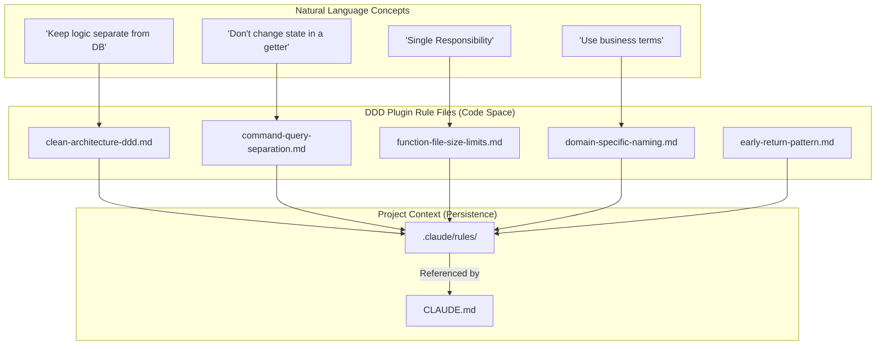
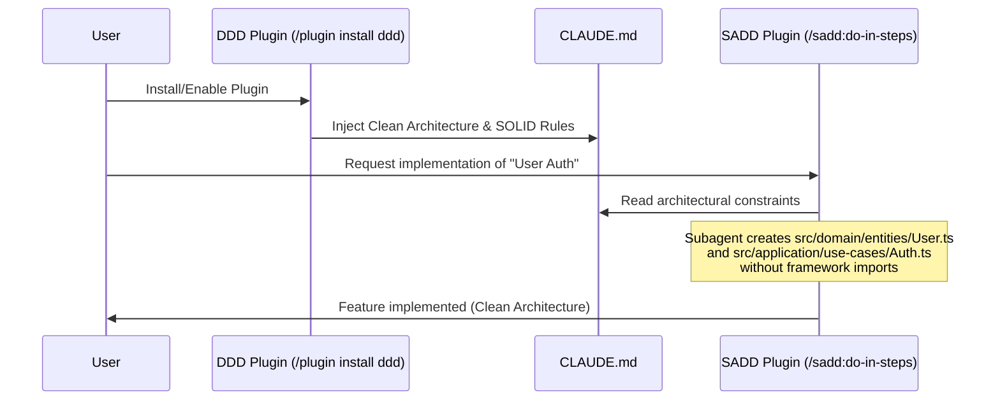

<!-- source: DeepWiki mcp.deepwiki.com · repo NeoLabHQ/context-engineering-kit · extra page DDD Plugin · fetched 2026-10-26 -->

# DDD Plugin

<details>
<summary>Relevant source files</summary>

The following files were used as context for generating this wiki page:

- [.claude/commands/bump-plugin.md](.claude/commands/bump-plugin.md)
- [docs/concepts.md](docs/concepts.md)
- [docs/plugins/README.md](docs/plugins/README.md)
- [docs/plugins/ddd/README.md](docs/plugins/ddd/README.md)
- [docs/plugins/ddd/usage-examples.md](docs/plugins/ddd/usage-examples.md)
- [plugins/ddd/.claude-plugin/plugin.json](plugins/ddd/.claude-plugin/plugin.json)
- [plugins/ddd/README.md](plugins/ddd/README.md)
- [plugins/ddd/rules/call-site-honesty.md](plugins/ddd/rules/call-site-honesty.md)
- [plugins/ddd/rules/clean-architecture-ddd.md](plugins/ddd/rules/clean-architecture-ddd.md)
- [plugins/ddd/rules/command-query-separation.md](plugins/ddd/rules/command-query-separation.md)
- [plugins/ddd/rules/domain-specific-naming.md](plugins/ddd/rules/domain-specific-naming.md)
- [plugins/ddd/rules/early-return-pattern.md](plugins/ddd/rules/early-return-pattern.md)
- [plugins/ddd/rules/error-handling.md](plugins/ddd/rules/error-handling.md)
- [plugins/ddd/rules/explicit-control-flow.md](plugins/ddd/rules/explicit-control-flow.md)
- [plugins/git/.claude-plugin/plugin.json](plugins/git/.claude-plugin/plugin.json)

</details>


The DDD (Domain-Driven Development) Plugin is a code quality framework that embeds **Clean Architecture**, **SOLID principles**, and **Domain-Driven Design** patterns into the development workflow. It operates through persistent rules and contextual commands that update the project's `CLAUDE.md` configuration to ensure that AI-assisted code generation adheres to high-quality architectural standards.

[plugins/ddd/README.md:1-11]()

## Overview

The DDD plugin addresses the core challenge of software development: **managing complexity**. It establishes clear boundaries between business logic and infrastructure, promotes domain-specific naming, and follows proven design patterns. These principles are based on foundational works such as Eric Evans' "Domain-Driven Design" (2003) and Robert C. Martin's "Clean Architecture" (2017).

The plugin functions by providing:
- **Persistent Rules**: 14 composable rules organized into Architecture, Function Design, Explicitness, and Code Quality categories.
- **Contextual Commands**: Tools to update `CLAUDE.md` with best practices for domain-driven development.
- **Architectural Guardrails**: Correct and incorrect code examples within rules to guide the model toward maintainable patterns.

[plugins/ddd/README.md:12-19](), [plugins/ddd/.claude-plugin/plugin.json:1-9](), [docs/plugins/ddd/README.md:1-11]()

## System Architecture & Data Flow

The DDD plugin acts as a configuration engine for the `CLAUDE.md` file, which serves as the primary context source for Claude Code. Unlike "Skills" which are loaded into every session, the DDD plugin's effects are persisted directly into the project's rule files to minimize token usage while maintaining architectural integrity.

### Logic Flow: Natural Language to Code Entity

The following diagram illustrates how architectural concepts expressed in natural language are mapped to specific rule files within the DDD plugin and subsequently persisted.

Title: Architectural Mapping from Intent to Rule


**Sources:** [plugins/ddd/README.md:33-43](), [plugins/ddd/.claude-plugin/plugin.json:4-4](), [docs/concepts.md:68-75]()

## Installation & Setup

Install the DDD plugin from the marketplace:

```bash
/plugin install ddd@NeoLabHQ/context-engineering-kit
```

Once installed, the rules activate automatically when writing or reviewing code. The plugin's primary command updates the local project configuration to enforce these standards.

[docs/plugins/README.md:29-35](), [plugins/ddd/README.md:20-29]()

## Rules Reference

The plugin includes 14 rules organized into four categories. These rules target specific file patterns (usually `src/**/*`) and provide impact levels to prioritize architectural integrity.

| Category | Rules | Impact | Scope |
| :--- | :--- | :--- | :--- |
| **Architecture** | `clean-architecture-ddd`, `separation-of-concerns`, `functional-core-imperative-shell` | HIGH | `src/**/*` |
| **Function Design** | `command-query-separation`, `principle-of-least-astonishment`, `call-site-honesty` | HIGH/MED | `src/**/*` |
| **Explicitness** | `explicit-control-flow`, `explicit-data-flow`, `explicit-side-effects` | HIGH | `src/**/*` |
| **Code Quality** | `error-handling`, `domain-specific-naming`, `library-first-approach`, `early-return-pattern`, `function-file-size-limits` | HIGH/MED | `**/*` |

[plugins/ddd/README.md:33-43](), [plugins/ddd/rules/error-handling.md:1-6]()

### Detailed Implementation Rules

#### Architecture
- **Clean Architecture & DDD**: Separates domain entities from infrastructure concerns (frameworks, DBs). Business logic must be framework-independent. Use cases depend on abstract repository interfaces. [plugins/ddd/rules/clean-architecture-ddd.md:8-18]()
- **Separation of Concerns**: Prevents mixing business logic with UI components or database queries directly in controllers. [plugins/ddd/rules/clean-architecture-ddd.md:45-50]()
- **Functional Core, Imperative Shell**: Pushes side effects to the edges of the system while keeping the core logic pure. [plugins/ddd/README.md:66-66]()

#### Function Design & Explicitness
- **Command-Query Separation (CQS)**: A function must either return a value (query) or cause a side effect (command), never both. Mixing them makes call sites deceptive. [plugins/ddd/rules/command-query-separation.md:8-10]()
- **Call-Site Honesty**: Side effects and control flow must be explicit at the call site. For example, a validation helper should return a boolean for the caller to handle, rather than throwing internally. [plugins/ddd/rules/command-query-separation.md:38-55]()
- **Early Return Pattern**: Uses guard clauses at the top of functions to handle error conditions, reducing nesting levels and keeping the "happy path" at the lowest indentation level. [plugins/ddd/rules/early-return-pattern.md:9-11]()

#### Code Quality
- **Typed Error Handling**: Never silently swallow exceptions. Catch blocks must use typed checks and log the error with context (operation name, IDs) before rethrowing. [plugins/ddd/rules/error-handling.md:8-10]()
- **Domain-Specific Naming**: Prohibits generic modules like `utils` or `helpers`. Requires names that reflect the **Ubiquitous Language** of the bounded context (e.g., `TaxCalculator` instead of `mathUtils`). [plugins/ddd/README.md:60-61](), [docs/plugins/ddd/usage-examples.md:193-205]()
- **Library-First Approach**: Encourages using mature, well-tested libraries for infrastructure concerns (like retry logic) rather than custom implementations, unless domain-specific behavior is required. [docs/plugins/ddd/usage-examples.md:146-170]()

## Integration with Development Workflow

The DDD plugin provides the architectural foundation for other workflow plugins like **TDD** (Test-Driven Development) and **SADD** (Subagent-Driven Development). When a subagent is launched, it inherits the DDD rules persisted in `CLAUDE.md`.

Title: DDD Rule Enforcement in Subagent Workflow


**Sources:** [docs/plugins/ddd/usage-examples.md:8-46](), [docs/concepts.md:85-91](), [plugins/ddd/README.md:20-31]()

## Foundational Concepts

The plugin applies concepts from core software engineering literature:

| Concept | Source | Application in Plugin |
| :--- | :--- | :--- |
| **Ubiquitous Language** | Eric Evans (DDD) | `domain-specific-naming.md` |
| **Dependency Inversion** | Robert C. Martin (SOLID) | `clean-architecture-ddd.md` |
| **Command-Query Separation** | Bertrand Meyer (OOSC) | `command-query-separation.md` |
| **Single Responsibility** | Robert C. Martin (SOLID) | `function-file-size-limits.md` |
| **Functional Core** | Gary Bernhardt | `functional-core-imperative-shell.md` |

[plugins/ddd/README.md:52-68](), [plugins/ddd/rules/command-query-separation.md:57-61]()

---

