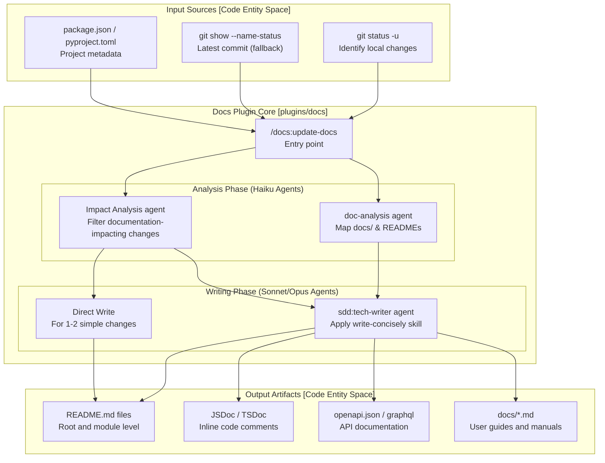
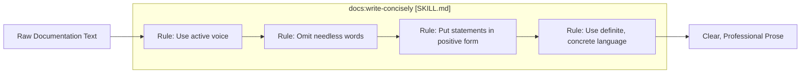

<!-- source: DeepWiki mcp.deepwiki.com · repo NeoLabHQ/context-engineering-kit · extra page Docs Plugin · fetched 2026-10-26 -->

# Docs Plugin

Relevant source files

The following files were used as context for generating this wiki page:

- [docs/plugins/docs/update-docs.md](docs/plugins/docs/update-docs.md)
- [docs/plugins/docs/write-concisely.md](docs/plugins/docs/write-concisely.md)
- [plugins/docs/README.md](plugins/docs/README.md)
- [plugins/docs/skills/update-docs/SKILL.md](plugins/docs/skills/update-docs/SKILL.md)
- [plugins/kaizen/README.md](plugins/kaizen/README.md)
- [plugins/tdd/README.md](plugins/tdd/README.md)

Technical documentation management plugin that maintains living documentation throughout the development lifecycle, ensuring docs stay accurate, useful, and aligned with code changes. It implements a documentation philosophy that prioritizes user tasks over comprehensive coverage, preferring automation where possible and manual documentation where it adds unique value.

**Sources:** [plugins/docs/README.md:1-21](), [plugins/docs/skills/update-docs/SKILL.md:1-11]()

---

## Overview

The Docs plugin provides a structured approach to documentation management based on the principle that documentation must justify its existence. It focuses on reducing documentation debt, improving discoverability, and maintaining accuracy through smart prioritization.

The plugin guides the user through:
- **Documentation audit**: Assess existing docs for freshness, accuracy, and value.
- **Gap analysis**: Identify high-impact documentation needs.
- **Smart updates**: Create or update documentation with a clear purpose.
- **Quality validation**: Verify that examples work and links are valid.

**Sources:** [plugins/docs/README.md:5-29]()

---

## Core Skills and Agents

The plugin leverages specialized agents and writing principles to ensure high-quality output.

### Tech-Writer Agent
The plugin utilizes the `sdd:tech-writer` agent (referenced from the SDD plugin) for complex documentation tasks. This agent follows specific documentation hierarchy patterns and focuses on user-facing impact rather than internal implementation details. In multi-agent workflows, these agents are typically run using Sonnet or Opus models for high-quality synthesis.

### write-concisely Skill
This skill applies William Strunk Jr.'s *The Elements of Style* (1918) principles to documentation. It makes writing clearer and more professional by:
- Using **active voice** (e.g., "team completed" instead of "was completed by team").
- Using **positive form** (e.g., "few" instead of "not many").
- Using **definite, specific, concrete language**.
- **Omitting needless words** (e.g., deleting "the fact that").
- Keeping **related words together** and placing **emphatic words at the end** of sentences.

**Sources:** [plugins/docs/README.md:57-82](), [plugins/docs/skills/update-docs/SKILL.md:15-17](), [docs/plugins/docs/write-concisely.md:1-32](), [plugins/docs/skills/update-docs/SKILL.md:151-165]()

---

## Plugin Architecture & Data Flow

The following diagrams illustrate how the plugin bridges Natural Language documentation requirements with Code Entity space.

### Documentation Management Data Flow
"Title: Documentation Management Data Flow"

**Sources:** [plugins/docs/skills/update-docs/SKILL.md:31-115](), [plugins/docs/README.md:49-62](), [docs/plugins/docs/update-docs.md:20-50]()

---

## Command Reference

### /docs:update-docs
Analyzes the project, identifies documentation needs for uncommitted changes (or the latest commit), and updates files following best practices.

**Arguments:**
- `target`: (Optional) Specific directory path or documentation type (`api`, `guides`, `readme`, `jsdoc`).

**Workflow Detail:**
1. **Discovery**: Scans for `docs/`, `README.md`, `package.json`, and generated doc tools (OpenAPI, Swagger).
2. **Analysis**: Uses parallel Haiku agents to map documentation structure and analyze local `git` changes.
3. **Planning**: Groups changes by area (API, Module READMEs, User Guides) and identifies "Index Documents" (like root `README.md`) that need updates.
4. **Execution**:
    - **Simple Flow**: If 1-2 files changed, the agent writes the documentation directly.
    - **Multi-Agent Flow**: If 3+ files changed, it launches `doc-analysis` agents to create requirements, followed by `sdd:tech-writer` agents for the actual writing.

**Sources:** [plugins/docs/skills/update-docs/SKILL.md:1-165](), [plugins/docs/README.md:51-55](), [docs/plugins/docs/update-docs.md:8-19]()

### /docs:write-concisely
Applies *The Elements of Style* principles to existing or new documentation text. It targets a 20-40% word count reduction while increasing the active voice percentage.

"Title: Conciseness Skill Application"

**Sources:** [docs/plugins/docs/write-concisely.md:1-32](), [plugins/docs/README.md:57-62](), [docs/plugins/docs/write-concisely.md:75-87]()

---

## Integration with Development Workflows

The Docs plugin is designed to be the final step in several development methodologies within the kit.

| Methodology | Command | Interaction |
|-------------|---------|-------------|
| **SDD** | `/sdd:05-document` | Triggers `/docs:update-docs` to finalize feature documentation. |
| **SADD** | Subagent Dispatch | Uses `sdd:tech-writer` agents for parallel documentation of sub-tasks. |
| **TDD** | `/tdd:write-tests` | Complements test creation by documenting the resulting validated behavior. |
| **Kaizen** | `/kaizen:analyse-problem` | Documents complex problems using the A3 format, often refined by conciseness skills. |

**Sources:** [plugins/docs/skills/update-docs/SKILL.md:15-19](), [plugins/docs/README.md:36-45](), [plugins/kaizen/README.md:43-45]()

---

## Summary of Documentation Standards

The plugin enforces specific standards during the update process:
- **Active Voice**: "The system saves the user" instead of "The user is saved by the system".
- **Task-Oriented**: Focus on what the user can *do*, not how the code is structured.
- **No Redundancy**: If information is in an OpenAPI spec, the README should link to it rather than duplicating it.
- **Working Examples**: All code snippets in documentation must be verified against the current implementation.
- **Poka-Yoke**: The documentation should guide users toward "Error Proofing" and standardized work.

**Sources:** [plugins/docs/README.md:71-82](), [plugins/docs/skills/update-docs/SKILL.md:127-133](), [plugins/kaizen/README.md:52-60]()

---

