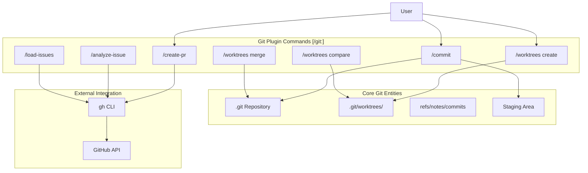
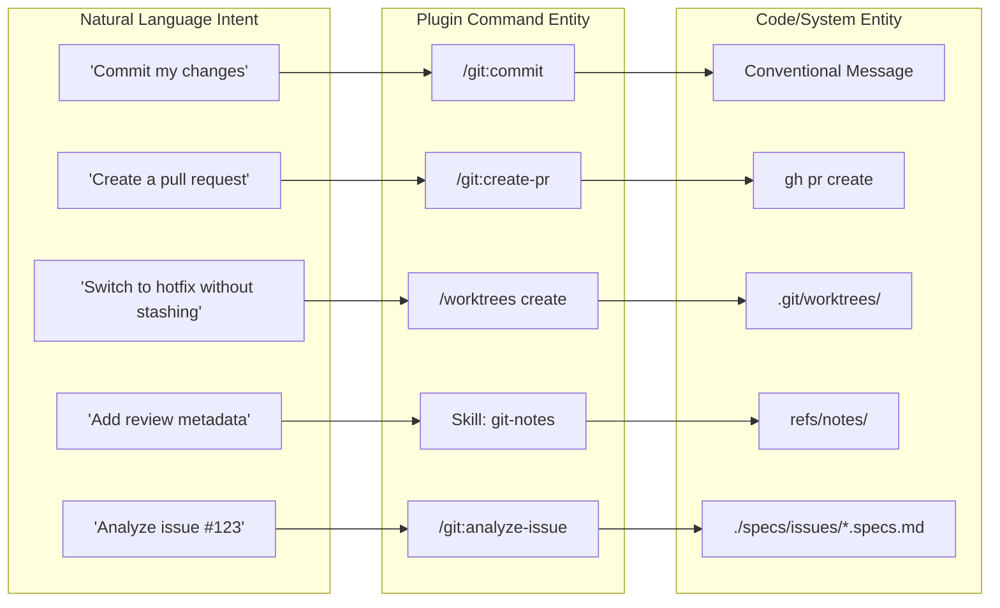
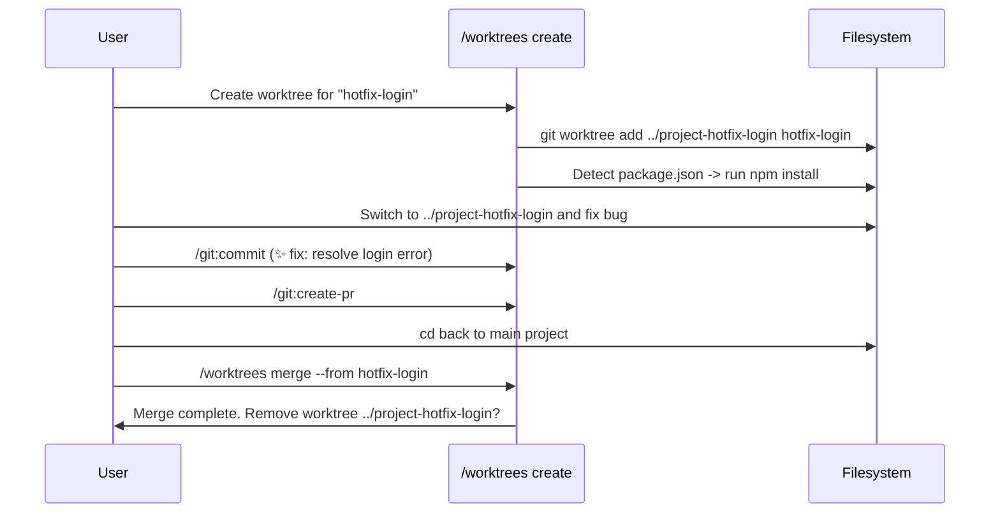

<!-- source: DeepWiki mcp.deepwiki.com · repo NeoLabHQ/context-engineering-kit · extra page Git Plugin · fetched 2026-10-26 -->

# Git Plugin

Relevant source files

The following files were used as context for generating this wiki page:

- [.specs/reports/compare-worktrees-step-2-2026-01-30.md](.specs/reports/compare-worktrees-step-2-2026-01-30.md)
- [.specs/reports/create-worktree-step-1-2026-01-30.md](.specs/reports/create-worktree-step-1-2026-01-30.md)
- [.specs/reports/merge-worktree-step-3-2026-01-30.md](.specs/reports/merge-worktree-step-3-2026-01-30.md)
- [.specs/tasks/done/add-compare-worktrees-command.feature.md](.specs/tasks/done/add-compare-worktrees-command.feature.md)
- [.specs/tasks/done/add-create-worktree-command.feature.md](.specs/tasks/done/add-create-worktree-command.feature.md)
- [.specs/tasks/done/add-merge-worktree-command.feature.md](.specs/tasks/done/add-merge-worktree-command.feature.md)
- [docs/plugins/git/README.md](docs/plugins/git/README.md)
- [docs/plugins/git/git-worktrees.md](docs/plugins/git/git-worktrees.md)
- [docs/reference/commands.md](docs/reference/commands.md)
- [plugins/git/README.md](plugins/git/README.md)
- [plugins/git/skills/analyze-issue/SKILL.md](plugins/git/skills/analyze-issue/SKILL.md)
- [plugins/git/skills/attach-review-to-pr/SKILL.md](plugins/git/skills/attach-review-to-pr/SKILL.md)
- [plugins/git/skills/commit/SKILL.md](plugins/git/skills/commit/SKILL.md)
- [plugins/git/skills/git-worktrees/SKILL.md](plugins/git/skills/git-worktrees/SKILL.md)
- [plugins/git/skills/load-issues/SKILL.md](plugins/git/skills/load-issues/SKILL.md)
- [plugins/sdd/skills/brainstorm/SKILL.md](plugins/sdd/skills/brainstorm/SKILL.md)

## Purpose and Scope

The Git Plugin provides commands for streamlined Git operations including conventional commits with emoji, pull request creation, GitHub issue management, and advanced worktree operations. It automates Git workflows to ensure consistent commit history, proper PR formatting, and efficient issue-to-code transformation while supporting parallel development through worktree management. [plugins/git/README.md:1-16](), [docs/plugins/git/README.md:1-16]()

This page documents the Git plugin's commands, skills, and integration patterns.

## Overview

The Git Plugin standardizes Git operations across teams by:

- **Enforcing conventional commits** - All commits follow the Conventional Commits specification with emoji prefixes. [plugins/git/README.md:7-7](), [docs/reference/commands.md:27-27]()
- **Automating PR creation** - Uses GitHub CLI to create pull requests with templates and proper formatting. [plugins/git/README.md:8-8](), [docs/reference/commands.md:28-28]()
- **Transforming issues to specs** - Converts GitHub issues into technical specifications for implementation via `/git:analyze-issue`. [plugins/git/README.md:9-9](), [docs/reference/commands.md:29-29]()
- **Parallel Development** - Manages git worktrees to allow working on multiple branches simultaneously without stashing. [plugins/git/README.md:50-52](), [docs/plugins/git/git-worktrees.md:5-6]()
- **Metadata Management** - Utilizes git notes to attach non-invasive metadata to commits without changing history. [plugins/git/README.md:54-54](), [docs/reference/commands.md:54-54]()

The plugin requires **GitHub CLI (`gh`)** for full functionality including PR creation, issue loading, and reviewer assignment. [plugins/git/README.md:16-16](), [docs/plugins/git/README.md:16-16]()

**Sources:** [plugins/git/README.md:1-55](), [docs/plugins/git/README.md:1-55](), [docs/reference/commands.md:23-31]()

## Architecture

### Command and Data Flow

**Sources:** [docs/reference/commands.md:23-31](), [plugins/git/README.md:44-52](), [plugins/git/skills/git-worktrees/SKILL.md:22-22](), [docs/plugins/git/git-worktrees.md:125-134]()

### Natural Language to Git Entity Mapping

This diagram illustrates how user intent (Natural Language) maps to specific Git commands and underlying filesystem entities managed by the plugin.

**Sources:** [plugins/git/README.md:44-55](), [docs/reference/commands.md:23-31](), [plugins/git/skills/git-worktrees/SKILL.md:10-22](), [docs/plugins/git/git-worktrees.md:8-16]()

## Commands

### /git:commit
Creates well-formatted commits with conventional commit messages and emoji. It automates the analysis of changes to ensure history remains clean and searchable. [plugins/git/README.md:45-45](), [docs/reference/commands.md:27-27]()

### /git:create-pr
Creates pull requests using GitHub CLI (`gh`). It handles template selection from `.github/`, formatting of descriptions, and linking to relevant issues. [plugins/git/README.md:46-46](), [docs/reference/commands.md:28-28]()

### /git:analyze-issue
Analyzes a GitHub issue by its ID and creates a detailed technical specification. This bridges the gap between issue description and actionable code tasks. [plugins/git/README.md:47-47](), [docs/reference/commands.md:29-29]()

### /git:load-issues
Loads all open issues from the GitHub repository and saves them as local markdown files for offline analysis and context engineering. [plugins/git/README.md:48-48](), [docs/reference/commands.md:30-30]()

### /git:attach-review-to-pr
Adds line-specific review comments to pull requests using the GitHub CLI API. This allows the agent to participate in the review cycle directly from the terminal. [plugins/git/README.md:49-49]()

### /worktrees create
Creates and sets up git worktrees for parallel development. It includes automatic dependency installation (e.g., `npm i`, `pip install`, `cargo build`) based on detected project files. [docs/plugins/git/git-worktrees.md:36-43](), [.specs/reports/create-worktree-step-1-2026-01-30.md:37-38]()

### /worktrees compare
Compares files and directories between git worktrees or between a specific worktree and the current branch. Supports `--stat` for summary statistics. [docs/plugins/git/git-worktrees.md:77-83](), [.specs/reports/compare-worktrees-step-2-2026-01-30.md:30-41]()

### /worktrees merge
Merges changes from worktrees into the current branch using various strategies:
- **Selective File**: `git checkout <branch> -- <path>`. [docs/plugins/git/git-worktrees.md:129-129]()
- **Interactive Patch**: `git checkout -p <branch> -- <path>`. [docs/plugins/git/git-worktrees.md:130-130]()
- **Cherry-Pick**: `git cherry-pick --no-commit`. [docs/plugins/git/git-worktrees.md:131-131]()
- **Manual Merge**: `git merge --no-commit`. [docs/plugins/git/git-worktrees.md:132-132]()
The command prompts for worktree cleanup (removal) after a successful merge. [.specs/reports/merge-worktree-step-3-2026-01-30.md:108-110]()

## Skills

### git-worktrees
Provides patterns for parallel development with multiple working directories. It manages the lifecycle of linked worktrees and the shared `.git` database. [plugins/git/skills/git-worktrees/SKILL.md:6-13](), [docs/plugins/git/git-worktrees.md:8-16]()

| Concept | Description |
|---------|-------------|
| **Main worktree** | Original directory from `git clone`. |
| **Linked worktree** | Additional directories created via `git worktree add`. |
| **Branch lock** | A branch can only be checked out in one worktree at a time. |

**Sources:** [plugins/git/skills/git-worktrees/SKILL.md:15-22](), [docs/plugins/git/git-worktrees.md:8-16]()

### notes
Provides the ability to use git notes for adding metadata to commits without changing history. This is often used for attaching review status, build artifacts, or context identifiers to existing commits. [plugins/git/README.md:54-54](), [docs/reference/commands.md:54-54]()

**Sources:** [plugins/git/README.md:52-55](), [docs/reference/commands.md:52-55]()

## Workflow Example: Parallel Feature and Hotfix

**Sources:** [docs/plugins/git/git-worktrees.md:142-160](), [plugins/git/skills/git-worktrees/SKILL.md:142-160](), [.specs/reports/merge-worktree-step-3-2026-01-30.md:108-110]()

---

