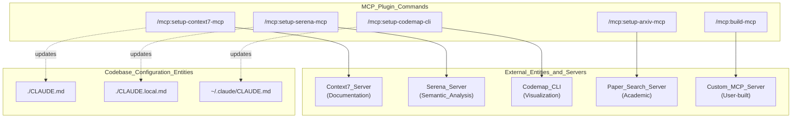
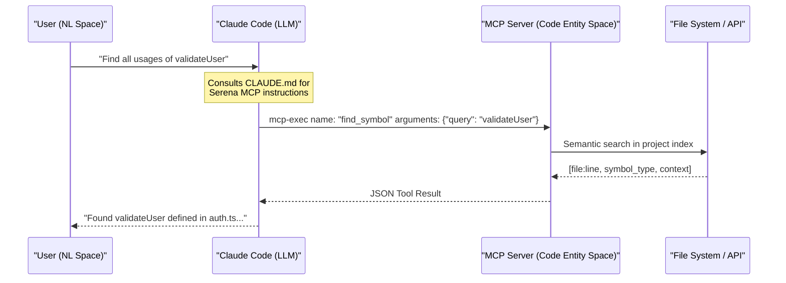

<!-- source: DeepWiki mcp.deepwiki.com · repo NeoLabHQ/context-engineering-kit · extra page MCP Plugin Overview · fetched 2026-10-26 -->

# MCP Plugin Overview

Relevant source files

The following files were used as context for generating this wiki page:

- [CLAUDE.md](CLAUDE.md)
- [docs/plugins/mcp/README.md](docs/plugins/mcp/README.md)
- [plugins/kaizen/.claude-plugin/plugin.json](plugins/kaizen/.claude-plugin/plugin.json)
- [plugins/mcp/.claude-plugin/plugin.json](plugins/mcp/.claude-plugin/plugin.json)
- [plugins/mcp/README.md](plugins/mcp/README.md)
- [plugins/reflexion/.claude-plugin/plugin.json](plugins/reflexion/.claude-plugin/plugin.json)

The MCP Plugin provides commands for integrating Model Context Protocol (MCP) servers into your AI-powered development workflow. This plugin enables Claude to access external data sources, tools, and specialized capabilities through a standardized protocol interface [plugins/mcp/README.md:1-11]().

This page covers the plugin's architecture, the five core commands, and integration patterns. For detailed setup procedures for each MCP server, see section 4 (MCP Integration Deep Dive). For workflow guides combining MCP with other plugins, see section 5 (Development Guides).

## What is Model Context Protocol?

Model Context Protocol (MCP) is an open protocol that enables AI assistants to interact with external services, databases, and tools through a standardized interface [docs/plugins/mcp/README.md:9-11](). MCP servers run as separate processes that communicate with Claude through the MCP protocol, providing access to capabilities without loading them into Claude's context window until needed [CLAUDE.md:133-138]().

| Capability Type | Purpose | Example |
|----------------|---------|---------|
| **Resources** | External data sources Claude can read | Library documentation, API schemas |
| **Tools** | Actions Claude can execute | `search_arxiv`, `find_symbol`, `mcp__context7__query-docs` |
| **Prompts** | Reusable prompt templates | Query patterns with dynamic inputs |

**Sources:** [plugins/mcp/README.md:9-11](), [CLAUDE.md:113-138]()

## Plugin Architecture

The MCP Plugin serves as an integration hub, connecting Claude Code to external MCP servers through five setup commands and one development guide. Each command handles the integration workflow: installation verification, configuration, and `CLAUDE.md` documentation updates [plugins/mcp/README.md:13-27]().

### System to Code Entity Mapping: MCP Plugin Flow

This diagram maps the high-level integration concepts to the specific commands defined in the plugin manifest [plugins/mcp/.claude-plugin/plugin.json:1-9]().

**Sources:** [plugins/mcp/README.md:13-27](), [docs/plugins/mcp/README.md:13-27](), [plugins/mcp/.claude-plugin/plugin.json:1-9]()

## Three-Tier Configuration System

Each MCP setup command supports configuration at three levels, allowing different scopes of configuration sharing [plugins/mcp/README.md:21-27](). This aligns with the CEK design principle of using setup commands to update `CLAUDE.md` for persistent project context [CLAUDE.md:50]().

| Level | File Path | Git Tracked | Use Case |
|-------|-----------|-------------|----------|
| **Project Shared** | `./CLAUDE.md` | Yes | Team-wide MCP server configuration and documentation requirements |
| **Project Personal** | `./CLAUDE.local.md` | No | Local project-specific configuration (e.g., local API keys) |
| **User Global** | `~/.claude/CLAUDE.md` | No | Global configuration applying to all projects for the current user |

**Sources:** [plugins/mcp/README.md:21-27](), [docs/plugins/mcp/README.md:21-27](), [CLAUDE.md:50]()

## Core Commands Overview

### /mcp:setup-context7-mcp: Documentation Access
Sets up the Context7 MCP server to provide real-time access to library and framework documentation, eliminating hallucinations from outdated training data [docs/plugins/mcp/README.md:51]().

*   **Usage**: `mcp__context7__query-docs libraryId: "/anthropics/claude-code" query: "..."` [CLAUDE.md:110]().
*   **Recommended IDs**: Includes `/anthropics/claude-code`, `/websites/platform_claude`, and `/anthropics/anthropic-cookbook` [CLAUDE.md:97-105]().

### /mcp:setup-serena-mcp: Semantic Code Analysis
Configures the Serena MCP server for semantic code retrieval and symbol-based editing [docs/plugins/mcp/README.md:52](). It enables precise code manipulation in large codebases through symbols rather than just file paths.

### /mcp:setup-codemap-cli: Codebase Visualization
Installs and configures the Codemap CLI for intelligent codebase navigation, providing tree views and dependency analysis [docs/plugins/mcp/README.md:53]().

### /mcp:setup-arxiv-mcp: Academic Paper Search
Sets up the Paper Search MCP server via Docker MCP [docs/plugins/mcp/README.md:54](). It provides tools like `search_arxiv`, `search_pubmed`, and `search_semantic` [CLAUDE.md:119-126]().

### /mcp:build-mcp: Custom Server Development
A comprehensive guide for creating high-quality MCP servers [docs/plugins/mcp/README.md:55](). This command assists developers in extending the kit's capabilities to internal APIs or proprietary services.

**Sources:** [docs/plugins/mcp/README.md:50-56](), [CLAUDE.md:93-138]()

## Data Flow: MCP Integration Pattern

This diagram illustrates how MCP tools bridge the gap between Natural Language requests and Code Entity operations.

**Sources:** [CLAUDE.md:135-138](), [docs/plugins/mcp/README.md:52]()

## Integration with Other Plugins

MCP servers provide the "contextual fuel" for other specialized agents in the kit, adhering to the principle of using specialized agents with focused context [CLAUDE.md:49]().

| Plugin | MCP Enhancement |
|--------|-----------------|
| **SDD** | Uses **Context7** during the specification phase to verify external library capabilities. |
| **Kaizen** | Uses **Codemap** to perform Muda Analysis and visualize waste in dependency graphs. |
| **Reflexion** | Uses **Serena** to verify if suggested refinements match the actual symbol definitions in the codebase. |

**Sources:** [CLAUDE.md:49](), [plugins/kaizen/.claude-plugin/plugin.json:1-9](), [plugins/reflexion/.claude-plugin/plugin.json:1-9]()

---

