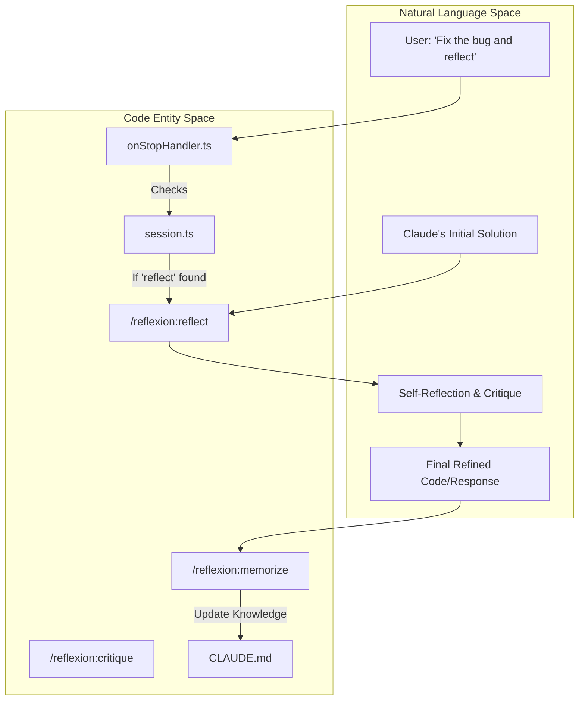
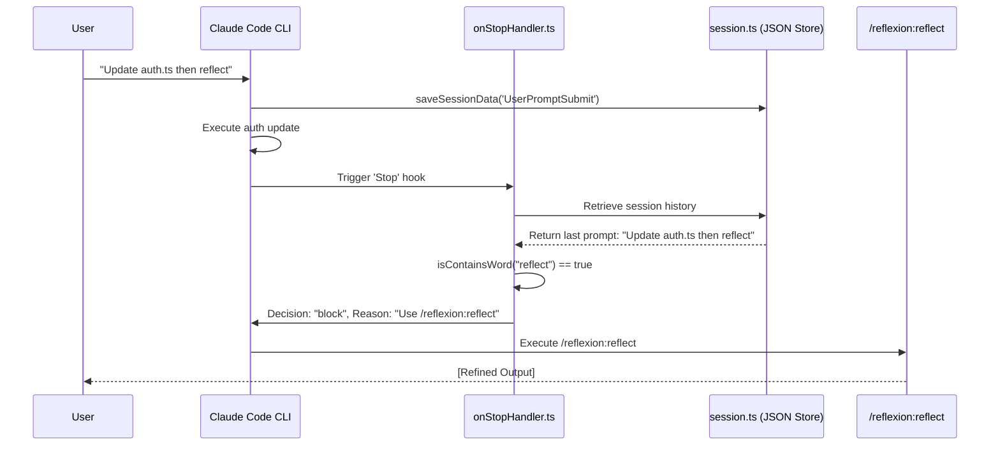

<!-- source: DeepWiki mcp.deepwiki.com · repo NeoLabHQ/context-engineering-kit · extra page Reflexion Plugin · fetched 2026-10-26 -->

# Reflexion Plugin

<details>
<summary>Relevant source files</summary>

The following files were used as context for generating this wiki page:

- [docs/plugins/reflexion/README.md](docs/plugins/reflexion/README.md)
- [plugins/reflexion/README.md](plugins/reflexion/README.md)
- [plugins/reflexion/hooks/.gitignore](plugins/reflexion/hooks/.gitignore)
- [plugins/reflexion/hooks/README.md](plugins/reflexion/hooks/README.md)
- [plugins/reflexion/hooks/bun.lockb](plugins/reflexion/hooks/bun.lockb)
- [plugins/reflexion/hooks/hooks.json](plugins/reflexion/hooks/hooks.json)
- [plugins/reflexion/hooks/package.json](plugins/reflexion/hooks/package.json)
- [plugins/reflexion/hooks/src/index.ts](plugins/reflexion/hooks/src/index.ts)
- [plugins/reflexion/hooks/src/lib.ts](plugins/reflexion/hooks/src/lib.ts)
- [plugins/reflexion/hooks/src/onStopHandler.test.ts](plugins/reflexion/hooks/src/onStopHandler.test.ts)
- [plugins/reflexion/hooks/src/onStopHandler.ts](plugins/reflexion/hooks/src/onStopHandler.ts)
- [plugins/reflexion/hooks/src/session.ts](plugins/reflexion/hooks/src/session.ts)
- [plugins/reflexion/skills/critique/SKILL.md](plugins/reflexion/skills/critique/SKILL.md)
- [plugins/reflexion/skills/memorize/SKILL.md](plugins/reflexion/skills/memorize/SKILL.md)
- [plugins/reflexion/skills/reflect/SKILL.md](plugins/reflexion/skills/reflect/SKILL.md)

</details>


The Reflexion plugin provides self-refinement capabilities through structured feedback and refinement loops. Based on research papers such as *Self-Refine* and *Reflexion*, it improves LLM output by introducing iterative critique and memory integration. The plugin consists of three primary commands: `/reflexion:reflect`, `/reflexion:critique`, and `/reflexion:memorize`, along with an automated TypeScript hook system for trigger-word-based reflection.

Sources: [plugins/reflexion/README.md:1-10](), [plugins/reflexion/hooks/README.md:1-5]()

## Purpose and Architecture

The Reflexion plugin implements a feedback loop where the model evaluates its own performance. This architecture moves beyond single-pass generation to an iterative "Generate-Critique-Refine" cycle. It is proven to increase output quality by 8–21% across tasks like coding and mathematical reasoning.

### Feedback Loop Architecture



**Diagram: Reflexion Feedback Loop Architecture**

The system bridges natural language triggers (the word "reflect") to code-level execution via `onStopHandler.ts` [plugins/reflexion/hooks/src/onStopHandler.ts:11-37](). It persists session state in `session.ts` [plugins/reflexion/hooks/src/session.ts:28-57]() to allow the `Stop` hook to access historical user prompts even after the tool execution has completed.

Sources: [plugins/reflexion/hooks/README.md:7-35](), [plugins/reflexion/hooks/src/onStopHandler.ts:11-37](), [plugins/reflexion/hooks/src/session.ts:28-57]()

## Automatic Reflection (Hooks)

The plugin includes a sophisticated hook system that automates reflection without requiring explicit slash commands. This is implemented as a set of Claude Code hooks that intercept the session lifecycle.

### Trigger Logic

The `onStopHandler.ts` monitors the `Stop` event. If the user's last prompt contained the standalone word "reflect", the handler blocks the standard stop signal and forces the execution of `/reflexion:reflect`.

| Component | Logic | File Reference |
|-----------|-------|----------------|
| **Trigger Word** | Matches "reflect" as a standalone word (case-insensitive). | [plugins/reflexion/hooks/src/onStopHandler.ts:3-4]() |
| **Regex Protection** | Uses negative lookbehind `(?<![:/])` to avoid triggering on `/reflect` or `:reflect`. | [plugins/reflexion/hooks/src/onStopHandler.ts:44-50]() |
| **Cycle Prevention** | Filters session data for `UserPromptSubmit` and `Stop`. Blocks if two `Stop` events occur consecutively. | [plugins/reflexion/hooks/src/onStopHandler.ts:11-28]() |
| **Session Persistence** | Stores prompts in `/tmp/claude-hooks-sessions/<session_id>.json`. | [plugins/reflexion/hooks/src/session.ts:6-18]() |

Sources: [plugins/reflexion/hooks/src/onStopHandler.ts:11-50](), [plugins/reflexion/hooks/README.md:46-57](), [plugins/reflexion/hooks/src/session.ts:6-18]()

### Hook Execution Flow



**Diagram: Hook-Based Reflection Flow**

Sources: [plugins/reflexion/hooks/README.md:9-27](), [plugins/reflexion/hooks/src/onStopHandler.ts:11-37](), [plugins/reflexion/hooks/src/session.ts:28-52]()

## Commands and Skills Reference

The plugin exposes functionality through a combination of slash commands and background skills.

### /reflexion:reflect
This command forces the model to review its previous output. It acts as a **ruthless quality gatekeeper** [plugins/reflexion/skills/reflect/SKILL.md:11-26](). It categorizes tasks into three paths:
- **Quick Path**: 5-second check for simple edits [plugins/reflexion/skills/reflect/SKILL.md:31-40]().
- **Standard Path**: Full reflection for multi-file changes [plugins/reflexion/skills/reflect/SKILL.md:42-51]().
- **Deep Reflection Path**: For critical systems (security, core architecture) [plugins/reflexion/skills/reflect/SKILL.md:53-62]().

### /reflexion:critique
Implements a **Generator-Critic** pattern using a Multi-Agent Debate structure [plugins/reflexion/skills/critique/SKILL.md:9-21](). It spawns three specialized parallel judges:
1. **Requirements Validator**: Checks alignment with original user request [plugins/reflexion/skills/critique/SKILL.md:55-109]().
2. **Solution Architect**: Evaluates technical approach and optimality [plugins/reflexion/skills/critique/SKILL.md:111-184]().
3. **Code Quality Reviewer**: Identifies refactoring opportunities and code smells [plugins/reflexion/skills/critique/SKILL.md:186-222]().

### /reflexion:memorize
Implements the **Curation** phase of Agentic Context Engineering (ACE) [plugins/reflexion/skills/memorize/SKILL.md:9-24](). It extracts high-value insights (Solution Patterns, Anti-Patterns, Error identification) and persists them into `CLAUDE.md` to create a durable context playbook [plugins/reflexion/skills/memorize/SKILL.md:41-64]().

Sources: [plugins/reflexion/skills/reflect/SKILL.md:1-62](), [plugins/reflexion/skills/critique/SKILL.md:9-222](), [plugins/reflexion/skills/memorize/SKILL.md:9-64]()

## Implementation Details

The hook system is built using TypeScript and executed via `bun`. The entry point `src/index.ts` registers multiple handlers including `Stop` and `UserPromptSubmit` [plugins/reflexion/hooks/src/index.ts:138-153]().

### Transcript Processing
The `lib.ts` file provides utility functions to parse Claude's internal transcript format (JSONL), allowing the plugin to extract conversation history and tool usage results for analysis during reflection [plugins/reflexion/hooks/src/lib.ts:154-191]().

| Function | Purpose |
|----------|---------|
| `getInitialMessage` | Extracts the first user message from the session transcript. |
| `getConversationHistory` | Reconstructs the full chat log for context analysis. |
| `getToolUsage` | Identifies which tools were called and their inputs/outputs. |

Sources: [plugins/reflexion/hooks/src/lib.ts:84-216](), [plugins/reflexion/hooks/src/index.ts:138-153]()

## Installation and Setup

The hooks require `bun` for execution as defined in the `hooks.json` configuration, which uses environment variables like `${CLAUDE_PLUGIN_ROOT}` to locate the hook scripts.

```bash
# Install hook dependencies
cd plugins/reflexion/hooks
bun install

# Start Claude with the plugin
claude --plugin-dir ./plugins/reflexion
```

The hook configuration in `hooks.json` registers the `Stop` and `UserPromptSubmit` events to the `src/index.ts` entry point using a shell command wrapper [plugins/reflexion/hooks/hooks.json:1-26]().

Sources: [plugins/reflexion/hooks/README.md:63-79](), [plugins/reflexion/hooks/hooks.json:1-26]()

---

