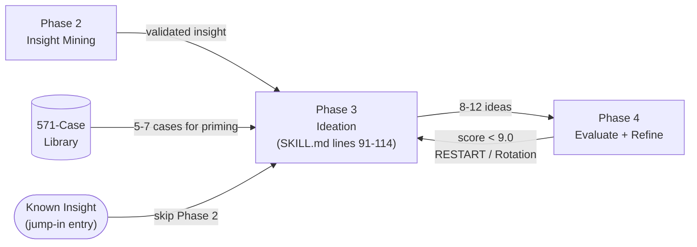
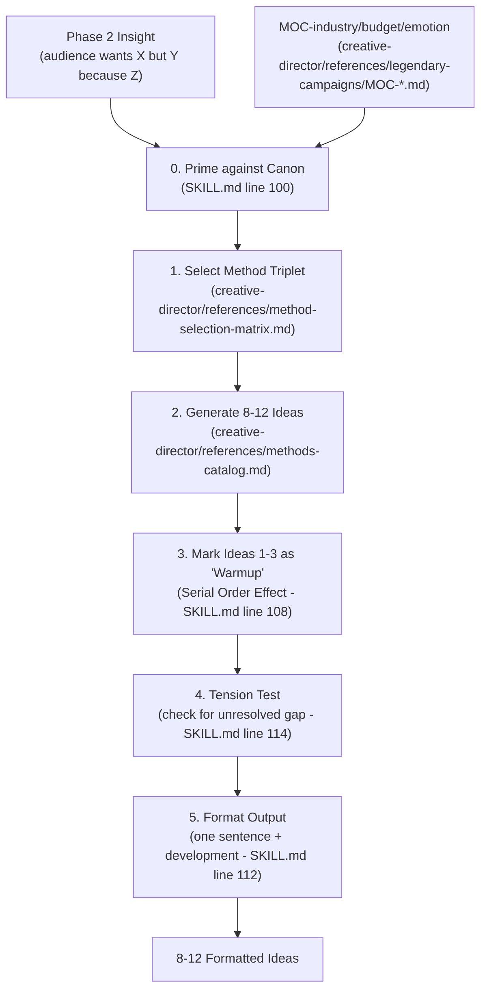
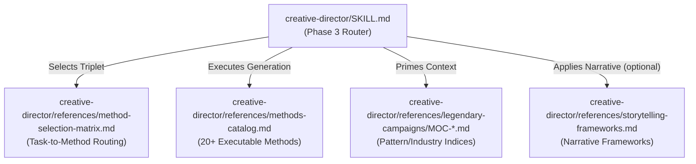

<!-- source: DeepWiki mcp.deepwiki.com · repo smixs/creative-director-skill · page 2.3 Phase 3: Ideation · fetched 2026-10-26 -->

# Phase 3: Ideation

Relevant source files

The following files were used as context for generating this wiki page:

- [assets/methods-20.webp](assets/methods-20.webp)
- [creative-director/SKILL.md](creative-director/SKILL.md)
- [creative-director/references/legendary-campaigns/MOC-index.md](creative-director/references/legendary-campaigns/MOC-index.md)

## Purpose and Scope

This page documents Phase 3 of the creative pipeline: Ideation. It covers how the system primes itself against the canon of legendary advertising, assembles a method triplet for each pass, generates 8–12 ideas from a validated insight, applies the serial-order bias rule, and performs the Tension Test on each concept.

For the method rotation rules that govern how the triplet changes across recursive passes, see [Method Selection & Rotation](3.2). For a complete reference of all individual methods and their inputs/outputs, see [Methods Catalog](3.1). For how the generated ideas are scored and refined in the next stage, see [Phase 4: Evaluate & Refine](2.4).

Sources: [creative-director/SKILL.md:91-114]()

---

## Position in the Pipeline

Phase 3 receives a validated insight from Phase 2 and passes a set of 8-12 ideas to Phase 4. A critical pre-generation step involves "priming against the canon" using the 571-case library to ensure anti-derivative thinking.

**Diagram: Phase 3 context and data flow**

Sources: [creative-director/SKILL.md:91-114](), [creative-director/SKILL.md:27-36]()

---

## Priming Against the Canon

Before generating any ideas, the system performs a mandatory priming step to avoid "inventing from zero" and to detect potential saturation.

1.  **Select Relevant MOC:** Based on the brief context, the system opens the most relevant Map of Content (MOC) from `references/legendary-campaigns/`:
    *   `MOC-industry.md` for industry-specific context.
    *   `MOC-budget.md` for budget-constrained tasks.
    *   `MOC-emotion.md` for specific emotional intents.
    *   `MOC-index.md` is also available as a general index [creative-director/references/legendary-campaigns/MOC-index.md:1-1]().
2.  **Scan 5-7 Cases:** It reviews the Insight, Mechanic, and "Why it worked" sections of 5-7 canonical cards.
3.  **Anti-Derivative Goal:** The goal is to identify existing patterns (P01-P18) to ensure generation aims at the "gap" rather than repeating high-saturation mechanics.
4.  **Remixing:** Borrowing mechanics across categories (e.g., a P11 absurd mechanic from a beverage ad applied to a beauty brief) is explicitly encouraged.

Sources: [creative-director/SKILL.md:100-100](), [creative-director/references/legendary-campaigns/MOC-index.md:1-1]()

---

## Method Triplet Selection

Every Ideation pass uses exactly three methods drawn from three different categories. This is a hard rule enforced to prevent free-association traps.

| Slot | Category | Role | Example Methods |
|------|----------|------|-----------------|
| **Primary** | Structural | Systematic skeleton/transformation | SIT, SCAMPER, TRIZ, Morphological Analysis |
| **Secondary** | Association / Collision | Conceptual depth and surprise | Bisociation, Random Entry, Synectics, Forced Connections |
| **Stimulus** | Inversion / Perturbation | Breaking habitual patterns | Reverse Brainstorming, Worst Idea, Provocation PO, Oblique Strategies |

Sources: [creative-director/SKILL.md:101-105]()

### Task-Type Routing

`method-selection-matrix.md` maps task types to a recommended triplet. If the task type is ambiguous, the **default triplet** is used.

| Task Type | Primary | Secondary | Stimulus |
|-----------|---------|-----------|----------|
| New brand launch / rebrand | SIT | Bisociation | Provocation PO |
| Seasonal / promo campaign | SCAMPER | Forced Connections | Oblique Strategies |
| Digital / social campaign | SIT | Random Entry | Worst Idea |
| **Default (ambiguous)** | **SIT** | **Bisociation** | **Oblique Strategies** |

Sources: [creative-director/SKILL.md:101-105]()

---

## Rotation Rules Across Passes

When Phase 3 is re-entered from Phase 4 (recursive refinement), the system must rotate methods. The same method may **never** appear in two consecutive passes.

**Pass-by-pass switching logic:**

| Pass | Action |
|------|--------|
| **Pass 1** | Use recommended triplet from routing table. |
| **Pass 2** | Advance Primary method in its cycle (e.g., SIT → SCAMPER). |
| **Pass 3** | Advance Secondary method in its cycle. |
| **Pass 4+** | Advance Stimulus and add a Volume method (e.g., Crazy 8s). |

Sources: [creative-director/SKILL.md:101-105]()

---

## Idea Generation Algorithm

The system follows a strict five-step algorithm to produce the idea set.

**Diagram: SKILL.md Ideation Algorithm (Natural Language to Code Entity)**

Sources: [creative-director/SKILL.md:97-114]()

### The Tension Test

For each generated idea, the system must verify it carries an **unresolved tension** (Cultural, Category, or Human). If the idea resolves the tension too cleanly, it is flagged as weak/unoriginal. Great work lives in the unresolved gap between the audience's want and the barrier.

Sources: [creative-director/SKILL.md:114-114]()

### Serial-Order Bias Rule

Ideas 1–3 are explicitly labeled as **"conventional warmup"**. Per the serial order effect, later ideas (5–12+) are statistically more original. The system biases its focus toward these later concepts during evaluation.

Sources: [creative-director/SKILL.md:108-108]()

### Required Idea Format

Each idea must be formulated as:
1.  **One sentence** (The "Big Idea" or central thought).
2.  **2–3 lines of development** (The mechanic, visual execution, or channel application).

Sources: [creative-director/SKILL.md:112-112]()

---

## Module Dependencies

Phase 3 is the primary consumer of the `methods-catalog.md` and the `legendary-campaigns/` library for priming.

**Diagram: Phase 3 Orchestration and File Dependencies**

Sources: [creative-director/SKILL.md:93-95]()

---

