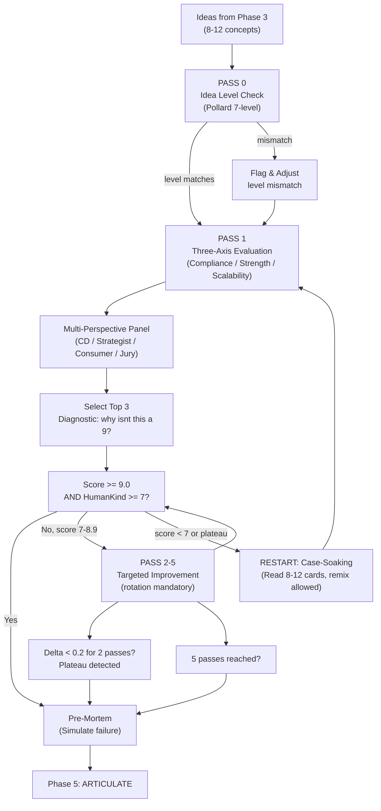
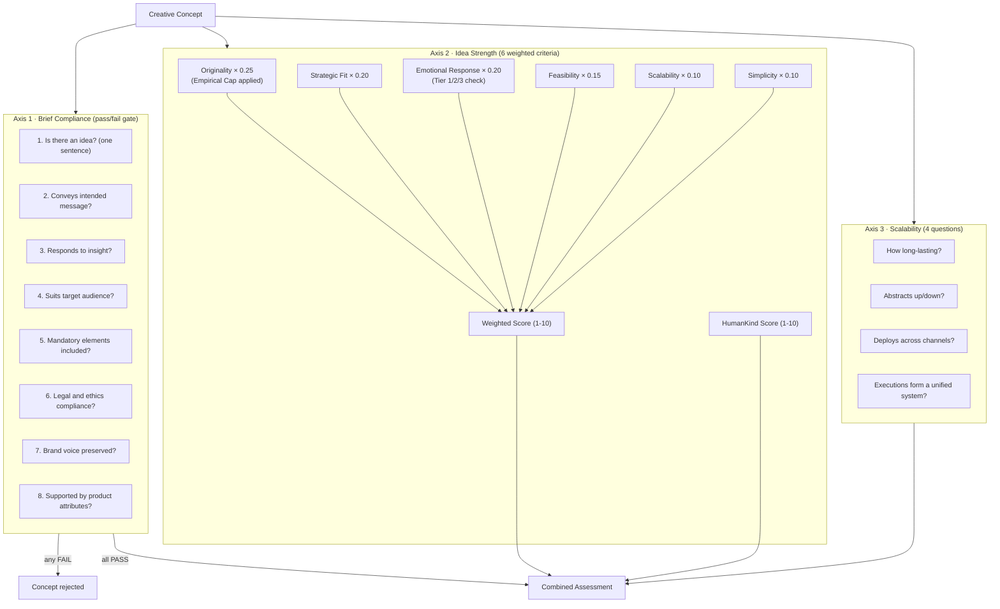
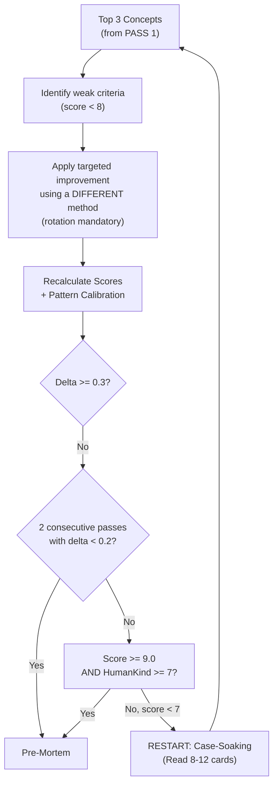
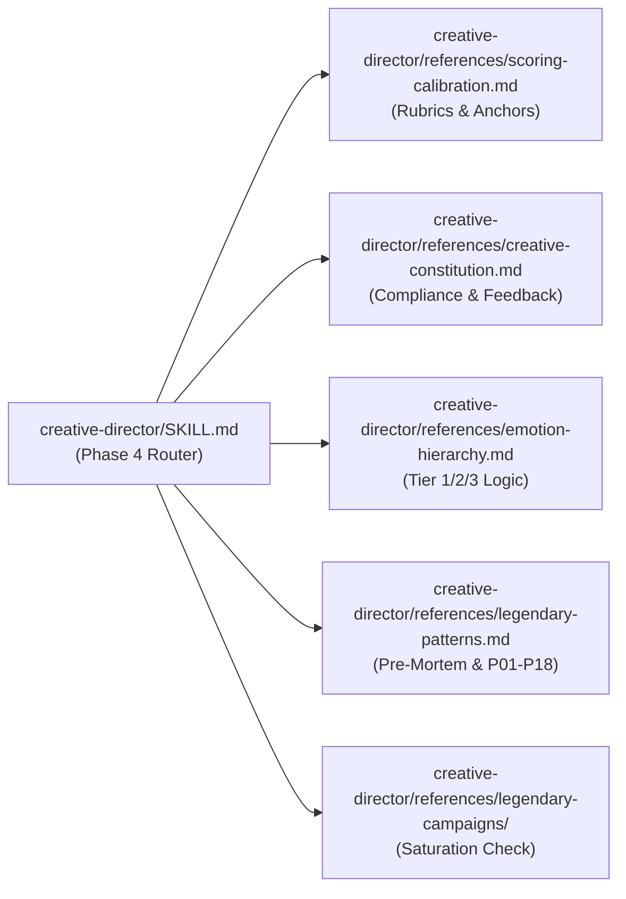

<!-- source: DeepWiki mcp.deepwiki.com · repo smixs/creative-director-skill · page 2.4 Phase 4: Evaluate & Refine · fetched 2026-10-26 -->

# Phase 4: Evaluate & Refine

Relevant source files

The following files were used as context for generating this wiki page:

- [assets/scoring-loop.webp](assets/scoring-loop.webp)
- [creative-director/SKILL.md](creative-director/SKILL.md)
- [creative-director/references/creative-constitution.md](creative-director/references/creative-constitution.md)
- [creative-director/references/emotion-hierarchy.md](creative-director/references/emotion-hierarchy.md)

Phase 4 is the recursive evaluation and improvement engine of the creative pipeline. It applies three parallel scoring systems to rank generated concepts, identifies weak areas, triggers targeted re-ideation using different methods, and loops until a quality threshold is met or a stopping condition is reached.

This page documents the mechanics of the evaluation loop itself. For the detailed rubric behind each scoring criterion, see the [Scoring Calibration](#4.1). For the full three-layer compliance and quality framework, see the [Creative Constitution](#4.2). For the methods applied during refinement passes, see the [Ideation Methods Reference](#3).

---

## Entry Points

Phase 4 can be entered in two ways:

| Entry Path | Context |
|---|---|
| Sequential pipeline | Automatically follows Phase 3 (Ideation) |
| Direct jump-in | User submits an existing idea with "evaluate this" or "improve this concept" |

When entering directly, the system skips Phases 1–3 and begins at PASS 0 using the submitted idea as input. See [Creative Process](#2) for the full pipeline entry-point map.

Sources: [creative-director/SKILL.md:31-32]()

---

## Phase 4 Overview

**Title diagram: Phase 4 Internal Flow**

Sources: [creative-director/SKILL.md:118-188]()

---

## PASS 0: Idea Level Check

Before any scoring begins, the system verifies that the level of the generated ideas matches the `idea_type` requirement established in Phase 1.

| Required Level | Verification Criteria |
|---|---|
| `business` / `brand` | Must scale for years; answers "what does the company stand for?" |
| `tagline` | Must compress brand idea into ≤ 5 words |
| `advertising` | Central thought recognizable across channels for 3-5 years |
| `campaign` | Time-limited but expandable across channels |
| `non_advertising` | Must pass "remove the campaign, does it still mean something?" test |
| `execution` | Specific, one-off channel/format/mechanic |

A mismatch is flagged and the ideas are adjusted before scoring proceeds. This prevents wasting evaluation cycles on ideas that are structurally misaligned with the brief's objective.

Sources: [creative-director/SKILL.md:122-132]()

---

## PASS 1: Three-Axis Evaluation

The full evaluation runs three independent axes in parallel. All three contribute to the final assessment of each concept.

**Title diagram: Three-Axis Scoring Architecture**

Sources: [creative-director/SKILL.md:135-163](), [creative-director/references/creative-constitution.md:7-82]()

### Axis 1: Brief Compliance (Pass/Fail Gate)

This axis is a binary filter. If any single question fails, the concept is ineligible for further scoring regardless of creative merit.

The eight questions are defined in `creative-constitution.md` Layer 1:

| # | Question | Fail Example |
|---|---|---|
| 1 | Is there an idea (one sentence)? | Describing the mechanic without a central thought |
| 2 | Does it convey the intended message? | Beautiful visuals, unclear proposition |
| 3 | Does it respond to the insight? | Insight about loneliness, execution shows a party |
| 4 | Does it suit the target audience? | Brief for 45+, ad speaks to Gen Z |
| 5 | Are mandatory elements included? | Missing logo placement or legal disclaimer |
| 6 | Does it comply with legislation/ethics? | Medical product promising guaranteed cure |
| 7 | Is the brand voice preserved? | Luxury brand using slang |
| 8 | Is it supported by product attributes? | "We care" with no functional backing |

Sources: [creative-director/references/creative-constitution.md:7-82](), [creative-director/SKILL.md:137-142]()

### Axis 2: Idea Strength

Two parallel scores are calculated:

**Six Weighted Criteria Score**
The primary score (1–10) is calculated using the formula:
`Total = (Originality × 0.25) + (Strategic Fit × 0.20) + (Emotional Response × 0.20) + (Feasibility × 0.15) + (Scalability × 0.10) + (Simplicity × 0.10)`

Two critical constraints apply here:
1.  **Empirical Originality Cap:** If the idea's mechanic matches 3+ canonical cases in the `legendary-campaigns/` library (saturation), the `Originality` score is capped at **7**.
2.  **Emotion Tier Check:** `Emotional Response` score 9+ requires a Tier 3 emotion (two emotions in unresolved tension). Tier 1 emotions (happy/sad) cap the score at **6**. This is detailed in `references/emotion-hierarchy.md`.

Sources: [creative-director/SKILL.md:143-147](), [creative-director/references/emotion-hierarchy.md:81-90]()

**HumanKind Score (Leo Burnett)**
A parallel holistic score (1–10) evaluating the idea's impact on people and culture. Rule: HumanKind < 7 is not presentable.

Sources: [creative-director/references/scoring-calibration.md:77-93]()

### Multi-Perspective Panel

After axes are assessed, a four-role panel evaluates each concept independently:

| Role | Focus | Key Question |
|---|---|---|
| **CD** | Craft, originality, simplicity | Would I put this in my portfolio? |
| **Strategist** | Brief fit, insight, target audience | Does this solve the client's problem? |
| **Consumer** | First reaction, emotion | Would I stop scrolling? Would I share this? |
| **Jury** | Novelty for industry, case potential | Will this make the Cannes shortlist? |

Sources: [creative-director/SKILL.md:156-165](), [creative-director/references/scoring-calibration.md:166-194]()

---

## PASS 2–5: Targeted Improvement

If no concept reaches the exit threshold, the system enters a recursive refinement loop.

**Title diagram: Recursive Refinement Loop**

Sources: [creative-director/SKILL.md:167-187]()

### RESTART via Case-Soaking
When ideas plateau or score < 7, the system triggers a **RESTART**. It reads 8-12 canonical cards from the `legendary-campaigns/` library to "soak" in high-quality insights. Combining or remixing existing patterns is explicitly allowed during this phase.

Sources: [creative-director/SKILL.md:181-182]()

---

## Pre-Mortem & Stopping Conditions

Before exiting Phase 4, the system performs a **Pre-Mortem**: it simulates failure and surfaces the most likely failure modes (e.g., "client will be afraid of the legal risk," "audience will find it tone-dead"). The template for this is found in `references/legendary-patterns.md`.

**Stopping Conditions:**
1.  **Score ≥ 9.0 AND HumanKind ≥ 7.**
2.  **Max 5 passes reached.**
3.  **Plateau:** Two consecutive passes with delta < 0.2.

Sources: [creative-director/SKILL.md:183-188]()

---

## Module Dependencies

**Title diagram: Phase 4 Code Entity Mapping**

Sources: [creative-director/SKILL.md:118-120]()

---

