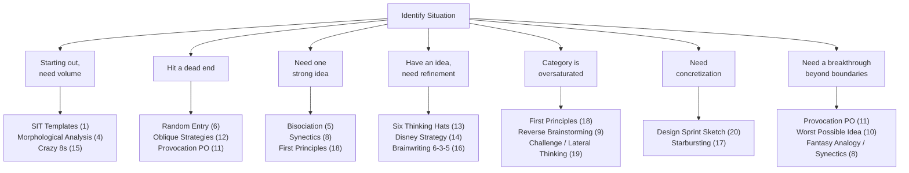
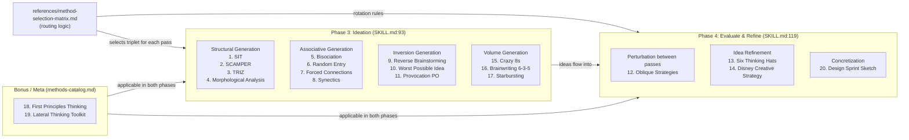

<!-- source: DeepWiki mcp.deepwiki.com · repo smixs/creative-director-skill · page 3 Ideation Methods Reference · fetched 2026-10-26 -->

# Ideation Methods Reference

<details>
<summary>Relevant source files</summary>

The following files were used as context for generating this wiki page:

- [assets/methods-20.webp](assets/methods-20.webp)
- [creative-director/SKILL.md](creative-director/SKILL.md)

</details>


This page provides a high-level overview of the ideation methodology system used by the Creative Director skill. It outlines the categories of creative methods, how they are selected and rotated during the ideation process, and introduces the method selection matrix. For detailed information on each method and the selection logic, please refer to the linked child pages.

The ideation process is primarily handled in [Phase 3: Ideation](#2.3) of the Creative Director's pipeline, where methods are applied to generate a diverse set of ideas.

---

## SCOPING: This page has child pages

This is a PARENT page. The following child pages exist and will cover their topics in detail:
- [Methods Catalog](#3.1) — Comprehensive reference for all 20+ creative methodologies by category: Structural Templates (SIT, SCAMPER, TRIZ, Morphological Analysis), Association/Collision, Inversion/Disruption, Recombination/Perturbation, Volume Generation, and Bonus methods. Each documented as an executable card.
- [Method Selection & Rotation](#3.2) — Document the method-selection-matrix: task types mapped to recommended triplets, default triplet, pass-by-pass rotation rules for Primary/Secondary/Stimulus categories, hard constraints, restart logic, and category compatibility.

---

## Overview of the Ideation Methodology System

The Creative Director skill employs a structured approach to ideation, moving beyond free association to leverage established creative methodologies. This system is designed to generate novel and useful ideas by applying a diverse set of cognitive operations. The core of this system is a catalog of over 20 methods, categorized by their underlying creative mechanism.

For details on each method, see [Methods Catalog](#3.1).

---

## Method Categories

The ideation methods are organized into six categories, each representing a distinct approach to idea generation. This categorization helps in selecting a balanced set of methods for each ideation pass, ensuring a broad exploration of the problem space. The categories are:

1.  **Structural Templates:** Methods that apply deterministic operators to the components and environment of a product or problem.
2.  **Association / Collision:** Methods that generate ideas by connecting disparate concepts or forcing unexpected juxtapositions.
3.  **Inversion / Disruption:** Methods that challenge assumptions or reverse conventional thinking to uncover new perspectives.
4.  **Recombination / Perturbation:** Methods that introduce controlled changes or re-arrange existing elements to create new combinations.
5.  **Volume Generation:** Methods focused on rapidly producing a large quantity of initial ideas.
6.  **Bonus Methods:** Advanced or specialized methods for specific ideation challenges.

This categorization is defined in `creative-director/references/methods-catalog.md` [creative-director/references/methods-catalog.md:1-8]().

**Diagram: Method Categories from `methods-catalog.md`**

```mermaid
graph TD
    CATALOG["creative-director/references/methods-catalog.md"]

    CATALOG --> A["Category A: Structural Templates\nMethods 1–4"]
    CATALOG --> B["Category B: Association / Collision\nMethods 5–8"]
    CATALOG --> C["Category C: Inversion / Disruption\nMethods 9–11"]
    CATALOG --> D["Category D: Recombination / Perturbation\nMethods 12–14"]
    CATALOG --> E["Category E: Volume Generation\nMethods 15–17"]
    CATALOG --> F["Category F: Bonus Methods\nMethods 18–20"]

    A --> A1["1. SIT / Goldenberg Templates"]
    A --> A2["2. SCAMPER"]
    A --> A3["3. TRIZ: 10 Advertising Principles"]
    A --> A4["4. Morphological Analysis"]

    B --> B1["5. Bisociation"]
    B --> B2["6. Random Entry / Random Word"]
    B --> B3["7. Forced Connections"]
    B --> B4["8. Synectics"]

    C --> C1["9. Reverse Brainstorming"]
    C --> C2["10. Worst Possible Idea"]
    C --> C3["11. Provocation PO"]

    D --> D1["12. Oblique Strategies"]
    D --> D2["13. Six Thinking Hats"]
    D --> D3["14. Disney Creative Strategy"]

    E --> E1["15. Crazy 8s"]
    E --> E2["16. Brainwriting 6-3-5"]
    E --> E3["17. Starbursting"]

    F --> F1["18. First Principles Thinking"]
    F --> F2["19. Lateral Thinking Toolkit"]
    F --> F3["20. Design Sprint Sketch"]
```



Sources: [creative-director/references/methods-catalog.md:1-8]()

---

## Method Selection and Rotation

The Creative Director skill does not randomly select ideation methods. Instead, it uses a sophisticated selection and rotation mechanism to ensure a balanced and effective ideation process. This involves:

-   **Method Selection Matrix:** A mapping of task types to recommended triplets of methods, ensuring that the chosen methods are appropriate for the specific creative challenge.
-   **Default Triplet:** A standard set of methods used when no specific task type is identified.
-   **Pass-by-Pass Rotation Rules:** Guidelines for rotating methods across multiple ideation passes, ensuring diversity and preventing creative stagnation.
-   **Hard Constraints and Restart Logic:** Rules that govern when certain methods can or cannot be used, and how to reset the selection process if needed.
-   **Category Compatibility:** Ensuring that selected methods from different categories complement each other.

This system is crucial for generating a wide range of ideas and is detailed in [Method Selection & Rotation](#3.2). The selection process is invoked during `Phase 3: IDEATION` [creative-director/SKILL.md:93-106]().

**Diagram: Method Selection and Pipeline Integration**

```mermaid
graph TD
    START[Start Ideation Phase 3] --> PRIME[Prime against Canon\n(MOCs)]
    PRIME --> SELECT_METHODS[Select 3 Methods from method-selection-matrix.md]
    SELECT_METHODS --> M1[Method 1: Structural]
    SELECT_METHODS --> M2[Method 2: Association/Collision]
    SELECT_METHODS --> M3[Method 3: Inversion/Perturbation]
    M1 --> GENERATE_IDEAS[Generate 8-12 Ideas]
    M2 --> GENERATE_IDEAS
    M3 --> GENERATE_IDEAS
    GENERATE_IDEAS --> MARK_WARMUP[Mark first 3 ideas as "conventional warmup"]
    MARK_WARMUP --> TIE_INSIGHT[Tie each idea to specific Insight/Tension]
    TIE_INSIGHT --> FORMULATE_IDEA[Formulate idea: 1 sentence + 2-3 lines development]
    FORMULATE_IDEA --> TENSION_TEST[Tension Test: check for unresolved tension]
    TENSION_TEST --> END[End Ideation Pass]

    subgraph References
        MOC_REF["references/legendary-campaigns/MOC-*.md"]
        MSM_REF["references/method-selection-matrix.md"]
        MC_REF["references/methods-catalog.md"]
        LP_REF["references/legendary-patterns.md"]
    end

    PRIME -- "Scan 5-7 cases" --> MOC_REF
    SELECT_METHODS -- "Uses rules from" --> MSM_REF
    M1 -- "Details from" --> MC_REF
    M2 -- "Details from" --> MC_REF
    M3 -- "Details from" --> MC_REF
    TENSION_TEST -- "References" --> LP_REF
```

Sources: [creative-director/SKILL.md:93-117](), [creative-director/references/method-selection-matrix.md](), [creative-director/references/methods-catalog.md]()

---

## Quick-Reference Selection Matrix

The following matrix provides a high-level overview of how different ideation methods are recommended based on the current creative situation. This is a simplified view; the full machine-readable routing table with detailed rules is found in [Method Selection & Rotation](#3.2).

**Diagram: Method Routing by Situation**



Sources: [creative-director/references/methods-catalog.md:464-474]()

---

## Method Roles in the Pipeline

The ideation methods are primarily invoked during `Phase 3: IDEATION` [creative-director/SKILL.md:93-117]() for generating new ideas. However, some methods also play a role in `Phase 4: EVALUATE + REFINE` [creative-director/SKILL.md:119-128]() for perturbing, refining, or concretizing existing ideas. The diagram below illustrates how methods are distributed across these phases.

**Diagram: Method-to-Phase Mapping**



Sources: [creative-director/SKILL.md:93-117](), [creative-director/SKILL.md:119-128](), [creative-director/references/methods-catalog.md:1-8](), [creative-director/references/methods-catalog.md:266-283](), [creative-director/references/methods-catalog.md:286-325](), [creative-director/references/methods-catalog.md:440-461]()

---

