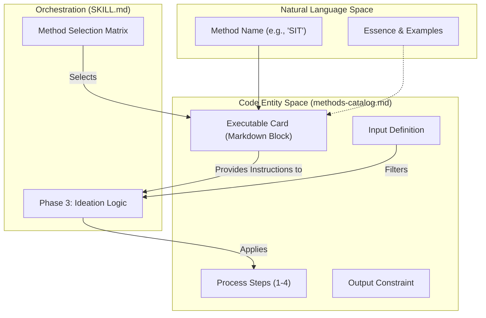
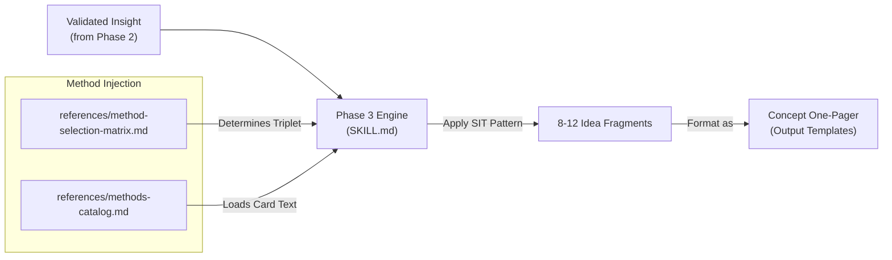

<!-- source: DeepWiki mcp.deepwiki.com · repo smixs/creative-director-skill · page 3.1 Methods Catalog · fetched 2026-10-26 -->

# Methods Catalog

Relevant source files

The following files were used as context for generating this wiki page:

- [README.md](README.md)
- [assets/methods-20.webp](assets/methods-20.webp)

This page provides a comprehensive technical reference for the 20+ creative methodologies available in the system. Each method is treated as an executable "card" with a specific input, transformation process, and output format. These methods are categorized by their cognitive function: structural templates, associative collisions, inversions, perturbations, and volume generation.

## 1. Structural Templates
These methods provide the generative skeleton for an idea. They rely on the "Closed World" principle, where all elements are drawn from the product's immediate environment to ensure brand relevance.

| Method | Key Principle | Primary Use Case |
| :--- | :--- | :--- |
| **SIT (Systematic Inventive Thinking)** | 6 recurring patterns (Subtraction, Multiplication, etc.) | High-efficiency coverage of standard ad patterns. |
| **SCAMPER** | 7 transformation operators (Substitute, Combine, Adapt, etc.) | Finding new angles for existing products/campaigns. |
| **TRIZ** | Resolving contradictions via 10 specific principles. | Briefs with insurmountable constraints or tensions. |
| **Morphological Analysis** | Combining values across 5-7 independent parameters. | Generating a high volume of diverse concept directions. |

### Implementation Detail: SIT / Goldenberg Templates
The SIT method is often the first method invoked in a session because 89% of award-winning ads follow these structural patterns.
*   **Process:** Lists components (Product, User, Environment) and applies patterns like **Task Unification** (e.g., packaging becomes media) or **Attribute Dependency** (e.g., "The more X, the more Y").
*   **File Reference:** [creative-director/references/methods-catalog.md:12-34]()

### Implementation Detail: Morphological Analysis
*   **Data Flow:** Takes a brief → breaks into dimensions (Tone, Mechanic, Channel, Hero, Proof) → lists 4-6 values per dimension → performs random selection to create combinations.
*   **File Reference:** [creative-director/references/methods-catalog.md:94-113]()

**Sources:** [creative-director/references/methods-catalog.md:10-113]()

---

## 2. Association / Collision
These methods generate creative "sparks" by colliding the product's world with a donor world or random stimuli.

*   **Bisociation:** Colliding two unrelated "matrices of thought" to find a shared structural intersection. [creative-director/references/methods-catalog.md:117-142]()
*   **Random Entry:** Using a completely random word/image as a lens to view the problem, forcing the brain to create a bridge. [creative-director/references/methods-catalog.md:144-162]()
*   **Forced Connections:** Taking two objects (Product + Random Object) and listing attributes of both to find a "Third Object" idea. [creative-director/references/methods-catalog.md:164-181]()
*   **Synectics (Analogical Thinking):** Using four types of analogies (Personal, Direct, Symbolic, Fantasy) to reframe the problem. [creative-director/references/methods-catalog.md:183-196]()

**Sources:** [creative-director/references/methods-catalog.md:115-196]()

---

## 3. Inversion / Disruption
These methods work by breaking habitual patterns or looking at the problem from the "wrong" end.

*   **Reverse Brainstorming:** Instead of "How to solve X?", ask "How to achieve the worst possible version of X?". The resulting "sabotage" ideas are then flipped back into solutions. [creative-director/references/methods-catalog.md:201-219]()
*   **Worst Possible Idea:** Intentionally generating bad, illegal, or embarrassing ideas to lower the "inner critic" threshold and find hidden truths. [creative-director/references/methods-catalog.md:221-238]()
*   **Provocation PO:** Using Edward de Bono's "PO" operator to make a statement that contradicts experience (e.g., "Cars should have square wheels") and using it as a stepping stone to a new concept. [creative-director/references/methods-catalog.md:240-261]()

**Sources:** [creative-director/references/methods-catalog.md:199-261]()

---

## 4. Recombination / Perturbation
Methods designed to inject "productive noise" into the creative process to prevent the system from settling into a local optimum.

*   **Oblique Strategies:** Based on Brian Eno’s deck. Short, cryptic instructions (e.g., "Honor thy error as a hidden intention") that force a change in creative direction. [creative-director/references/methods-catalog.md:266-283]()
*   **Six Thinking Hats:** De Bono’s framework for parallel thinking. The system simulates different perspectives (White: Data, Red: Emotion, Black: Risks, Yellow: Benefits, Green: Ideas, Blue: Process). [creative-director/references/methods-catalog.md:285-306]()
*   **Disney Creative Strategy:** A three-stage filter moving from **The Dreamer** (unlimited ideas) to **The Realist** (implementation) to **The Critic** (finding holes). [creative-director/references/methods-catalog.md:308-326]()

**Sources:** [creative-director/references/methods-catalog.md:264-326]()

---

## 5. Volume Generation & Bonus Methods
These are used in Pass 4+ or when a rapid volume of variations is required.

*   **Crazy 8s:** Generating 8 distinct sketches/concepts in rapid succession (simulated as 8 high-speed text prompts). [creative-director/references/methods-catalog.md:330-346]()
*   **Brainwriting 6-3-5:** A collaborative simulation where 6 "virtual personas" generate 3 ideas every 5 minutes, building on the previous persona's work. [creative-director/references/methods-catalog.md:348-368]()
*   **First Principles:** Breaking the product down to its fundamental "physical" truths and rebuilding the message from scratch, ignoring all category conventions. [creative-director/references/methods-catalog.md:372-388]()
*   **Lateral Thinking Toolkit:** A set of "quick-hit" operators: Challenge, Alternatives, Concept Fan, and Provocation. [creative-director/references/methods-catalog.md:390-410]()

**Sources:** [creative-director/references/methods-catalog.md:328-410]()

---

## 6. System Mapping: Natural Language to Code Entities

The following diagrams bridge the gap between the natural language descriptions of these methods and how they are handled as data entities within the system.

### Diagram: Method Entity Mapping
This diagram shows how a method name in the catalog maps to specific executable sections and logic used by the Phase 3 ideation engine.

**Sources:** [creative-director/references/methods-catalog.md:1-8](), [SKILL.md]()

### Diagram: Method Execution Data Flow
This diagram tracks the data flow as a method card is processed by the AI during an ideation pass.

**Sources:** [creative-director/references/methods-catalog.md:4-6](), [creative-director/references/method-selection-matrix.md](), [SKILL.md]()

---

## 7. Summary Table of Methods

| Category | Method | Logic Type |
| :--- | :--- | :--- |
| **Structural** | SIT | Deductive (Closed World) |
| **Structural** | SCAMPER | Transformative |
| **Structural** | TRIZ | Dialectic (Contradiction) |
| **Association** | Bisociation | Collisional |
| **Association** | Synectics | Analogical |
| **Inversion** | Reverse Brainstorm | Oppositional |
| **Perturbation** | Oblique Strategies | Random/Provocative |
| **Volume** | Brainwriting 6-3-5 | Iterative/Recursive |

**Sources:** [creative-director/references/methods-catalog.md:1-410]()

---

