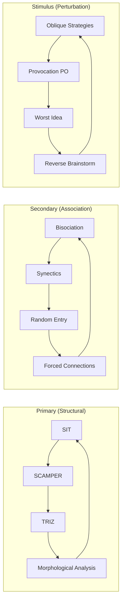
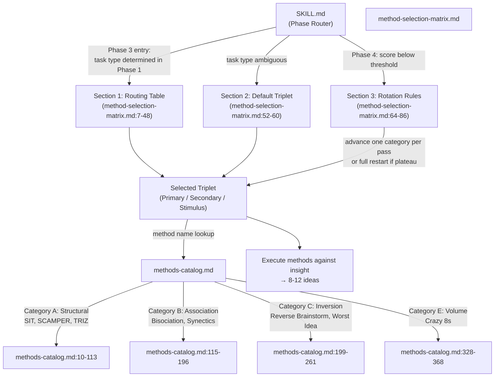
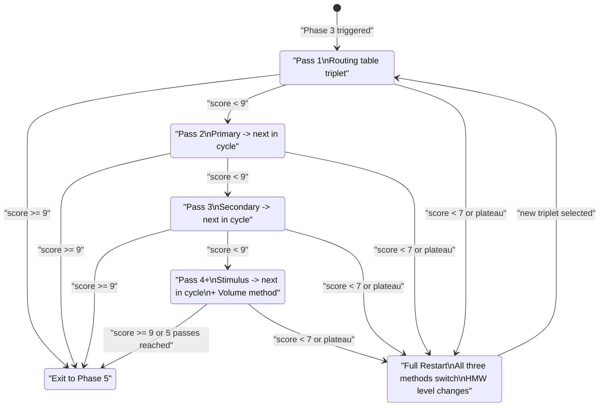

<!-- source: DeepWiki mcp.deepwiki.com · repo smixs/creative-director-skill · page 3.2 Method Selection & Rotation · fetched 2026-10-26 -->

# Method Selection & Rotation

Relevant source files

The following files were used as context for generating this wiki page:

- [assets/methods-20.webp](assets/methods-20.webp)
- [creative-director/SKILL.md](creative-director/SKILL.md)

This page documents how the system selects a triplet of three ideation methods at the start of each Phase 3 ideation pass, and how that triplet changes on subsequent passes during Phase 4's recursive refinement loop. It covers the routing table, the default fallback triplet, rotation order per category, hard constraints, and restart logic.

For details on the individual methods referenced here, see [Methods Catalog](#3.1). For how Phase 3 uses the selected triplet to generate ideas, see [Phase 3: Ideation](#2.3). For how passes are triggered and exit conditions are determined, see [Phase 4: Evaluate & Refine](#2.4).

The logic described here lives in `creative-director/references/method-selection-matrix.md`, which is loaded by `SKILL.md` during Phase 3 routing [creative-director/SKILL.md:94]().

---

## The Method Triplet

Every ideation pass uses exactly three methods, one from each functional category:

| Role | Category Label | Function |
|---|---|---|
| **Primary** | Structural | Provides the generative skeleton — constrains how ideas are built |
| **Secondary** | Association | Adds conceptual depth through semantic connections |
| **Stimulus** | Perturbation | Breaks habitual thinking; injects an unexpected angle |

Running three complementary methods per pass avoids the dead ends of using a single technique in isolation [creative-director/references/method-selection-matrix.md:1-4](). The category labels (Primary, Secondary, Stimulus) are the naming convention used throughout the system.

**Sources:** [creative-director/references/method-selection-matrix.md:1-4]()

---

## Routing Table

The routing table in `method-selection-matrix.md` maps twelve named task types to recommended triplets [creative-director/references/method-selection-matrix.md:7-48](). `SKILL.md` consults this table after Phase 1 Intake determines the task type [creative-director/SKILL.md:102]().

| Task Type | Primary (Structural) | Secondary (Association) | Stimulus (Perturbation) |
|---|---|---|---|
| New brand launch / rebrand | SIT | Bisociation | Provocation PO |
| Seasonal / promo campaign | SCAMPER | Forced Connections | Oblique Strategies |
| Digital / social campaign | SIT | Random Entry | Worst Idea |
| Product innovation / new feature launch | TRIZ | Bisociation | Reverse Brainstorm |
| Brand awareness / top-of-mind | Morphological Analysis | Synectics | Oblique Strategies |
| Behavior change / social impact | TRIZ | Synectics | Provocation PO |
| B2B / corporate | SIT | Bisociation | Oblique Strategies |
| Event / activation / experiential | Morphological Analysis | Forced Connections | Worst Idea |
| Packaging / POS / retail | SCAMPER | Bisociation | Reverse Brainstorm |
| Content / storytelling series | Morphological Analysis | Synectics | Oblique Strategies |
| Crisis response / reputation | SIT | Forced Connections | Reverse Brainstorm |
| Challenger brand / disruption | TRIZ | Random Entry | Provocation PO |

Each assignment reflects a structural rationale. For example, crisis tasks use SIT as Primary because SIT forces reduction to minimum necessary message elements [creative-director/references/methods-catalog.md:14-35](). Challenger tasks use TRIZ as Primary because TRIZ is built around resolving fundamental contradictions [creative-director/references/methods-catalog.md:65-91]().

**Sources:** [creative-director/references/method-selection-matrix.md:7-48](), [creative-director/references/methods-catalog.md:14-91](), [creative-director/SKILL.md:102]()

---

## Default Triplet

When the task type is ambiguous or does not match any row in the routing table, the system falls back to a fixed default defined in the selection matrix [creative-director/references/method-selection-matrix.md:52-60]():

| Role | Method |
|---|---|
| Primary | **SIT** |
| Secondary | **Bisociation** |
| Stimulus | **Oblique Strategies** |

This triplet is the "universal combination": SIT supplies structural discipline, Bisociation supplies conceptual depth, and Oblique Strategies supply an exit from habitual thinking [creative-director/references/method-selection-matrix.md:52-60]().

**Sources:** [creative-director/references/method-selection-matrix.md:52-60]()

---

## Rotation Rules Between Passes

When an ideation pass scores below threshold and Phase 4 triggers another pass, the triplet is not reused — it rotates according to fixed cycles defined per category [creative-director/references/method-selection-matrix.md:64-72]().

### Rotation Cycles

Each category has an ordered cycle of four methods. Rotation advances one step forward in the cycle on each relevant pass.

**Diagram: Rotation Cycles by Category**

**Sources:** [creative-director/references/method-selection-matrix.md:64-72]()

### Pass-by-Pass Logic

Each pass advances exactly one category's method, leaving the others unchanged, until pass 4+ where all three are potentially in motion and a Volume method is added [creative-director/references/method-selection-matrix.md:74-86]().

| Pass | Primary | Secondary | Stimulus | Notes |
|---|---|---|---|---|
| **1** | From routing table | From routing table | From routing table | Initial recommended triplet |
| **2** | Next in cycle | Unchanged | Unchanged | Primary advances |
| **3** | Unchanged (from pass 2) | Next in cycle | Unchanged | Secondary advances |
| **4+** | Unchanged | Unchanged | Next in cycle | Stimulus advances; Volume method added |

On pass 4 and beyond, a Volume method (e.g., `Crazy 8s` or `Brainwriting 6-3-5`) is added as a fourth generation element to increase the number of concept variants [creative-director/references/method-selection-matrix.md:84-86]().

**Sources:** [creative-director/references/method-selection-matrix.md:74-86]()

---

## Hard Constraints

Three rules override all other rotation logic [creative-director/references/method-selection-matrix.md:81-86]():

1. **No consecutive repeats:** The same method must not appear in two consecutive passes in any role.
2. **Full restart on score < 7 or quality plateau:** All three methods switch simultaneously, and the HMW (How Might We) framing must also shift level (e.g., from product level to user level).
3. **Volume method is additive:** When a Volume method is engaged (pass 4+), it joins the triplet as a fourth element rather than displacing a slot.

**Sources:** [creative-director/references/method-selection-matrix.md:81-86]()

---

## Category Compatibility

Certain pairings are explicitly recommended or flagged for caution in the matrix [creative-director/references/method-selection-matrix.md:89-106]().

| Pairing | Status | Rationale |
|---|---|---|
| **SIT + Bisociation** | Recommended | SIT provides the skeleton; Bisociation fills it with meaning. |
| **TRIZ + Synectics** | Recommended | TRIZ formulates the contradiction; Synectics resolves it via analogy. |
| **Random Entry + Worst Idea** | Caution | Two sources of chaos; high risk of losing conceptual focus. |

**Sources:** [creative-director/references/method-selection-matrix.md:89-106]()

---

## System Integration Diagram

The following diagram maps how `SKILL.md`, `method-selection-matrix.md`, and `methods-catalog.md` interact during method selection.

**Diagram: File-Level Routing for Method Selection**

**Sources:** [creative-director/references/method-selection-matrix.md:1-106](), [creative-director/references/methods-catalog.md:1-368](), [creative-director/SKILL.md:94]()

---

## Rotation State Machine

The complete state machine for method rotation across passes.

**Diagram: Pass Rotation State Machine**

**Sources:** [creative-director/references/method-selection-matrix.md:74-86](), [creative-director/SKILL.md:119-128]()

---

