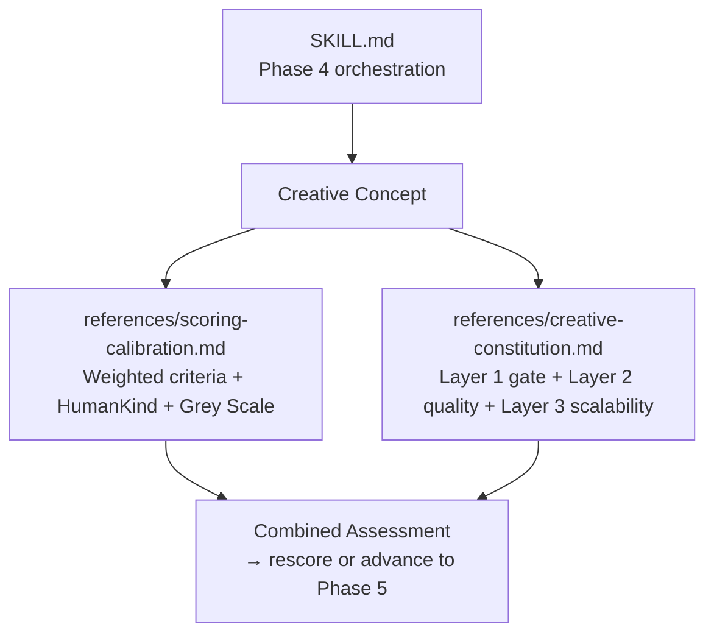
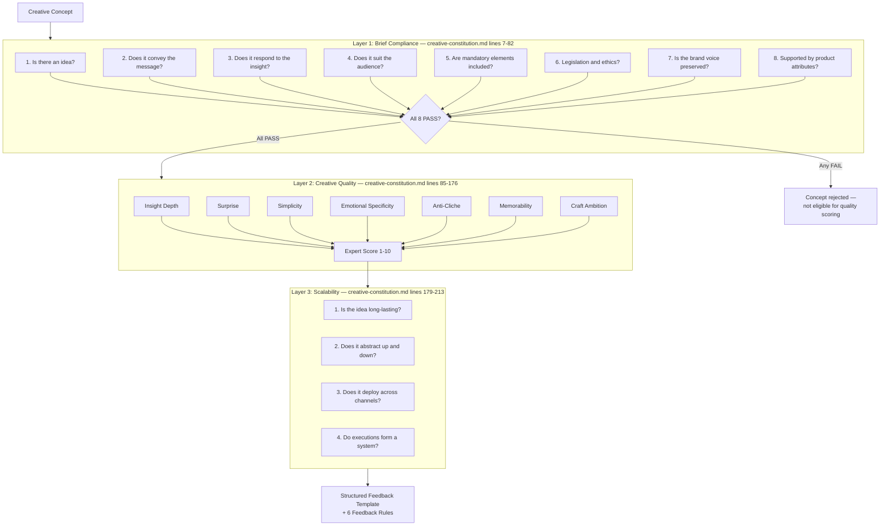
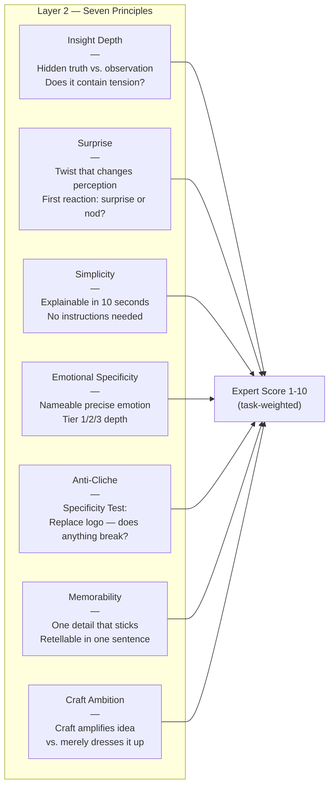
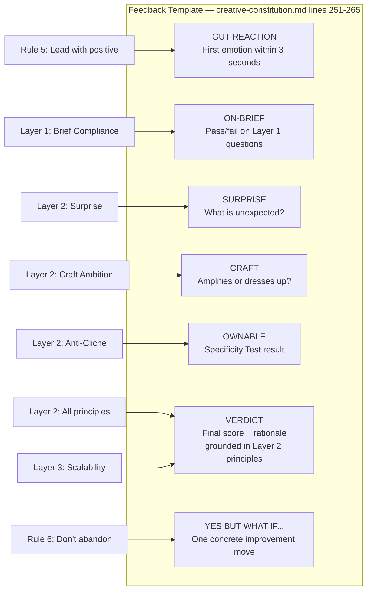

<!-- source: DeepWiki mcp.deepwiki.com · repo smixs/creative-director-skill · page 4.2 Creative Constitution · fetched 2026-10-26 -->

# Creative Constitution

Relevant source files

The following files were used as context for generating this wiki page:

- [creative-director/references/creative-constitution.md](creative-director/references/creative-constitution.md)

This page documents the evaluation framework defined in [creative-director/references/creative-constitution.md](), which operates as one of two parallel scoring systems applied during Phase 4 (Evaluate & Refine). Its role is to provide structured, principled critique of each generated concept across three sequential layers: a binary compliance gate, a qualitative quality score, and a strategic scalability assessment.

For the numerical scoring rubrics (weighted six-criteria score, HumanKind Scale, Grey Scale) used alongside this framework, see [Scoring Calibration (5.1)](). For a description of how Phase 4 orchestrates both systems together, see [Phase 4: Evaluate & Refine (3.4)]().

---

## Role in the Evaluation System

The Creative Constitution is invoked by `SKILL.md` during Phase 4 alongside `scoring-calibration.md`. The two modules share an evaluation layer — neither calls the other directly, but both contribute to the same per-concept assessment pass.

**Diagram: creative-constitution.md in Phase 4 Context**

Sources: [creative-director/references/creative-constitution.md:1-5]()

---

## Three-Layer Structure

**Diagram: Three-Layer Evaluation Flow in creative-constitution.md**

Sources: [creative-director/references/creative-constitution.md:7-265]()

---

## Layer 1: Brief Compliance

[creative-director/references/creative-constitution.md:7-82]()

Eight binary questions. **A single failure disqualifies the concept from Layer 2 scoring.** The gate enforces "brief first, creative second."

| # | Question | Pass Condition | Common Fail Pattern |
|---|----------|----------------|---------------------|
| 1 | Is there an idea? | Formulated in one sentence containing a twist or position [creative-director/references/creative-constitution.md:15-15]() | Describes mechanics or plot instead of the central thought [creative-director/references/creative-constitution.md:16-16]() |
| 2 | Does it convey the intended message? | Consumer can retell the proposition in their own words [creative-director/references/creative-constitution.md:24-24]() | Beautiful execution, unclear offer or brand role [creative-director/references/creative-constitution.md:25-25]() |
| 3 | Does it respond to the insight? | Insight from the brief is felt in the final work [creative-director/references/creative-constitution.md:33-33]() | Insight present in strategy deck, absent in execution [creative-director/references/creative-constitution.md:34-34]() |
| 4 | Does it suit the target audience? | Audience recognizes themselves in language, codes, references [creative-director/references/creative-constitution.md:42-42]() | Great idea aimed at the wrong demographic [creative-director/references/creative-constitution.md:43-43]() |
| 5 | Are mandatory elements included? | Logo, disclaimer, copy, packshot, product name all present [creative-director/references/creative-constitution.md:51-51]() | Missing disclaimer; logo misplaced [creative-director/references/creative-constitution.md:52-52]() |
| 6 | Legislation and ethics? | No category restriction violations, no deceptive claims [creative-director/references/creative-constitution.md:60-60]() | Medical product promising guaranteed cure [creative-director/references/creative-constitution.md:61-61]() |
| 7 | Is the brand voice preserved? | Cover the logo — tone and visual still identify the brand [creative-director/references/creative-constitution.md:69-69]() | Copy could belong to any brand in the category [creative-director/references/creative-constitution.md:70-70]() |
| 8 | Supported by product attributes? | Emotional promise tied to a specific product function [creative-director/references/creative-constitution.md:78-78]() | "We care" with no functional proof [creative-director/references/creative-constitution.md:79-79]() |

**Key diagnostic for question 1:** if explaining the idea takes more than one sentence [creative-director/references/creative-constitution.md:17-17](), or if the idea cannot be separated from a specific format, it is an execution — not an idea [creative-director/references/creative-constitution.md:17-17]().

Sources: [creative-director/references/creative-constitution.md:7-82]()

---

## Layer 2: Creative Quality

[creative-director/references/creative-constitution.md:85-176]()

Seven principles, each scored 1–10. **The final score is not an arithmetic average** — it is an expert judgment weighted by each principle's relevance to the specific task [creative-director/references/creative-constitution.md:87-87]().

**Diagram: Layer 2 Principles with Diagnostic Entry Points**

Sources: [creative-director/references/creative-constitution.md:85-176]()

### Principle Details

**1. Insight Depth**
Diagnostic: "Would a person say 'yes, exactly, but I've never put it that way'?" [creative-director/references/creative-constitution.md:91-91](). An insight contains internal contradiction or tension. An observation does not.

**2. Surprise**
Diagnostic: "Did the client expect exactly this?" [creative-director/references/creative-constitution.md:104-104](). Predictable advertising is invisible advertising. The first idea that comes to mind in a category automatically fails.

**3. Simplicity**
Diagnostic: "Can it be formulated in one sentence without instructions?" [creative-director/references/creative-constitution.md:117-117](). Multi-step mechanics and context-dependent understanding are red flags.

**4. Emotional Specificity**
Three-tier depth model [creative-director/references/creative-constitution.md:129-136]():
| Tier | Description | Example |
|------|-------------|---------|
| 1 | Pleasant — baseline | "Beautiful views, pleasant" |
| 2 | Interesting — good | "Made me think about travel differently" |
| 3 | Deeply moving — excellent | Lump in the throat from recognition |

**5. Anti-Cliché**
Three tests applied [creative-director/references/creative-constitution.md:143-150]():
- **Specificity Test**: Replace the brand with a competitor. Does anything break?
- **Why This Brand**: Could only this brand say this?
- **Unexpectedness Test**: Is this the first solution that comes to mind in the category?

**6. Memorability**
Requirement: one detail (image, phrase, sound, situation) that acts as a memory anchor [creative-director/references/creative-constitution.md:158-158](). If the work cannot be retold to a friend in one sentence, it will not be remembered.

**7. Craft Ambition**
Key distinction: craft that *amplifies* the idea (Apple "Shot on iPhone" — remove craft, the idea ceases to exist) vs. craft that *dresses up* the idea (strong idea survives without the production quality) [creative-director/references/creative-constitution.md:172-175]().

Sources: [creative-director/references/creative-constitution.md:89-175]()

---

## Layer 3: Scalability

[creative-director/references/creative-constitution.md:179-213]()

Four questions determine whether the concept has strategic potential beyond a single execution. This layer maps to the "Scalability" axis in the three-axis final summary.

| # | Question | Good Signal | Bad Signal |
|---|----------|-------------|------------|
| 1 | Is the idea long-lasting? | New executions possible for years on one platform (e.g., Dove Real Beauty) [creative-director/references/creative-constitution.md:184-184]() | Exhausted after one season; tied to a specific event or trend [creative-director/references/creative-constitution.md:185-185]() |
| 2 | Does it abstract up and down? | Works from global manifesto to specific push notification ("Just Do It") [creative-director/references/creative-constitution.md:191-191]() | Only works at one level of abstraction [creative-director/references/creative-constitution.md:192-192]() |
| 3 | Does it deploy across channels? | Lives in video, static, outdoor, event, social — each channel adds a layer [creative-director/references/creative-constitution.md:198-198]() | "You have to see it in video" [creative-director/references/creative-constitution.md:199-199]() |
| 4 | Do executions form a unified system? | Each execution is self-contained but recognizable as part of something bigger [creative-director/references/creative-constitution.md:205-205]() | Disjointed ideas sharing only a logo and font [creative-director/references/creative-constitution.md:206-206]() |

**Note on question 1:** A long-running execution series is not a Big Idea. If new spots repeat the same format without generating a new platform layer, that is a series, not a platform [creative-director/references/creative-constitution.md:188-188]().

Sources: [creative-director/references/creative-constitution.md:179-213]()

---

## Feedback Rules

[creative-director/references/creative-constitution.md:217-243]()

Six rules, mandatory for every feedback pass. Based on the IKRA/Voskresensky methodology.

| # | Rule | Key Distinction |
|---|------|-----------------|
| 1 | Reasoned Criticism | "Here's why: [specific principle]" — not "I don't like it" [creative-director/references/creative-constitution.md:220-221]() |
| 2 | Critique the Work, Not the Person | "This idea has a weak X" — not "you came up with something bad" [creative-director/references/creative-constitution.md:224-225]() |
| 3 | Don't Touch Execution Details | Critique idea, strategy, message — leave execution decisions to the responsible party [creative-director/references/creative-constitution.md:228-229]() |
| 4 | The Sandwich Rule | Praise (strong, specific) → Critique (reasoned, directional) → Praise (softer) [creative-director/references/creative-constitution.md:232-233]() |
| 5 | Lead with Positive Comments | What was done right first; enables the author to know what to preserve [creative-director/references/creative-constitution.md:236-237]() |
| 6 | Don't Abandon the Creative | Point a direction, give a new stimulus — draft 1 is not the end [creative-director/references/creative-constitution.md:240-243]() |

Sources: [creative-director/references/creative-constitution.md:217-243]()

---

## Feedback Template

[creative-director/references/creative-constitution.md:247-283]()

A structured template applied after a full pass through all three layers. Each field maps to a specific layer or rule.

**Diagram: Feedback Template Fields Mapped to Evaluation Layers**

Sources: [creative-director/references/creative-constitution.md:247-283]()

The `"YES BUT WHAT IF..."` field is the operationalization of Feedback Rule 6: it must be a **concrete move**, not an abstract direction [creative-director/references/creative-constitution.md:240-243](). Example: "what if the final scene shows not abstract care, but a specific product function in action" — this closes a specific Layer 1 failure (question 8) and strengthens a specific Layer 2 criterion (Anti-Cliché) [creative-director/references/creative-constitution.md:282-283]().

---

## Relationship to Scoring Calibration

The Creative Constitution and `scoring-calibration.md` are the two modules that share the evaluation layer in Phase 4. They are complementary but distinct:

| Dimension | creative-constitution.md | scoring-calibration.md |
|-----------|--------------------------|------------------------|
| Primary mode | Qualitative, principle-based | Quantitative, rubric-based |
| Layer 1 output | Pass / Fail per question | Pass / Fail per brief criterion |
| Layer 2 output | Expert score (task-weighted) | Weighted score across 6 fixed criteria |
| Additional scales | — | HumanKind Scale (1–10), Grey Scale (1–10) |
| Feedback artifact | Structured 7-field template | Four-perspective panel simulation |

Sources: [creative-director/references/creative-constitution.md:1-5](), [creative-director/references/scoring-calibration.md]()

---

