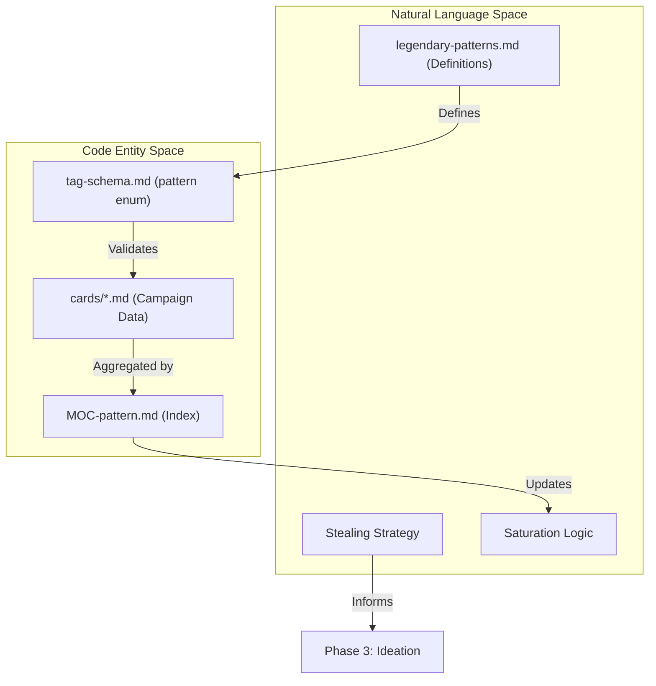
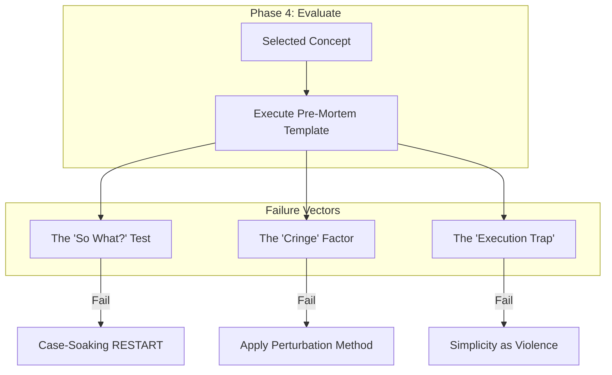

<!-- source: DeepWiki mcp.deepwiki.com · repo smixs/creative-director-skill · page 5.1 P01–P18 Pattern Reference · fetched 2026-10-26 -->

# P01–P18 Pattern Reference

Relevant source files

The following files were used as context for generating this wiki page:

- [creative-director/references/legendary-campaigns/MOC-pattern.md](creative-director/references/legendary-campaigns/MOC-pattern.md)
- [creative-director/references/legendary-campaigns/README.md](creative-director/references/legendary-campaigns/README.md)

This page provides a detailed technical reference for the 18 creative patterns (P01–P18) that form the backbone of the Creative Director Skill's pattern recognition system. These patterns are used to categorize the 571-case library, calibrate the originality of new ideas, and provide a "stealing strategy" for creative execution.

## Purpose and Scope

The pattern system serves as a calibration instrument. Every strong idea generated by the system is mapped to one or more of these 18 patterns. This mapping allows the system to:
1.  **Verify Mechanics:** Determine if the underlying logic of an idea has been proven successful in the past [creative-director/references/legendary-patterns.md:5-5]().
2.  **Measure Saturation:** Calculate how "crowded" a creative space is based on the number of canonical cases in the library [creative-director/references/legendary-patterns.md:7-7]().
3.  **Adjust Originality Pressure:** If a pattern is highly saturated (e.g., P03 with 45+ cases), the system increases the scoring threshold for "Originality" [creative-director/references/legendary-patterns.md:7-7]().

### Data Flow: From Library to Calibration

The following diagram illustrates how the `legendary-patterns.md` definitions interact with the `MOC-pattern.md` index and the individual campaign cards.

**Pattern-to-Code Entity Mapping**

Sources: [creative-director/references/legendary-patterns.md:1-9](), [creative-director/references/legendary-campaigns/MOC-pattern.md:1-15]()

---

## P01–P09: Structural & Identity Patterns

### P01 — Format as Idea
*   **Core Mechanic:** The medium or platform constraint becomes the concept itself. The ad cannot exist in any other format without losing its meaning [creative-director/references/legendary-patterns.md:19-19]().
*   **Why it works:** Novelty is structural. The audience cannot separate "the idea" from "the container" [creative-director/references/legendary-patterns.md:21-21]().
*   **Stealing Strategy:** Audit native constraints (size, timing, interaction). Make a limitation load-bearing [creative-director/references/legendary-patterns.md:28-28]().
*   **Saturation:** 6 cases [creative-director/references/legendary-campaigns/MOC-pattern.md:7-13]().

### P02 — Enemy or Conflict
*   **Core Mechanic:** The brand builds communication around an opponent (competitor, habit, or stereotype) [creative-director/references/legendary-patterns.md:36-36]().
*   **Why it works:** Humans organize identity around opposition. A clear enemy makes the brand's position legible [creative-director/references/legendary-patterns.md:38-38]().
*   **Stealing Strategy:** Name the enemy precisely. Avoid vague targets like "the category" [creative-director/references/legendary-patterns.md:45-45]().
*   **Saturation:** 15 cases [creative-director/references/legendary-campaigns/MOC-pattern.md:15-30]().

### P03 — Behavior Inversion
*   **Core Mechanic:** Identify an arbitrary category rule and violate it literally [creative-director/references/legendary-patterns.md:53-53]().
*   **Why it works:** Category codes are learned. Breaking them signals confidence and reframes the brand [creative-director/references/legendary-patterns.md:55-55]().
*   **Stealing Strategy:** List visual/tonal conventions. Pick the one most taken for granted and invert it [creative-director/references/legendary-patterns.md:62-62]().
*   **Saturation:** 45 cases (High Saturation) [creative-director/references/legendary-campaigns/MOC-pattern.md:32-66]().

### P04 — Brand as Activist
*   **Core Mechanic:** The brand takes a position on a social/political issue and acts on it at cost [creative-director/references/legendary-patterns.md:70-70]().
*   **Why it works:** Costly actions are credible; stated values are cheap [creative-director/references/legendary-patterns.md:72-72]().
*   **Stealing Strategy:** The action must cost something visible. Avoid issues without an authentic stake [creative-director/references/legendary-patterns.md:79-79]().
*   **Saturation:** 28 cases [creative-director/references/legendary-campaigns/MOC-pattern.md:71-100]().

### P05 — Cultural Hijack
*   **Core Mechanic:** Inserting the brand into a live cultural event or news cycle. Speed is the primary asset [creative-director/references/legendary-patterns.md:87-87]().
*   **Why it works:** Borrows concentrated attention at marginal cost [creative-director/references/legendary-patterns.md:89-89]().
*   **Stealing Strategy:** Build reactive capability before the moment. Trap: speed without relevance [creative-director/references/legendary-patterns.md:96-96]().
*   **Saturation:** 35 cases [creative-director/references/legendary-campaigns/MOC-pattern.md:102-137]().

### P06 — Limitation as Power
*   **Core Mechanic:** A genuine weakness or structural constraint is reframed as a defining advantage [creative-director/references/legendary-patterns.md:104-104]().
*   **Why it works:** Admitting weakness signals honesty and preempts competitor attacks [creative-director/references/legendary-patterns.md:106-106]().
*   **Stealing Strategy:** Find what the brand cannot compete on. Turn that into the claim [creative-director/references/legendary-patterns.md:113-113]().
*   **Saturation:** 9 cases [creative-director/references/legendary-campaigns/MOC-pattern.md:139-148]().

### P07 — Invisible Brand
*   **Core Mechanic:** Minimal logo or product presence. Narrative carries the full weight [creative-director/references/legendary-patterns.md:121-121]().
*   **Why it works:** Restraint signals confidence. Audiences recognize excessive branding as insecurity [creative-director/references/legendary-patterns.md:123-123]().
*   **Stealing Strategy:** Remove the logo from the first 80% of the execution. If it fails, the idea isn't strong enough [creative-director/references/legendary-patterns.md:130-130]().
*   **Saturation:** 12 cases [creative-director/references/legendary-campaigns/MOC-pattern.md:150-162]().

### P08 — Craft as Message
*   **Core Mechanic:** The obsession with how the ad is made (art direction, copy, production) becomes the proof of brand quality [creative-director/references/legendary-patterns.md:137-137]().
*   **Why it works:** Effort is a proxy for value. Extreme craft suggests extreme product care [creative-director/references/legendary-patterns.md:139-139]().
*   **Stealing Strategy:** Choose a medium and push it to an "impossible" level of detail [creative-director/references/legendary-patterns.md:146-146]().
*   **Saturation:** 18 cases [creative-director/references/legendary-campaigns/MOC-pattern.md:164-182]().

### P09 — User as Co-Author
*   **Core Mechanic:** The brand provides a tool, prompt, or "unfinished" asset for the audience to complete [creative-director/references/legendary-patterns.md:153-153]().
*   **Why it works:** Endowment effect. People value what they help build [creative-director/references/legendary-patterns.md:155-155]().
*   **Stealing Strategy:** Don't ask for "content"; ask for a specific choice or contribution [creative-director/references/legendary-patterns.md:162-162]().
*   **Saturation:** 22 cases [creative-director/references/legendary-campaigns/MOC-pattern.md:184-206]().

---

## P10–P18: Execution & Narrative Patterns

| ID | Pattern Name | Core Mechanic | Saturation |
|:---|:---|:---|:---|
| **P10** | **Serialization & Ritual** | Creating a recurring format or "event" that the audience anticipates. | 14 cases |
| **P11** | **Absurd as Carrier** | Using surrealism or non-sequiturs to bypass logical defense mechanisms. | 31 cases |
| **P12** | **Social Experiment** | Setting up a real-world scenario to observe human behavior on camera. | 25 cases |
| **P13** | **Truth Telling** | Radical honesty about the product, the category, or the customer's life. | 29 cases |
| **P14** | **Product as Proof** | The product's performance in an extreme test is the only message. | 19 cases |
| **P15** | **Benefit Hyperbole** | Taking a single product benefit to its most illogical, extreme conclusion. | 41 cases |
| **P16** | **Long-form Drama** | Using cinematic storytelling depth to build emotional resonance. | 17 cases |
| **P17** | **Design as Idea** | The visual system or physical product design *is* the communication. | 11 cases |
| **P18** | **Tech as Canvas** | Using emerging technology (AI, AR, etc.) as the primary creative driver. | 15 cases |

Sources: [creative-director/references/legendary-campaigns/MOC-pattern.md:208-410](), [creative-director/references/legendary-patterns.md:170-300]() (Note: Descriptions truncated for brevity; full details in source).

---

## System Integration: Pre-Mortem Template

Before an idea is finalized, it must pass the **Pre-Mortem**. This is a mandatory step in Phase 4 and 5 [creative-director/references/legendary-patterns.md:9-9]().

### Pre-Mortem Logic Flow

**Template Fields:**
1.  **The "So What?" Test:** If this appears in a feed, why would a cynical person stop? [creative-director/references/legendary-patterns.md:315-315]()
2.  **The Misinterpretation:** How could this be read as offensive or out of touch? [creative-director/references/legendary-patterns.md:317-317]()
3.  **The "Just an Ad" Risk:** Does it feel like a brand talking to itself? [creative-director/references/legendary-patterns.md:319-319]()

Sources: [creative-director/references/legendary-patterns.md:310-325]()

---

## Pattern Saturation & Originality Cap

The system enforces an **Originality Cap** based on the `MOC-pattern.md` counts.

*   **Low Saturation (<10 cases):** System allows for structural "stealing" of the mechanic with minimal modification.
*   **High Saturation (>40 cases):** (e.g., P03, P15). The system triggers a mandatory **Pattern Calibration** step. The AI must explicitly state how the new idea differs from the 3 most recent canonical cases in that pattern [creative-director/references/legendary-patterns.md:7-7]().

Sources: [creative-director/references/legendary-campaigns/MOC-pattern.md:1-5](), [creative-director/references/legendary-patterns.md:5-10]()

---

