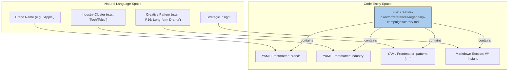
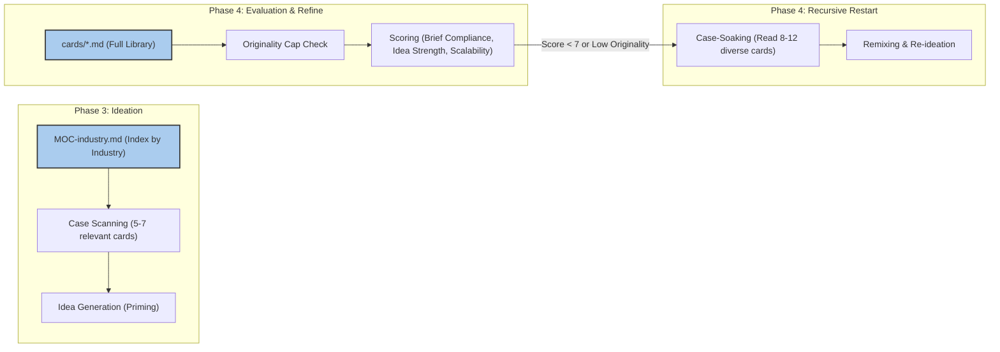

<!-- source: DeepWiki mcp.deepwiki.com · repo smixs/creative-director-skill · page 5.2 Campaign Cards by Brand · fetched 2026-10-26 -->

# Campaign Cards by Brand

<details>
<summary>Relevant source files</summary>

The following files were used as context for generating this wiki page:

- [creative-director/references/legendary-campaigns/cards/adidas-d-rose-jump-store-2012.md](creative-director/references/legendary-campaigns/cards/adidas-d-rose-jump-store-2012.md)
- [creative-director/references/legendary-campaigns/cards/always-like-a-girl-2014.md](creative-director/references/legendary-campaigns/cards/always-like-a-girl-2014.md)
- [creative-director/references/legendary-campaigns/cards/apple-1984-1984.md](creative-director/references/legendary-campaigns/cards/apple-1984-1984.md)
- [creative-director/references/legendary-campaigns/cards/apple-think-different-1997.md](creative-director/references/legendary-campaigns/cards/apple-think-different-1997.md)
- [creative-director/references/legendary-campaigns/cards/avis-we-try-harder-1962.md](creative-director/references/legendary-campaigns/cards/avis-we-try-harder-1962.md)
- [creative-director/references/legendary-campaigns/cards/bmw-the-hire-2001.md](creative-director/references/legendary-campaigns/cards/bmw-the-hire-2001.md)
- [creative-director/references/legendary-campaigns/cards/budweiser-whassup-1999.md](creative-director/references/legendary-campaigns/cards/budweiser-whassup-1999.md)
- [creative-director/references/legendary-campaigns/cards/burger-king-mcwhopper-proposal-2015.md](creative-director/references/legendary-campaigns/cards/burger-king-mcwhopper-proposal-2015.md)

</details>


This page serves as a technical reference for the 571 individual campaign cards stored within the `creative-director/references/legendary-campaigns/cards/` directory. These cards represent the "canon" used by the system for pattern calibration, originality benchmarking, and case-soaking during the creative process.

### Card Anatomy and Schema
Each card is a Markdown file containing a 17-axis YAML frontmatter block followed by four standardized content sections. This structure allows for both human readability and programmatic filtering.

| Section | Purpose |
| :--- | :--- |
| **Frontmatter** | Metadata for filtering (Brand, Pattern, Industry, Emotion, Budget, etc.) [creative-director/references/tag-schema.md:1-100]() |
| **Insight** | The underlying human, category, or cultural truth the campaign addressed. |
| **Mechanic** | The creative execution or "how it works" in practice. |
| **Why it worked** | Strategic analysis of the campaign's success. |
| **Steal** | The portable "creative logic" that can be applied to other briefs. |

**Sources:** [creative-director/references/legendary-campaigns/cards/adidas-d-rose-jump-store-2012.md:1-50](), [creative-director/references/legendary-campaigns/cards/always-like-a-girl-2014.md:1-53]()

---

### Major Brand Clusters

The library is organized into clusters of high-volume brands that have defined advertising history.

#### Apple (10+ Cards)
Apple's library spans from the 1984 Super Bowl ad to modern product-as-proof executions.
*   **Key Examples:**
    *   `apple-1984-1984.md`: Announcing Macintosh as an act of liberation against corporate control [creative-director/references/legendary-campaigns/cards/apple-1984-1984.md:33-41]().
    *   `apple-think-different-1997.md`: Restating Apple's identity through aligning with visionaries [creative-director/references/legendary-campaigns/cards/apple-think-different-1997.md:39-41]().

#### Adidas (Example Card)
Adidas cards often feature experiential and performance-based mechanics.
*   **Key Example:**
    *   `adidas-d-rose-jump-store-2012.md`: Product-as-proof through a participatory mechanic, where the price is performance [creative-director/references/legendary-campaigns/cards/adidas-d-rose-jump-store-2012.md:37-39]().

#### Always (Example Card)
Always campaigns frequently address social insights and purpose-driven narratives.
*   **Key Example:**
    *   `always-like-a-girl-2014.md`: A social experiment revealing the internalized insult of "like a girl" [creative-director/references/legendary-campaigns/cards/always-like-a-girl-2014.md:37-38]().

#### Avis (Example Card)
Avis is a classic example of turning a perceived weakness into a brand strength.
*   **Key Example:**
    *   `avis-we-try-harder-1962.md`: Acknowledging the #2 position to Hertz and making it a service promise [creative-director/references/legendary-campaigns/cards/avis-we-try-harder-1962.md:39-40]().

#### BMW (Example Card)
BMW campaigns often push boundaries in branded content and digital engagement.
*   **Key Example:**
    *   `bmw-the-hire-2001.md`: Inventing the branded content model with a series of short action films [creative-director/references/legendary-campaigns/cards/bmw-the-hire-2001.md:36-37]().

#### Budweiser (Example Card)
Budweiser campaigns frequently tap into cultural rituals and social bonding.
*   **Key Example:**
    *   `budweiser-whassup-1999.md`: Amplifying a male friendship ritual into a pop-culture phenomenon [creative-director/references/legendary-campaigns/cards/budweiser-whassup-1999.md:36-37]().

#### Burger King (Example Card)
Burger King is known for provocative stunts that leverage competitor dynamics.
*   **Key Example:**
    *   `burger-king-mcwhopper-proposal-2015.md`: Designing a public invitation where the competitor's only options benefit the challenger [creative-director/references/legendary-campaigns/cards/burger-king-mcwhopper-proposal-2015.md:40-41]().

**Sources:** [creative-director/references/legendary-campaigns/cards/apple-1984-1984.md:1-53](), [creative-director/references/legendary-campaigns/cards/apple-think-different-1997.md:1-53](), [creative-director/references/legendary-campaigns/cards/adidas-d-rose-jump-store-2012.md:1-52](), [creative-director/references/legendary-campaigns/cards/always-like-a-girl-2014.md:1-53](), [creative-director/references/legendary-campaigns/cards/avis-we-try-harder-1962.md:1-57](), [creative-director/references/legendary-campaigns/cards/bmw-the-hire-2001.md:1-53](), [creative-director/references/legendary-campaigns/cards/budweiser-whassup-1999.md:1-53](), [creative-director/references/legendary-campaigns/cards/burger-king-mcwhopper-proposal-2015.md:1-53]()

---

### Technical Navigation and Filtering

The system treats the `cards/` directory as a flat namespace to simplify programmatic access. Filtering is achieved through the 17-axis schema defined in `tag-schema.md`.

#### Cross-Axis Filtering with Ripgrep
To find specific campaign types across the library, use `rg` (ripgrep) to scan the frontmatter:

```bash
# Find all "Automotive" campaigns with "High" budget
rg -l "industry: automotive" creative-director/references/legendary-campaigns/cards/ | xargs rg -l "budget: high"

# Find campaigns using Pattern P11 (Absurd) in the "Alcohol" industry
rg -l "pattern:.*P11" creative-director/references/legendary-campaigns/cards/ | xargs rg -l "industry: alcohol"
```

#### Mapping System Entities to Code
The following diagram illustrates how the natural language concept of a "Brand Cluster" is represented in the file system and schema.

**Diagram: Campaign Card Entity Mapping**

This diagram shows how a natural language concept like "Brand Name" maps directly to the `brand` field in the YAML frontmatter of a campaign card file [creative-director/references/legendary-campaigns/cards/apple-1984-1984.md:4](). Similarly, "Industry Cluster" maps to the `industry` field [creative-director/references/legendary-campaigns/cards/apple-1984-1984.md:9](), and "Creative Pattern" to the `pattern` array [creative-director/references/legendary-campaigns/cards/apple-1984-1984.md:10](). The "Strategic Insight" is found in the dedicated Markdown section `## Insight` [creative-director/references/legendary-campaigns/cards/apple-1984-1984.md:33]().

**Sources:** [creative-director/references/tag-schema.md:1-50](), [creative-director/references/legendary-campaigns/cards/apple-1984-1997.md:1-54]()

---

### Data Flow: Card to Process
Campaign cards are not static references; they are injected into the creative pipeline during specific phases.

**Diagram: Campaign Card Integration into Creative Pipeline**

1.  **Ideation (Phase 3):** The system scans 5-7 cases from relevant Maps of Content (MOCs) (e.g., `MOC-industry.md`) to prime the model before generation. This ensures the AI is exposed to successful examples within the relevant domain.
2.  **Evaluation (Phase 4):** The entire library of `cards/*.md` acts as a saturation map. If a newly generated idea too closely mirrors a "Mechanic" or "Steal" in an existing card, an empirical originality cap is applied, potentially reducing its score.
3.  **Restart (Phase 4):** If the creative process plateaus (e.g., low scores or originality), the `RESTART` protocol triggers "case-soaking." During this, the system reads 8-12 canonical cards, often from diverse industries or patterns, to force new neural pathways and break creative blocks.

**Sources:** [creative-director/references/legendary-campaigns/cards/adidas-d-rose-jump-store-2012.md:45-49](), [creative-director/references/legendary-campaigns/cards/always-like-a-girl-2014.md:46-49](), [creative-director/references/legendary-campaigns/cards/apple-1984-1984.md:45-49](), [creative-director/references/legendary-campaigns/cards/apple-think-different-1997.md:46-49](), [creative-director/references/legendary-campaigns/cards/avis-we-try-harder-1962.md:50-53](), [creative-director/references/legendary-campaigns/cards/bmw-the-hire-2001.md:46-49](), [creative-director/references/legendary-campaigns/cards/budweiser-whassup-1999.md:46-49](), [creative-director/references/legendary-campaigns/cards/burger-king-mcwhopper-proposal-2015.md:46-49]()

---

