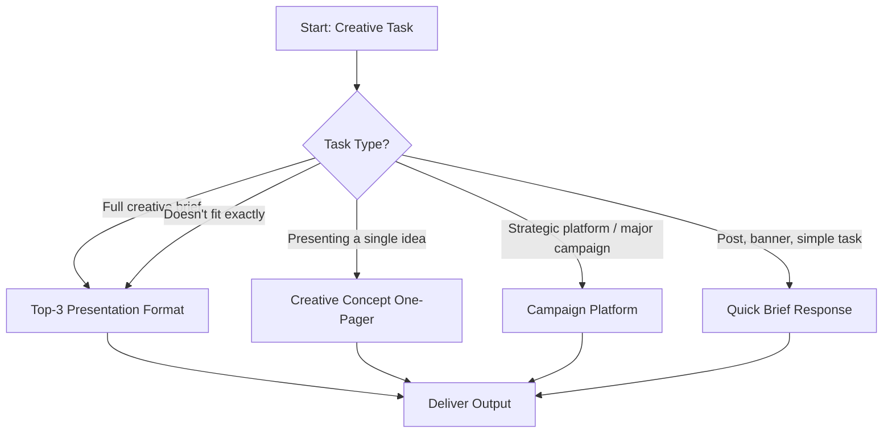
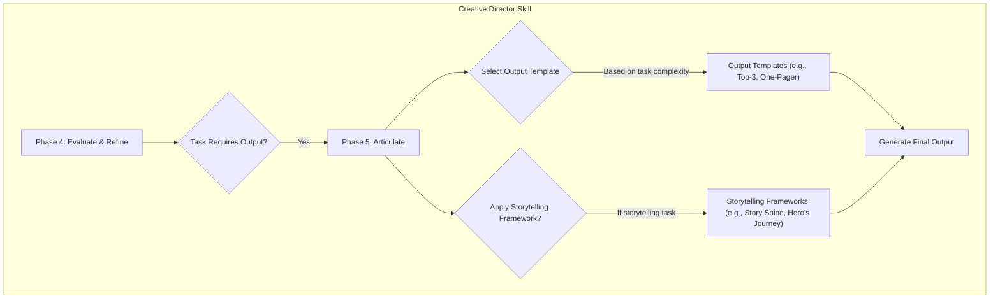

<!-- source: DeepWiki mcp.deepwiki.com · repo smixs/creative-director-skill · page 6 Output & Narrative Formats · fetched 2026-10-26 -->

# Output & Narrative Formats

Relevant source files

The following files were used as context for generating this wiki page:

- [creative-director/SKILL.md](creative-director/SKILL.md)
- [creative-director/assets/output-templates.md](creative-director/assets/output-templates.md)

This page provides an overview of how the Creative Director skill presents its finished work. It covers the four standardized output templates used for delivering creative concepts and the six storytelling frameworks employed for narrative framing. This page serves as a high-level parent, linking to dedicated child pages for detailed information on each topic.

The selection of an appropriate output template and, optionally, a storytelling framework, occurs during **Phase 5: ARTICULATE** of the creative pipeline [SKILL.md:36-36](). This phase is responsible for structuring the final creative output based on the task type and desired level of detail.

## Output Templates

The Creative Director skill utilizes four distinct output templates, each designed for different task types and levels of detail. These templates ensure consistency, clarity, and completeness in the delivered creative work. The choice of template depends on the complexity of the brief and the required scope of the response.

The four templates are:
*   **Creative Concept One-Pager**: For detailed presentation of a single idea.
*   **Top-3 Presentation Format**: The primary working template for comprehensive brief responses, presenting multiple ideas with recommendations.
*   **Campaign Platform**: For strategic, systemic campaign approaches.
*   **Quick Brief Response**: A lightweight format for simple, rapid tasks.

For details on the structure, required fields, filling rules, and selection guidance for each template, see [Output Templates](#6.1).

### Output Template Selection Flow

Sources: [creative-director/assets/output-templates.md:198-207]()

## Storytelling Frameworks

In addition to structured output templates, the Creative Director skill can apply various storytelling frameworks to enhance the narrative framing of creative concepts. These frameworks provide established structures for developing compelling stories, which can be crucial for engaging audiences and communicating the essence of an idea effectively. The application of these frameworks is particularly relevant for "storytelling tasks" during the Ideation phase [SKILL.md:96-96]().

The six narrative frameworks available are:
*   **Story Spine**
*   **Sparkline**
*   **Freytag's Pyramid**
*   **Monroe's Motivated Sequence**
*   **Pixar Rules**
*   **Hero's Journey**

For detailed information on the structure, timing guidance per ad format, and use cases for each framework, see [Storytelling Frameworks](#6.2).

### Integration of Output Templates and Storytelling Frameworks

Sources:
[SKILL.md:36-36]()
[SKILL.md:96-96]()
[creative-director/assets/output-templates.md:1-211]()

---

