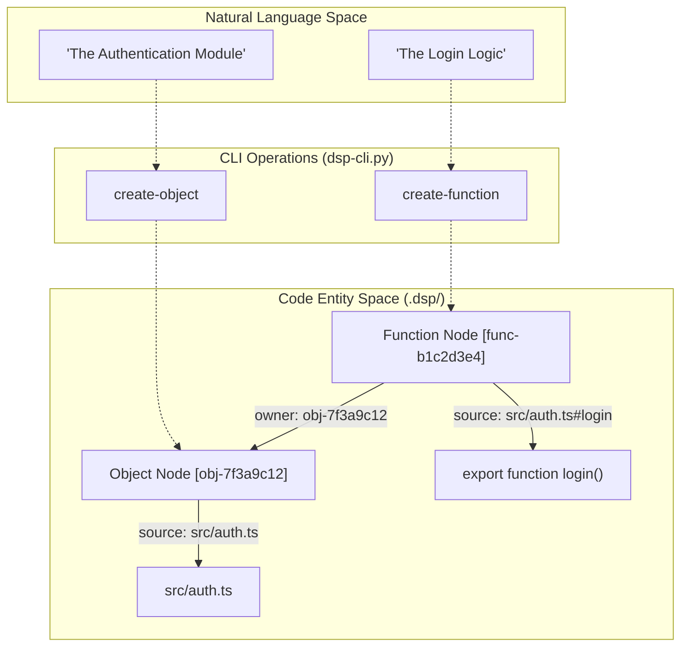
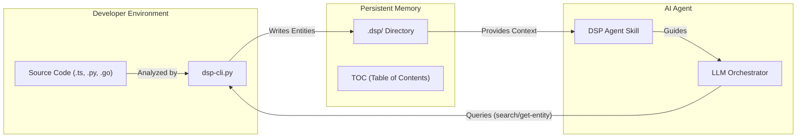

<!-- source: DeepWiki mcp.deepwiki.com · repo k-kolomeitsev/data-structure-protocol · page 1 Overview · fetched 2026-10-26 -->

# Overview

Relevant source files

The following files were used as context for generating this wiki page:

- [ARCHITECTURE.md](ARCHITECTURE.md)
- [GETTING_STARTED.md](GETTING_STARTED.md)
- [README.md](README.md)
- [article.md](article.md)

The **Data Structure Protocol (DSP)** is a graph-based long-term structural memory layer for AI-assisted development. It provides a persistent, versionable map of a codebase—entities, dependencies, public APIs, and the semantic "whys" behind every connection—stored directly within the repository in a `.dsp/` directory [README.md:10-20]().

By externalizing the project map into a language-agnostic graph, DSP eliminates the "orientation tax" where AI agents spend significant time and tokens re-scanning files to rebuild context at the start of every session [article.md:3-5]().

## The Core Problem: Agent Amnesia

Standard AI coding agents (like Cursor, Claude Code, or Codex) typically operate with a "short-term" view of the codebase. Every new task or session requires the agent to re-learn the structure:
*   **Token Waste:** Constant re-reading of entry points and import trees [README.md:18-18]().
*   **Context Fragmentation:** Loss of structural understanding between different tasks or team members [README.md:50-50]().
*   **Refactor Risk:** Difficulty in performing impact analysis on large, coupled systems without a global dependency map [README.md:52-53]().

DSP fixes this by providing a **persistent structural memory** that the agent can query and update, ensuring the "project map" is always available and up-to-date [README.md:20-22]().

## How It Works: Code as a Graph

DSP models a codebase as a directed graph where nodes are **Entities** and edges are **Relationships** [ARCHITECTURE.md:63-63]().

### 1. Entities (Nodes)
There are two primary entity types:
*   **Object (`obj-`):** Modules, files, classes, configs, resources, or external dependencies [ARCHITECTURE.md:77-77]().
*   **Function (`func-`):** Specific functions, methods, handlers, or pipelines [ARCHITECTURE.md:78-78]().

Entities are identified by stable **UIDs** (e.g., `obj-a1b2c3d4`), which remain constant even if the underlying file is renamed or moved [ARCHITECTURE.md:92-97]().

### 2. Relationships (Edges)
*   **Imports:** What an entity uses (including the specific reason "why") [ARCHITECTURE.md:79-79]().
*   **Shared/Exports:** What an entity exposes as a public API to the rest of the system [ARCHITECTURE.md:80-81]().

### Bridge: Natural Language to Code Entities
The following diagram illustrates how DSP maps high-level concepts to specific code artifacts and CLI management.

**DSP Entity Mapping**

Sources: [ARCHITECTURE.md:63-82](), [ARCHITECTURE.md:92-114](), [ARCHITECTURE.md:23-24]()

## Repository Organization

The DSP repository is structured to provide both the protocol specification and the tooling required to implement it.

| Path | Purpose |
|:---|:---|
| `.dsp/` | The reference implementation's own structural memory [README.md:77-79](). |
| `dsp-cli.py` | The central management utility for building and querying the graph [README.md:71-73](). |
| `skills/` | Integration packages for AI agents (Cursor, Claude Code, Codex) [GETTING_STARTED.md:32-56](). |
| `hooks/` | Git hooks (pre-commit/pre-push) for graph consistency enforcement [GETTING_STARTED.md:169-183](). |
| `docs/` | Detailed architectural specifications and workflow guides [GETTING_STARTED.md:189-191](). |

### Workflow Integration
The following diagram shows how the `dsp-cli.py` acts as the bridge between the physical codebase and the LLM's memory.

**DSP Operational Flow**

Sources: [README.md:63-86](), [ARCHITECTURE.md:45-51](), [GETTING_STARTED.md:3-5]()

## Navigation and Child Sections

To explore specific aspects of the protocol, refer to the following sections:

*   **[Getting Started](#1.1)**: Step-by-step onboarding, from installation to initializing your first `.dsp/` directory.
*   **[Core Concepts and Architecture](#1.2)**: Deep dive into the "Code = Graph" model, UID stability, and the storage format.
*   **[DSP CLI Reference](#2)**: Complete documentation for all entity management and graph traversal commands.
*   **[Storage Format](#3)**: Detailed specification of the `.dsp/` directory layout and file structures.
*   **[Bootstrap Procedure](#4)**: How to populate DSP for existing (brownfield) or new (greenfield) projects.
*   **[Agent Integrations](#5)**: Configuration guides for Cursor, Claude Code, and Codex.
*   **[Git Hooks and CI](#6)**: Automated enforcement of graph integrity and consistency.
*   **[Installation](#7)**: Reference for global and project-level installation scripts.
*   **[Comparisons and Design Rationale](#8)**: Why DSP focuses on memory rather than workflow wrappers.
*   **[Glossary](#9)**: Definitions of key terms like "Object", "Function", and "Reverse Index".

Sources: [README.md:94-144](), [GETTING_STARTED.md:1-191](), [ARCHITECTURE.md:1-114]()

---

