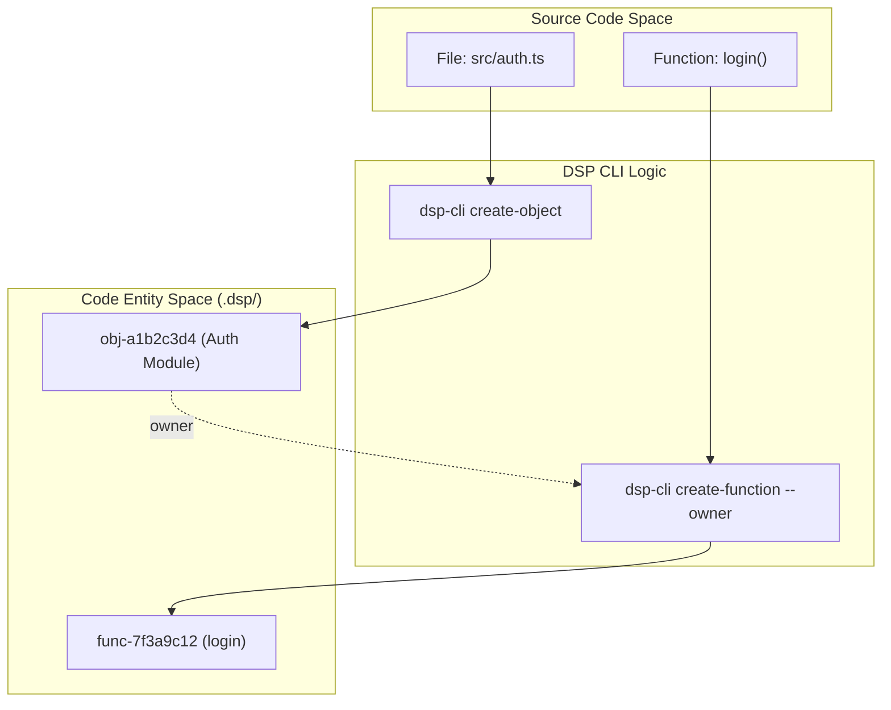
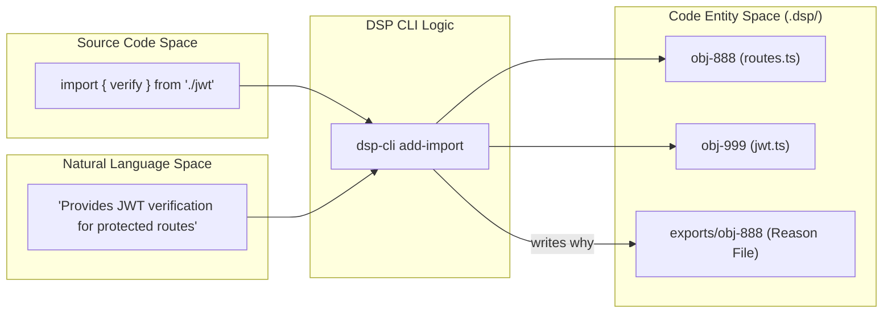

<!-- source: DeepWiki mcp.deepwiki.com · repo k-kolomeitsev/data-structure-protocol · page 2 DSP CLI Reference · fetched 2026-10-26 -->

# DSP CLI Reference

<details>
<summary>Relevant source files</summary>

The following files were used as context for generating this wiki page:

- [skills/data-structure-protocol/SKILL.md](skills/data-structure-protocol/SKILL.md)
- [skills/data-structure-protocol/references/operations.md](skills/data-structure-protocol/references/operations.md)
- [skills/data-structure-protocol/scripts/dsp-cli.py](skills/data-structure-protocol/scripts/dsp-cli.py)

</details>


The `dsp-cli.py` tool is the central management utility for the Data Structure Protocol. It provides a production-ready interface for building, navigating, and maintaining the graph-based structural memory of a codebase within the `.dsp/` directory. 

The CLI is designed to be used primarily by AI agents (like Cursor, Claude Code, or Codex) to maintain context across long-term development sessions, but it is equally accessible to human developers for manual graph inspection and maintenance.

### Core CLI Usage
The script is located at `scripts/dsp-cli.py` within the DSP skill distribution. All paths provided as arguments are interpreted as relative to the project root.

```bash
python scripts/dsp-cli.py [--root <project-root>] <command> [args]
```

| Parameter | Description |
| :--- | :--- |
| `--root` | The project root directory. Defaults to the current working directory. [scripts/dsp-cli.py:60-63]() |
| `<command>` | The specific DSP operation to perform (e.g., `create-object`, `search`). [scripts/dsp-cli.py:495-535]() |

**Sources:** [skills/data-structure-protocol/scripts/dsp-cli.py:1-8](), [skills/data-structure-protocol/scripts/dsp-cli.py:57-63]()

---

## System Mapping: Code to Graph

The following diagrams illustrate how `dsp-cli.py` maps physical code entities and their relationships into the DSP graph structure stored in the filesystem.

### Entity Creation Mapping
This diagram shows how `create-object` and `create-function` calls transform source code symbols into persistent UIDs.


**Sources:** [skills/data-structure-protocol/references/operations.md:16-43](), [skills/data-structure-protocol/scripts/dsp-cli.py:44-46]()

### Dependency and "Why" Mapping
This diagram shows how an `import` statement in code is translated into a structured relationship with a mandatory justification using `add-import`.


**Sources:** [skills/data-structure-protocol/references/operations.md:57-91](), [skills/data-structure-protocol/scripts/dsp-cli.py:232-234]()

---

## Command Categories

The CLI operations are grouped into three functional categories, each covered in detail on its respective child page.

### Entity Management
These commands handle the write-side of the protocol. They are used to initialize the graph, register new files and functions, and maintain the relationships as the code evolves. This includes handling cascading deletions to ensure graph integrity.
*   **Key Commands:** `init`, `create-object`, `create-function`, `add-import`, `remove-entity`, `move-entity`.
*   For details, see [Entity Management Commands](#2.1).

**Sources:** [skills/data-structure-protocol/references/operations.md:14-151]()

### Graph Traversal and Query
These commands provide the read-side of the protocol. They allow agents and developers to search the graph, discover dependencies, and perform impact analysis by looking "up" the graph (parents/recipients) or "down" the graph (children/dependencies).
*   **Key Commands:** `search`, `find-by-source`, `get-entity`, `get-children`, `get-parents`, `get-path`.
*   For details, see [Graph Traversal and Query Commands](#2.2).

**Sources:** [skills/data-structure-protocol/references/operations.md:152-229]()

### Diagnostics and Health
These commands are used to validate the structural integrity of the DSP graph. They detect issues like circular dependencies, orphaned entities (dead code), and provide high-level project statistics.
*   **Key Commands:** `detect-cycles`, `get-orphans`, `get-stats`.
*   For details, see [Diagnostics and Health Checks](#2.3).

**Sources:** [skills/data-structure-protocol/references/operations.md:230-255]()

---

