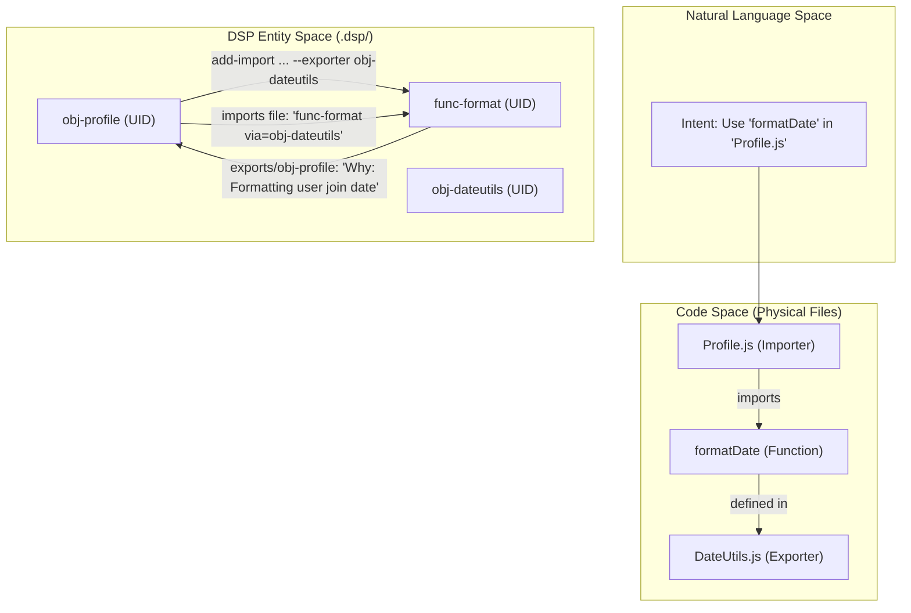
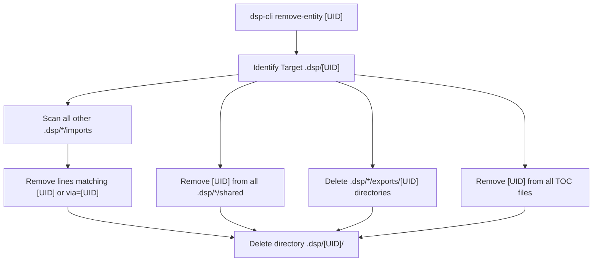

<!-- source: DeepWiki mcp.deepwiki.com · repo k-kolomeitsev/data-structure-protocol · page 2.1 Entity Management Commands · fetched 2026-10-26 -->

# Entity Management Commands

Relevant source files

The following files were used as context for generating this wiki page:

- [skills/data-structure-protocol/SKILL.md](skills/data-structure-protocol/SKILL.md)
- [skills/data-structure-protocol/references/operations.md](skills/data-structure-protocol/references/operations.md)
- [skills/data-structure-protocol/scripts/dsp-cli.py](skills/data-structure-protocol/scripts/dsp-cli.py)

This section provides a technical reference for the write-side operations of the Data Structure Protocol (DSP) CLI. These commands are responsible for maintaining the integrity of the `.dsp/` directory, which serves as the persistent structural memory for the codebase.

## Overview of Write Operations

Entity management in DSP follows a strict graph-based model where nodes (Objects and Functions) are identified by stable UIDs. Write operations ensure that every change in the physical codebase (file creation, symbol export, or dependency addition) is mirrored in the `.dsp/` metadata with an accompanying "why" context.

### Data Flow and Implementation
The CLI is implemented in `scripts/dsp-cli.py`. It uses a `Store` class [skills/data-structure-protocol/scripts/dsp-cli.py:159-232]() to abstract filesystem operations. Commands typically follow a three-step lifecycle:
1.  **Validation**: Check if the entity exists or if the pre-conditions (like usage of an import) are met.
2.  **Filesystem Update**: Create or modify directories and flat files (`description`, `imports`, `shared`, `exports/`).
3.  **Index Maintenance**: Update Table of Contents (TOC) files or reverse-index entries in the `exports/` directories of related entities.

**Sources:** [skills/data-structure-protocol/scripts/dsp-cli.py:1-157](), [skills/data-structure-protocol/references/operations.md:1-13]()

---

## Entity Creation

### create-object
Creates a new Object entity representing a module, class, configuration file, or external dependency.

*   **Syntax**: `dsp-cli create-object <source> <purpose> [--kind external] [--toc ROOT_UID]`
*   **UID Format**: Generates an `obj-<8hex>` identifier [skills/data-structure-protocol/scripts/dsp-cli.py:44-46]().
*   **Behavior**:
    1.  Creates the directory `.dsp/obj-.../`.
    2.  Writes the `description` file containing the source path, kind (default: `module`), and purpose [skills/data-structure-protocol/references/operations.md:25-26]().
    3.  Initializes empty `imports` and `shared` files.
    4.  Registers the UID in the specified TOC (or the default `TOC` file) [skills/data-structure-protocol/references/operations.md:27-27]().

### create-function
Creates a Function entity, typically representing an exported function or a class method.

*   **Syntax**: `dsp-cli create-function <source> <purpose> [--owner UID] [--toc ROOT_UID]`
*   **UID Format**: Generates a `func-<8hex>` identifier [skills/data-structure-protocol/scripts/dsp-cli.py:44-46]().
*   **Ownership**: If `--owner` (an Object UID) is provided, the CLI automatically establishes a bidirectional link:
    *   The function UID is added to the owner's `imports` (indicating the object "sees" its members).
    *   A reverse link is created in `.dsp/<funcUid>/exports/<ownerUid>` with the value `owner: method/member` [skills/data-structure-protocol/references/operations.md:40-43]().

### create-shared
Registers existing entities (usually functions) as the public API of an object.

*   **Syntax**: `dsp-cli create-shared <exporter_uid> <shared_uid> [<shared_uid> ...]`
*   **Actions**:
    1.  Appends the `shared_uid` to the `shared` file of the `exporter_uid`.
    2.  Creates a directory `.dsp/<exporter_uid>/exports/<shared_uid>/`.
    3.  Initializes a `description` file inside that export directory, mirroring the shared entity's purpose for easy discovery [skills/data-structure-protocol/references/operations.md:53-55]().

**Sources:** [skills/data-structure-protocol/references/operations.md:14-56](), [skills/data-structure-protocol/SKILL.md:101-108]()

---

## Relationship Management

### add-import
Records a dependency relationship between two entities. This is the most critical command for graph density.

*   **Syntax**: `dsp-cli add-import <importer_uid> <imported_uid> <why> [--exporter UID]`
*   **Pre-condition**: The user/agent must verify the symbol is actually used in the code body (not just the import statement) [skills/data-structure-protocol/references/operations.md:65-71]().
*   **The "Why" Field**: Must describe the concrete role of the import in the *importer's* context, not just restate the imported entity's purpose [skills/data-structure-protocol/references/operations.md:73-84]().
*   **The `via=` Syntax**: If an `--exporter` is provided (e.g., importing a function from a module), the link is stored as `imported_uid via=exporter_uid` in the `imports` file [skills/data-structure-protocol/scripts/dsp-cli.py:61-62]().

### Mapping Natural Language to Code Space (Import Flow)

The following diagram illustrates how a developer's intent to "use a utility" translates into DSP filesystem entities.

Title: Natural Language Intent to DSP Entity Space

**Sources:** [skills/data-structure-protocol/references/operations.md:57-91](), [skills/data-structure-protocol/SKILL.md:67-74]()

---

## Update and Move Operations

| Command | Parameter | Effect |
| :--- | :--- | :--- |
| `update-description` | `<uid> [--source] [--purpose] [--kind]` | Modifies specific fields in the `description` file while preserving others [skills/data-structure-protocol/references/operations.md:94-100](). |
| `update-import-why` | `<importer> <imported> <new_why>` | Updates the text in the reverse-index (`exports/`) for a specific relationship [skills/data-structure-protocol/references/operations.md:102-108](). |
| `move-entity` | `<uid> <new_source>` | Updates the `source` field in the `description`. The **UID remains stable** [skills/data-structure-protocol/references/operations.md:110-116](). |

**Sources:** [skills/data-structure-protocol/references/operations.md:92-116](), [skills/data-structure-protocol/SKILL.md:119-124]()

---

## Deletion and Cascading Behavior

DSP maintains graph integrity by automatically cleaning up dangling references when entities or relationships are removed.

### remove-entity
The most destructive operation. It performs a full system-wide cleanup.
1.  **Inbound Links**: Scans all other entities' `imports` files and removes any line referencing the target UID (either as the direct import or as a `via=` provider).
2.  **Outbound Links**: Removes the reverse-index entries (`exports/`) in all entities that the target previously imported.
3.  **Shared/Exports**: Removes the entity from any `shared` lists and deletes its `exports/` directory.
4.  **TOC**: Removes the UID from all Table of Contents files.
5.  **Filesystem**: Deletes the `.dsp/<uid>/` directory [skills/data-structure-protocol/references/operations.md:139-150]().

### remove-shared
Unregisters a public API member. This triggers a cascade:
1.  The UID is removed from the exporter's `shared` file.
2.  The specific `exports/<shared_uid>/` directory is deleted.
3.  Every recipient that was importing this entity "via" the exporter has that specific line removed from their `imports` file [skills/data-structure-protocol/references/operations.md:128-137]().

### Entity Deletion Logic Flow

Title: Cascading Deletion Logic (remove-entity)

**Sources:** [skills/data-structure-protocol/references/operations.md:118-151](), [skills/data-structure-protocol/SKILL.md:125-130]()

---

