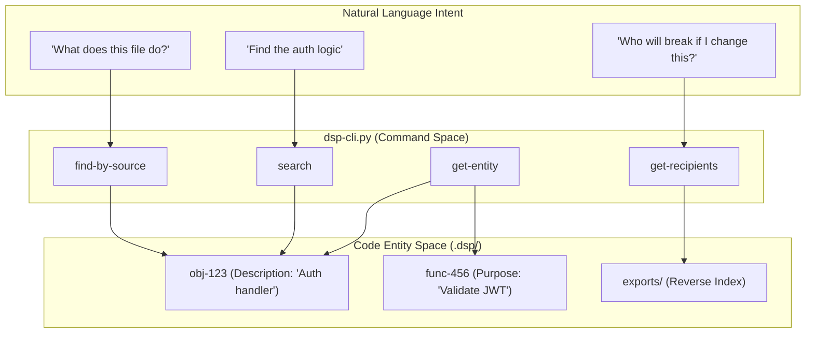
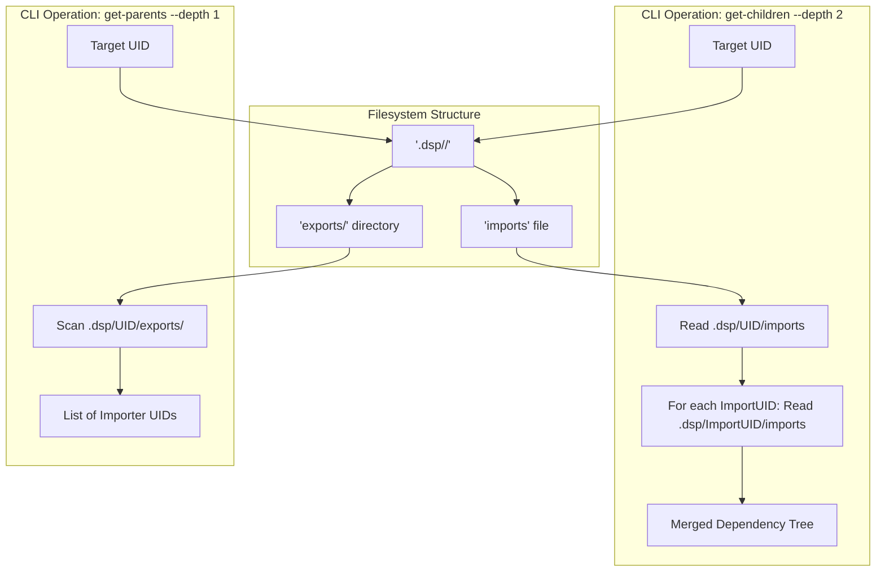

<!-- source: DeepWiki mcp.deepwiki.com · repo k-kolomeitsev/data-structure-protocol · page 2.2 Graph Traversal and Query Commands · fetched 2026-10-26 -->

# Graph Traversal and Query Commands

Relevant source files

The following files were used as context for generating this wiki page:

- [ARCHITECTURE.md](ARCHITECTURE.md)
- [skills/data-structure-protocol/SKILL.md](skills/data-structure-protocol/SKILL.md)
- [skills/data-structure-protocol/references/operations.md](skills/data-structure-protocol/references/operations.md)

This page provides a technical reference for the read-side operations of the Data Structure Protocol (DSP) CLI. These commands allow agents and developers to navigate the dependency graph, perform impact analysis, and discover entities within the `.dsp/` storage layer.

## Overview of Query Mechanisms

The DSP CLI implements graph traversal using the filesystem as a flat-file database. Every entity is a directory named by its UID (`obj-*` or `func-*`), and relationships are stored as lists of UIDs in `imports` files or reverse-indexed in `exports/` directories [ARCHITECTURE.md:84-96]().

### Traversal Logic
*   **Downward Traversal (Dependencies):** Follows the `imports` file within an entity directory [skills/data-structure-protocol/references/operations.md:183-187]().
*   **Upward Traversal (Dependents):** Follows the `exports/` subdirectories, which act as a reverse index of who imports the current entity [ARCHITECTURE.md:115-121]().
*   **Shortest Path:** Implemented via Breadth-First Search (BFS) across both import and export edges [skills/data-structure-protocol/references/operations.md:196-202]().

## Command Reference

### Entity Discovery

#### `search <query>`
Performs a case-insensitive full-text search across all `description` files and export record names within the `.dsp/` directory [skills/data-structure-protocol/references/operations.md:206-213](). Use this to find UIDs when only the functional purpose or a symbol name is known.

#### `find-by-source <source_path>`
Maps a repository-relative file path back to its DSP entities. Since a single file (Object) can contain multiple exported Functions, this command may return multiple UIDs [skills/data-structure-protocol/references/operations.md:214-220]().

#### `read-toc [--toc ROOT_UID]`
Reads the Table of Contents file. This is the primary entry point for an LLM to understand the high-level architecture of a project or a specific sub-root [skills/data-structure-protocol/references/operations.md:222-229]().

### Detailed Inspection

#### `get-entity <uid>`
Provides a complete snapshot of a specific node: its description (source, kind, purpose), its outgoing imports, its shared/public members, and a list of who exports it [skills/data-structure-protocol/references/operations.md:154-161]().

#### `get-recipients <uid>`
A specialized query for impact analysis. It performs a three-level search to find every entity that depends on the target UID:
1.  **Direct:** Entities listing the UID in their `imports`.
2.  **Via Shared:** Entities importing the UID through a "barrel" or exporter object.
3.  **Fallback:** A full scan of the `.dsp` directory if indices are inconsistent [skills/data-structure-protocol/references/operations.md:170-177]().

### Graph Navigation

#### `get-children <uid> [--depth N]`
Retrieves the dependency tree downward. 
*   **Depth 1:** Immediate imports.
*   **Depth `inf`:** The recursive dependency tree [skills/data-structure-protocol/references/operations.md:180-187]().

#### `get-parents <uid> [--depth N]`
Retrieves the dependency tree upward (the "inverse" tree). Useful for determining the blast radius of a breaking change in a low-level function [skills/data-structure-protocol/references/operations.md:188-194]().

#### `get-path <from_uid> <to_uid>`
Calculates the shortest path between two nodes using BFS. This is bidirectional, considering both `imports` (A depends on B) and `exports` (B is used by A) as valid edges [skills/data-structure-protocol/references/operations.md:196-202]().

### Diagnostics and Stats

#### `get-stats`
Returns high-level metrics of the graph health, including total counts of Objects vs. Functions, external dependency count, and counts of orphans or cycles [skills/data-structure-protocol/references/operations.md:248-255]().

---
**Sources:**
* [skills/data-structure-protocol/references/operations.md:152-255]()
* [ARCHITECTURE.md:43-82]()
* [skills/data-structure-protocol/SKILL.md:109-118]()

## Data Flow: From Natural Language to Code Entities

The following diagram illustrates how a developer's intent (Natural Language) is translated into specific code entities and CLI operations within the DSP ecosystem.

**Intent to Entity Mapping**

**Sources:**
* [skills/data-structure-protocol/SKILL.md:109-118]()
* [ARCHITECTURE.md:43-58]()

## Internal Traversal Architecture

The following diagram shows the internal logic of the `get-children` and `get-parents` operations, demonstrating how the CLI interacts with the filesystem structure to resolve graph edges.

**BFS Traversal Logic**

**Sources:**
* [skills/data-structure-protocol/references/operations.md:180-194]()
* [ARCHITECTURE.md:84-121]()

## Summary of Traversal Commands

| Command | Direction | Primary Source File | Use Case |
| :--- | :--- | :--- | :--- |
| `get-children` | Downward | `imports` | Understanding what a module needs to function. |
| `get-parents` | Upward | `exports/` | Impact analysis; identifying dependents. |
| `get-recipients` | Upward | `exports/` + scan | Exhaustive list of all users of an API. |
| `get-path` | Bidirectional | `imports` + `exports/` | Finding how two distant modules are connected. |
| `read-toc` | Entrypoint | `TOC` | Initial project orientation for agents. |

---
**Sources:**
* [skills/data-structure-protocol/references/operations.md:152-202]()
* [ARCHITECTURE.md:61-73]()

---

