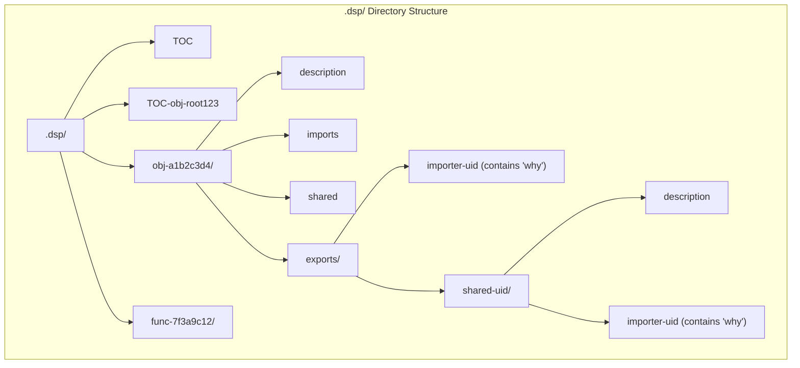
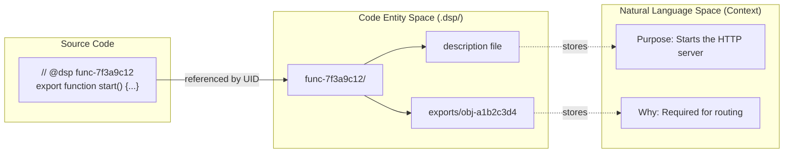

<!-- source: DeepWiki mcp.deepwiki.com · repo k-kolomeitsev/data-structure-protocol · page 3 Storage Format · fetched 2026-10-26 -->

# Storage Format

Relevant source files

The following files were used as context for generating this wiki page:

- [ARCHITECTURE.md](ARCHITECTURE.md)
- [README.md](README.md)
- [skills/data-structure-protocol/references/storage-format.md](skills/data-structure-protocol/references/storage-format.md)

The Data Structure Protocol (DSP) stores the codebase graph as a flat-file database within a `.dsp/` directory at the repository root [ARCHITECTURE.md:84-86](). This format is designed to be human-readable, git-friendly (for diffs and merges), and easily traversable by AI agents without requiring a specialized database engine [README.md:55-55]().

### The .dsp/ Directory Structure

The storage layout organizes information into entity-specific directories and Table of Contents (TOC) files that define the entry points into the graph.

*Sources: [skills/data-structure-protocol/references/storage-format.md:13-33]()*

### Entity Directories
Every node in the DSP graph (Objects and Functions) is represented by a directory named after its unique identifier (UID). UIDs are 8-character hex strings derived from `uuid4()` and prefixed by the entity type [ARCHITECTURE.md:92-97]():
*   `obj-<hex>`: Modules, classes, configs, or external dependencies [skills/data-structure-protocol/references/storage-format.md:39-39]().
*   `func-<hex>`: Functions, methods, or handlers [skills/data-structure-protocol/references/storage-format.md:40-40]().

Inside each directory, four key files/folders define the entity's metadata and relationships:
1.  **`description`**: Contains the source path, entity kind, and a natural language purpose [skills/data-structure-protocol/references/storage-format.md:44-50]().
2.  **`imports`**: A list of UIDs that this entity depends on. It supports a `via=` syntax for tracking barrel exports (e.g., `imported_uid via=exporter_uid`) [skills/data-structure-protocol/references/storage-format.md:56-70]().
3.  **`shared`**: A list of UIDs representing internal elements (like functions in a module) that this entity exposes to the outside world [skills/data-structure-protocol/references/storage-format.md:72-78]().
4.  **`exports/`**: A reverse-index directory. It stores files named after *importer* UIDs; the content of these files explains **why** the dependency exists [skills/data-structure-protocol/references/storage-format.md:80-107]().

For details on the internal file schemas and annotated examples, see **[Entity Directory Structure](#3.1)**.

### Table of Contents (TOC)
The TOC files serve as the starting point for any agent or tool navigating the graph. They provide a linearized list of UIDs reachable from a specific root entrypoint [ARCHITECTURE.md:71-71]().

*   **Single-root**: Uses a file named `.dsp/TOC` [skills/data-structure-protocol/references/storage-format.md:111-111]().
*   **Multi-root**: Uses files named `.dsp/TOC-<rootUid>` for projects with multiple distinct entrypoints (e.g., a monorepo with `backend` and `frontend` roots) [skills/data-structure-protocol/references/storage-format.md:112-112]().

For details on TOC naming, multi-root support, and navigation rules, see **[Table of Contents (TOC) Files](#3.2)**.

### Mapping Code to Storage
DSP bridges the gap between the physical file system and the logical entity graph using `@dsp` markers in source code.

| Code Entity | DSP Storage Mapping |
| :--- | :--- |
| **File/Module** (`src/app.ts`) | `obj-<hex>/description` (source: src/app.ts) |
| **Function** (`function start()`) | `func-<hex>/description` (source: src/app.ts#start) |
| **Import Statement** (`import { x } from 'y'`) | `obj-y/exports/obj-app/` (contains "why") |
| **Export Statement** (`export const x`) | `obj-y/shared` (contains UID of x) |

*Sources: [ARCHITECTURE.md:99-112](), [skills/data-structure-protocol/references/storage-format.md:44-50](), [skills/data-structure-protocol/references/storage-format.md:88-88]()*

### Child Pages
*   **[Entity Directory Structure](#3.1)**: Detailed breakdown of the `description`, `imports`, `shared`, and `exports/` file formats.
*   **[Table of Contents (TOC) Files](#3.2)**: Specification for TOC file naming, multi-root entrypoints, and graph entry rules.

**Sources:**
*   [README.md:55-55]()
*   [ARCHITECTURE.md:71-71]()
*   [ARCHITECTURE.md:84-86]()
*   [ARCHITECTURE.md:92-97]()
*   [ARCHITECTURE.md:99-112]()
*   [skills/data-structure-protocol/references/storage-format.md:13-33]()
*   [skills/data-structure-protocol/references/storage-format.md:39-40]()
*   [skills/data-structure-protocol/references/storage-format.md:44-50]()
*   [skills/data-structure-protocol/references/storage-format.md:56-70]()
*   [skills/data-structure-protocol/references/storage-format.md:72-78]()
*   [skills/data-structure-protocol/references/storage-format.md:80-107]()
*   [skills/data-structure-protocol/references/storage-format.md:111-112]()

---

