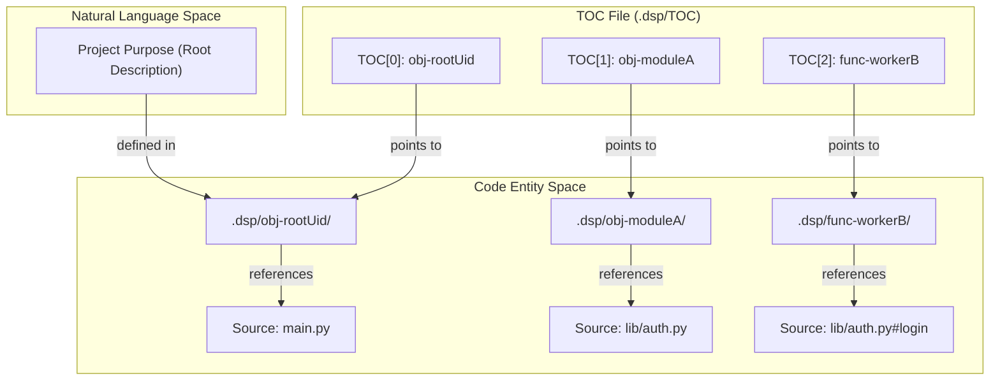
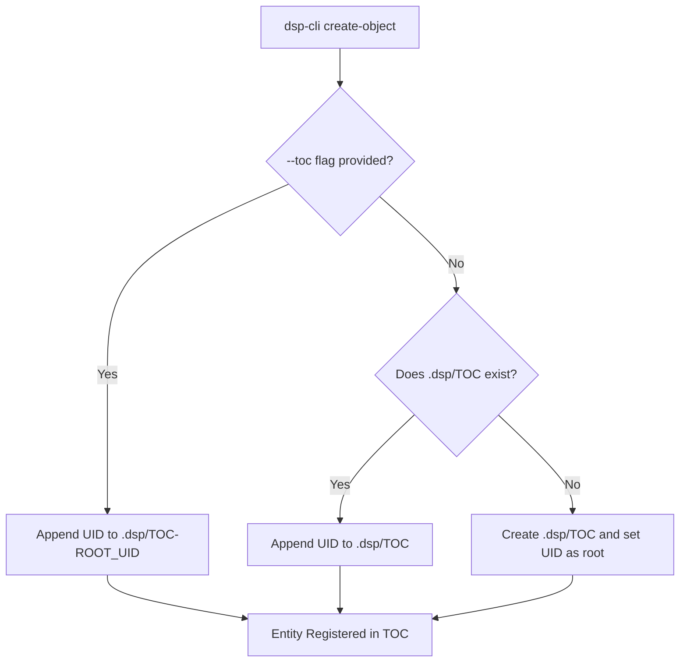

<!-- source: DeepWiki mcp.deepwiki.com · repo k-kolomeitsev/data-structure-protocol · page 3.2 Table of Contents (TOC) Files · fetched 2026-10-26 -->

# Table of Contents (TOC) Files

<details>
<summary>Relevant source files</summary>

The following files were used as context for generating this wiki page:

- [ARCHITECTURE.md](ARCHITECTURE.md)
- [skills/data-structure-protocol/references/bootstrap.md](skills/data-structure-protocol/references/bootstrap.md)
- [skills/data-structure-protocol/references/storage-format.md](skills/data-structure-protocol/references/storage-format.md)

</details>


The Table of Contents (TOC) files serve as the primary entry point for AI agents and LLMs to navigate the Data Structure Protocol (DSP) graph. While the `.dsp/` directory stores the granular entity data, the TOC files provide a structured, ordered sequence of entities that define the project's scope and reachability from specific entry points [skills/data-structure-protocol/references/bootstrap.md:13-13]().

## Purpose and Functionality

In the DSP model, the TOC is not just a list; it is a map of the "documented world" from a specific root [skills/data-structure-protocol/references/bootstrap.md:86-90]().

1.  **Entry Point Discovery**: LLMs use `read-toc` to identify the root of a project and the order in which entities were documented during the bootstrap procedure [ARCHITECTURE.md:37-37]().
2.  **Scope Definition**: The TOC distinguishes between entities that are part of the active project graph and orphaned entities that may still exist in the filesystem but are no longer reachable from a root [skills/data-structure-protocol/references/storage-format.md:123-128]().
3.  **Multi-Root Support**: Large repositories (monorepos) or projects with multiple entry points (e.g., a CLI tool and a Web Server) use separate TOC files to maintain distinct dependency trees [skills/data-structure-protocol/references/bootstrap.md:21-21]().

## File Naming and Location

TOC files are stored at the base of the `.dsp/` directory. The naming convention depends on whether the project has a single entry point or multiple roots [skills/data-structure-protocol/references/storage-format.md:110-112]().

| File Pattern | Context | Description |
| :--- | :--- | :--- |
| `.dsp/TOC` | Single-Root | The default TOC for projects with one primary entry point. |
| `.dsp/TOC-<rootUid>` | Multi-Root | Specific TOC files named after the UID of their respective root Object. |

### Multi-Root Projects
When a project has multiple entry points (e.g., `main.py` and `worker.py`), the bootstrap procedure creates a separate TOC for each [skills/data-structure-protocol/references/bootstrap.md:21-21](). An entity may appear in multiple TOC files if it is reachable from both roots [skills/data-structure-protocol/references/storage-format.md:127-127]().

## Format and Structure

The TOC file is a plain-text file containing one UID per line [skills/data-structure-protocol/references/storage-format.md:116-121]().

```text
obj-a1b2c3d4
func-7f3a9c12
obj-e5f6g7h8
...
```

### Key Rules
*   **Root Position**: The first line (`TOC[0]`) is always the UID of the root entrypoint for that specific tree [skills/data-structure-protocol/references/storage-format.md:124-124]().
*   **Documentation Order**: Entities are typically listed in the order they were encountered during the Depth-First Search (DFS) bootstrap [skills/data-structure-protocol/references/storage-format.md:125-125]().
*   **Uniqueness**: Each UID appears exactly once within a single TOC file [skills/data-structure-protocol/references/storage-format.md:126-126]().
*   **Appends**: When new entities are created via `create-object` or `create-function`, they are appended to the end of the specified TOC [skills/data-structure-protocol/references/storage-format.md:128-128]().

**Sources:** [skills/data-structure-protocol/references/storage-format.md:108-129](), [skills/data-structure-protocol/references/bootstrap.md:13-21]()

## TOC Data Flow and Navigation

The TOC acts as the bridge between the high-level project intent and the low-level entity relationships. When an agent starts a session, it reads the TOC to understand the "spine" of the codebase.

### Diagram: From Entry Point to Entity Graph
This diagram illustrates how the `TOC` file links the "Natural Language Space" (Project Purpose) to the "Code Entity Space" (specific UIDs and files).


**Sources:** [skills/data-structure-protocol/references/storage-format.md:13-33](), [ARCHITECTURE.md:43-51]()

## CLI Interaction: The `--toc` Flag

Most write-side commands in the `dsp-cli` accept an optional `--toc` flag. This ensures that when an entity is created or modified, it is correctly registered in the appropriate project root [ARCHITECTURE.md:23-24]().

### Common Command Patterns
*   **Initialization**: `dsp-cli init` prepares the `.dsp/` directory but does not create a TOC until the first entity is registered [ARCHITECTURE.md:22-22]().
*   **Registration**: `dsp-cli create-object <source> <purpose> --toc obj-root123` adds the new object to the specified TOC file [ARCHITECTURE.md:23-23]().
*   **Reading**: `dsp-cli read-toc [--toc ROOT_UID]` allows the agent to list all entities in the graph for the specified root [ARCHITECTURE.md:37-37]().

### Diagram: TOC Update Logic
This diagram shows the logic used by `dsp-cli` (specifically within the `create-object` and `create-function` flows) to maintain TOC files.


**Sources:** [ARCHITECTURE.md:21-39](), [skills/data-structure-protocol/references/storage-format.md:110-128]()

## Bootstrap and TOC Generation

During the **Bootstrap Procedure**, the TOC is generated dynamically as the agent performs a Depth-First Search (DFS) of the imports [skills/data-structure-protocol/references/bootstrap.md:13-13]().

1.  The agent identifies the root (e.g., `package.json` main) [skills/data-structure-protocol/references/bootstrap.md:19-19]().
2.  The root UID is written to the first line of the TOC [skills/data-structure-protocol/references/bootstrap.md:26-26]().
3.  As the agent descends into imports, each newly documented file's UID is appended to the TOC [skills/data-structure-protocol/references/bootstrap.md:59-59]().
4.  External dependencies are added to the TOC but are not traversed further (leaf nodes) [skills/data-structure-protocol/references/bootstrap.md:89-89]().

**Sources:** [skills/data-structure-protocol/references/bootstrap.md:1-94]()

---

