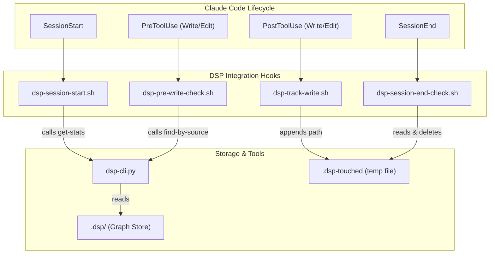
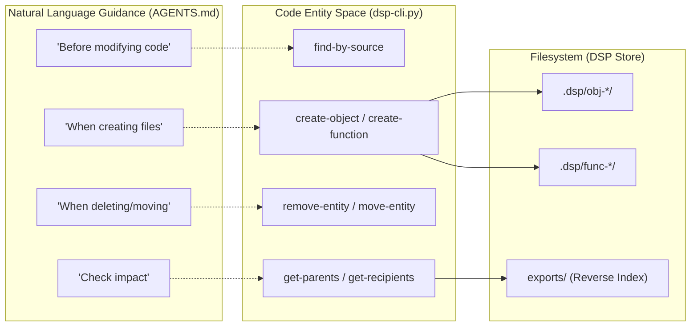

<!-- source: DeepWiki mcp.deepwiki.com · repo k-kolomeitsev/data-structure-protocol · page 5.2 Claude Code Integration · fetched 2026-10-26 -->

# Claude Code Integration

Relevant source files

The following files were used as context for generating this wiki page:

- [integrations/claude/.claude/settings.json](integrations/claude/.claude/settings.json)
- [integrations/claude/AGENTS.md](integrations/claude/AGENTS.md)
- [integrations/claude/README.md](integrations/claude/README.md)
- [integrations/claude/examples/brownfield-workflow.md](integrations/claude/examples/brownfield-workflow.md)
- [integrations/claude/examples/greenfield-workflow.md](integrations/claude/examples/greenfield-workflow.md)
- [integrations/claude/hooks/dsp-pre-write-check.sh](integrations/claude/hooks/dsp-pre-write-check.sh)
- [integrations/claude/hooks/dsp-session-end-check.sh](integrations/claude/hooks/dsp-session-end-check.sh)
- [integrations/claude/hooks/dsp-session-start.sh](integrations/claude/hooks/dsp-session-start.sh)
- [integrations/claude/hooks/dsp-track-write.sh](integrations/claude/hooks/dsp-track-write.sh)

The Claude Code integration pack connects the Data Structure Protocol (DSP) with the Claude Code CLI via lifecycle hooks and agent guidance. It ensures that the AI agent maintains structural awareness of the codebase throughout a session, from initialization to final cleanup.

## Overview and Purpose

The integration serves three primary purposes:
1.  **Context Loading**: Automatically presenting the DSP graph state when a session begins [integrations/claude/hooks/dsp-session-start.sh:33-36]().
2.  **Safety Checks**: Warning the agent if it attempts to modify files that are not yet registered in the DSP graph [integrations/claude/hooks/dsp-pre-write-check.sh:42-45]().
3.  **Consistency Reminders**: Tracking modified files and reminding the agent to update the structural memory before the session ends [integrations/claude/hooks/dsp-session-end-check.sh:17-26]().

Sources: [integrations/claude/README.md:1-13](), [integrations/claude/README.md:53-69]()

## Hook Configuration

Claude Code uses a `settings.json` file located in the `.claude/` directory to manage lifecycle hooks. The DSP integration utilizes four specific hook types.

### Hook Registration Table

| Hook Type | Trigger | Script | Purpose |
| :--- | :--- | :--- | :--- |
| `SessionStart` | Session init | `dsp-session-start.sh` | Prints DSP stats and status [integrations/claude/hooks/dsp-session-start.sh:33-36]() |
| `PreToolUse` | Write/Edit tool | `dsp-pre-write-check.sh` | Checks if `file_path` exists in DSP [integrations/claude/hooks/dsp-pre-write-check.sh:40-45]() |
| `PostToolUse` | Write/Edit tool | `dsp-track-write.sh` | Records the file to `.dsp-touched` [integrations/claude/hooks/dsp-track-write.sh:19-27]() |
| `SessionEnd` | Session exit | `dsp-session-end-check.sh` | Lists touched files and reminds to sync [integrations/claude/hooks/dsp-session-end-check.sh:17-26]() |

Sources: [integrations/claude/.claude/settings.json:1-48](), [integrations/claude/README.md:7-13]()

## Lifecycle and Data Flow

The integration follows a non-blocking design. All scripts are designed to exit with code `0` even if DSP is missing or an error occurs, ensuring the agent's workflow is never interrupted [integrations/claude/README.md:77-83]().

### Integration Lifecycle Diagram

"This diagram illustrates how Claude Code lifecycle events trigger specific DSP shell scripts and how they interact with the DSP CLI and the filesystem."

Sources: [integrations/claude/README.md:53-69](), [integrations/claude/hooks/dsp-track-write.sh:19-27](), [integrations/claude/hooks/dsp-session-end-check.sh:28-30]()

## Implementation Details

### CLI Discovery
The hooks utilize a `find_dsp_cli` function to locate the `dsp-cli.py` script across various possible installation paths (Cursor, Claude, or generic skill directories) [integrations/claude/hooks/dsp-session-start.sh:4-18](). This allows the integration to function regardless of how the DSP protocol was installed.

### Tracking Mechanism
The `dsp-track-write.sh` script parses the JSON input from Claude Code to extract the `file_path` [integrations/claude/hooks/dsp-track-write.sh:12-13](). It then appends this path to a temporary file named `.dsp-touched` [integrations/claude/hooks/dsp-track-write.sh:19-27]().

### Session Cleanup
Upon session termination, `dsp-session-end-check.sh` reads the `.dsp-touched` file. If files were modified, it prints a summary and provides the agent with commands to verify the graph (e.g., `get-orphans`) [integrations/claude/hooks/dsp-session-end-check.sh:17-26](). Finally, it deletes the `.dsp-touched` file to ensure a clean state for the next session [integrations/claude/hooks/dsp-session-end-check.sh:28-30]().

Sources: [integrations/claude/hooks/dsp-session-start.sh:4-18](), [integrations/claude/hooks/dsp-track-write.sh:12-27](), [integrations/claude/hooks/dsp-session-end-check.sh:4-30]()

## Natural Language to Code Mapping

"This diagram maps the conceptual agent instructions found in AGENTS.md to the specific dsp-cli.py commands and filesystem entities they manipulate."

Sources: [integrations/claude/AGENTS.md:7-12](), [integrations/claude/AGENTS.md:16-38]()

## Installation

The integration can be installed in three ways:

1.  **Full Install**: Copying the `.claude/` directory and `hooks/` folder to the project root and setting execution permissions [integrations/claude/README.md:19-30]().
2.  **Selective Install**: Manually adding specific hooks to an existing `settings.json` [integrations/claude/README.md:32-43]().
3.  **Zero-Config (AGENTS.md only)**: Copying `AGENTS.md` to the project root. Claude Code automatically reads this file to gain context on how to interact with the DSP CLI without requiring active hooks [integrations/claude/README.md:45-51]().

### Requirements
-   `python3` or `python` available in the system `PATH` [integrations/claude/hooks/dsp-pre-write-check.sh:29-31]().
-   An initialized `.dsp/` directory in the project root [integrations/claude/hooks/dsp-session-start.sh:20-22]().

Sources: [integrations/claude/README.md:17-51](), [integrations/claude/README.md:71-76]()

---

