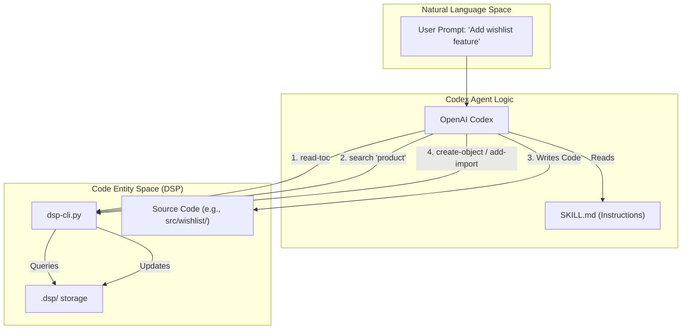
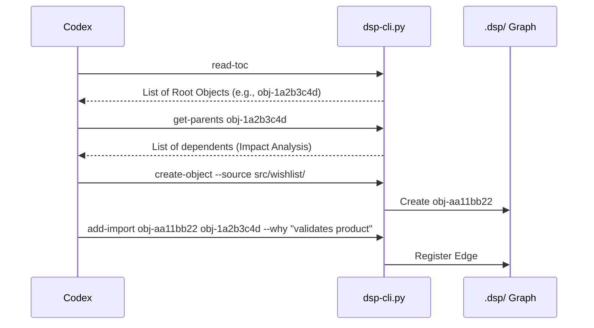

<!-- source: DeepWiki mcp.deepwiki.com · repo k-kolomeitsev/data-structure-protocol · page 5.3 Codex Integration · fetched 2026-10-26 -->

# Codex Integration

<details>
<summary>Relevant source files</summary>

The following files were used as context for generating this wiki page:

- [integrations/codex/AGENTS.md](integrations/codex/AGENTS.md)
- [integrations/codex/README.md](integrations/codex/README.md)
- [integrations/codex/examples/brownfield-workflow.md](integrations/codex/examples/brownfield-workflow.md)
- [integrations/codex/examples/greenfield-workflow.md](integrations/codex/examples/greenfield-workflow.md)

</details>


The Codex Integration pack enables OpenAI Codex to natively interact with the Data Structure Protocol (DSP). By leveraging Codex's skill discovery mechanism, the integration allows the agent to maintain a persistent structural memory of the codebase in the `.dsp/` directory, facilitating better architectural awareness during both brownfield and greenfield development.

## Discovery and Architecture

Codex discovers the DSP integration through its automated skill-loading mechanism. When a project contains a `.codex/skills/` directory, Codex parses the `SKILL.md` file within the `data-structure-protocol` subdirectory to understand available commands and their usage [integrations/codex/README.md:5-7]().

### Data Flow: Natural Language to Code Entity Space

The following diagram illustrates how a natural language request from a user is translated by Codex into specific `dsp-cli` operations that interact with the filesystem-backed graph.

**Codex Skill Execution Flow**



**Sources:** [integrations/codex/README.md:5-7](), [integrations/codex/examples/brownfield-workflow.md:14-118]()

## Installation

There are three primary methods to install the Codex integration pack. All methods aim to place the DSP skill into the `.codex/skills/data-structure-protocol/` directory of your project [integrations/codex/README.md:9-41]().

### 1. Automated Install Script
The recommended method uses the central DSP installer, targeting the `codex` agent specifically.
- **Unix:** `curl -fsSL https://raw.githubusercontent.com/k-kolomeitsev/data-structure-protocol/main/install.sh | bash -s -- codex` [integrations/codex/README.md:13-15]()
- **Windows:** `irm https://raw.githubusercontent.com/k-kolomeitsev/data-structure-protocol/main/install.ps1 | iex` [integrations/codex/README.md:17-18]()

### 2. Codex Skill Installer
If the environment has the `$skill-installer` utility:
```bash
$skill-installer install https://github.com/k-kolomeitsev/data-structure-protocol/tree/main/skills/data-structure-protocol
```
[integrations/codex/README.md:21-27]()

### 3. Manual Installation
Manual setup involves cloning the repository and copying the skill files:
1. `mkdir -p .codex/skills/data-structure-protocol` [integrations/codex/README.md:36]()
2. `cp -r skills/data-structure-protocol/* .codex/skills/data-structure-protocol/` [integrations/codex/README.md:37]()

## Agent Guidance (AGENTS.md)

The `AGENTS.md` file serves as a standalone reference for the agent. It defines the core rules for interacting with the graph and provides a command reference for `dsp-cli` [integrations/codex/AGENTS.md:1-5]().

### Core Rules for Codex
- **Look up first:** Use `search`, `find-by-source`, or `read-toc` before modifying code [integrations/codex/AGENTS.md:9]().
- **Register changes:** Use `create-object` or `create-function` for new files [integrations/codex/AGENTS.md:10]().
- **Link dependencies:** Use `add-import` with a `--why` description for every new dependency [integrations/codex/AGENTS.md:32]().
- **Cleanup:** Use `remove-entity` or `move-entity` to maintain graph integrity [integrations/codex/AGENTS.md:11]().

### What NOT to Update
To minimize noise, Codex is instructed to skip DSP updates for:
- Formatting/whitespace [integrations/codex/AGENTS.md:56]().
- Comment-only edits [integrations/codex/AGENTS.md:57]().
- Private function body refactors that don't change signatures [integrations/codex/AGENTS.md:58]().
- Dependency version bumps [integrations/codex/AGENTS.md:59]().

**Sources:** [integrations/codex/AGENTS.md:7-62]()

## Workflow Examples

### Brownfield: Feature Addition
In an existing project, Codex uses DSP to perform impact analysis before writing code.

**Entity Relationship Discovery**



1. **Discovery:** `read-toc` to see the module map [integrations/codex/examples/brownfield-workflow.md:23]().
2. **Context:** `get-entity` and `get-children` to understand the internal API of a module [integrations/codex/examples/brownfield-workflow.md:47-48]().
3. **Impact Analysis:** `get-parents` and `get-recipients` to see who consumes the target module [integrations/codex/examples/brownfield-workflow.md:58-59]().
4. **Registration:** `create-object` and `add-import` to document the new feature [integrations/codex/examples/brownfield-workflow.md:75-90]().

### Greenfield: New Project
In a new project, Codex initializes the protocol immediately via `dsp-cli init` [integrations/codex/examples/greenfield-workflow.md:15](). As it builds the architecture (Database layer, User management, etc.), it registers each `Object` and `Function` and links them with `add-import` [integrations/codex/examples/greenfield-workflow.md:34-93]().

**Sources:** [integrations/codex/examples/brownfield-workflow.md:1-118](), [integrations/codex/examples/greenfield-workflow.md:1-135]()

---

