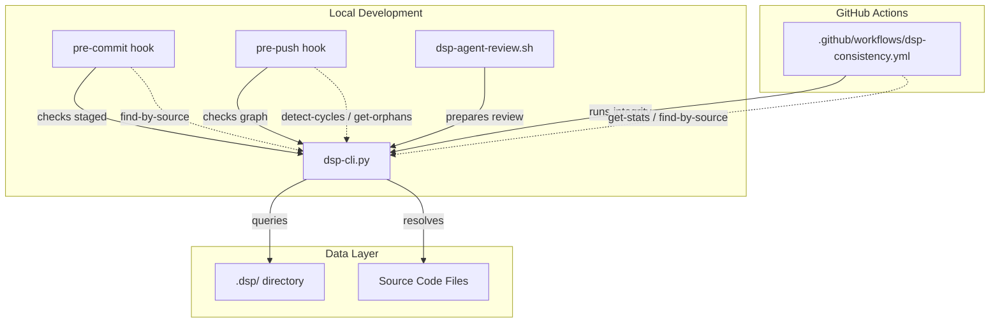
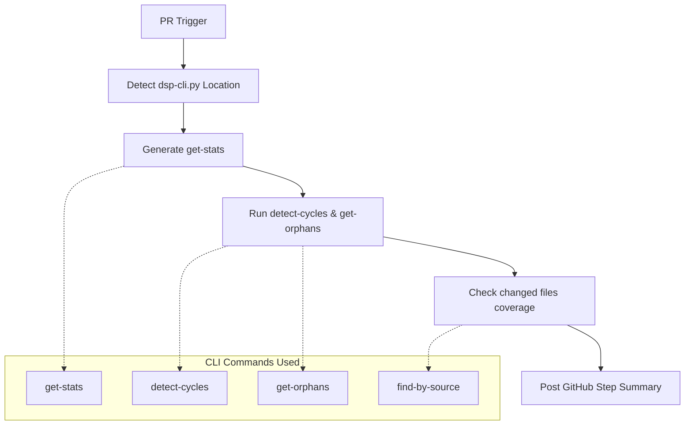

<!-- source: DeepWiki mcp.deepwiki.com · repo k-kolomeitsev/data-structure-protocol · page 6 Git Hooks and CI · fetched 2026-10-26 -->

# Git Hooks and CI

Relevant source files

The following files were used as context for generating this wiki page:

- [.github/workflows/dsp-consistency.yml](.github/workflows/dsp-consistency.yml)
- [hooks/README.md](hooks/README.md)
- [hooks/pre-commit](hooks/pre-commit)
- [hooks/pre-push](hooks/pre-push)

The Data Structure Protocol (DSP) includes an automated enforcement layer designed to ensure the `.dsp/` graph remains synchronized with the underlying codebase. This layer consists of local Git hooks for immediate feedback during development and a GitHub Actions workflow for centralized validation during the CI/CD process [hooks/README.md:1-14]().

### Overview of Automated Checks

The enforcement layer operates in two distinct modes to balance speed and depth:

| Mode | Speed | LLM Required | Mechanism | Use Case |
|:---|:---|:---|:---|:---|
| **Deterministic** | Fast (< 1s) | No | `pre-commit`, `pre-push`, CI | Validates file presence, orphans, and cycles [hooks/README.md:11-11](). |
| **Agent-assisted** | Slower (10-30s) | Yes | `dsp-agent-review.sh` | Semantic analysis of changes against DSP entities [hooks/README.md:12-12](). |

#### Automated Enforcement Architecture
The following diagram illustrates how the various scripts and workflows interact with the DSP CLI and the repository state.

**System Integration Diagram**

Sources: [hooks/pre-commit:47-62](), [hooks/pre-push:25-37](), [.github/workflows/dsp-consistency.yml:56-83]()

---

### Pre-commit and Pre-push Hooks

Local hooks provide the first line of defense against graph drift. The `pre-commit` hook focuses on the delta of the current commit, ensuring that new files are registered and deleted files are removed from the protocol [hooks/pre-commit:44-60](). The `pre-push` hook performs a global integrity check, looking for circular dependencies and orphaned nodes across the entire graph [hooks/pre-push:23-35]().

Configuration is handled via environment variables such as `DSP_PRECOMMIT_MODE` (which can be set to `warn` or `block`) and `DSP_SKIP_PATTERNS` to exclude non-code assets [hooks/README.md:36-40]().

For details, see [Pre-commit and Pre-push Hooks](#6.1).

**Sources:** [hooks/README.md:57-75](), [hooks/pre-commit:5-30]()

---

### Agent-Assisted Review Hook

While deterministic hooks catch structural errors, they cannot validate if the *content* of a DSP description accurately reflects a logic change in the code. The `dsp-agent-review.sh` (and `.ps1` variant) bridges this gap by generating a comprehensive context package for an LLM [hooks/README.md:88-91]().

This script aggregates:
1. The `git diff` of affected files [hooks/README.md:90-90]().
2. The current DSP entity definitions for those files [hooks/README.md:90-90]().
3. Global graph statistics and orphan reports [hooks/README.md:90-90]().

The resulting document allows an AI agent to perform a "semantic diff," suggesting updates to `purpose` or `why` fields that a regex-based hook would miss [hooks/README.md:97-102]().

For details, see [Agent-Assisted Review Hook](#6.2).

**Sources:** [hooks/README.md:88-102]()

---

### GitHub Actions CI Workflow

The CI workflow, defined in `.github/workflows/dsp-consistency.yml`, ensures that no inconsistent DSP state is merged into protected branches. It automatically detects the location of the `dsp-cli.py` within the repository (supporting `.cursor/`, `.claude/`, or `.codex/` skill paths) and runs a suite of integrity tests [.github/workflows/dsp-consistency.yml:20-32]().

On Pull Requests, the workflow specifically checks "DSP Coverage" for changed files, flagging any supported source files (e.g., `.ts`, `.py`, `.go`) that lack a corresponding entry in the `.dsp/` directory [.github/workflows/dsp-consistency.yml:78-95]().

**CI Logic Flow**

Sources: [.github/workflows/dsp-consistency.yml:44-96]()

For details, see [GitHub Actions CI Workflow](#6.3).

**Sources:** [.github/workflows/dsp-consistency.yml:1-100]()

---

