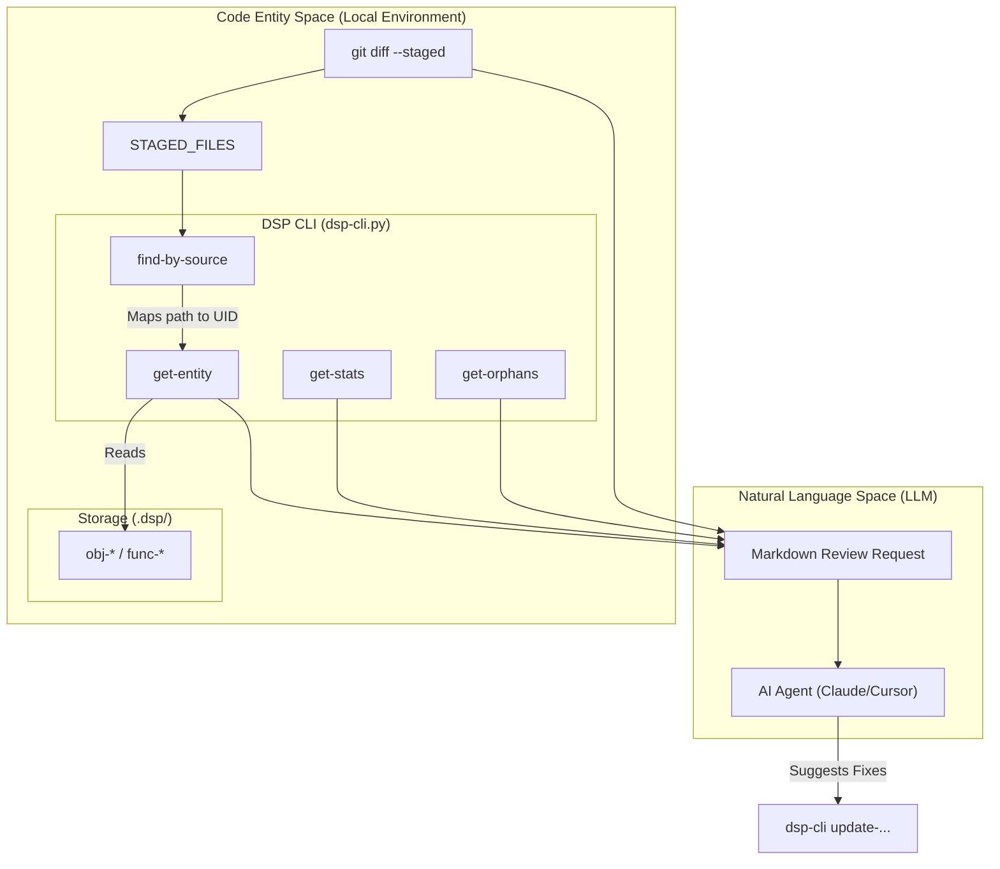
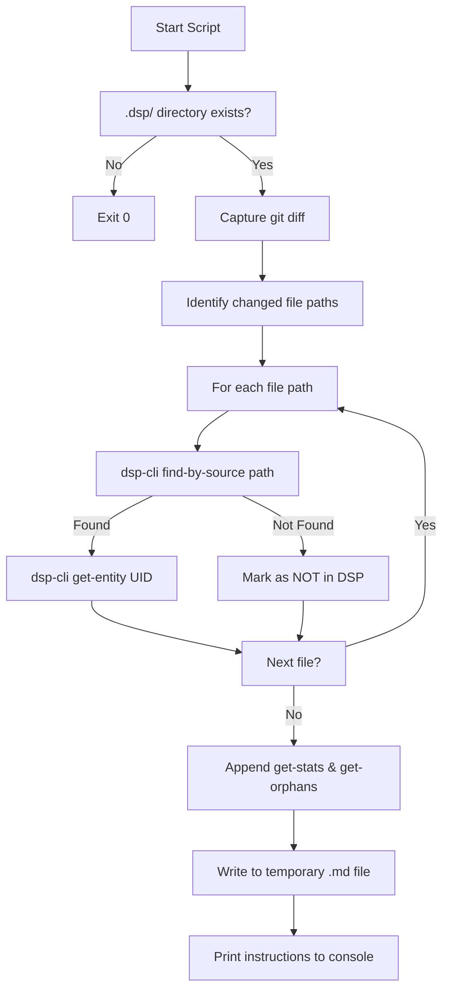

<!-- source: DeepWiki mcp.deepwiki.com · repo k-kolomeitsev/data-structure-protocol · page 6.2 Agent-Assisted Review Hook · fetched 2026-10-26 -->

# Agent-Assisted Review Hook

<details>
<summary>Relevant source files</summary>

The following files were used as context for generating this wiki page:

- [hooks/README.md](hooks/README.md)
- [hooks/dsp-agent-review.ps1](hooks/dsp-agent-review.ps1)
- [hooks/dsp-agent-review.sh](hooks/dsp-agent-review.sh)

</details>


The Agent-Assisted Review Hook provides a mechanism for performing deep semantic validation of the Data Structure Protocol (DSP) graph using Large Language Models (LLMs). While deterministic hooks (pre-commit/pre-push) focus on structural integrity—such as file existence and cycle detection—the agent-assisted review analyzes the relationship between code changes and the DSP metadata.

## Overview and Purpose

The agent-assisted review is implemented via `dsp-agent-review.sh` (Bash) and `dsp-agent-review.ps1` (PowerShell). Unlike the deterministic hooks that run automatically on every commit, this review is typically invoked manually for significant changes [hooks/README.md:12-14]().

The primary goal is to bridge the gap between raw code changes (`git diff`) and the persistent structural memory stored in `.dsp/`. It generates a comprehensive review document that an AI agent (Claude Code, Cursor, or Codex) can consume to identify:
* Missing DSP entity updates for modified code [hooks/README.md:99-100]().
* Required new abstractions or entities [hooks/README.md:101]().
* Indirect impact on dependent entities [hooks/README.md:102]().
* Inconsistencies in "why" descriptions or import relationships.

### Comparison of Hook Modes

| Feature | Deterministic Hooks | Agent-Assisted Review |
| :--- | :--- | :--- |
| **Trigger** | `git commit` / `git push` | Manual invocation |
| **Speed** | Fast (< 1s) | Slower (10-30s) |
| **Logic** | Boolean/Structural checks | Semantic/Contextual analysis |
| **Output** | Exit code (0/1) | Markdown Review Document |

Sources: [hooks/README.md:7-14]()

## Data Flow and Implementation

The review script aggregates data from the local Git environment and the DSP CLI to build a context-rich prompt.

### Review Generation Logic
1. **Change Detection**: The script identifies changes using `git diff --staged` or falls back to the previous commit (`HEAD~1`) [hooks/dsp-agent-review.sh:12-18]().
2. **Context Retrieval**: For every modified file, it calls `dsp-cli.py find-by-source` to locate the corresponding UID [hooks/dsp-agent-review.sh:21-24]().
3. **Entity Hydration**: If a UID is found, it retrieves the full entity metadata via `get-entity` [hooks/dsp-agent-review.sh:26-27]().
4. **Global Health Snapshot**: It appends global graph statistics and a list of current orphans [hooks/dsp-agent-review.sh:34-35]().
5. **Report Generation**: All data is written to a temporary Markdown file (`/tmp/dsp-review-XXXXXX.md` or `$env:TEMP`) [hooks/dsp-agent-review.sh:37-63]().

### Diagram: From Code Changes to LLM Context
This diagram illustrates how the review script maps physical file changes to DSP entities and prepares the LLM prompt.

**DSP Context Aggregation Flow**

Sources: [hooks/dsp-agent-review.sh:12-63](), [hooks/dsp-agent-review.ps1:15-74]()

## Integration Workflow

The scripts are designed to be used in conjunction with modern AI coding tools. After the script generates the review file, it provides platform-specific instructions for passing that context to an agent.

### Usage Examples

**Bash (Linux/macOS):**
```bash
./hooks/dsp-agent-review.sh
# To send to Claude Code:
claude "Review DSP consistency: $(cat /tmp/dsp-review-XXXXXX.md)"
```
[hooks/dsp-agent-review.sh:65-72]()

**PowerShell (Windows):**
```powershell
.\hooks\dsp-agent-review.ps1
# Copy to clipboard for Cursor/Codex:
Get-Content $reviewFile | Set-Clipboard
```
[hooks/dsp-agent-review.ps1:76-80]()

### Logic Flow of dsp-agent-review.sh
The following diagram details the internal execution logic of the bash implementation.

**Execution Logic**

Sources: [hooks/dsp-agent-review.sh:4-73]()

## Key Functions and Variables

| Component | Role | Source |
| :--- | :--- | :--- |
| `DSP_CLI` | Path to the `dsp-cli.py` executable. | [hooks/dsp-agent-review.sh:4]() |
| `STAGED_FILES` | List of files filtered by `ACMRD` (Added, Copied, Modified, Renamed, Deleted). | [hooks/dsp-agent-review.sh:18]() |
| `DSP_CONTEXT` | Buffer containing the hydrated metadata for all affected entities. | [hooks/dsp-agent-review.sh:20]() |
| `find-by-source` | CLI command used to resolve file paths to DSP UIDs. | [hooks/dsp-agent-review.sh:22]() |
| `get-entity` | CLI command used to extract full JSON/Text representation of an entity. | [hooks/dsp-agent-review.sh:26]() |

Sources: [hooks/dsp-agent-review.sh:4-32](), [hooks/dsp-agent-review.ps1:4-42]()

---

