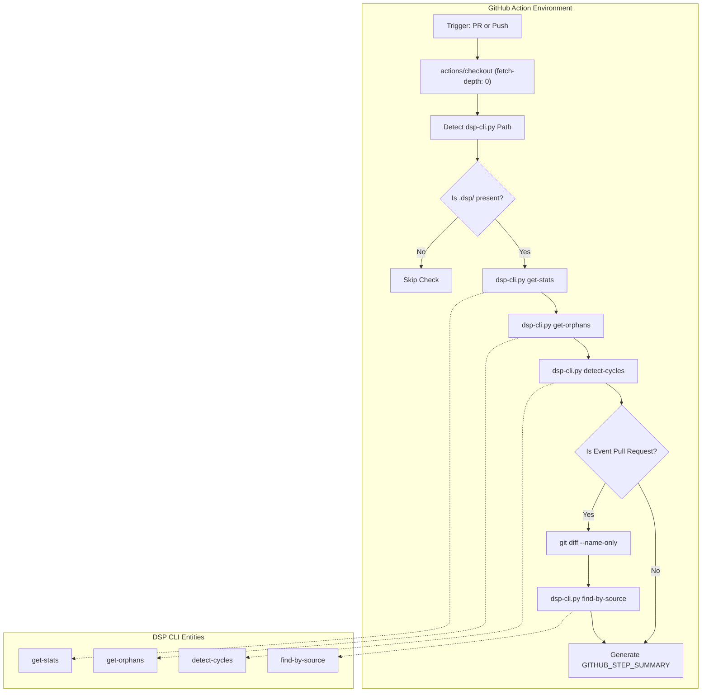
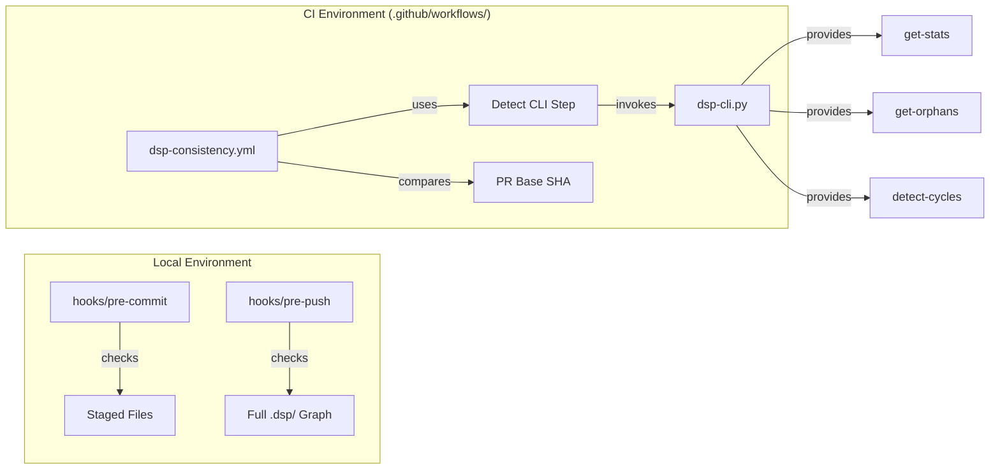

<!-- source: DeepWiki mcp.deepwiki.com · repo k-kolomeitsev/data-structure-protocol · page 6.3 GitHub Actions CI Workflow · fetched 2026-10-26 -->

# GitHub Actions CI Workflow

Relevant source files

The following files were used as context for generating this wiki page:

- [.github/workflows/dsp-consistency.yml](.github/workflows/dsp-consistency.yml)
- [hooks/README.md](hooks/README.md)

The GitHub Actions CI workflow provides an automated enforcement layer for the Data Structure Protocol (DSP). It ensures that every Pull Request and push to main branches maintains graph integrity, detects circular dependencies, and monitors the coverage of DSP entities relative to modified source code.

## Purpose and Scope

The `.github/workflows/dsp-consistency.yml` workflow is designed to complement local [6.1 Pre-commit and Pre-push Hooks]() by providing a centralized, "source of truth" validation during the CI/CD pipeline [.github/workflows/dsp-consistency.yml:1-6](). It serves three primary functions:
1.  **Integrity Validation**: Runs deterministic checks (orphans and cycles) on the entire graph [.github/workflows/dsp-consistency.yml:62-76]().
2.  **Coverage Tracking**: Specifically identifies if new or modified source files in a PR are missing corresponding DSP entities [.github/workflows/dsp-consistency.yml:78-96]().
3.  **Visibility**: Generates a "DSP Consistency Report" directly in the GitHub Step Summary for easy reviewer auditing [.github/workflows/dsp-consistency.yml:53-60]().

### Sources:
- [.github/workflows/dsp-consistency.yml:1-99]()
- [hooks/README.md:5-15]()

## Workflow Implementation

The workflow is implemented as a single job `dsp-check` running on `ubuntu-latest` [.github/workflows/dsp-consistency.yml:9-10](). It utilizes a multi-stage detection logic to find the `dsp-cli.py` tool across various integration paths (Cursor, Claude, Codex, or local skills) [.github/workflows/dsp-consistency.yml:20-32]().

### CI Data Flow and Logic

The following diagram illustrates how the CI workflow interacts with the repository state and the `dsp-cli.py` to generate the consistency report.

**CI Consistency Check Process**

### Sources:
- [.github/workflows/dsp-consistency.yml:11-51]()
- [.github/workflows/dsp-consistency.yml:56-96]()

## Automated Checks

The workflow executes four primary diagnostic commands to validate the state of the `.dsp/` directory.

### 1. Graph Statistics
The workflow calls `get-stats` to provide a high-level overview of the graph's health (entity counts, relation density) [.github/workflows/dsp-consistency.yml:56-60]().

### 2. Orphan Detection
The workflow identifies entities that have no valid connections (parents) in the graph using `get-orphans` [.github/workflows/dsp-consistency.yml:62-68](). This ensures that the structural memory remains a connected graph rather than a collection of disconnected notes.

### 3. Cycle Detection
Using `detect-cycles`, the CI prevents the introduction of circular dependencies within the DSP graph [.github/workflows/dsp-consistency.yml:70-76](). While circular dependencies may exist in some codebases, DSP encourages a Directed Acyclic Graph (DAG) structure for better LLM reasoning.

### 4. PR Coverage Check (Changed Files)
For Pull Requests, the workflow performs a "Gap Analysis" [.github/workflows/dsp-consistency.yml:78-96]():
- It fetches the list of changed files via `git diff` [.github/workflows/dsp-consistency.yml:79]().
- For each file with a trackable extension (e.g., `.ts`, `.py`, `.go`, `.rs`), it checks if a corresponding DSP entity exists via `find-by-source` [.github/workflows/dsp-consistency.yml:83-91]().
- Files missing from DSP are flagged with a warning symbol (⚠) in the summary [.github/workflows/dsp-consistency.yml:90]().

### Sources:
- [.github/workflows/dsp-consistency.yml:56-96]()
- [hooks/README.md:57-75]()

## Integration with Local Hooks

The CI workflow is the final gate in a tiered validation strategy. While local hooks focus on developer velocity, the CI focuses on repository-wide consistency.

| Feature | Local Pre-commit | Local Pre-push | GitHub CI Workflow |
| :--- | :--- | :--- | :--- |
| **Scope** | Staged files only | Full Graph | Full Graph + PR Diff |
| **Failure Mode** | Can `block` commit | `warn` only | `warn` (Step Summary) |
| **Environment** | Developer machine | Developer machine | GitHub Runner |
| **Primary Goal** | Prevent dirty commits | Prevent broken pushes | Audit & PR Review |

**Code Entity Mapping: Hooks vs CI**

### Sources:
- [hooks/README.md:9-14]()
- [hooks/README.md:38-40]()
- [.github/workflows/dsp-consistency.yml:20-32]()
- [.github/workflows/dsp-consistency.yml:78-80]()

## Adding to a Project

To add the DSP CI workflow to a repository:

1.  **Ensure DSP is initialized**: The workflow requires a `.dsp/` directory to exist, or it will exit silently [.github/workflows/dsp-consistency.yml:37-41]().
2.  **Install the CLI**: The workflow automatically searches for `dsp-cli.py` in common skill directories [.github/workflows/dsp-consistency.yml:23-27](). If using a custom path, ensure the detection logic in the `Detect DSP CLI` step is updated.
3.  **Copy Workflow**: Place the content of `.github/workflows/dsp-consistency.yml` into your repository.
4.  **Configure Permissions**: The workflow requires `fetch-depth: 0` to accurately calculate diffs between the PR branch and the base branch [.github/workflows/dsp-consistency.yml:14]().

### Sources:
- [.github/workflows/dsp-consistency.yml:1-43]()

---

