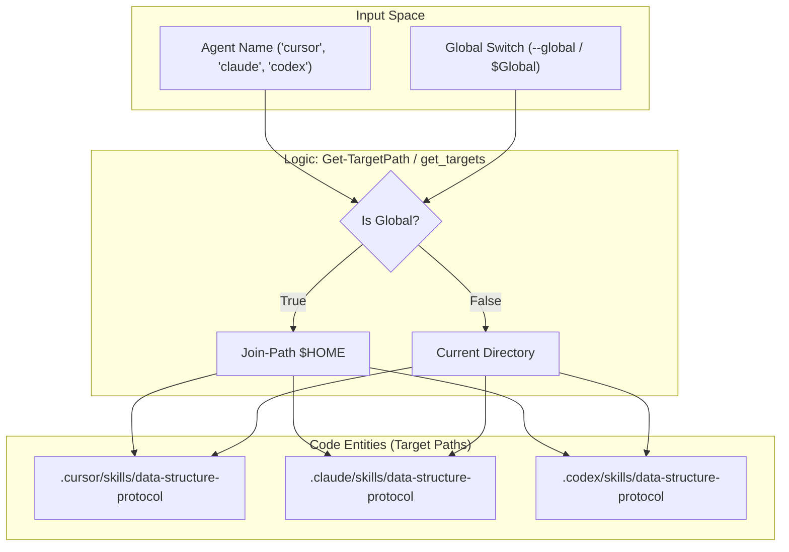
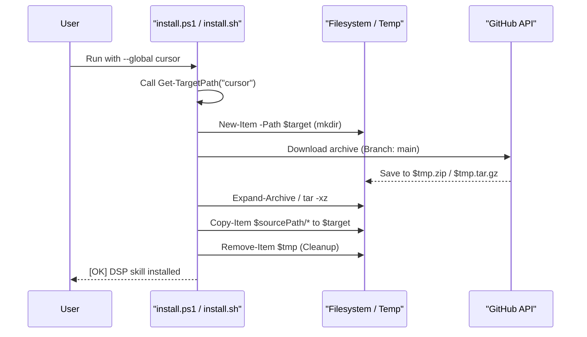

<!-- source: DeepWiki mcp.deepwiki.com · repo k-kolomeitsev/data-structure-protocol · page 7.1 Skill Installation (install.sh / install.ps1) · fetched 2026-10-26 -->

# Skill Installation (install.sh / install.ps1)

Relevant source files

The following files were used as context for generating this wiki page:

- [hooks/install-hooks.ps1](hooks/install-hooks.ps1)
- [install.ps1](install.ps1)
- [install.sh](install.sh)

The Skill Installation scripts provide a streamlined mechanism for deploying the Data Structure Protocol (DSP) integration packs to various AI agents. These scripts automate the retrieval of the protocol's rule-sets and hooks from the repository and place them into the specific filesystem locations required by Cursor, Claude Code, and Codex.

### Installation Overview

The installation process is handled by two primary scripts: `install.sh` for Unix-based systems (macOS/Linux) and `install.ps1` for Windows environments. Both scripts share a common logic: they resolve the target agent, determine the installation path (local vs. global), download the source archive from GitHub, and extract the `skills/data-structure-protocol` directory to the target destination.

#### Parameters and Configuration

The scripts accept the following parameters to control the installation behavior:

| Parameter | Type | Default | Description |
| :--- | :--- | :--- | :--- |
| `$Agent` / `AGENT` | Array/String | `all` | Target agents for installation. Valid values: `cursor`, `claude`, `codex`, `all`. |
| `$Global` / `--global` | Switch/Flag | `false` | If set, installs to user-level home directories. Otherwise, installs to the current working directory. |
| `$Branch` / `--branch` | String | `main` | The GitHub branch to pull the skill source from. |

**Sources:** [install.ps1:3-10](), [install.sh:32-41]()

---

### Target Path Resolution

The scripts use a path resolution function (`Get-TargetPath` in PowerShell, `get_targets` in Bash) to map agent names to their respective skill directories. DSP supports three primary agent targets, each with a specific directory convention.

#### Target Directory Mapping

| Agent | Local Path (Project Root) | Global Path (Home Dir) |
| :--- | :--- | :--- |
| **Cursor** | `.cursor/skills/data-structure-protocol` | `~/.cursor/skills/data-structure-protocol` |
| **Claude** | `.claude/skills/data-structure-protocol` | `~/.claude/skills/data-structure-protocol` |
| **Codex** | `.codex/skills/data-structure-protocol` | `~/.codex/skills/data-structure-protocol` |

**Code Entity Mapping: Path Resolution**

The following diagram illustrates how the `Get-TargetPath` logic associates input parameters with filesystem entities.

"Natural Language Space to Code Entity Space: Target Resolution"

**Sources:** [install.ps1:16-32](), [install.sh:43-60]()

---

### Installation Lifecycle

The `Install-ForAgent` (PowerShell) and `install_for_agent` (Bash) functions manage the lifecycle of the installation, from environment preparation to cleanup.

#### Download-Extract-Cleanup Flow

1.  **Directory Creation**: The script ensures the target directory exists using `mkdir -p` or `New-Item -ItemType Directory` [install.sh:68](), [install.ps1:40]().
2.  **Temporary Workspace**: A temporary directory is created to avoid polluting the workspace during extraction [install.sh:71](), [install.ps1:42]().
3.  **Archive Retrieval**:
    *   **Unix**: Uses `curl` to fetch the `.tar.gz` and pipes it to `tar` with `--strip-components=1` [install.sh:74-75]().
    *   **Windows**: Uses `Invoke-WebRequest` to download a `.zip` and `Expand-Archive` to extract it [install.ps1:46-49]().
4.  **Selective Copy**: Only the contents of the `skills/data-structure-protocol` folder from the repository are copied to the target agent directory [install.sh:77](), [install.ps1:58]().
5.  **Cleanup**: Temporary files and zip archives are removed regardless of success or failure using `trap` (Bash) or `finally` (PowerShell) [install.sh:72](), [install.ps1:61-64]().

**Code Entity Mapping: Installation Lifecycle**

"Natural Language Space to Code Entity Space: Installation Flow"

**Sources:** [install.ps1:34-65](), [install.sh:62-79]()

---

### Hook Installation Complement

While the main install scripts handle the agent rules (skills), the `hooks/install-hooks.ps1` (and its shell equivalent) script handles the automation of DSP graph validation during the Git lifecycle.

The hook installer:
1.  Locates the local `.git/hooks` directory using `git rev-parse --git-dir` [hooks/install-hooks.ps1:3]().
2.  Copies the `pre-commit` and `pre-push` scripts from the repository's `hooks/` directory to the local Git configuration [hooks/install-hooks.ps1:8-9]().
3.  Informs the user about environment variables used by the hooks, such as `DSP_PRECOMMIT_MODE` and `DSP_SKIP_PATTERNS` [hooks/install-hooks.ps1:14-16]().

**Sources:** [hooks/install-hooks.ps1:1-17]()

---

