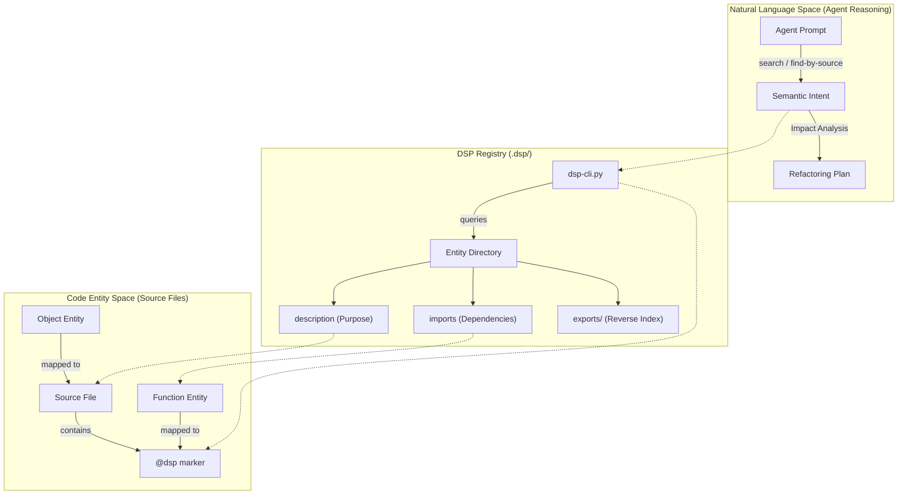
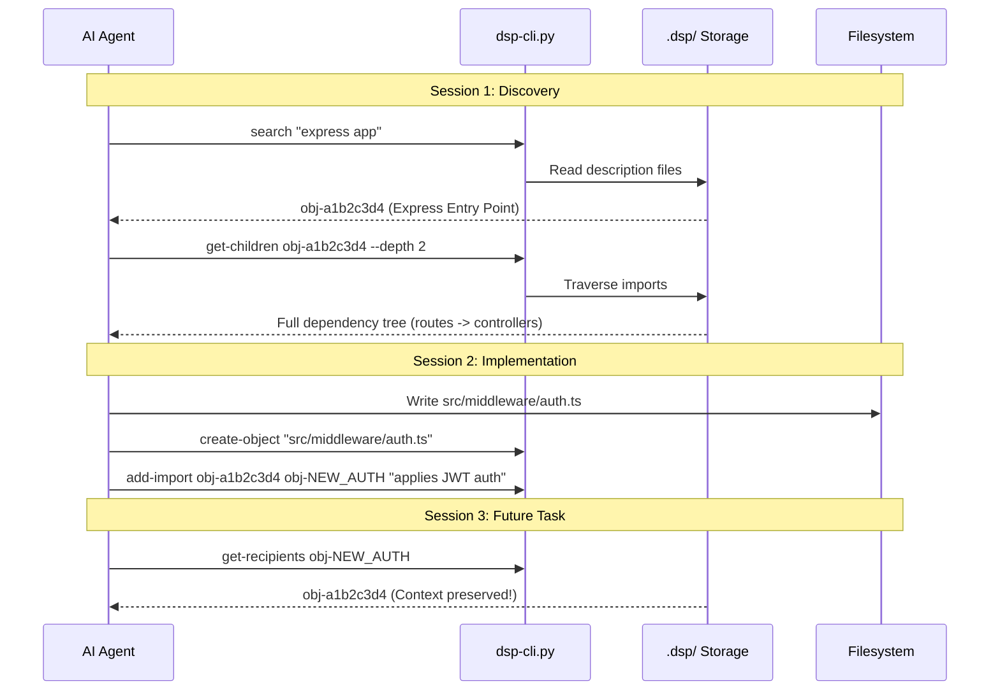

<!-- source: DeepWiki mcp.deepwiki.com · repo k-kolomeitsev/data-structure-protocol · page 8.1 DSP vs GSD · fetched 2026-10-26 -->

# DSP vs GSD

Relevant source files

The following files were used as context for generating this wiki page:

- [article.md](article.md)
- [docs/comparisons/dsp-vs-gsd.md](docs/comparisons/dsp-vs-gsd.md)

This section provides a detailed technical comparison between the **Data Structure Protocol (DSP)** and **Get Shit Done (GSD)**. While both tools aim to improve AI agent performance in software engineering, they address fundamentally different problems: DSP focuses on **persistent structural memory**, while GSD focuses on **workflow orchestration**.

### The Core Problem: Memory vs. Process

The fundamental premise of DSP is that modern Large Language Models (LLMs) like Claude 3.5 Sonnet or GPT-4o have become highly proficient at planning and executing tasks but still suffer from a "blank slate" problem every time a new session begins [docs/comparisons/dsp-vs-gsd.md:5-9]().

| Aspect | Data Structure Protocol (DSP) | Get Shit Done (GSD) |
| :--- | :--- | :--- |
| **Primary Goal** | Persistent structural memory [docs/comparisons/dsp-vs-gsd.md:15-16]() | Workflow/Process wrapper [docs/comparisons/dsp-vs-gsd.md:17-18]() |
| **Core Mechanism** | A versioned graph in `.dsp/` [article.md:27-32]() | Lifecycle phases (Plan → Execute → Verify) [docs/comparisons/dsp-vs-gsd.md:17-18]() |
| **Problem Solved** | "Orientation tax" and token waste [article.md:3-5]() | Chaotic or undisciplined agent output [docs/comparisons/dsp-vs-gsd.md:42-43]() |
| **Persistence** | Full graph persists across sessions and tools [docs/comparisons/dsp-vs-gsd.md:28]() | No persistent project memory; often starts fresh [docs/comparisons/dsp-vs-gsd.md:28]() |
| **Impact Analysis** | Native (`get-parents`, `get-recipients`) [article.md:74-75]() | Not available [docs/comparisons/dsp-vs-gsd.md:30]() |
| **Overhead** | Low: simple memory layer [docs/comparisons/dsp-vs-gsd.md:31]() | Medium: mandatory lifecycle ceremony [docs/comparisons/dsp-vs-gsd.md:31]() |

**Sources:** [article.md:3-32](), [docs/comparisons/dsp-vs-gsd.md:5-43]()

---

### Implementation and Data Flow

The following diagram illustrates how DSP bridges the gap between the agent's natural language reasoning and the actual code entities by providing a stable, queryable index.

**Diagram: DSP Entity Mapping and Data Flow**

**Sources:** [article.md:27-32](), [article.md:53-54](), [article.md:66-76]()

---

### Why Modern LLMs No Longer Need Lifecycle Wrappers

DSP is built on the observation that as of 2025-2026, LLMs have evolved to handle engineering discipline natively [docs/comparisons/dsp-vs-gsd.md:44-45]().

1.  **Planning:** Agents can generate plans without an external `/gsd:plan-phase` command [docs/comparisons/dsp-vs-gsd.md:46-47]().
2.  **Verification:** Modern models natively run tests and linting without being forced by a wrapper [docs/comparisons/dsp-vs-gsd.md:48-49]().
3.  **Context Management:** While GSD uses "waves" to manage context, DSP allows the agent to surgically pull only the required nodes and their immediate neighbors, reducing the need for complex orchestration [article.md:63-64](), [docs/comparisons/dsp-vs-gsd.md:49-50]().

What agents **cannot** do natively is remember that a specific service was refactored last week or know that seven modules depend on a specific middleware before they attempt to change it [docs/comparisons/dsp-vs-gsd.md:51-56]().

**Sources:** [article.md:63-64](), [docs/comparisons/dsp-vs-gsd.md:44-56]()

---

### Token Usage and Session Continuity Example

Consider the task: *"Add authentication to an existing Express.js project."*

#### DSP Workflow
The agent uses the `dsp-cli.py` tool to navigate the graph. It identifies the entry point and recipients in seconds without reading every file in the directory [docs/comparisons/dsp-vs-gsd.md:63-75]().

**Diagram: DSP Session Continuity**

#### GSD Workflow
The agent must re-scan the codebase or rely on a "fresh-context" wave that discards previous discovery, leading to repeated token expenditure for the same structural information [docs/comparisons/dsp-vs-gsd.md:85-94]().

**Sources:** [article.md:66-76](), [docs/comparisons/dsp-vs-gsd.md:63-100]()

### Summary of Differences

| Metric | DSP | GSD |
| :--- | :--- | :--- |
| **Reason Tracking** | Every import has a `why`; every export tracks usage [article.md:32-34]() | Not tracked [docs/comparisons/dsp-vs-gsd.md:36]() |
| **Brownfield Support** | First-class DFS bootstrap [article.md:101-105]() | One-time `map-codebase` scan [docs/comparisons/dsp-vs-gsd.md:29]() |
| **Git Integration** | Pre-commit/Pre-push graph validation [docs/comparisons/dsp-vs-gsd.md:37]() | Workflow enforcement hooks [docs/comparisons/dsp-vs-gsd.md:37]() |

**The bottom line:** DSP provides the "long-term memory" that agents lack, whereas GSD provides a "process" that agents have largely outgrown.

**Sources:** [article.md:32-34](), [article.md:101-105](), [docs/comparisons/dsp-vs-gsd.md:29-37]()

---

