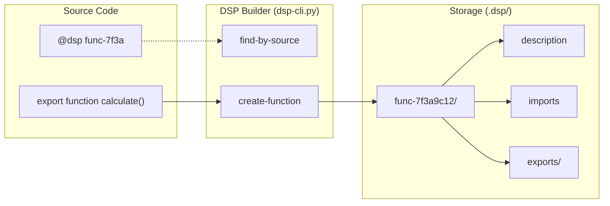

<!-- source: DeepWiki mcp.deepwiki.com · repo k-kolomeitsev/data-structure-protocol · page 9 Glossary · fetched 2026-10-26 -->

# Glossary

<details>
<summary>Relevant source files</summary>

The following files were used as context for generating this wiki page:

- [ARCHITECTURE.md](ARCHITECTURE.md)
- [README.md](README.md)
- [article.md](article.md)
- [hooks/dsp-check-staged.ps1](hooks/dsp-check-staged.ps1)
- [skills/data-structure-protocol/SKILL.md](skills/data-structure-protocol/SKILL.md)
- [skills/data-structure-protocol/references/bootstrap.md](skills/data-structure-protocol/references/bootstrap.md)
- [skills/data-structure-protocol/references/operations.md](skills/data-structure-protocol/references/operations.md)
- [skills/data-structure-protocol/references/storage-format.md](skills/data-structure-protocol/references/storage-format.md)

</details>


This page defines the core terminology, abbreviations, and concepts of the Data Structure Protocol (DSP). DSP is a graph-based persistent memory layer designed to provide AI agents with a stable, versionable map of a codebase, reducing the need for repetitive repository scanning.

## Core Entities

The DSP graph consists of nodes called **Entities**. Every entity is uniquely identified by a stable UID and stored as a directory within the `.dsp/` folder.

| Term | Definition | Code Pointer |
|:---|:---|:---|
| **Entity** | A generic term for any node in the DSP graph. | [skills/data-structure-protocol/SKILL.md:13-13]() |
| **Object** | Any "thing" with a UID that is not a function. Includes modules, classes, configs, resource files, and external dependencies. | [ARCHITECTURE.md:77-78]() |
| **Function** | A specific entity representing a function, method, handler, or pipeline that performs work. | [ARCHITECTURE.md:78-78]() |
| **External** | A special kind of Object representing a dependency outside the project (e.g., `npm` packages, `pip` modules). DSP records their existence but does not traverse their internals. | [skills/data-structure-protocol/references/bootstrap.md:89-89]() |

**Sources:** [ARCHITECTURE.md:74-78](), [skills/data-structure-protocol/SKILL.md:13-15](), [skills/data-structure-protocol/references/bootstrap.md:89-89]()

---

## Identity and Addressing

DSP prioritizes stable identity over filesystem paths to ensure the graph remains valid after refactoring.

### UID (Unique Identifier)
A 10-character string consisting of a type prefix and 8 hexadecimal characters (derived from the first 8 characters of a UUID4).
*   **Object UID:** `obj-<8hex>` (e.g., `obj-a1b2c3d4`)
*   **Function UID:** `func-<8hex>` (e.g., `func-7f3a9c12`)

### @dsp Marker
A comment placed in source code immediately before an entity declaration to "anchor" the UID to the implementation. This allows the CLI and agents to find code entities regardless of line number changes.
*   **JS/TS:** `// @dsp func-7f3a9c12`
*   **Python:** `# @dsp obj-a1b2c3d4`

### Source Reference
The `source` field in an entity's description. For Objects, it is a repo-relative path (e.g., `src/app.ts`). For Functions, it includes a symbol anchor (e.g., `src/app.ts#start`).

**Sources:** [skills/data-structure-protocol/references/storage-format.md:37-43](), [ARCHITECTURE.md:92-111](), [skills/data-structure-protocol/SKILL.md:76-92]()

---

## Relationship Concepts

The DSP graph is defined by directed edges representing usage and visibility.

### Imports
A list of UIDs that the current entity **uses**. This includes external libraries, other local modules, or specific functions. For an Object, it also includes its own owned functions (composition).
*   **Implementation:** Stored in `.dsp/<uid>/imports`.

### Shared
A list of UIDs that the current entity **exposes** to the outside world (public API).
*   **Implementation:** Stored in `.dsp/<uid>/shared`.

### Exports (Reverse Index)
A directory structure that tracks **who** uses an entity and **why**. This is the inverse of the `imports` relationship.
*   **Implementation:** Stored in `.dsp/<uid>/exports/<importer_uid>`.

### The "Why"
A mandatory 1-3 sentence explanation for every import edge. It answers: *"What would break in THIS file if this import were removed?"* It describes the specific usage site rather than restating the imported entity's purpose.

**Sources:** [ARCHITECTURE.md:79-82](), [skills/data-structure-protocol/references/storage-format.md:56-107](), [skills/data-structure-protocol/references/bootstrap.md:35-53]()

---

## Structural Components

### .dsp/ Directory
The root storage for the DSP graph. It is a flat-file database where each subdirectory name is an entity UID.
*   **Path:** `root/.dsp/`

### Table of Contents (TOC)
A file listing all UIDs reachable from a specific root entrypoint in documentation order.
*   **Single-root:** `.dsp/TOC`
*   **Multi-root:** `.dsp/TOC-<rootUid>`

### Root Entrypoint
The starting file for a DSP traversal (e.g., `main.ts`, `index.js`, `app.py`). The first UID in a TOC is always the root.

**Sources:** [skills/data-structure-protocol/references/storage-format.md:13-33](), [skills/data-structure-protocol/references/storage-format.md:108-129]()

---

## Architecture Diagrams

### From Natural Language to Code Entities
This diagram maps conceptual developer goals to the specific code entities and CLI operations used to manage them.

```mermaid
graph TD
    subgraph "Natural Language Space"
        A["'I created a new module'"]
        B["'I need to use a library'"]
        C["'What happens if I delete this?'"]
        D["'Where do I start reading?'"]
    end

    subgraph "Code Entity Space (dsp-cli.py)"
        A -->| "create-object" | E["Object Entity (obj-*)"]
        B -->| "add-import" | F["Import Edge (imports file)"]
        C -->| "get-recipients" | G["Reverse Index (exports/ dir)"]
        D -->| "read-toc" | H["TOC File (.dsp/TOC)"]
    end

    E --- I["description file"]
    F --- J["'why' text"]
    G --- K["importer_uid file"]
```
**Sources:** [skills/data-structure-protocol/SKILL.md:34-53](), [skills/data-structure-protocol/references/operations.md:1-11](), [ARCHITECTURE.md:43-60]()

### System Data Flow: Code to Graph
This diagram shows how source code markers and file structures are transformed into the persistent DSP storage format.


**Sources:** [README.md:61-86](), [skills/data-structure-protocol/references/storage-format.md:13-33](), [ARCHITECTURE.md:92-115]()

---

## Command & Storage Summary Table

| Term | CLI Command | Storage Path | Purpose |
|:---|:---|:---|:---|
| **Initialize** | `init` | `.dsp/` | Creates the graph root. |
| **Search** | `search <query>` | `.dsp/*/description` | Full-text search of purposes. |
| **Dependency Down** | `get-children` | `.dsp/<uid>/imports` | Shows what an entity uses. |
| **Dependency Up** | `get-parents` | `.dsp/*/imports` | Shows what uses an entity. |
| **Public API** | `get-shared` | `.dsp/<uid>/shared` | Lists exported entities. |
| **Impact Analysis** | `get-recipients` | `.dsp/<uid>/exports/` | Lists all importers + reasons. |
| **Health Check** | `get-orphans` | `N/A` | Finds unused entities. |

**Sources:** [skills/data-structure-protocol/references/operations.md:14-255](), [skills/data-structure-protocol/references/storage-format.md:1-129]()