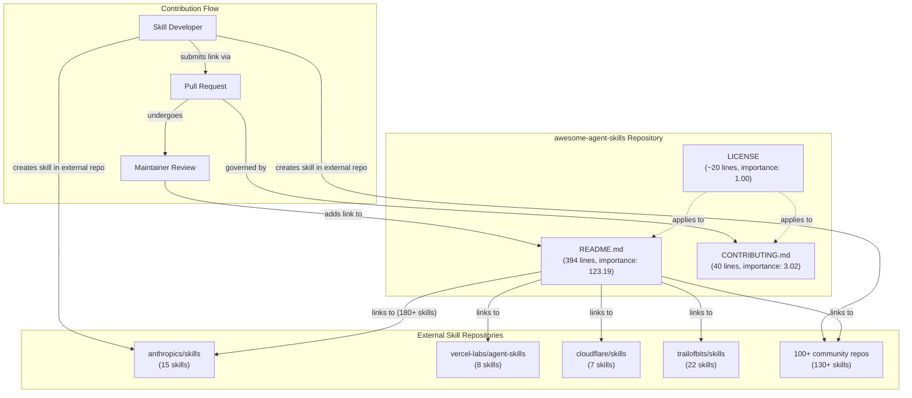
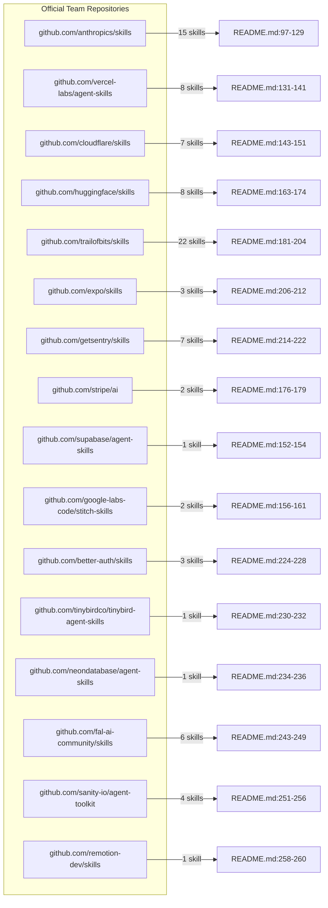
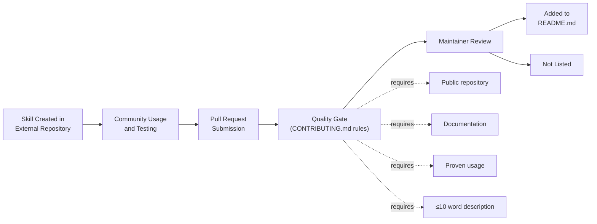

<!-- source: DeepWiki mcp.deepwiki.com · repo VoltAgent/awesome-agent-skills · page 1 Overview · fetched 2026-10-26 -->

# Overview

<details>
<summary>Relevant source files</summary>

The following files were used as context for generating this wiki page:

- [README.md](README.md)

</details>


This document introduces the Awesome Agent Skills repository, explaining its architecture as a curated collection of skill definitions for AI coding assistants, the ecosystem it serves, and how it functions as a discovery hub for 180+ skills maintained across external repositories.

For detailed installation instructions, see [Getting Started](#2). For the complete catalog of available skills, see [Skill Catalog](#4). For information about submitting your own skills, see [Contributing to the Collection](#5).

## What This Repository Is

The Awesome Agent Skills repository is a **curated discovery hub** that maintains links to 180+ Agent Skills distributed across external repositories. The repository itself contains only three files:

| File | Lines | Importance Score | Purpose |
|------|-------|------------------|---------|
| `README.md` | 394 | 123.19 | Primary interface containing categorized skill listings |
| `CONTRIBUTING.md` | 40 | 3.02 | Contribution process and quality requirements |
| `LICENSE` | ~20 | 1.00 | MIT license terms |

The repository **does not host skill implementations**. Each skill listed in [README.md:97-372]() is a hyperlink to an external repository where the skill is developed, maintained, and supported by its original author or team.

**Sources:** [README.md:1-394](), Diagram 6 from high-level architecture

## Repository Architecture



**Architecture: Repository Boundary and Responsibility Model**

The repository implements a **decentralized content, centralized discovery** architecture. Skill developers maintain their implementations externally, while `README.md` serves as the canonical index for community-adopted skills.

**Sources:** [README.md:1-394](), Diagram 1 and Diagram 6 from high-level architecture

## Agent Skills Definition Format

Agent Skills are structured as directories containing YAML front matter and Markdown instructions. The basic format shown in [README.md:44-72]() demonstrates the standardized structure:

```yaml
---
name: api-tester
description: Test REST APIs and validate responses
---
```

Followed by Markdown sections defining:
- Skill title and overview
- When to use the skill
- Step-by-step instructions
- Validation criteria
- Optional resources (scripts, configurations)

This format is compatible with 8+ AI coding assistants listed in [README.md:78-87]() through standardized file system paths.

**Sources:** [README.md:42-74]()

## Supported AI Coding Assistants

The following table from [README.md:78-87]() documents the complete compatibility matrix:

| AI Assistant | Project-Specific Path | Global Path | Documentation Link |
|--------------|----------------------|-------------|-------------------|
| Antigravity | `.agent/skills/` | `~/.gemini/antigravity/skills/` | Official docs linked |
| Claude Code | `.claude/skills/` | `~/.claude/skills/` | Official docs linked |
| Codex | `.codex/skills/` | `~/.codex/skills/` | Official docs linked |
| Cursor | `.cursor/skills/` | `~/.cursor/skills/` | Official docs linked |
| Gemini CLI | `.gemini/skills/` | `~/.gemini/skills/` | Official docs linked |
| GitHub Copilot | `.github/skills/` | `~/.copilot/skills/` | Official docs linked |
| OpenCode | `.opencode/skills/` | `~/.config/opencode/skills/` | Official docs linked |
| Windsurf | `.windsurf/skills/` | `~/.codeium/windsurf/skills/` | Official docs linked |

Each assistant supports both project-scoped (`.tool/skills/`) and user-scoped (`~/.tool/skills/`) skill installations, enabling flexible deployment strategies.

**Sources:** [README.md:76-87](), Diagram 3 from high-level architecture

## Skill Ecosystem Structure

```mermaid
graph TB
    subgraph "Skill Contributors"
        OfficialTeams["Official Development Teams<br/>(16 organizations)"]
        CommunityDevs["Community Developers<br/>(100+ contributors)"]
    end
    
    subgraph "Skill Categories in README.md"
        DocCreation["Document Creation<br/>lines 99-105"]
        Creative["Creative and Design<br/>lines 107-113"]
        Development["Development<br/>lines 115-119"]
        Branding["Branding and Communication<br/>lines 121-124"]
        Meta["Meta<br/>lines 126-129"]
        Security["Security Skills by Trail of Bits<br/>lines 181-204 (22 skills)"]
        Marketing["Community: Marketing<br/>lines 264-269 (23+ skills)"]
        Productivity["Community: Productivity<br/>lines 271-290 (20+ skills)"]
        DevTesting["Community: Development<br/>lines 292-331 (40+ skills)"]
        Context["Community: Context Engineering<br/>lines 332-341 (8 skills)"]
        Specialized["Community: Specialized Domains<br/>lines 343-353"]
    end
    
    subgraph "End Users"
        Developers["Software Developers"]
        Teams["Engineering Teams"]
    end
    
    OfficialTeams -->|"contribute"| DocCreation
    OfficialTeams -->|"contribute"| Creative
    OfficialTeams -->|"contribute"| Development
    OfficialTeams -->|"contribute"| Branding
    OfficialTeams -->|"contribute"| Meta
    OfficialTeams -->|"contribute"| Security
    
    CommunityDevs -->|"contribute"| Marketing
    CommunityDevs -->|"contribute"| Productivity
    CommunityDevs -->|"contribute"| DevTesting
    CommunityDevs -->|"contribute"| Context
    CommunityDevs -->|"contribute"| Specialized
    
    DocCreation -->|"discovered by"| Developers
    Security -->|"discovered by"| Teams
    Marketing -->|"discovered by"| Developers
    DevTesting -->|"discovered by"| Teams
```



**Skill Organization in README.md**

Skills in [README.md:97-372]() are organized into two primary categories:

1. **Official Team Skills** ([README.md:97-260]()): Platform-specific capabilities from 16 organizations including Anthropic, Vercel, Cloudflare, Hugging Face, Trail of Bits, Expo, Sentry, Stripe, Supabase, Google Labs, Better Auth, Tinybird, Neon, fal.ai, Sanity, and Remotion.

2. **Community Skills** ([README.md:262-372]()): Cross-cutting capabilities organized by functional domain including Marketing, Productivity, Development, Context Engineering, and Specialized Domains.

**Sources:** [README.md:97-372](), Diagram 4 from high-level architecture

## Skill Contributors by Organization

The following diagram maps the major contributing organizations to their skill repositories:



**Official Team Skill Distribution**

The distribution shows Trail of Bits as the largest contributor with 22 security-focused skills ([README.md:181-204]()), followed by Anthropic with 15 skills across document creation, creative design, development, branding, and meta categories ([README.md:97-129]()).

**Sources:** [README.md:97-260]()

## Quality Curation Model

The repository implements strict quality requirements documented in [CONTRIBUTING.md](). The curation process filters skills based on:

1. **Community Usage Requirement**: Skills must demonstrate real-world adoption before listing ([CONTRIBUTING.md:21-35]())
2. **Public Repository**: Must be hosted in a publicly accessible repository
3. **Documentation**: Must include comprehensive instructions and examples
4. **Description Length**: Maximum 10 words for consistency ([CONTRIBUTING.md]())



**Quality-First Curation Process**

The note in [README.md:381]() explicitly states: "Please don't submit skills you created 3 hours ago. We're now focusing on community-adopted skills, especially those published by development teams and proven in real-world usage. Quality over quantity."

This ensures the collection maintains high standards and serves as a reliable resource for production use.

**Sources:** [README.md:374-382](), [CONTRIBUTING.md:1-40](), Diagram 2 from high-level architecture

## Contribution Statistics

The repository features community contribution tracking:

- 180+ total skills cataloged ([README.md:24]())
- 16 official development teams contributing
- 100+ community contributors
- Contributor visualization at [README.md:384]()
- Active Discord community linked at [README.md:26]()

**Sources:** [README.md:9-29](), [README.md:383-384]()

## Legal and Licensing

The repository operates under MIT License ([LICENSE]()). Important disclaimers in [README.md:386-392]():

1. **No Endorsement**: Listed skills are not audited, endorsed, or guaranteed by the repository maintainers
2. **Author Responsibility**: Skills are created and maintained by respective authors and teams
3. **Security Notice**: Skills are not security-audited and should be reviewed before production use
4. **Removal Process**: Skill authors can request removal via GitHub issues

**Sources:** [README.md:386-392](), [LICENSE]()

---

