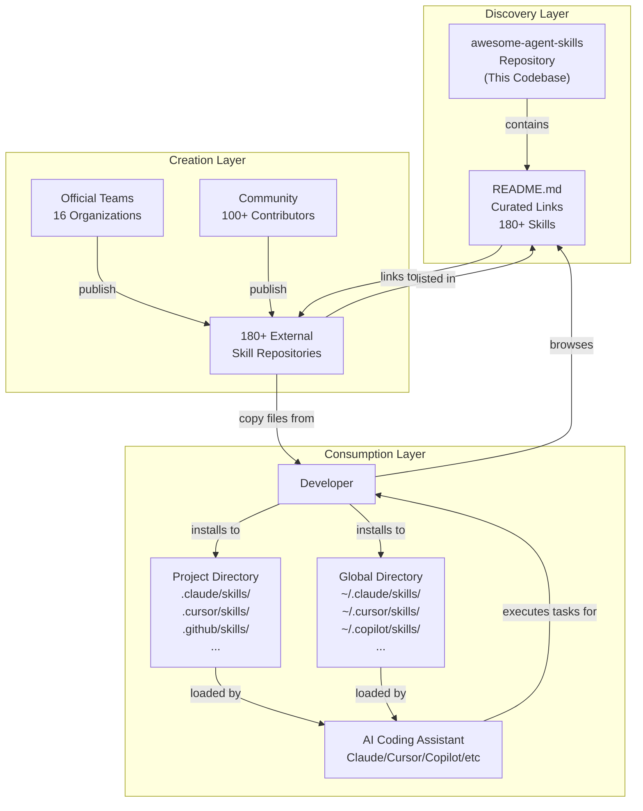
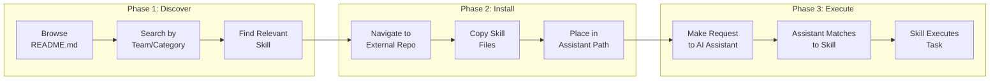
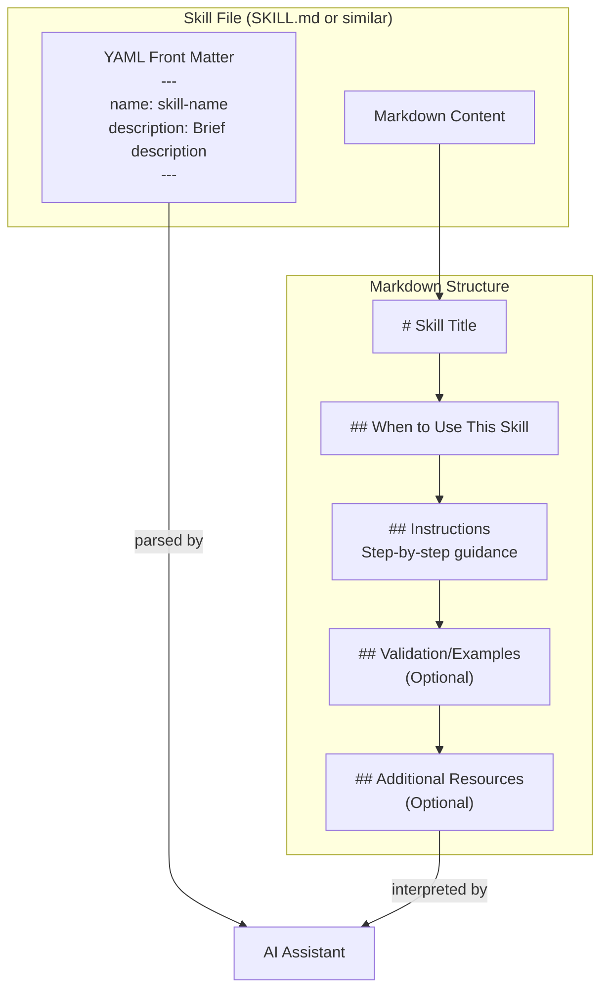
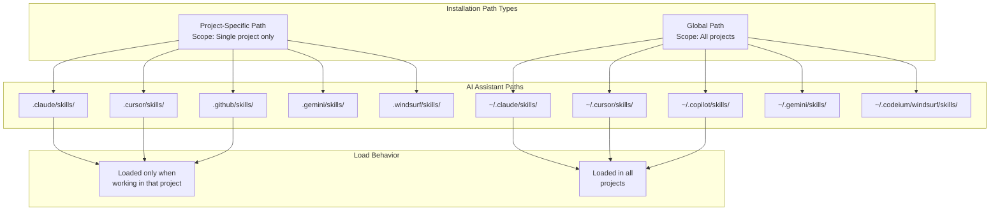
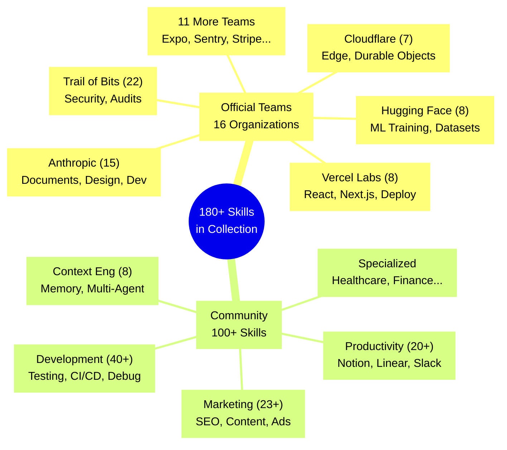

<!-- source: DeepWiki mcp.deepwiki.com · repo VoltAgent/awesome-agent-skills · page 2 Getting Started · fetched 2026-10-26 -->

# Getting Started

Relevant source files

The following files were used as context for generating this wiki page:

- [README.md](README.md)

## Purpose and Scope

This page introduces Agent Skills and guides you through the essential concepts needed to start using them. You will learn what Agent Skills are, how they fit into the AI coding assistant ecosystem, and the basic workflow for discovering and deploying skills.

For detailed installation instructions across specific AI assistants, see [Installing Skills](#2.1). For a hands-on walkthrough of using your first skill, see [Using Your First Skill](#2.2). For understanding how skills are technically structured and executed, see [Skill Architecture](#3).

**Sources:** [README.md:1-393]()

---

## What Are Agent Skills?

Agent Skills are folders containing instructions, scripts, and resources that teach AI coding assistants how to perform specific tasks. Each skill is defined using a standardized format consisting of YAML metadata and Markdown instructions that AI agents can parse and execute.

A skill teaches an AI assistant a capability such as:
- Creating and editing documents (Word, PowerPoint, Excel, PDF)
- Testing APIs and validating responses
- Deploying applications to cloud platforms
- Performing security audits and vulnerability analysis
- Managing project workflows and collaboration tools
- Generating code following specific frameworks and best practices

The key characteristic of Agent Skills is their **portability**: a single skill definition works across multiple AI coding assistants (Claude Code, Cursor, GitHub Copilot, Gemini CLI, Windsurf, and others) without modification.

**Sources:** [README.md:33-37](), [README.md:42-74]()

---

## The Decentralized Skills Ecosystem

Understanding the architecture of the Agent Skills ecosystem is crucial for getting started effectively:

**Diagram: Agent Skills Ecosystem Architecture**

**Critical Distinction:** The `awesome-agent-skills` repository does **not** host skill implementations. It only curates links to external repositories where skills are maintained by their original authors. This separation ensures:
- Skill creators maintain full control over their implementations
- The curated list remains focused on quality and discovery
- Skills can be updated independently by their maintainers

**Sources:** [README.md:1-393](), [README.md:33-40]()

---

## Basic Workflow: Discover, Install, Execute

The standard workflow for using Agent Skills follows three phases:

**Diagram: Three-Phase Agent Skills Workflow**

**Phase 1: Discover** - Browse the curated collection in [README.md:97-373]() organized by official teams and community categories. Each skill listing includes a GitHub link and a concise description (≤10 words).

**Phase 2: Install** - Navigate to the external repository, copy the skill files (typically a directory containing `SKILL.md` or similar), and place them in your AI assistant's skill directory. Skills can be installed either project-specific (in your project's `.claude/skills/` directory) or globally (in `~/.claude/skills/`).

**Phase 3: Execute** - Once installed, your AI assistant automatically loads the skill. When you make a request that matches the skill's domain, the assistant interprets the skill's instructions and executes the task.

**Sources:** [README.md:76-87](), [README.md:97-373]()

---

## Skill Anatomy: YAML + Markdown Structure

Every Agent Skill follows a standardized format combining YAML front matter for metadata with Markdown content for human-readable instructions:

**Diagram: Skill File Structure and Processing**

The minimal skill structure demonstrated in [README.md:44-72]() shows:

1. **YAML Front Matter** - Machine-readable metadata:
   - `name`: Identifier for the skill (e.g., `api-tester`)
   - `description`: Brief explanation of capability

2. **Markdown Content** - Human-readable instructions:
   - Title and overview
   - "When to Use This Skill" section defining applicability
   - "Instructions" section with step-by-step guidance
   - Optional validation rules and examples

AI assistants parse both components: the YAML provides indexing and matching capabilities, while the Markdown provides execution instructions.

**Sources:** [README.md:42-74]()

---

## Installation Path Architecture

Agent Skills use a dual-path system that allows skills to be deployed either project-wide or globally across all projects:

**Diagram: Project-Specific vs Global Installation Paths**

The complete compatibility matrix in [README.md:76-87]() documents eight AI coding assistants with their respective paths:

| Assistant | Project Path | Global Path |
|-----------|-------------|-------------|
| Claude Code | `.claude/skills/` | `~/.claude/skills/` |
| Cursor | `.cursor/skills/` | `~/.cursor/skills/` |
| GitHub Copilot | `.github/skills/` | `~/.copilot/skills/` |
| Gemini CLI | `.gemini/skills/` | `~/.gemini/skills/` |
| Windsurf | `.windsurf/skills/` | `~/.codeium/windsurf/skills/` |
| Antigravity | `.agent/skills/` | `~/.gemini/antigravity/skills/` |
| Codex | `.codex/skills/` | `~/.codex/skills/` |
| OpenCode | `.opencode/skills/` | `~/.config/opencode/skills/` |

**Path Selection Strategy:**
- Use **project-specific paths** (`.claude/skills/`) for skills relevant only to a particular codebase (e.g., framework-specific patterns, project conventions)
- Use **global paths** (`~/.claude/skills/`) for general-purpose skills used across multiple projects (e.g., document creation, API testing, security analysis)

**Sources:** [README.md:76-87]()

---

## Available Skill Categories

The collection organizes 180+ skills into major categories for efficient discovery:

**Diagram: Skill Catalog Organization**

The README organizes skills by contributing team to make discovery intuitive:
- **Official Team Skills** ([README.md:97-261]()): Platform-specific capabilities from major organizations
- **Community Skills** ([README.md:262-373]()): Cross-cutting functionality organized by domain

For detailed exploration of all available skills, see [Skill Catalog](#4).

**Sources:** [README.md:97-373]()

---

## Prerequisites and Requirements

Before installing and using Agent Skills:

**Required:**
- An AI coding assistant that supports the Agent Skills format (see compatibility matrix above)
- Basic familiarity with file system navigation and directory structures
- Access to GitHub to browse external skill repositories

**Helpful:**
- Understanding of YAML and Markdown syntax (for creating custom skills later)
- Familiarity with your AI assistant's configuration and settings
- Command-line experience (for manual file management)

**Not Required:**
- Programming experience (skills are designed for all skill levels)
- Understanding of AI/ML internals
- Prior experience with AI coding assistants

**Sources:** [README.md:33-40](), [README.md:76-87]()

---

## Next Steps

You now understand the foundational concepts of Agent Skills. Proceed to:

1. **[Installing Skills](#2.1)** - Detailed, step-by-step instructions for installing skills in your specific AI coding assistant, including troubleshooting common issues

2. **[Using Your First Skill](#2.2)** - A hands-on walkthrough that demonstrates discovering, installing, and executing a real skill from start to finish

For deeper technical understanding of how skills are structured and processed, see [Skill Architecture](#3). To explore the full catalog of available skills, see [Skill Catalog](#4). If you're interested in contributing your own skills, see [Contributing to the Collection](#5).

**Sources:** [README.md:1-393]()

---

