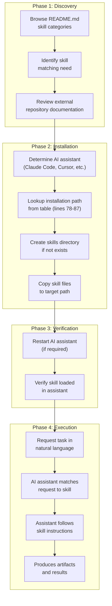
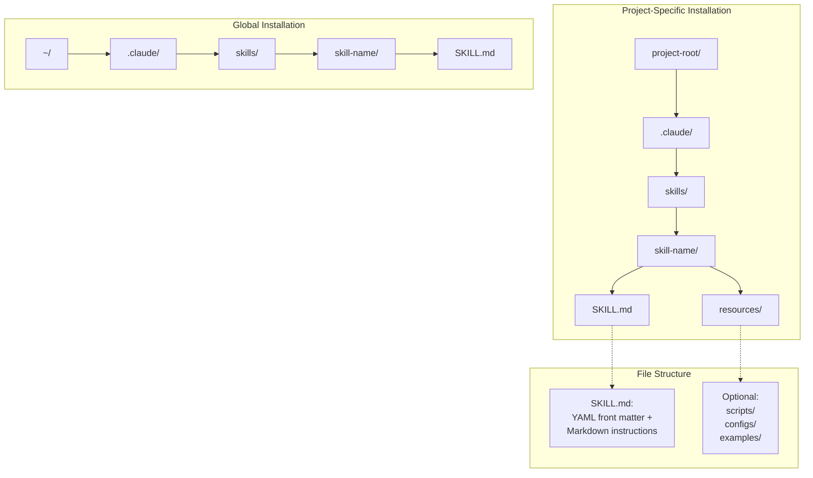
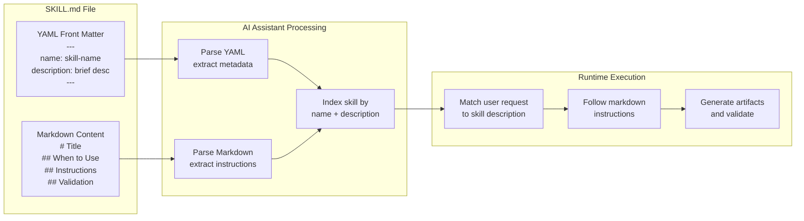
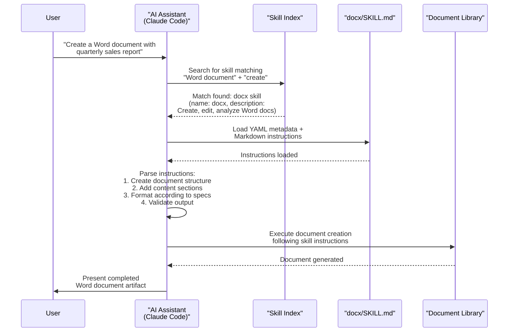
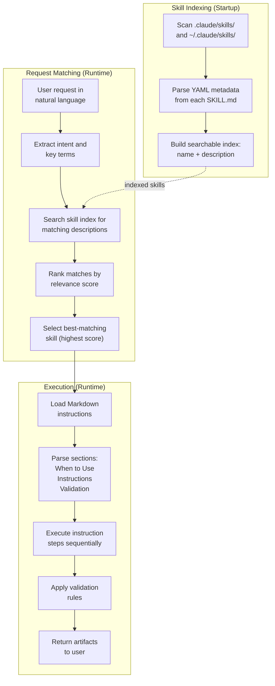

<!-- source: DeepWiki mcp.deepwiki.com · repo VoltAgent/awesome-agent-skills · page 2.2 Using Your First Skill · fetched 2026-10-26 -->

# Using Your First Skill

<details>
<summary>Relevant source files</summary>

The following files were used as context for generating this wiki page:

- [README.md](README.md)

</details>


This document provides a practical walkthrough of the complete skill workflow: discovering a skill from the curated collection, installing it in your AI coding assistant, and executing tasks with it. This guide demonstrates the basic end-to-end process using concrete examples.

For detailed installation instructions for specific AI coding assistants, see [Installing Skills](#2.1). For information about skill structure and technical architecture, see [Skill Definition Format](#3.1).

## Discovery to Execution Workflow

The following diagram illustrates the complete user journey from discovering a skill to executing tasks with it.



**Sources:** [README.md:1-393]()

## Skill File System Structure

Skills are installed by copying files to specific directory paths. The following diagram shows the file system organization for both project-specific and global installations.



**Sources:** [README.md:78-87]()

## Skill Definition Anatomy

Skills consist of YAML metadata followed by Markdown content. The AI assistant parses both components to understand when and how to execute the skill.



**Sources:** [README.md:44-72]()

## Practical Example: Installing the DOCX Skill

This section demonstrates installing the `anthropics/docx` skill, which enables creating, editing, and analyzing Word documents.

### Step 1: Locate the Skill in README.md

The skill is listed in the "Official Claude Skills" section under "Document Creation":

| Field | Value |
|-------|-------|
| Skill Name | `anthropics/docx` |
| Repository URL | `https://github.com/anthropics/skills/tree/main/skills/docx` |
| Description | Create, edit, and analyze Word documents |
| Category | Document Creation |
| README Location | Lines 101 |

**Sources:** [README.md:101]()

### Step 2: Determine Installation Path

Using the AI assistant compatibility matrix, determine the correct path for your assistant:

| AI Assistant | Project Path | Global Path |
|-------------|-------------|-------------|
| Claude Code | `.claude/skills/` | `~/.claude/skills/` |
| Cursor | `.cursor/skills/` | `~/.cursor/skills/` |
| GitHub Copilot | `.github/skills/` | `~/.copilot/skills/` |
| Gemini CLI | `.gemini/skills/` | `~/.gemini/skills/` |
| Windsurf | `.windsurf/skills/` | `~/.codeium/windsurf/skills/` |

For this example, we'll use Claude Code with project-specific installation at `.claude/skills/`.

**Sources:** [README.md:78-87]()

### Step 3: Create Directory Structure

Execute the following commands in your project root:

```bash
# Create skills directory if it doesn't exist
mkdir -p .claude/skills/docx

# Navigate to the external repository
# Visit: https://github.com/anthropics/skills/tree/main/skills/docx
# Download or clone the skill files
```

### Step 4: Copy Skill Files

The skill repository contains:

```
docx/
├── SKILL.md          # Main skill definition
├── examples/         # Optional example files
└── resources/        # Optional additional resources
```

Copy the `SKILL.md` file (minimally required) and any additional resources to `.claude/skills/docx/`.

**Sources:** [README.md:44-72]()

### Step 5: Verify Installation

The installed skill should now be present in your project:

```
your-project/
├── .claude/
│   └── skills/
│       └── docx/
│           └── SKILL.md
├── src/
└── README.md
```

## Execution Workflow Example

Once installed, the skill becomes available to the AI assistant. The following diagram shows how a user request is matched to the skill and executed.



**Sources:** [README.md:44-72]()

## Example User Interaction

Here's what the actual interaction looks like:

**User Request:**
```
Create a Word document with our Q4 sales analysis. Include:
- Executive summary
- Regional performance tables
- Year-over-year comparison charts
```

**AI Assistant Response (with docx skill loaded):**

The assistant recognizes this matches the `docx` skill based on the YAML description "Create, edit, and analyze Word documents". It then follows the instructions in `SKILL.md` to:

1. Parse the user's requirements
2. Structure the document with appropriate sections
3. Create tables and formatting as specified
4. Generate the `.docx` file
5. Validate the output contains all requested elements

**Resulting Artifact:**

The assistant produces a properly formatted Word document following the skill's instructions for document structure, formatting, and validation.

**Sources:** [README.md:101]()

## Installation Path Reference Table

| AI Assistant | Example Project Path | Example Global Path | Official Documentation |
|-------------|---------------------|-------------------|----------------------|
| Antigravity | `.agent/skills/docx/` | `~/.gemini/antigravity/skills/docx/` | [Antigravity Skills](https://antigravity.google/docs/skills) |
| Claude Code | `.claude/skills/docx/` | `~/.claude/skills/docx/` | [Claude Code Skills](https://docs.anthropic.com/en/docs/claude-code/skills) |
| Codex | `.codex/skills/docx/` | `~/.codex/skills/docx/` | [Codex Skills](https://developers.openai.com/codex/skills) |
| Cursor | `.cursor/skills/docx/` | `~/.cursor/skills/docx/` | [Cursor Skills](https://cursor.com/docs/context/skills) |
| Gemini CLI | `.gemini/skills/docx/` | `~/.gemini/skills/docx/` | [Gemini CLI Skills](https://geminicli.com/docs/cli/skills/) |
| GitHub Copilot | `.github/skills/docx/` | `~/.copilot/skills/docx/` | [Copilot Skills](https://docs.github.com/en/copilot/concepts/agents/about-agent-skills) |
| OpenCode | `.opencode/skills/docx/` | `~/.config/opencode/skills/docx/` | [OpenCode Skills](https://opencode.ai/docs/skills) |
| Windsurf | `.windsurf/skills/docx/` | `~/.codeium/windsurf/skills/docx/` | [Windsurf Cascade Skills](https://docs.windsurf.com/windsurf/cascade/skills) |

**Sources:** [README.md:78-87]()

## Skill Matching and Execution Flow

This diagram shows how the AI assistant matches user requests to installed skills and executes them.



**Sources:** [README.md:44-72](), [README.md:78-87]()

## Common Troubleshooting

| Issue | Cause | Solution |
|-------|-------|----------|
| Skill not recognized | Directory path incorrect | Verify path matches table for your AI assistant |
| Skill not loading | Missing `SKILL.md` file | Ensure file is named exactly `SKILL.md` (case-sensitive) |
| Assistant doesn't use skill | Description too vague | Check YAML description matches your use case terms |
| Partial execution | Missing instructions | Verify all required sections present in Markdown |
| No restart trigger | Assistant cached old state | Manually restart the AI assistant application |

**Sources:** [README.md:78-87]()

## Project vs Global Installation

Skills can be installed in two scopes:

**Project-Specific (`.claude/skills/`):**
- Skills apply only to the current project
- Version-controlled with the project (if committed)
- Team members share same skills
- Useful for project-specific workflows

**Global (`~/.claude/skills/`):**
- Skills apply to all projects
- User-specific configuration
- Persistent across projects
- Useful for personal productivity tools

Both installation paths are scanned simultaneously. If a skill with the same name exists in both locations, the project-specific version takes precedence.

**Sources:** [README.md:78-87]()

## Next Steps

After successfully installing and using your first skill:

1. Explore additional skills from the curated collection in [README.md:98-372]()
2. Learn about advanced skill features in [Skill Definition Format](#3.1)
3. Understand how skills integrate with MCP servers in [MCP Server Integration](#3.3)
4. Consider contributing your own skills following [Contribution Guidelines](#5.1)

**Sources:** [README.md:1-393]()

---

