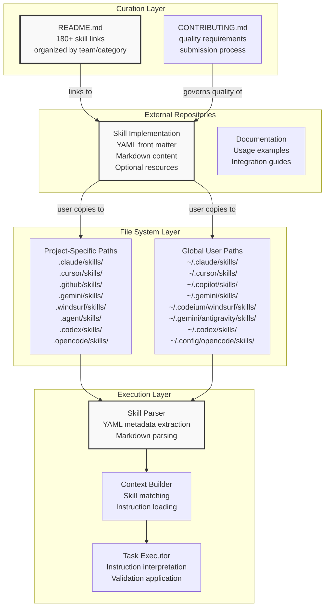
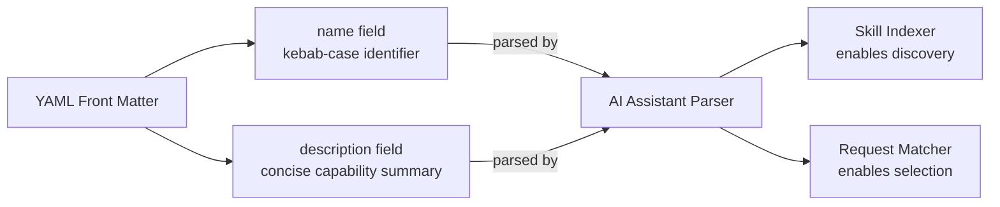
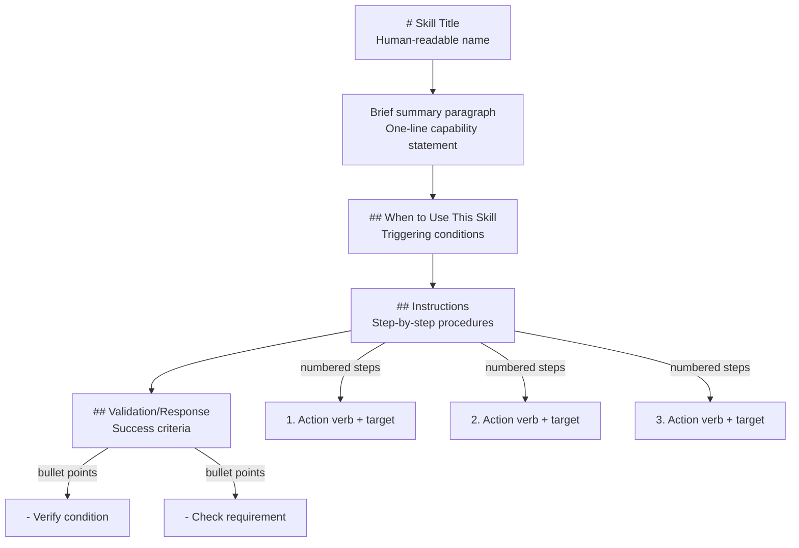
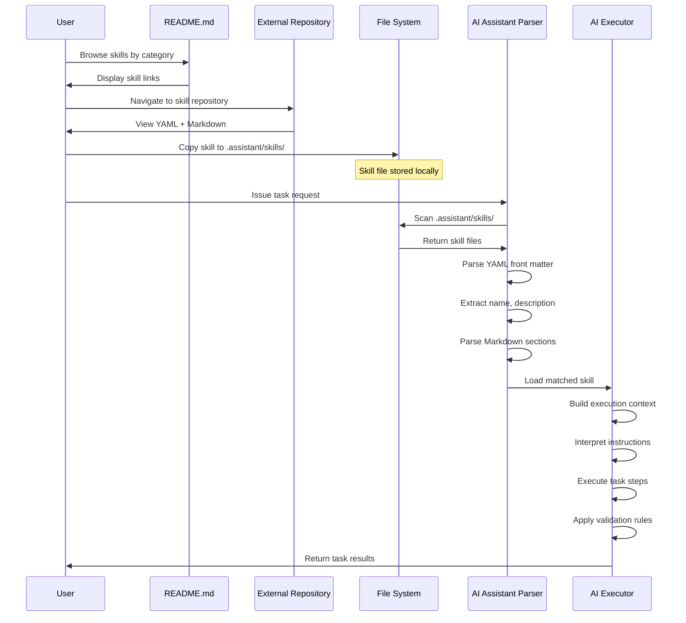
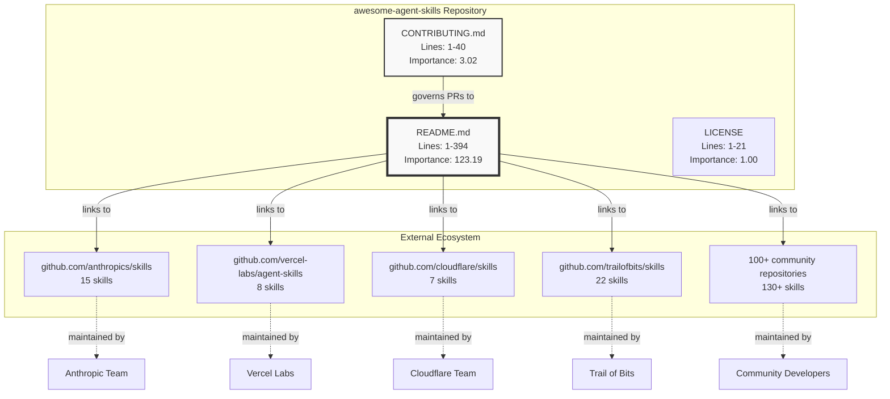
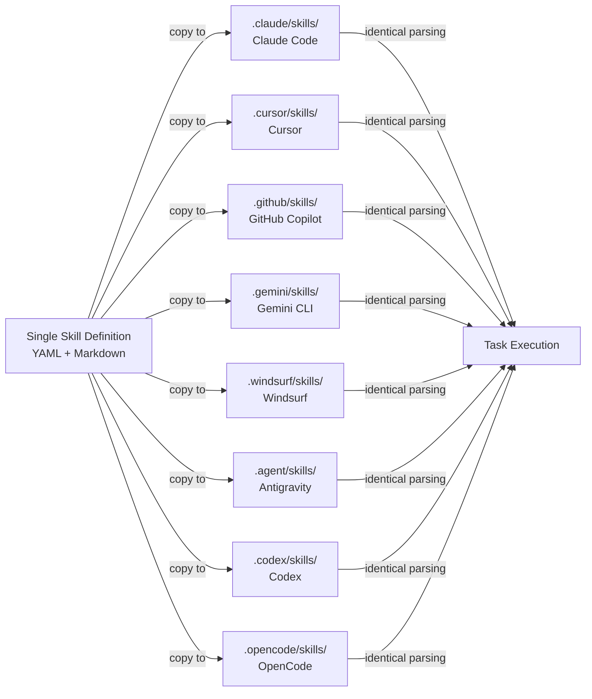
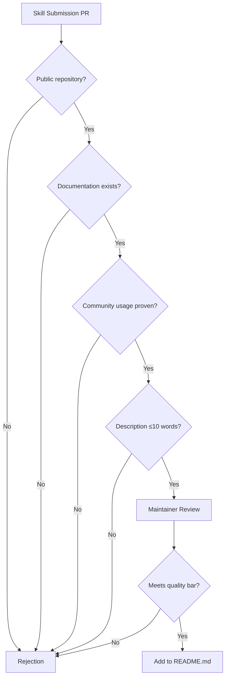

<!-- source: DeepWiki mcp.deepwiki.com · repo VoltAgent/awesome-agent-skills · page 3 Skill Architecture · fetched 2026-10-26 -->

# Skill Architecture

Relevant source files

The following files were used as context for generating this wiki page:

- [README.md](README.md)

## Purpose and Scope

This document explains the technical architecture of the Agent Skills system, focusing on how skills are defined, discovered, and executed by AI coding assistants. It covers the standardized skill format, file system conventions, and the execution model that enables write-once, run-anywhere portability across multiple AI assistants.

For details about the specific YAML and Markdown structure of skill definitions, see [Skill Definition Format](#3.1). For information about how individual AI assistants integrate with and execute skills, see [AI Assistant Integration](#3.2). For MCP server capabilities within skills, see [MCP Server Integration](#3.3).

**Sources:** [README.md:1-43]()

## Architectural Overview

The Agent Skills system implements a decentralized architecture where skill implementations live in external repositories while discovery and curation happen through this repository. This separation enables independent skill development while maintaining a curated quality bar.

### System Components

**Diagram: End-to-End Skill Architecture**

This architecture implements three key design principles:

1. **Decentralized Content, Centralized Discovery**: Skills are maintained in 180+ external repositories but discovered through `README.md`
2. **Standardized Format**: All skills use identical YAML + Markdown structure regardless of AI assistant
3. **Dual-Scope Deployment**: Skills can be installed project-wide or globally per-user

**Sources:** [README.md:1-43](), [README.md:76-88]()

## Skill File Structure

Each skill consists of two required components and one optional component:

### Required Components

| Component | Format | Purpose |
|-----------|--------|---------|
| YAML Front Matter | YAML block between `---` delimiters | Machine-readable metadata for parsing |
| Markdown Content | Standard Markdown | Human-readable instructions for AI agent |

### Optional Component

| Component | Format | Purpose |
|-----------|--------|---------|
| Resources | Additional files | Scripts, configs, examples that support the skill |

**Sources:** [README.md:42-73]()

### YAML Front Matter Fields

**Diagram: YAML Metadata Processing**

The `name` field uses kebab-case (e.g., `api-tester`, `web-artifacts-builder`) and serves as the skill's unique identifier. The `description` field provides a brief summary of capabilities, typically 10 words or fewer.

**Sources:** [README.md:44-48]()

### Markdown Content Structure

Skills follow a consistent Markdown structure:

**Diagram: Skill Markdown Structure**

**Sources:** [README.md:50-72]()

## File System Conventions

The skill system uses standardized directory paths that enable multi-assistant compatibility. Each AI coding assistant recognizes specific directory patterns for skill discovery.

### Directory Path Patterns

```mermaid
graph TB
    subgraph "Project-Scoped Skills"
        ProjectRoot["Project Root Directory"]
        
        ProjectRoot --> claude[".claude/skills/"]
        ProjectRoot --> cursor[".cursor/skills/"]
        ProjectRoot --> github[".github/skills/"]
        ProjectRoot --> gemini[".gemini/skills/"]
        ProjectRoot --> windsurf[".windsurf/skills/"]
        ProjectRoot --> agent[".agent/skills/"]
        ProjectRoot --> codex[".codex/skills/"]
        ProjectRoot --> opencode[".opencode/skills/"]
    end
    
    subgraph "User-Scoped Skills"
        UserHome["User Home Directory ~"]
        
        UserHome --> claudeGlobal["~/.claude/skills/"]
        UserHome --> cursorGlobal["~/.cursor/skills/"]
        UserHome --> copilotGlobal["~/.copilot/skills/"]
        UserHome --> geminiGlobal["~/.gemini/skills/"]
        UserHome --> windsurfGlobal["~/.codeium/windsurf/skills/"]
        UserHome --> antigravityGlobal["~/.gemini/antigravity/skills/"]
        UserHome --> codexGlobal["~/.codex/skills/"]
        UserHome --> opencodeGlobal["~/.config/opencode/skills/"]
    end
    
    claude --> ClaudeCode["Claude Code"]
    cursor --> Cursor["Cursor"]
    github --> Copilot["GitHub Copilot"]
    gemini --> GeminiCLI["Gemini CLI"]
    windsurf --> Windsurf["Windsurf"]
    agent --> Antigravity["Antigravity"]
    codex --> Codex["Codex"]
    opencode --> OpenCode["OpenCode"]
    
    claudeGlobal --> ClaudeCode
    cursorGlobal --> Cursor
    copilotGlobal --> Copilot
    geminiGlobal --> GeminiCLI
    windsurfGlobal --> Windsurf
    antigravityGlobal --> Antigravity
    codexGlobal --> Codex
    opencodeGlobal --> OpenCode
```

**Diagram: File System Path Mapping to AI Assistants**

### Path Resolution Priority

AI assistants typically check paths in this order:

1. Project-specific path (`.assistant/skills/`)
2. Global user path (`~/.assistant/skills/`)

Skills in project-specific paths override identically-named skills in global paths, enabling project-specific customization.

**Sources:** [README.md:76-88]()

## Skill Discovery and Execution Flow

**Diagram: Skill Discovery and Execution Sequence**

### Processing Stages

| Stage | Component | Input | Output |
|-------|-----------|-------|--------|
| Discovery | `README.md` | User browsing | Skill repository URLs |
| Installation | User action | Skill files | Local `.assistant/skills/` directory |
| Parsing | AI Assistant Parser | YAML + Markdown files | Structured skill metadata |
| Matching | Request Matcher | User task + skill descriptions | Selected skill(s) |
| Execution | Task Executor | Skill instructions + user request | Task results |

**Sources:** [README.md:1-88]()

## Repository Architecture and Boundaries

This repository serves as a curation hub rather than an implementation host. Understanding these boundaries is critical to the architecture.

**Diagram: Repository Architecture and External Dependencies**

### Responsibility Separation

| Repository | Responsibilities | Does NOT Include |
|------------|------------------|------------------|
| `awesome-agent-skills` | Curate links, maintain quality standards, organize by category | Skill implementations, support, maintenance |
| External skill repositories | Implement skills, provide documentation, support users | Curation, quality gatekeeping |

This architecture enables:
- **Independent skill evolution**: Authors update implementations without touching this repository
- **Quality-controlled discovery**: Only community-proven skills appear in `README.md`
- **Distributed maintenance**: Each team maintains their own skills
- **Single source of truth**: `README.md` remains the canonical skill catalog

**Sources:** [README.md:1-394](), [README.md:374-393]()

## Standardization Benefits

The standardized architecture provides several key benefits:

### Write-Once, Run-Anywhere

**Diagram: Cross-Assistant Portability**

### Zero Vendor Lock-In

Because skills use a standardized format independent of any specific AI assistant, users can:
- Switch between assistants without recreating skills
- Use different assistants for different projects
- Share skills across teams using different tools
- Adopt new assistants as they emerge

**Sources:** [README.md:37-88]()

## Integration Points

Skills can integrate with external systems through several mechanisms:

### MCP Server Integration

Skills may reference MCP (Model Context Protocol) servers to access external APIs and services. For detailed information about MCP integration patterns, see [MCP Server Integration](#3.3).

Example skills using MCP servers:
- [README.md:118]() - `anthropics/mcp-builder` for creating MCP servers
- [README.md:146]() - `cloudflare/building-mcp-server-on-cloudflare` for remote MCP servers
- [README.md:361]() - `czlonkowski/n8n-mcp-tools-expert` for n8n MCP tools

### External Tool Integration

Skills can invoke external development tools and CLIs:
- [README.md:119]() - `anthropics/webapp-testing` uses Playwright
- [README.md:302]() - `jthack/ffuf-claude-skill` uses ffuf for web fuzzing
- [README.md:303]() - `lackeyjb/playwright-skill` for browser automation

### API Integration

Skills may call external APIs directly:
- [README.md:244-249]() - `fal-ai-community/*` skills integrate with fal.ai APIs
- [README.md:298]() - `Rootly-AI-Labs/rootly-incident-responder` requires Rootly MCP Server

**Sources:** [README.md:118-119](), [README.md:146](), [README.md:244-249](), [README.md:298](), [README.md:302-303](), [README.md:361]()

## Quality Architecture

The contribution process enforces quality through architectural constraints defined in `CONTRIBUTING.md`:

**Diagram: Quality Enforcement Flow**

This architectural approach ensures `README.md` contains only battle-tested, community-validated skills rather than experimental projects.

**Sources:** [README.md:374-382]()

---

This skill architecture enables a scalable, decentralized ecosystem where skill creators maintain independence while users benefit from centralized discovery and quality curation. The standardized format ensures skills work across all major AI coding assistants, maximizing utility and minimizing vendor lock-in.

---

