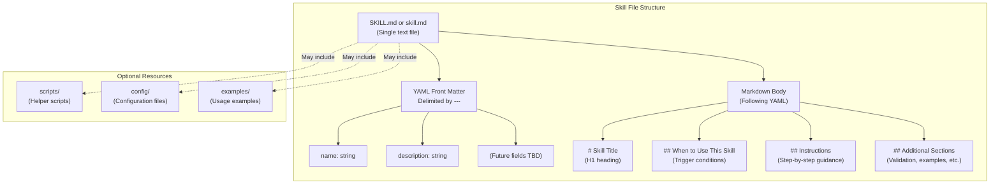
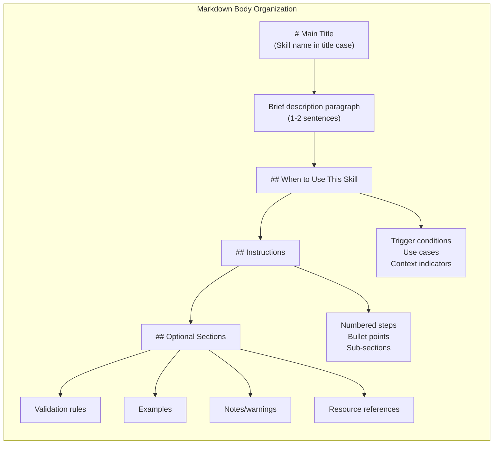
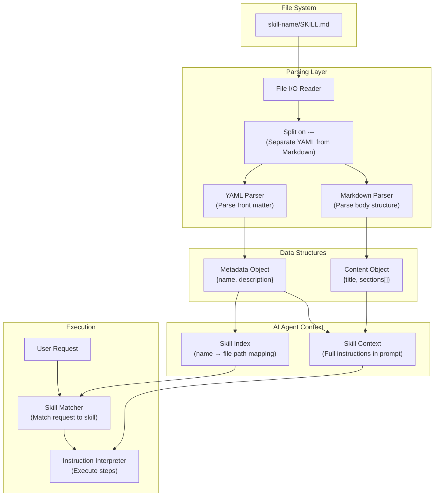

<!-- source: DeepWiki mcp.deepwiki.com · repo VoltAgent/awesome-agent-skills · page 3.1 Skill Definition Format · fetched 2026-10-26 -->

# Skill Definition Format

<details>
<summary>Relevant source files</summary>

The following files were used as context for generating this wiki page:

- [README.md](README.md)

</details>


This document specifies the standardized format for defining Agent Skills. A skill is defined using a two-part structure: YAML front matter for machine-readable metadata and Markdown content for human-readable instructions. This format is portable across all supported AI coding assistants including Claude Code, Cursor, GitHub Copilot, Gemini CLI, Windsurf, and others.

For information about how AI assistants load and execute skills, see [AI Assistant Integration](#3.2). For contributing skills to the collection, see [Contribution Guidelines](#5.1).

## Format Overview

Agent Skills use a standardized text-based format that combines structured metadata with natural language instructions. The format consists of two primary components that work together to provide both machine-parseable configuration and human-readable guidance.



**Sources:** [README.md:33-74]()

## YAML Front Matter

The YAML front matter is a metadata block enclosed by triple-dash delimiters (`---`) at the beginning of the skill file. It provides machine-readable information that AI assistants use to index, search, and identify skills.

### Required Fields

| Field | Type | Constraints | Purpose |
|-------|------|-------------|---------|
| `name` | string | Lowercase with hyphens, alphanumeric | Unique identifier for the skill |
| `description` | string | ≤10 words (by convention) | Brief summary of skill capability |

### Field Specifications

**`name`**
- Format: kebab-case (lowercase with hyphens)
- Example: `api-tester`, `web-artifacts-builder`, `mcp-builder`
- Used as: Directory name convention, search index key
- Must be: Unique within a skill collection, URL-safe

**`description`**
- Format: Plain text, concise sentence or phrase
- Length: Typically 5-10 words as per [CONTRIBUTING.md]()
- Purpose: Displayed in skill listings, used for search/discovery
- Should: Clearly state what the skill does, avoid marketing language

### Example YAML Block

```yaml
---
name: api-tester
description: Test REST APIs and validate responses
---
```

**Sources:** [README.md:44-48](), [CONTRIBUTING.md:21-35]()

## Markdown Body Structure

The Markdown body follows immediately after the closing `---` delimiter of the YAML front matter. It contains natural language instructions that guide AI assistants on how to execute the skill's capabilities.

### Standard Sections



### Section Descriptions

**# Main Title (H1 Heading)**
- Format: Title case version of the `name` field
- Example: `# API Tester` (for `name: api-tester`)
- Appears once at the top of the markdown body
- May be followed by a 1-2 sentence summary

**## When to Use This Skill**
- Purpose: Defines trigger conditions and appropriate contexts
- Content: Describes scenarios where the skill should be activated
- Format: Prose, bullet points, or conditional statements
- Example from [README.md:54-56]():
  ```markdown
  ## When to Use This Skill
  
  Use this skill when you need to test API endpoints and verify response data.
  ```

**## Instructions**
- Purpose: Provides step-by-step execution guidance
- Content: Detailed procedures for accomplishing the skill's task
- Format: Numbered lists, bullet points, or sub-sections
- Should: Be clear, actionable, and unambiguous
- Example from [README.md:58-66]():
  ```markdown
  ## Instructions
  
  When testing an API:
  
  1. Send a request to the specified endpoint
  2. Check the response status code
  3. Validate the response body structure
  4. Report any errors or unexpected results
  ```

**## Additional Sections (Optional)**
Common optional sections include:
- **Validation**: Rules for verifying correct execution
- **Examples**: Sample inputs/outputs
- **Configuration**: Setup requirements
- **Notes**: Important caveats or limitations
- **Resources**: External references or dependencies

Example validation section from [README.md:68-72]():
```markdown
## Response Validation

- Verify required fields exist
- Check data types match expected values
- Confirm nested objects have correct structure
```

**Sources:** [README.md:44-72]()

## File Naming and Directory Structure

Skills follow a conventional directory layout that enables AI assistants to discover and load them consistently across different tools.

```mermaid
graph TB
    subgraph "Skill Directory Layout"
        SkillDir["skill-name/<br/>(Directory named after 'name' field)"]
        
        SkillDir --> MainFile["SKILL.md or skill.md<br/>(Primary definition file)"]
        SkillDir --> OptionalDirs["Optional subdirectories"]
        
        OptionalDirs --> ScriptsDir["scripts/<br/>(Executable helpers)"]
        OptionalDirs --> ConfigDir["config/<br/>(Configuration files)"]
        OptionalDirs --> ExamplesDir["examples/<br/>(Usage samples)"]
        OptionalDirs --> ResourcesDir["resources/<br/>(Additional materials)"]
        
        ScriptsDir --> ScriptFiles["*.py, *.sh, *.js<br/>(Referenced from instructions)"]
        ConfigDir --> ConfigFiles["*.json, *.yaml, *.toml<br/>(Settings/templates)"]
        ExamplesDir --> ExampleFiles["example-*.md<br/>(Demonstrations)"]
    end
    
    subgraph "AI Assistant Paths"
        ProjectPath[".claude/skills/<br/>.cursor/skills/<br/>.github/skills/<br/>etc."]
        GlobalPath["~/.claude/skills/<br/>~/.cursor/skills/<br/>~/.copilot/skills/<br/>etc."]
    end
    
    ProjectPath -.-> SkillDir
    GlobalPath -.-> SkillDir
```



### File Naming Conventions

**Primary Definition File**
- Name: `SKILL.md` or `skill.md` (both conventions are used)
- Location: Root of the skill directory
- Content: YAML front matter + Markdown body as documented above
- Note: Anthropic's official skills use `SKILL.md`; community practices vary

**Directory Name**
- Must match: The `name` field in YAML front matter
- Format: kebab-case (lowercase with hyphens)
- Examples from [README.md]():
  - `docx/` for `name: docx`
  - `api-tester/` for `name: api-tester`
  - `web-artifacts-builder/` for `name: web-artifacts-builder`

### Installation Paths

Skills are deployed to assistant-specific directories as specified in [README.md:78-87]():

| AI Assistant | Project Path | Global Path |
|--------------|-------------|-------------|
| Claude Code | `.claude/skills/` | `~/.claude/skills/` |
| Cursor | `.cursor/skills/` | `~/.cursor/skills/` |
| GitHub Copilot | `.github/skills/` | `~/.copilot/skills/` |
| Gemini CLI | `.gemini/skills/` | `~/.gemini/skills/` |
| Windsurf | `.windsurf/skills/` | `~/.codeium/windsurf/skills/` |
| Antigravity | `.agent/skills/` | `~/.gemini/antigravity/skills/` |
| Codex | `.codex/skills/` | `~/.codex/skills/` |
| OpenCode | `.opencode/skills/` | `~/.config/opencode/skills/` |

**Sources:** [README.md:33](), [README.md:78-87]()

## Processing Flow

This diagram illustrates how AI assistants parse and consume the skill definition format, bridging the text-based format to runtime execution.



**Sources:** [README.md:44-72]()

## Complete Annotated Example

The following is a complete, annotated skill definition showing all components of the format:

```yaml
# File: api-tester/SKILL.md

---
# YAML Front Matter (Required)
# Enclosed by --- delimiters at the start of the file
name: api-tester                           # Unique identifier (kebab-case)
description: Test REST APIs and validate responses  # Brief summary (≤10 words)
---

# Markdown Body starts after closing ---

# API Tester
# H1 heading - title case version of the name

Test HTTP endpoints and validate response structures.
# Brief description (1-2 sentences) immediately after title

## When to Use This Skill
# Defines trigger conditions - when should this skill activate?

Use this skill when you need to test API endpoints and verify response data.

## Instructions
# Step-by-step guidance - the core execution logic

When testing an API:

1. Send a request to the specified endpoint
2. Check the response status code
3. Validate the response body structure
4. Report any errors or unexpected results

## Response Validation
# Optional section providing additional context

- Verify required fields exist
- Check data types match expected values
- Confirm nested objects have correct structure
```

### Key Characteristics

| Aspect | Specification |
|--------|--------------|
| **File format** | Plain text, UTF-8 encoding |
| **YAML version** | YAML 1.2 compatible |
| **Markdown flavor** | GitHub Flavored Markdown (GFM) |
| **Line endings** | LF (Unix-style) or CRLF (Windows-style) |
| **Required sections** | YAML front matter with `name` and `description`; Markdown body with title |
| **Recommended sections** | "When to Use This Skill", "Instructions" |
| **Optional sections** | Unlimited, based on skill complexity |

**Sources:** [README.md:44-72]()

## Validation Checklist

When creating or reviewing a skill definition, verify the following:

**Format Compliance**
- [ ] File begins with `---` delimiter
- [ ] YAML front matter is properly closed with `---`
- [ ] `name` field is present and uses kebab-case
- [ ] `description` field is present and concise (≤10 words)
- [ ] Markdown body follows immediately after YAML
- [ ] H1 heading (`#`) appears once at the top of markdown body

**Content Quality**
- [ ] "When to Use This Skill" section clearly defines trigger conditions
- [ ] "Instructions" section provides actionable, step-by-step guidance
- [ ] Language is clear and unambiguous
- [ ] Examples are provided where helpful
- [ ] Validation criteria are specified if applicable

**File System**
- [ ] Directory name matches `name` field from YAML
- [ ] Primary file is named `SKILL.md` or `skill.md`
- [ ] Optional resources are organized in subdirectories

**Sources:** [README.md:44-72](), [CONTRIBUTING.md:21-35]()

## Extended Format Features

While the basic format documented above covers the majority of use cases, some skills in the ecosystem demonstrate extended patterns and conventions.

### Multi-File Skills

Some skills organize content across multiple files:

```
skill-name/
├── SKILL.md                 # Main definition (required)
├── README.md                # Extended documentation
├── scripts/
│   ├── setup.sh            # Initialization script
│   └── helper.py           # Utility functions
├── config/
│   └── defaults.json       # Default configuration
└── examples/
    ├── example-1.md        # Usage example 1
    └── example-2.md        # Usage example 2
```

Instructions in `SKILL.md` may reference these resources:
- `See scripts/setup.sh for initialization`
- `Refer to examples/example-1.md for usage patterns`
- `Configure using config/defaults.json`

### Integration with External Resources

Skills may reference external systems or require additional setup:

```markdown
## Prerequisites

This skill requires:
- MCP server installed: `npm install -g @example/mcp-server`
- API credentials configured in environment variables
- External tool available: `ffmpeg` (for media processing)

## Instructions

1. Verify prerequisites using the setup script: `scripts/check-prerequisites.sh`
2. [Continue with main instructions...]
```

### Skill Composition

Advanced skills may reference or compose other skills:

```markdown
## Instructions

1. First, use the `code-review` skill to analyze the changes
2. Then, apply the `security-audit` skill to check for vulnerabilities
3. Finally, use this skill's specific validation steps...
```

**Sources:** [README.md:118](), [README.md:146]()

## Format Evolution

The skill definition format is established by community convention and AI assistant implementations. Current limitations and future considerations:

**Current State**
- Format is stable across 180+ skills from 16+ official teams
- Minimal breaking changes since initial adoption
- Backward compatibility maintained by assistant implementations

**Known Variations**
- File naming: Both `SKILL.md` and `skill.md` are accepted
- Section headers: Minor variations in capitalization and phrasing
- YAML fields: Currently only `name` and `description` are standardized

**Future Extensions** (Not Yet Standardized)
- Additional YAML metadata fields (version, author, tags, dependencies)
- Structured instruction formats (JSON-LD, YAML blocks within instructions)
- Schema validation and type systems
- Skill dependency declarations
- Versioning and compatibility indicators

See the [official Anthropic skills repository](https://github.com/anthropics/skills) and [creation guide](https://support.claude.com/en/articles/12512198-how-to-create-custom-skills) referenced in [README.md:74]() for authoritative guidance.

**Sources:** [README.md:33-74](), [README.md:78-87]()

---

