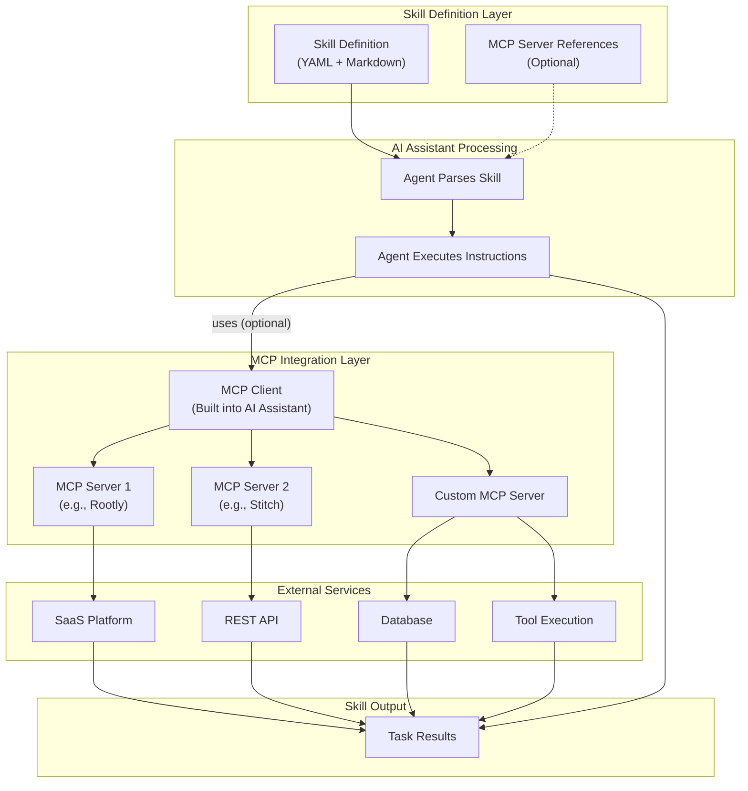
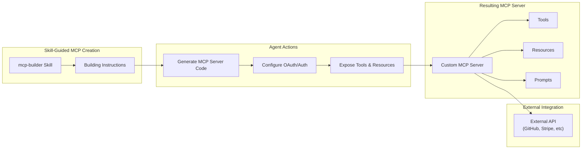
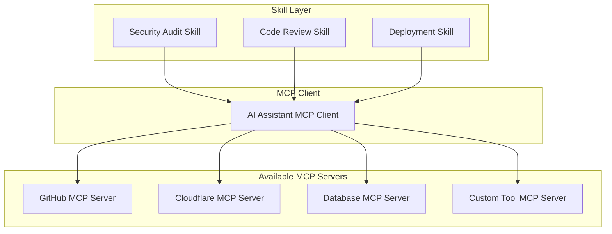
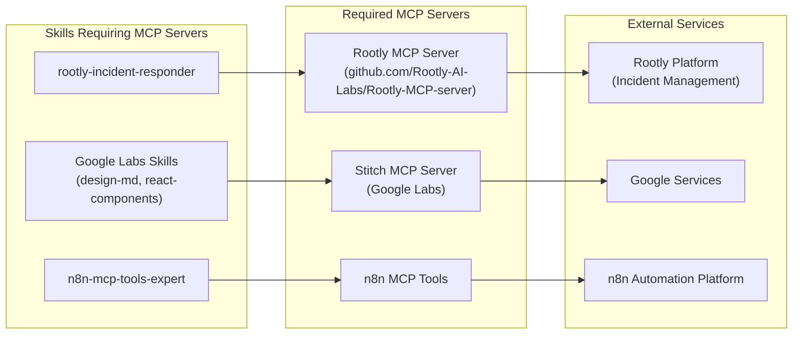
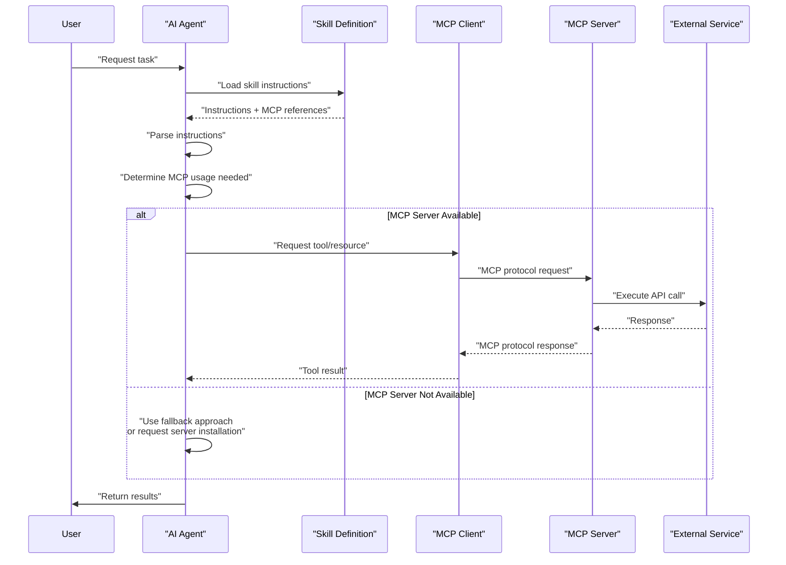

<!-- source: DeepWiki mcp.deepwiki.com · repo VoltAgent/awesome-agent-skills · page 3.3 MCP Server Integration · fetched 2026-10-26 -->

# MCP Server Integration

Relevant source files

The following files were used as context for generating this wiki page:

- [README.md](README.md)

This document details how skills leverage Model Context Protocol (MCP) servers to interact with external APIs and services. MCP integration is an optional but powerful capability that extends skill functionality beyond the AI assistant's built-in capabilities.

For information about the overall skill architecture, see [Skill Architecture](#3). For details on how skills are defined, see [Skill Definition Format](#3.1). For how AI assistants load and execute skills, see [AI Assistant Integration](#3.2).

## Overview

MCP (Model Context Protocol) servers act as bridges between skills and external services, providing standardized interfaces for tools, resources, and data sources. Skills can optionally integrate with MCP servers during execution to access capabilities beyond the AI assistant's native features.

**Sources:** [README.md:118](), [README.md:144](), [README.md:146]()

### MCP Server Role in Skill Execution

**Sources:** [README.md:118](), [README.md:298](), Diagram 5 from high-level architecture

## Integration Patterns

### Pattern 1: Skill References Existing MCP Server

Skills can reference and utilize pre-existing MCP servers that must be installed and configured separately.

| Skill | Required MCP Server | Purpose |
|-------|-------------------|---------|
| `rootly-incident-responder` | Rootly MCP Server | Incident response with ML similarity matching and on-call coordination |
| Google Labs skills | Stitch MCP Server | Design.md management and React component conversion |
| `n8n-mcp-tools-expert` | n8n MCP tools | Workflow automation node configuration |

**Sources:** [README.md:298](), [README.md:158](), [README.md:361]()

### Pattern 2: Skill Builds MCP Servers

Some skills guide the AI agent in creating new MCP servers to expose custom functionality.

**Sources:** [README.md:118](), [README.md:146]()

#### MCP Builder Skills

| Skill | Focus | Key Capabilities |
|-------|-------|-----------------|
| `anthropics/mcp-builder` | General MCP server creation | Integrate external APIs and services |
| `cloudflare/building-mcp-server-on-cloudflare` | Cloudflare-hosted MCP servers | Build remote MCP servers with tools and OAuth |
| `cloudflare/agents-sdk` | Stateful AI agents | Build agents with scheduling, RPC, and MCP servers |

**Sources:** [README.md:118](), [README.md:146](), [README.md:144]()

### Pattern 3: Skill-Agnostic MCP Usage

The AI assistant's MCP client can interact with any properly configured MCP server, regardless of whether a specific skill references it. Skills provide context and workflows, while MCP servers provide tools.

**Sources:** [README.md:144-150](), Diagram 5 from high-level architecture

## MCP Server Types in the Ecosystem

### Platform-Specific MCP Servers

Cloudflare provides several platform-specific MCP integration patterns:

| Server Type | Skill | Capabilities |
|------------|-------|--------------|
| Cloudflare Agents | `cloudflare/agents-sdk` | Stateful agents with scheduling, RPC, MCP servers |
| Remote MCP Servers | `cloudflare/building-mcp-server-on-cloudflare` | Tools, OAuth, remote execution |
| AI Agent Platform | `cloudflare/building-ai-agent-on-cloudflare` | State management, WebSockets, AI agents |

**Sources:** [README.md:144](), [README.md:145](), [README.md:146]()

### Third-Party MCP Servers

External services provide MCP servers that skills can leverage:

**Sources:** [README.md:298](), [README.md:158-161](), [README.md:361]()

## MCP Server Components

MCP servers expose three primary types of components that skills can utilize:

### Tools

Executable functions that perform specific actions:

- API calls (REST, GraphQL)
- Database operations
- File system operations
- External service interactions

### Resources

Data sources and content that can be read:

- Configuration files
- Documentation
- Cached data
- State information

### Prompts

Pre-defined instruction templates:

- Common workflows
- Best practices
- Domain-specific guidance

**Sources:** [README.md:146](), [README.md:361]()

## Execution Flow with MCP Integration

**Sources:** [README.md:298](), Diagram 5 from high-level architecture

## Use Cases

### Incident Response Automation

The `rootly-incident-responder` skill demonstrates MCP integration for complex workflows:

- **MCP Server**: Rootly MCP Server (required dependency)
- **Capabilities**: ML similarity matching, solution suggestions, on-call coordination
- **Integration**: Skill provides workflow context; MCP server handles API interactions

**Sources:** [README.md:298]()

### Platform Deployment

Cloudflare skills leverage MCP for deployment automation:

- **Workers deployment**: `cloudflare/wrangler` skill with MCP tools
- **Durable Objects**: `cloudflare/durable-objects` with RPC, SQLite, WebSockets via MCP
- **AI agents**: `cloudflare/agents-sdk` for stateful agent creation with MCP servers

**Sources:** [README.md:144](), [README.md:148](), [README.md:150]()

### Design Tool Integration

Google Labs Stitch MCP server enables design workflow skills:

- **Skill**: `google-labs-code/design-md`
- **MCP Server**: Stitch
- **Function**: Create and manage DESIGN.md files through MCP tools
- **Compatibility**: Works with Claude Code, Gemini CLI, Cursor

**Sources:** [README.md:158](), [README.md:160]()

### Automation Workflow Configuration

n8n skills use MCP for workflow node configuration:

- **Skill**: `czlonkowski/n8n-mcp-tools-expert`
- **Focus**: MCP tools guide with tool selection and node formats
- **Integration**: Provides patterns for connecting AI to automation workflows

**Sources:** [README.md:361]()

## MCP Server Configuration

### Installation Paths

MCP servers are typically configured at the AI assistant level, not within individual skills. Each AI assistant has its own MCP configuration mechanism:

| AI Assistant | Configuration Location | Documentation |
|-------------|----------------------|---------------|
| Claude Code | `~/.claude/` | [Claude Code Skills](https://docs.anthropic.com/en/docs/claude-code/skills) |
| Gemini CLI | `~/.gemini/` | [Gemini CLI Skills](https://geminicli.com/docs/cli/skills/) |
| Cursor | `~/.cursor/` | [Cursor Skills](https://cursor.com/docs/context/skills) |

**Sources:** [README.md:78-87]()

### Skill Requirements Documentation

Skills that require MCP servers should document this in their definition:

1. **Required MCP server name and repository**
2. **Installation instructions or links**
3. **Configuration requirements**
4. **Authentication/OAuth setup if needed**

**Example from ecosystem:**

> Requires [Rootly MCP Server](https://github.com/Rootly-AI-Labs/Rootly-MCP-server)

**Sources:** [README.md:298]()

## Benefits of MCP Integration

### For Skill Developers

- **Reusability**: Build MCP server once, use across multiple skills
- **Separation of concerns**: Skills define workflows; MCP servers handle service integration
- **Standardization**: Common protocol for external integrations
- **Authentication**: Centralized OAuth and credential management

### For Users

- **Flexibility**: Mix and match skills with available MCP servers
- **Security**: Credentials managed at MCP server level, not in skills
- **Extensibility**: Add new capabilities by installing MCP servers
- **Portability**: MCP servers work across compatible AI assistants

**Sources:** [README.md:146](), [README.md:298](), Diagram 3 from high-level architecture

## Limitations and Considerations

### MCP Server Availability

Skills that require specific MCP servers may not function if:

- The required MCP server is not installed
- The MCP server is not configured correctly
- Authentication credentials are missing
- The MCP server version is incompatible

### Platform Compatibility

Not all AI assistants support MCP servers equally:

- Some may have limited MCP support
- Configuration mechanisms vary by platform
- MCP protocol version differences may exist

**Sources:** [README.md:78-87](), [README.md:298]()

## Related Skills for MCP Development

| Skill Category | Skills | Purpose |
|---------------|--------|---------|
| MCP Server Creation | `anthropics/mcp-builder`, `cloudflare/building-mcp-server-on-cloudflare` | Guide agents in building new MCP servers |
| Platform Integration | `cloudflare/agents-sdk`, `cloudflare/durable-objects` | Leverage platform-specific MCP capabilities |
| Tool Configuration | `n8n-mcp-tools-expert` | Configure MCP tools for automation |

**Sources:** [README.md:118](), [README.md:144](), [README.md:146](), [README.md:361]()

---

