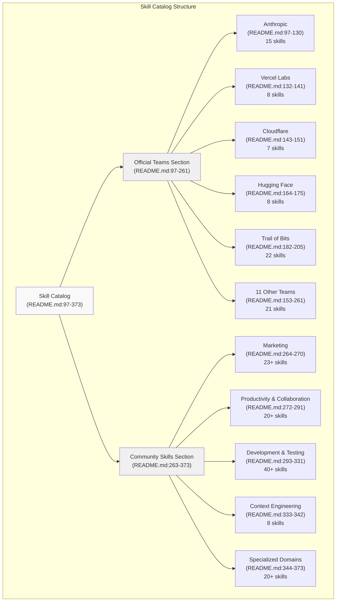
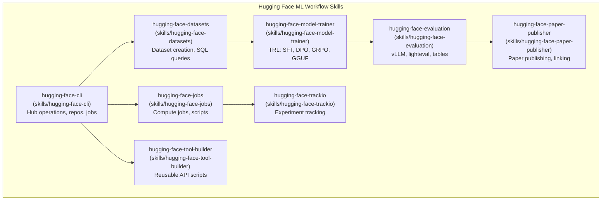
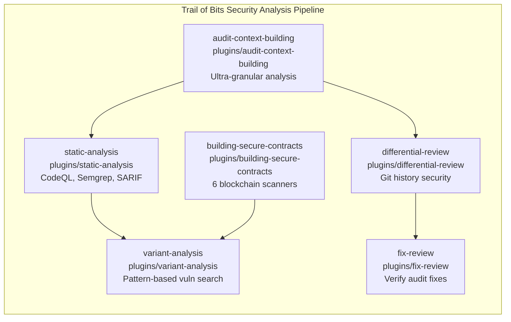
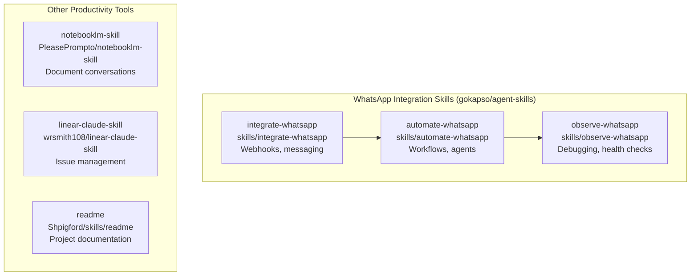
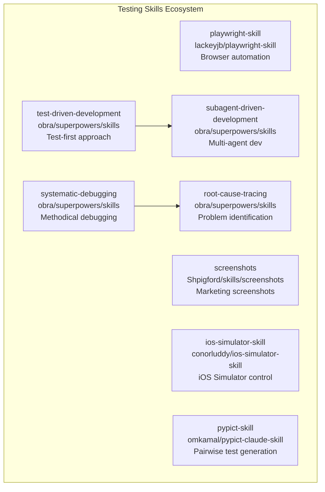
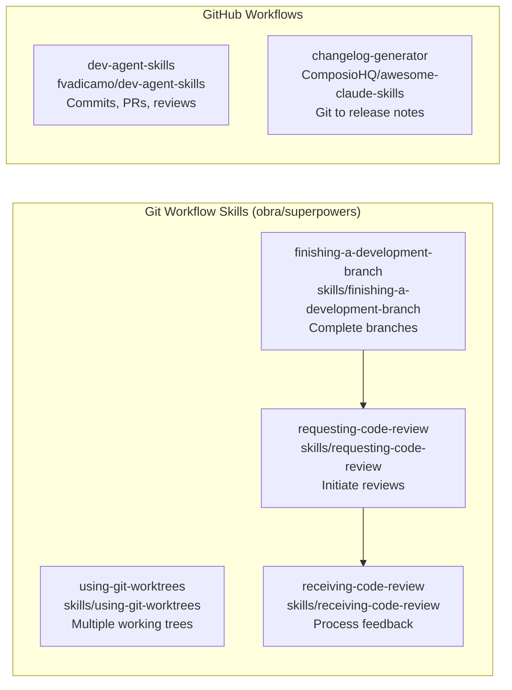
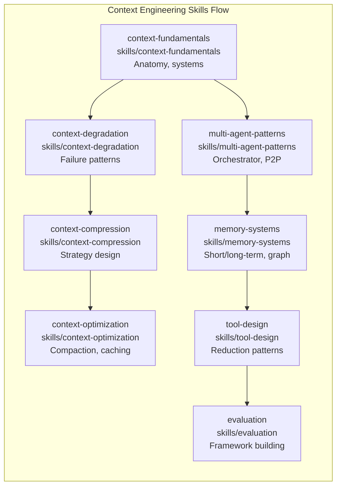
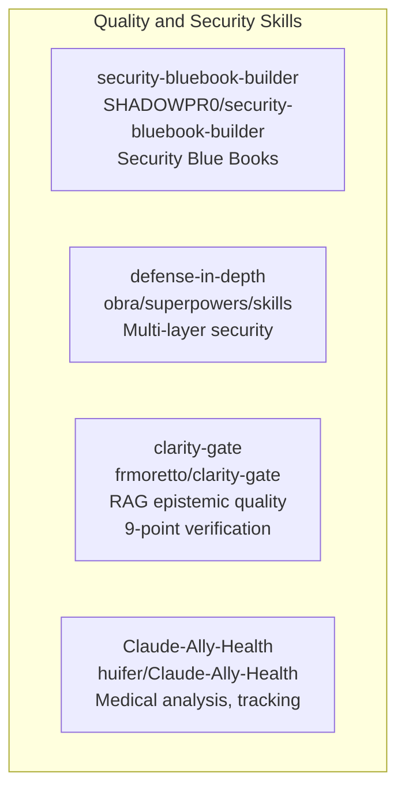

<!-- source: DeepWiki mcp.deepwiki.com · repo VoltAgent/awesome-agent-skills · page 4 Skill Catalog · fetched 2026-10-26 -->

# Skill Catalog

<details>
<summary>Relevant source files</summary>

The following files were used as context for generating this wiki page:

- [README.md](README.md)

</details>


This document serves as the primary navigation hub for discovering and browsing the 180+ agent skills curated in this repository. The catalog is organized by contributing source (official teams vs. community) and functional domain, with each entry linking to external repositories where skill implementations are maintained.

**Scope**: This page documents the organizational taxonomy, distribution statistics, and navigation structure of the skill collection as defined in [README.md:97-373](). It does not cover skill installation procedures (see [Installing Skills](#2.1)), skill format specifications (see [Skill Definition Format](#3.1)), or contribution requirements (see [Contributing to the Collection](#5)).

## Catalog Organization Structure

The skill catalog uses a two-tier hierarchical organization model defined in [README.md:97-373]():



**Sources**: [README.md:97-373]()

## Distribution Statistics

The catalog contains skills distributed across official teams and community contributors, with significant variation in contribution volume by source:

| Category | Teams/Contributors | Total Skills | Average per Source | Notable Outliers |
|----------|-------------------|--------------|-------------------|------------------|
| Official Teams | 16 | 81 | 5.1 | Trail of Bits (22), Anthropic (15) |
| Community | 50+ | 100+ | ~2 | obra/superpowers (20+), muratcankoylan (8) |
| **Total** | **65+** | **180+** | **2.8** | - |

**Key Observations**:
- Trail of Bits contributes 27% of all official team skills [README.md:182-205]()
- Security-focused skills represent the largest single category (22 from Trail of Bits alone)
- Community contributions show long-tail distribution with most contributors providing 1-3 skills

**Sources**: [README.md:97-373]()

## Skill Entry Format

Each skill in the catalog follows a standardized markdown list entry format defined in [README.md:101-373]():

```markdown
- **[org/repo-path](github-url)** - Brief description (≤10 words)
```

### Entry Components

| Component | Format | Example | Location in Codebase |
|-----------|--------|---------|---------------------|
| Link Label | `[org/skill-name]` | `[anthropics/docx]` | [README.md:101]() |
| Repository URL | Full GitHub path | `https://github.com/anthropics/skills/tree/main/skills/docx` | [README.md:101]() |
| Description | ≤10 words | "Create, edit, and analyze Word documents" | [README.md:101]() |

**Sources**: [README.md:101-373](), [CONTRIBUTING.md:21-35]()

## Official Team Skills by Organization

### Primary Contributors Overview

```mermaid
graph LR
    subgraph "Official Team Skills Distribution"
        Anthropic["anthropics/skills<br/>Document Creation (5)<br/>Creative Design (5)<br/>Development (3)<br/>Branding (2)"]
        Vercel["vercel-labs/agent-skills<br/>vercel-labs/next-skills<br/>React/Next.js (8)"]
        Cloudflare["cloudflare/skills<br/>Edge Computing (7)"]
        HuggingFace["huggingface/skills<br/>ML Workflows (8)"]
        TrailOfBits["trailofbits/skills<br/>Security (22)"]
        
        Anthropic --> DocumentCreation["docx, pptx, xlsx, pdf<br/>doc-coauthoring"]
        Anthropic --> CreativeDesign["algorithmic-art<br/>canvas-design<br/>frontend-design<br/>slack-gif-creator<br/>theme-factory"]
        Anthropic --> DevTools["web-artifacts-builder<br/>mcp-builder<br/>webapp-testing"]
        
        Vercel --> ReactPatterns["react-best-practices<br/>composition-patterns<br/>react-native-skills"]
        Vercel --> NextJS["next-best-practices<br/>next-cache-components<br/>next-upgrade"]
        
        Cloudflare --> EdgeInfra["agents-sdk<br/>durable-objects<br/>wrangler"]
        Cloudflare --> MCPDev["building-mcp-server-on-cloudflare<br/>building-ai-agent-on-cloudflare"]
        
        HuggingFace --> MLOps["hugging-face-cli<br/>hugging-face-model-trainer<br/>hugging-face-evaluation"]
        HuggingFace --> DataMgmt["hugging-face-datasets<br/>hugging-face-jobs<br/>hugging-face-trackio"]
        
        TrailOfBits --> SecurityAudit["audit-context-building<br/>differential-review<br/>fix-review"]
        TrailOfBits --> VulnDetection["building-secure-contracts<br/>semgrep-rule-creator<br/>variant-analysis"]
        TrailOfBits --> StaticAnalysis["static-analysis<br/>constant-time-analysis<br/>sharp-edges"]
    end
```



**Sources**: [README.md:97-261]()

### Anthropic Skills Catalog

The Anthropic team maintains 15 skills in `anthropics/skills` repository, organized into 5 functional categories:

**Document Creation** ([README.md:99-106]()):
| Skill Path | Description | Primary Use Case |
|-----------|-------------|------------------|
| `skills/docx` | Word document manipulation | DOCX creation/editing |
| `skills/doc-coauthoring` | Collaborative editing | Multi-author workflows |
| `skills/pptx` | PowerPoint operations | Presentation generation |
| `skills/xlsx` | Excel spreadsheet handling | Data/table manipulation |
| `skills/pdf` | PDF text extraction/forms | Document processing |

**Creative and Design** ([README.md:108-114]()):
| Skill Path | Description | Tech Stack |
|-----------|-------------|------------|
| `skills/algorithmic-art` | Generative art | p5.js, seeded randomness |
| `skills/canvas-design` | Visual art generation | PNG, PDF formats |
| `skills/frontend-design` | UI/UX development | Frontend frameworks |
| `skills/slack-gif-creator` | Animated GIF creation | Slack optimization |
| `skills/theme-factory` | Theme generation/styling | Artifact styling |

**Development** ([README.md:116-120]()):
| Skill Path | Description | Integration |
|-----------|-------------|-------------|
| `skills/web-artifacts-builder` | claude.ai HTML artifacts | React, Tailwind CSS |
| `skills/mcp-builder` | MCP server creation | External API integration |
| `skills/webapp-testing` | Local web app testing | Playwright |

**Branding** ([README.md:122-125]()): `brand-guidelines`, `internal-comms`

**Meta** ([README.md:127-130]()): `skill-creator`, `template`

**Sources**: [README.md:97-130]()

### Vercel Labs Skills Catalog

Vercel maintains 8 skills across two repositories focused on React/Next.js ecosystem:

**Repository: `vercel-labs/agent-skills`** ([README.md:133-141]()):
| Skill Path | Focus Area | Key Patterns |
|-----------|------------|--------------|
| `skills/react-best-practices` | React patterns | Component design |
| `skills/claude.ai/vercel-deploy-claimable` | Deployment | Vercel platform |
| `skills/web-design-guidelines` | Web standards | Design systems |
| `skills/composition-patterns` | Component architecture | Reusable patterns |
| `skills/react-native-skills` | Mobile development | Performance optimization |

**Repository: `vercel-labs/next-skills`** ([README.md:137-140]()):
| Skill Path | Next.js Version | Specialization |
|-----------|----------------|----------------|
| `skills/next-best-practices` | Latest | Recommended patterns |
| `skills/next-cache-components` | Latest | Caching strategies |
| `skills/next-upgrade` | Migration | Version upgrades |

**Sources**: [README.md:132-141]()

### Cloudflare Skills Catalog

Cloudflare provides 7 skills in `cloudflare/skills` focused on edge computing and infrastructure:

**Infrastructure Skills** ([README.md:143-151]()):

| Skill Path | Technology | Primary Capability |
|-----------|-----------|-------------------|
| `agents-sdk` | Durable Objects | Stateful AI agents, scheduling, RPC |
| `building-ai-agent-on-cloudflare` | Workers, WebSockets | State management, real-time |
| `building-mcp-server-on-cloudflare` | MCP protocol | Remote tools, OAuth |
| `durable-objects` | SQLite, RPC | Stateful coordination |
| `wrangler` | Cloudflare CLI | KV, R2, D1, Vectorize, Queues |
| `web-perf` | Analytics | Core Web Vitals auditing |
| `commands` | CLI reference | Platform commands |

**Sources**: [README.md:143-151]()

### Hugging Face Skills Catalog

Hugging Face maintains 8 skills in `huggingface/skills` for ML workflows:

**ML Operations** ([README.md:164-175]()):



| Skill Path | Core Technology | Output |
|-----------|----------------|--------|
| `skills/hugging-face-cli` | Hub CLI | Model/dataset management |
| `skills/hugging-face-datasets` | Datasets API | Data configs, SQL |
| `skills/hugging-face-model-trainer` | TRL framework | SFT/DPO/GRPO models |
| `skills/hugging-face-evaluation` | vLLM, lighteval | Evaluation metrics |
| `skills/hugging-face-jobs` | Compute API | Training jobs |
| `skills/hugging-face-paper-publisher` | Hub publishing | Research papers |
| `skills/hugging-face-tool-builder` | API wrappers | Automation scripts |
| `skills/hugging-face-trackio` | Experiment tracking | Dashboards |

**Sources**: [README.md:164-175]()

### Trail of Bits Security Skills Catalog

Trail of Bits contributes the largest single skill collection with 22 security-focused skills in `trailofbits/skills`:

**Security Skill Categories** ([README.md:182-205]()):

| Category | Skills Count | Example Paths |
|----------|--------------|---------------|
| Audit Workflows | 4 | `plugins/audit-context-building`, `plugins/differential-review`, `plugins/fix-review` |
| Vulnerability Detection | 5 | `plugins/building-secure-contracts`, `plugins/semgrep-rule-creator`, `plugins/variant-analysis` |
| Static Analysis | 4 | `plugins/static-analysis`, `plugins/constant-time-analysis`, `plugins/sharp-edges` |
| Testing | 3 | `plugins/property-based-testing`, `plugins/testing-handbook-skills` |
| Smart Contract Security | 3 | `plugins/building-secure-contracts`, `plugins/entry-point-analyzer`, `plugins/spec-to-code-compliance` |
| Configuration Security | 2 | `plugins/insecure-defaults`, `plugins/firebase-apk-scanner` |
| Tooling | 1 | `plugins/semgrep-rule-variant-creator` |

**Notable Security Tools**:



**Sources**: [README.md:182-205]()

### Additional Official Teams

**Other Contributing Teams** ([README.md:153-261]()):

| Team | Repository | Skills | Focus Area |
|------|-----------|--------|------------|
| Supabase | `supabase/agent-skills` | 1 | PostgreSQL best practices |
| Google Labs | `google-labs-code/stitch-skills` | 2 | DESIGN.md, React components |
| Stripe | `stripe/ai` | 2 | Payment integration, SDK upgrades |
| Expo | `expo/skills` | 3 | Mobile app development |
| Sentry | `getsentry/skills` | 7 | Code review, PR management |
| Better Auth | `better-auth/skills` | 3 | Authentication setup |
| Tinybird | `tinybirdco/tinybird-agent-skills` | 1 | Data pipeline best practices |
| Neon | `neondatabase/agent-skills` | 1 | Serverless Postgres |
| fal.ai | `fal-ai-community/skills` | 6 | Image/video/audio AI generation |
| Sanity | `sanity-io/agent-toolkit` | 4 | CMS, content modeling, SEO |
| Remotion | `remotion-dev/skills` | 1 | Programmatic video creation |

**Sources**: [README.md:153-261]()

## Community Skills by Domain

### Marketing Skills

**Primary Repository**: `coreyhaines31/marketingskills` contains 23+ marketing skills ([README.md:266]()):

| Skill Repository | Focus | Key Capabilities |
|------------------|-------|------------------|
| `coreyhaines31/marketingskills` | Marketing automation | SEO, copywriting, email, ads |
| `ComposioHQ/content-research-writer` | Content creation | Research-enhanced writing |
| `ComposioHQ/competitive-ads-extractor` | Competitive analysis | Ad campaign analysis |
| `wshuyi/x-article-publisher-skill` | Social media | X/Twitter publishing |

**Sources**: [README.md:264-270]()

### Productivity and Collaboration Skills

**Notion Integration** ([README.md:273]()):
- `notiondevs/Notion Skills for Claude` - Comprehensive Notion workspace skills

**Presentation Generation** ([README.md:274-276]()):

| Repository | Technology | Output Format |
|-----------|-----------|---------------|
| `op7418/NanoBanana-PPT-Skills` | AI-powered | PPT with styled images |
| `zarazhangrui/frontend-slides` | Animation-rich | HTML presentations |

**Communication Platforms** ([README.md:277-279]()):



**Collaboration Skills** ([README.md:281-291]()):

| Skill Path | Repository | Purpose |
|-----------|-----------|---------|
| `superpowers-lab` | `obra/superpowers-lab` | Claude superpowers lab |
| `skills/brainstorming` | `obra/superpowers` | Idea generation |
| `skills/writing-plans` | `obra/superpowers` | Strategic documentation |
| `skills/executing-plans` | `obra/superpowers` | Plan implementation |
| `skills/dispatching-parallel-agents` | `obra/superpowers` | Multi-agent coordination |

**Sources**: [README.md:272-291]()

### Development and Testing Skills

**Infrastructure and Cloud** ([README.md:294-298]()):

| Repository | Platform | Specialization |
|-----------|----------|----------------|
| `robzolkos/skill-rails-upgrade` | Ruby on Rails | Upgrade analysis |
| `antonbabenko/terraform-skill` | Terraform | IaC best practices |
| `zxkane/aws-skills` | AWS | Cloud architecture |

**Testing and Automation** ([README.md:295-319]()):



**Database and Data** ([README.md:301-302]()):

| Skill | Repository | Technology | Mode |
|-------|-----------|-----------|------|
| `postgres` | `sanjay3290/ai-skills` | PostgreSQL | Read-only SQL queries |
| `deep-research` | `sanjay3290/ai-skills` | Gemini Deep Research | Multi-step research |

**Security and Fuzzing** ([README.md:303]()):
- `jthack/ffuf_claude_skill` - Web fuzzing with ffuf tool

**Framework-Specific Skills** ([README.md:304-331]()):

| Framework | Repository | Key Features |
|-----------|-----------|--------------|
| UI/UX | `ibelick/ui-skills` | Interface constraints |
| UI/UX Pro | `nextlevelbuilder/ui-ux-pro-max-skill` | Design patterns |
| React Native | `callstackincubator/agent-skills` | Callstack performance optimization |
| SwiftUI | `AvdLee/SwiftUI-Agent-Skill` | iOS 26+ Liquid Glass |
| Swift | `efremidze/swift-patterns-skill` | Modern Swift/SwiftUI |
| Three.js | `CloudAI-X/threejs-skills` | 3D elements, interactions |
| Makepad | `ZhangHanDong/makepad-skills` | Rust UI framework |

**Git and Version Control** ([README.md:314-323]()):



**Advanced Development Patterns** ([README.md:324-331]()):

| Repository | Pattern | Technology |
|-----------|---------|------------|
| `alinaqi/claude-bootstrap` | Opinionated init | Security-first, spec-driven |
| `massimodeluisa/recursive-decomposition-skill` | Long-context | 100+ files, 50k+ tokens, RLM research |

**Sources**: [README.md:293-331]()

### Context Engineering Skills

**Repository**: `muratcankoylan/Agent-Skills-for-Context-Engineering` provides 8 specialized skills ([README.md:333-342]()):

| Skill Path | Topic | Core Concepts |
|-----------|-------|---------------|
| `skills/context-fundamentals` | Foundations | Anatomy, importance, systems |
| `skills/context-degradation` | Failure modes | Lost-in-middle, poisoning, clash |
| `skills/context-compression` | Compression | Long-running session strategies |
| `skills/context-optimization` | Optimization | Compaction, masking, caching |
| `skills/multi-agent-patterns` | Architecture | Orchestrator, P2P, hierarchical |
| `skills/memory-systems` | Memory | Short-term, long-term, graph-based |
| `skills/tool-design` | Tool building | Architectural reduction patterns |
| `skills/evaluation` | Evaluation | Agent system frameworks |

**Context Engineering Pipeline**:



**Sources**: [README.md:333-342]()

### Specialized Domain Skills

**Scientific and Research** ([README.md:345-354]()):

| Domain | Repository | Scope |
|--------|-----------|-------|
| Materials Science | `HeshamFS/materials-simulation-skills` | Numerical stability, mesh generation, validation |
| Scientific Research | `K-Dense-AI/claude-scientific-skills` | Research, analysis |
| AI Research | `zechenzhangAGI/AI-research-SKILLs` | 77 skills, 20 categories: architecture, fine-tuning, MLOps |

**Platform-Specific** ([README.md:346-353]()):

| Platform | Repository | Purpose |
|----------|-----------|---------|
| Windows 11 | `NotMyself/claude-win11-speckit-update-skill` | System management |
| Google Gemini | `sanjay3290/ai-skills/skills/imagen` | Image generation API |
| SMS | `jeffersonwarrior/claudisms` | Messaging integration |

**Security and Quality** ([README.md:349-353]()):



**Sources**: [README.md:344-354]()

### n8n Automation Skills

**Repository**: `czlonkowski/n8n-skills` provides 7 n8n workflow skills ([README.md:356-365]()):

| Skill Path | Focus | Key Technologies |
|-----------|-------|-----------------|
| `skills/n8n-code-javascript` | JavaScript coding | Code nodes, data access |
| `skills/n8n-code-python` | Python coding | Code nodes, limitations |
| `skills/n8n-expression-syntax` | Expression syntax | `{{}}`, `$json`, `$node` |
| `skills/n8n-mcp-tools-expert` | MCP integration | Tool selection, formats |
| `skills/n8n-node-configuration` | Node config | Dependencies, AI connections |
| `skills/n8n-validation-expert` | Error fixing | Error catalog, validation |
| `skills/n8n-workflow-patterns` | Workflow patterns | Webhook, HTTP, database, AI |

**Sources**: [README.md:356-365]()

### Miscellaneous Skills

**Specialized Utilities** ([README.md:367-373]()):

| Repository | Purpose | Technology |
|-----------|---------|------------|
| `wrsmith108/varlock-claude-skill` | Secrets management | Environment variables, git safety |
| `SHADOWPR0/beautiful_prose` | Writing style | Hard-edged English prose contract |
| `SeanZoR/claude-speed-reader` | Speed reading | RSVP 600+ WPM, Spritz ORP |
| `yusufkaraaslan/Skill_Seekers` | Skill generation | Documentation to skills converter |

**Sources**: [README.md:367-373]()

## Catalog Maintenance and Quality Standards

The skill catalog enforces strict quality requirements through [CONTRIBUTING.md:21-35]():

**Entry Requirements**:
1. Public repository with documentation
2. Demonstrated community usage (not "created 3 hours ago")
3. ≤10 word description
4. Properly formatted markdown entry

**Quality Bar** ([README.md:381-382]()):
- Focus on "community-adopted skills"
- Emphasis on "development teams and proven in real-world usage"
- "Quality over quantity" principle

**Curation Note** ([README.md:390-392]()):
> "This is a curated list. Skills listed here are created and maintained by their respective authors and teams, not by us. We select community-adopted, proven skills and do not audit, endorse, or guarantee the security or correctness of listed projects."

**Sources**: [README.md:381-392](), [CONTRIBUTING.md:21-35]()

## Catalog Navigation by Use Case

The following mapping helps locate skills by common development scenarios:

| Use Case | Relevant Skills | Section Reference |
|----------|----------------|-------------------|
| Document generation | anthropics/docx, pptx, xlsx, pdf | [Official Teams](#official-team-skills-by-organization) |
| API integration | anthropics/mcp-builder, cloudflare/building-mcp-server | [Anthropic](#anthropic-skills-catalog), [Cloudflare](#cloudflare-skills-catalog) |
| Security auditing | Trail of Bits (all 22 skills) | [Trail of Bits](#trail-of-bits-security-skills-catalog) |
| ML workflows | Hugging Face (all 8 skills) | [Hugging Face](#hugging-face-skills-catalog) |
| React development | Vercel (8 skills), Callstack | [Vercel](#vercel-labs-skills-catalog), [Development](#development-and-testing-skills) |
| Testing automation | playwright-skill, pypict, obra/test-driven | [Development](#development-and-testing-skills) |
| Context optimization | muratcankoylan (8 skills) | [Context Engineering](#context-engineering-skills) |
| Marketing automation | coreyhaines31 (23+ skills) | [Marketing](#marketing-skills) |
| n8n workflows | czlonkowski (7 skills) | [n8n Automation](#n8n-automation-skills) |

**Sources**: [README.md:97-373]()

---

