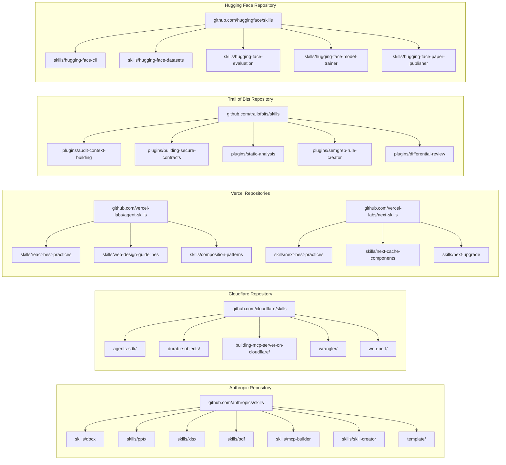
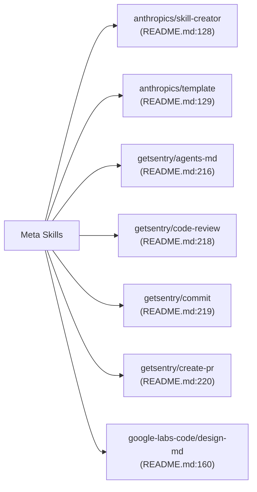
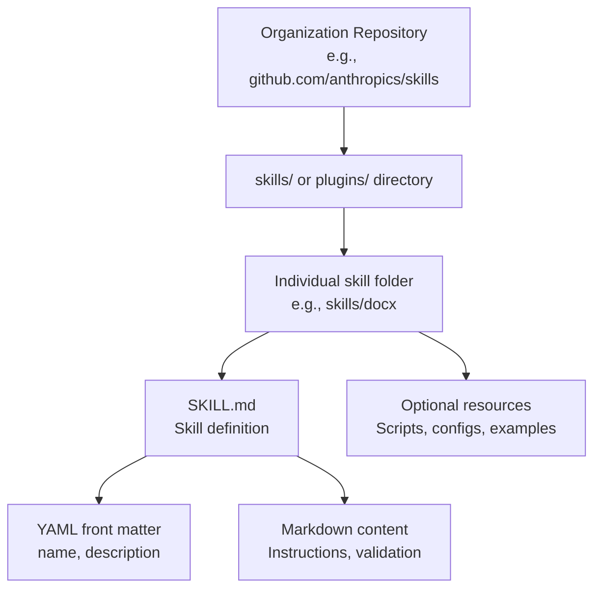

<!-- source: DeepWiki mcp.deepwiki.com · repo VoltAgent/awesome-agent-skills · page 4.1 Official Team Skills · fetched 2026-10-26 -->

# Official Team Skills

Relevant source files

The following files were used as context for generating this wiki page:

- [README.md](README.md)

This document covers the skills contributed by official development teams from major organizations and companies. These skills are platform-specific capabilities deeply integrated with their respective ecosystems, maintained by the teams that build the platforms themselves.

For community-contributed skills covering broader functional domains, see [Community Skills](#4.2). For the complete skill catalog navigation, see [Skill Catalog](#4).

## Overview

Official team skills represent capabilities published and maintained by 16 major organizations, totaling 89 skills across various domains. Unlike community skills which address cross-cutting concerns, official team skills focus on platform-specific implementations, best practices for proprietary technologies, and integration patterns for commercial services.

These skills are maintained in separate repositories by their respective teams and are listed in [README.md:97-261]().

**Sources:** [README.md:97-261]()

## Organizational Structure

The following diagram shows the hierarchical organization of official team skills and their relationships to skill repositories:

```mermaid
graph TB
    OfficialTeams["Official Team Skills<br/>(README.md:97-261)"]
    
    subgraph "Infrastructure & Platform"
        Anthropic["Anthropic<br/>15 skills<br/>(README.md:97-130)"]
        Cloudflare["Cloudflare<br/>7 skills<br/>(README.md:142-151)"]
        Vercel["Vercel Labs<br/>8 skills<br/>(README.md:131-141)"]
        Neon["Neon<br/>1 skill<br/>(README.md:234-237)"]
        Supabase["Supabase<br/>1 skill<br/>(README.md:152-155)"]
    end
    
    subgraph "Machine Learning"
        HuggingFace["Hugging Face<br/>8 skills<br/>(README.md:163-175)"]
        FalAI["fal.ai<br/>6 skills<br/>(README.md:242-250)"]
    end
    
    subgraph "Security"
        TrailOfBits["Trail of Bits<br/>22 skills<br/>(README.md:181-205)"]
    end
    
    subgraph "Developer Tools"
        Expo["Expo<br/>3 skills<br/>(README.md:206-213)"]
        Sentry["Sentry<br/>7 skills<br/>(README.md:214-223)"]
        GoogleLabs["Google Labs (Stitch)<br/>2 skills<br/>(README.md:156-162)"]
    end
    
    subgraph "Content & Media"
        Sanity["Sanity<br/>4 skills<br/>(README.md:251-257)"]
        Remotion["Remotion<br/>1 skill<br/>(README.md:258-261)"]
    end
    
    subgraph "Services & Auth"
        Stripe["Stripe<br/>2 skills<br/>(README.md:176-180)"]
        BetterAuth["Better Auth<br/>3 skills<br/>(README.md:224-229)"]
    end
    
    subgraph "Data & Analytics"
        Tinybird["Tinybird<br/>1 skill<br/>(README.md:230-233)"]
    end
    
    OfficialTeams --> Anthropic
    OfficialTeams --> Cloudflare
    OfficialTeams --> Vercel
    OfficialTeams --> HuggingFace
    OfficialTeams --> TrailOfBits
    OfficialTeams --> Expo
    OfficialTeams --> Sentry
    OfficialTeams --> Stripe
    OfficialTeams --> Neon
    OfficialTeams --> Supabase
    OfficialTeams --> GoogleLabs
    OfficialTeams --> BetterAuth
    OfficialTeams --> Tinybird
    OfficialTeams --> FalAI
    OfficialTeams --> Sanity
    OfficialTeams --> Remotion
    
    Anthropic --> AnthropicRepo["github.com/anthropics/skills"]
    Cloudflare --> CloudflareRepo["github.com/cloudflare/skills"]
    Vercel --> VercelRepo["github.com/vercel-labs/agent-skills<br/>github.com/vercel-labs/next-skills"]
    HuggingFace --> HFRepo["github.com/huggingface/skills"]
    TrailOfBits --> TOBRepo["github.com/trailofbits/skills"]
    Expo --> ExpoRepo["github.com/expo/skills"]
    Sentry --> SentryRepo["github.com/getsentry/skills"]
    Stripe --> StripeRepo["github.com/stripe/ai"]
```

**Sources:** [README.md:97-261]()

## Team Distribution by Domain

| Domain | Teams | Total Skills | Focus Areas |
|--------|-------|--------------|-------------|
| Infrastructure & Platform | Anthropic, Cloudflare, Vercel, Neon, Supabase | 32 | Document creation, edge computing, React/Next.js patterns, serverless Postgres |
| Machine Learning | Hugging Face, fal.ai | 14 | Model training, datasets, evaluation, image/video generation |
| Security | Trail of Bits | 22 | Security audits, static analysis, smart contracts, vulnerability detection |
| Developer Tools | Expo, Sentry, Google Labs | 12 | Mobile development, monitoring, workflow management |
| Content & Media | Sanity, Remotion | 5 | Content modeling, programmatic video creation |
| Services & Auth | Stripe, Better Auth | 5 | Payments integration, authentication setup |
| Data & Analytics | Tinybird | 1 | Real-time analytics pipelines |

**Sources:** [README.md:97-261]()

## Repository to Skill Mapping

The following diagram maps external skill repositories to their actual skill implementations, showing how skills are organized within each team's repository:

**Sources:** [README.md:101-175](), [README.md:181-205]()

## Skill Categories by Team

### Document and Content Creation

Teams focusing on document creation and manipulation provide skills for working with office formats and creative design:

| Team | Skills | Repository Path |
|------|--------|-----------------|
| Anthropic | `docx`, `pptx`, `xlsx`, `pdf`, `doc-coauthoring` | `github.com/anthropics/skills/tree/main/skills/` |
| Anthropic | `algorithmic-art`, `canvas-design`, `frontend-design`, `slack-gif-creator`, `theme-factory` | `github.com/anthropics/skills/tree/main/skills/` |

**Sources:** [README.md:99-114]()

### Platform Integration and Development

Teams providing platform-specific development tools and best practices:

| Team | Focus | Key Skills |
|------|-------|------------|
| Vercel Labs | React/Next.js | `react-best-practices`, `next-best-practices`, `next-cache-components` |
| Cloudflare | Edge computing | `agents-sdk`, `durable-objects`, `building-mcp-server-on-cloudflare` |
| Expo | Mobile development | `expo-app-design`, `expo-deployment`, `upgrading-expo` |
| Anthropic | MCP integration | `mcp-builder`, `web-artifacts-builder`, `webapp-testing` |

**Sources:** [README.md:115-141](), [README.md:142-151](), [README.md:206-213]()

### Machine Learning Workflows

| Team | Repository | Skill Count | Workflow Coverage |
|------|-----------|-------------|-------------------|
| Hugging Face | `github.com/huggingface/skills` | 8 | Model training, datasets, evaluation, jobs, paper publishing |
| fal.ai | `github.com/fal-ai-community/skills` | 6 | Image/video generation, audio processing, upscaling |

**Sources:** [README.md:163-175](), [README.md:242-250]()

### Security and Code Analysis

Trail of Bits maintains the largest single collection of official team skills (22 skills) focused entirely on security:

```mermaid
graph TB
    TOBSkills["Trail of Bits Security Skills<br/>(README.md:181-205)"]
    
    subgraph "Audit Workflows"
        auditcontext["audit-context-building<br/>Deep architectural analysis"]
        diffreview["differential-review<br/>Security-focused diff review"]
        fixreview["fix-review<br/>Verify fix commits"]
        speccode["spec-to-code-compliance<br/>Blockchain audit compliance"]
    end
    
    subgraph "Static Analysis"
        staticanalysis["static-analysis<br/>CodeQL, Semgrep, SARIF"]
        semgrepcreator["semgrep-rule-creator<br/>Create detection rules"]
        semgrepvariant["semgrep-rule-variant-creator<br/>Port rules to languages"]
        variantanalysis["variant-analysis<br/>Pattern-based vuln search"]
    end
    
    subgraph "Smart Contract Security"
        buildingsecure["building-secure-contracts<br/>6 blockchain scanners"]
        entrypoint["entry-point-analyzer<br/>State-changing entry points"]
    end
    
    subgraph "Vulnerability Detection"
        insecuredefaults["insecure-defaults<br/>Hardcoded secrets, weak crypto"]
        sharpedges["sharp-edges<br/>Error-prone APIs"]
        constanttime["constant-time-analysis<br/>Timing side-channels"]
        firebaseapk["firebase-apk-scanner<br/>APK misconfigurations"]
    end
    
    subgraph "Testing"
        propertybased["property-based-testing<br/>Multiple languages"]
        testinghandbook["testing-handbook-skills<br/>Fuzzers, sanitizers"]
    end
    
    TOBSkills --> auditcontext
    TOBSkills --> diffreview
    TOBSkills --> staticanalysis
    TOBSkills --> buildingsecure
    TOBSkills --> insecuredefaults
    TOBSkills --> propertybased
```

**Sources:** [README.md:181-205]()

## Platform-Specific Service Integration

Teams providing skills for their commercial platforms:

| Team | Platform | Skills | Integration Type |
|------|----------|--------|------------------|
| Stripe | Payment processing | `stripe-best-practices`, `upgrade-stripe` | API integration, SDK upgrades |
| Better Auth | Authentication | `best-practices`, `commands`, `create-auth` | Auth setup, CLI commands |
| Supabase | Serverless Postgres | `postgres-best-practices` | Database patterns |
| Neon | Serverless Postgres | `using-neon` | Database best practices |
| Tinybird | Real-time analytics | `tinybird-best-practices` | Datasources, pipes, SQL |
| Sanity | Content platform | `sanity-best-practices`, `content-modeling-best-practices`, `seo-aeo-best-practices` | CMS workflows, GROQ |

**Sources:** [README.md:152-155](), [README.md:176-180](), [README.md:224-237](), [README.md:251-257]()

## Meta Skills and Development Tools

Several teams provide meta-level skills for skill creation and development workflows:

**Sources:** [README.md:128-129](), [README.md:214-223](), [README.md:156-162]()

## Quality Characteristics

Official team skills exhibit distinct characteristics that differentiate them from community contributions:

| Characteristic | Description | Example Teams |
|----------------|-------------|---------------|
| **Platform Authority** | Published by platform creators with deep internal knowledge | Anthropic, Cloudflare, Vercel, Stripe |
| **Production-Grade** | Battle-tested in production environments | Trail of Bits (22 security skills in active audits), Sentry (internal dev team usage) |
| **Maintained Repositories** | Dedicated GitHub repositories with active maintenance | All 16 teams maintain separate skill repositories |
| **Platform Evolution** | Updated alongside platform changes | Vercel's `next-upgrade`, Stripe's `upgrade-stripe`, Expo's `upgrading-expo` |
| **Integration Depth** | Deep integration with platform internals | Cloudflare's `durable-objects`, Hugging Face's `hugging-face-cli` |
| **Domain Specialization** | Focused on specific platform ecosystems | fal.ai (AI models), Sanity (CMS), Remotion (video) |

**Sources:** [README.md:35](), [README.md:97-261]()

## Repository Architecture Pattern

All official team skills follow a consistent repository structure pattern:

**Example paths:**
- `github.com/anthropics/skills/tree/main/skills/docx`
- `github.com/cloudflare/skills/tree/main/agents-sdk`
- `github.com/trailofbits/skills/tree/main/plugins/static-analysis`
- `github.com/huggingface/skills/tree/main/skills/hugging-face-cli`

**Sources:** [README.md:44-74](), [README.md:97-261]()

## Cross-Reference to Detailed Documentation

For comprehensive documentation of each team's skill collection:

- Anthropic Skills: See [Anthropic Skills](#4.1.1)
- Vercel Skills: See [Vercel Skills](#4.1.2)
- Cloudflare Skills: See [Cloudflare Skills](#4.1.3)
- Hugging Face Skills: See [Hugging Face Skills](#4.1.4)
- Trail of Bits Security Skills: See [Trail of Bits Security Skills](#4.1.5)
- Other Team Skills (Expo, Sentry, Stripe, etc.): See [Other Team Skills](#4.1.6)

**Sources:** [README.md:97-261]()

---

